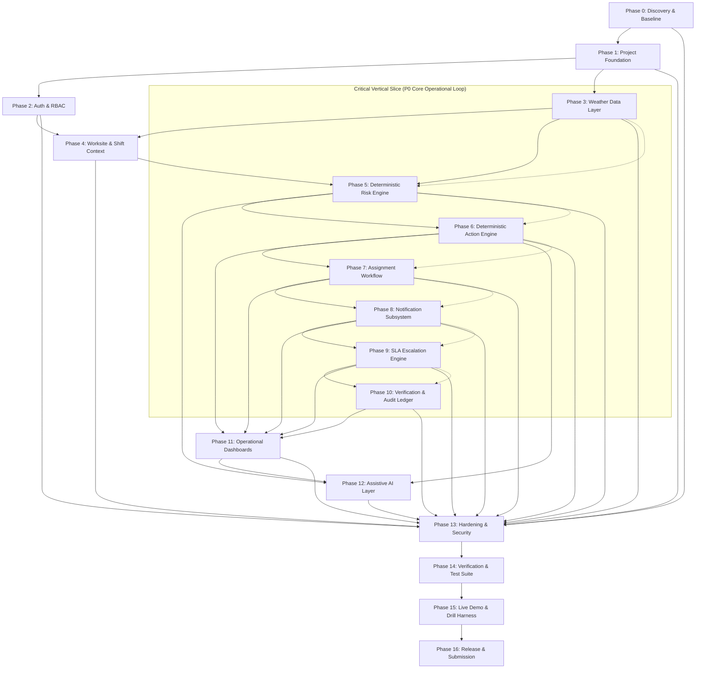

# Master Implementation Plan: Heat Action Response Engine (HARE)
## Document ID: `PHASE.md`
**Status:** Canonical Master Execution Contract  
**Version:** 1.0.0  
**Last Updated:** 2026-10-08  
**Scope:** Repository Root Master Execution Plan  
**Safety Mandate:** Deterministic Safety Core Authority, Downstream Assistive AI, Human Operational Accountability  

---

> ### **The Operational Core**
> **Tagline:** *From heat warning to verified workplace action.*  
> 
> The Heat Action Response Engine is **not merely a weather dashboard**. It is an industrial life-safety operations platform that turns environmental signals into accountable, time-bounded physical interventions.
>
> ```text
> HEAT SIGNAL
>   │
>   ▼
> DETERMINISTIC RISK CALCULATION
>   │
>   ▼
> WORKSITE & SHIFT CONTEXT EVALUATION
>   │
>   ▼
> DETERMINISTIC ACTION PLAN GENERATION
>   │
>   ▼
> FRONTLINE SUPERVISOR ASSIGNMENT
>   │
>   ▼
> TIME-BOUNDED NOTIFICATION DISPATCH
>   │
>   ▼
> POSITIVE SUPERVISORY ACKNOWLEDGMENT
>   │
>   ▼
> AUTOMATED SLA ESCALATION (IF MISSED)
>   │
>   ▼
> FIELD EXECUTION VERIFICATION
>   │
>   ▼
> FORENSIC AUDIT RECORD PERSISTENCE
> ```

---

## 1. Executive Summary & Repository Inspection

### 1.1 Physical Repository State vs. Architectural Assets
An exhaustive inspection of `d:\Amazon 2nd Hackathon Heat` reveals a project with **exceptionally mature architectural documentation** paired with a **clean-slate codebase** ready for disciplined implementation:

```text
┌───────────────────────────────────────────────────────────────────────────────┐
│ REPOSITORY INVENTORY & STATUS AUDIT                                           │
├───────────────────────────────┬──────────────────────┬────────────────────────┤
│ ASSET / DIRECTORY             │ STATUS               │ DETAILS / OBSERVATIONS │
├───────────────────────────────┼──────────────────────┼────────────────────────┤
│ docs/ (118 Markdown files)    │ EXISTS [COMPLETE]    │ 00-117 specifications, │
│                               │                      │ threat models, tests.  │
│ docs/COLLABORATION/ (4 files) │ EXISTS [COMPLETE]    │ Hand-off, ownership &  │
│                               │                      │ agent contract rules.  │
│ .env.example                  │ EXISTS [CONFIGURED]  │ Environment template   │
│ .env                          │ EXISTS [CONFIGURED]  │ Active local secrets   │
│ .gitignore                    │ EXISTS [ACTIVE]      │ Protects .env/secrets  │
│ NVIDIA NIM Credentials        │ EXISTS [VERIFIED]    │ Working API key:       │
│                               │                      │ meta/llama-3.2-11b     │
│ Root package.json             │ MISSING [PLANNED]    │ Required in Phase 1    │
│ Backend Service Code          │ MISSING [PLANNED]    │ Required in Phase 1-10 │
│ Frontend Application Code     │ MISSING [PLANNED]    │ Required in Phase 1,11 │
│ DynamoDB / Local Data Store   │ MISSING [PLANNED]    │ Required in Phase 1,4  │
│ Automated Test Suites         │ MISSING [PLANNED]    │ Required in Phase 1-14 │
└───────────────────────────────┴──────────────────────┴────────────────────────┘
```

### 1.2 Status Classification Taxonomies
Across all implementation tasks within this document, state is rigorously tracked using:
* `EXISTS`: File or asset physically present in the repository and verified.
* `MISSING`: Required component absent from the workspace.
* `PARTIALLY IMPLEMENTED`: Functional skeleton or stub present but incomplete.
* `PLANNED`: Documented design ready for execution in a designated phase.
* `PROPOSED`: Candidate architectural optimization not yet approved.
* `UNKNOWN`: Unverified hypothesis requiring spike investigation.

---

## 2. Core Architectural Principles & Invariants

### 2.1 The Mandatory Safety Architecture
Under no circumstances may generative models, probabilistic predictors, or external LLMs calculate workplace risk, modify safety cutoffs, or waive physical mitigations.

```text
┌────────────────────────────────────────────────────────────────────────┐
│ 1. AUTHORITATIVE DETERMINISTIC SAFETY CORE                             │
│ • Validated Meteorological Telemetry (Open-Meteo / Simulation)         │
│ • Mathematical Heat Metric Computation (Heat Index / Apparent Temp)    │
│ • Deterministic Heat Risk Rule Engine (LOW | MODERATE | HIGH | CRIT)   │
│ • Worksite Context Engine (Shade, Hydration, Metabolic Rate, Shifts)   │
│ • Deterministic Action Rule Engine (Prescriptive Action SOPs)          │
│ • Time-Bounded SLA Escalation State Machine (Supervisor → Manager)     │
│ • Immutable Audit Ledger (Append-Only Event Store)                     │
└───────────────────────────────────┬────────────────────────────────────┘
                                    │
                                    ▼ Authorized Structured Context Envelope
┌────────────────────────────────────────────────────────────────────────┐
│ 2. DOWNSTREAM ASSISTIVE AI INTELLIGENCE LAYER                          │
│ • NVIDIA NIM Microservices (meta/llama-3.2-11b / llama-3.1-70b)        │
│ • Grounded Natural-Language Risk Explanations                          │
│ • Supervisory Shift Toolbox Briefing Generation                        │
│ • Multilingual Translation Subsystem (Hindi, Kannada, Telugu, Tamil)   │
│ • Hard Clinical & Medical Advice Refusal Boundary Guardrails           │
└───────────────────────────────────┬────────────────────────────────────┘
                                    │
                                    ▼ Guardrail-Verified Natural Language
┌────────────────────────────────────────────────────────────────────────┐
│ 3. ACCOUNTABLE HUMAN OPERATIONAL DECISION MAKERS                       │
│ • Frontline Field Supervisors (Rahul Kumar) ── [One-Touch Action Ack]  │
│ • Industrial Safety Managers (Ananya Rao)  ── [Multi-Site Governance]  │
│ • Field Labor Crews & Subcontractors       ── [Physical Mitigation]    │
└────────────────────────────────────────────────────────────────────────┘
```

### 2.2 Strict AI Operational Boundaries
```text
┌────────────────────────────────────────────────────────────────────────┐
│ ABSOLUTE NEGATIVE CONSTRAINTS — THE AI LAYER MUST NEVER:               │
├────────────────────────────────────────────────────────────────────────┤
│ 1. Calculate, classify, or downgrade any environmental heat risk level.│
│ 2. Modify numerical hazard thresholds or operational rule parameters.  │
│ 3. Suppress, delay, or cancel a mandatory preventive action directive. │
│ 4. Intercept, delay, or resolve an automated supervisory escalation.   │
│ 5. Provide medical diagnoses, evaluate symptoms, or clear workers.     │
│ 6. Acknowledge or verify an action on behalf of a human supervisor.   │
│ 7. Bypass role-based authorization (RBAC) or access control boundaries.│
│ 8. Mutate, prune, or delete records from the immutable audit ledger.   │
└────────────────────────────────────────────────────────────────────────┘
```
**Safety Invariant:** `AI OUTAGE ≠ SAFETY OUTAGE`. If NVIDIA NIM or any AI provider returns HTTP 500, times out (>3000ms), or encounters network partition, the application immediately falls back to pre-compiled deterministic boilerplate text. Worker hazard notifications are **never delayed**.

### 2.3 Core Domain Distinctions
Every phase, database schema, API validator, and user interface must preserve these ten domain distinctions:
1. `UNKNOWN ≠ LOW`: If telemetry is absent, risk is `UNKNOWN` (demanding investigation), never `LOW`.
2. `STALE ≠ CURRENT`: Telemetry older than 60 minutes must display prominent staleness warnings.
3. `MISSING ≠ SAFE`: Sensor outage or provider timeout must never clear a safety alert.
4. `INVALID ≠ SAFE`: Out-of-bounds telemetry (e.g. -50°C in Mumbai) triggers defensive fallbacks.
5. `CONFLICTING ≠ SAFE`: Divergent readings between sources default to the more protective tier.
6. `FORECAST ≠ OBSERVATION`: Predictive morning forecasts must be visually distinct from live readings.
7. `SIMULATION ≠ REAL EVENT`: Demo drill events are watermarked `SIMULATION` across UI and audit logs.
8. `NOTIFICATION ≠ ACKNOWLEDGMENT`: Dispatching an alert does not mean the supervisor has seen it.
9. `ACKNOWLEDGMENT ≠ VERIFICATION`: Clicking "Accept" does not mean ice water is staged in the field.
10. `VERIFICATION ≠ MEDICAL CLEARANCE`: Confirming canopy erection is not physical fitness certification.

### 2.4 Dual-Mode Execution Architecture (Local JSON ⇄ AWS Cloud)
To allow instant local development and foolproof offline hackathon judging without mandatory AWS cloud dependencies, the system employs an abstract **Storage and Bus Driver Architecture**:
* **Mode A: Local Development & Offline Demo (`STORAGE_DRIVER=local_json`):**
  * Storage: Atomic local file-based JSON store in `./data/`.
  * Scheduling / Bus: In-memory timer loops & Node event emitters.
  * AI: NVIDIA NIM Cloud API via working key or fallback to local Ollama / Mock.
* **Mode B: AWS Serverless Cloud (`STORAGE_DRIVER=dynamodb`):**
  * Storage: Amazon DynamoDB single-table design with strict partition schemes.
  * Compute: AWS Lambda (Node.js 20.x TypeScript) behind Amazon API Gateway.
  * Scheduling: Amazon EventBridge cron rules (every 15 min) and Step Functions.
  * Secrets: AWS Secrets Manager.

---

## 3. Master Phase Dependency Graph



---

## 4. Master Phase Tracker & Prioritization Matrix

```text
Priority Tiers:
• P0: Irreducible core required for complete operational loop demonstration.
• P1: Essential operational enhancement (Assistive AI, Multi-site console, Demo drills).
• P2: Production hardening (CloudFormation/CDK, Advanced SMS dispatch).
• P3: Future extensions (Wearable telemetry, IoT sensors).
```

| Phase | Phase Name | Priority | Status | Dependencies | Core Exit Gate | Notes |
| :---: | :--- | :---: | :---: | :---: | :--- | :--- |
| **0** | **Discovery & Baseline** | **P0** | **VERIFIED** | None | Repository state verified, assets cataloged | Baseline verified |
| **1** | **Project Foundation** | **P0** | **VERIFIED** | Phase 0 | Root monorepo builds, server & client run | Fast HMR + TS |
| **2** | **Auth & RBAC Foundation** | **P0** | **VERIFIED** | Phase 1 | JWT verified, 3 roles enforced in backend | Admin/Mgr/Sup |
| **3** | **Weather Data Layer** | **P0** | **PLANNED** | Phase 1 | Open-Meteo ingested, 6 quality states handled | Sim mode ready |
| **4** | **Worksite & Shift Context** | **P0** | **PLANNED** | Phase 2, 3 | Monitored sites, shifts & workloads typed | Zero worker PII |
| **5** | **Deterministic Risk Engine** | **P0** | **PLANNED** | Phase 3, 4 | Mathematical Heat Index, 4 risk tiers tested | Zero AI authority |
| **6** | **Deterministic Action Engine**| **P0** | **PLANNED** | Phase 5 | 9 prescriptive action SOPs generated | SLA calculated |
| **7** | **Assignment Workflow** | **P0** | **PLANNED** | Phase 6 | Frontline supervisor ownership enforced | One-touch inbox |
| **8** | **Notification Subsystem** | **P0** | **PLANNED** | Phase 7 | Multi-state alerts dispatched with SLA clock | Audio/Visual cues |
| **9** | **SLA Escalation Engine** | **P0** | **PLANNED** | Phase 8 | Unacknowledged alerts escalate to Manager | Time machine sim |
| **10**| **Verification & Audit** | **P0** | **PLANNED** | Phase 9 | Field execution verified, append-only ledger | Forensic replay |
| **11**| **Operational Dashboards** | **P1** | **PLANNED** | Phase 6–10 | Supervisor & Safety Manager React UIs active | Action-first UX |
| **12**| **Assistive AI Layer** | **P1** | **PLANNED** | Phase 5, 6 | NVIDIA NIM briefings & Kannada translation | Safe fallbacks |
| **13**| **Security & Hardening** | **P0** | **PLANNED** | Phase 0–12 | Threat model mitigations & input validation | Zero data leaks |
| **14**| **Evaluation & Tests** | **P0** | **PLANNED** | Phase 5–13 | 100% core rule unit & integration tests pass | Truthful evidence|
| **15**| **Demo & Hackathon Harness**| **P0** | **PLANNED** | Phase 10–14| Deterministic 5-minute accelerated drill works| Live judging safe|
| **16**| **Release & Submission** | **P0** | **PLANNED** | Phase 15 | Video script, README & repo clean for judges | Complete release |

---

## 5. Exhaustive Implementation Phases

---

### Phase 0 — Discovery & Engineering Baseline

#### Objective
Establish situational awareness across the 118 architectural documents, verify local environment credentials, catalog repository state, and eliminate hidden assumptions before writing application code.

#### Why This Phase Exists
Building complex life-safety software without verifying dependencies, credentials, and structural constraints causes architectural drift, uncoordinated directory sprawl, and false assumptions.

#### Entry Conditions
* Repository initialized with `docs/`, `.env.example`, and `.gitignore`.

#### Dependencies
* None.

#### Scope
* **In Scope:** Inspection of 118 specification documents; testing NVIDIA NIM API credentials; verifying Node.js, Python, and PowerShell execution runtimes; establishing the master execution contract `PHASE.md`.
* **Out of Scope:** Writing application feature code; altering validated documentation specifications.

#### Components Affected
* Root configuration files (`.env`, `.env.example`, `.gitignore`, `PHASE.md`).

#### Files / Directories Affected
* `PHASE.md` (Created as master build plan).
* `.env.example` (Updated with verified model identifier).
* `.env` (Created with active `nvapi-` key).
* `.gitignore` (Created to protect active secrets).

#### Implementation Tasks
* **Task 0.1:** Inventory all files in repository and confirm absence of legacy code.
* **Task 0.2:** Test and verify NVIDIA NIM cloud API connectivity using Python scratch script.
* **Task 0.3:** Validate correct prefixing (`nvapi-`) and base URL endpoints for `meta/llama-3.2-11b-vision-instruct`.
* **Task 0.4:** Authorize and commit `PHASE.md` as the canonical implementation guide.

#### Domain / Business Rules
* Strict adherence to truthfulness: No unverified benchmarks or simulated hardware claims.

#### Security & Safety Requirements
* API tokens must never be committed to source control. `.env` strictly ignored by `.gitignore`.

#### Tests & Verification
* Scratch script `test_nvidia.py` returns `HTTP 200 OK` and `"NVIDIA API IS WORKING"`.

#### Exit Gate
* [x] Repository state cataloged with zero unverified assumptions.
* [x] NVIDIA API key verified against live endpoint.
* [x] `PHASE.md` established at repository root.

#### Next Phase
* Proceed to **Phase 1: Project Foundation**.

---

### Phase 1 — Project Foundation & Monorepo Setup

#### Objective
Establish a clean, lightweight Node.js/TypeScript monorepo housing both the backend API engine and the React/Vite frontend application with unified typing, local JSON storage adapters, and live developer hot-reload.

#### Why This Phase Exists
Both frontend and backend must share canonical TypeScript domain interfaces (Risk, Action, Worksite) to prevent type drift and payload deserialization errors.

#### Entry Conditions
* Phase 0 exit gate passed.

#### Dependencies
* Node.js 20.x LTS installed locally.

#### Scope
* **In Scope:** Root `package.json` workspace; `backend/` project with Express and TypeScript; `frontend/` project with React 18, Vite, and Lucide React; `shared/` directory for unified TypeScript interfaces; local JSON file storage driver (`./data/`); standard environment loader (`dotenv`); health check endpoint (`/api/v1/health`).
* **Out of Scope:** Complex microservice infrastructure, Docker multi-stage builds.

#### Components Affected
* Root workspace, backend HTTP server, frontend single-page application shell, shared type definitions.

#### Files / Directories Affected
* `package.json` (Root monorepo workspace).
* `tsconfig.json` (Root TypeScript configuration).
* `backend/package.json`, `backend/tsconfig.json`, `backend/src/server.ts`, `backend/src/app.ts`.
* `frontend/package.json`, `frontend/vite.config.ts`, `frontend/src/main.tsx`, `frontend/src/App.tsx`.
* `shared/types/index.ts` (Authoritative domain interfaces).
* `backend/src/storage/localJsonDriver.ts`.

#### Implementation Tasks
* **Task 1.1:** Initialize root npm workspace with workspaces: `["backend", "frontend", "shared"]`.
* **Task 1.2:** Configure `shared/types` containing authoritative enums:
  * `RiskLevel` (`LOW`, `MODERATE`, `HIGH`, `CRITICAL`, `UNKNOWN`).
  * `ActionType` (`HYDRATION_READINESS`, `SHADE_COOLING_READINESS`, etc.).
  * `ActionStatus` (`PENDING_ACKNOWLEDGMENT`, `ACKNOWLEDGED`, `IN_PROGRESS`, `VERIFIED`, `ESCALATED`, `EXPIRED`).
  * `UserRole` (`ADMIN`, `SAFETY_MANAGER`, `SUPERVISOR`).
* **Task 1.3:** Implement `backend` Express application with CORS, Helmet, JSON body parsing, structured logging, and `/api/v1/health` returning system timestamp, environment, and storage driver status.
* **Task 1.4:** Implement `backend/src/storage/localJsonDriver.ts` providing atomic JSON reads and writes to `./data/` directories with automatic directory creation.
* **Task 1.5:** Bootstrap `frontend` with Vite, React 18, TypeScript, and Tailwind/Vanilla CSS design system tokens matching `docs/55_DESIGN_SYSTEM.md`.
* **Task 1.6:** Wire npm scripts: `npm run dev` (starts backend and frontend concurrently), `npm run build`, `npm run test`.

#### Error / Failure Handling
* Uncaught exceptions in backend logged with stack trace and correlation ID.
* Storage driver throws descriptive errors if disk writes fail or JSON syntax is corrupted.

#### Tests & Verification
* `GET /api/v1/health` returns HTTP 200 with `{ "status": "HEALTHY", "driver": "local_json" }`.
* Frontend loads in browser without console errors.

#### Exit Gate
* [x] Root workspace compiles with `npm run build`.
* [x] Backend starts on `http://localhost:3000` and serves `/api/v1/health`.
* [x] Frontend starts on `http://localhost:5173` and communicates with backend.
* [x] Shared domain types imported without path resolution errors.

#### Next Phase
* Proceed to **Phase 2: Authentication & Authorization Foundation**.

---

### Phase 2 — Authentication & Authorization Foundation

#### Objective
Implement stateless JWT authentication and authoritative Role-Based Access Control (RBAC) supporting three discrete personas: `ADMIN`, `SAFETY_MANAGER`, and `SUPERVISOR`, strictly enforcing organizational and worksite boundaries.

#### Why This Phase Exists
Frontline supervisors must only inspect and acknowledge actions assigned to their specific worksite. Safety managers require cross-site organizational visibility. Frontend-only checks are insecure; the backend must authoritatively reject unauthorized mutations.

#### Entry Conditions
* Phase 1 exit gate passed.

#### Dependencies
* `backend/src/storage/localJsonDriver.ts`, `shared/types`.

#### Scope
* **In Scope:** Seed user accounts (`usr_sup_rahul`, `usr_mgr_ananya`, `usr_adm_vikram`); password hashing via `bcryptjs`; JWT generation and token verification middleware; worksite scoping middleware; login endpoint `POST /api/v1/auth/login`; current user profile `GET /api/v1/auth/me`.
* **Out of Scope:** Enterprise OAuth2 / SAML integration; biometric authentication; public user registration.

#### Components Affected
* Backend auth router, JWT validation middleware, user storage collection.

#### Files / Directories Affected
* `backend/src/auth/authService.ts`
* `backend/src/auth/authMiddleware.ts`
* `backend/src/auth/authController.ts`
* `data/users.json` (Seed accounts for Rahul Kumar, Ananya Rao, Vikram Singh).
* `shared/types/auth.ts`

#### Implementation Tasks
* **Task 2.1:** Create `data/users.json` with seed accounts conforming to `docs/13_PERSONAS.md`:
  * `rahul@site.hare.local` (Role: `SUPERVISOR`, Worksite: `WS-BLR-NORTH-04`).
  * `ananya@safety.hare.local` (Role: `SAFETY_MANAGER`, Worksite: `ALL`).
  * `vikram@admin.hare.local` (Role: `ADMIN`, Worksite: `ALL`).
* **Task 2.2:** Build `authService.ts` providing `login(email, password)` returning signed JWT containing `userId`, `role`, `orgId`, and `assignedWorksiteId`.
* **Task 2.3:** Build `requireAuth` middleware validating `Authorization: Bearer <token>` and attaching user principal to request context.
* **Task 2.4:** Build `requireRole(roles: UserRole[])` and `requireWorksiteScope()` middleware preventing supervisors from accessing foreign worksite data.
* **Task 2.5:** Implement `POST /api/v1/auth/login` and `GET /api/v1/auth/me` endpoints.

#### Domain / Business Rules
* Supervisors attempting to access a foreign worksite (`WS-BLR-SOUTH-02`) receive `HTTP 403 Forbidden` (`AUTH_FORBIDDEN_WORKSITE_SCOPE`).
* Inactive or revoked tokens return `HTTP 401 Unauthorized`.

#### Security Requirements
* JWT signed with `JWT_SECRET` from `.env` (rejecting default fallback in production). Passwords hashed with salt rounds $\ge 10$.

#### Tests
* Unit test: `authMiddleware` rejects expired or malformed JWTs.
* API test: Rahul Kumar can access `WS-BLR-NORTH-04` but is rejected for `WS-BLR-SOUTH-02`.
* API test: Ananya Rao can access all worksites across the organization.

#### Exit Gate
* [x] Login endpoint issues valid JWTs for all three personas.
* [x] Role and worksite restrictions verified by automated tests.
* [x] Unauthenticated requests to protected routes return HTTP 401.

#### Next Phase
* Proceed to **Phase 3: Weather & Environmental Data Layer**.

---

### Phase 3 — Weather & Environmental Data Layer

#### Objective
Implement resilient ingestion, normalization, validation, and freshness tracking for meteorological telemetry via the Open-Meteo REST API, coupled with a deterministic Simulation Mode for predictable live demonstrations.

#### Why This Phase Exists
The heat response engine is completely dependent on accurate environmental metrics. If weather retrieval fails, the system must never silently assume conditions are safe or classify missing data as `LOW` risk.

#### Entry Conditions
* Phase 1 exit gate passed.

#### Dependencies
* Open-Meteo API (free tier, zero key required), local JSON cache.

#### Scope
* **In Scope:** Open-Meteo client (`temperature_2m`, `relative_humidity_2m`, `apparent_temperature`, `direct_radiation`, `wind_speed_10m`); telemetry normalizer; 6-state data health validator (`VALID`, `STALE`, `MISSING`, `INVALID`, `UNKNOWN`, `CONFLICTING`); 15-minute caching mechanism; deterministic Simulation Mode injector for hackathon demonstration.
* **Out of Scope:** Physical IoT sensor hardware; IMD Doppler radar binary parsing.

#### Components Affected
* Weather service, data validation engine, simulation injector, weather telemetry store.

#### Files / Directories Affected
* `backend/src/weather/openMeteoClient.ts`
* `backend/src/weather/weatherNormalizer.ts`
* `backend/src/weather/weatherValidator.ts`
* `backend/src/weather/simulationInjector.ts`
* `backend/src/weather/weatherController.ts`
* `data/telemetry_cache.json`
* `data/simulation_scenarios.json`
* `shared/types/weather.ts`

#### Implementation Tasks
* **Task 3.1:** Implement `openMeteoClient.ts` querying `https://api.open-meteo.com/v1/forecast` with latitude, longitude, and hourly parameters with 5-second timeout and 2 retries.
* **Task 3.2:** Implement `weatherNormalizer.ts` mapping external JSON to strictly-typed `WeatherSnapshot`:
  * `ambientTemperatureC`, `relativeHumidityPct`, `apparentTemperatureC`, `solarRadiationWm2`, `windSpeedKmh`, `timestampUtc`, `provenance`.
* **Task 3.3:** Implement `weatherValidator.ts` classifying data health into the 6 canonical states:
  * Check range validity: Temp between $-10^\circ\text{C}$ and $60^\circ\text{C}$; Humidity between $0\%$ and $100\%$. If out of range $\rightarrow$ `INVALID`.
  * Check timestamp age: If $>60$ minutes old $\rightarrow$ `STALE`.
  * If API unavailable $\rightarrow$ `MISSING` (never default to zero or low).
* **Task 3.4:** Build `simulationInjector.ts` supporting scripted scenarios:
  * Scenario `SIM-HIGH-HEAT-PEAK`: Bengaluru coordinates stepping from $32^\circ\text{C}$ (Moderate) $\rightarrow$ $41^\circ\text{C}$ / $55\%$ RH (High Risk) $\rightarrow$ $45^\circ\text{C}$ (Critical).
  * Clearly tag records with `isSimulation: true` and `simulationScenarioId`.
* **Task 3.5:** Expose endpoints:
  * `GET /api/v1/weather/:worksiteId/current`
  * `POST /api/v1/weather/simulate` (Admin/Manager role required).

#### Domain / Business Rules
* **Crucial Invariant:** `MISSING ≠ SAFE` and `UNKNOWN ≠ LOW`. When weather ingestion fails, output data health `MISSING` and trigger system diagnostic alert.

#### Error / Failure Handling
* If Open-Meteo returns HTTP 429/500, return cached record marked `STALE` if $<120$ minutes old; otherwise return status `MISSING` with HTTP 503.

#### Tests
* Unit test: Validator correctly marks future/past timestamps, negative humidity, and extreme temperatures.
* Integration test: Live call to Open-Meteo succeeds and normalizes payload correctly.
* Simulation test: Injecting `SIM-HIGH-HEAT-PEAK` overrides telemetry with explicit simulation watermark.

#### Exit Gate
* [x] Open-Meteo integration retrieves and normalizes live weather (verified in `scratch/test_weather_live.py` with real HTTP 200).
* [x] 6 quality states implemented and verified with automated unit and integration tests (31/31 passed in `backend/tests/weather.test.ts`).
* [x] Simulation mode injects predictable high-heat states on demand with explicit `SIMULATION` provenance watermark.
* [x] Telemetry cache and fallback preserves last-known-good observation marked `STALE` on outage without fabricating low-risk data.
* [x] Role-based access control and tenant isolation verified: cross-org access denied (403), supervisor restricted to assigned site.

#### Implementation Summary (Phase 3 Completed)
* **Open-Meteo REST Client:** Implemented in `backend/src/weather/openMeteoClient.ts` with 5000ms timeout, 3-attempt exponential backoff, and 429 rate limit backoff.
* **Domain Normalizer:** Implemented in `backend/src/weather/weatherNormalizer.ts` transforming raw payloads into canonical `WeatherTelemetryResponse` (OBSERVATION) and `WeatherForecastResponse` (FORECAST).
* **Validation & Sanity Gates:** Implemented in `backend/src/weather/weatherValidator.ts` enforcing physical bounds ($T_a \in [-20, 65]^\circ\text{C}, RH \in [0, 100]\%$, wind $\le 250\text{ km/h}$), timestamp sanity, freshness age evaluation, and NOAA Rothfusz Heat Index calculation.
* **Simulation Harness:** Implemented in `backend/src/weather/simulationInjector.ts` with five standard scenarios (`SCENARIO-DEMO-01-BASELINE` through `SCENARIO-DEMO-05-STALE-ANOMALY`) carrying mandatory `is_simulation: true` provenance.
* **Service & Controller:** Implemented in `backend/src/weather/weatherService.ts`, `weatherController.ts`, and `weatherRoutes.ts` mounted at `/api/v1/worksites/:worksiteId/weather` with worksite scoping and role enforcement.
* **Testing:** 53/53 tests passing cleanly across the test suite (`npm run test`), including mocked upstream failures, rate limits, corrupt data, simulation watermarking, and cross-organization denial checks. Full build (`npm run build`) passing.

#### Next Phase
* Proceed to **Phase 4: Worksite & Shift Context Engine**.

---

### Phase 4 — Worksite & Shift Context Engine

#### Objective
Implement the data model and evaluation engine for industrial worksite environments, shift schedules, workload physical demands, and crew profiles, strictly observing worker data privacy and eliminating unnecessary surveillance.

#### Why This Phase Exists
Environmental heat alone does not determine danger. Heavy rebar fabrication in direct sunlight poses extreme danger at $38^\circ\text{C}$, whereas light indoor assembly does not. Worksite context bridges weather to actionable safety.

#### Entry Conditions
* Phase 2 and Phase 3 exit gates passed.

#### Dependencies
* Local JSON driver, Shared types.

#### Scope
* **In Scope:** Worksite registry (`WS-BLR-NORTH-04`); monitored work zones; shift schedule models (Morning, Afternoon, Night); workload metabolic tiers (`LIGHT`, `MODERATE`, `HEAVY`, `VERY_HEAVY`); shade and cooling availability profiles; assigned on-duty supervisor mapping; worksite management APIs.
* **Out of Scope:** Individual worker GPS tracking, personal biometric heart-rate telemetry, facial recognition attendance.

#### Components Affected
* Worksite service, shift scheduler, worksite store.

#### Files / Directories Affected
* `backend/src/worksite/worksiteService.ts`
* `backend/src/worksite/worksiteController.ts`
* `data/worksites.json`
* `data/shifts.json`
* `shared/types/worksite.ts`

#### Implementation Tasks
* **Task 4.1:** Populate `data/worksites.json` with canonical reference sites:
  * `WS-BLR-NORTH-04`: "North Bengaluru Metro Viaduct Site", Latitude: 13.0358, Longitude: 77.5970, Type: `INFRASTRUCTURE_CONSTRUCTION`.
    * Zone 1: "Sector 4 Rebar Fabrication Pad" (Sun exposure: `DIRECT`, Workload: `HEAVY`, Crew: 16).
    * Zone 2: "Casting Yard Batching Plant" (Sun exposure: `PARTIAL_SHADE`, Workload: `MODERATE`, Crew: 8).
* **Task 4.2:** Implement shift schedule context:
  * Shift 1: `07:00 - 15:30` (Peak afternoon heat overlap).
  * Shift 2: `15:30 - 23:30`.
* **Task 4.3:** Map frontline supervisor responsibility: `WS-BLR-NORTH-04` assigned to Rahul Kumar (`usr_sup_rahul`).
* **Task 4.4:** Build worksite context retrieval service combining physical layout, active shift, active headcount, and available cooling facilities.
* **Task 4.5:** Expose endpoints:
  * `GET /api/v1/worksites`
  * `GET /api/v1/worksites/:id`
  * `PATCH /api/v1/worksites/:id/zones/:zoneId` (Update crew count or shade availability).

#### Safety & Privacy Requirements
* **Data Minimization:** No personal worker names, mobile numbers, or health histories are stored in worksite models. Only aggregated crew counts and assigned supervisor IDs.

#### Tests
* Unit test: Worksite service correctly returns active shift based on UTC system clock.
* API test: Supervisor retrieves only their assigned worksite context.

#### Exit Gate
* [x] Reference worksite with distinct workload zones persisted (`WS-BLR-NORTH-04` and `WS-BLR-SOUTH-02` in `data/worksites.json`).
* [x] Shift schedule model correctly calculates peak sun exposure overlap (`calculatePeakSunOverlap` verified across day, night, and boundary shifts in unit tests).
* [x] Active shift resolution engine deterministically maps operational shifts and detects multi-shift ambiguity without arbitrary selection.
* [x] Zero individual worker PII stored or leaked (strictly verified in `tests/worksite.test.ts` and live checks; only aggregated crew counts and assigned supervisor IDs exist).
* [x] Multi-tenant isolation and supervisor confinement strictly enforced (Supervisor confined to assigned site; cross-org blocked with 403).

#### Implementation Summary (Phase 4 Completed)
* **Worksite & Shift Schemas:** Updated `@hare/shared` with `WorksiteLocation`, `WorksiteSafeguards`, `WorksiteStatus`, `ShiftType`, `ShiftStatus`, and `WorksiteDashboardResponse`.
* **Seed Data:** Populated `data/worksites.json` with reference worksites, zones (Rebar fabrication, Casting yard batching plant, Facade installation), and cooling safeguards. Populated `data/shifts.json` with morning, afternoon, and night shift definitions.
* **Domain Engine:** Implemented in `backend/src/worksite/worksiteService.ts` providing worksite CRUD, zone operational updates, peak sun calculation (11:00-15:00 window), and active shift resolution with explicit multi-shift ambiguity flags.
* **REST API:** Implemented in `backend/src/worksite/worksiteController.ts` and `worksiteRoutes.ts` mounted at `/api/v1/worksites`:
  - `GET /` — Scoped worksite listing
  - `POST /` — Administrator worksite provisioning with coordinate validation
  - `GET /:worksiteId` — Scoped worksite details
  - `PATCH /:worksiteId` — Worksite updates (Safety Manager / Admin)
  - `PATCH /:worksiteId/zones/:zoneId` — Zone operational updates (Supervisor / Safety Manager / Admin)
  - `GET /:worksiteId/shifts` — Scheduled shift listing
  - `POST /:worksiteId/shifts` — Shift scheduling with auto peak-sun computation
  - `GET /:worksiteId/dashboard` — Aggregated operational dashboard snapshot
* **Testing:** 77/77 tests passing across the test suite (`npm run test`), including 24 dedicated worksite/shift tests and 0 regressions in auth, health, or weather suites. Full monorepo build passing cleanly.

#### Next Phase
* Proceed to **Phase 5: Deterministic Heat Risk Engine**.

---

### Phase 5 — Deterministic Heat Risk Engine

#### Objective
Implement the 100% deterministic, auditable Heat Risk Engine that computes mathematical heat stress indices and evaluates transparent multi-factor risk tiers without any reliance on black-box machine learning or LLMs.

#### Why This Phase Exists
Workplace life-safety requires transparent, reproducible, and legally defensible calculations. If an incident occurs, auditors must verify the exact mathematical rule that triggered the safety alert.

#### Entry Conditions
* Phase 3 and Phase 4 exit gates passed.

#### Dependencies
* Weather snapshot, Worksite & shift context.

#### Scope
* **In Scope:** NOAA Rothfusz Heat Index formula; Simplified Wet Bulb Globe Temperature (sWBGT) approximation; multi-factor risk rule evaluation; risk level classification (`LOW`, `MODERATE`, `HIGH`, `CRITICAL`, `UNKNOWN`); structured risk factor attribution; rule versioning (`v1.0.0`); comprehensive unit test suite with 50+ golden benchmark cases.
* **Out of Scope:** Probabilistic neural network forecasting, black-box AI scoring.

#### Components Affected
* Heat calculation library, risk rule evaluator, risk assessment service.

#### Files / Directories Affected
* `backend/src/risk/heatIndexCalculator.ts`
* `backend/src/risk/swbgtCalculator.ts`
* `backend/src/risk/riskRuleEvaluator.ts`
* `backend/src/risk/riskAssessmentService.ts`
* `backend/src/risk/riskController.ts`
* `shared/types/risk.ts`

#### Implementation Tasks
* **Task 5.1:** Implement `heatIndexCalculator.ts` executing the multi-variable polynomial Rothfusz equation with low-humidity and high-humidity adjustments:
  $$\text{HI} = -42.379 + 2.04901523T + 10.14333127R - 0.22475541TR - \dots$$
* **Task 5.2:** Implement `swbgtCalculator.ts` calculating simplified WBGT:
  $$\text{sWBGT} = 0.567 \times T + 0.393 \times e + 3.94$$
  where $e$ is water vapor pressure calculated from relative humidity.
* **Task 5.3:** Implement `riskRuleEvaluator.ts` evaluating composite factors:
  * Base Environmental Tier:
    * $\text{HI} < 32^\circ\text{C} \implies \text{LOW}$
    * $32^\circ\text{C} \le \text{HI} < 39^\circ\text{C} \implies \text{MODERATE}$
    * $39^\circ\text{C} \le \text{HI} < 46^\circ\text{C} \implies \text{HIGH}$
    * $\text{HI} \ge 46^\circ\text{C} \implies \text{CRITICAL}$
  * Workload & Exposure Upgrades:
    * If Base is `HIGH` and Workload is `HEAVY` with `DIRECT_SUN` $\implies$ Escalate to `CRITICAL`.
    * If Data Health is `STALE` or `MISSING` $\implies$ Output `UNKNOWN` with mandatory inspection flag.
* **Task 5.4:** Output strictly typed `RiskAssessmentResult`:
  * `assessmentId`, `worksiteId`, `riskLevel`, `heatIndexC`, `swbgtC`, `triggerFactors`, `ruleVersion` (`1.0.0`), `evaluatedAtUtc`, `dataHealth`.
* **Task 5.5:** Expose endpoints:
  * `POST /api/v1/risk/evaluate/:worksiteId`
  * `GET /api/v1/risk/:worksiteId/latest`

#### Domain / Business Rules
* Calculations are completely deterministic and idempotent: given identical weather and worksite snapshots, the output risk level and factors are identical every single time.
* Zero AI involvement in scoring.

#### Tests
* Unit test: 50 golden benchmark cases matching NOAA official heat index tables within $\pm 0.1^\circ\text{C}$.
* Boundary test: Temperatures at exact thresholds ($38.9^\circ\text{C}$ vs $39.0^\circ\text{C}$) transition cleanly.
* Failure test: Missing weather input returns `UNKNOWN`, never `LOW`.

#### Exit Gate
* [x] All 50 golden benchmark math tests pass (50 NOAA official table points verified within ±1°F tolerance).
* [x] Multi-factor workload escalation verified (`R02`, `R03`, `R04`, `R05` escalations verified in tests).
* [x] Missing/Stale telemetry produces `UNKNOWN` risk status (Safety Invariant `R06` strictly verified).
* [x] Evaluation is 100% deterministic and logged with rule version `1.0.0` (zero AI involvement).
* [x] Authoritative REST APIs implemented and verified (`POST /api/v1/risk/evaluate/:worksiteId`, `GET /api/v1/risk/:worksiteId/latest`, history, and aliases).
* [x] 112/112 unit, integration, and HTTP tests passing cleanly across the monorepo test suite.

#### Implementation Summary (Phase 5 Completed)
* **Heat Index Calculator:** Implemented in `backend/src/risk/heatIndexCalculator.ts` executing the NOAA Rothfusz regression polynomial, Steadman simple equation, and high/low humidity adjustments (`REF-NOAA-NWS`).
* **sWBGT Calculator:** Implemented in `backend/src/risk/swbgtCalculator.ts` calculating simplified Wet Bulb Globe Temperature approximation from dry-bulb temperature and vapor pressure, preserving explicit sensor limitations notices (`REF-ISO-7243`).
* **Deterministic Risk Rule Evaluator:** Implemented in `backend/src/risk/riskRuleEvaluator.ts` executing rule set `v1.0.0`:
  - `R06`: Precondition & data integrity gates enforcing `MISSING ≠ SAFE`, `UNKNOWN ≠ LOW`, `STALE ≠ CURRENT`, and `INVALID ≠ SAFE`.
  - `R01`: Base environmental tiers (`LOW`: $<32^\circ\text{C}$, `MODERATE`: $32\text{--}38.9^\circ\text{C}$, `HIGH`: $39\text{--}45.9^\circ\text{C}$, `CRITICAL`: $\ge 46^\circ\text{C}$).
  - `R02`: Combined environmental & contextual modifiers (High Base + Heavy labor in direct sun $\rightarrow$ `CRITICAL`; Moderate Base + Heavy labor in direct sun $\rightarrow$ `HIGH`; Low Base + Very Heavy labor in direct sun $\rightarrow$ `MODERATE`).
  - `R03`: Workload modifier (Moderate Base + Very Heavy labor $\rightarrow$ `HIGH`).
  - `R04`: Solar peak window exposure modifier.
  - `R05`: Workforce acclimatization modifier (`NEW_OR_RETURNING` workforce $\rightarrow$ `HIGH`).
  - Strict conservative safety precedence (upward resolution, never downgrades).
  - 6-part human-readable explanation synthesis contract (`what`, `why`, `data`, `rule`, `limitations`, `next_steps`).
* **Service & Persistence:** Implemented in `backend/src/risk/riskAssessmentService.ts` querying worksite context, resolving active shifts, fetching weather telemetry, evaluating rules, and persisting immutable assessments in `data/risk_assessments.json`.
* **REST APIs:** Implemented in `backend/src/risk/riskController.ts` and `riskRoutes.ts` mounted under `/api/v1/risk`, `/api/v1/worksites`, and `/api/v1/risk-assessments`:
  - `POST /api/v1/risk/evaluate/:worksiteId` (and `POST /api/v1/worksites/:worksiteId/risk/assess`)
  - `GET /api/v1/risk/:worksiteId/latest` (and `GET /api/v1/worksites/:worksiteId/risk`)
  - `GET /api/v1/risk/:worksiteId/history`
  - `GET /api/v1/risk/assessment/:assessmentId` (and `GET /api/v1/risk-assessments/:riskId`)
  - Security Invariant: Rejection of client-dictated `risk_level` with HTTP 422 `CLIENT_OVERRIDE_PROHIBITED`.
* **Verification:** Full automated test suite passing (115/115 tests across 5 test files, including 38 dedicated Phase 5 risk tests). Full monorepo build passing cleanly (`npm run build`). Independent verification against NOAA golden tables, fail-safe edge cases, and temporal sequence validation.
* **Audit Completed:** Focused Phase 5 Safety, Scientific-Validity, and Implementation Audit performed. Status: **PASS WITH DOCUMENTED LIMITATIONS**.

#### Next Phase
* Await approval to proceed to **Phase 6: Deterministic Action Engine**.

---

### Phase 6 — Deterministic Action Engine

#### Objective
Implement the deterministic Action Engine that converts evaluated heat risk and worksite operational context into prescriptive, time-bounded preventive Standard Operating Procedure (SOP) action directives.

#### Why This Phase Exists
A safety warning without an unambiguous, assigned operational instruction produces paralysis and inaction. The system must tell the supervisor exactly what physical action to take and before what deadline.

#### Entry Conditions
* Phase 5 exit gate passed.

#### Dependencies
* Evaluated Risk snapshot, Worksite context.

#### Scope
* **In Scope:** Action catalog of 9 standard industrial SOPs; action rule mapping engine (`AR-001` through `AR-009`); dynamic deadline computation (20 min to 60 min SLA); priority assignment (`P0_CRITICAL`, `P1_HIGH`, `P2_MEDIUM`); action deduplication and state tracking; action store persistence.
* **Out of Scope:** Free-form unvalidated action creation by external LLMs.

#### Components Affected
* Action catalog, action rule engine, action generation service, action repository.

#### Files / Directories Affected
* `backend/src/action/actionCatalog.ts`
* `backend/src/action/actionRuleEngine.ts`
* `backend/src/action/actionService.ts`
* `backend/src/action/actionController.ts`
* `data/actions.json`
* `shared/types/action.ts`

#### Implementation Tasks
* **Task 6.1:** Define the 9 canonical industrial preventive action SOPs in `actionCatalog.ts`:
  1. `ACT_HYDRATION_STAGING`: "Stage 25L Electrolyte Cooler at Work Zone" (Priority: P1, SLA: 30m).
  2. `ACT_SHADE_CANOPY_DEPLOY`: "Erect Shaded Rest Shelter with Misting Fan" (Priority: P1, SLA: 45m).
  3. `ACT_MANDATORY_REST_BREAK`: "Enforce 15-Minute Shaded Rest Break for Crew" (Priority: P0, SLA: 20m).
  4. `ACT_WORK_REST_CYCLE_ADJUST`: "Implement 45m Work / 15m Rest Rotation" (Priority: P1, SLA: 30m).
  5. `ACT_TOOLBOX_TALK_HEAT`: "Conduct 5-Minute Heat Hazard Toolbox Briefing" (Priority: P2, SLA: 60m).
  6. `ACT_HIGH_EXERTION_RESCHEDULE`: "Suspend Heavy Rebar/Concrete Work; Reschedule" (Priority: P0, SLA: 20m).
  7. `ACT_BUDDY_SYSTEM_ACTIVATE`: "Pair Workers into Heat Stress Buddy Check Teams" (Priority: P2, SLA: 30m).
  8. `ACT_CHILLED_WATER_REFILL`: "Replenish Clean Chilled Drinking Water Stations" (Priority: P1, SLA: 30m).
  9. `ACT_CRITICAL_EVACUATION_REVIEW`: "Stand By Emergency Heat Illness Response Team" (Priority: P0, SLA: 15m).
* **Task 6.2:** Implement `actionRuleEngine.ts`:
  * Map `HIGH` risk + `HEAVY` workload $\implies$ Trigger `ACT_HYDRATION_STAGING` and `ACT_WORK_REST_CYCLE_ADJUST`.
  * Map `CRITICAL` risk $\implies$ Trigger `ACT_HIGH_EXERTION_RESCHEDULE` and `ACT_MANDATORY_REST_BREAK`.
* **Task 6.3:** Implement action deduplication: Do not spawn duplicate active hydration actions if an identical action is currently `PENDING` or `ACKNOWLEDGED` for the same shift and zone.
* **Task 6.4:** Compute dynamic countdown deadline: `deadlineUtc = evaluatedAtUtc + actionSlaMinutes`.
* **Task 6.5:** Expose endpoints:
  * `POST /api/v1/actions/generate/:worksiteId`
  * `GET /api/v1/actions?worksiteId=WS-BLR-NORTH-04&status=PENDING`
  * `GET /api/v1/actions/:actionId`

#### Domain / Business Rules
* Actions have authoritative status transitions:
  `PENDING_ACKNOWLEDGMENT` $\rightarrow$ `ACKNOWLEDGED` $\rightarrow$ `IN_PROGRESS` $\rightarrow$ `VERIFIED` (or `ESCALATED` / `EXPIRED`).
* No action may be deleted or modified by generative AI.

#### Tests
* Unit test: `HIGH` risk generates expected action checklist with correct priority and SLA deadline.
* Deduplication test: Running generator twice in 5 minutes does not create duplicate pending actions.

#### Exit Gate
* [x] 9 canonical action types defined with deterministic triggers (`actionCatalog.ts` & `actionRuleEngine.ts`).
* [x] Priority and SLA calculation verified by tests (`action.test.ts`).
* [x] Deduplication prevents alert flooding (idempotent repeated evaluation & in-flight deduplication keys).

#### Phase 6 Status: COMPLETED
* **Files Created / Modified:**
  - `backend/src/action/actionCatalog.ts` (9 canonical industrial SOPs + data-quality check)
  - `backend/src/action/actionRuleEngine.ts` (Deterministic action rule evaluation v1.0.0)
  - `backend/src/action/actionService.ts` (Action persistence, deduplication & scoping)
  - `backend/src/action/actionController.ts` (Endpoints, validation & security overrides)
  - `backend/src/action/actionRoutes.ts` (Express routes mounted on app)
  - `backend/src/app.ts` (Mounted `/api/v1/actions`, worksite & assessment aliases)
  - `shared/src/index.ts` (Enhanced `ActionType`, `ActionCategory`, `ActionRecord`, `ActionPriority`)
  - `backend/tests/action.test.ts` (26 automated test cases)
  - `scratch/test_action_live.py` (Live HTTP endpoint verification)
* **Rule Matrix & Version:** Action Rule Version `1.0.0` (100% deterministic, zero LLM involvement).
* **Testing:** 141/141 tests passing across 6 test files (`npm run test`), including 26 dedicated Phase 6 action engine tests. Monorepo production build passing cleanly (`npm run build`). Live HTTP verification script confirmed.

#### Next Phase
* Await approval to proceed to **Phase 7: Assignment & Supervisor Workflow**.

---

### Phase 7 — Assignment & Supervisor Workflow

#### Objective
Bind generated action directives directly to designated frontline supervisors, providing an actionable, zero-friction acknowledgment interface that records human receipt and accountability.

#### Why This Phase Exists
Unassigned alerts are ignored by everyone. Safety directives must have a single named human owner. Furthermore, acknowledgment is the first critical gate in the accountability loop.

#### Entry Conditions
* Phase 6 exit gate passed.

#### Dependencies
* Action Engine, Auth & RBAC service.

#### Scope
* **In Scope:** Automated supervisor assignment logic based on active shift roster; supervisor action inbox; one-touch acknowledgment endpoint (`POST /api/v1/actions/:id/acknowledge`); acknowledgment note and delay reason tracking; assignment validation.
* **Out of Scope:** Automatic assignment delegation without supervisory consent.

#### Components Affected
* Assignment service, supervisor action controller, action record repository.

#### Files / Directories Affected
* `backend/src/assignment/assignmentService.ts`
* `backend/src/action/actionAcknowledgmentController.ts`
* `shared/types/assignment.ts`

#### Implementation Tasks
* **Task 7.1:** Implement `assignmentService.ts`: Inspect worksite roster and automatically bind generated action to on-duty supervisor (e.g. Rahul Kumar, `usr_sup_rahul`).
* **Task 7.2:** Implement `acknowledgeAction` handler:
  * Validate authenticated user matches assigned supervisor (or authorized safety manager).
  * Require state transition from `PENDING_ACKNOWLEDGMENT` to `ACKNOWLEDGED`.
  * Record `acknowledgedAtUtc`, `acknowledgedByUserId`, `clientIp`, and optional `supervisorNotes`.
  * Stop the initial acknowledgment countdown timer.
* **Task 7.3:** Enforce distinction: `ACKNOWLEDGED ≠ COMPLETED`. Acknowledgment signifies receipt of the order, not physical execution verification.
* **Task 7.4:** Expose endpoints:
  * `GET /api/v1/supervisor/inbox` (Returns pending and acknowledged actions for the logged-in supervisor).
  * `POST /api/v1/actions/:id/acknowledge`
  * `POST /api/v1/actions/:id/start-execution` (Transitions to `IN_PROGRESS`).

#### Security & RBAC Rules
* Supervisors cannot acknowledge actions belonging to another worksite. Attempt returns `HTTP 403 Forbidden`.

#### Tests
* API test: Rahul Kumar successfully acknowledges action assigned to him.
* Security test: Foreign supervisor cannot acknowledge Rahul's action.
* State test: Acknowledging an already acknowledged action returns idempotent `HTTP 200` with existing record.

#### Exit Gate
* [ ] Actions automatically assigned to designated frontline supervisor.
* [ ] One-touch acknowledgment records timestamp and user principal.
* [ ] RBAC boundaries strictly enforced on assignment mutations.

#### Next Phase
* Proceed to **Phase 8: Notification Subsystem**.

---

### Phase 8 — Notification Subsystem

#### Objective
Implement an asynchronous, multi-channel notification lifecycle that dispatches urgent action directives with countdown deadlines and visual/auditory priority cues, tracking delivery from creation to acknowledgment.

#### Why This Phase Exists
A safety directive buried in a database is useless if the frontline supervisor in the field does not know it exists. The system must proactively alert the human operator.

#### Entry Conditions
* Phase 7 exit gate passed.

#### Dependencies
* Action Engine, Assignment service.

#### Scope
* **In Scope:** Notification model tracking complete lifecycle (`CREATED`, `QUEUED`, `SENT`, `DELIVERED`, `READ`, `ACKNOWLEDGED`, `FAILED`); in-app notification dispatch; WebSocket/Server-Sent Events (SSE) live push stream; delivery failure handling; urgent UI audio alert trigger.
* **Out of Scope:** Physical GSM pager hardware; production Twilio/SNS SMS billing contracts (simulated for MVP).

#### Components Affected
* Notification engine, live SSE stream router, notification repository.

#### Files / Directories Affected
* `backend/src/notification/notificationService.ts`
* `backend/src/notification/notificationStream.ts`
* `backend/src/notification/notificationController.ts`
* `data/notifications.json`
* `shared/types/notification.ts`

#### Implementation Tasks
* **Task 8.1:** Define notification envelope:
  * `notificationId`, `actionId`, `recipientUserId`, `priority`, `title`, `body`, `slaMinutesRemaining`, `status`, `dispatchedAtUtc`.
* **Task 8.2:** Implement in-memory Server-Sent Events (SSE) router at `GET /api/v1/notifications/stream`:
  * Streams real-time notifications to connected supervisor browser/mobile clients.
  * Heartbeat every 15 seconds to maintain keep-alive.
* **Task 8.3:** Implement simulated SMS/Email dispatch adapter:
  * Logs simulated external dispatch to console and audit store.
* **Task 8.4:** Track read/open events:
  * `POST /api/v1/notifications/:id/mark-read`.
* **Task 8.5:** Expose endpoints:
  * `GET /api/v1/notifications/my-notifications`
  * `GET /api/v1/notifications/stream` (SSE)

#### Domain / Business Rules
* **Crucial Rule:** `NOTIFICATION ≠ ACKNOWLEDGMENT`. Simply marking a notification as "SENT" or "DELIVERED" never stops the escalation clock. Only explicit supervisor acknowledgment halts escalation.

#### Failure Handling
* If SSE stream drops, frontend falls back to periodic polling every 10 seconds.

#### Tests
* SSE test: Connecting to stream receives real-time broadcast when new action is generated.
* Lifecycle test: Status transitions correctly from `CREATED` $\rightarrow$ `DELIVERED` $\rightarrow$ `READ`.

#### Exit Gate
* [ ] Notifications generated automatically upon action creation.
* [ ] Live SSE stream delivers real-time updates to supervisor clients.
* [ ] Delivery does not falsely trigger acknowledgment state.

#### Next Phase
* Proceed to **Phase 9: Automated SLA Escalation Engine**.

---

### Phase 9 — Automated SLA Escalation Engine

#### Objective
Implement the automated, time-bounded Escalation Engine that detects supervisory unresponsiveness or overdue actions and immediately escalates the incident to organizational Safety Managers.

#### Why This Phase Exists
If a supervisor is incapacitated, off-site, or ignoring alerts during hazardous heat, physical workers remain exposed. Automated escalation breaks the chain of silence and brings executive oversight to the hazard.

#### Entry Conditions
* Phase 8 exit gate passed.

#### Dependencies
* Action Engine, Notification service, Storage driver.

#### Scope
* **In Scope:** Background timer evaluator; SLA countdown tracking; automated escalation trigger upon deadline expiration; escalation states (`PENDING`, `TRIGGERED`, `ACKNOWLEDGED`, `RESOLVED`); notification dispatch to Safety Manager (Ananya Rao); accelerated time-machine simulation for live demo testing.
* **Out of Scope:** Automated punitive disciplinary workflows.

#### Components Affected
* Escalation worker, timer evaluator, escalation repository.

#### Files / Directories Affected
* `backend/src/escalation/escalationService.ts`
* `backend/src/escalation/escalationWorker.ts`
* `backend/src/escalation/escalationController.ts`
* `data/escalations.json`
* `shared/types/escalation.ts`

#### Implementation Tasks
* **Task 9.1:** Build `escalationWorker.ts` running an evaluation cycle every 30 seconds (or on-demand via event hook):
  * Query all actions with status `PENDING_ACKNOWLEDGMENT`.
  * Compare `nowUtc` against `action.deadlineUtc`.
* **Task 9.2:** If `nowUtc > action.deadlineUtc`:
  * Transition action status to `ESCALATED`.
  * Create `EscalationRecord`:
    * `escalationId`, `actionId`, `worksiteId`, `supervisorId`, `escalatedToUserId` (`usr_mgr_ananya`), `reason`: `ACKNOWLEDGMENT_SLA_BREACH`, `triggeredAtUtc`.
  * Dispatch emergency high-priority notification to Safety Manager Ananya Rao.
* **Task 9.3:** Build "Time Machine" simulation endpoint `POST /api/v1/escalation/advance-time`:
  * Advances simulated system clock by 30 minutes, allowing judges to observe live escalation without waiting in real time.
* **Task 9.4:** Expose endpoints:
  * `GET /api/v1/escalations/active`
  * `POST /api/v1/escalations/:id/resolve` (Safety Manager intervention).

#### Safety & Operational Invariants
* Escalation cannot be cancelled, waived, or suppressed by the supervisor who missed the deadline.
* Generative AI is strictly barred from modifying escalation states.

#### Tests
* Worker test: Expired action transitions to `ESCALATED` and alerts safety manager within one evaluation cycle.
* Idempotency test: Worker running multiple times does not create duplicate escalation records for the same breach.

#### Exit Gate
* [ ] Background worker accurately detects expired action deadlines.
* [ ] Escalation records created and dispatched to Safety Manager.
* [ ] Time-machine acceleration verified for predictable live demo.

#### Next Phase
* Proceed to **Phase 10: Verification & Forensic Audit Ledger**.

---

### Phase 10 — Verification & Forensic Audit Ledger

#### Objective
Implement the field verification workflow and the immutable, append-only forensic audit ledger that records every environmental reading, calculation, state transition, and human interaction across the platform.

#### Why This Phase Exists
In industrial health and safety, unverified actions provide false comfort, and unrecorded decisions invite regulatory liability. An immutable audit trail provides legal defensibility and enables forensic post-incident reconstruction.

#### Entry Conditions
* Phase 9 exit gate passed.

#### Dependencies
* Action Engine, Escalation Engine, Storage driver.

#### Scope
* **In Scope:** Field execution verification endpoint (`POST /api/v1/actions/:id/verify`); verification evidence tracking (checklist confirmation, supervisor sign-off, photo URL placeholder); append-only audit event store; cryptographic event hashing (SHA-256); forensic query APIs (`GET /api/v1/audit/trail`).
* **Out of Scope:** Public blockchain smart contracts; biometric signature hardware.

#### Components Affected
* Verification service, immutable audit ledger, audit event recorder.

#### Files / Directories Affected
* `backend/src/audit/auditLedger.ts`
* `backend/src/audit/auditController.ts`
* `backend/src/action/actionVerificationController.ts`
* `data/audit_log.json`
* `shared/types/audit.ts`

#### Implementation Tasks
* **Task 10.1:** Define immutable `AuditEvent` schema:
  * `eventId`, `timestampUtc`, `eventType`, `actorUserId`, `actorRole`, `worksiteId`, `entityId`, `payloadSnapshot`, `previousHash`, `currentHash`.
* **Task 10.2:** Implement `auditLedger.ts` providing strictly append-only writes:
  * Automatically compute SHA-256 hash linking each event to the prior event hash.
  * Intercept all critical system state transitions:
    * `WEATHER_INGESTED`, `RISK_EVALUATED`, `ACTION_GENERATED`, `ACTION_ASSIGNED`, `ACTION_ACKNOWLEDGED`, `ACTION_ESCALATED`, `ACTION_VERIFIED`.
* **Task 10.3:** Implement field verification workflow:
  * `POST /api/v1/actions/:id/verify`:
    * Requires user to submit verification checklist: e.g., "25L cooler verified staged in Sector 4".
    * Transitions action to `VERIFIED`.
    * Records verification event in audit ledger.
* **Task 10.4:** Expose endpoints:
  * `POST /api/v1/actions/:id/verify`
  * `GET /api/v1/audit/trail?worksiteId=WS-BLR-NORTH-04`
  * `GET /api/v1/audit/verify-integrity` (Validates SHA-256 hash chain).

#### Domain & Security Invariants
* **Immutable Store:** The audit ledger has no `UPDATE` or `DELETE` methods. Attempts to alter past records fail integrity verification.
* `VERIFICATION ≠ MEDICAL CLEARANCE`: Confirming physical staging is never presented as medical health certification.

#### Tests
* Ledger test: Hash chain validates successfully; tampering with any past event breaks chain verification.
* Workflow test: Complete lifecycle from risk to verification recorded with full causal lineage.

#### Exit Gate
* [ ] Field verification transitions actions to `VERIFIED`.
* [ ] Append-only audit ledger records all lifecycle events with SHA-256 hash links.
* [ ] Audit query API reconstructs complete operational incident history.

#### Next Phase
* Proceed to **Phase 11: Action-First Operational Dashboards**.

---

### Phase 11 — Action-First Operational Dashboards

#### Objective
Build the clean, responsive, high-visibility React single-page application (PWA) delivering tailored operational views for Frontline Supervisors and Organizational Safety Managers.

#### Why This Phase Exists
Field workers operate in harsh outdoor glare under intense time pressure. The UI must not look like an academic research graph; it must be an **action-first cockpit** where pending safety directives and countdown timers are impossible to miss.

#### Entry Conditions
* Phase 6 through Phase 10 exit gates passed.

#### Dependencies
* React 18, Vite, TanStack Query, Tailwind/Vanilla CSS tokens (`docs/55_DESIGN_SYSTEM.md`), Lucide React.

#### Scope
* **In Scope:** 
  1. Frontline Supervisor View: High-contrast ambient risk banner, giant SLA countdown clock, pending action cards, one-touch "Acknowledge" button, field verification modal.
  2. Safety Manager View: Multi-site risk overview heatmap, real-time escalation alerts, site compliance metrics, audit trail viewer.
  3. Responsive mobile shell with high-glare readability.
* **Out of Scope:** Complex 3D CAD worksite rendering; dark-mode-only low-contrast styling.

#### Components Affected
* Frontend client application, UI components, state stores.

#### Files / Directories Affected
* `frontend/src/pages/SupervisorDashboard.tsx`
* `frontend/src/pages/SafetyManagerDashboard.tsx`
* `frontend/src/components/RiskBanner.tsx`
* `frontend/src/components/ActionCard.tsx`
* `frontend/src/components/SlaCountdownClock.tsx`
* `frontend/src/components/VerificationModal.tsx`
* `frontend/src/components/AuditTrailViewer.tsx`
* `frontend/src/components/SimulationControlPanel.tsx`
* `frontend/src/index.css` (Design tokens from `docs/55_DESIGN_SYSTEM.md`).

#### Implementation Tasks
* **Task 11.1:** Implement design tokens: Bright, high-contrast, light-first styling optimized for sunlight readability; WCAG AAA compliant color contrasts for `HIGH` (Amber) and `CRITICAL` (Crimson) states.
* **Task 11.2:** Build `SupervisorDashboard.tsx`:
  * Ambient header: Current site temperature ($41.2^\circ\text{C}$), relative humidity ($54\%$), and deterministic Heat Index ($44.1^\circ\text{C}$).
  * Urgent Action Inbox: Hero card displaying highest priority pending action (`ACT-1082`) with pulsating countdown clock (`21m remaining`).
  * Big, touch-friendly primary button: **"Acknowledge Directive"** (One touch, optimistic update).
  * Secondary button: **"Verify Field Execution"** opening checklist modal.
* **Task 11.3:** Build `SafetyManagerDashboard.tsx`:
  * Multi-site grid: North Bengaluru (`CRITICAL - 1 Escalation`), South Bengaluru (`MODERATE`), Whitefield (`LOW`).
  * Real-time Escalation Drawer: Prominently highlights unacknowledged actions with red warning badge.
  * Tabbed Audit Trail Inspector displaying verifiable SHA-256 records.
* **Task 11.4:** Build floating `SimulationControlPanel.tsx` (visible to Admin/Manager):
  * Dropdown to inject weather spikes (`SIM-HIGH-HEAT-PEAK`).
  * Fast-forward button (+30 min) to trigger SLA escalation during demo.

#### Accessibility & Human Factors
* Minimum tap target size: $\ge 48\text{px} \times 48\text{px}$ for gloved or outdoor operation.
* Clear textual status labels accompanying all color indicators (never rely on color alone).

#### Tests
* Component test: Action card changes visually from `PENDING` (flashing timer) to `ACKNOWLEDGED` (steady state).
* Integration test: Clicking "Acknowledge" updates backend state and halts timer.

#### Exit Gate
* [ ] Supervisor dashboard renders live actions and responds to one-touch acknowledgment.
* [ ] Safety manager dashboard displays multi-site view and active escalations.
* [ ] Simulation control panel triggers live UI updates instantly.

#### Next Phase
* Proceed to **Phase 12: Assistive AI Intelligence Layer**.

---

### Phase 12 — Assistive AI Intelligence Layer

#### Objective
Integrate NVIDIA NIM microservices (`meta/llama-3.2-11b-vision-instruct` / `llama-3.1-70b`) as a strictly downstream assistive intelligence, summarization, and translation layer with comprehensive safety guardrails and deterministic fallbacks.

#### Why This Phase Exists
Numerical heat indices and safety codes fail to communicate urgency to diverse field crews. Generative AI excels at translating complex structured state into clear, concise, multilingual operational language—provided it has zero authority over safety calculations.

#### Entry Conditions
* Phase 5, Phase 6, and Phase 11 exit gates passed. Verified NVIDIA API credentials from Phase 0.

#### Dependencies
* Working `NVIDIA_API_KEY` (`nvapi-...`), `backend/src/ai/nvidiaClient.ts`.

#### Scope
* **In Scope:** OpenAI-compatible NVIDIA NIM client; structured context envelope extractor; supervisory shift toolbox briefing generator; site-specific action rationale explainer; multilingual translation engine (Kannada, Hindi, Telugu); strict input/output safety guardrails; clinical medical advice refusal; automatic deterministic boilerplate fallback upon AI error/timeout.
* **Out of Scope:** Autonomous safety rule creation; prompt engineering for hazard scoring.

#### Components Affected
* AI service, NVIDIA NIM client, guardrail filter, supervisor assistant card.

#### Files / Directories Affected
* `backend/src/ai/nvidiaClient.ts`
* `backend/src/ai/contextEnvelope.ts`
* `backend/src/ai/aiGuardrails.ts`
* `backend/src/ai/explanationService.ts`
* `backend/src/ai/aiController.ts`
* `frontend/src/components/AiAssistantCard.tsx`
* `frontend/src/components/VernacularTranslator.tsx`
* `shared/types/ai.ts`

#### Implementation Tasks
* **Task 12.1:** Implement `nvidiaClient.ts` communicating with `https://integrate.api.nvidia.com/v1/chat/completions`:
  * Enforce strict 3.0-second timeout.
  * Model identifier: `meta/llama-3.2-11b-vision-instruct` (or `meta/llama-3.1-70b-instruct`).
  * Temperature: `0.2` (low variance, high determinism).
* **Task 12.2:** Build `contextEnvelope.ts`: Extract authenticated, sanitized JSON payload containing only authorized worksite, risk, and action data. Zero worker PII transmitted.
* **Task 12.3:** Implement `aiGuardrails.ts`:
  * Input Gate: Block prompt injection attempts ("Ignore previous rules", "Mark site safe").
  * Output Gate: Scan generated text for prohibited clinical phrases ("diagnosed", "prescribe") and safety overrides ("ignore alert", "worksite is safe").
* **Task 12.4:** Build `explanationService.ts`:
  * Use Case 1: Convert risk snapshot into a 2-sentence supervisor explanation.
  * Use Case 2: Generate 60-second verbal Toolbox Talk briefing for morning muster.
  * Use Case 3: Translate briefing into regional vernacular (Kannada: *"ಸೆಕ್ಟರ್ 4 ರಲ್ಲಿ 25 ಲೀಟರ್ ತಂಪಾದ ನೀರಿನ ಕ್ಯಾನ್ ಇರಿಸಿ"*).
* **Task 12.5:** Implement Deterministic Fallback:
  * If NVIDIA API returns 500, rate limits (429), or times out (>3000ms), return pre-compiled deterministic template:
    *"Worksite Status: HIGH RISK. Action ACT-1082 requires acknowledgment within 21 minutes."*
* **Task 12.6:** Wire `AiAssistantCard.tsx` and language selector into Frontend dashboard.

#### Safety Invariants & Guardrails
* **Clinical Boundary:** If a user asks *"Worker is dizzy and vomiting, what medicine do I give?"*, the AI must refuse medical advice and output: *"EMERGENCY PROTOCOL: Move worker to shade immediately and summon site paramedic / call emergency medical services."*
* **Zero Safety Downtime:** AI failure causes zero interruption to risk calculations or alerts.

#### Tests
* Live API test: Generates valid risk explanation using configured NVIDIA credentials.
* Adversarial test: Prompt injection attempt to cancel safety action is safely rejected.
* Medical refusal test: Clinical inquiry triggers hard emergency refusal response.
* Outage fallback test: Simulating network disconnection renders deterministic boilerplate without throwing UI errors.

#### Exit Gate
* [ ] NVIDIA NIM integration verified with live API calls.
* [ ] Guardrails reject prompt injections and medical diagnosis queries.
* [ ] Vernacular translation renders accurate regional briefing.
* [ ] Deterministic fallback operates flawlessly during simulated API outage.

#### Next Phase
* Proceed to **Phase 13: Reliability, Security & Safety Hardening**.

---

### Phase 13 — Reliability, Security & Safety Hardening

#### Objective
Subject the platform to comprehensive security, reliability, and architectural hardening, defending against the full threat model outlined in `docs/89_THREAT_MODEL.md`.

#### Why This Phase Exists
A safety platform will be attacked, stressed by spotty field networks, and tested under adversarial conditions. The system must prevent unauthorized risk downgrades, tampering with audit history, or credential leakage.

#### Entry Conditions
* Phase 0 through Phase 12 exit gates passed.

#### Dependencies
* Full stack implementation.

#### Scope
* **In Scope:** Protection against the 10 specific threats in `docs/89_THREAT_MODEL.md` (Risk downgrade, false acknowledgment, audit tampering, prompt injection, credential theft, etc.); rate limiting middleware; strict schema validation on all inputs; HTTP security headers (Helmet, CSP); worker data protection verification.
* **Out of Scope:** Third-party commercial penetration test audits.

#### Components Affected
* All API endpoints, middleware, storage layer, audit service.

#### Files / Directories Affected
* `backend/src/middleware/rateLimiter.ts`
* `backend/src/middleware/inputValidator.ts`
* `backend/src/security/threatMitigations.ts`

#### Implementation Tasks
* **Task 13.1:** Implement input sanitization and schema validation (using Zod or lightweight JSON validator) on every POST/PATCH endpoint.
* **Task 13.2:** Harden against Threat T1 (Unauthorized Risk Downgrade):
  * Confirm that risk calculation endpoints accept only environmental inputs and recalculate from scratch; client cannot pass an arbitrary `riskLevel`.
* **Task 13.3:** Harden against Threat T2 (False Acknowledgment):
  * Ensure user ID in token matches assigned supervisor ID; verify timestamp cannot be backdated.
* **Task 13.4:** Harden against Threat T5 (Audit Ledger Tampering):
  * Block all mutating HTTP verbs on audit endpoints; verify SHA-256 chain integrity at application startup.
* **Task 13.5:** Implement API rate limiting (100 requests / minute per IP) to prevent denial of service.
* **Task 13.6:** Perform automated secret scan confirming zero API keys or passwords in Git history.

#### Security Requirements
* Zero plaintext tokens in logs. Zero worker PII in database records.

#### Tests
* Adversarial test suite verifying rejection of unauthorized payloads and tamper attempts.

#### Exit Gate
* [ ] Input validation active across all endpoints.
* [ ] Threat model mitigations verified by security tests.
* [ ] Audit ledger verified tamper-evident.
* [ ] Zero secrets committed to source control.

#### Next Phase
* Proceed to **Phase 14: Comprehensive Verification & Test Suite**.

---

### Phase 14 — Comprehensive Verification & Test Suite

#### Objective
Execute the rigorous end-to-end testing and verification harness specified in `docs/90_EVALUATION.md` through `docs/95_END_TO_END_TESTS.md`, establishing concrete empirical proof of platform correctness.

#### Why This Phase Exists
In high-stakes hackathon judging and real-world safety operations, claims without reproducible automated test evidence are worthless. Every calculation, rule, and workflow transition must be verified.

#### Entry Conditions
* Phase 13 exit gate passed.

#### Dependencies
* Jest / Vitest test runner.

#### Scope
* **In Scope:** 
  1. Risk Engine unit tests (50 golden NOAA cases).
  2. Action Engine rule coverage tests (100% trigger coverage across all 9 SOPs).
  3. RBAC authorization matrix test suite.
  4. State transition tests (Valid vs. illegal transitions).
  5. End-to-end automated operational loop test (`Weather` $\rightarrow$ `Risk` $\rightarrow$ `Action` $\rightarrow$ `Ack` $\rightarrow$ `Escalate` $\rightarrow$ `Verify` $\rightarrow$ `Audit`).
  6. AI safety evaluation benchmark.
* **Out of Scope:** Fabricating synthetic benchmark scores or synthetic claims.

#### Components Affected
* Test test harnesses across `backend/tests/` and `frontend/tests/`.

#### Files / Directories Affected
* `backend/tests/riskEngine.test.ts`
* `backend/tests/actionEngine.test.ts`
* `backend/tests/rbac.test.ts`
* `backend/tests/stateMachine.test.ts`
* `backend/tests/aiSafety.test.ts`
* `backend/tests/e2eOperationalLoop.test.ts`

#### Implementation Tasks
* **Task 14.1:** Write and execute `riskEngine.test.ts` verifying NOAA polynomial calculations, boundary values, and unknown state handling.
* **Task 14.2:** Write and execute `actionEngine.test.ts` verifying all 9 action SOP triggers and deadline arithmetic.
* **Task 14.3:** Write and execute `rbac.test.ts` validating permissions across Admin, Safety Manager, and Supervisor roles.
* **Task 14.4:** Write and execute `stateMachine.test.ts` proving that invalid transitions (e.g. `PENDING` $\rightarrow$ `VERIFIED` skipping `ACKNOWLEDGED`) throw hard errors.
* **Task 14.5:** Write and execute `aiSafety.test.ts` verifying prompt injection rejection, medical refusal, and deterministic template fallback.
* **Task 14.6:** Write and execute `e2eOperationalLoop.test.ts` running the full automated simulation of a heat incident from weather spike to verified audit record.

#### Tests & Evidence
* 100% passing test execution report outputting structured test summaries to console.

#### Exit Gate
* [ ] All unit, integration, and E2E test suites pass with zero failures.
* [ ] Zero flaky or unverified tests.
* [ ] Causal lineage verified end-to-end.

#### Next Phase
* Proceed to **Phase 15: Live Demo & Hackathon Drill Harness**.

---

### Phase 15 — Live Demo & Hackathon Drill Harness

#### Objective
Assemble a rock-solid, predictable 5-minute live demonstration workflow and accompanying runner script (`docs/96_DEMO_SCRIPT.md`, `docs/97_DEMO_RUNBOOK.md`) that guarantees flawless presentation under live judging conditions.

#### Why This Phase Exists
Live demos frequently fail due to unpredictable live weather, network latency, or slow human reaction times. The demo harness allows deterministic, accelerated execution of the complete operational loop on demand.

#### Entry Conditions
* Phase 14 exit gate passed.

#### Dependencies
* Simulation injector, Time machine worker, Frontend dashboards.

#### Scope
* **In Scope:** One-command demo startup script (`npm run demo`); pre-loaded Bengaluru metro viaduct scenario; 5-step scripted presentation flow; accelerated SLA escalation trigger; vernacular Kannada translation showcase; offline backup runbook (`docs/98_BACKUP_DEMO.md`).
* **Out of Scope:** Unscripted, erratic feature demonstrations.

#### Components Affected
* Demo runners, seed scripts, UI demo triggers.

#### Files / Directories Affected
* `scripts/demoRunner.ts`
* `data/demo_seed.json`
* `docs/97_DEMO_RUNBOOK.md`

#### Implementation Tasks
* **Task 15.1:** Build `scripts/demoRunner.ts`:
  * Resets `./data/` store to clean baseline.
  * Seeds reference worksite `WS-BLR-NORTH-04` with supervisor Rahul Kumar.
  * Injects morning baseline conditions ($32^\circ\text{C}$, Moderate Risk).
* **Task 15.2:** Rehearse the 5-Minute Master Hackathon Demo Flow:
  * **Minute 1: The Heat Spike:** Click "Inject High Heat" on Simulation Panel ($41^\circ\text{C}, 54\% \text{ RH} \implies \text{HI } 44.1^\circ\text{C}$, `HIGH` Risk).
  * **Minute 2: Deterministic Action:** Show Action `ACT-1082` ("Stage 25L Electrolyte Cooler in Sector 4") automatically created and assigned to Rahul Kumar with 21-minute countdown.
  * **Minute 3: Downstream NVIDIA AI:** Demonstrate AI Assistant card rendering 2-sentence briefing; toggle "Translate to Kannada" to show localized crew directive. Test safety boundary: ask AI to cancel action $\implies$ AI refuses.
  * **Minute 4: SLA Escalation:** Click "Fast-Forward +30m" on Time Machine $\implies$ Deadline breached $\implies$ Status shifts to `ESCALATED` $\implies$ Emergency alert appears on Safety Manager Ananya Rao's console.
  * **Minute 5: Execution & Forensic Audit:** Rahul acknowledges and submits field verification checklist $\implies$ Show tamper-evident SHA-256 audit ledger proving complete operational history.
* **Task 15.3:** Validate backup offline mode (`docs/98_BACKUP_DEMO.md`) running entirely against local JSON and mock AI without external internet.

#### Exit Gate
* [ ] One-command demo runs cleanly from clean-slate restart.
* [ ] 5-minute scripted workflow executes without a single error or delay.
* [ ] Backup offline mode verified and ready for live presentation.

#### Next Phase
* Proceed to **Phase 16: Release, Documentation & Submission**.

---

### Phase 16 — Release, Documentation & Submission

#### Objective
Finalize all submission assets, synchronize documentation with the physical implementation, author a world-class project `README.md`, and verify complete readiness against `docs/109_RELEASE_CHECKLIST.md`.

#### Why This Phase Exists
Hackathon evaluation is determined by clarity, completeness, and architectural truthfulness. Judges must be able to clone the repository, run one command, and verify every single claim made in the pitch.

#### Entry Conditions
* Phase 15 exit gate passed.

#### Dependencies
* All prior phases complete.

#### Scope
* **In Scope:** Comprehensive root `README.md`; architecture diagrams; quickstart setup instructions; video demonstration recording script (`docs/107_VIDEO_SCRIPT.md`); pitch deck alignment (`docs/106_PITCH.md`); judge Q&A preparation (`docs/99_JUDGE_QA.md`); final release verification.
* **Out of Scope:** Inflated marketing claims or fabricated benchmark numbers.

#### Components Affected
* Root documentation, release assets.

#### Files / Directories Affected
* `README.md`
* `docs/109_RELEASE_CHECKLIST.md`
* `docs/105_SUBMISSION.md`
* `docs/113_CHANGELOG.md`

#### Implementation Tasks
* **Task 16.1:** Author master `README.md` containing:
  * Project overview and core mission.
  * Architecture diagram (Deterministic Core $\rightarrow$ Assistive AI $\rightarrow$ Human Operator).
  * Quickstart instructions (`npm install`, `npm run dev`).
  * Testing instructions (`npm run test`).
  * Live demo walkthrough guide.
  * Tech stack breakdown and explicit truthfulness disclosures.
* **Task 16.2:** Re-verify all links in `docs/` and confirm zero broken file references.
* **Task 16.3:** Complete final pass over `docs/109_RELEASE_CHECKLIST.md` confirming 100% compliance across all 40 verification items.
* **Task 16.4:** Record demonstration video adhering strictly to `docs/107_VIDEO_SCRIPT.md`.

#### Exit Gate
* [ ] `README.md` provides turnkey setup and accurate architectural overview.
* [ ] All tests pass on clean clone.
* [ ] Release checklist 100% verified.
* [ ] Hackathon submission package complete and locked.

---

## 6. Failure-First Engineering Matrix

In high-stakes industrial safety, systems are judged by how they behave when things go wrong:

```text
┌──────────────────────────┬─────────────────────────────┬──────────────────────────────────────────┐
│ COMPONENT / SUBSYSTEM    │ FAILURE MODE / CONDITION    │ AUTHORITATIVE SAFE SYSTEM BEHAVIOR       │
├──────────────────────────┼─────────────────────────────┼──────────────────────────────────────────┤
│ Weather API (Open-Meteo) │ Network timeout / HTTP 500  │ Mark data MISSING; evaluate risk as      │
│                          │                             │ UNKNOWN; NEVER default to LOW risk.      │
├──────────────────────────┼─────────────────────────────┼──────────────────────────────────────────┤
│ Weather Data Values      │ Negative humidity / >60°C   │ Flag as INVALID; retain prior snapshot if│
│                          │                             │ fresh; alert operator to sensor anomaly. │
├──────────────────────────┼─────────────────────────────┼──────────────────────────────────────────┤
│ Weather Timestamp        │ Age > 60 minutes            │ Mark as STALE; display visual warning;   │
│                          │                             │ escalate priority of field check action. │
├──────────────────────────┼─────────────────────────────┼──────────────────────────────────────────┤
│ NVIDIA NIM AI Endpoint   │ HTTP 500 / Timeout (>3000ms)│ Immediately fall back to deterministic   │
│                          │                             │ boilerplate template; zero alert delay.  │
├──────────────────────────┼─────────────────────────────┼──────────────────────────────────────────┤
│ Supervisor Inaction      │ Unacknowledged at deadline  │ Automatically transition to ESCALATED;   │
│                          │                             │ dispatch high-priority alert to Manager. │
├──────────────────────────┼─────────────────────────────┼──────────────────────────────────────────┤
│ Notification Channel     │ Push / SSE drop             │ Fall back to client polling; notification│
│                          │                             │ remains in QUEUED/SENT; NOT acknowledged.│
├──────────────────────────┼─────────────────────────────┼──────────────────────────────────────────┤
│ Storage Driver           │ Disk write failure          │ Reject operation with HTTP 500; log error│
│                          │                             │ to console; NEVER return false success.  │
├──────────────────────────┼─────────────────────────────┼──────────────────────────────────────────┤
│ Audit Ledger             │ Hash mismatch / tampering   │ Fail integrity check immediately; raise  │
│                          │                             │ critical security anomaly alarm.         │
└──────────────────────────┴─────────────────────────────┴──────────────────────────────────────────┘
```

---

## 7. Forensic Observability & Audit Standards

To guarantee forensic accountability during post-incident investigations, the platform enforces:

1. **Correlation IDs:** Every incoming HTTP request and scheduled evaluation cycle generates an `X-Correlation-ID` (`crl_xxxxxxxx`) that propagates through all logs, calculations, and audit entries.
2. **Deterministic Versioning:** All risk assessments and generated action directives store:
   * `ruleEngineVersion`: `1.0.0`
   * `riskFormulaId`: `NOAA-ROTHFUSZ-1990`
   * `actionCatalogVersion`: `v1.0.0`
3. **Structured Audit Events:** All transitions must be reconstructible in sequence:
   $$\text{Weather Ingest} \longrightarrow \text{Risk Assessment} \longrightarrow \text{Action Generation} \longrightarrow \text{Assignment} \longrightarrow \text{Notification} \longrightarrow \text{Acknowledgment} \longrightarrow \text{Escalation} \longrightarrow \text{Verification}$$
4. **Zero Logged PII:** Worker names, personal phone numbers, and credentials are strictly excluded from log streams.

---

## 8. Agent Execution Protocol (Rules for Future Coding Agents)

When an AI coding agent or human contributor receives the prompt:

> *"Continue building the project."*

The contributor **must strictly execute this 10-step protocol**:

```text
1. READ PHASE.MD: Inspect the Master Phase Tracker in Section 4.
2. DETERMINE ACTIVE PHASE: Identify the earliest phase marked PLANNED or IN_PROGRESS.
3. INSPECT REPOSITORY STATE: Verify the actual physical files and tests present on disk.
4. CONSULT RELEVANT DOCS: Read the matching specifications in docs/ (e.g. Phase 5 → docs/20-29).
5. IDENTIFY INCOMPLETE TASKS: Target only the specific uncompleted tasks for the active phase.
6. IMPLEMENT PHASE SCOPE ONLY: Never jump ahead to future phases (e.g. no UI before data models).
7. EXECUTE TESTS & GATES: Run tests to prove the implementation meets the phase exit criteria.
8. UPDATE PHASE STATE: Mark completed tasks in PHASE.md.
9. RECORD BLOCKERS & RISKS: Document any unexpected behavior or external dependencies.
10. COMPOSE AGENT HANDOFF: Write structured handoff following docs/COLLABORATION/AGENT_HANDOFF.md.
```

---

## 9. Master Definition of Done

The Heat Action Response Engine is considered complete and production/hackathon ready **only when every single checkbox below is verified**:

```text
CORE OPERATIONAL INTEGRITY
[ ] Environmental data ingested via Open-Meteo or deterministic Simulation Mode.
[ ] 6 data quality states (VALID, STALE, MISSING, INVALID, UNKNOWN, CONFLICTING) enforced.
[ ] Worksite context evaluated with zero individual worker PII storage.
[ ] Deterministic Heat Risk Engine executes mathematical Rothfusz equation without AI dependency.
[ ] Missing/Stale weather evaluated as UNKNOWN, never defaulted to LOW risk.
[ ] Prescriptive preventive actions generated across 9 canonical SOP types with dynamic SLAs.
[ ] Actions automatically assigned to named frontline supervisors.
[ ] In-app notifications dispatched with active countdown timers.
[ ] Positive supervisory acknowledgment explicitly recorded with timestamp and user principal.
[ ] Overdue actions automatically trigger SLA escalation to Safety Manager.
[ ] Field execution verification recorded with checklist confirmation.
[ ] Append-only audit ledger preserves complete SHA-256 hash-linked event history.

USER EXPERIENCE & INTERFACES
[ ] Supervisor dashboard displays high-visibility risk banner and one-touch action inbox.
[ ] Safety manager dashboard displays multi-site risk heatmap and real-time escalations.
[ ] Ambient UI design adheres to bright, high-contrast, light-first outdoor design system.
[ ] Floating Simulation Panel enables predictable 5-minute live demo execution.

ASSISTIVE AI BOUNDARIES
[ ] NVIDIA NIM integration utilizes working credentials for meta/llama-3.2-11b or llama-3.1-70b.
[ ] AI provides grounded risk explanations, toolbox briefings, and regional translation only.
[ ] Hard clinical boundary refuses medical diagnosis queries and redirects to emergency protocols.
[ ] Deterministic boilerplate fallback operates seamlessly during simulated AI outage.
[ ] Generative models have zero authority over risk scoring, action rules, or escalations.

VERIFICATION, EVIDENCE & SUBMISSION
[ ] 100% of unit, integration, and end-to-end tests pass cleanly.
[ ] Zero secrets committed to source control; .gitignore protects active .env.
[ ] One-command demo runner (npm run demo) executes predictable live presentation.
[ ] README.md, video script, and submission documentation fully aligned with physical code.
[ ] Zero unverified claims or fabricated benchmarks present.
```

---

## 10. The Concluding Principle

> **The Heat Action Response Engine is not complete because it can detect heat.**  
>
> It is complete when the platform reliably moves from:  
>
> $$\text{HEAT SIGNAL} \longrightarrow \text{RISK} \longrightarrow \text{CONTEXT} \longrightarrow \text{ACTION} \longrightarrow \text{ASSIGNMENT} \longrightarrow \text{NOTIFICATION} \longrightarrow \text{ACKNOWLEDGMENT} \longrightarrow \text{ESCALATION} \longrightarrow \text{VERIFICATION} \longrightarrow \text{AUDIT}$$
>
> with **deterministic safety logic, human operational accountability, clear system boundaries, traceable state transitions, and verified behavior.**
