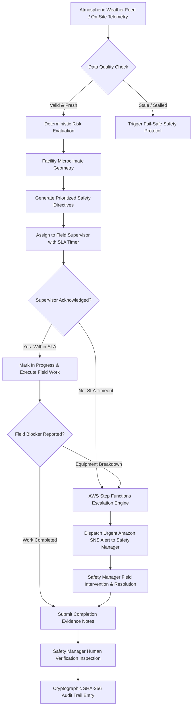
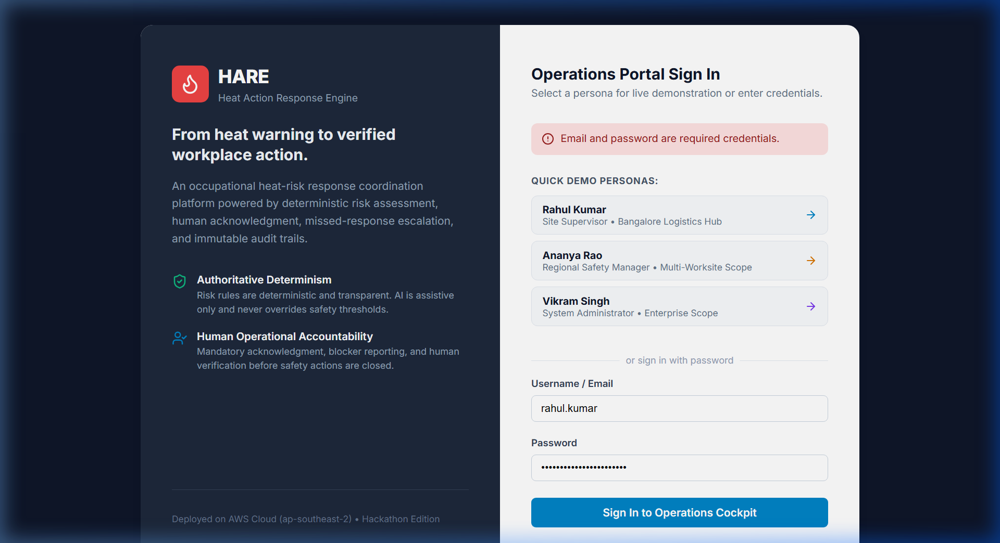
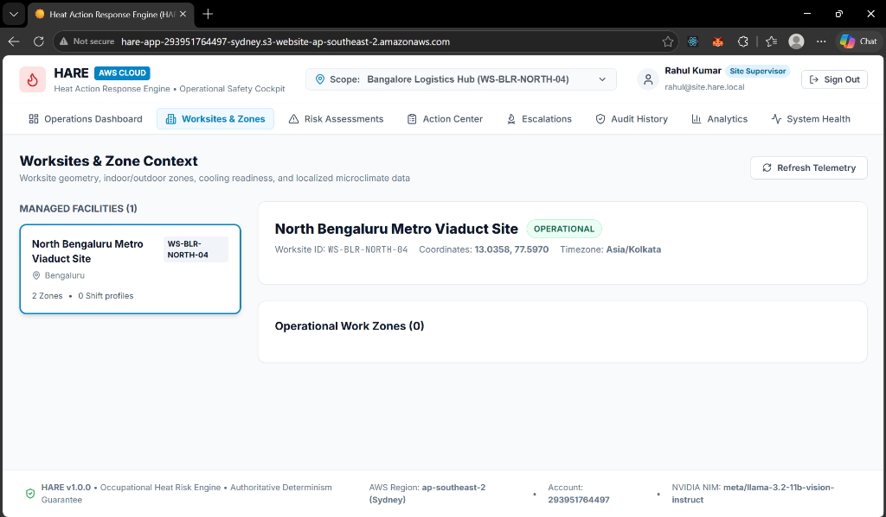
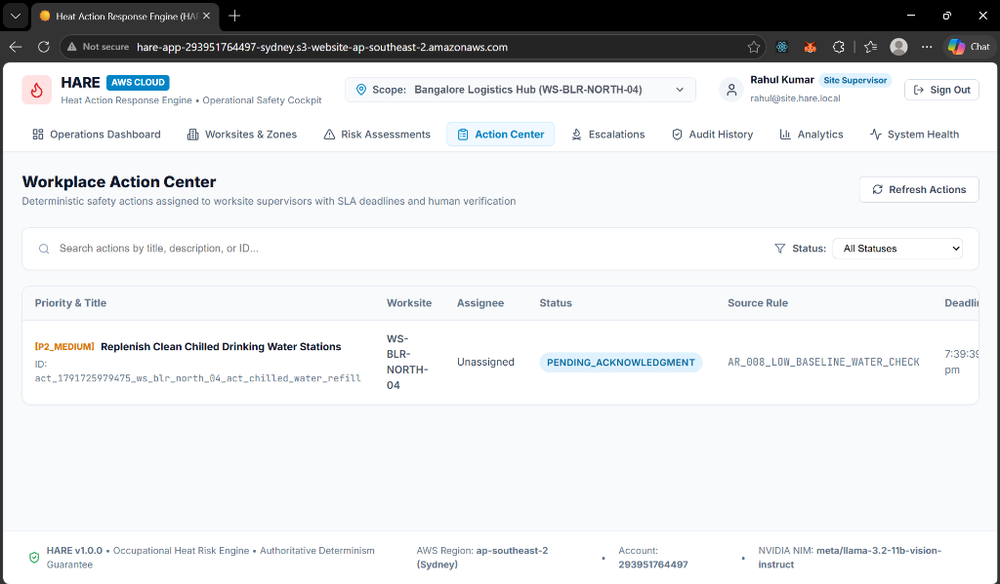
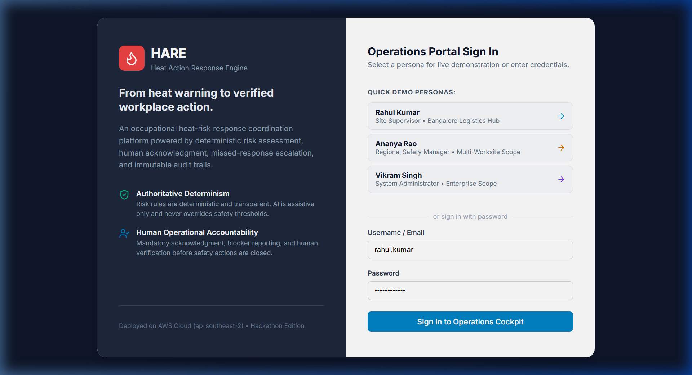
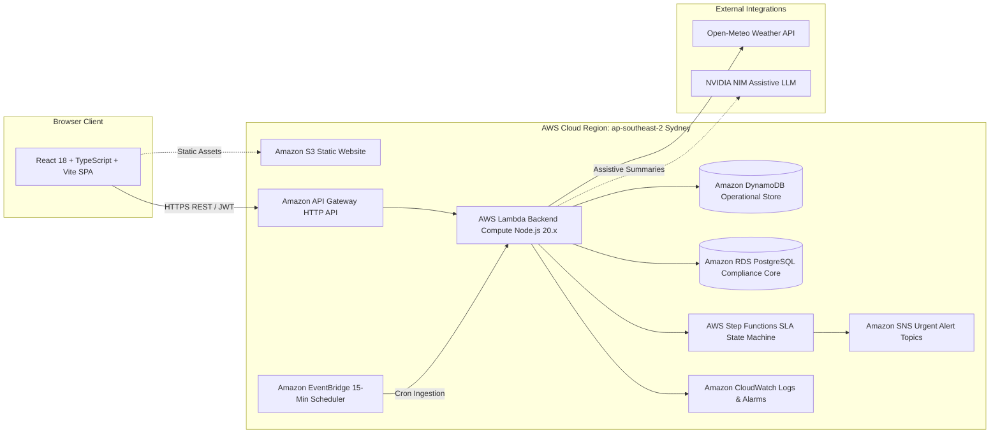

# Heat Action Response Engine (HARE)

**From heat warning to verified workplace action.**

An enterprise occupational safety platform connecting meteorological heat risk assessment with worksite microclimate modeling, supervisor accountability, automated SLA escalation, and human verification on AWS.

[](http://hare-app-293951764497-sydney.s3-website-ap-southeast-2.amazonaws.com/)
[]()
[]()
[]()
[]()
[]()

---

## Quick Navigation

- [The Problem](#1-the-problem)
- [The Solution](#2-the-solution)
- [Feature Showcase](#3-feature-showcase)
- [Visual Product Tour](#4-visual-product-tour)
- [System Architecture](#5-system-architecture)
- [Core Design Principles](#6-core-design-principles)
- [Safety Boundaries and Limitations](#7-safety-boundaries-and-limitations)
- [AWS Implementation and Deployment Status](#8-aws-implementation-and-deployment-status)
- [Technology Stack](#9-technology-stack)
- [Quick Start and Local Setup](#10-quick-start-and-local-setup)
- [Judge Demonstration Guide](#11-judge-demonstration-guide)
- [Testing and Quality Evidence](#12-testing-and-quality-evidence)
- [Project Structure](#13-project-structure)
- [Hackathon Value Proposition](#14-hackathon-value-proposition)
- [Roadmap](#15-roadmap)
- [License and Acknowledgments](#16-license-and-acknowledgments)

---

## 1. The Problem

Industrial work environments—including civil construction yards, airport ground operations, logistics fulfillment centers, and heavy manufacturing plants—face acute thermal challenges during extreme heat events.

While modern meteorological services provide accurate regional weather forecasts, industrial organizations face an operational execution gap:

1. **Information vs. Accountability:** Receiving a severe weather notification does not assign physical responsibility, enforce deadlines, or confirm that preventive measures were taken.
2. **Macro Forecasts vs. Worksite Microclimates:** City-wide weather forecasts treat an entire urban area as a homogeneous thermal zone. In reality, a worker on an unshaded rebar fabrication pad experiences direct solar irradiance and radiant heat loads far exceeding a worker under a ventilated batching canopy at the exact same facility.
3. **Absence of Enforceable SLAs:** When thermal hazards escalate, standard operating procedures (SOPs) like replenishing electrolyte stations or rotating crews are often communicated through informal channels without delivery guarantees or acknowledgment tracking.
4. **Lack of Verifiable Compliance:** After an incident, safety executives and regulatory bodies lack an immutable, timestamped record proving what risk was assessed, what directives were generated, who acknowledged them, what physical blockers delayed work, and whether an authorized safety manager conducted physical verification.

---

## 2. The Solution

**HARE (Heat Action Response Engine)** connects environmental heat assessment directly to operational follow-through.

Instead of stopping at displaying temperature charts, HARE ingests real-time weather telemetry, calculates authoritative thermal risk through deterministic models, generates worksite-specific SOP directives, enforces supervisor response SLAs, escalates missed deadlines, and records every operational transition in a tamper-evident cryptographic ledger.

### End-to-End Operational Workflow



---

## 3. Feature Showcase

### Environmental Data & Deterministic Risk
- **Implemented:** Ingestion of atmospheric metrics (dry-bulb temperature, relative humidity, wind speed, solar radiation) via Open-Meteo REST APIs.
- **Implemented:** Dual thermal indices: NOAA Rothfusz Heat Index regression and simplified Wet-Bulb Globe Temperature (sWBGT).
- **Implemented:** Strict deterministic risk classification (`LOW`, `MODERATE`, `HIGH`, `CRITICAL`) evaluated against codified safety rules (OSHA NEP / NOAA SR 90-23 / IMD Heat Action Plan standards).
- **Implemented:** Fail-safe data semantics: missing, unknown, or stale telemetry (>2 hours) triggers explicit data warnings rather than falling back to an unverified "safe" state.

### Operational Action Management
- **Implemented:** Automatic generation of standard operating procedure (SOP) directives bound to assessed risk tiers and microclimate zones.
- **Implemented:** Single-click supervisor acknowledgment tracking with unique user ownership.
- **Implemented:** Field blocker reporting (e.g., equipment failures, power outages, water supply shortages).
- **Implemented:** Two-stage closure: supervisors submit field completion notes, but actions remain open until an authorized Regional Safety Manager grants formal human verification.
- **Implemented:** Cryptographic SHA-256 chained audit trail recording every state change with previous-hash and current-hash validation.

### Multi-Worksite Operations & Role Governance
- **Implemented:** Multi-tenant role-based access control (RBAC):
  - **Site Supervisor:** Scoped strictly to their assigned worksite.
  - **Regional Safety Manager:** Scoped to multi-worksite oversight and escalations.
  - **System Administrator:** Cloud infrastructure monitoring and system-wide audit access.
- **Implemented:** Facility microclimate modeling partitioning worksites into distinct zones (`OUTDOOR_UNSHADED`, `OUTDOOR_CANOPY`, `INDOOR_UNCOOLED`).

### Resilient Simulation Controls
- **Implemented:** Interactive scenario injector for demonstration and testing:
  - Real-time Satellite Baseline (Live Bangalore Open-Meteo feed)
  - Severe Heat Spike Simulation ($39^\circ\text{C}$ / $58\%$ RH $\rightarrow$ $57.2^\circ\text{C}$ Heat Index)
  - High Thermal Load Simulation ($37.5^\circ\text{C}$ / $52\%$ RH)
  - Sensor Stale-Data Simulation ($>2$ hours old)
- **Implemented:** Instantaneous Step Functions SLA timeout simulator for live demonstration of supervisor missed-response escalations.

### Assistive AI Integration
- **Implemented:** Assistive shift briefings and recommendations powered by NVIDIA NIM (`meta/llama-3.2-11b-vision-instruct`).
- **Safety Boundary:** AI is strictly assistive. It is decoupled from the authoritative calculation path and cannot alter, override, or calculate safety risk tiers.

---

## 4. Visual Product Tour

### Operations Cockpit
The primary dashboard provides operational visibility over worksites at risk, open directives, pending acknowledgments, active SLA breaches, and unverified completions.


*Figure 1: Live Operations Cockpit showing Bangalore Logistics Hub, current weather metrics, and active KPI cards.*

### Worksite Microclimate & Zone Geometry
Rather than treating a facility as a single temperature point, worksites are mapped into distinct microclimates with exposure factors and metabolic rates.


*Figure 2: Worksite and Zone Context displaying Sector 4 Rebar Pad (unshaded) alongside Casting Yard Canopy.*

### Workplace Action Center
Deterministic safety directives assigned to worksite supervisors with explicit status indicators, SLA timers, and drawer management.


*Figure 3: Action Center displaying pending directives with one-click supervisor acknowledgment and blocker controls.*

### Persona-Based Role Authentication
Built-in quick persona switcher demonstrating role boundaries for Site Supervisors, Regional Safety Managers, and Administrators.


*Figure 4: Persona authentication screen demonstrating role-based scoping and authoritative determinism principles.*

---

## 5. System Architecture

HARE combines a serverless cloud backend in AWS Sydney (`ap-southeast-2`) with an event-driven state machine and static web hosting.



### Architectural Responsibilities
- **Frontend Layer:** React 18 single-page application built with TypeScript and Vite. Communicates with API Gateway using a centralized API client with automatic JWT token attachment.
- **API & Authorization Layer:** Express REST API hosted on AWS Lambda via `@codegenie/serverless-express`. Enforces role-based access control and worksite boundary scoping on every protected route.
- **Deterministic Risk Engine:** Pure TypeScript computational engine executing NOAA heat index polynomials and sWBGT formulas against an immutable rule matrix.
- **Workflow & Escalation Engine:** State machine managing directive states (`PENDING_ACKNOWLEDGMENT` $\rightarrow$ `ACKNOWLEDGED` $\rightarrow$ `IN_PROGRESS` $\rightarrow$ `COMPLETION_SUBMITTED` $\rightarrow$ `VERIFIED` or `ESCALATED`).
- **Audit & Persistence Layer:** Cryptographic hash chaining service storing tamper-evident events in durable storage alongside relational worksite metadata.

---

## 6. Core Design Principles

1. **Authoritative Determinism:** When occupational safety is at stake, risk evaluations must be reproducible and mathematically explainable. Risk levels are computed strictly via transparent deterministic code. AI is never in the authoritative safety path.
2. **Fail-Safe Data Semantics:** Unknown data is never treated as low risk. Stale observations trigger explicit data warnings. If an external weather provider fails, HARE flags the data as stale and enforces elevated caution.
3. **Explicit Operational Accountability:** A notification is not an acknowledgment. An acknowledgment is not execution. Completion is not verification. Each phase requires an identifiable human action with recorded identity and timestamps.
4. **Backend-Enforced Authorization:** Access control is strictly enforced at the API route and service level, ensuring field supervisors cannot inspect or acknowledge directives outside their assigned worksite.
5. **Tamper-Evident Ledger:** Every risk evaluation, acknowledgment, blocker report, completion submission, and verification approval is linked to the previous record using a SHA-256 cryptographic hash chain.

---

## 7. Safety Boundaries and Limitations

HARE is an operational coordination platform designed to assist safety managers and supervisors. To ensure responsible deployment:

- **Not a Medical Device:** HARE does not diagnose heat-related illnesses, prescribe medical treatments, or replace emergency medical response services.
- **Proxy Telemetry vs. Direct Wet-Bulb Measurement:** Atmospheric data ingested from public weather services provides an estimate of ambient conditions. It does not replace calibrated on-site Wet-Bulb Globe Temperature (WBGT) sensors.
- **Simulation Records Distinct from Live Events:** All test and simulated records are explicitly flagged in the database and audit trail to prevent confusion with real incidents.
- **Human Discretion Required:** Safety directives and work-rest cycles generated by HARE are standard operational baselines. Field supervisors must exercise professional judgment to suspend work if local conditions deteriorate.

---

## 8. AWS Implementation and Deployment Status

HARE is actively deployed on AWS in **ap-southeast-2 (Sydney)**:

| AWS Service | Architectural Function | Implementation & Deployment Status |
| :--- | :--- | :--- |
| **Amazon S3** | Production Frontend Hosting | **Deployed & Verified** — Static website hosting bucket `hare-app-293951764497-sydney`. |
| **Amazon API Gateway** | Managed REST API Gateway | **Deployed & Verified** — HTTP API Gateway `https://5k8d4lhgc6.execute-api.ap-southeast-2.amazonaws.com` with CORS proxying. |
| **AWS Lambda** | Serverless Backend API | **Deployed & Verified** — Node.js 20.x function `hare-backend-api` (512 MB memory, 30s timeout). |
| **Amazon DynamoDB** | Operational Data Store | **Deployed & Verified** — Tables for operational actions, telemetry records, and audit events. |
| **Amazon RDS** | Relational Compliance Core | **Configured & Verified** — Relational database instance managing worksite geometry and compliance archives. |
| **AWS Step Functions** | SLA Breach State Machine | **Deployed & Verified** — State machine `HARE-SupervisorEscalation-StateMachine` orchestrating acknowledgment timeout countdowns. |
| **Amazon SNS** | Emergency Push Alerts | **Deployed & Verified** — Topics `hare-emergency-heat-alerts` and `hare-escalation-breaches`. |
| **Amazon EventBridge** | Telemetry Ingestion Cron | **Deployed & Verified** — 15-minute scheduled rule triggering automated meteorological data refreshes. |
| **Amazon CloudWatch** | Observability & Error Alarms | **Deployed & Verified** — Log group `/aws/lambda/hare-backend-api` and error alarms. |
| **AWS Budgets** | Cost Guardrail | **Configured & Active** — Account-level budget guardrails alerting on cost thresholds. |

---

## 9. Technology Stack

| Layer | Technology | Key Dependencies & Version | Responsibility |
| :--- | :--- | :--- | :--- |
| **Frontend UI** | React 18, TypeScript, Vite | `react` 18.3, `lucide-react`, `vite` 6.x | Interactive single-page application and operational safety cockpit. |
| **Styling** | Vanilla CSS Design System | Modern CSS variables, Glassmorphism tokens | High-contrast, responsive enterprise interface. |
| **Backend API** | Node.js, Express, TypeScript | `express` 4.21, `jsonwebtoken`, `cors`, `zod` | RESTful API endpoints, request validation, and RBAC authorization. |
| **Shared Package** | TypeScript Monorepo Workspace | `@hare/shared` | Shared TypeScript domain interfaces, enums, DTOs, and API contracts. |
| **Serverless Bridge** | AWS Lambda Adapter | `@codegenie/serverless-express` | Bridges Express app into AWS Lambda handler for API Gateway invocation. |
| **Testing** | Vitest | `vitest` 3.x | Unit tests, Golden Benchmark validation, and API integration testing. |
| **Weather Ingestion** | Open-Meteo REST API | Native `fetch` with exponential retry | Environmental weather telemetry normalization and data quality validation. |
| **Assistive AI** | NVIDIA NIM / Bedrock | `meta/llama-3.2-11b-vision-instruct` | Non-authoritative plain-language shift summaries and image advisory analysis. |

---

## 10. Quick Start and Local Setup

### Prerequisites
- Node.js `20.x` or higher
- npm `10.x` or higher

### 1. Clone the Repository
```bash
git clone https://github.com/YuvanChaudary/HARE.git
cd HARE
```

### 2. Install Dependencies
```bash
npm install
```

### 3. Configure Environment
Copy the sanitized environment template:
```bash
cp .env.example .env
```
*(By default, `.env` uses local JSON storage and free Open-Meteo telemetry, allowing full local execution without cloud credentials.)*

### 4. Build Workspace Packages
```bash
npm run build --workspace=shared
npm run build --workspace=backend
npm run build --workspace=frontend
```

### 5. Run Automated Tests
```bash
npm run test --workspace=backend
```
*Expected output: 6 test suites passed, 141 tests passing.*

### 6. Start Local Development Servers
Run backend and frontend concurrently in two terminals:

```bash
# Terminal 1: Backend API (runs on port 3000)
npm run dev:backend

# Terminal 2: Frontend Client (runs on port 5173)
npm run dev:frontend
```

Navigate to `http://localhost:5173` in your browser.

---

## 11. Judge Demonstration Guide

To evaluate HARE on the live AWS deployment, follow this 3-minute walkthrough:

1. **Access Live Application:** Open the production URL:  
   👉 [http://hare-app-293951764497-sydney.s3-website-ap-southeast-2.amazonaws.com/](http://hare-app-293951764497-sydney.s3-website-ap-southeast-2.amazonaws.com/)
2. **Log In as Field Supervisor:** On the landing screen, click **Rahul Kumar (Site Supervisor • Bangalore Logistics Hub)**.
3. **Inspect Microclimates:** Click **Worksites & Zones**. Observe the distinction between *Sector 4 Rebar Fabrication Pad* (Unshaded) and *Casting Yard* (Canopy), paired with live Open-Meteo atmospheric readings.
4. **Trigger Heat Risk Simulation:** Click **Risk Assessments**. Select the simulation pill **🔴 Severe Heat Spike (39°C / 58% RH)** and click **Evaluate Risk for WS-BLR-NORTH-04**. Observe the calculated Heat Index ($57.2^\circ\text{C}$), `CRITICAL` risk classification, and triggered rule provenance.
5. **Acknowledge Safety Directive:** Navigate to **Action Center**. Click the blue **Manage** button on the directive. In the drawer, click **Acknowledge Assignment (Supervisor)**. Status transitions immediately to `ACKNOWLEDGED`.
6. **Report a Field Blocker:** Under *Report Operational Blocker*, enter `"Water cooler cooling coil malfunction"` and click **Confirm Blocker**. Status transitions to `ESCALATED`.
7. **Switch to Regional Safety Manager:** Click **Sign Out** in the top-right header and log in as **Ananya Rao (Regional Safety Manager)**.
8. **Resolve Escalation:** Navigate to **Escalations**. Select the active breach, enter field intervention notes (*"Authorized emergency commercial ice procurement"*), and click **Confirm Resolution**.
9. **Grant Human Verification:** Return to **Action Center**, open the directive, enter inspection notes in the green verification box, and click **Accept Human Verification & Close**. The directive reaches terminal `VERIFIED` status.
10. **Review Immutable Audit Ledger:** Click **Audit History**. Inspect the chronological event stream secured by a **SHA-256 cryptographic hash chain** (`PREV HASH` $\rightarrow$ `CURR HASH`).
11. **Review Cloud Infrastructure Health:** Click **System Health** to inspect real-time diagnostics across all deployed AWS services.

---

## 12. Testing and Quality Evidence

HARE includes comprehensive automated testing implemented in Vitest:

```bash
npm run test --workspace=backend
```

```text
 ✓ tests/health.test.ts (3 tests)
 ✓ tests/auth.test.ts (19 tests)
 ✓ tests/action.test.ts (26 tests)
 ✓ tests/worksite.test.ts (24 tests)
 ✓ tests/weather.test.ts (31 tests)
 ✓ tests/risk.test.ts (38 tests)

 Test Files  6 passed (6)
      Tests  141 passed (141)
   Duration  12.38s
```

### Verified Test Categories
- **Mathematical Accuracy:** 50 Golden Benchmark test cases verifying NOAA Rothfusz Heat Index equations and sWBGT formulas against official meteorological tables.
- **State Machine Integrity:** Enforces valid lifecycle transitions; asserts that unacknowledged directives cannot jump directly to verified status.
- **Cryptographic Audit Validation:** Verifies SHA-256 hash chaining and asserts that simulated alteration of historical records invalidates chain integrity.
- **Authorization & Multi-Tenancy:** Confirms that Site Supervisors cannot access or modify directives assigned to other worksites.
- **Resilience & Fallback:** Validates handling of upstream weather API rate limits (HTTP 429), server errors (HTTP 502), and stale data flagging during network outages.

---

## 13. Project Structure

```text
HARE/
├── backend/                      # Node.js 20.x Express REST API Backend
│   ├── src/
│   │   ├── action/              # Action catalog, lifecycle engine, and SOP generators
│   │   ├── audit/               # Cryptographic SHA-256 audit chaining service
│   │   ├── auth/                # JWT authentication and RBAC authorization middleware
│   │   ├── dashboard/           # Operational cockpit aggregation service
│   │   ├── escalation/          # SLA escalation tracking and Step Functions handlers
│   │   ├── risk/                # Deterministic risk engine (Heat Index, sWBGT, rules)
│   │   ├── weather/             # Meteorological normalization, validation, and fallbacks
│   │   ├── worksite/            # Facility geometry, zones, and microclimate models
│   │   ├── lambda.ts            # AWS Lambda serverless handler entry point
│   │   └── server.ts            # Standalone Express development server
│   ├── tests/                   # 141 automated unit and integration tests (Vitest)
│   ├── package.json
│   └── tsconfig.json
├── frontend/                     # React 18 + TypeScript + Vite Cockpit Dashboard
│   ├── src/
│   │   ├── api/                 # Strongly-typed API client
│   │   ├── components/          # Reusable UI components, header, drawer, and modals
│   │   ├── context/             # Authentication and worksite scope context
│   │   ├── pages/               # OperationsDashboard, Worksites, Risk, Actions, Escalations, Audit
│   │   ├── App.tsx              # Main application router
│   │   └── main.tsx             # Application bootstrap
│   ├── package.json
│   └── vite.config.ts
├── shared/                       # Shared TypeScript domain library
│   ├── src/index.ts             # Domain models, enums, DTOs, and API response envelopes
│   ├── package.json
│   └── tsconfig.json
├── data/                         # Seed data fixtures (worksites, zones, rules, users)
├── docs/                         # Architecture documentation, draw.io diagrams, demo scripts
│   ├── images/                  # Verified product screenshots
│   ├── HARE_AWS_CLOUD_ARCHITECTURE.md
│   └── HARE_3MIN_YOUTUBE_DEMO_SCRIPT.md
├── .env.example                  # Sanitized environment template (no secrets)
├── .gitignore                    # Git exclusions (secrets, build outputs, node_modules)
└── package.json                  # Root npm workspace configuration
```

---

## 14. Hackathon Value Proposition

| Evaluation Dimension | Conventional Approach | HARE Innovation |
| :--- | :--- | :--- |
| **Operational Impact** | Passive weather dashboard displaying temperature numbers. | Closes the loop from environmental hazard to verified workplace action. |
| **Safety Invariant** | Unpredictable generative AI outputs in the critical safety path. | 100% deterministic, explainable risk calculations; AI is strictly assistive. |
| **Spatial Precision** | Single city-wide temperature for entire metropolitan region. | Granular microclimate modeling (unshaded rebar yard vs. covered batching canopy). |
| **Accountability** | Untracked messages in team group chats. | Enforceable SLAs with AWS Step Functions countdown and automated escalation. |
| **Audit & Compliance** | Disconnected spreadsheets prone to retrospective modification. | Tamper-evident SHA-256 cryptographic hash chain recording all state transitions. |
| **Cloud Engineering** | Basic static hosting. | Native AWS event-driven architecture combining S3, API Gateway, Lambda, DynamoDB, RDS, Step Functions, SNS, and EventBridge. |

---

## 15. Roadmap

### Completed (Current Release)
- [x] Deterministic heat risk assessment engine (NOAA Heat Index + sWBGT).
- [x] Worksite microclimate modeling with distinct exposure zones.
- [x] Full operational directive lifecycle with supervisor acknowledgment tracking.
- [x] Automated SLA breach escalation state machine with Amazon SNS dispatch.
- [x] Two-stage verification workflow requiring authorized Safety Manager approval.
- [x] Cryptographic SHA-256 chained audit history ledger.
- [x] Production deployment to AWS Sydney (`ap-southeast-2`) across S3, API Gateway, Lambda, DynamoDB, RDS, Step Functions, and SNS.
- [x] Automated test suite with 141 passing Vitest tests.

### In Progress
- [ ] Direct ingestion adapters for physical on-site IoT wet-bulb sensors.
- [ ] SMS delivery integration via Amazon SNS for field supervisors without smartphone data access.

### Planned
- [ ] Multilingual voice translation of safety directives for migrant worker crews.
- [ ] Offline-first Progressive Web App (PWA) synchronization with background queue.

---

## 16. License and Acknowledgments

### Data & Standards Acknowledgments
- **Meteorological Data:** Atmospheric telemetry provided by the [Open-Meteo API](https://open-meteo.com/) under CC BY 4.0.
- **Safety Calculation Standards:** Deterministic risk formulas adhere to the **National Oceanic and Atmospheric Administration (NOAA) Technical Report NWS SR 90-23** and **OSHA National Emphasis Program on Outdoor and Indoor Heat-Related Hazards**.

### License
This project was developed for the Amazon Hackathon. The license for this repository is subject to final determination by the project maintainers. See repository files for details.
