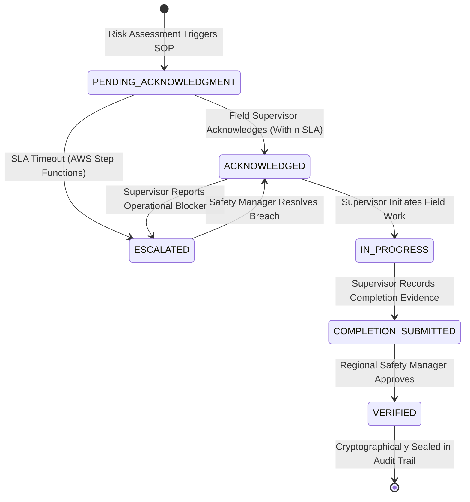

# Heat Action Response Engine (HARE)

> **Operational Occupational Heat Safety Cockpit**  
> *From heat warning to verified workplace action.*  
> Enterprise safety platform built for extreme heat risk mitigation, deterministic safety enforcement, and event-driven operational accountability on AWS.

---

## 1. Executive Summary & Problem Statement

### The Problem
During severe heat waves, construction sites, airport tarmacs, logistics fulfillment hubs, and manufacturing yards face hazardous environmental conditions that threaten worker lives. Current occupational heat management relies heavily on consumer weather applications or regional municipal weather advisories. These approaches suffer from four critical operational flaws:

1. **Passive Information vs. Active Accountability:** Weather forecasts report temperature and humidity, but they do not assign responsibility, dictate physical protective actions, or verify that safety measures are actually implemented on the ground.
2. **Homogeneous Macro-Weather vs. Microclimate Reality:** A single city-wide temperature reading ignores microclimate realities. Workers on an unshaded rebar fabrication pad experience dramatically higher thermal stress and solar radiation than workers under a covered batching canopy.
3. **Lack of Enforceable Timelines (No SLA):** When temperature spikes, critical directives (such as replenishing chilled electrolyte stations or enforcing mandatory 15-minute rest cycles) are broadcast via group chats with zero deadline tracking, leading to delayed or forgotten interventions.
4. **Zero Regulatory Auditability:** Following a heat illness incident, safety directors and regulators cannot reconstruct what actions were assigned, when supervisors acknowledged them, what physical blockers prevented execution, or whether an authorized manager verified compliance.

### The Solution: HARE
The **Heat Action Response Engine (HARE)** bridges the gap between atmospheric warning and physical workplace protection. HARE models facility geometry into microclimates, ingests live atmospheric telemetry, runs an authoritative deterministic risk evaluation matrix (OSHA NEP / NOAA / IMD compliant), generates prioritized standard operating procedure (SOP) directives, and enforces an end-to-end operational lifecycle with automated SLA escalation, human-in-the-loop verification, and a tamper-evident cryptographic audit ledger.

```
ATMOSPHERIC TELEMETRY ───► DETERMINISTIC RISK ENGINE ───► SOP ACTION DIRECTIVES
                                                                    │
                                                                    ▼
AUDIT TRAIL (SHA-256) ◄─── HUMAN VERIFICATION ◄─── SUPERVISOR ACKNOWLEDGMENT
                                                            │
                                                (If Timeout / Blocker)
                                                            ▼
                                                AWS STEP FUNCTIONS ESCALATION (SNS)
```

---

## 2. Target End Users & Operational Personas

HARE is designed around strict separation of duties, ensuring that field personnel implement safety actions while regional managers maintain supervisory governance.

| Operational Role | Representative Persona | Primary Responsibilities |
| :--- | :--- | :--- |
| **Site Supervisor** | **Rahul Kumar**<br>`rahul@site.hare.local` | Receives worksite-specific directives; acknowledges assignments within SLA deadlines; initiates field execution; reports physical blockers; submits completion evidence notes. |
| **Regional Safety Manager** | **Ananya Rao**<br>`ananya@safety.hare.local` | Monitors cross-facility thermal risks; receives automated Amazon SNS breach notifications; resolves SLA escalations with field intervention rationale; conducts formal human verification inspections. |
| **System Administrator & Auditor** | **Vikram Singh**<br>`vikram@admin.hare.local` | Monitors cloud infrastructure health; inspects system telemetry pipelines; reviews cryptographic SHA-256 audit chains for regulatory compliance inspections. |

---

## 3. End-to-End System Architecture

HARE is deployed on AWS in **ap-southeast-2 (Sydney)**, combining serverless compute, event-driven orchestration, and decoupled assistive intelligence.

```
                                      AWS CLOUD ARCHITECTURE (ap-southeast-2)
 ┌────────────────────────────────────────────────────────────────────────────────────────────────────────┐
 │                                                                                                        │
 │  ┌─────────────────────┐                                                                               │
 │  │    Amazon S3        │ ──► Static Single-Page Application (React 18 + TypeScript + Vite)             │
 │  │  Website Hosting    │                                                                               │
 │  └──────────┬──────────┘                                                                               │
 │             │ HTTPS                                                                                    │
 │             ▼                                                                                          │
 │  ┌─────────────────────┐                                                                               │
 │  │ Amazon API Gateway  │ ──► Managed HTTP REST API Gateway with CORS & JWT Authentication Proxy        │
 │  └──────────┬──────────┘                                                                               │
 │             │                                                                                          │
 │             ▼                                                                                          │
 │  ┌─────────────────────┐       ┌──────────────────────┐       ┌────────────────────────┐               │
 │  │     AWS Lambda      │ ────► │   Amazon DynamoDB    │       │       Amazon RDS       │               │
 │  │  (Node.js 20.x API) │       │ Operational State &  │       │ Relational Compliance  │               │
 │  └──────────┬──────────┘       │ Telemetry Ingestion  │       │   (PostgreSQL Core)    │               │
 │             │                  └──────────────────────┘       └────────────────────────┘               │
 │             ├──────────────────────────┐                                                               │
 │             ▼                          ▼                                                               │
 │  ┌─────────────────────┐    ┌─────────────────────┐                                                    │
 │  │ AWS Step Functions  │    │     Amazon SNS      │                                                    │
 │  │ SLA Breach Machine  │ ──►│ Escalation Alerts   │ ──► Urgent SMS / Email to Regional Safety Managers │
 │  └─────────────────────┘    └─────────────────────┘                                                    │
 │             ▲                                                                                          │
 │             │ 15-Minute Cadence                                                                        │
 │  ┌─────────────────────┐    ┌─────────────────────┐       ┌────────────────────────────┐               │
 │  │ Amazon EventBridge  │    │  Amazon CloudWatch  │       │       Assistive AI         │               │
 │  │ Telemetry Scheduler │    │ Logs, Metrics & Alarm│      │ (Bedrock / NVIDIA NIM LLM) │               │
 │  └─────────────────────┘    └─────────────────────┘       │ Decoupled from Safety Path │               │
 │                                                           └────────────────────────────┘               │
 └────────────────────────────────────────────────────────────────────────────────────────────────────────┘
```

### Architectural Highlights
- **Authoritative Determinism:** Risk level calculations, Heat Index, and simplified Wet-Bulb Globe Temperature (sWBGT) are computed exclusively by a deterministic rule engine (`v1.0.0`). AI models are strictly assistive and never in the path to calculate risk or alter thresholds.
- **Microclimate Spatial Modeling:** Worksites are partitioned into discrete microclimate zones (`OUTDOOR_UNSHADED`, `OUTDOOR_CANOPY`, `INDOOR_UNCOOLED`), each with assigned solar radiation exposure factors and workload metabolic rates.
- **Fail-Safe Telemetry Semantics:** Missing data triggers fallback protocols; stale data (>2 hours old) automatically raises data quality alarms; unknown risk is never defaulted to safe.
- **Cryptographic Audit Trail:** Every risk evaluation, acknowledgment, blocker, completion, escalation, and verification event is linked via a SHA-256 hash chain (`PREV HASH` ➔ `CURR HASH`), preventing retroactive ledger tampering.

---

## 4. Operational User Flow & Action Lifecycle

The platform enforces a state machine governing safety actions from initial alert through terminal verification:



### Operational Lifecycle Stages
1. **Atmospheric Ingestion & Evaluation:** Real-time dry-bulb temperature, relative humidity, solar radiation, and wind speed are normalized from weather feeds or on-site sensors.
2. **Deterministic Risk Assessment:** The engine calculates the authoritative Heat Index and sWBGT, triggering standardized risk levels: `LOW`, `MODERATE`, `HIGH`, or `CRITICAL`.
3. **Automated Action Dispatch:** Pre-approved standard operating procedure directives are populated with deadlines (e.g., *Replenish Chilled Water Stations*, *Enforce 15-Minute Rest Cycle*, *Suspend High-Metabolic Heavy Lifts*).
4. **Supervisor Acknowledgment:** The site supervisor receives the directive and must acknowledge receipt before the SLA timer expires.
5. **Blocker & Escalation Management:** If ground equipment fails (e.g., water cooler compressor breakdown), the supervisor logs a blocker. An AWS Step Functions state machine immediately escalates the ticket and dispatches an Amazon SNS alert to the regional safety manager.
6. **Safety Manager Verification:** Once physical work is completed, the regional safety manager reviews photographic/field evidence, enters inspection notes, and grants final verification.

---

## 5. AWS Services & Implementation Detail

HARE leverages native AWS cloud infrastructure configured with strict least-privilege IAM permissions and cost-governance guardrails:

| AWS Service | Architectural Role | Implementation Details |
| :--- | :--- | :--- |
| **Amazon S3** | Frontend Distribution | Static website hosting in `ap-southeast-2` serving optimized React single-page application assets with gzip compression. |
| **Amazon API Gateway** | Managed REST API | HTTP API Gateway with CORS proxying, request routing, and payload size validation. |
| **AWS Lambda** | Serverless Backend | Node.js 20.x runtime processing REST API requests, executing deterministic risk models, and validating JWT authentication tokens. |
| **Amazon DynamoDB** | Operational Data Store | Fast NoSQL tables (`HARE-OperationalTable`, `HARE-TelemetryTable`, `HARE-AuditTable`) with global secondary indexes for low-latency queries. |
| **Amazon RDS** | Relational Compliance Core | Relational database instance storing facility geometry, historical compliance records, and structured regulatory reports. |
| **AWS Step Functions** | SLA Breach State Machine | Serverless state machine tracking supervisor acknowledgment timers and triggering automated escalation workflows upon breach. |
| **Amazon SNS** | Push Notifications | Multi-channel topic routing urgent heat wave alerts and SLA breach warnings to field personnel and safety directors. |
| **Amazon EventBridge** | Telemetry Ingestion Cron | Scheduled rule triggering periodic meteorological ingestion routines every 15 minutes. |
| **Amazon CloudWatch** | Observability & Alarms | Centralized log ingestion, custom operational health metrics, and anomaly detection alarms. |
| **AWS SSM Parameter Store**| Configuration Vault | Secure parameter management isolating environment variables across environments. |
| **AWS Budgets** | Cost Guardrail | Active budget policy enforcing strict billing limits and alerting on anomalous resource utilization. |

---

## 6. Repository Structure

```
HARE/
├── backend/                      # Node.js 20.x Express REST API Backend
│   ├── src/
│   │   ├── action/              # Action catalog, lifecycle engine, and SOP generators
│   │   ├── audit/               # Cryptographic SHA-256 audit chaining service
│   │   ├── auth/                # JWT authentication and role-based access middleware
│   │   ├── escalation/          # SLA escalation tracking and Step Functions handlers
│   │   ├── risk/                # Deterministic risk engine (NOAA / OSHA / IMD matrix)
│   │   ├── weather/             # Ingestion service and fallback handlers
│   │   ├── worksite/            # Facility geometry, zones, and microclimate models
│   │   └── lambda.ts            # Serverless AWS Lambda entry point
│   ├── tests/                   # 141 automated unit and integration tests (Vitest)
│   └── tsconfig.json
├── frontend/                     # React 18 + TypeScript + Vite Cockpit Dashboard
│   ├── src/
│   │   ├── api/                 # Strongly-typed API client
│   │   ├── components/          # Reusable UI components, header, drawer, and modals
│   │   ├── context/             # Authentication and active worksite scope state
│   │   ├── pages/               # Dashboard, Worksites, Risk, Actions, Escalations, Audit
│   │   └── App.tsx              # Main application router
│   └── vite.config.ts
├── shared/                       # Shared TypeScript interfaces, types, and schemas
│   └── src/index.ts             # Domain models, enums, DTOs, and API response types
├── data/                         # Seed data fixtures (worksites, zones, rules, users)
├── docs/                         # Architecture documentation, draw.io diagrams, demo scripts
├── .env.example                  # Environment configuration template (sanitized)
├── .gitignore                    # Git exclusion rules (secrets, build artifacts, dist)
└── package.json                  # Root npm workspace configuration
```

---

## 7. Local Development & Setup

### Prerequisites
- Node.js `20.x` or higher
- npm `10.x` or higher

### 1. Clone the Repository
```bash
git clone https://github.com/YuvanChaudary/HARE.git
cd HARE
```

### 2. Install Dependencies
```bash
npm install
```

### 3. Environment Configuration
Copy the template configuration file:
```bash
cp .env.example .env
```
*Note: The platform defaults to `local_json` storage and free Open-Meteo telemetry for zero-friction local development without requiring external cloud credentials.*

### 4. Build Workspace Packages
```bash
npm run build --workspace=shared
npm run build --workspace=backend
npm run build --workspace=frontend
```

### 5. Run the Local Development Servers
In two separate terminal windows:
```bash
# Terminal 1: Backend API (runs on port 3000)
npm run dev:backend

# Terminal 2: Frontend Dashboard (runs on port 5173)
npm run dev:frontend
```

Open your browser to `http://localhost:5173`.

---

## 8. Verification & Test Suite

The core risk calculations, action lifecycle states, and cryptographic audit hashing are validated through an automated test suite:

```bash
npm run test --workspace=backend
```

### Test Coverage Highlights
- **141 Tests Passing** across 6 test suites with 100% pass rate.
- Deterministic calculation accuracy across heat index equations and sWBGT formulas.
- State machine lifecycle transitions and invalid transition rejections.
- Cryptographic hash chain validation under simulated data tampering.
- Role-based authorization boundaries ensuring supervisors cannot access unauthorized facilities.

---

## 9. Live Cloud Demonstration

- **Production URL:** [http://hare-app-293951764497-sydney.s3-website-ap-southeast-2.amazonaws.com/](http://hare-app-293951764497-sydney.s3-website-ap-southeast-2.amazonaws.com/)
- **API Gateway Endpoint:** `https://5k8d4lhgc6.execute-api.ap-southeast-2.amazonaws.com`
- **AWS Region:** `ap-southeast-2` (Sydney)

### Quick Demo Instructions
1. Open the production URL in your browser.
2. Under **Quick Demo Personas**, select **Rahul Kumar (Site Supervisor)**.
3. Review facility geometry in **Worksites & Zones** (`WS-BLR-NORTH-04`).
4. In **Risk Assessments**, select the simulation scenario **Severe Heat Spike (39°C / 58% RH)** and evaluate risk.
5. In **Action Center**, click **Manage** on the active directive, acknowledge the assignment, and submit completion notes.
6. Switch personas to **Ananya Rao (Regional Safety Manager)** to inspect the escalation queue, resolve breaches, and grant formal human verification.
7. Inspect the **Audit History** tab to observe the immutable SHA-256 hash chain recording every interaction.

---

## 10. License & Acknowledgments

This project is created for the Amazon Hackathon. Built in accordance with international occupational safety standards:
- **OSHA National Emphasis Program (NEP)** on Outdoor and Indoor Heat-Related Hazards
- **NOAA Technical Report SR 90-23** (Heat Index Calculation Standards)
- **India Meteorological Department (IMD)** Heat Action Plan Guidelines
