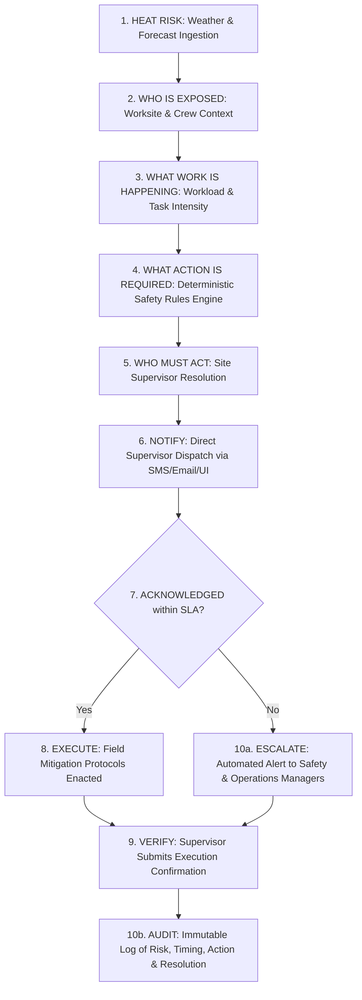
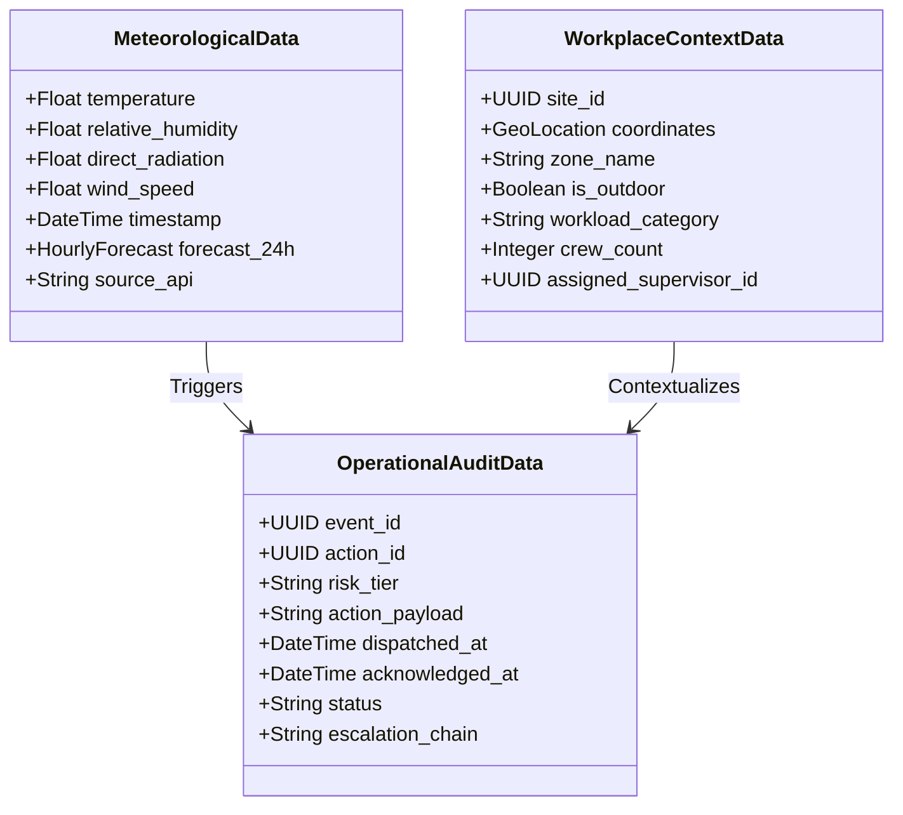

# Heat Action Response Engine (HARE) — Project Charter

## 1. Project Overview

The **Heat Action Response Engine (HARE)** is an operational safety platform engineered to bridge the critical gap between environmental heat-hazard monitoring and verifiable, frontline workplace execution.

Current heat safety practices rely predominantly on passive meteorological advisories (e.g., regional heat alerts broadcast via weather services or public agencies). These alerts are static, broad-brush, and disconnected from operational realities on the ground. When extreme heat conditions materialize, frontline worksites often lack automated, context-sensitive mechanisms to translate meteorological metrics into targeted interventions, assign clear supervisory responsibilities, verify execution, and maintain auditable records.

The Heat Action Response Engine solves this breakdown by transforming real-time weather and forecast data into context-aware, deterministic action plans. The engine evaluates site-specific exposure conditions (workload, shift timing, shade availability, crew exposure), assigns targeted safety protocols to designated site supervisors, monitors acknowledgment within strict service-level agreements (SLAs), and automatically escalates unaddressed hazards to operational leadership.

---

## 2. Project Name

* **Official Project Name:** Heat Action Response Engine
* **Project Acronym / Working Title:** HARE
* **Repository Path:** `docs/00_PROJECT_CHARTER.md`

---

## 3. One-Line Product Description

A software-first operational platform that converts continuously updated meteorological heat risk into context-aware, verifiable workplace safety actions with automated supervisory dispatch, acknowledgment tracking, and hierarchical escalation.

---

## 4. Product Tagline

> **From heat warning to verified workplace action.**

---

## 5. Problem Being Addressed

Industrial workplaces—including construction sites, logistics yards, manufacturing terminals, agricultural operations, and utility maintenance facilities—face escalating heat-related operational and human safety risks. While environmental heat monitoring has advanced, operational heat response remains structurally broken.

### 5.1 The "Advisory-to-Action" Gap
Standard meteorological heat warnings (issued by regional weather agencies or commercial forecasting services) are broadcast as macro-level warnings over hundreds of square kilometers. They inform organizations that "it is hot," but provide zero operational guidance on what specific mitigation steps must occur at a specific facility at 14:00 for a crew performing heavy structural assembly.

### 5.2 Context Blindness
Heat stress is not a function of ambient temperature alone. It is determined by the intersection of:
* Environmental parameters (temperature, relative humidity, solar radiation, wind speed).
* Workload intensity (metabolic heat generated by light, moderate, heavy, or very heavy physical labor).
* Operational context (direct sun exposure vs. shaded canopy, shift duration, time of day, hydration logistics).

Traditional alerting systems fail to factor in this context, leading to either alarm fatigue (unrealistic, disruptive blanket shutdowns) or dangerous under-protection.

### 5.3 Absence of Accountability and Closed-Loop Verification
In standard operating environments, when a safety bulletin is issued via group chat, email, or physical board, there is:
* No verifiable record of whether the responsible supervisor saw the alert.
* No timestamped confirmation that mandatory rest cycles, hydration replenishment, or shade breaks were implemented.
* No automated fail-safe to alert senior management when a critical heat threshold is reached and frontline supervisors fail to respond.

### 5.4 Deficit in Traceable Safety Operations
Following a heat-stress incident or operational inspection, organizations frequently discover a complete void in auditability. They cannot reconstruct what weather data was received, what threshold was breached, what specific mitigation protocol was recommended, who was notified, or why supervisory action stalled.

---

## 6. Proposed Solution

The Heat Action Response Engine introduces a closed-loop, deterministic execution architecture that transforms environmental data streams into documented, verifiable operational safety tasks.

```
+--------------------------------------------------------------------------------------------------+
|                                    TRADITIONAL WARNING SYSTEM                                    |
|                                                                                                  |
|                     [ Weather Data ]  ------>  [ Generic Broadcast Alert ]                       |
|                                                (No context, no tracking, no audit)               |
+--------------------------------------------------------------------------------------------------+

+--------------------------------------------------------------------------------------------------+
|                                  HEAT ACTION RESPONSE ENGINE                                     |
|                                                                                                  |
|   [ Weather Ingestion ]                                                                          |
|             |                                                                                    |
|             v                                                                                    |
|   [ Deterministic Risk Engine ]                                                                  |
|             |                                                                                    |
|             v                                                                                    |
|   [ Workplace Context Engine ] (Workload, Shift, Shading, Exposure)                              |
|             |                                                                                    |
|             v                                                                                    |
|   [ Prescriptive Action Plan ]                                                                   |
|             |                                                                                    |
|             v                                                                                    |
|   [ Supervisor Assignment & Direct Notification ]                                                |
|             |                                                                                    |
|             +---------> [ Acknowledged within SLA? ]                                             |
|                                  |                |                                              |
|                                 YES               NO                                             |
|                                  |                |                                              |
|                                  v                v                                              |
|                           [ Execution Log ]   [ Automatic Manager Escalation ]                   |
|                                  |                |                                              |
|                                  +--------+-------+                                              |
|                                           |                                                      |
|                                           v                                                      |
|                               [ Immutable Audit Trail ]                                          |
+--------------------------------------------------------------------------------------------------+
```

### Key Solution Pillars:
1. **Software-First Environmental Ingestion:** Programmatic ingestion of real-time temperature, humidity, solar radiation, and forecast data from reliable external meteorological APIs (e.g., Open-Meteo) aligned with recognized occupational heat indices (e.g., Heat Index, Wet Bulb Globe Temperature approximations, and Indian Meteorological Department heat hazard criteria).
2. **Deterministic, Explainable Risk Assessment:** Risk levels are computed through transparent mathematical rules and established occupational health matrices—not opaque black-box models. Every risk score is completely explainable and traceable.
3. **Contextual Action Formulation:** The engine combines calculated environmental stress with operational facility parameters (workload category, shift schedule, shade infrastructure, crew size) to generate clear, actionable standard operating procedures (SOPs).
4. **Supervisor Assignment & Closed-Loop SLA Tracking:** Interventions are dispatched directly to designated site supervisors with enforceable acknowledgment windows (e.g., 15 minutes for High Risk).
5. **Hierarchical Escalation:** If a frontline supervisor fails to acknowledge an active high-risk mitigation directive within the SLA, the system automatically escalates the alert to Safety Managers and Operations Leadership.
6. **Assistive AI Layer (NVIDIA AI):** NVIDIA AI models serve exclusively as assistive communication and synthesis layers (generating clear supervisor briefings, summarizing shift action plans, and translating instructions into regional dialects), strictly constrained from overriding deterministic safety calculations.
7. **End-to-End Operational Auditability:** Every meteorological reading, risk score calculation, action dispatch, supervisory acknowledgment, and escalation event is captured in a tamper-evident event log.

---

## 7. Core Product Workflow

The platform operates on a ten-stage deterministic lifecycle:



### Workflow Execution Stages:

| Stage | Name | System Responsibility | Operational Outcome |
| :--- | :--- | :--- | :--- |
| **1** | **Heat Risk** | Ingest real-time and forecast meteorological metrics from Open-Meteo / external APIs; compute heat risk category. | Environmental risk tier established (Normal, Caution, High, Extreme). |
| **2** | **Who is Exposed?** | Query site roster, active shifts, and physical deployment zones. | Identification of specific crews and workers exposed at target coordinates. |
| **3** | **What Work is Happening?** | Retrieve scheduled activity profiles (e.g., rebar fixing vs. equipment operation). | Workload metabolic category classified (Light, Moderate, Heavy, Very Heavy). |
| **4** | **What Action is Required?** | Match Risk Tier + Workload Category + Site Environment against pre-configured occupational safety action matrices. | Explicit, prescriptive safety protocols generated (e.g., 45 min work / 15 min rest, mandatory canopy shade, hydration intervals). |
| **5** | **Who Must Act?** | Resolve on-duty supervisor responsible for the specific zone and crew. | Single responsible supervisor mapped to the action package. |
| **6** | **Notify** | Dispatch action directive via web dashboard, SMS, or operational messaging channels. | Supervisor alerted with prioritized checklist and response timer. |
| **7** | **Acknowledged?** | Monitor system response against predefined acknowledgment SLA (e.g., 15 minutes). | Positive receipt recorded OR timeout triggered. |
| **8** | **Execute** | Supervisor implements required on-site controls with their crew. | Interventions active in the field. |
| **9** | **Verify** | Supervisor logs completion or status update through the portal. | Confirmed status logged. |
| **10a**| **Escalate if Necessary** | If acknowledgment or verification breaches SLA, trigger hierarchical alerts to Safety & Operations Managers. | Oversight leadership mobilized to intervene immediately. |
| **10b**| **Audit** | Write all state transitions, timestamps, payloads, and responses to the centralized audit ledger. | Comprehensive, post-shift verifiable audit trail created. |

---

## 8. Target Users

The platform is designed around organizational roles, providing specialized views, controls, and workflows for each stakeholder.

| User Role | Primary Responsibilities | Key Platform Workflows | Value Delivered |
| :--- | :--- | :--- | :--- |
| **Site Supervisor** | Frontline crew leadership, field execution, immediate worker welfare. | * Receives real-time action dispatches on mobile/web.<br>* Acknowledges directives with one touch.<br>* Confirms field implementation (water breaks, shade deployment, task rescheduling). | Removes guesswork; provides clear, manageable instructions tailored to current site conditions. |
| **Safety Manager** | Occupational health policy, compliance oversight, hazard monitoring across all active sites. | * Configures site safety thresholds and action matrices.<br>* Monitors company-wide real-time risk heatmaps.<br>* Receives second-tier escalations when supervisors fail to respond.<br>* Generates safety audit reports. | Complete situational visibility; instant notification of unaddressed safety risks; automated audit records. |
| **Operations Manager** | Production scheduling, project delivery timelines, cross-facility resource planning. | * Reviews heat-adjusted productivity forecasts.<br>* Approves major operational adjustments (shift shifts, work reallocations).<br>* Receives critical operational escalations. | Balances production targets with worker safety; avoids emergency shutdowns through proactive forecast planning. |
| **Organization Administrator** | System governance, user provisioning, worksite configuration, infrastructure settings. | * Configures worksite geospatial coordinates.<br>* Manages supervisory rosters and escalation chains.<br>* Integrates external API endpoints and cloud infrastructure. | Centralized configuration, role-based access control, and seamless deployment. |

> **Note on Workers in MVP:** In this software-first MVP, individual workers are modeled as workforce exposure entities (headcount, shift membership, task assignments, and physical locations). The MVP does not require individual workers to carry native applications or hardware tokens; safety is operationalized directly through the supervisory chain of command.

---

## 9. MVP Objective

The primary objective for the hackathon MVP is to demonstrate a fully functional, end-to-end, realistic operational scenario that showcases the complete transition from heat warning to verified workplace action.

### The Judge Demonstration Scenario:
1. **Worksite Under Active Monitoring:** The system actively tracks a configured industrial worksite (e.g., an outdoor logistics terminal or construction yard in an urban heat zone).
2. **Environmental Conditions Deteriorate:** Real-time weather input (or an accelerated realistic weather simulation sequence) reflects a rising Heat Index passing critical thresholds (e.g., transitioning from Moderate to High Risk).
3. **Deterministic Evaluation:** The engine determines that current active tasks (e.g., heavy physical loading in direct sunlight) require mandatory operational modifications.
4. **Site-Specific Action Plan Generated:** The platform synthesizes a clear action plan (mandatory 15-minute rest breaks per hour, canopy shade deployment, and hydration verification).
5. **Supervisor Notification Dispatched:** The assigned Site Supervisor receives a direct, prioritized action directive.
6. **Acknowledgment SLA Tracking:**
   * *Path A (Successful Acknowledgment):* The supervisor acknowledges the alert within the 10-minute SLA window, marking actions as underway.
   * *Path B (Escalation Demonstration):* The supervisor does not acknowledge the directive within the SLA window. The engine automatically triggers a high-priority escalation to the Safety Manager and Operations Manager, flagging an unaddressed frontline risk.
7. **Comprehensive Audit Dashboard:** The management dashboard reflects the entire chronological sequence: weather values, risk triggers, action contents, timestamps, supervisor receipt, escalation dispatch, and final resolution.

---

## 10. Core Capabilities

### 10.1 External Environmental Ingestion
* Programmatic integration with open meteorological APIs (Open-Meteo) providing current temperature, relative humidity, direct solar radiation, wind speed, and hourly predictive forecasts.
* Integration compatibility with Indian Meteorological Department (IMD) heat advisory standards and heatwave classifications.
* Multi-site polling engine that queries conditions based on precise latitude/longitude coordinates.

### 10.2 Deterministic Risk Engine
* Transparent mathematical calculation of heat stress metrics (Heat Index, Wet-Bulb approximations).
* Multi-variable risk tier assignment based on published occupational health standards (e.g., OSHA, NIOSH, and National Disaster Management Authority guidelines).
* Rule-based engine that maps environmental severity and metabolic workload categories into standardized risk levels (Low, Moderate, High, Severe).

### 10.3 Workplace Context Engine
* Site profile management: coordinates, indoor/outdoor designation, shade infrastructure, drinking water stations.
* Shift and task management: active shifts, crew headcount, task physical intensity (Light: <200W, Moderate: 200–350W, Heavy: >350W).
* Dynamic exposure calculation: combines physical workload with ambient environmental risk to determine effective strain.

### 10.4 Action Dispatch & Supervisory Assignment
* Pre-mapped Standard Operating Procedure (SOP) repository containing specific mitigation tasks.
* Automatic assignment of action checklists to the designated on-duty supervisor for the target zone.
* Multi-channel notification dispatch capability (web dashboard alerts, email, SMS simulation).

### 10.5 Acknowledgment & SLA Escalation Engine
* Time-bounded acknowledgment tracking with configurable countdown timers per risk severity.
* Automated state-machine progression: `DISPATCHED` → `ACKNOWLEDGED` → `EXECUTED` → `RESOLVED`, or `DISPATCHED` → `SLA_BREACH` → `ESCALATED`.
* Escalation routing to secondary and tertiary managers upon SLA breach.

### 10.6 Operational Dashboard & Audit Ledger
* High-visibility operational console showing active sites, real-time risk tiers, pending actions, and escalation alerts.
* Granular timeline tracking showing exact timestamps of risk breaches, notifications, acknowledgments, and escalations.
* Exportable, inspection-ready audit logs.

---

## 11. AI Role (NVIDIA AI)

### 11.1 The Cardinal AI Safety Principle
> **The LLM / NVIDIA AI model must NEVER independently determine whether a worker or situation is medically safe or unsafe.**
> 
> Authoritative safety guidelines, deterministic mathematical equations, and rule-based organizational matrices are the sole sources of truth for safety evaluations and risk thresholds.

### 11.2 Approved Assistive AI Capabilities
NVIDIA AI is utilized strictly as an assistive intelligence and communication engine:

1. **Risk Explanation & Contextual Translation:** Synthesizing complex meteorological data (heat index, solar load, wet-bulb metrics) into intuitive, plain-language operational summaries for non-technical field supervisors.
2. **Supervisor Action Briefing Generation:** Automatically composing concise, actionable, and tone-appropriate supervisory alerts and checklists based on the deterministic rules triggered.
3. **Shift Briefings & Executive Summaries:** Generating structured daily heat safety briefing documents for Operations Managers, highlighting forecast peak danger windows and recommended resource shifts.
4. **Multilingual Adaptation:** Translating standardized safety instructions and action checklists into regional languages (e.g., Hindi, Tamil, Telugu, Marathi) to ensure frontline field comprehension.
5. **Grounded In-App Querying:** Answering supervisor questions regarding site SOPs, hydration guidelines, or emergency protocols strictly grounded in loaded safety documentation and active site telemetry.

### 11.3 Prohibited AI Actions
* Modifying, overriding, or suppressing deterministic risk thresholds.
* Diagnosing medical symptoms of heat-related illness or advising on medical treatment.
* Overriding supervisor escalation triggers or clearing safety alerts autonomously.

---

## 12. Data Strategy

The system utilizes three distinct data categories to guarantee high operational reliability and deterministic reproducibility:



### 12.1 Meteorological Data
* Source: Open-Meteo REST API (free, reliable, global coverage, no complex hardware requirements).
* Parameters: 2m Air Temperature (°C), Relative Humidity (%), Direct Solar Radiation (W/m²), Wind Speed (km/h), Hourly Forecast (24-48 hours).
* Alignment: Indian Meteorological Department (IMD) heat advisory classifications and heat index guidance where applicable.

### 12.2 Workplace & Operational Context Data
* Worksite metadata: Site name, GPS coordinates, operating hours, physical exposure characteristics (open ground, scaffold, shade canopy).
* Shift rosters: Shift timings, crew sizes, current task type, ergonomic workload rating.
* Personnel mapping: Site Supervisors, Safety Officers, Operations Managers, contact information, on-duty schedules.

### 12.3 Operational Event & Audit Ledger Data
* Event log: Every calculation cycle is assigned a unique UUID.
* State transitions: Captures input weather parameters, calculated risk index, generated SOP actions, supervisor notification timestamp, acknowledgment timestamp, escalation triggers, and resolution state.

---

## 13. AWS Role

The system leverages Amazon Web Services (AWS) infrastructure to guarantee cloud scalability, resilience, and operational reliability for industrial clients:

* **Compute & Hosting:** AWS Lambda / Amazon ECS (Elastic Container Service) or EC2 for hosting backend application microservices and deterministic rule processing engines.
* **Database & Persistence:** Amazon DynamoDB / Amazon Aurora (PostgreSQL) for storing worksite metadata, active shift schedules, and high-throughput append-only audit event logs.
* **API Management:** Amazon API Gateway providing secure, rate-limited RESTful endpoints for frontend dashboards and meteorological ingestion schedulers.
* **Notification & Messaging:** Amazon SNS (Simple Notification Service) and Amazon SES (Simple Email Service) to power real-time supervisor dispatches and urgent escalation alerts.
* **Static Web Hosting:** Amazon S3 and Amazon CloudFront for hosting the React-based operational dashboard.

---

## 14. Hackathon Success Criteria

The project will be evaluated against strict engineering and functional benchmarks during the hackathon demonstration:

| Criteria Category | Benchmark Requirement | Demonstration Validation |
| :--- | :--- | :--- |
| **Functional Completeness** | End-to-end execution from weather change to verified action. | Working demonstration showing ingestion of elevated heat data, risk calculation, supervisor alert, acknowledgment, and escalation. |
| **Architectural Integrity** | Strict adherence to the Software-First, Zero-Hardware model. | Zero dependence on physical microcontrollers or custom hardware; 100% cloud/software-driven. |
| **AI Safety Compliance** | NVIDIA AI used exclusively for communication and synthesis. | Proof that all risk tiers and safety decisions originate from deterministic rules; LLM provides explanation and messaging assistance only. |
| **Closed-Loop Verification** | Live demonstration of SLA tracking and escalation. | Demonstration of an unattended alert triggering an automated escalation to higher management when the timer expires. |
| **Engineering Rigor** | Explainable, reproducible, and fully auditable. | Review of the audit log displaying precise timestamps, deterministic input parameters, and full state history. |
| **Usability & Design** | Modern, responsive, intuitive operational dashboard. | High-fidelity supervisor and safety manager web interfaces that clearly communicate urgency without cognitive overload. |

---

## 15. Key Product Principles

1. **Software-First, Zero-Hardware Barrier:** Safety cannot wait for custom hardware manufacturing, site wiring, or physical sensor maintenance. The platform must be deployable to any worksite on earth in five minutes using coordinates and software services alone.
2. **Deterministic Primacy:** When human life and physical safety are concerned, core decisions must be deterministic, transparent, and reproducible. AI models must never act as autonomous safety arbiters.
3. **Closed-Loop Accountability:** An unverified warning is a failed warning. Safety operations require positive verification of receipt, execution tracking, and automated escalation fail-safes.
4. **Operational Pragmatism:** Directives must be concise, direct, and actionable. Field supervisors do not need raw meteorological charts; they need clear instructions: *“Provide 15-minute shaded water breaks for Crew 2 every 45 minutes until 16:00.”*
5. **Zero-Defect Auditability:** Every action taken—or omitted—must be permanently recorded to protect workers, provide legal and regulatory clarity, and inform continuous safety improvements.
6. **Explicit Boundary Definition:** The platform is an operational workflow orchestrator, not a medical diagnostic tool or personal health monitor.

---

## 16. Explicit MVP Boundaries

To guarantee flawless delivery and architectural discipline during the hackathon, boundaries are strictly enforced:

### In-Scope (MVP Deliverables):
* Ingestion of live and forecast weather data via Open-Meteo API.
* Deterministic heat index and occupational risk score calculation.
* Worksite, shift, and workload context configuration engine.
* Automated generation of site-specific standard operating safety action plans.
* Supervisor assignment, notification dispatch, and one-click acknowledgment interface.
* Configurable SLA timer with automated escalation to secondary managers.
* Complete event timeline and immutable audit log viewer.
* NVIDIA AI integration for risk explanation generation, supervisory messaging, and briefing summaries.
* Responsive web dashboard for Safety Managers, Supervisors, and Operations Leadership.

### Explicitly Out-of-Scope (Excluded from MVP):
* **Hardware & IoT Sensors:** No ESP32, Arduino, Raspberry Pi, DHT11/DHT22 sensors, or MQTT hardware pipelines.
* **Wearable Biometrics:** No smartwatches, core body temperature probes, or heart-rate monitors.
* **Medical Diagnosis:** No automated assessment of whether an individual worker is experiencing medical heat stroke or requires clinical care.
* **Emergency Response Dispatch:** No direct integration with 911/108 municipal ambulance or emergency dispatch systems.
* **Worker-Facing Mobile Apps:** No requirement for individual laborers to install apps or manage user accounts.
* **Automated Physical Actuation:** No direct control of physical site hardware (e.g., automated sprinkler valves, misting fans, or gate locks).
* **Legal / Regulatory Certification:** The system does not issue certified legal compliance guarantees or replace qualified occupational safety inspectors.

---

## 17. Documentation Governance

This project follows a strict **Documentation-Driven Development (DDD)** methodology.

* **Authoritative Foundation:** This file (`docs/00_PROJECT_CHARTER.md`) is the supreme reference for project scope, architecture, product definitions, and hackathon demonstration boundaries.
* **Consistency Rule:** Subsequent architecture specifications, data schemas, API contracts, and user interface designs must strictly adhere to the principles established in this charter.
* **Architectural Decisions:** Any modification, architectural divergence, or addition to the approved scope must be explicitly justified and recorded in `docs/110_DECISIONS.md`. No undocumented or conflicting implementations are permitted.

---

## 18. Future Extensions (Post-MVP Roadmap)

While strictly excluded from the hackathon MVP, the platform architecture provides natural expansion vectors for production enterprise deployment:

* **On-Site IoT Micro-Weather Telemetry:** Optional integration with on-site industrial weather stations and calibrated Wet Bulb Globe Temperature (WBGT) sensors via secure MQTT / AWS IoT Core pipelines for microclimate precision.
* **Wearable Physiological Monitoring:** Opt-in integration with ruggedized industrial smart wearables monitoring biometric strain indices (heart-rate recovery, estimated core temperature).
* **Enterprise HRMS & ERP Integration:** Direct bi-directional connectors to SAP SuccessFactors, Workday, Procore, and Oracle Primavera for automatic shift roster sync and labor cost tracking.
* **Automated Facility Controls:** Integration with building management systems (BMS) to automatically activate industrial misting systems, HVLS fans, or shade louvers based on engine directives.
* **Predictive Shift Re-Planning:** Multi-day predictive AI modeling that proactively reschedules high-exertion tasks 48 hours in advance to optimize productivity around forecast heat waves.

---

## 19. Project Status

* **Status:** Draft
* **Last Updated:** 2026-10-07
