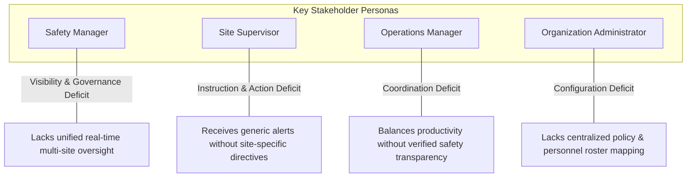
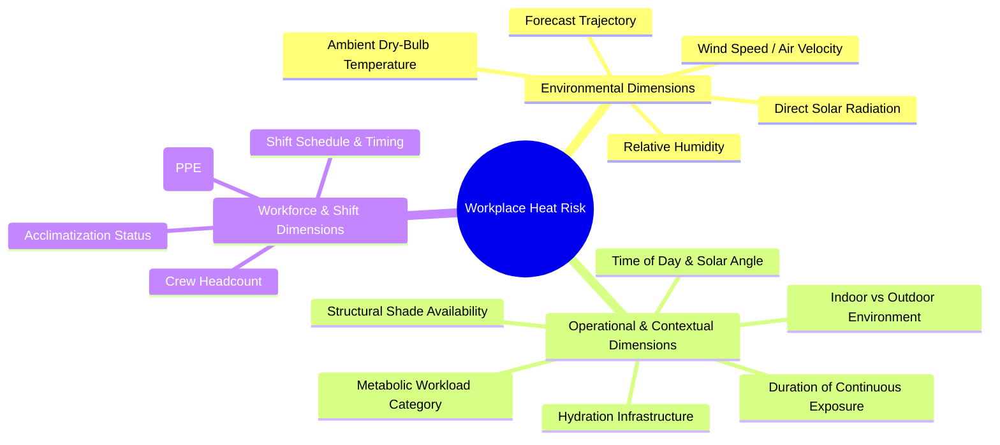
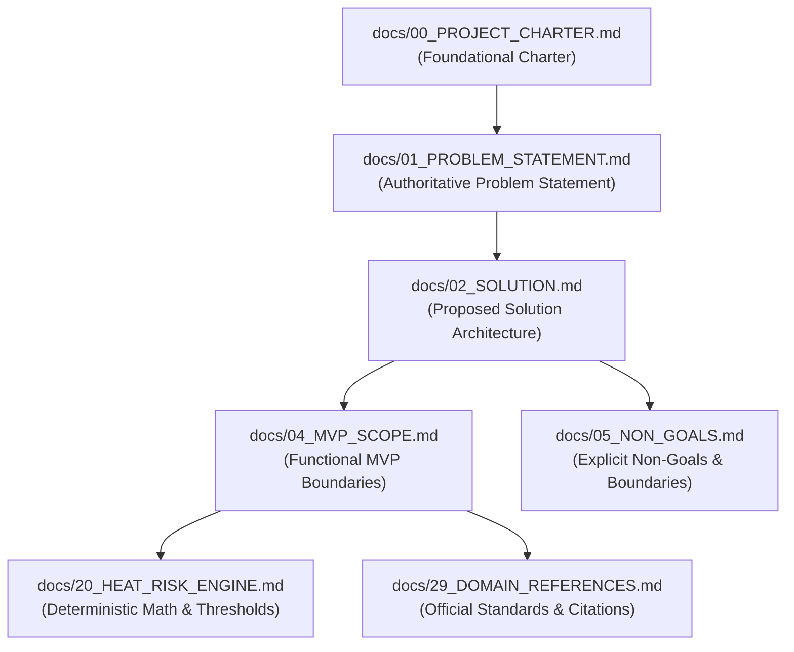

# Heat Action Response Engine (HARE) — Authoritative Problem Statement

## 1. Problem Statement

Organizations operating outdoor and heat-exposed worksites receive weather and heat-risk information, but converting that information into coordinated, site-specific, accountable workplace action remains an operational challenge.

Meteorological warnings and heat index advisories inform organizations that ambient environmental hazards are present. However, a warning by itself does not guarantee that:

* The specific worksite at risk is pinpointed.
* The exposed workers and task profiles are identified.
* The appropriate, context-specific preventive actions are selected.
* The responsible frontline supervisor receives clear, direct instructions.
* The instruction is seen, understood, and positively acknowledged.
* The preventive action is executed on site in a timely manner.
* Unacknowledged or unresolved situations are automatically escalated to oversight leadership.
* The complete sequence of events is retained for operational and safety review.

Many organizations already prioritize occupational safety and maintain field communication channels. Nevertheless, without an integrated operational mechanism connecting environmental intelligence to supervisory workflows, an operational gap can arise between hazard detection and frontline field execution.

---

## 2. The Core Problem

The core challenge addressed by the Heat Action Response Engine is an **operational transformation gap**:

```text
Environmental Risk Information
            ↓
          ????   <── [ The Operational Transformation Gap ]
            ↓
Workplace Action
```

Many industrial enterprises already have access to:
* Public weather broadcasts, commercial forecasts, and heat advisories.
* Internal environmental health and safety (EHS) policies and guidelines.
* Designated site supervisors, safety officers, and operational managers.
* Basic communication channels (group chats, phone calls, SMS, bulletin boards).

Despite the presence of these individual components, connecting them into a coordinated, accountable, and auditable operational workflow is difficult.

Therefore, our problem is **NOT**:

> *"People do not know that extreme heat is dangerous."*

Our problem is:

> **"Heat-risk information does not automatically become a coordinated, accountable, and traceable workplace response."**

---

## 3. Why a Heat Warning Is Not Enough

Information is fundamentally distinct from action. Receiving a notification stating that conditions are hazardous does not resolve the operational decisions required to mitigate that hazard.

```text
CONVENTIONAL HEAT WARNING
"High heat risk expected today across the metropolitan region."

CRITICAL OPERATIONAL QUESTIONS THAT REMAIN UNANSWERED:
* Which specific sites and zones are affected?
* Which crews and shifts are actively exposed?
* What level of physical exertion is scheduled for those crews?
* Who is the specific supervisor on duty responsible for responding?
* What concrete preventive controls (rest intervals, shade, hydration) must be initiated?
* Has the responsible supervisor seen and acknowledged the instruction?
* Have the preventive controls actually been carried out in the field?
* What happens if the supervisor is occupied or fails to respond?
```

A passive warning informs; an operational system coordinates, assigns, verifies, and escalates. Answering these operational questions is the primary objective of the Heat Action Response Engine.

---

## 4. The Operational Gap

The transition from raw meteorological data to an auditable safety record involves multiple operational layers. In many current environments, these layers remain disconnected:

| Operational Layer | Typical Question | Operational Challenge |
| :--- | :--- | :--- |
| **Weather** | How hot will it be? | Macro-level environmental information alone does not define a localized workplace response. |
| **Risk** | How serious is the exposure? | Ambient temperature alone does not reflect effective strain; workload, humidity, solar load, and duration matter. |
| **Planning** | What should change operationally? | Requires translating abstract indices into concrete, context-specific standard operating procedures (SOPs). |
| **Responsibility** | Who is required to act? | In broadcast communication models, responsibility can remain diffused across multiple parties without clear individual ownership. |
| **Communication** | Did the recipient receive the message? | Standard alerts do not enforce or record positive acknowledgment. |
| **Execution** | Was the corrective action performed? | Sending a notification does not confirm that rest breaks, hydration, or shade were implemented on site. |
| **Escalation** | What happens if nobody responds? | Without automated monitoring, unacknowledged high-risk situations rely on manual follow-up, introducing delays. |
| **Audit** | What happened during the event? | Response logs, timestamps, and communication histories are often fragmented, complicating post-incident analysis. |

---

## 5. Who Experiences the Problem?

The operational gap impacts multiple roles across an enterprise, each encountering distinct operational friction:



### 5.1 Safety Manager
* **Operational Needs:** Real-time visibility across all active worksites, instant identification of high-risk facilities, live action status tracking, automated escalation visibility, and comprehensive historical response records.
* **Core Friction:** Must coordinate across geographically distributed locations, often lacking the tools to verify whether local supervisors have implemented mandatory preventive measures.

### 5.2 Site Supervisor
* **Operational Needs:** Unambiguous, site-specific instructions, timely notifications that fit frontline workflows, one-click acknowledgment, and clear escalation support.
* **Core Friction:** A generic regional weather bulletin does not translate into practical instructions. The supervisor must decide what rest intervals or shade measures to enact while balancing active task deadlines.

### 5.3 Operations Manager
* **Operational Needs:** Clear visibility into active workforce deployments, operational continuity, forward-looking risk awareness, and documented assurance that required safety protocols were enacted.
* **Core Friction:** Safety directives can conflict with production schedules. Without structured, predictable action plans, managers face ad-hoc operational disruptions rather than controlled schedule adaptations.

### 5.4 Organization Administrator
* **Operational Needs:** Centralized management of worksite geospatial profiles, shift rosters, supervisory hierarchy, escalation rules, and system configuration.
* **Core Friction:** Organizational directories, shift rosters, and safety policies often reside in disparate silos, hindering automated routing of safety directives.

---

## 6. Who Is Affected?

While HARE is an organizational platform rather than an individual consumer application, its operational outputs directly protect heat-exposed workforces across varied industrial sectors:

* **Construction Crews:** Structural framing, masonry, earthmoving, and rebar crews exposed to direct sunlight and high metabolic exertion.
* **Road and Infrastructure Workers:** Asphalt pavers, utility trenchers, and track maintenance teams operating in severe microclimates with high radiant surface heat.
* **Logistics and Yard Personnel:** Container handlers, loading dock workers, and material movers in non-climate-controlled terminals and open storage yards.
* **Utility and Field Service Technicians:** Power line workers, pipeline inspectors, and telecommunications technicians working outdoors under tight service schedules.
* **Agricultural and Landscape Workers:** Field labor and groundskeeping crews subject to prolonged sun and ambient heat exposure.
* **Industrial Maintenance Personnel:** Maintenance teams operating in unconditioned indoor/outdoor industrial facilities.

The platform is designed around **organizational heat-risk operations** generally, rather than a single niche industry, providing adaptable workflows across any outdoor or heat-exposed operational environment.

---

## 7. Why the Problem Is Operationally Difficult

Translating heat risk into workplace action is complex because occupational heat stress is inherently multidimensional. A worksite's risk cannot be captured by ambient temperature alone.



### Key Contextual Dimensions:
1. **Environmental Influx:** The interaction of ambient temperature, humidity (which impedes evaporative cooling), radiant heat from direct sunlight, and air velocity.
2. **Metabolic Heat Generation:** Heavy physical exertion (e.g., manual digging or lifting) generates substantial internal body heat, creating severe strain even at moderate ambient temperatures.
3. **Operational Configuration:** Shaded staging areas, availability of cool drinking water, and shift timing (morning vs. afternoon peak heat) drastically alter actual on-site strain.
4. **Protective Equipment (PPE):** Heavy workwear, high-visibility vests, and protective gear can impede natural heat dissipation.

Because these factors interact dynamically, a simplistic rule such as:

$$\text{Temperature} > X \implies \text{Broadcast Alert}$$

is insufficient as an operational safety solution. It results in either alarm fatigue or dangerous under-protection.

*(Note: Precise risk calculation formulas and threshold matrices are documented separately in [`docs/20_HEAT_RISK_ENGINE.md`](file:///d:/Amazon%202nd%20Hackathon%20Heat/docs/20_HEAT_RISK_ENGINE.md).)*

---

## 8. Information → Action Gap

The operational breakdown in conventional safety workflows can be mapped as follows:

```text
                            CURRENT CONVENTIONAL WORKFLOW

   [ Weather / Meteorological Data ]
                 │
                 ▼
      [ Broadcast Heat Warning ]
                 │
                 ▼
    [ Ad-hoc Human Interpretation ]  ──> Risk of inconsistent or subjective assessments
                 │
                 ▼
       [ Manual Coordination ]      ──> Delays, phone calls, informal messaging
                 │
                 ▼
   [ Informal Supervisor Messaging ] ──> Message lost in group chat, no delivery verification
                 │
                 ▼
       [ Unverified Field Action ]   ──> Actions may be delayed, partial, or skipped
                 │
                 ▼
      [ Manual or Absent Follow-up ] ──> No automated escalation if supervisor is unresponsive
                 │
                 ▼
       [ Fragmented Records ]        ──> Incomplete audit trail for post-incident review
```

### Common Failure Modes in the Manual Chain:
* **Fragmented Communication:** Alerts scattered across email, WhatsApp groups, radio channels, and paper boards.
* **Inconsistent Interpretation:** Different site supervisors apply differing, subjective criteria to the same heat warning.
* **Unclear Ownership:** Broadcast warnings lack a designated single point of accountability.
* **Delayed Acknowledgment:** No mechanism exists to alert management when a supervisor has not viewed a critical directive.
* **Lack of Verification:** Management assumes safety controls were deployed, but lacks structured confirmation.
* **Audit Trail Deficits:** Following an inspection or heat-stress event, the organization cannot produce a verifiable timeline of actions taken.

---

## 9. What Existing Weather and Heat Tools Solve

To maintain intellectual and engineering integrity, HARE does not claim that heat monitoring is an unsolved problem. A mature ecosystem of weather and heat-risk technologies already addresses foundational elements of the domain:

* **Meteorological Monitoring & Forecasting:** Global numerical weather prediction models and APIs (e.g., Open-Meteo, IMD, NOAA) deliver high-precision weather forecasts and real-time conditions.
* **Heat Indices & Bio-meteorological Metrics:** Established formulas (e.g., Steadman's Heat Index, Wet Bulb Globe Temperature approximations) reliably quantify environmental heat stress.
* **Public Warning Networks:** Government agencies and weather portals effectively distribute regional heat advisories and heatwave warnings.
* **Industrial Weather Stations:** On-site commercial weather stations provide high-precision localized physical measurements.
* **Wearable Physiological Sensors:** Specialized enterprise wearable solutions monitor individual heart rate and body temperature proxies.

Therefore, our project does **NOT** claim:

> *"Nobody has built heat-risk detection or heat warning systems."*

Instead, HARE addresses the operational layer that sits between risk detection and organizational execution:

```text
               EXISTING STRENGTH
             [ Risk Detection & Weather Forecasting ]
                            │
                            ▼
      ======================================================
      [ THE HARE OPPORTUNITY: OPERATIONALIZING THE RESPONSE ]
      * Contextual Workload Mapping
      * Prescriptive Action Plan Synthesis
      * Supervisory Role Binding & Direct Dispatch
      * Time-Bounded SLA Acknowledgment
      * Automated Hierarchical Escalation
      * Centralized Operational Event Ledger
      ======================================================
                            │
                            ▼
               TARGET OUTCOME
             [ Verified, Accountable Workplace Action ]
```

---

## 10. Our Specific Problem Boundary

The Heat Action Response Engine focuses exclusively on the coordination and verification problem between heat-risk signals and workplace execution:

> **We solve the operational coordination problem between environmental heat-risk information and frontline workplace response.**

The platform is engineered to answer seven sequential operational questions:

```text
1. Where is the risk?         ──> (Identifies specific site & physical zone)
        ↓
2. Who is exposed?            ──> (Resolves active crews, shifts, & headcounts)
        ↓
3. What action is required?   ──> (Maps risk + workload to prescriptive SOPs)
        ↓
4. Who owns the action?       ──> (Binds directive to designated on-duty supervisor)
        ↓
5. Did they acknowledge it?   ──> (Tracks positive receipt against SLA countdown)
        ↓
6. Was it verified?           ──> (Records field execution status confirmation)
        ↓
7. If not, who intervenes?    ──> (Automatically escalates to Safety & Ops Managers)
```

This sequence defines the complete boundary of the HARE platform.

---

## 11. What We Are NOT Solving

To prevent scope creep and maintain strict safety boundaries, the project explicitly defines what it does **NOT** attempt to solve:

* **Not a Medical Diagnosis System:** The system does not assess, diagnose, or treat heat-related illnesses (heat cramps, heat exhaustion, heat stroke).
* **Not a Clinical Triage System:** Does not determine individual medical fitness for work or predict individual clinical outcomes.
* **Not an Emergency Dispatch System:** Does not replace municipal emergency medical services (911 / 108 ambulance dispatch).
* **Not a Replacement for Safety Professionals:** Does not replace trained EHS personnel, industrial hygienists, or human site supervisors.
* **No Guaranteed Safety Outcomes:** The system coordinates operational processes; it does not claim to guarantee life safety or eliminate all physical risks.
* **Not a Legal or Regulatory Certification Tool:** The system does not certify legal compliance with statutory labor codes or occupational regulations.
* **No Physical IoT Dependency in MVP:** The MVP does not build, deploy, or require physical microcontrollers, sensors, or hardware telemetry pipelines.
* **No Autonomous Safety Arbiters:** AI models do not override deterministic rules or independently decide whether conditions are safe.

*(For the complete, exhaustive catalog of non-goals, refer to [`docs/05_NON_GOALS.md`](file:///d:/Amazon%202nd%20Hackathon%20Heat/docs/05_NON_GOALS.md).)*

---

## 12. Evidence Classification Framework

To ensure engineering rigor and transparency throughout project documentation, all claims and statements are categorized into a three-tier evidence hierarchy:

| Claim Category | Definition & Meaning | Example in HARE Context |
| :--- | :--- | :--- |
| **Verified Evidence** | Statements supported directly by authoritative official documentation, published standards, or empirical data. | Prolonged physical labor under high heat index conditions increases occupational thermal strain. |
| **Reasonable Inference** | Logical deductions derived directly from verified evidence, established engineering patterns, or common operational practice. | Automated assignment and direct notification to frontline supervisors may reduce coordination delays compared to manual phone calls. |
| **Product Hypothesis** | Testable propositions regarding product workflow efficacy that require empirical validation through operational use. | Enforcing time-bounded acknowledgment and automated escalation will increase organizational response rates to extreme heat events. |

This classification ensures that project documentation clearly distinguishes between established scientific facts, logical operational deductions, and testable product hypotheses.

---

## 13. Evidence Requirements for Project Documentation

All future technical, risk, and operational documentation must adhere to strict sourcing requirements. Project claims must prioritize:

1. **Official Meteorological Authorities:** e.g., Indian Meteorological Department (IMD), National Oceanic and Atmospheric Administration (NOAA).
2. **Occupational Safety & Health Authorities:** e.g., National Institute for Occupational Safety and Health (NIOSH/CDC), Occupational Safety and Health Administration (OSHA), National Disaster Management Authority (NDMA).
3. **Peer-Reviewed Scientific & Occupational Health Literature:** Published studies on bio-meteorology, ergonomics, and thermal strain indices.
4. **Reputable Standards Organizations:** e.g., International Organization for Standardization (ISO standards for thermal environments such as ISO 7243 / ISO 7933).
5. **Technical & Platform Documentation:** Official documentation for cloud and language model platforms (AWS, NVIDIA).

*(All literature citations and source references will be formally cataloged in [`docs/29_DOMAIN_REFERENCES.md`](file:///d:/Amazon%202nd%20Hackathon%20Heat/docs/29_DOMAIN_REFERENCES.md).)*

---

## 14. Problem Severity vs Product Scope

A critical distinction must be maintained between the societal severity of heat risk and the bounded scope of our software platform:

```text
ESTABLISHED REALITY:
Extreme heat exposure is a well-documented occupational hazard that complicates industrial operations.

PRODUCT HYPOTHESIS:
Structured software workflows that connect environmental data to supervised, time-bounded actions
can help organizations coordinate their preventive responses more consistently.

WHAT WE MEASURE (SYSTEM OPERATIONAL METRICS):
We measure operational workflow performance, NOT speculative clinical health outcomes.
```

### Observable System-Level Metrics:
* **Acknowledgment Latency:** Time elapsed between notification dispatch and supervisor confirmation.
* **Escalation Frequency:** Rate at which unacknowledged directives trigger escalation across monitored facilities.
* **Action Resolution Rate:** Percentage of generated action plans that reach verified execution status.
* **Operational Visibility:** Proportion of active worksites with real-time risk classification and assigned supervisory coverage.
* **SOP Compliance Traceability:** Completeness of the chronological event log across all detected heat events.

System metrics evaluate whether the operational software loop functions reliably; they do not serve as unverified proxies for medical outcomes.

---

## 15. Example Problem Scenario

The following realistic chronological timeline illustrates the operational breakdown our product addresses:

```text
08:30 | Shift Inception
        Morning crew begins outdoor structural steel installation at an urban infrastructure site.
        Ambient conditions are moderate (28°C, 55% RH). Work proceeds normally.

10:00 | Rapid Environmental Transition
        Solar radiation intensifies and humidity remains elevated. Ambient temperature climbs to 35°C,
        causing the effective heat stress index to cross into an elevated risk tier.

10:05 | The Information-to-Action Disconnect
        Regional weather services update conditions. A public heat advisory is broadcast.
        However, on the active worksite:
        - The site supervisor is focused on crane operations and has not checked external weather feeds.
        - The regional safety officer is managing three other distant sites and is unaware that this specific
          site's microclimate just crossed a critical threshold.
        - The heavy steel installation continues at high metabolic exertion without planned cooling breaks.

10:20 | The Accountability Void
        No dedicated system has evaluated the site's workload, formulated a tailored work-rest schedule,
        or assigned an action directive to the on-duty supervisor.
        Because no instruction was assigned, no acknowledgment timer exists, and no escalation occurs.

11:15 | Delayed Intervention
        The safety officer finally notices regional weather updates and calls the site supervisor.
        Nearly an hour of high-strain exposure has elapsed before shaded rest and hydration are organized.

Post-Shift | The Audit Deficit
        Management reviews the shift. There is no timestamped record showing when the environmental hazard arose,
        what specific mitigation was mandated, who was responsible for enacting it, or why delays occurred.
```

This scenario highlights the exact coordination breakdown that HARE eliminates through automated detection, contextualization, assignment, time-bounded acknowledgment, and escalation.

---

## 16. Problem Statement in One Sentence

> **Heat-risk information tells organizations when conditions may become dangerous; the harder operational problem is turning that signal into timely, site-specific, accountable, and traceable workplace action.**

*(This sentence represents the canonical problem formulation across all project architecture and design artifacts.)*

---

## 17. Problem Statement for Hackathon Judges

> *"When extreme heat threatens outdoor worksites, current weather alerts only tell companies that it is hot—they leave a dangerous operational gap between the warning and actual workplace response.*
> 
> *Frontline supervisors rarely receive site-specific, task-appropriate action plans, nobody tracks whether safety directives are acknowledged, unaddressed hazards fail to escalate, and organizations lack an auditable record of what occurred.*
> 
> *The Heat Action Response Engine solves this by transforming raw heat forecasts into context-aware work-rest-hydration actions, assigning them directly to on-duty supervisors, enforcing time-bounded acknowledgment with automated escalation, and maintaining an immutable operational audit trail."*

---

## 18. Problem → Opportunity

The strategic trajectory of the project is summarized below:

```text
========================================================================================
PROBLEM:
Heat-risk information frequently remains disconnected from frontline workplace execution,
relying on manual, fragmented, and unverified response chains.
========================================================================================
                                           │
                                           ▼
========================================================================================
OPPORTUNITY:
Construct an automated operational layer that connects environmental risk data directly
to designated supervisors, prescriptive actions, and verified accountability loops.
========================================================================================
                                           │
                                           ▼
========================================================================================
PRODUCT RESPONSE (THE HARE OPERATIONAL ENGINE):
Detect ──> Assess ──> Contextualize ──> Decide ──> Assign ──> Notify ──> Acknowledge
       ──> Escalate ──> Verify ──> Audit
========================================================================================
```

---

## 19. Relationship to Other Documents

This document establishes the problem boundary and serves as a foundational dependency for the broader documentation suite:



* **`00_PROJECT_CHARTER.md`:** Top-level charter defining project purpose, high-level principles, and governance.
* **`01_PROBLEM_STATEMENT.md` (This document):** Rigorous definition of the operational gap and problem boundaries.
* **`02_SOLUTION.md`:** Detailed functional and technical architecture of the proposed response engine.
* **`04_MVP_SCOPE.md` & `05_NON_GOALS.md`:** Precise functional inclusions, exclusions, and safety guardrails.
* **`20_HEAT_RISK_ENGINE.md`:** Mathematical formulation of heat indices, workload categories, and deterministic thresholds.
* **`29_DOMAIN_REFERENCES.md`:** Verified literature citations, official safety standards, and repository review findings.

---

* **Status:** Draft
* **Last Updated:** 2026-10-07
