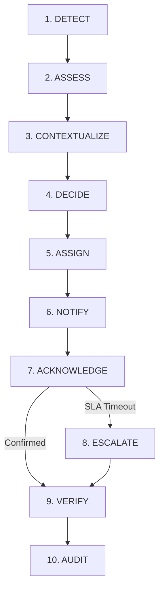
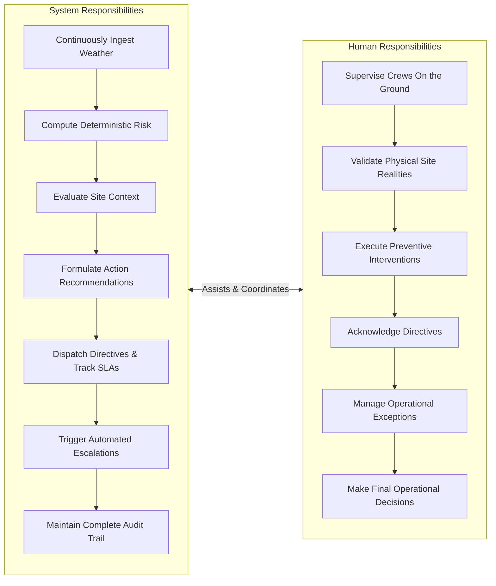

# Heat Action Response Engine (HARE) — Complete Proposed Solution

## 1. Solution Overview

The **Heat Action Response Engine (HARE)** is a software platform engineered to convert changing heat and weather conditions into coordinated, traceable workplace actions.

> **We turn heat forecasts into site-specific work-rest-hydration actions, assign them to responsible supervisors, and automatically escalate when nobody acts.**

HARE is fundamentally distinct from conventional weather dashboards or passive alerting tools. Standard tools inform organizations about environmental conditions, but stop at the point of communication. HARE operationalizes environmental data into an accountable, closed-loop workflow:

```text
Weather / Heat Signal
        ↓
Heat Risk Assessment
        ↓
Worksite Context
        ↓
Exposure Context
        ↓
Required Action
        ↓
Responsible Person
        ↓
Notification
        ↓
Acknowledgment
        ↓
Execution / Verification
        ↓
Escalation
        ↓
Audit History
```

By connecting environmental risk directly to designated human supervisors, tracking their acknowledgment in real time, escalating unacknowledged hazards, and retaining an immutable audit trail, HARE provides an end-to-end operational safety loop.

---

## 2. Problem-to-Solution Mapping

The table below outlines common operational challenges observed across industrial worksites during extreme heat events and how HARE addresses them:

| Existing Problem | Why It Matters | Our Solution |
| :--- | :--- | :--- |
| **Weather warnings do not automatically become workplace actions** | Broad weather warnings inform management that it is hot, but fail to specify what exact preventive adjustments (e.g., rest periods, shade deployment, water replenishment) must occur at a specific worksite. | **Context-Driven Action Generation:** Automatically generates discrete, prescriptive standard operating procedures (SOPs) based on evaluated risk and site activity. |
| **Different worksites have divergent exposure contexts** | Two facilities in the same city experience identical ambient weather, yet one crew operates heavy machinery in direct sunlight while another works in a ventilated indoor staging area. | **Workplace Context Engine:** Ingests site-specific parameters (workload intensity, shade availability, active shift schedules) to evaluate effective risk rather than raw temperature alone. |
| **Supervisors need actionable instructions rather than generic warnings** | Frontline supervisors lack time to interpret complex meteorological charts (e.g., heat index curves, wet-bulb metrics) and need clear, practical directives. | **Direct, Prioritized Checklists:** Dispatches clear, concise, task-based mitigation instructions directly to the on-duty supervisor's interface. |
| **Safety managers lack cross-site operational visibility** | Regional safety managers overseeing multiple dispersed facilities cannot easily determine if safety protocols are being implemented uniformly. | **Centralized Management Console:** Provides a unified multi-site dashboard displaying real-time risk tiers, active action plans, acknowledgment statuses, and escalations. |
| **Important actions may be acknowledged late or not at all** | When warnings are distributed through broadcast channels (group chats, notice boards), there is no mechanism to track who saw the warning or ensure timely action. | **Time-Bounded SLA & Automated Escalation:** Tracks acknowledgment against strict response windows; automatically escalates unacknowledged directives to higher management. |
| **Absence of centralized history for heat-risk events and responses** | After heat-stress incidents or during safety audits, organizations cannot reconstruct what alerts occurred, who was notified, or what actions were taken. | **End-to-End Audit Ledger:** Maintains an immutable, timestamped event log recording input weather parameters, generated actions, supervisor acknowledgments, and escalations. |
| **Existing tools focus primarily on risk information rather than response loops** | Many existing solutions treat the alert as the final output, leaving an operational gap between hazard awareness and physical field intervention. | **Closed-Loop Execution Pipeline:** Focuses on the complete lifecycle from detection through supervisory assignment, acknowledgment, execution logging, and governance. |

---

## 3. Core Solution Loop

The Heat Action Response Engine operates via a continuous ten-stage operational lifecycle:



### Stage 1: DETECT
* **What happens:** The system programmatically ingests current meteorological conditions and forward-looking hourly forecast data for all registered worksite coordinates.
* **Data used:** Ambient temperature, relative humidity, direct solar radiation, wind speed, and hourly forecast sequences from external meteorological APIs.
* **System output:** Normalized meteorological telemetry records.
* **Responsible party:** Automated Environmental Ingestion Service.

### Stage 2: ASSESS
* **What happens:** The deterministic risk engine evaluates incoming environmental metrics to calculate standard heat stress indices (e.g., Heat Index and wet-bulb approximations) and determine the base environmental risk tier.
* **Data used:** Normalized temperature, relative humidity, solar radiation, and authoritative occupational risk thresholds.
* **System output:** Calculated heat risk index and baseline environmental risk level (e.g., Low, Moderate, High, Severe).
* **Responsible party:** Deterministic Heat Risk Engine.

### Stage 3: CONTEXTUALIZE
* **What happens:** The system evaluates baseline environmental risk against active site-specific operational parameters to determine effective site strain.
* **Data used:** Worksite geospatial profile, active shift schedule, crew headcount, task metabolic workload category (Light, Moderate, Heavy, Very Heavy), and physical environment (indoor vs. outdoor, shade availability).
* **System output:** Contextualized risk profile tailored to the specific crew and active work zone.
* **Responsible party:** Workplace Context Engine.

### Stage 4: DECIDE
* **What happens:** The system maps the contextualized risk profile against predefined, authoritative occupational heat safety matrices to determine mandatory preventive interventions.
* **Data used:** Contextualized risk profile, organizational SOP safety rules, and mitigation protocol templates.
* **System output:** A discrete Action Plan detailing specific mitigation steps (e.g., work-rest cycles, mandatory shade breaks, hydration replenishment intervals).
* **Responsible party:** Action Engine (Deterministic Safety Rules).

### Stage 5: ASSIGN
* **What happens:** The system resolves the specific on-duty supervisor responsible for the target worksite, zone, and shift, binding them as the primary owner of the Action Plan.
* **Data used:** Organizational shift roster, personnel mapping, contact directory, and supervisory role hierarchy.
* **System output:** An assigned Action Plan bound to a specific supervisor entity with a defined acknowledgment deadline.
* **Responsible party:** Operational Workflow Service.

### Stage 6: NOTIFY
* **What happens:** The system delivers a clear, actionable directive to the assigned supervisor across designated notification channels.
* **Data used:** Assigned Action Plan, supervisor contact profile, preferred messaging channel (web portal, SMS, email).
* **System output:** Dispatched notification payload containing the prioritized action checklist and SLA countdown.
* **Responsible party:** Notification Service / Dispatcher.

### Stage 7: ACKNOWLEDGE
* **What happens:** The assigned supervisor reviews the directive and submits positive confirmation acknowledging responsibility for executing the actions on site.
* **Data used:** Supervisor authentication identity, timestamp, action identifier, user confirmation payload.
* **System output:** State transition from `DISPATCHED` to `ACKNOWLEDGED`.
* **Responsible party:** Site Supervisor (Frontline Human-in-the-Loop).

### Stage 8: ESCALATE
* **What happens:** If the assigned supervisor fails to acknowledge the Action Plan within the configured acknowledgment window, the system automatically triggers an escalation alert to secondary leadership.
* **Data used:** Configured SLA timeout parameters, elapsed time since dispatch, escalation routing matrix.
* **System output:** State transition to `ESCALATED`; high-priority notifications dispatched to the Safety Manager and Operations Manager.
* **Responsible party:** Automated Escalation Monitor.

### Stage 9: VERIFY
* **What happens:** Following field execution of the required mitigations, the supervisor logs execution status or confirms that corrective controls are active on site.
* **Data used:** Execution confirmation details, field notes, completion timestamp.
* **System output:** State transition to `EXECUTED` or `RESOLVED`.
* **Responsible party:** Site Supervisor and Safety Manager.

### Stage 10: AUDIT
* **What happens:** Every transition, parameter, timestamp, payload, acknowledgment, and escalation event is immutably written to the event history.
* **Data used:** Full chronological event metadata across all stages.
* **System output:** Inspection-ready, tamper-evident audit record.
* **Responsible party:** Audit Ledger Service.

---

## 4. What Makes This Different From a Weather Alert

To understand the core innovation of the Heat Action Response Engine, compare the conventional weather alert model with HARE's operational execution model:

```text
CONVENTIONAL MODEL
Weather API  ──>  Temperature  ──>  Heat Warning  ──>  User sees alert (Passive Broadcast)

HEAT ACTION RESPONSE ENGINE MODEL
Weather API  ──>  Heat Risk Engine  ──>  Worksite Context  ──>  Exposure + Work Context
             ──>  Action Plan  ──>  Responsible Supervisor  ──>  Acknowledgment
             ──>  Escalation  ──>  Audit (Closed-Loop Operational Action)
```

### The Product Insight

> **The important unit of work is not the alert. It is the verified action.**

Passive alerts treat the human recipient as a passive consumer of information. In an industrial or construction setting, a broadcast message ("Heat advisory in effect today") does not establish:
* Who must adjust work schedules?
* What specific rest intervals are mandatory for high-exertion tasks?
* Did the field supervisor receive and review the directive?
* Did the supervisor actually implement the rest break?
* Who intervenes if the supervisor is occupied or fails to respond?

HARE bridges this gap by transforming an informational alert into a governed operational workflow where accountability is tracked, verified, and preserved.

---

## 5. Example Scenario

The following realistic operational scenario illustrates the platform in action at a construction facility in Bengaluru:

```text
Site: Construction Site #17 (Bengaluru East Zone)
Active Workforce: 42 Workers
Shift Schedule: 09:00 – 17:00
Work Profile: Structural rebar installation and exterior concrete pouring (Heavy Physical Work, Direct Sun)

11:30 | Meteorological Ingestion
        Continuously updated weather data indicates ambient temperature rising to 36°C with 62% relative humidity,
        pushing the calculated Heat Index past the High Risk threshold.
          ↓
11:31 | Contextual Risk Assessment
        System evaluates Site #17 context:
        - 42 workers deployed in unshaded outdoor zone.
        - Workload classified as Heavy Metabolic Rate (>350W).
        - High environmental heat combined with heavy physical exertion triggers mandatory intervention.
          ↓
11:32 | Action Plan Generation
        Deterministic safety rules generate Action Plan #AP-1082:
        - Implement 45-minute work / 15-minute shaded rest cycle.
        - Verify active hydration stations stocked with potable water and electrolytes.
        - Move high-exertion concrete finishing to shaded staging where feasible.
          ↓
11:32 | Supervisory Assignment & Notification
        System resolves on-duty Site Supervisor: Ramesh K.
        Notification dispatched to Supervisor portal with a 15-minute acknowledgment window.
          ↓
11:39 | Supervisor Acknowledgment
        Supervisor Ramesh K. reviews Action Plan #AP-1082 and clicks "Acknowledge & Enact".
        System records acknowledgment at 7 minutes (within SLA window).
          ↓
11:45 | Field Execution
        Supervisor halts heavy pouring, directs crew to shaded break canopy, verifies hydration replenishment.
        Supervisor marks "Rest cycle initiated; shade and water verified" in portal.
          ↓
12:00 | Centralized Audit & Management Visibility
        Safety Manager console reflects Site #17 status as "Active Mitigations Underway; Acknowledged".
        All environmental parameters, generated actions, and supervisor timestamps are permanently logged.
```

*(Note: In an alternate escalation demonstration, had Supervisor Ramesh K. not acknowledged by 11:47, the system would have automatically escalated Action Plan #AP-1082 to the Regional Safety Manager at 11:48, initiating proactive secondary follow-up.)*

---

## 6. Action Plan Concept

An **Action Plan** is a structured, contextualized operational artifact produced by the system whenever environmental and workplace conditions warrant preventive intervention.

### Core Attributes of an Action Plan:
* **Plan Identifier:** Unique system-generated UUID (e.g., `AP-1082`).
* **Worksite & Location:** Target site identifier, physical zone, coordinates, indoor/outdoor designation.
* **Risk Level & Classification:** Calculated heat risk tier (Low, Caution, High, Severe).
* **Risk Rationale:** Explicit, deterministic explanation of the factors triggering the plan (e.g., ambient temperature, relative humidity, solar load, workload category).
* **Target Work Group / Shift:** Identified shift, active crew headcount, scheduled task types.
* **Required Preventive Actions:** Prioritized, concrete standard operating procedure checklist.
* **Responsible Person:** Explicitly assigned Site Supervisor or Safety Officer.
* **Acknowledgment Deadline:** Time-bounded SLA window based on risk severity.
* **Workflow Status:** Current state (`CREATED`, `DISPATCHED`, `ACKNOWLEDGED`, `ESCALATED`, `EXECUTED`, `RESOLVED`).
* **Timestamps:** Dispatched timestamp, acknowledged timestamp, resolution timestamp.
* **Audit Metadata:** Source weather data references, algorithm version, rule version.

### Conceptual Action Categories:
Action items fall into standardized operational categories grounded in occupational safety practices:
* **Work-Rest Scheduling:** Adjusting active work cycles and mandatory cooling rest periods.
* **Hydration Management:** Enforcing scheduled fluid replenishment intervals and verifying water availability.
* **Environmental Controls:** Deploying temporary shade canopies, cooling tents, or mechanical ventilation.
* **Task Rescheduling:** Postponing high-exertion physical tasks or reallocating them to cooler morning/evening hours.
* **Supervisory Monitoring:** Increasing active crew observation for early signs of heat strain.
* **Safety Communication:** Conducting brief tailgate safety briefings on heat awareness.
* **Administrative Escalation:** Notifying higher operational management when extreme conditions persist.

*Disclaimer:* Actual operational protocols and threshold parameters will be grounded in recognized occupational safety guidelines and organizational SOPs; the system does not generate arbitrary medical prescriptions.

---

## 7. Human-in-the-Loop Design

The Heat Action Response Engine is strictly architected as a **human-in-the-loop operational support system**. It is designed to empower human supervisors and safety professionals, never to bypass or replace them.



### Allocation of Responsibilities:

* **What the System Does:**
  * Monitors continuously updated meteorological streams without human fatigue.
  * Evaluates complex multidimensional matrices reliably and objectively.
  * Ensures that required safety actions are not forgotten or delayed.
  * Enforces operational accountability through time-bounded tracking.
  * Preserves transparent records of safety operations.

* **What Humans Do:**
  * Frontline supervisors observe dynamic conditions on site (e.g., sudden local cloud cover, equipment delays, individual worker comfort).
  * Supervisors physically implement and enforce safety measures (distributing water, pausing work).
  * Safety and Operations Managers assess business trade-offs and make final calls on site shutdowns or major task rescheduling.
  * Humans manage unexpected field exceptions and emergency situations.

---

## 8. Deterministic Safety Layer vs AI Layer

To ensure uncompromised safety and regulatory reliability, the architecture maintains a strict, impenetrable boundary between the **Deterministic Safety Layer** and the **AI Layer**.

> **AI communicates and assists; deterministic rules govern safety-critical decisions.**

```text
+--------------------------------------------------------------------------------------------------+
|                                    DETERMINISTIC SAFETY LAYER                                    |
|                                     (Source of Truth / Rules)                                    |
|                                                                                                  |
|  * Mathematical Heat Index calculation         * Workload category thresholds                    |
|  * Environmental risk tier assignment          * Action SOP mapping rules                        |
|  * Acknowledgment SLA countdown logic          * Workflow state machine & transitions            |
|  * Hierarchical escalation triggers            * Centralized audit logging                       |
+--------------------------------------------------------------------------------------------------+
                                                 │
                                 Structured Data │ Grounded Context
                                                 ▼
+--------------------------------------------------------------------------------------------------+
|                                       ASSISTIVE AI LAYER                                         |
|                                    (NVIDIA AI / Language Models)                                 |
|                                                                                                  |
|  * Natural-language risk explanations          * Multi-lingual dialect translation               |
|  * Concise supervisor alert message drafting   * Grounded Q&A on active site conditions          |
|  * Executive shift safety summaries            * Contextual communication assistance             |
+--------------------------------------------------------------------------------------------------+
```

### Why This Separation is Essential:
1. **Safety Integrity:** Machine learning models and large language models (LLMs) can hallucinate, drift, or exhibit non-deterministic behavior. Safety-critical thresholds (e.g., whether a work-rest cycle is mandatory at 38°C) must be 100% predictable, verifiable, and rule-based.
2. **Regulatory & Audit Transparency:** In post-incident investigations, safety auditors require clear proof of the exact formula and threshold applied. Deterministic rules provide transparent mathematical traceability.
3. **Optimized AI Utility:** LLMs excel at natural language synthesis, multilingual adaptation, and context summarization. By focusing AI strictly on communication assistance, the system leverages AI's greatest strengths without exposing worker safety to probabilistic errors.

---

## 9. Weather and Data Strategy

The MVP employs a completely **software-first data strategy**, deliberately avoiding dependencies on physical on-site sensors or custom microcontrollers.

```text
External Meteorological APIs (Open-Meteo)
                  ↓
Continuously Updated Weather & Hourly Forecast Data
                  ↓
HARE Environmental Ingestion Service
                  ↓
Deterministic Heat Risk Engine
```

### Key Principles of the MVP Data Strategy:
* **Software-Accessible External Data:** The primary environmental data source is the Open-Meteo REST API, providing continuously updated ambient temperature, relative humidity, direct solar radiation, wind speed, and forward-looking hourly forecast curves based on high-resolution numerical weather prediction models.
* **National Guidance Context:** Where technically feasible and relevant, official Indian weather and heat advisories from the Indian Meteorological Department (IMD) provide authoritative regional context for heatwave conditions.
* **No On-Site Sensor Dependency:** Open-Meteo data is explicitly understood as **continuously updated weather and forecast data**, not localized physical sensor telemetry. 
* **Zero-Deployment Barrier:** Because data is ingested purely via software APIs based on geospatial coordinates, worksites can be onboarded instantly without capital expenditure, hardware shipping, site wiring, or physical maintenance.

---

## 10. Software-First Architecture

The conceptual system architecture illustrates how environmental data flows through the deterministic and operational engines to frontline personnel:

```text
                    ┌─────────────────────────┐
                    │   External Weather /    │
                    │   Forecast APIs         │
                    └────────────┬────────────┘
                                 │ Ingested Weather Payload
                                 ▼
                    ┌─────────────────────────┐
                    │    Heat Risk Engine     │  <─── Deterministic Rules & Thresholds
                    └────────────┬────────────┘
                                 │ Calculated Environmental Tier
                                 ▼
                    ┌─────────────────────────┐
                    │ Workplace Context Engine│  <─── Worksite, Shift, Workload Data
                    └────────────┬────────────┘
                                 │ Contextualized Risk Profile
                                 ▼
                    ┌─────────────────────────┐
                    │      Action Engine      │  <─── Pre-Configured Safety SOPs
                    └────────────┬────────────┘
                                 │ Generated Action Plan
                                 ▼
                    ┌─────────────────────────┐      ┌─────────────────────────┐
                    │  Notification Service   │ <──> │ NVIDIA AI Assist Layer  │
                    └────────────┬────────────┘      │ (Drafting & Translation)│
                                 │ Dispatched Directive └─────────────────────────┘
                                 ▼
                    ┌─────────────────────────┐
                    │     Site Supervisor     │
                    │     (Mobile / Web)      │
                    └────────────┬────────────┘
                                 │
                         ACK / NO ACK DECISION
                                 │
                   ┌─────────────┴─────────────┐
                   ▼                           ▼
            [ ACKNOWLEDGED ]            [ SLA TIMEOUT ]
                   │                           │
                   ▼                           ▼
          [ Field Execution ]          [ Automated Escalation ]
                   │                     (Safety / Ops Manager)
                   ▼                           │
          [ Status Verified ]                  ▼
                   │                  [ Secondary Response ]
                   └─────────────┬─────────────┘
                                 │
                                 ▼
                    ┌─────────────────────────┐
                    │      Audit History      │
                    │      (Immutable Log)    │
                    └─────────────────────────┘
```

---

## 11. Role of NVIDIA AI

NVIDIA AI models are integrated as specialized assistive microservices to enhance operational communication without participating in safety-critical decisions.

### Approved Assistive Responsibilities:
1. **Risk Explanation:** Translating complex technical values (e.g., *“Heat Index 41°C, Solar Radiation 850 W/m²”*) into clear, non-technical explanations of operational risks for site personnel.
2. **Supervisor Message Generation:** Transforming structured JSON action plans into concise, polite, and urgent supervisory dispatch messages formatted for SMS, mobile chat, or push notifications.
3. **Multilingual Adaptation:** Automatically translating English action plans into regional languages (e.g., Hindi, Kannada, Tamil, Marathi) to ensure field comprehension across linguistically diverse workforces.
4. **Situation Summaries:** Generating executive-level daily and shift summaries for Safety Managers, synthesizing active risk windows across all monitored facilities.
5. **Grounded In-App Assistant:** Providing an interactive Q&A assistant for supervisors and managers, answering queries strictly grounded in currently active site telemetry and organizational SOP manuals.

### Strict AI Prohibitions:
To maintain safety and regulatory integrity, the AI model is strictly prohibited from:
* Inventing, modifying, or relaxing heat-risk thresholds.
* Overriding or cancelling any deterministically generated safety action.
* Diagnosing medical symptoms or assessing whether a worker has heat stroke.
* Declaring an individual worker medically fit or unfit for duty.
* Fabricating or estimating weather conditions when API streams are unavailable.
* Claiming certainty when underlying operational data is ambiguous.

---

## 12. ACK → Escalation Model

The **Acknowledgment and Escalation Model** provides the operational enforcement mechanism ensuring that critical safety directives are not overlooked.

```text
                     [ Action Plan Created ]
                                │
                                ▼
                     [ Assigned to Supervisor ]
                                │
                                ▼
                     [ Notification Dispatched ]
                                │
                                ▼
                     [ Acknowledgment Timer Started ]
                                │
                 ┌──────────────┴──────────────┐
                 ▼                             ▼
       [ Positive Acknowledgment ]    [ Timer Expires (No ACK) ]
                 │                             │
                 ▼                             ▼
       [ Supervisor Enacts SOP ]       [ SLA Breach Triggered ]
                 │                             │
                 ▼                             ▼
       [ Execution Verification ]     [ Escalated to Safety Manager ]
                 │                             │
                 │                             ▼
                 │                    [ High-Priority Alert Sent ]
                 │                             │
                 │                             ▼
                 │                    [ Safety Manager Intervenes ]
                 │                             │
                 └──────────────┬──────────────┘
                                │
                                ▼
                      [ Immutable Audit Log ]
```

### Key Operational Characteristics:
* **Configurable SLA Windows:** Acknowledgment windows are configurable based on risk severity (e.g., shorter response windows for severe risk tiers compared to moderate advisory tiers).
* **Multi-Tier Escalation Hierarchy:** If the primary site supervisor does not acknowledge within the allotted window, the directive escalates immediately to the designated Safety Manager, followed by the Operations Manager if secondary timeouts elapse.
* **Comprehensive Event Capture:** The exact timestamp of creation, dispatch, timer expiration, escalation routing, and supervisory response are permanently logged to provide full visibility into organizational responsiveness.

---

## 13. Dashboard Concept

The HARE management console is designed to give operational leaders instant, unambiguous visibility into safety operations across all facilities.

### Key Conceptual Views & Widgets:
* **Monitored Worksites Overview:** Total facilities actively tracked, categorized by current risk tier (Normal, Caution, High, Severe).
* **Active Heat Risk Map & List:** Real-time geospatial view displaying active meteorological conditions and heat indices across sites.
* **Active Action Plans Feed:** Real-time roster of generated action plans, showing affected crews, scheduled tasks, and assigned supervisors.
* **Pending Acknowledgments Queue:** High-visibility monitor displaying active directives with live SLA countdown timers.
* **Escalation Alert Banner:** Prominent notification zone highlighting unresolved, escalated safety directives requiring urgent executive intervention.
* **Response & Resolution Metrics:** Operational metrics tracking supervisor acknowledgment times and completed verifications.
* **Audit Trail Viewer:** Granular, searchable event ledger allowing safety officers to inspect historical events, input data, and timestamped actions.

> **Core Dashboard Question:** The console is engineered to answer one fundamental operational question at a single glance:
> 
> *“Where is the heat risk, what action is required, who owns it, and has it been verified?”*

---

## 14. Observable Product Metrics

To measure system performance and operational reliability during execution, HARE tracks objective, system-level operational metrics:

* **Number of Worksites Monitored:** Total distinct geographic locations actively ingested and evaluated.
* **Number of Risk Events Detected:** Total instances where calculated heat stress crossed baseline caution or danger thresholds.
* **Number of Action Plans Created:** Total discrete operational action plans synthesized by the rules engine.
* **Number of Actions Acknowledged:** Count of action directives positively acknowledged by frontline supervisors.
* **Number of Actions Completed / Verified:** Count of action plans with recorded completion or verification logs.
* **Number of SLA Escalations:** Total occurrences where unacknowledged directives breached the configured response window.
* **Average Supervisor Acknowledgment Time:** Mean duration between notification dispatch and supervisor acknowledgment.
* **Total Workforce Represented:** Aggregated worker headcount across all actively monitored worksites.
* **Action Resolution Rate:** Percentage of generated action plans that progress through acknowledgment to full resolution.

*(Note: These are objective system workflow metrics, not speculative or unverified claims of clinical medical outcomes.)*

---

## 15. Existing Heat-Stress Detection Repository

The development team notes the existence of the public repository:

`Biraj021/AI-Heat-Stress-Detection`

### Evaluation Protocol:
In accordance with engineering governance principles, this repository will **NOT** be integrated into the MVP architecture or treated as a technical dependency until it has been formally reviewed. 

A dedicated technical evaluation will assess:
* Architecture and underlying model framework.
* Dataset composition, sourcing, and clinical validity.
* Third-party software dependencies and runtime requirements.
* Software licensing compatibility.
* Hardware dependencies (e.g., reliance on specialized microcontrollers or sensors).
* Reported accuracy, benchmarking, and validation methodologies.
* Potential reusable components or algorithms.
* Technical feasibility and safety alignment with HARE's deterministic principles.

The formal findings of this review will be documented in `docs/29_DOMAIN_REFERENCES.md`.

---

## 16. IoT Strategy

The platform maintains a clear architectural separation between the environmental data source and the core risk/action execution engine:

```text
CURRENT MVP (Software-First)
[ Open-Meteo REST API ] ──> [ HARE Ingestion Service ] ──> [ Deterministic Risk & Action Engine ]

FUTURE EXTENSION (Hardware-Agnostic)
[ ESP32 / Industrial Sensors ] ──> [ AWS IoT Core ] ──> [ HARE Ingestion Service ] ──> [ Same Risk & Action Engine ]
```

### Core Strategy Principles:
* **MVP Scope (Zero Hardware):** The MVP strictly requires no microcontrollers (ESP32, Arduino), physical sensors (DHT11, DHT22), or MQTT hardware pipelines. Environmental inputs are derived entirely from software-accessible weather APIs.
* **Source-Agnostic Engine:** The risk engine, context evaluator, action dispatcher, and escalation state machine are decoupled from data ingestion.
* **Future Plug-and-Play Extensibility:** When industrial clients later deploy on-site microclimate sensors or AWS IoT Core pipelines, the data will feed into the same ingestion interface without requiring architectural changes to the core safety and workflow engines.

---

## 17. Why This Solution Is Suitable for the Hackathon

From the perspective of hackathon judges, HARE presents a compelling, high-impact demonstration that addresses a pressing real-world industrial challenge with rigorous engineering:

1. **Demonstrates a Complete Operational Loop:** Rather than presenting an isolated machine learning model or a static weather dashboard, the project demonstrates a full end-to-end lifecycle from data ingestion to verified human execution.
2. **Pragmatic, Deployable Architecture:** By eliminating physical hardware requirements, the solution is immediately deployable to any industrial site worldwide using geographic coordinates alone.
3. **Responsible & Safe AI Usage:** It establishes a clear, best-practice paradigm for enterprise AI: leveraging LLMs for rich communication, translation, and summarization while strictly anchoring safety-critical logic in deterministic, explainable rules.
4. **Cloud-Native AWS Foundation:** Designed for modern cloud backends, utilizing scalable compute, managed persistence, and automated notification services.
5. **Compelling Live Demonstration:** Judges will witness real-time simulated or live weather shifts triggering automated action dispatches, visual SLA countdowns, and automated managerial escalations on an intuitive, modern interface.

---

## 18. Solution Principles

The design and development of HARE adhere to twelve foundational principles:

1. **Action Over Alerts:** The core unit of value is a verified, completed action, not an unacknowledged broadcast alert.
2. **Human-in-the-Loop:** Systems advise, track, and escalate; responsible humans supervise, validate, and execute.
3. **Deterministic Safety Decisions:** Thresholds, risk calculations, and safety rules must be transparent, mathematical, and 100% reproducible.
4. **AI-Assisted Communication:** Generative AI is harnessed to explain, format, translate, and synthesize, never to arbitrate safety limits.
5. **Software-First MVP:** Zero dependence on physical microcontrollers or custom hardware for baseline deployment.
6. **Grounded Data:** All system communications, explanations, and summaries are strictly anchored in verified operational telemetry.
7. **Traceable Workflow:** Every state transition from detection to resolution is tracked with high fidelity.
8. **Explicit Escalation:** Unattended safety directives trigger automated, hierarchical escalation.
9. **Auditable Events:** The platform maintains an immutable, tamper-evident record of all environmental and operational events.
10. **No Unsupported Safety Claims:** The platform positions itself as an operational safety coordination tool, avoiding unsupported medical or regulatory claims.
11. **Modular Data Architecture:** Ingestion pipelines are abstracted from core risk and action engines to enable effortless future expansion.
12. **IoT Optional, Not Required:** Physical sensors represent a potential future enhancement, never a prerequisite for operational capability.

---

## 19. Future Extensions

The following capabilities represent post-MVP roadmap enhancements and are explicitly excluded from the hackathon MVP commitments:

* **Physical Environmental Sensors:** On-site deployment of calibrated Wet Bulb Globe Temperature (WBGT) sensors and microclimate weather stations.
* **AWS IoT Core Integration:** Ingestion of continuous telemetry from industrial sensor fleets via MQTT.
* **Worker Mobile Application:** Dedicated lightweight mobile interface for individual workers to view assigned rest schedules and hydration logs.
* **Wearable Biometric Ingestion:** Integration with industrial smartwatches or physiological strain monitors.
* **Microclimate Urban Modeling:** Advanced computational fluid dynamics (CFD) and canopy shading simulations for dense industrial yards.
* **Additional Meteorological Providers:** Multi-provider weather aggregation incorporating specialized hyper-local commercial forecasting APIs.
* **Predictive Shift Optimization:** AI-driven multi-day shift scheduling engines that automatically optimize heavy labor around forecast heat waves.
* **Enterprise ERP Connectors:** Bi-directional integration with SAP, Workday, and Oracle for automated workforce scheduling.
* **Historical Trend Analytics:** Long-term analytics dashboards tracking heat resilience and organizational response times over multi-year periods.

---

## 20. Final Solution Summary

The Heat Action Response Engine does not merely inform an enterprise that ambient temperatures are elevated. It establishes an accountable, closed-loop operational workflow:

```text
Detect
  → Assess
  → Contextualize
  → Decide
  → Assign
  → Notify
  → Acknowledge
  → Escalate
  → Verify
  → Audit
```

By transitioning the operational focus from passive alerting to verified action, HARE provides industrial organizations with the transparency, discipline, and closed-loop execution needed to protect frontline workforces from extreme heat hazards.

---

* **Status:** Draft
* **Last Updated:** 2026-10-07
