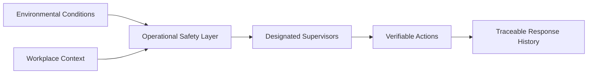
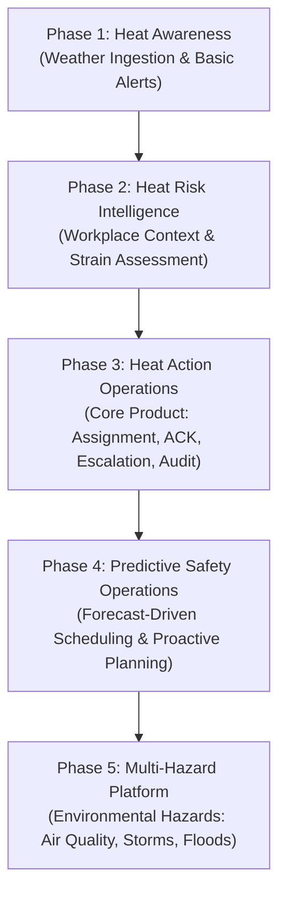
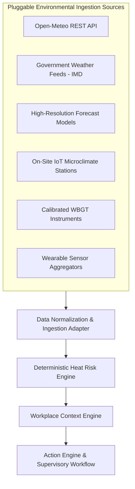
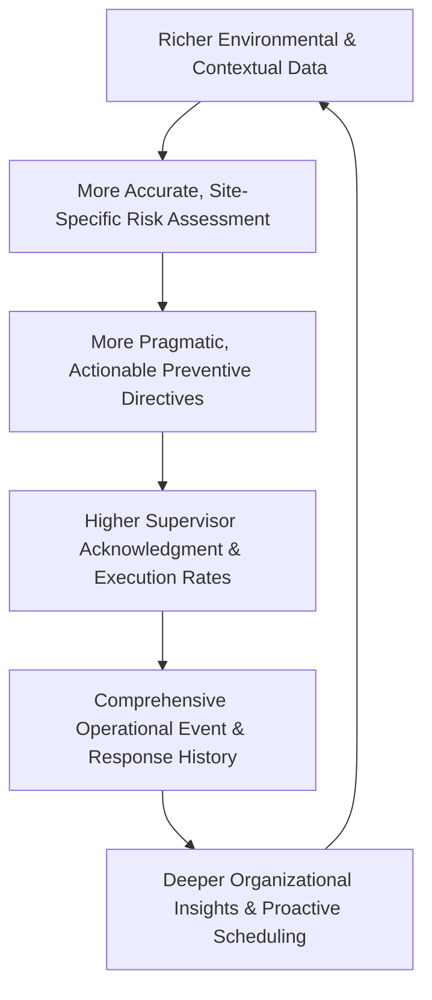
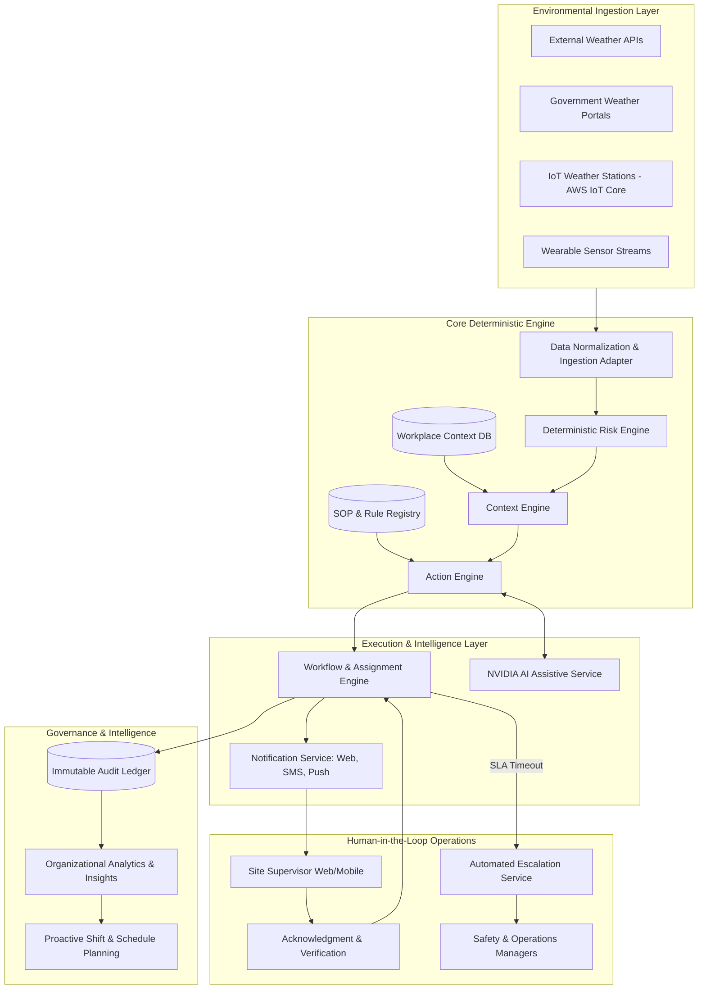

# Heat Action Response Engine (HARE) — Long-Term Product Vision

## 1. Product Vision

> **Build an intelligent heat-safety operations platform that helps organizations continuously transform environmental heat risk into coordinated, accountable, and verifiable workplace action.**

The Heat Action Response Engine is not conceived as another consumer weather application, a regional air-quality-style dashboard, a standalone heat index calculator, an unconstrained AI chatbot, or a sensor visualization portal.

Instead, the long-term vision is to establish an **operational safety layer** that sits directly between external environmental hazards and frontline workplace operations. This layer connects environmental monitoring, facility-specific operational context, designated supervisory personnel, prescriptive standard operating procedures (SOPs), and closed-loop response verification into a unified, traceable management system.



---

## 2. Vision Statement

Organizations operating outdoor and heat-exposed facilities should not have to manually interpret every environmental alert, improvise ad-hoc mitigation plans, or rely on unverified broadcast messages to protect frontline workers.

```text
Environmental Risk
        ↓
Contextual Understanding
        ↓
Operational Decision
        ↓
Responsible Person
        ↓
Verified Action
        ↓
Closed-Loop Verification
        ↓
Organizational Learning
```

The long-term vision is that every severe environmental hazard automatically resolves into a clear, assigned, and accountable workplace response—ensuring that safety protocols are executed consistently across every active facility.

---

## 3. Product Mission

> **Help organizations move from passive awareness of heat risk to proactive, coordinated, and traceable workplace safety operations.**

The fundamental distinction driving this mission is the difference between passive awareness and operational execution:

* **Passive Awareness:** *"Regional weather forecasts indicate conditions may become dangerous this afternoon across the district."*
* **Operational Safety Operations:** *"Construction Site #17 is exposed to High Risk at 13:00; 42 workers on heavy structural tasks require 45-min work / 15-min shaded rest cycles; Supervisor Ramesh K. owns the directive; acknowledgment is tracked; and the system will automatically escalate to the Safety Manager if unconfirmed within the SLA window."*

---

## 4. Long-Term Product Identity

In its mature state, the product is defined as:

> **An enterprise heat-risk operations platform for organizations with distributed or heat-exposed worksites.**

The platform occupies the critical execution boundary between raw environmental data and human workplace action:

```text
[ Environmental Data Streams ]
              ↓
   [ Risk Intelligence ]
              ↓
[ Organizational Operations & Context ]
              ↓
    [ Human Supervisory Action ]
              ↓
  [ Closed-Loop Verification ]
              ↓
[ Continuous Safety Governance ]
```

Rather than serving as a single-screen dashboard, the platform will evolve to support comprehensive organizational workflows: daily shift safety planning, live hazard dispatching, multi-facility compliance governance, and post-shift operational reviews.

---

## 5. Product Principles

The long-term architecture and evolution of the platform are guided by eight foundational principles:

### 5.1 Action over Alerts
The platform optimizes for verified, completed safety actions in the field, not for the volume of alerts pushed to users. An unverified alert represents an incomplete operational workflow.

### 5.2 Human-in-the-Loop
The system is built to support human decision-making, not replace responsible humans. Site supervisors, safety professionals, and operations managers retain ultimate operational authority, physical validation, and execution responsibility.

### 5.3 Safety-Critical Determinism
Core safety decisions—such as environmental risk score calculations, workload stress matrices, SOP action selection, and escalation timers—must remain deterministic, mathematical, testable, and fully transparent.

### 5.4 AI as an Assistant
Artificial intelligence serves as a communication, summarization, and cognitive assistant. It explains complex metrics, formats supervisory instructions, translates across dialects, and synthesizes reports, but never acts as an unconstrained safety arbiter.

### 5.5 Data Grounding
Every recommendation, notification, and summary must be strictly anchored in verified environmental telemetry, active worksite parameters, and authoritative occupational safety guidelines.

### 5.6 Complete Traceability
Every transition in the system lifecycle—from initial hazard detection through supervisory acknowledgment, escalation, and verification—must be permanently recorded in a tamper-evident audit ledger.

### 5.7 Progressive Intelligence
The platform begins with simple, explainable deterministic rule engines. More sophisticated machine learning or predictive modeling will be introduced progressively, and only where validated by operational evidence.

### 5.8 Hardware Independence
The operational response engine is architected to be completely agnostic of data-ingestion mechanisms. The core risk evaluation, contextualization, assignment, and escalation workflows operate identically regardless of the underlying data source:

```text
External Weather APIs (Open-Meteo)
                  OR
Official Government Meteorological Feeds (IMD)
                  OR
On-Site IoT Microclimate Weather Stations
                  OR
Wearable Biometric Ingestion Streams
                  OR
Enterprise Building Management Systems (BMS)
                  │
                  ▼
[ Data Ingestion & Normalization Layer ]
                  │
                  ▼
[ Same HARE Risk & Action Engine ]
```

---

## 6. Who We Want to Serve

The platform is designed to scale across organizational hierarchies and diverse industrial sectors.

### Primary Organizational Users (Immediate Focus)
* **Safety Managers (EHS Officers):** Requiring cross-site visibility, proactive hazard detection, compliance tracking, and audit-ready records.
* **Site Supervisors (Crew Leads):** Requiring clear, concise, actionable task checklists, mobile-friendly acknowledgment, and clear escalation support.
* **Operations Managers:** Requiring workforce availability forecasts, schedule impact estimates, and proof of safety protocol compliance.
* **Workforce / Shift Planners:** Requiring forward-looking heat forecasts to plan shift rotations and avoid peak midday heat windows.
* **Organization Administrators:** Requiring centralized configuration of site coordinates, personnel rosters, escalation hierarchies, and safety policies.

### Potential Future Users & Sectors (Long-Term Expansion)
* **Frontline Workers:** Receiving localized rest reminders, hydration notices, and shift safety guidance.
* **Specialist Contractors & Subcontractors:** Integrating secondary vendor crews into a unified worksite safety protocol.
* **External Safety Auditors & Insurers:** Reviewing verifiable operational safety compliance histories.
* **Municipal Infrastructure & Public Works Teams:** Managing roadwork, sanitation, and municipal maintenance crews.
* **Target Industry Sectors:** Commercial Construction, Heavy Civil Infrastructure, Industrial Logistics Yards, Agriculture & Forestry, Mining & Extraction, Port Terminals, and Utility Grid Maintenance.

*(Note: Initial product releases prioritize internal supervisory and safety management roles; worker-facing and external auditor interfaces represent future milestones.)*

---

## 7. Long-Term Product Experience

The long-term product experience eliminates cognitive friction for both operational leadership and frontline supervisors.

### 7.1 The Safety Manager Experience
When a regional safety manager opens the console, the interface immediately answers ten critical questions without requiring manual calculations:

```text
1. Where is the environmental risk?     ──> (Real-time multi-site risk map)
2. How severe is the exposure?          ──> (Calculated risk tier & heat indices)
3. Who is actively exposed?             ──> (Affected worksite, zone, crew headcount)
4. What type of work is affected?       ──> (Metabolic workload classification)
5. What preventive action is mandated?  ──> (Generated standard operating procedure)
6. Who owns the action on the ground?   ──> (Assigned on-duty site supervisor)
7. Has the directive been acknowledged? ──> (Live SLA countdown monitor)
8. Has field execution occurred?        ──> (Confirmed verification logs)
9. What situations remain unresolved?   ──> (Prominent escalation alert feed)
10. What is the historical trajectory?  ──> (Audit ledger & post-shift analytics)
```

### 7.2 The Site Supervisor Experience
A frontline supervisor does not receive an abstract meteorological chart. Instead, they receive a direct, context-rich mobile notification:

```text
[ HARE SAFETY DIRECTIVE ]
Site: West Logistics Yard — Zone B
Risk Level: HIGH (Heat Index: 41°C | High Solar Load)
Affected Crew: 18 Cargo Handlers (Heavy Exertion)
Action Required:
  1. Enact 45-min work / 15-min shaded rest rotation immediately.
  2. Replenish shaded hydration stations with potable water.
  3. Move heavy unpalletized sorting under covered canopy.
Acknowledgment Deadline: 12 Minutes Remaining
[ ACKNOWLEDGE & ENACT ]    [ REQUEST CLARIFICATION ]
```

---

## 8. Product Evolution

The platform follows a disciplined five-phase evolution, expanding capabilities progressively:



### Phase 1 — Heat Awareness
* Ingestion of public and commercial weather APIs.
* Calculation of standard heat indices for configured site coordinates.
* Visual dashboard displaying ambient weather and generic alert tiers.
* *Status:* Foundational baseline; insufficient as a standalone solution.

### Phase 2 — Heat Risk Intelligence
* Ingestion of worksite operational parameters: physical zones, active shifts, crew headcounts, and metabolic workload ratings.
* Evaluation of effective thermal strain by combining environmental conditions with physical labor intensity.
* Transition from *"How hot is it?"* to *"What does this weather mean for this specific crew?"*

### Phase 3 — Heat Action Operations (Current Product Core)
* Automated synthesis of discrete, site-specific Action Plans based on deterministic safety rules.
* Dynamic supervisory assignment, multi-channel notification dispatch, and one-click acknowledgment tracking.
* Automated hierarchical escalation upon SLA timeout.
* Complete operational audit ledger capturing all events and state transitions.
* NVIDIA AI assistive communication (summaries, message formatting, translation).
* Transition from *"What is the risk?"* to *"What verifiable actions must occur right now, and who owns them?"*

### Phase 4 — Predictive Safety Operations (Future Capability)
* Ingestion of high-resolution 24- to 72-hour forecast curves to project upcoming high-risk periods.
* Proactive recommendations to reschedule high-exertion tasks to cooler morning/evening hours before risk peaks.
* Historical response pattern analysis to identify bottlenecks in supervisory acknowledgment.
* *Guardrail:* Predictive recommendations serve strictly as operational planning aids and cannot relax mandatory real-time safety thresholds.

### Phase 5 — Multi-Hazard Environmental Safety Platform (Long-Term Horizon)
* Expansion of the operational execution loop to additional environmental workplace hazards: extreme air pollution (PM2.5/AQI), high-wind crane hazards, flash flooding, and lightning risk.
* Universal execution paradigm maintained across all hazards:
  $$\text{SIGNAL} \rightarrow \text{RISK} \rightarrow \text{CONTEXT} \rightarrow \text{ACTION} \rightarrow \text{OWNER} \rightarrow \text{ACK} \rightarrow \text{ESCALATE} \rightarrow \text{VERIFY} \rightarrow \text{AUDIT}$$

---

## 9. Intelligent Action Layer

The long-term objective of the Action Engine is to evolve from basic rule mapping into an advanced, context-aware operational planning service:

```text
CURRENT CAPABILITY (Deterministic Rule Mapping)
Calculated Risk Tier ──> Predefined Static SOP Checklist

FUTURE VISION (Intelligent Context-Aware Action Synthesis)
Calculated Risk Tier
  + Microclimate Ingestion
  + Active Shift Schedule
  + Task Ergonomic Rating
  + On-Site Control Inventory (Available shade tents, misting fans, hydration stations)
  + Historical Site Responsiveness
        ↓
Context-Aware, Operationally Pragmatic Action Plan
(Feasible, prioritized, and strictly compliant with occupational safety bounds)
```

### Absolute Safety Boundary:
The Intelligent Action Layer must **never optimize operational productivity at the expense of human safety constraints**. If an active safety rule mandates a 15-minute rest period at a given thermal threshold, no algorithm may reduce that rest period to preserve delivery schedules.

---

## 10. AI Vision

In the long-term architecture, artificial intelligence acts as a cognitive multiplier across three core operational dimensions while remaining strictly bounded from safety-critical arbitration:

```text
+--------------------------------------------------------------------------------------------------+
|                                  LONG-TERM AI ROLES & BOUNDARIES                                 |
+--------------------------------------------------------------------------------------------------+
|  1. NATURAL-LANGUAGE SAFETY ASSISTANT                                                            |
|     * Conversational querying: "Why did Site #17 escalate to High Risk at 13:00?"              |
|     * Operational status briefs: "Summarize all pending acknowledgments across North Zone."     |
|     * Forecast differential queries: "What operational changes are needed for tomorrow's shift?"|
+--------------------------------------------------------------------------------------------------+
|  2. COMMUNICATION & TRANSLATION INTELLIGENCE                                                     |
|     * Automated formulation of clear, concise, culturally tuned supervisory alerts.              |
|     * Real-time multilingual adaptation into regional languages (Hindi, Kannada, Tamil, etc.).   |
|     * Automated executive shift summaries for Operations Directors.                              |
+--------------------------------------------------------------------------------------------------+
|  3. OPERATIONAL PATTERN RECOGNITION                                                              |
|     * Identifying facilities with recurring supervisory acknowledgment bottlenecks.             |
|     * Highlighting tasks that consistently face heat-induced schedule delays.                    |
|     * Recommending proactive shade infrastructure allocations based on historical patterns.     |
+--------------------------------------------------------------------------------------------------+
|                                    SUPREME ARBITRATION RULE:                                     |
|                       Deterministic Safety Rules  >  AI Recommendations                          |
|           Whenever an AI recommendation conflicts with a safety rule, the rule governs.          |
+--------------------------------------------------------------------------------------------------+
```

---

## 11. Data Source Independence

The long-term architecture maintains strict data-source neutrality. By isolating data ingestion behind a standardized normalization interface, the core risk and action engines remain unaffected by changes in data providers or sensor technologies:



This independence ensures that organizations can deploy the software platform immediately using public weather APIs, and later plug in specialized on-site IoT sensors or wearables without altering their operational workflows.

---

## 12. IoT and Sensor Vision

The platform maintains a clear demarcation between current software MVP boundaries and future physical sensor capabilities:

* **Current MVP Scope (Software-First):** Zero hardware dependency. Operates entirely on software-accessible external weather and forecast APIs (e.g., Open-Meteo).
* **Future IoT Capabilities (Hardware-Agnostic Extension):**
  * Integration with on-site industrial weather stations measuring hyper-local microclimates.
  * Direct telemetry ingestion from Wet Bulb Globe Temperature (WBGT) instrumentation via AWS IoT Core and MQTT.
  * Integration with commercial wearable sensors monitoring physiological strain metrics (heart rate recovery, skin temperature proxies).
* **Architectural Principle:** Physical sensors serve as **context enhancers**, providing higher spatial resolution for environmental inputs, but they do not alter the fundamental operational loop (`DETECT → ASSESS → CONTEXTUALIZE → DECIDE → ASSIGN → NOTIFY → ACKNOWLEDGE → ESCALATE → VERIFY → AUDIT`).

---

## 13. Worker-Centric Future Vision

While the MVP deliberately focuses on the supervisory chain of command, a future product phase may introduce a dedicated, worker-centric digital experience:

```text
FUTURE WORKER-CENTRIC TOUCHPOINTS (POST-MVP ROADMAP)
├── Shift Heat Safety Briefings (Delivered via SMS/WhatsApp or simple mobile web)
├── Multilingual Hydration & Cooling Rest Prompts
├── Designated Shade & Drinking Water Location Maps
├── One-Touch Welfare Check-ins ("Confirming hydration break taken")
└── Direct Emergency Heat Distress Signaling (Escalating directly to site supervisor)
```

> **MVP Boundary Reminder:** Individual worker-facing applications are explicitly excluded from the hackathon MVP; frontline safety is managed entirely through site supervisors.

---

## 14. Organizational Intelligence

As organizations utilize HARE across multiple seasons, the platform accumulates a valuable repository of operational safety data. Long-term analytics will transform this history into proactive operational insights:

```text
Historical Environmental Events
              ↓
Recorded Supervisor Responses
              ↓
Acknowledgment & Escalation Latencies
              ↓
Action Completion & Verification Rates
              ↓
Workforce Exposure Trajectories
              ↓
ORGANIZATIONAL SAFETY INTELLIGENCE
* Identifying facilities with recurring heat-stress exposure.
* Pinpointing supervisory bottlenecks where alerts linger unacknowledged.
* Revealing operational tasks that suffer consistent heat-related productivity losses.
* Evaluating the effectiveness of deployed shade and cooling infrastructure.
```

*(Note: These analytics represent operational workflow intelligence; they do not generate medical diagnoses or clinical predictions.)*

---

## 15. Digital Heat Safety Record

In its mature state, the platform establishes an authoritative, structured **Digital Heat Safety Record** for every monitored facility:

### Key Components of the Safety Record:
* **Environmental Inputs:** Timestamped ambient temperature, humidity, solar radiation, and calculated heat index values.
* **Risk Classifications:** Complete record of deterministic risk tiers and triggering rules.
* **Operational Directives:** Exact standard operating procedures and action checklists issued.
* **Chain of Custody:** Explicit record of assigned supervisors, notification delivery timestamps, and positive acknowledgments.
* **Escalation Sequences:** Timestamped logs of any SLA timeouts and secondary management notifications.
* **Field Verification:** Supervisor confirmation logs, field status notes, and corrective actions taken.
* **System Communications:** Full records of AI-assisted messages, summaries, and notifications dispatched.

This digital record provides enterprises with an organized, traceable history of heat-safety operations, supporting continuous safety improvement and transparent operational reviews.

---

## 16. The Product Flywheel

The long-term value of the platform compounds through an operational flywheel:



By progressively refining the relationship between environmental hazards and workplace operations, organizations develop institutional heat resilience rather than reacting to crises in an ad-hoc manner.

---

## 17. Long-Term Differentiation

The platform does not claim novelty in basic meteorological detection or heat index formulas. Its lasting market differentiation lies in the **depth, rigor, and accountability of its operational response loop**:

```text
TRADITIONAL INFORMATION SYSTEMS
Detect ──> Alert ──> User receives notification
(Passive, unverified, unassigned, fragmented)

HARE OPERATIONAL EXECUTION SYSTEM
Detect ──> Assess ──> Contextualize ──> Decide ──> Assign ──> Notify
       ──> Acknowledge ──> Execute ──> Escalate ──> Verify ──> Audit
(Active, verified, accountable, traceable, closed-loop)
```

By elevating the **verified action**—rather than the passive warning—to the central unit of value, HARE establishes a distinct category of operational safety execution software.

---

## 18. Product Success Metrics

Long-term product success is measured across three observable operational dimensions:

| Dimension | Long-Term Success Indicators |
| :--- | :--- |
| **Operational Performance** | * Reduction in mean supervisor acknowledgment latency.<br>* Decrease in the frequency of unresolved, escalated safety directives.<br>* High rate of verified preventive action completions.<br>* Complete elimination of untracked, unacknowledged heat directives. |
| **Organizational Governance** | * Unified, real-time heat hazard visibility across 100% of active enterprise facilities.<br>* Standardized enforcement of safety SOPs regardless of geographic location.<br>* Continuous accumulation of structured, audit-ready safety event records.<br>* Data-driven proactive shift scheduling during forecast heat waves. |
| **User Experience & Trust** | * Frontline supervisors report clear, low-friction actionable directives.<br>* Safety Managers instantly identify non-responsive facilities.<br>* Complete user confidence in deterministic safety calculations and AI transparency. |

---

## 19. MVP vs Vision Boundary Matrix

To maintain strict execution focus for the hackathon, the boundary between the MVP and the long-term vision is explicitly defined:

| Platform Capability | Hackathon MVP Scope | Long-Term Vision Scope |
| :--- | :--- | :--- |
| **Weather Ingestion** | Open-Meteo REST API | Multi-provider weather aggregation + IMD integration |
| **Heat Risk Engine** | Deterministic formulas (Heat Index) | Multi-metric engine (WBGT, UTCI, Heat Index) |
| **Worksite Context** | Core attributes (site, shift, workload tier) | Dynamic microclimate, canopy models, ERP sync |
| **Action Engine** | Predefined SOP rule mapping | Context-aware, inventory-sensitive action synthesis |
| **Supervisory Workflow** | Single on-duty supervisor assignment | Multi-role delegation, shift handover protocols |
| **Acknowledgment Tracking** | Time-bounded SLA countdown | Adaptive SLAs based on operational urgency |
| **Escalation Engine** | Automated trigger to Safety Manager | Multi-tier escalation with automated call trees |
| **Audit Ledger** | Append-only event history log | Cryptographically verified, exportable compliance ledger |
| **NVIDIA AI Assistance** | Bounded: explanations, alerts, translation | Conversational safety assistant, deep pattern recognition |
| **On-Site IoT Sensors** | **Explicitly Excluded (No Hardware)** | Supported via AWS IoT Core / MQTT |
| **Wearable Biometrics** | **Explicitly Excluded** | Optional industrial wearable telemetry |
| **Worker Mobile App** | **Explicitly Excluded** | Lightweight worker-facing guidance portal |
| **Predictive Analytics** | Basic hourly forecast display | Advanced 72-hour operational shift re-planning |
| **Multi-Hazard Expansion** | **Explicitly Excluded (Heat Only)** | Comprehensive environmental hazard engine |
| **Advanced ML Models** | **No dependency** | Validated predictive and pattern-mining models |
| **Enterprise Analytics** | Basic operational metrics | Cross-seasonal institutional resilience analytics |

---

## 20. Product North Star

> **Verified preventive action in response to identified heat risk.**

The success of the Heat Action Response Engine will never be judged by:
* The quantity of weather alerts broadcasted.
* The volume of AI tokens generated.
* The number of raw API calls executed.
* The complexity of underlying server infrastructure.

The platform is judged exclusively by whether it successfully transforms an environmental hazard into a **visible, assigned, acknowledged, and verified workplace safety action**.

---

## 21. Future Product Architecture

The long-term conceptual architecture illustrates how the platform accommodates diverse data streams, enterprise integrations, and user interfaces while maintaining core engine stability:



---

## 22. Future Product Roadmap

The multi-stage roadmap outlines the strategic growth of the platform:

```text
STAGE 1: HACKATHON MVP (Current)
├── Software-first architecture (Open-Meteo API ingestion)
├── Deterministic Heat Index calculation
├── Core worksite, shift, and workload context engine
├── Standard Operating Procedure (SOP) action plan generation
├── Supervisor notification dispatch and SLA acknowledgment tracking
├── Automated escalation to Safety Manager
├── Immutable operational audit log
└── NVIDIA AI assistive explanations, alert drafting, and translation

STAGE 2: PRODUCTION HARDENING & ENTERPRISE READINESS
├── Multi-tenant enterprise organization management and role-based access (RBAC)
├── High-reliability AWS infrastructure deployment (ECS/Fargate, Aurora PostgreSQL)
├── Production SMS and WhatsApp Business notification integrations (Amazon SNS / Twilio)
├── Custom SOP authoring interface for corporate EHS directors
└── Enhanced system observability, distributed tracing, and automated failover

STAGE 3: PLUGGABLE SENSOR & WORKER INTEGRATION
├── AWS IoT Core ingestion pipeline for industrial on-site weather stations
├── High-precision Wet Bulb Globe Temperature (WBGT) telemetry support
├── Lightweight worker-facing mobile web portal for shift guidance and hydration logs
└── Opt-in integration with industrial wearable biometric platforms

STAGE 4: PREDICTIVE OPERATIONAL INTELLIGENCE
├── 72-hour forecast curve analysis with automated shift rescheduling recommendations
├── Cross-site historical response pattern analysis and supervisory bottleneck detection
├── Bi-directional enterprise ERP/HRMS synchronization (SAP, Workday, Procore)
└── Seasonal heat resilience benchmarking for enterprise operations

STAGE 5: MULTI-HAZARD ENVIRONMENTAL SAFETY PLATFORM
├── Expansion to extreme air quality (AQI / particulate matter) protocols
├── Integration of high-wind crane safety thresholds and thunderstorm alerts
├── Flash flood and severe weather emergency operational coordination
└── Universal enterprise environmental hazard governance suite
```

*(Note: Roadmap stages represent architectural milestones and are intentionally decoupled from calendar deadlines.)*

---

## 23. Vision Guardrails

To prevent mission drift and ensure uncompromising ethical and engineering discipline, the project enforces eight inviolable guardrails:

1. **No Replacement of Human Safety Responsibility:** The platform will never claim to eliminate the need for trained, vigilant human safety personnel on site.
2. **No Medical Diagnosis or Clinical Prediction:** The platform will never assess clinical symptoms, diagnose heat illnesses, or predict individual medical outcomes.
3. **No Safety Rule Override:** No algorithmic, optimization, or artificial intelligence process will ever override or weaken deterministic occupational safety rules.
4. **No Autonomous AI Safety Authority:** AI models will never act as unsupervised safety arbiters or independently determine whether conditions are safe.
5. **No Unsupported Regulatory Claims:** The platform will not claim to certify legal or statutory compliance unless validated against specific legal requirements.
6. **No Sensor Equivalence Claims:** Software-based meteorological models will never be falsely represented as localized physical sensor measurements.
7. **No Hardware Dependencies in Software Deployments:** The baseline operational engine will always remain fully deployable without requiring physical hardware.
8. **No Premature Feature Assumptions:** Future capabilities (IoT, wearables, worker apps) must never be assumed as operational in the current MVP.

---

## 24. Final Vision Statement

> **The long-term vision is to turn environmental heat risk from a passive warning into an active organizational safety workflow—where risk is understood in context, actions are assigned to accountable people, unresolved situations are escalated, and every important response is traceable.**

```text
THE EVOLUTIONARY TRAJECTORY:
From heat warning
        ↓
to heat intelligence
        ↓
to coordinated action
        ↓
to verified response
        ↓
to proactive safety operations.
```

---

* **Status:** Draft
* **Last Updated:** 2026-10-07
