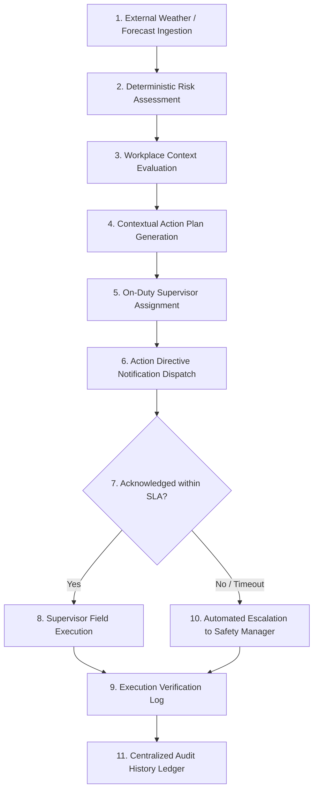
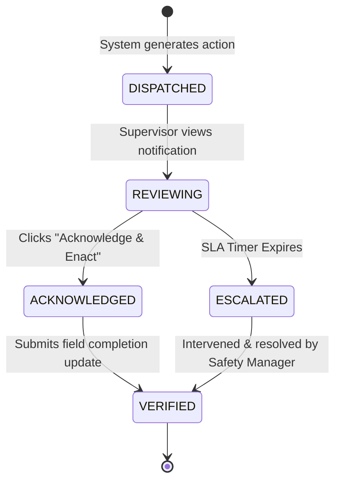
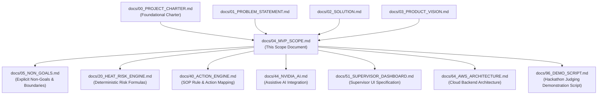

# Heat Action Response Engine (HARE) — MVP Scope & Boundary Specification

## 1. MVP Definition

The Minimum Viable Product (MVP) for the Heat Action Response Engine is:

> **A software-first heat-risk operations platform that monitors weather and forecast conditions for configured worksites, evaluates heat risk using deterministic rules, generates contextual preventive actions, assigns those actions to responsible supervisors, tracks acknowledgment, escalates unresolved actions, and records the complete response history.**

This document establishes the authoritative **scope control boundary** for the hackathon project. It is intentionally designed to prevent feature creep, eliminate premature optimization, and preserve architectural discipline. This specification represents the **hackathon implementation target**, not the complete long-term commercial platform.

---

## 2. MVP North Star

> **Turn an identified heat-risk event into a visible, accountable, and traceable workplace action.**

For the hackathon, technical success is judged by the reliability and completeness of the operational loop rather than the sheer volume of incidental features. Every component included in the MVP must directly reinforce this single outcome.

---

## 3. MVP Core Workflow

Every software component, data structure, and user interface in the MVP exists solely to support this operational execution pipeline:



Any feature proposal that does not directly advance or monitor this flow is out of scope for the MVP.

---

## 4. MVP Feature List

The table below catalogs all candidate capabilities, assigning strict priority ratings:

* **P0 (Mandatory):** Core components required for the complete end-to-end hackathon demonstration. Non-negotiable.
* **P1 (Desirable):** High-value assistive or reliability capabilities to be integrated only if P0 stability is achieved. Non-blocking.
* **Future (Excluded):** Explicitly deferred to post-hackathon releases.

| ID | Feature Name | MVP? | Priority | Core Purpose & Architectural Justification |
| :--- | :--- | :---: | :---: | :--- |
| **F01** | **Worksite Management** | **Yes** | **P0** | Define monitored facility coordinates, zones, shifts, and assigned supervisory personnel. |
| **F02** | **Weather Ingestion** | **Yes** | **P0** | Programmatically obtain real-time and forecast meteorological data via Open-Meteo REST API. |
| **F03** | **Heat-Risk Calculation** | **Yes** | **P0** | Compute transparent, deterministic heat stress metrics (Heat Index) and base risk tiers. |
| **F04** | **Worksite Context Engine** | **Yes** | **P0** | Evaluate environmental risk against active shift schedules, crew headcounts, and workload tiers. |
| **F05** | **Action Plan Generation** | **Yes** | **P0** | Synthesize discrete, prescriptive Standard Operating Procedure (SOP) mitigation checklists. |
| **F06** | **Supervisor Assignment** | **Yes** | **P0** | Bind action directives to a single designated on-duty frontline supervisor entity. |
| **F07** | **Notification Dispatch** | **Yes** | **P0** | Dispatch action directives to the supervisor with clear task priorities and SLA countdowns. |
| **F08** | **Acknowledgment Tracking** | **Yes** | **P0** | Enforce and record positive one-touch supervisory receipt and acceptance of responsibility. |
| **F09** | **Automated Escalation** | **Yes** | **P0** | Trigger high-priority alerts to Safety Managers upon expiration of the acknowledgment SLA. |
| **F10** | **Audit Trail Ledger** | **Yes** | **P0** | Immutable, chronological persistence of all environmental values, actions, and state transitions. |
| **F11** | **Supervisor Dashboard** | **Yes** | **P0** | High-visibility, low-friction mobile/web interface for supervisors to view and acknowledge tasks. |
| **F12** | **Safety Manager View** | **Yes** | **P1** | Multi-site monitoring console displaying risk heatmaps, pending SLAs, and escalations. |
| **F13** | **NVIDIA AI Assistance** | **Yes** | **P1** | Assistive text generation for risk explanations, supervisor briefings, and multilingual translation. |
| **F14** | **Simulation / Demo Mode** | **Yes** | **P1** | Deterministic injection of accelerated weather progressions to guarantee predictable live judging. |
| **F15** | **Physical IoT Sensors** | **No** | **Future** | Hardware telemetry (ESP32, DHT22, custom microcontrollers, MQTT hardware pipelines). |
| **F16** | **Wearable Biometrics** | **No** | **Future** | Physiological monitoring (smartwatches, heart-rate recovery, core body temperature probes). |
| **F17** | **Worker Mobile App** | **No** | **Future** | Dedicated individual laborer mobile application or personal worker accounts. |
| **F18** | **Multi-Hazard Expansion** | **No** | **Future** | Expanding operational response to air quality (AQI), high-wind crane risks, and flooding. |
| **F19** | **Advanced Predictive ML** | **No** | **Future** | Complex multi-day predictive scheduling and neural pattern matching across seasons. |

---

## 5. P0 — Mandatory MVP Capabilities

These capabilities form the irreducible core of the platform. If any single P0 capability is missing, the MVP cannot be considered complete.

### 5.1 Worksite Management
The MVP maintains structured operational profiles for configured facilities. Each worksite record must contain:
* `worksite_id`: Unique identifier (UUID).
* `name`: Human-readable identifier (e.g., *"Bengaluru Logistics Terminal #17"*).
* `location`: Precise latitude and longitude coordinates.
* `assigned_supervisor_id`: Primary on-duty supervisor entity.
* `worker_count`: Active workforce headcount.
* `shift_timing`: Active operating hours (e.g., *09:00–17:00*).
* `work_type`: Operational description (e.g., *Structural Steel Installation*).
* `workload_category`: Standard metabolic exertion rating (*Light*, *Moderate*, *Heavy*, *Very Heavy*).
* `safety_context`: Basic physical infrastructure flags (e.g., *Outdoor Open Ground*, *Shaded Canopy Available*, *Hydration Point Stocked*).

*(Enterprise HRMS integration, dynamic biometric rosters, and complex contractor billing systems are strictly excluded.)*

### 5.2 Weather Data Ingestion
* **Source:** Open-Meteo REST API (publicly accessible, reliable, zero hardware required).
* **Ingested Parameters:**
  * 2m Ambient Temperature (°C)
  * Relative Humidity (%)
  * Apparent Temperature / Heat Index
  * Direct Solar Radiation (W/m²)
  * Wind Speed (km/h)
  * Hourly Forecast Sequence (24-hour horizon)
  * Ingestion Timestamp & Geolocation Coordinates
* **Operational Boundary:** External API weather data must be explicitly treated as **continuously updated regional meteorological data**, never represented as on-site microclimate sensor telemetry.

### 5.3 Deterministic Heat Risk Engine
The risk engine must be 100% deterministic, explainable, and transparent. Black-box neural networks or non-deterministic LLMs must never determine the risk score.

```text
Normalized Weather Payload
          ↓
Validate Environmental Inputs
          ↓
Apply Deterministic Heat Index Formula
          ↓
Evaluate Occupational Risk Thresholds
          ↓
OUTPUT:
  - Calculated Heat Risk Level (LOW, MODERATE, HIGH, CRITICAL)
  - Explicit Trigger Reasons (e.g., "Ambient 38°C + Humidity 65% exceeds High threshold")
  - Recommended Baseline Action Category
```

*(Note: Exact mathematical formulas and numeric thresholds are defined authoritative in [`docs/20_HEAT_RISK_ENGINE.md`](file:///d:/Amazon%202nd%20Hackathon%20Heat/docs/20_HEAT_RISK_ENGINE.md). No arbitrary thresholds may be hard-coded outside that specification.)*

---

## 6. Worksite Context Engine

The context engine bridges the gap between raw meteorology and operational realities. It evaluates whether identical weather conditions present different hazards based on site activities:

```text
Site A: Ambient 36°C | Equipment Operation in A/C Cab | Light Workload   ──> MODERATE ACTION
Site B: Ambient 36°C | Outdoor Concrete Pouring | Heavy Workload         ──> CRITICAL ACTION
```

### Context Evaluation Inputs:
* Worksite profile and geospatial location.
* Current active shift and remaining shift duration.
* Task metabolic exertion tier:
  * *Light:* <200W (inspections, gate control, machinery operation).
  * *Moderate:* 200–350W (walking, equipment maintenance, carpentry).
  * *Heavy:* >350W (manual digging, rebar binding, concrete finishing).
* Exposure environment: Direct sunlight vs. shaded enclosure.
* Available on-site controls: Potable water access, cooling fans, shaded rest shelters.

---

## 7. Action Engine

The Action Engine converts the contextualized risk profile into a prescriptive, actionable Standard Operating Procedure (SOP) package.

### Structure of an MVP Action Plan:
* `action_id`: Unique system UUID (e.g., `AP-1082`).
* `worksite_id`: Target facility identifier.
* `risk_level`: Evaluated severity tier (`LOW`, `MODERATE`, `HIGH`, `CRITICAL`).
* `risk_rationale`: Human-readable explanation of triggering factors.
* `prescriptive_actions`: Concrete checklist of mandatory field steps:
  * *Work-Rest Cycles:* (e.g., 45 minutes active labor / 15 minutes shaded cooling).
  * *Hydration Mandates:* (e.g., mandatory 250ml water consumption every 20 minutes).
  * *Task Adaptation:* (e.g., suspend unshaded high-exertion tasks until 16:00).
  * *Environmental Controls:* (e.g., deploy canopy shade and cooling mist stations).
* `assigned_supervisor`: Designated on-duty supervisor profile and contact.
* `sla_window`: Configured acknowledgment response window.
* `workflow_status`: Current lifecycle state (`CREATED`, `DISPATCHED`, `ACKNOWLEDGED`, `ESCALATED`, `RESOLVED`).
* `created_at` & `acknowledged_at`: Precise ISO-8601 timestamps.

*(Action plans represent operational standard operating procedures grounded in established safety standards, not clinical medical prescriptions.)*

---

## 8. Supervisor Workflow

The supervisor interface must be intentionally minimal, lightweight, and frictionless, ensuring frontline crew leads can review and act without distraction:



### Required Supervisor Actions:
1. Receive real-time notification containing risk severity, trigger rationale, and checklist.
2. Review specific required field mitigations.
3. Submit single-touch acknowledgment (`ACKNOWLEDGE & ENACT`).
4. Log optional execution verification note (e.g., *"Shade canopy deployed; crew on 15-min rest"*).
5. View active SLA status and escalation indicators.

---

## 9. Acknowledgment Architecture

A notification being sent does not prove that a human saw, accepted, or enacted it. The MVP explicitly decouples notification dispatch from positive acknowledgment:

```text
[ NOT_ASSIGNED ]
        ↓
   [ ASSIGNED ]
        ↓
  [ DISPATCHED ]  ──> Notification delivered to supervisor client
        ↓
 [ ACKNOWLEDGED ] ──> Positive human interaction recorded
```

### Data Captured Upon Acknowledgment:
* `action_id`: Target action plan identifier.
* `acknowledged_by`: Authenticated supervisor entity ID.
* `timestamp`: High-precision server timestamp of acknowledgment receipt.
* `acknowledgment_latency_seconds`: Duration elapsed since notification dispatch.
* `worksite_id`: Target facility.

---

## 10. Automated Escalation Architecture

If a critical safety directive is ignored or missed by frontline supervision, the platform must prevent the hazard from lingering unaddressed:

```text
                   [ Action Plan Dispatched ]
                               │
                               ▼
                   [ Start SLA Countdown Timer ]
                               │
                ┌──────────────┴──────────────┐
                ▼                             ▼
      [ Supervisor Acknowledges ]    [ Timer Reaches Zero (Timeout) ]
                │                             │
                ▼                             ▼
         [ State = ACK ]             [ State = ESCALATED ]
                │                             │
                ▼                             ▼
      [ Proceed to Execution ]       [ Dispatch High-Priority Alert ]
                                     [ To Regional Safety Manager ]
                                              │
                                              ▼
                                     [ Safety Manager Intervenes ]
```

### Escalation Configuration Rules:
* **Configurable SLA Windows:** The acknowledgment timeout must be a configurable system parameter.
* **Separation of Operational vs. Demo Timeouts:**
  * *Real Operational Timeout:* Configurable in minutes (e.g., 15 minutes for High Risk).
  * *Demo / Simulation Timeout:* Accelerated in seconds (e.g., 20–30 seconds) to enable live, reliable judging demonstrations without artificial pauses.

---

## 11. Audit Trail Ledger

The platform maintains an immutable, append-only operational event history:

### Logged Lifecycle Events:
1. `RISK_DETECTED`: Ingested weather parameters breach baseline risk thresholds.
2. `ACTION_GENERATED`: Action plan synthesized with specific SOP checklist.
3. `SUPERVISOR_ASSIGNED`: Action bound to designated supervisor entity.
4. `NOTIFICATION_DISPATCHED`: Directive sent to supervisor client.
5. `ACKNOWLEDGMENT_RECEIVED`: Positive supervisor confirmation captured with latency.
6. `SLA_BREACH_DETECTED`: Acknowledgment timer expires without response.
7. `ESCALATION_TRIGGERED`: High-priority escalation dispatched to Safety Manager.
8. `ACTION_VERIFIED`: Field completion confirmed and logged.

Each audit record stores the event UUID, event type, worksite ID, payload snapshot, actor identity, and UTC timestamp.

---

## 12. Operational Dashboard

The web management console must instantly answer five core operational questions:

```text
1. WHERE IS THE RISK?       ──> Displays all monitored worksites categorized by risk tier.
2. WHAT REQUIRES ACTION?    ──> Lists all active, open action plans.
3. WHO OWNS THE ACTION?     ──> Explicitly displays assigned supervisors.
4. HAS IT BEEN ACKNOWLEDGED?──> Real-time SLA countdown and acknowledgment status badges.
5. WHAT IS UNRESOLVED?      ──> Prominent visual alert panel for escalated, overdue actions.
```

### Observable System Metrics Displayed:
* Total Active Monitored Worksites
* Facilities Under High / Critical Risk
* Active Action Plans Dispatched
* Pending Supervisory Acknowledgments
* Active Escalation Alerts
* Completed / Verified Interventions Today
* Mean Supervisory Acknowledgment Latency (Minutes)

*(Note: These are operational workflow metrics, not clinical health claims.)*

---

## 13. NVIDIA AI Scope & Guardrails

NVIDIA AI models are integrated strictly as **assistive communication microservices**.

### Permitted MVP Capabilities (P1):
* **Risk Explanation Generation:** Converts raw metrics (*"Heat Index 42°C, solar flux 880 W/m²"*) into concise, intuitive situational summaries for supervisors.
* **Supervisor Briefing Formulation:** Generates clear, professional, urgent dispatch messages from structured JSON action plans.
* **Shift Executive Summaries:** Drafts high-level shift heat safety summaries for Safety Managers.
* **Multilingual Translation:** Translates English action checklists into regional languages (e.g., Hindi, Kannada) where technically feasible.
* **Grounded In-App Assistant:** Answers supervisor questions strictly grounded in active site telemetry and loaded SOP manuals.

### Inviolable AI Guardrails:
* AI must **NEVER** calculate, adjust, or override risk thresholds.
* AI must **NEVER** alter deterministic risk tier classifications.
* AI must **NEVER** diagnose heat-related illnesses or evaluate medical fitness.
* AI must **NEVER** cancel, delay, or suppress safety directives or escalations.
* AI must **NEVER** fabricate weather telemetry when external data is unavailable.

> **Supreme Rule:** Deterministic rules govern safety; NVIDIA AI assists communication.

---

## 14. Simulation & Demo Mode

To guarantee a flawless, deterministic demonstration during hackathon evaluation, the platform must include a dedicated **Simulation Mode**.

```text
SIMULATION PROGRESSION TIMELINE:
Stage 1: Baseline Normal (Ambient 28°C, Moderate Workload) ──> Green / Low Risk
Stage 2: Rapid Weather Surge (Ambient climbs to 39°C, 65% RH) ──> Red / Critical Risk Triggered
Stage 3: Automated Action Synthesis ──> Action Plan Generated & Dispatched
Stage 4A: Positive Path Demonstration ──> Supervisor acknowledges within 15 seconds
Stage 4B: Escalation Path Demonstration ──> Timer expires ──> System escalates to Safety Manager
Stage 5: Audit Review ──> Live inspection of the chronological event ledger
```

* **Clear Labeling:** When active, the user interface must prominently display a `[SIMULATION MODE ACTIVE]` banner to distinguish it from live meteorological feeds.

---

## 15. Operational Data Modes

The platform supports two runtime modes utilizing an identical downstream workflow engine:

```text
[ LIVE MODE ]
Open-Meteo REST API Ingestion ──┐
                                ├──> [ Deterministic Risk & Action Workflow Engine ]
[ DEMO / SIMULATION MODE ]     │
Controlled Scenario Sequence  ──┘
```

1. **LIVE MODE:** Continuously polls live meteorological conditions and forecasts for real-world GPS coordinates via Open-Meteo.
2. **DEMO MODE:** Injects scripted, predictable environmental profiles to allow instant demonstration of risk transitions and SLA timeouts without waiting for external weather changes.

---

## 16. Authentication and Role Permissions

The MVP implements a clean, role-based access control (RBAC) model across three core organizational roles:

| Operational Capability | Admin | Safety Manager | Site Supervisor |
| :--- | :---: | :---: | :---: |
| Register & Configure Worksites | **Yes** | **Yes** | No |
| View Global Multi-Site Heatmap | **Yes** | **Yes** | No |
| View Assigned Worksite & Risk | **Yes** | **Yes** | **Yes** (Assigned Only) |
| Author & Edit Safety SOP Rules | **Yes** | **Yes** | No |
| Acknowledge Action Directives | Optional | **Yes** (Override) | **Yes** (Primary) |
| Intervene in Escalated Actions | **Yes** | **Yes** | No |
| Inspect Global Audit History | **Yes** | **Yes** | **Yes** (Assigned Only) |
| Trigger Simulation Scenarios | **Yes** | **Yes** | No |

---

## 17. Notification Scope

For the hackathon MVP, notification mechanisms are focused on guaranteed delivery to the evaluation screen:

* **Primary MVP Channel:** In-app real-time notification banners and visual modal alerts on the Supervisor Dashboard.
* **Secondary Channel (P1):** Simulated external dispatch (e.g., visual SMS preview panel or Amazon SNS email dispatch if configured).
* **Core Requirement:** The assigned supervisor must see that an action requires immediate acknowledgment without manual page refreshes.

---

## 18. Backend Architecture Scope

The MVP backend must provide lightweight, robust RESTful APIs supporting:
* Worksite metadata management (`/api/sites`).
* Weather ingestion and simulation feeds (`/api/weather`).
* Risk evaluation and action plan dispatch (`/api/actions`).
* Supervisory acknowledgment processing (`/api/actions/{id}/ack`).
* Escalation status monitoring and polling (`/api/escalations`).
* Chronological audit log retrieval (`/api/audit`).
* NVIDIA AI assistive text generation endpoints (`/api/ai/explain`).

---

## 19. AWS MVP Scope

The cloud infrastructure focuses on core serverless and managed services that directly power the operational loop:

```text
[ React Frontend ] ──> [ Amazon CloudFront / S3 ]
                               │
                               ▼
                    [ Amazon API Gateway ]
                               │
                               ▼
                   [ AWS Lambda Functions ]
                      (Python / Node.js)
                               │
                ┌──────────────┴──────────────┐
                ▼                             ▼
      [ Amazon DynamoDB ]            [ Amazon SNS / SES ]
    (Sites, Actions, Audit)        (Supervisor Notifications)
```

Additional AWS services (EventBridge, Step Functions, CloudWatch) will be incorporated only where they directly reduce operational complexity.

---

## 20. MVP End-to-End Demonstration Scenario

The mandatory judge demonstration follows this precise, repeatable sequence:

* **Step 1 (Worksite Profile):** The judge views *Construction Site #17* in Bengaluru East (42 outdoor workers, heavy structural steel installation, assigned to Supervisor Ramesh K.).
* **Step 2 (Environmental Ingestion):** The system displays incoming weather telemetry (starting at 30°C, Moderate Risk).
* **Step 3 (Hazard Escalation):** Weather conditions intensify (or demo injection transitions ambient temperature to 38°C with 65% humidity).
* **Step 4 (Deterministic Evaluation):** The risk engine identifies that high ambient heat coupled with heavy metabolic labor triggers `CRITICAL RISK`. Trigger rationale is clearly displayed.
* **Step 5 (Action Plan Generation):** Action Plan `AP-1082` is synthesized: mandatory 45-min work / 15-min shaded rest rotation, hydration station replenishment, and temporary pause on high-exertion unshaded tasks.
* **Step 6 (Supervisor Notification):** Supervisor Ramesh K. receives an urgent directive with an active countdown timer.
* **Step 7A (Positive Path):** The supervisor reviews the checklist and clicks `Acknowledge & Enact`. The directive transitions to `ACKNOWLEDGED` and the latency is recorded.
* **Step 7B (Alternate Escalation Path):** The supervisor does not respond. The countdown timer reaches zero. The system immediately triggers an automated `ESCALATED` alert to the Regional Safety Manager.
* **Step 8 (Audit Verification):** The judge inspects the Audit Ledger, viewing the complete, timestamped history of weather parameters, risk evaluations, dispatches, acknowledgments, and escalations.

---

## 21. Definition of Done (DoD)

The hackathon MVP is formally complete only when all items on this checklist pass verification:

```text
[ ] Worksite profile can be created and viewed with GPS coordinates and supervisor.
[ ] Real-time weather data is ingested programmatically from Open-Meteo REST API.
[ ] Deterministic risk engine computes Heat Index and assigns appropriate risk tier.
[ ] Explicit mathematical trigger reasons are displayed alongside the risk tier.
[ ] Worksite context (crew size, shift, workload tier) dynamically influences action selection.
[ ] Prescriptive Action Plan is automatically generated containing clear SOP steps.
[ ] Action Plan is bound to the designated on-duty supervisor.
[ ] Notification is visible on the supervisor console with an active SLA countdown.
[ ] Supervisor can submit positive acknowledgment with a single click.
[ ] Action lifecycle state transitions correctly from DISPATCHED to ACKNOWLEDGED.
[ ] Unacknowledged actions automatically transition to ESCALATED upon SLA timeout.
[ ] Safety Manager console displays active escalated directives with high visual priority.
[ ] Immutable audit ledger permanently logs all events with ISO-8601 timestamps.
[ ] Centralized dashboard answers all five core operational visibility questions.
[ ] Demo / Simulation mode reliably reproduces the full scenario on demand.
[ ] NVIDIA AI assistive features generate clear briefings without overriding safety rules.
```

---

## 22. Priority Classification Summary

* **P0 — Must Work (Core Demonstration):** Weather Ingestion, Deterministic Risk Engine, Worksite Context, Action Synthesis, Supervisory Assignment, Acknowledgment Tracking, Automated Escalation, Audit Ledger, Operational Dashboard, and Simulation Mode.
* **P1 — Non-Blocking Enhancements:** NVIDIA AI Risk Explanations, Multilingual Translation, Visual SMS Preview Simulation, Advanced Multi-Site Heatmap Analytics.
* **P2 — Explicitly Excluded (Post-Hackathon):** Hardware/IoT Microcontrollers, Wearable Biometrics, Worker Mobile Apps, Multi-Hazard Expansion, Advanced Predictive ML, Enterprise ERP Connectors.

---

## 23. Explicit MVP Exclusions

The following capabilities are **strictly excluded** from the hackathon implementation:

```text
EXCLUSION CATEGORIES:
├── 1. HARDWARE & IOT
│   ├── No ESP32, Arduino, Raspberry Pi, or custom microcontrollers
│   ├── No DHT11, DHT22, or physical environmental sensors
│   └── No custom MQTT broker hardware pipelines
│
├── 2. MEDICAL & CLINICAL
│   ├── No clinical medical diagnosis of heat illness
│   ├── No individual worker physiological strain estimation
│   ├── No municipal 911 / 108 emergency ambulance dispatching
│   └── No medical fitness-for-duty legal certifications
│
├── 3. ENTERPRISE HR & ADMINISTRATIVE
│   ├── No payroll, biometric attendance, or overtime tracking systems
│   └── No complex subcontractor billing or legal contract workflows
│
├── 4. UNCONSTRAINED AI
│   ├── No autonomous AI determination of safety thresholds
│   ├── No AI override of deterministic safety SOPs
│   └── No autonomous ungrounded agent execution
│
└── 5. MULTI-HAZARD EXPANSION
    └── No air pollution (AQI), flood, lightning, or high-wind features
```

---

## 24. Scope-Control Rule

> **If a proposed feature does not directly improve the core heat-risk-to-action workflow or materially enhance the hackathon demonstration, it must NOT be added to the MVP without an explicit architectural decision.**

Any proposed exception, architectural change, or scope expansion must be formally documented, justified, and approved in [`docs/110_DECISIONS.md`](file:///d:/Amazon%202nd%20Hackathon%20Heat/docs/110_DECISIONS.md).

---

## 25. MVP Architectural Boundary Map

```text
┌─────────────────────────────────────────────────────────────────────────────┐
│                       HACKATHON MVP EXECUTION BOUNDARY                      │
│                                                                             │
│   [ Open-Meteo API / Simulation ]                                           │
│                 ↓                                                           │
│   [ Deterministic Heat Risk Engine ]                                        │
│                 ↓                                                           │
│   [ Worksite & Workload Context Engine ]                                    │
│                 ↓                                                           │
│   [ SOP Action Plan Synthesis ]                                             │
│                 ↓                                                           │
│   [ Supervisor Assignment & Notification ] ──< NVIDIA AI Assistance         │
│                 ↓                                (Explanation & Translation)│
│   [ Time-Bounded SLA Acknowledgment ]                                       │
│                 ↓                                                           │
│   [ Automated Manager Escalation ]                                          │
│                 ↓                                                           │
│   [ Centralized Audit Ledger & Dashboard ]                                  │
└─────────────────────────────────────────────────────────────────────────────┘

                                    FUTURE
                                      ↓
      Physical IoT Sensors | Industrial Wearables | Worker Mobile Apps
      Predictive Shift Scheduling | Multi-Hazard Environmental Platform
```

---

## 26. Final MVP Statement

> **The Heat Action Response Engine MVP is not attempting to solve every aspect of occupational heat safety. It demonstrates one complete, rigorous, and valuable operational loop: converting changing heat conditions into contextualized preventive actions, assigning individual responsibility, tracking acknowledgment, escalating unresolved hazards, and maintaining an immutable, traceable response history.**

```text
MVP NORTH STAR EXECUTION:
Detect risk.
Understand context.
Create action.
Assign ownership.
Get acknowledgment.
Escalate when necessary.
Record what happened.
```

---

## 27. Related Documentation

This scope specification serves as the blueprint for subsequent architectural and implementation documents:



---

* **Status:** Draft
* **Last Updated:** 2026-10-07
