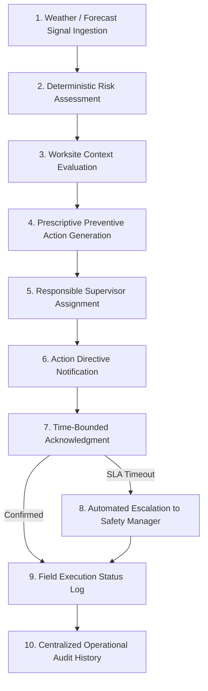
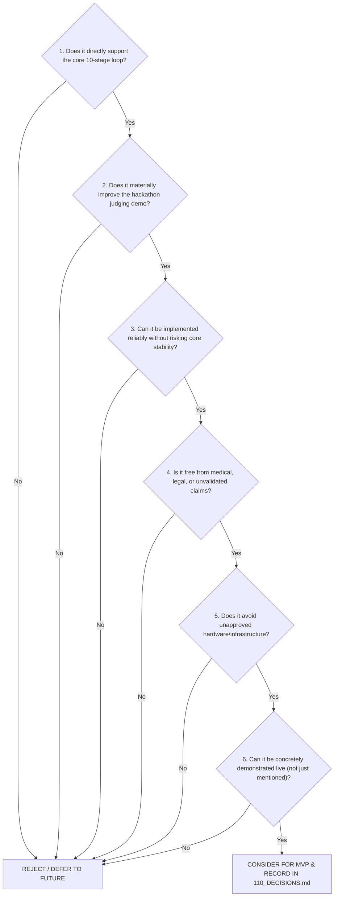

# Heat Action Response Engine (HARE) — Non-Goals & Scope Boundaries

## Document Purpose

This document defines what the **Heat Action Response Engine (HARE)** intentionally does **not** attempt to solve in the current project. It serves as the authoritative scope boundary for the Minimum Viable Product (MVP), protecting engineering focus, eliminating premature complexity, and preventing future concepts from being misrepresented as active system capabilities.

Specifically, this document defines:
1. What the MVP deliberately does not solve.
2. Which capabilities are explicitly excluded from the current implementation.
3. Which capabilities belong strictly to the post-hackathon roadmap.
4. Which claims the product and project team must never make.
5. How engineering and product decisions must evaluate future feature proposals.

A robust MVP is defined not only by what it delivers, but by what it intentionally excludes. 

> **The Heat Action Response Engine focuses on converting identified heat risk into accountable preventive workplace action. It does not attempt to become a complete occupational health, medical, HR, IoT, weather, or enterprise-management platform.**

---

## 1. Core Scope Boundary

The MVP is strictly centered on executing and validating the closed-loop operational lifecycle:



Any capability, feature, or integration falling outside this ten-stage loop is categorized as future scope, optional enhancement, external integration, or explicitly excluded functionality. The MVP does not attempt to solve every dimension of occupational heat safety.

---

## 2. Explicit MVP Non-Goals

The following table summarizes the primary categories explicitly excluded from the MVP scope:

| Category / Non-Goal | Why It Is Out of Scope for MVP | Possible Future Direction |
| :--- | :--- | :--- |
| **Medical Diagnosis & Triage** | Requires clinical validation, medical device certifications, and introduces severe liability and human safety risks. | None. Medical diagnosis remains strictly outside the product's identity. |
| **Emergency Medical Response** | Municipal emergency dispatch (ambulance, 911/108) requires specialized telecommunications infrastructure. | Optional post-incident webhook integrations to enterprise emergency response desks. |
| **Worker Physiological Monitoring** | Requires physical biometric hardware, sensor calibrations, worker consent, and medical data privacy frameworks. | Opt-in industrial wearable integrations (e.g., heart rate monitors) managed under separate privacy controls. |
| **Physical IoT Hardware & Sensors** | Hardware development (microcontrollers, wiring, calibration) delays deployment and violates the software-first principle. | Ingestion of on-site weather station telemetry via AWS IoT Core and MQTT. |
| **Regulatory Safety Certification** | Statutory compliance requires localized legal accreditation and licensed professional engineering sign-offs. | Exportable, standardized operational audit reports to assist human EHS compliance officers. |
| **Legal Compliance Determination** | Legal liability cannot be assigned to automated software systems. | Configurable safety rules aligned with recognized occupational guidelines (OSHA, NIOSH, NDMA). |
| **Universal Bio-Meteorological Model** | Heat stress models vary across individual physiology, clothing, and microclimates; cannot be universally unified. | Support for multi-index models (Wet Bulb Globe Temperature, UTCI) alongside standard Heat Index. |
| **Autonomous AI Safety Authority** | Large language models can hallucinate and exhibit non-deterministic behavior; safety-critical rules must be deterministic. | Assistive natural-language explanations, multilingual translation, and grounded Q&A. |
| **Autonomous Facility Shutdowns** | Consequential business decisions (facility closures, shift terminations) must remain under human executive control. | High-priority escalation recommendations advising human leaders of severe conditions. |
| **Worker Surveillance & Performance Scoring** | Platform evaluates hazard workflows, not employee productivity; worker surveillance damages workplace trust. | Strictly excluded. System tracks supervisory workflow latency, never worker performance. |
| **Enterprise HRIS & Payroll Management** | Payroll, attendance, leave, and recruiting are complex enterprise domains orthogonal to heat safety operations. | Standard API connectors to synchronize worksite shift rosters from enterprise HRMS (SAP, Workday). |
| **General Consumer Weather Platform** | Radar maps, consumer forecasting, and public weather portals are already mature commercial markets. | Focused programmatic ingestion of weather data via Open-Meteo strictly as an operational input. |
| **Custom Weather Prediction Modeling** | Numerical weather modeling requires supercomputing clusters and specialized atmospheric science teams. | Continued reliance on established meteorological models and national meteorological agencies (IMD). |
| **Predictive Worker Illness ML** | Predicting individual heatstroke probability without clinical telemetry is scientifically unreliable. | Group-level contextual exposure modeling based on ambient conditions and metabolic exertion tiers. |
| **Multi-Hazard Environmental Safety** | Expanding into air quality, flooding, or seismic safety dilutes focus during the hackathon demonstration. | Architectural generalization to other environmental workplace hazards (AQI, wind, storm) in Phase 5. |
| **Water Utility / Water-Management Platform** | Industrial leak detection, municipal water networks, and irrigation systems are separate municipal engineering domains. | Operational hydration scheduling and water station logistics strictly as heat mitigations. |
| **Computer Vision Worker Monitoring** | Video-based PPE or heat-stress detection requires CCTV infrastructure, edge compute, and raises severe privacy concerns. | Human supervisory visual inspections guided by standardized system checklists. |
| **Microclimate CFD Digital Twins** | High-fidelity computational fluid dynamics (CFD) modeling of site structures is computationally prohibitive for an MVP. | Lightweight worksite context profiles (indoor/outdoor, shaded canopy available, direct sun). |
| **Individualized Medical Risk Scores** | Assigning percentage-based personal illness probabilities to named individuals is clinically unvalidated and deceptive. | Objective workplace risk categorization based on task workload category and environmental conditions. |
| **Predictive Workforce Behavioral Analytics** | Predicting which supervisor will fail an SLA introduces punitive bias and distracts from operational workflow tracking. | Objective, transparent SLA timers and hierarchical escalation based purely on real-time elapsed time. |

---

### Detailed Non-Goal Specifications

### 2.1 Medical Diagnosis
The platform does **not**:
* Diagnose heat cramps, heat exhaustion, heat stroke, or clinical dehydration.
* Determine personal medical conditions or medical fitness for work.
* Recommend prescription medications or specific clinical medical treatments.
* Replace physicians, industrial occupational nurses, paramedics, or emergency medical responders.

The platform provides operational administrative controls (e.g., work-rest intervals, shade breaks, hydration replenishment); all clinical evaluations remain strictly with qualified healthcare professionals.

### 2.2 Emergency Medical Response
The platform does **not** provide:
* Municipal emergency dispatching (e.g., 911 or 108 ambulance routing).
* Automated emergency medical triage.
* Direct clinical instructions for managing unconscious or seizing individuals.

The system manages operational escalations to organizational management, not emergency trauma services.

### 2.3 Worker Physiological Monitoring
The MVP explicitly excludes all biometric and wearable telemetry:
* Continuous heart-rate monitoring or heart-rate recovery tracking.
* Core body temperature estimation (ingestible pills, tympanic, rectal proxies).
* Galvanic skin response, skin temperature, or sweat-rate sensors.
* Smart helmets, sensorized vests, or biometric wristbands.

Any future introduction of physiological sensors requires separate ethical review, medical validation, worker consent frameworks, and stringent privacy protections.

### 2.4 IoT Hardware & On-Site Sensors
The MVP requires **zero physical hardware**:
* No microcontrollers (ESP32, Arduino, Raspberry Pi, STM32).
* No physical sensor modules (DHT11, DHT22, BME280, anemometers).
* No hardware fabrication, site wiring, solar power rigs, or industrial edge gateways.
* No custom MQTT broker hardware pipelines or AWS IoT Core device fleets.

> **Operational Reality:** The MVP operates entirely by ingesting external weather and forecast data via public APIs (Open-Meteo) combined with configured worksite metadata. The project will never misrepresent software-derived weather estimates as localized physical sensor measurements.

### 2.5 Full Occupational Heat-Safety Certification
The platform does **not**:
* Issue legal certifications that a facility is "heat-safe."
* Certify compliance with statutory labor codes, OSHA standards, or local factories acts.
* Replace mandatory statutory health and safety audits conducted by licensed professionals.

The audit trail documents system-level operations; it does not constitute an accredited certificate of legal immunity.

### 2.6 Legal or Regulatory Determinations
The platform makes no legal assertions. It will never output statements such as:
* *"This workplace is legally compliant with state labor regulations."*
* *"Employer has committed a statutory violation."*
* *"This action plan guarantees legal protection against liability."*

System rules are informed by authoritative occupational guidelines, but the platform is not a judicial or legal authority.

### 2.7 Universal Heat-Risk Model
The MVP does not claim to implement a single, universally flawless bio-meteorological heat-stress model for all human environments. Real-world heat stress is influenced by micro-airflow, clothing thermal resistance, individual acclimatization, radiant ground reflection, and personal health. The MVP applies a documented, transparent deterministic framework (Heat Index coupled with metabolic workload tiers) appropriate for operational workplace scheduling.

### 2.8 Autonomous Safety Decision-Making by AI
The artificial intelligence layer (NVIDIA AI) is strictly barred from making safety-critical determinations:
* AI must **never** calculate, adjust, or relax risk thresholds.
* AI must **never** override deterministic safety standard operating procedures.
* AI must **never** declare a worksite or worker "safe" or "unsafe."
* AI must **never** dismiss or delay an active escalation.

```text
DETERMINISTIC SYSTEM ENGINE (Authoritative Source of Truth)
  ──> Evaluates environmental inputs and applies explicit mathematical rules
  ──> Determines Risk Level, Action Checklist, and SLA Countdown

NVIDIA AI ASSISTIVE LAYER (Communication Multiplier Only)
  ──> Translates structured directives into clear supervisory briefings
  ──> Synthesizes shift summaries and translates into regional languages

HUMAN FRONTLINE SUPERVISION (Operational Authority)
  ──> Reviews, acknowledges, executes, and validates field mitigations
```

### 2.9 Fully Autonomous Workplace Operations
The platform does **not** autonomously actuate facility infrastructure or make binding employment decisions:
* No automated site-wide shutdowns or physical turnstile lockouts.
* No automatic termination of employee shifts or disciplinary actions.
* No automated actuation of industrial machinery or high-voltage equipment.

The engine recommends operational modifications and alerts leadership; executive authority remains with human managers.

### 2.10 Employee Performance Monitoring & Surveillance
HARE is not an employee productivity tracker or surveillance tool:
* Does not track individual worker movements, idle times, or pacing.
* Does not rank workers, calculate productivity scores, or generate attendance penalties.
* Does not maintain individual worker behavioral profiles.

Acknowledgment and execution tracking exist solely to verify that supervisory personnel enact required safety mitigations.

### 2.11 Full HR / Workforce Management System
The platform explicitly excludes general enterprise HR capabilities:
* No payroll processing, compensation calculations, or overtime tracking.
* No leave management, recruitment, or annual performance appraisals.
* No general workforce rostering beyond basic shift hours and headcount flags.

The system ingests only the minimum personnel metadata required to assign and route safety directives.

### 2.12 General Consumer Weather Platform
The platform does not compete with consumer weather applications:
* No interactive Doppler radar maps, satellite imagery, or hurricane trackers.
* No global consumer weather news or lifestyle forecasting widgets.
* No public consumer weather alerting apps.

Meteorological data is ingested strictly as an operational raw material for safety evaluation.

### 2.13 Custom Weather Forecasting Model Development
The project does not build or train proprietary numerical weather prediction (NWP) models. The platform leverages mature, verified meteorological models via external APIs (Open-Meteo) and national meteorological guidance (IMD).

### 2.14 Advanced Machine Learning Illness Prediction
The MVP excludes probabilistic ML models attempting to predict:
* Individual probability of collapsing from heat stroke.
* Worker physiological deterioration curves.
* Predictive statistical correlations between weather and medical claims.

Deterministic safety logic based on established occupational guidelines provides a safer, more transparent foundation.

### 2.15 Multi-Hazard Safety Platform
The MVP is dedicated exclusively to **heat-related workplace hazards**. It does not address:
* Air pollution / Particulate Matter (PM2.5 / AQI).
* Flash flooding or heavy precipitation.
* High-wind crane load stability.
* Lightning or severe thunderstorms.
* Chemical, radiological, or biological industrial hazards.

Multi-hazard expansion represents a potential Phase 5 roadmap milestone, not an MVP deliverable.

### 2.16 Water Utility & Infrastructure Management
While the hackathon theme may encompass "Heat and Water," the project focuses strictly on **workplace heat-risk operations**. It does **not** provide:
* Municipal water network optimization or leak detection.
* Industrial water-quality chemical testing.
* Agricultural irrigation scheduling or wastewater treatment monitoring.

Hydration management in HARE is confined to ensuring drinking water availability and scheduled consumption for heat-exposed workers.

### 2.17 Advanced Computer Vision
The MVP incorporates **zero computer vision models**:
* No CCTV stream processing or video analytics.
* No automated PPE detection (vests, hardhats, cooling scarves).
* No facial recognition, posture analysis, or thermal imaging camera feeds.

### 2.18 Real-Time Physical Microclimate Digital Twins
The MVP does not construct high-fidelity 3D spatial physics simulations:
* Does not model 3D building geometry, solar shadow ray-tracing, or structural surface emissivity.
* Does not run computational fluid dynamics (CFD) for localized wind tunnels.

Worksite context is maintained through practical, operational attributes (coordinates, shade availability, indoor/outdoor flag).

### 2.19 Individualized Medical Risk Scoring
The platform will never output personal clinical assessments such as:
> *"Worker #42 has an 82% risk of heat cramps today."*

Risk is evaluated at the worksite, zone, and crew level based on environmental exposure and task workload intensity.

### 2.20 Predictive Workforce Behavioral Analytics
The MVP does not employ predictive behavioral profiling to forecast whether a specific supervisor will ignore a safety directive. Accountability is enforced objectively via real-time countdown timers and automated escalation upon SLA breach.

---

## 3. Features That Are Future Scope

The table below outlines capabilities that represent compelling long-term roadmap opportunities, but are **explicitly excluded** from the hackathon MVP:

| Future Capability | Why It Is Operationally Compelling | Why It Is Excluded from Hackathon MVP |
| :--- | :--- | :--- |
| **On-Site IoT Microclimate Weather Stations** | Delivers hyper-local temperature, humidity, and direct solar flux directly from the worksite perimeter. | Requires physical hardware procurement, wiring, calibration, and edge gateways; delays deployment. |
| **Wet Bulb Globe Temperature (WBGT) Telemetry** | Incorporates radiant black-globe temperature for gold-standard industrial heat stress measurement. | High-precision WBGT instrumentation requires physical on-site deployment and regular maintenance. |
| **Industrial Wearable Biometrics** | Monitors physiological strain index (PSI), heart rate recovery, and skin temperature. | Involves complex privacy frameworks, battery lifecycle management, and worker union approvals. |
| **Lightweight Worker Mobile App** | Delivers personalized hydration reminders, cooling break timers, and local site shade maps directly to laborers. | Substantially increases mobile UI surface area; frontline safety is effectively managed via supervisors in MVP. |
| **Predictive 72-Hour Shift Rescheduling** | Recommends proactive schedule modifications days in advance based on numerical weather forecasts. | Requires deep integration with enterprise scheduling ERPs and extensive historical validation. |
| **CCTV Computer Vision for Shade Verification** | Verifies canopy deployment and water station stocking via fixed site cameras. | Introduces edge inference infrastructure, camera maintenance overhead, and workplace privacy concerns. |
| **Multi-Hazard Environmental Operations** | Unifies heat, air quality (AQI), high-wind crane risks, and storm alerts into one execution engine. | Broadens the operational surface area; MVP must prove complete closed-loop execution for heat first. |
| **Enterprise HRMS / ERP Synchronization** | Automatically synchronizes daily crew rosters from SAP SuccessFactors, Workday, or Procore. | Complex enterprise authentication, bespoke database schemas, and integration friction. |
| **Automated Facility Control Integration** | Directly triggers industrial misting cannons, shade louvers, or ventilation fans via building management systems. | Requires physical relay integration and industrial control protocol (BACnet/Modbus) support. |
| **Cross-Seasonal Predictive Safety Analytics** | Analyzes multi-year operational data to uncover institutional bottlenecks and site heat vulnerability patterns. | Requires years of accumulated historical operational data to yield statistically meaningful insights. |

---

## 4. Claims We Must Not Make

To uphold engineering integrity, legal safety, and judge trust, the project team must strictly avoid making unsubstantiated, exaggerated, or medical claims.

### Absolute Prohibitions:

```text
PROHIBITED CLAIMS:
× "This system prevents all heat-related illnesses and injuries."
× "This platform guarantees zero workplace safety incidents."
× "Our AI diagnoses early symptoms of heat stroke."
× "The system predicts the exact moment an individual worker will suffer heat exhaustion."
× "This application certifies compliance with statutory occupational health laws."
× "The platform replaces the need for on-site occupational safety professionals."
× "Our AI independently determines whether conditions are safe for human labor."
× "Open-Meteo provides real-time on-site sensor measurements."
× "The system operates on physical IoT telemetry" (when running on API or simulation feeds).
× "The algorithm has undergone clinical medical validation."
× "The software eliminates human supervisory responsibility."
```

### Approved, Evidence-Aware Terminology:

| Avoid Misleading Phrase | Use Approved Engineering Language |
| :--- | :--- |
| *"Guarantees worker safety"* | *"Supports proactive, structured safety operations"* |
| *"Diagnoses heat illness"* | *"Evaluates environmental heat hazards and task workload tiers"* |
| *"Predicts individual medical outcomes"* | *"Identifies environmental risk thresholds requiring preventive controls"* |
| *"Certifies regulatory compliance"* | *"Maintains an immutable operational audit trail of safety actions"* |
| *"Replaces safety supervisors"* | *"Empowers frontline supervisors with clear, actionable checklists"* |
| *"Real-time physical sensor data"* | *"Continuously updated weather and forecast data from Open-Meteo"* |
| *"AI determines safety"* | *"Deterministic rules govern safety; AI assists operational communication"* |

---

## 5. Scope-Creep Decision Framework

When a new feature, integration, or capability is proposed during development, the team must evaluate it against six strict filter questions:



### The Formal Evaluation Questions:
1. **Core Relevance:** Does the capability directly advance the detection $\rightarrow$ assessment $\rightarrow$ context $\rightarrow$ action $\rightarrow$ assignment $\rightarrow$ notification $\rightarrow$ acknowledgment $\rightarrow$ escalation $\rightarrow$ audit lifecycle?
2. **Demo Value:** Does it materially strengthen the 5-minute hackathon judge demonstration?
3. **Execution Feasibility:** Can it be delivered with high stability and test coverage in the available timeframe?
4. **Safety & Claim Integrity:** Is it free from speculative medical claims, legal guarantees, or unconstrained AI behavior?
5. **Zero Hardware Dependency:** Does it avoid introducing microcontrollers, physical sensors, or complex hardware pipelines?
6. **Verifiability:** Can the feature be proven functioning live on screen rather than merely described in slides?

> **Governance Enforcement:** Any proposed feature that alters MVP scope must be formally recorded, justified, and approved in [`docs/110_DECISIONS.md`](file:///d:/Amazon%202nd%20Hackathon%20Heat/docs/110_DECISIONS.md) before engineering commences.

---

## 6. MVP vs. Long-Term Vision Boundary Matrix

| System Capability | Hackathon MVP Status | Long-Term Commercial Vision |
| :--- | :---: | :---: |
| **Weather & Forecast Ingestion (Open-Meteo)** | **Yes (P0)** | **Yes** (Multi-provider aggregation) |
| **Deterministic Heat Risk Engine (Heat Index)** | **Yes (P0)** | **Yes** (Multi-metric: WBGT, UTCI) |
| **Worksite & Workload Context Modeling** | **Yes (P0)** | **Yes** (Dynamic microclimate & ERP sync) |
| **Prescriptive Action Plan Synthesis** | **Yes (P0)** | **Yes** (Context-aware action optimization) |
| **Designated Supervisor Assignment** | **Yes (P0)** | **Yes** (Delegation & shift handover) |
| **Direct Notification Dispatch** | **Yes (P0)** | **Yes** (Multi-channel: SMS, Push, WhatsApp) |
| **Time-Bounded Acknowledgment Tracking** | **Yes (P0)** | **Yes** (Adaptive SLAs) |
| **Automated Hierarchical Escalation** | **Yes (P0)** | **Yes** (Multi-tier escalation trees) |
| **Immutable Operational Audit Trail** | **Yes (P0)** | **Yes** (Cryptographically verified ledger) |
| **NVIDIA AI Assistance (Explanations & Translation)** | **Yes (P1)** | **Yes** (Expanded cognitive assistant) |
| **Simulation / Demonstration Mode** | **Yes (P1)** | **Yes** (Training & scenario drills) |
| **Physical IoT Weather Stations** | **No** | **Yes** (AWS IoT Core telemetry) |
| **Industrial Wearable Biometrics** | **No** | **Yes** (Opt-in physiological telemetry) |
| **Worker-Facing Mobile Application** | **No** | **Yes** (Dedicated worker portal) |
| **Predictive 72-Hour Shift Rescheduling** | **No** | **Yes** (Predictive operational scheduling) |
| **Multi-Hazard Expansion (AQI, Wind, Storm)** | **No** | **Yes** (Universal environmental platform) |
| **Full Enterprise HRIS & Payroll Integration** | **No** | **Optional** (Enterprise connectors) |
| **Clinical Medical Diagnosis & Triage** | **Strictly Excluded** | **Strictly Excluded** |
| **Statutory Regulatory Safety Certification** | **Strictly Excluded** | **Strictly Excluded** |

---

## 7. Why These Non-Goals Strengthen the Product

Excluding non-goals is a mark of architectural maturity and engineering discipline, not a limitation:

1. **Demonstrates Rigorous Prioritization:** Judges quickly identify when teams attempt to tackle too many disparate domains superficially. A disciplined focus on one complete, robust operational loop is far more compelling than five half-built features.
2. **Eliminates High-Risk Vulnerabilities:** By strictly avoiding clinical medical claims, employee surveillance, and legal certifications, the platform bypasses immense ethical, regulatory, and legal hazards.
3. **Guarantees Hackathon Deployability:** By rejecting physical microcontrollers and custom hardware, the software platform can be deployed, tested, and demonstrated anywhere on earth in minutes using geographic coordinates alone.
4. **Highlights Core Differentiation:** Clear non-goals prevent the product from being confused with a consumer weather app or a generic IoT dashboard, shining the spotlight on its true innovation: **closed-loop, accountable workplace execution**.
5. **Establishes Responsible AI Practices:** Bounding NVIDIA AI strictly to communication assistance while anchoring safety logic in deterministic math demonstrates state-of-the-art enterprise AI safety principles.

---

## 8. Relationship to the Product Vision

The non-goals established in this document do not contradict the expansive roadmap presented in [`docs/03_PRODUCT_VISION.md`](file:///d:/Amazon%202nd%20Hackathon%20Heat/docs/03_PRODUCT_VISION.md). Rather, they serve as the protective boundary that makes realizing that vision possible:

```text
[ PRODUCT VISION (docs/03_PRODUCT_VISION.md) ]
The ambitious, multi-phase destination: IoT telemetry, predictive planning, multi-hazard expansion.
                     │
                     ▼
[ MVP SCOPE (docs/04_MVP_SCOPE.md) ]
The smallest credible, fully functioning implementation of the core operational loop.
                     │
                     ▼
[ NON-GOALS (docs/05_NON_GOALS.md - This Document) ]
The rigorous defensive boundary preventing premature expansion, feature creep, and false claims.
```

The vision describes where the platform may travel; this non-goals document ensures the team successfully builds the foundational vehicle first.

---

## 9. Hackathon Judge Communication Guide

When presenting to hackathon evaluators, use the following standardized responses to address common scoping inquiries:

### Response 1: "Why didn't you build or include physical IoT sensors or wearables?"
> *"We made an intentional, disciplined engineering decision to deliver a software-first MVP. Industrial organizations frequently operate worksites where deploying custom hardware, wiring sensors, and negotiating wearable union agreements takes months or years.*
> 
> *The critical problem we are solving is the operational response gap—ensuring that when heat risk is identified, site-specific actions are automatically assigned, acknowledged, and escalated. By using reliable software weather APIs, our platform can be deployed to any worksite on earth in five minutes. Our architecture is modular, so when a client later deploys on-site IoT sensors or AWS IoT Core pipelines, that data plugs seamlessly into the exact same risk and action engine."*

### Response 2: "Why doesn't the system predict which individual worker will suffer heatstroke?"
> *"Predicting individual clinical medical outcomes without invasive physiological telemetry is scientifically unvalidated and introduces severe safety and liability risks. Furthermore, our goal is prevention, not post-hoc emergency triage.*
> 
> *Our engine evaluates contextual workplace risk—combining environmental conditions with task workload intensity and site infrastructure—to generate preventive operational controls such as mandatory rest cycles, shade deployment, and hydration. We solve the organizational coordination challenge to prevent heat strain before medical emergencies occur."*

---

## 10. Final Non-Goal Statement

> **The Heat Action Response Engine is intentionally not a medical diagnosis system, a consumer weather app, an IoT hardware platform, an employee surveillance tool, a regulatory certification engine, or an autonomous safety authority.**
> 
> **Its MVP focuses with uncompromising discipline on one measurable operational capability: transforming identified workplace heat risk into contextual preventive actions, accountable supervisory ownership, time-bounded acknowledgment, automated managerial escalation, and an immutable, traceable audit history.**

---

* **Status:** Draft
* **Last Updated:** 2026-10-07
