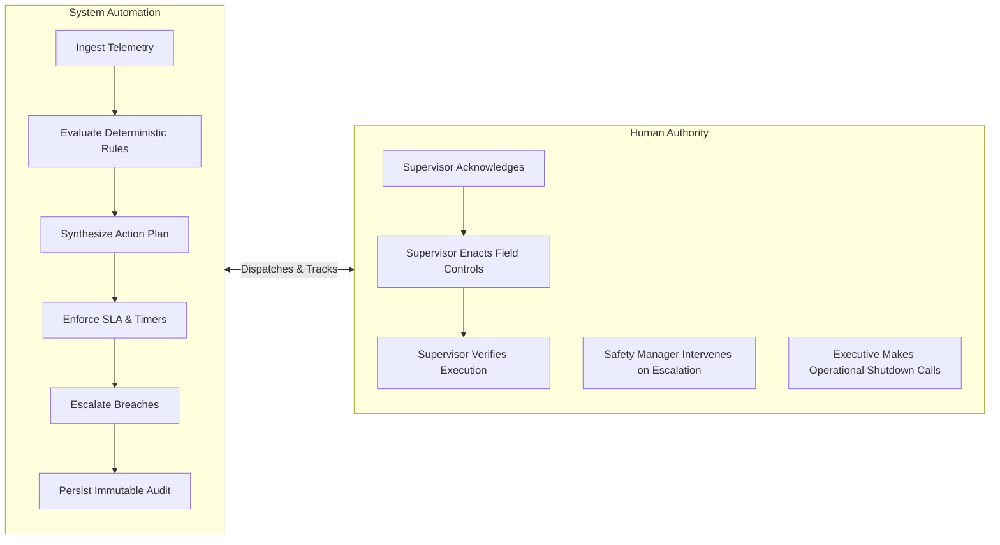

# Heat Action Response Engine (HARE) — Target Users & Stakeholder Specifications

## 1. Document Purpose

The **Heat Action Response Engine (HARE)** is an organizational safety-operations platform engineered for enterprise workplace coordination, not a consumer weather or personal wellness application.

Its primary users are the individuals responsible for:
* Monitoring workplace environmental heat risk across operating facilities.
* Formulating and evaluating context-appropriate preventive safety actions.
* Supervising frontline workforces and executing field mitigations.
* Responding to unacknowledged or escalated safety directives.
* Maintaining organizational visibility, compliance traceability, and administrative governance.

For the Minimum Viable Product (MVP), the application defines three core operational roles:

```text
ADMIN
SAFETY_MANAGER
SUPERVISOR
```

While the broader organizational ecosystem includes frontline workers, Operations Managers, executive leadership, and certified occupational health professionals, only the roles required to execute the closed-loop operational workflow receive full application scope in the MVP:

```text
HEAT SIGNAL
→ RISK
→ CONTEXT
→ ACTION
→ ASSIGN
→ NOTIFY
→ ACKNOWLEDGE
→ ESCALATE
→ VERIFY
→ AUDIT
```

---

## 2. Target User Overview

The table below outlines the primary organizational actors, distinguishing direct MVP application users from secondary stakeholders and indirect beneficiaries:

| User Role | Organizational Classification | Primary Responsibility | Core Need | Core System Interaction |
| :--- | :--- | :--- | :--- | :--- |
| **Safety Manager** | **Primary MVP User** | Oversee heat risk and safety operations across facilities. | Multi-site visibility and closed-loop accountability. | Monitors risk heatmaps, inspects action plans, manages escalations. |
| **Site Supervisor** | **Primary MVP User** | Coordinate and execute preventive actions on site. | Clear, actionable, task-based instructions. | Receives directives, acknowledges receipt, updates execution status. |
| **Organization Admin** | **Primary MVP User** | Configure worksite metadata, rosters, and permissions. | Reliable configuration and access governance. | Manages sites, users, roles, and escalation chains. |
| **Frontline Worker** | **Indirect Beneficiary** | Perform assigned physical labor safely. | Safe, shaded, hydrated working conditions. | Receives protective interventions via supervisors; no dedicated MVP app. |
| **Operations Manager** | **Secondary Stakeholder** | Balance production targets with operational safety. | Cross-site operational continuity visibility. | Reviews heat-adjusted schedules and major escalations (future scope). |
| **Occupational Safety Professional** | **Advisory Stakeholder** | Establish corporate EHS policies and risk matrices. | Evidence-based risk methodologies and standards. | Validates deterministic rules and SOP action libraries (domain advisor). |

---

## 3. Primary MVP Users

### 3.1 Safety Manager

The **Safety Manager** is the primary governance and oversight user of the platform.

#### Responsibilities:
* Monitoring heat-risk levels across all active company facilities simultaneously.
* Reviewing system-calculated risk classifications and triggering rationales.
* Ensuring that generated Action Plans are assigned to active, on-duty supervisors.
* Tracking real-time supervisory acknowledgment against established Service Level Agreements (SLAs).
* Intervening immediately when high-risk directives breach SLAs and trigger automated escalations.
* Inspecting chronological audit records during post-shift safety reviews.
* Verifying that the operational heat response process functions uniformly across all sites.

#### Primary Goals:
* Instantly identify which facilities currently require urgent safety interventions.
* Understand the explicit, deterministic reasons contributing to elevated risk.
* Verify who owns the corrective action on the ground at each facility.
* Intervene proactively before an unacknowledged field hazard leads to worker strain.
* Maintain an immutable, inspection-ready record of all organizational safety actions.

#### Target Workflow Challenges (Pain Points):
* **Fragmented Awareness:** Disconnected weather alerts do not reveal whether specific worksites are taking preventive steps.
* **Geographic Blindness:** Managing multiple dispersed sites makes manual phone calls and radio check-ins slow and error-prone.
* **Diffusion of Responsibility:** Broadcast chat alerts lack verifiable individual ownership.
* **Audit Trail Deficits:** Difficult to reconstruct exactly when a warning occurred, who was notified, or why mitigations were delayed.

#### System Interactions:
1. Views the real-time Multi-Site Risk Console.
2. Inspects mathematical risk factors and environmental parameters for any site.
3. Reviews system-generated Action Plans and assigned supervisors.
4. Monitors live SLA acknowledgment countdown timers.
5. Receives high-priority visual and notification alerts for escalated directives.
6. Reviews historical audit logs for compliance reporting.
7. Queries the grounded NVIDIA AI assistant for quick operational summaries.
8. Initiates simulation scenarios during safety drills and evaluation reviews.

#### Key Information Needed:
* Worksite name, zone, and GPS coordinates.
* Current and forecast heat risk tiers (Low, Moderate, High, Critical).
* Contributing environmental factors (ambient temperature, humidity, solar load).
* Workload category, active shift timing, and exposed crew headcount.
* Action Plan ID, prescriptive checklist items, and assigned supervisor entity.
* Acknowledgment state, elapsed response time, and escalation status.

#### Success Definition for This User:
> **The Safety Manager can instantly identify where heat-related intervention is needed, understand the root cause, verify whether the responsible supervisor has acted, and intervene immediately when an action remains unresolved.**

---

## 4. Site Supervisor

The **Site Supervisor** is the primary action-execution user on the frontline.

#### Responsibilities:
* Directly leading and supervising crews at a specific physical worksite or zone.
* Receiving dispatched preventive Action Plans on a mobile or web device.
* Positively acknowledging receipt of directives within the configured SLA window.
* Communicating and executing mandatory field controls (mandating shaded rest cycles, verifying hydration supplies, rescheduling heavy unshaded tasks).
* Updating the system once field mitigations are enacted.
* Answering escalation queries if field conditions prevent immediate implementation.

#### Primary Goals:
* Receive clear, concise, unambiguous instructions tailored to current site conditions.
* Minimize administrative friction and eliminate complex mobile navigation.
* Understand exactly why a specific work-rest cycle is mandated.
* Acknowledge directives with a single click while in active field environments.
* Keep frontline crews protected without chaotic operational disruptions.

#### Target Workflow Challenges (Pain Points):
* **Information Ambiguity:** Generic regional weather bulletins do not specify what rest schedule is needed for heavy concrete finishing.
* **Channel Clutter:** Safety directives mixed into general messaging apps get lost during busy shifts.
* **Cognitive Overload:** Complex meteorological charts create confusion rather than clear action.
* **Unclear Priorities:** Lacking clarity on whether an advisory is an optional recommendation or a mandatory operational protocol.

#### System Interactions:
1. Receives direct, prominent notification of an assigned Action Plan.
2. Views the worksite name, active risk tier, and trigger rationale.
3. Reviews the prioritized checklist of required field mitigations.
4. Clicks `ACKNOWLEDGE & ENACT` to confirm receipt and responsibility.
5. Submits execution verification notes (e.g., *"Crew on 15-min shaded rest; water restocked"*).
6. Views active countdown timers and escalation indicators.

#### Illustrative Supervisor Workflow:
```text
Worksite: Bengaluru Infrastructure Project — Site #17
Environmental Trigger: Ambient 37°C + Relative Humidity 62% (Heat Index High Risk)
Active Crew: 42 Workers (Structural Rebar Installation — Heavy Exertion)

DISPATCH:
Directive AP-1082 arrives on Supervisor Ravi's mobile console:
- Implement 45-min work / 15-min shaded cooling rotation immediately.
- Replenish shaded hydration stations with cool potable water.
- Move heavy manual tying under temporary canopy where feasible.
- Acknowledgment Window: 15 Minutes Remaining.

ACTION:
Supervisor Ravi taps "ACKNOWLEDGE & ENACT" at Minute 4.
System logs acknowledgment; timer stops; state updates to ACKNOWLEDGED.
Ravi gathers crew leads, blows the whistle for shaded rotation, and confirms water points.
Ravi taps "CONFIRM EXECUTION" with a quick note.
```

#### Success Definition for This User:
> **The Site Supervisor receives clear, context-aware, actionable directives and can acknowledge, execute, and verify them with minimal friction and zero ambiguity.**

---

## 5. Organization Administrator

The **Organization Administrator** is the configuration, setup, and governance user.

#### Responsibilities:
* Provisioning organizational accounts and managing user identity access.
* Creating and updating worksite profiles (geospatial coordinates, physical zone designations, indoor/outdoor flags).
* Configuring shift schedules, crew headcounts, and default task workload categories.
* Mapping Site Supervisors to designated worksites and shifts.
* Assigning Safety Managers to oversight zones and configuring escalation routing rules.
* Maintaining system-level integration settings (API keys, notification endpoints).

#### Primary Goals:
* Ensure seamless, error-free onboarding of new facilities and personnel.
* Maintain an accurate, up-to-date mapping of who is on duty at every site.
* Keep system access strictly aligned with corporate role-based access control (RBAC).
* Minimize administrative maintenance overhead through straightforward configuration UI.

#### System Interactions:
1. Creates, edits, and archives worksite profiles.
2. Configures latitude and longitude coordinates for automated weather ingestion.
3. Manages user accounts and assigns roles (`ADMIN`, `SAFETY_MANAGER`, `SUPERVISOR`).
4. Configures supervisor assignment rosters and backup escalation contacts.
5. Inspects system health logs and API status monitors.

#### Success Definition for This User:
> **The Organization Administrator can configure worksites and personnel rosters so that every monitored facility has accurate operational context and an assigned, accountable supervisor.**

---

## 6. Frontline Worker (Indirect Beneficiary)

### The Worker's Role in the Safety Ecosystem
Frontline laborers (construction workers, logistics handlers, utility technicians, agricultural crews) are the **primary beneficiaries** of the platform's safety operations. They are directly exposed to:
* High ambient temperatures and solar radiation.
* Heavy metabolic exertion generating intense internal body heat.
* PPE and heavy workwear impeding natural cooling.
* Physical fatigue and dehydration risks during prolonged shifts.

```text
               FRONTLINE WORKER
                      ▲
                      │ Receives field mitigations (shade, water, rest)
                      │
               SITE SUPERVISOR
                      ▲
                      │ Guided by prescriptive action plans & tracked by SLAs
                      │
               SAFETY MANAGER
                      ▲
                      │ Governs multi-site risk & intervenes upon escalation
                      │
        HEAT ACTION RESPONSE ENGINE (HARE)
```

### MVP Relationship & Rationale
The MVP intentionally does **not** provide a dedicated native mobile application for individual workers. Frontline industrial laborers frequently face device restrictions, connectivity limitations, language barriers, and union considerations. Enforcing safety through the supervisory chain of command guarantees immediate operational impact without requiring every laborer to carry a smartphone or manage an account.

### Worker Data Boundary
The platform respects worker privacy and data ethics:
* **No Individual Biometrics:** No heart-rate, body-temperature, or sweat telemetry.
* **No Personal Surveillance:** No individual GPS tracking, productivity pacing, or attendance scoring.
* **Aggregated Workforce Context:** The system stores only group-level operational parameters (crew headcount, shift hours, and task workload tier).

---

## 7. Operations Manager (Secondary Stakeholder)

The **Operations Manager** represents an operational leadership stakeholder focused on project delivery, schedule management, and cross-site resource allocation.

#### Key Interests:
* Ensuring operational continuity while upholding worker safety.
* Understanding forecast heat trends to anticipate schedule adjustments.
* Receiving secondary alerts when critical safety escalations require work stoppages or shift rescheduling.
* Verifying that safety protocols are executed without unnecessary operational disruption.

#### MVP Status:
The Operations Manager is a **secondary stakeholder** in the MVP. The platform addresses their needs through high-level visibility on the Safety Manager console and automated escalation alerts, rather than providing an isolated, full-featured operations management portal during the hackathon.

---

## 8. Occupational Safety Professional (Advisory Stakeholder)

Certified occupational safety professionals, industrial hygienists, and EHS directors serve as **domain authorities** who define organizational safety standards.

#### Advisory Contribution:
* Validating deterministic heat stress calculation models and threshold tiers.
* Reviewing Standard Operating Procedure (SOP) action libraries (e.g., work-rest ratios, hydration volumes).
* Ensuring system workflows align with recognized occupational safety bodies (OSHA, NIOSH, NDMA, ISO 7243).

#### Platform Boundary:
> **The Heat Action Response Engine operationalizes documented safety logic; it does not replace professional occupational health and safety judgment.**

---

## 9. User-to-Workflow Mapping

The matrix below maps each stakeholder to their active responsibilities across the ten-stage operational lifecycle:

| Workflow Stage | Organization Admin | Safety Manager | Site Supervisor | Frontline Worker |
| :--- | :---: | :---: | :---: | :---: |
| **1. Ingest Weather** | System Config | Observes Ingestion | — | — |
| **2. Assess Risk** | — | Reviews Risk Tier | Receives Context | — |
| **3. Contextualize** | Configures Context | Validates Context | Site Realities | Group Profile |
| **4. Decide Actions** | Registers SOPs | Reviews Action Plan | — | — |
| **5. Assign Owner** | Roster Setup | Oversight Assignment | Bound as Owner | — |
| **6. Notify** | Channel Setup | Oversight Feed | Receives Directive | — |
| **7. Acknowledge** | — | Monitors SLA Timer | **Submits Click ACK** | — |
| **8. Escalate** | Routing Rules | **Receives Escalation** | Alerts Secondary | — |
| **9. Verify Execution** | — | Audit Verification | **Submits Log** | **Enacts Mitigations** |
| **10. Audit History** | System Access | **Reviews Full Ledger** | Assigned History | — |

---

## 10. Role Permission Model

The platform implements an explicit Role-Based Access Control (RBAC) model across the three MVP roles:

| Operational Capability | Organization Admin | Safety Manager | Site Supervisor |
| :--- | :---: | :---: | :---: |
| **Create & Configure Worksites** | **Yes** | Yes (Limited) | No |
| **Manage Users & Role Assignment** | **Yes** | No | No |
| **View Global Multi-Site Heatmap** | **Yes** | **Yes** | No |
| **View Assigned Worksite Risk & Telemetry** | **Yes** | **Yes** | **Yes** (Assigned Sites Only) |
| **View All Active Action Plans** | **Yes** | **Yes** | No |
| **View Assigned Action Plans** | **Yes** | **Yes** | **Yes** (Assigned Plans Only) |
| **Acknowledge Safety Directives** | No | Yes (Oversight Override) | **Yes** (Primary Action) |
| **Submit Execution Verification Notes** | No | Yes (Oversight Verification) | **Yes** (Primary Action) |
| **Receive & Resolve SLA Escalations** | **Yes** | **Yes** | No |
| **Inspect Global Chronological Audit Ledger** | **Yes** | **Yes** | Assigned History Only |
| **Trigger Simulation / Demo Scenarios** | **Yes** | **Yes** | No |
| **Interact with NVIDIA AI Assistive Service** | System Guidance | Operational Summaries | Task Explanations |

*(Detailed authorization and API token schemas will be codified in `docs/19_PERMISSION_MODEL.md` and `docs/83_AUTHORIZATION.md`.)*

---

## 11. User Information Needs

To prevent cognitive overload, the system exposes the **minimum necessary information** required for each role to act decisively:

| Information Dimension | Safety Manager | Site Supervisor | Organization Admin |
| :--- | :---: | :---: | :---: |
| **Current Environmental Risk Tier** | **Yes (All Sites)** | **Yes (Assigned Site)** | Optional |
| **Deterministic Risk Trigger Reasons** | **Yes (Full Formula)** | **Yes (Plain Summary)** | Optional |
| **Live Meteorological Telemetry** | **Yes (Detailed)** | **Yes (Essential)** | Optional |
| **Worksite Operational Context** | **Yes** | **Yes** | **Yes (Full Config)** |
| **Required Action Checklist Items** | **Yes** | **Yes (Prioritized)** | Optional |
| **Assigned Action Owner Profile** | **Yes** | **Yes (Self)** | **Yes** |
| **Live SLA Acknowledgment Countdown** | **Yes (All Active)** | **Yes (Assigned)** | Optional |
| **Escalation Alerts & Status** | **Yes (Prominent)** | **Yes (Assigned)** | Optional |
| **Chronological Audit History** | **Yes (Exportable)** | Limited View | **Yes (System Logs)** |
| **User Directory & Credentials** | No | No | **Yes (Full Access)** |

---

## 12. End-to-End User Journeys

### 12.1 Safety Manager User Journey
```text
1. LOGIN & OVERVIEW:
   Safety Manager logs in; dashboard displays 12 active construction and logistics sites.
2. HAZARD DETECTION:
   Site #17 flashes AMBER → RED as midday Heat Index crosses into High Risk.
3. CONTEXTUAL REVIEW:
   Opens Site #17; reviews workload (Heavy structural steel), active crew (42 workers),
   and the generated Action Plan AP-1082.
4. OWNERSHIP VERIFICATION:
   Confirms Action Plan is dispatched to on-duty Supervisor Ravi; monitors the 15-minute SLA timer.
5. EXCEPTION HANDLING (PATH A - SUCCESS):
   Supervisor Ravi acknowledges at Minute 4; status badge transitions to Green / Acknowledged.
6. EXCEPTION HANDLING (PATH B - ESCALATION):
   Timer hits zero without acknowledgment; system triggers audible/visual ESCALATION alert.
   Safety Manager immediately calls the site radio or field dispatch to mandate rest cycles.
7. AUDIT & REPORTING:
   End-of-shift review verifies complete timeline of trigger, dispatch, and supervisory actions.
```

### 12.2 Site Supervisor User Journey
```text
1. DIRECTIVE RECEIPT:
   Supervisor receives urgent push/banner alert on mobile console: "ACTION REQUIRED: SITE #17".
2. FOCUSED REVIEW:
   Opens directive; reads concise plain-language summary: "High heat stress during afternoon shift.
   Heavy physical labor requires mandatory 45/15 work-rest cycle and shaded hydration."
3. ONE-TOUCH ACKNOWLEDGMENT:
   Taps "ACKNOWLEDGE & ENACT". System immediately updates status and confirms receipt.
4. FIELD EXECUTION:
   Supervisor directs crew to shaded break canopy, verifies drinking water coolers,
   and reschedules outdoor crane hoisting to shaded ground staging.
5. VERIFICATION LOG:
   Taps "CONFIRM MITIGATION COMPLETE" with a 5-second note: "Canopy active, water verified."
```

### 12.3 Organization Administrator User Journey
```text
1. ONBOARDING:
   Admin logs in; navigates to Facility Management; creates "Bengaluru Logistics Terminal #17".
2. GEOSPATIAL CONFIGURATION:
   Enters exact latitude/longitude coordinates; confirms automated Open-Meteo polling connection.
3. WORKPLACE PROFILE:
   Sets outdoor flag, available shade canopy, shift hours (09:00–17:00), and Heavy workload category.
4. ROSTER MAPPING:
   Assigns Supervisor Ravi K. as primary site supervisor and Safety Officer Priya M. as regional lead.
5. GOVERNANCE:
   Activates monitoring; platform begins autonomous environmental ingestion and rule evaluation.
```

---

## 13. Primary User Pain Points vs. Product Response

| Frontline Operational Friction | HARE Platform Response |
| :--- | :--- |
| **Weather alerts are disconnected from workplace tasks** | Evaluates site-specific context (workload, shift, shade) to translate weather into tailored actions. |
| **Generic advisories lack concrete operational instructions** | Generates standardized, prescriptive Standard Operating Procedure (SOP) action checklists. |
| **Broadcast warnings lack clear individual ownership** | Automatically resolves and assigns action plans to a single designated on-duty supervisor. |
| **Safety messages are easily overlooked or ignored** | Enforces time-bounded SLA countdowns requiring positive one-touch supervisory acknowledgment. |
| **Unanswered hazards linger without leadership intervention** | Automatically triggers hierarchical escalations to Safety Managers upon SLA timeout. |
| **Post-incident investigations lack verifiable records** | Writes every environmental trigger, directive, acknowledgment, and escalation to an audit ledger. |
| **Supervisors struggle to interpret complex meteorological indices** | Leverages NVIDIA AI to explain risk factors in concise, intuitive, non-technical language. |
| **Dispersed facilities have divergent exposure characteristics** | Maintains discrete worksite profiles reflecting local physical shading, hydration, and tasks. |

---

## 14. User Experience Principles by Role

```text
SAFETY MANAGER UX: "OVERVIEW FIRST, DRILL DOWN ON RISK"
├── High-level multi-site situational map at a single glance.
├── Immediate visual prioritization of facilities under elevated or critical risk.
├── Instant visibility of unacknowledged actions and active escalation alerts.
└── One-click access to exportable chronological audit histories.

SITE SUPERVISOR UX: "ACTION FIRST, MINIMAL COGNITIVE FRICTION"
├── Ultra-clean, mobile-responsive layout designed for outdoor visibility.
├── Direct, prominent action checklists highlighting mandatory tasks.
├── Single-touch acknowledgment button (no multi-screen navigation).
└── Simple voice or text verification note capture.

ORGANIZATION ADMIN UX: "SIMPLE SETUP, ZERO REDUNDANCY"
├── Intuitive facility registration form with GPS coordinate validation.
├── Clean drag-and-drop or dropdown personnel roster assignments.
└── Minimal configuration steps required to bring a worksite online.
```

---

## 15. The Human-in-the-Loop Model

HARE strictly enforces an augmented human-in-the-loop operational architecture:



* **The System Empowers, Never Replaces:** The platform eliminates human monitoring fatigue and automates task routing, but responsible humans observe field realities, execute mitigations, and make final operational decisions.
* **Non-Autonomous Operations:** The platform will never autonomously halt industrial machinery or shut down a facility; it alerts leadership, who retain full executive authority.

---

## 16. AI Interaction Matrix by Role

NVIDIA AI models are integrated as assistive communication services, strictly bounded from safety-critical determinations:

| User Role | Approved NVIDIA AI Assistive Capabilities | Prohibited AI Behaviors |
| :--- | :--- | :--- |
| **Safety Manager** | * Generates multi-site executive shift briefings.<br>* Summarizes active risk trends and escalation counts.<br>* Answers grounded questions on active site telemetry and SOPs. | * May not adjust risk thresholds.<br>* May not dismiss or resolve active escalations autonomously.<br>* May not declare a site safe. |
| **Site Supervisor** | * Translates structured JSON checklists into concise SMS/chat messages.<br>* Explains complex heat metrics in plain language.<br>* Translates English directives into regional dialects (Hindi, Kannada). | * May not modify mandatory rest-break intervals.<br>* May not diagnose heat exhaustion or illness.<br>* May not override assigned safety SOPs. |
| **Organization Admin**| * Assists in formulating standardized organizational SOP descriptions.<br>* Provides contextual help on system configuration parameters. | * May not bypass user authentication or alter access permissions. |
| **Frontline Worker** | * Future: Multilingual voice or text hydration prompts. | * Excluded from MVP. |

*(Detailed AI integration specifications are documented in `docs/43_AI_ASSISTANT.md`, `docs/44_NVIDIA_AI.md`, and `docs/46_AI_GUARDRAILS.md`.)*

---

## 17. Primary Persona Cards

### Persona Card A: The Safety Manager
* **Name:** Priya Mohan (Regional EHS Lead)
* **Goal:** Ensure 100% of field operations adhere to heat safety protocols across all regional worksites.
* **Core Need:** Real-time visibility into which sites are exposed, who is assigned, and whether actions are acknowledged.
* **Primary Frustration:** Knowing that a heatwave advisory was issued, but having zero visibility into whether site supervisors actually mandated rest breaks or deployed shade.
* **Success Metric:** Zero unacknowledged high-risk safety directives lingering beyond the SLA window.

### Persona Card B: The Site Supervisor
* **Name:** Ravi Kumar (Senior Structural Site Supervisor)
* **Goal:** Complete scheduled steel assembly milestones safely without worker heat distress or heat exhaustion incidents.
* **Core Need:** Clear, task-specific instructions that tell him exactly what work-rest ratio to implement right now.
* **Primary Frustration:** Receiving generic weather texts on his phone that say "Heat Advisory" without telling him what to do with his 42-person rebar crew.
* **Success Metric:** Ability to review, acknowledge, and enact a safety directive in under 30 seconds on his mobile screen.

### Persona Card C: The Organization Administrator
* **Name:** Anand Sharma (Systems & Operations Administrator)
* **Goal:** Maintain accurate, up-to-date site coordinates, supervisor assignments, and escalation routing rules.
* **Core Need:** Fast, intuitive configuration interfaces with zero operational complexity.
* **Primary Frustration:** Incomplete or out-of-date supervisor contact directories that cause critical safety alerts to bounce.
* **Success Metric:** A new worksite can be configured and actively monitored within five minutes.

---

## 18. Direct Users vs. Indirect Beneficiaries

```text
========================================================================================
DIRECT APPLICATION USERS (Interact with HARE Web/Mobile Interfaces)
├── Organization Admin: Sets up coordinates, rosters, and escalation trees.
├── Safety Manager: Monitors multi-site risk, inspects actions, manages escalations.
└── Site Supervisor: Receives actionable directives, acknowledges, verifies execution.
========================================================================================
                                           │
                                           ▼ (Operational Directives Enacted on Site)
========================================================================================
INDIRECT BENEFICIARIES (Protected by HARE-Driven Operational Interventions)
├── Frontline Workers: Receive scheduled shaded breaks, cool drinking water, and reduced strain.
├── Enterprise Organization: Gains verified compliance records, reduced downtime, and institutional resilience.
└── Project Stakeholders: Achieve predictable milestone delivery without emergency shutdowns.
========================================================================================
```

---

## 19. Target Organization Profile

The platform is engineered for enterprises operating distributed, outdoor, or heat-exposed physical operations. Potential target environments include:

* **Commercial & Residential Construction:** High-rise framing, earthmoving, roofing, and concrete pouring.
* **Civil Infrastructure Projects:** Highway paving, bridge construction, metro rail assembly, and pipeline laying.
* **Industrial Logistics & Freight Terminals:** Open-air container yards, cross-dock loading facilities, and rail freight terminals.
* **Utility & Power Grid Maintenance:** Substation repairs, high-voltage line inspections, and telecommunications tower work.
* **Mining & Heavy Quarrying:** Open-pit extraction and aggregate processing facilities.
* **Commercial Agriculture & Landscaping:** Large-scale commercial harvesting and grounds maintenance operations.

*(For the hackathon demonstration, the platform focuses on a representative outdoor construction and infrastructure worksite scenario.)*

---

## 20. Canonical Hackathon Demonstration Persona

To ensure rigorous consistency across all demo scripts, presentations, and test fixtures, the project establishes a canonical demo profile:

* **Enterprise Entity:** *Apex Infrastructure Ltd.* (Fictional Infrastructure Developer)
* **Monitored Worksite:** *Bengaluru East Metro Extension — Site #17*
* **Location Coordinates:** Lat: `12.9716° N`, Lon: `77.5946° E` (Bengaluru, Karnataka)
* **Workforce Profile:** 42 Active Workers (Structural Steel & Concrete Framing — Heavy Physical Work)
* **On-Duty Site Supervisor:** *Ravi Kumar* (`supervisor.ravi@apex-infra.demo`)
* **Regional Safety Manager:** *Priya Mohan* (`safety.priya@apex-infra.demo`)
* **Demonstration Scenario:**
  1. Ambient conditions surge from 30°C to 38°C (65% RH), triggering `CRITICAL RISK`.
  2. System synthesizes Action Plan `AP-1082` (mandatory 45/15 work-rest cycle, canopy shade, hydration).
  3. Action is dispatched to Supervisor Ravi with an active 20-second demonstration countdown timer.
  4. Path A shows instant one-touch acknowledgment; Path B demonstrates automated escalation to Safety Manager Priya upon SLA expiration.
  5. Audit ledger displays full timestamped chronological history.

*(All names, email addresses, and corporate entities are strictly fictional demo representations.)*

---

## 21. What Each User Sees (UI-Oriented Mapping)

| Role | Primary User Interface Screen | Most Critical Display Elements |
| :--- | :--- | :--- |
| **Safety Manager** | **Safety Manager Dashboard** (`docs/52_SAFETY_MANAGER_DASHBOARD.md`) | * Multi-site risk heatmap and facility status list.<br>* Active Action Plans feed with SLA countdowns.<br>* Prominent red escalation alert banner.<br>* Global compliance and acknowledgment metrics. |
| **Site Supervisor** | **Supervisor Action View** (`docs/51_SUPERVISOR_DASHBOARD.md`) | * Prominent current assigned Action Plan card.<br>* Explicit trigger rationale and plain-language summary.<br>* Prioritized checklist of required field actions.<br>* Large, single-touch `ACKNOWLEDGE & ENACT` button.<br>* Verification status update form. |
| **Organization Admin**| **Administration Console** | * Worksite registration and GPS coordinate form.<br>* User provisioning and role assignment table.<br>* Supervisor-to-worksite mapping matrix.<br>* Escalation timeout configuration controls. |
| **Frontline Worker** | **No Dedicated MVP Screen** | * Physical field mitigations enacted by supervisor (shade tents, water dispensers, rest pauses). |

---

## 22. Explicitly Out-of-Scope User Roles

In alignment with [`docs/05_NON_GOALS.md`](file:///d:/Amazon%202nd%20Hackathon%20Heat/docs/05_NON_GOALS.md), the MVP does **not** provide software interfaces for:

* **Clinical Physicians & Paramedics:** System does not perform medical diagnosis or clinical patient tracking.
* **Emergency Ambulance Dispatchers (911/108):** System does not integrate municipal emergency communications.
* **HR Payroll & Overtime Officers:** System does not calculate wages, attendance, or labor contracts.
* **Government Labor Inspectors:** Platform does not issue statutory compliance certifications.
* **Hardware & IoT Fleet Engineers:** MVP operates without physical microcontrollers or sensor fleets.
* **Insurance Underwriters:** System provides operational audit logs, not actuarial risk assessment tools.

---

## 23. User-Centered Success Criteria

The operational success of HARE is evaluated against concrete, user-observable benchmarks:

### For the Safety Manager:
* [x] Can identify an elevated-risk facility in under 3 seconds on the multi-site console.
* [x] Can immediately explain why the facility is at risk using deterministic trigger factors.
* [x] Can confirm which supervisor owns the corrective action.
* [x] Is automatically alerted within 1 second of an SLA timeout breach.
* [x] Can export an inspection-ready chronological audit report of any event.

### For the Site Supervisor:
* [x] Receives directives on mobile/web without navigating nested menus.
* [x] Understands required field tasks in under 15 seconds.
* [x] Can submit positive acknowledgment with a single touch.
* [x] Can log execution verification with zero complex forms.

### For the Organization Administrator:
* [x] Can register a new facility with GPS coordinates and assign personnel in under 5 minutes.
* [x] Can update supervisory rosters with instant operational effect.

---

## 24. Foundational UX Design Principle

> **The right information must reach the right person at the right time with a clear next action.**

```text
Risk without ownership       ──> Diffusion of responsibility and inaction.
Ownership without notification ──> Delayed awareness and ignored hazards.
Notification without acknowledgment ──> Management assumes safety, but lacks verification.
Acknowledgment without verification ──> Actions agreed upon, but field execution unconfirmed.
Response without an audit trail     ──> Post-incident investigations face a complete void.

HARE connects every link into one seamless, verifiable operational loop.
```

---

## 25. Relationship to Non-Goals

This specification strictly adheres to the scope boundaries defined in [`docs/05_NON_GOALS.md`](file:///d:/Amazon%202nd%20Hackathon%20Heat/docs/05_NON_GOALS.md):

* **Workers are Beneficiaries, Not Monitored Subjects:** Avoids biometric surveillance, individual scoring, and worker account overhead.
* **Supervisors are Action Owners, Not HR Subjects:** Focuses strictly on safety directive execution, not employee productivity metrics.
* **Safety Managers are Operational Overseers, Not Medical Arbiters:** Manages preventive workplace controls without diagnosing heatstroke or clinical illness.
* **Administrators Configure Safety, Not Enterprise Payroll:** Manages minimum worksite and personnel metadata without building an HRIS.
* **AI Assists Communication, Never Dictates Safety:** Constrains NVIDIA AI to explanation, summarization, and translation under strict deterministic rule primacy.

---

## 26. Final Target User Statement

> **The Heat Action Response Engine is designed primarily for the operational personnel responsible for turning environmental heat-risk information into verified workplace action:**
> 
> **Safety Managers who oversee multi-site risk and intervene upon escalation, Site Supervisors who execute preventive measures on the ground, and Administrators who configure the operational environment. Frontline workers are the primary beneficiaries of the resulting safety actions, while broader roles such as Operations Managers and occupational safety professionals represent secondary stakeholders and future integrations.**

---

* **Status:** Draft
* **Last Updated:** 2026-10-07
