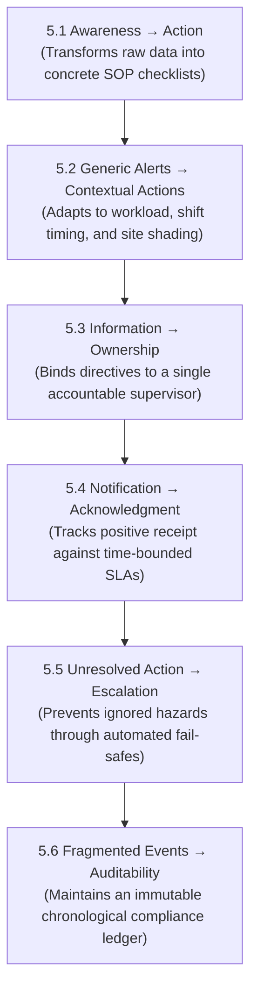
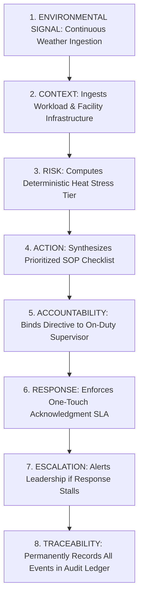
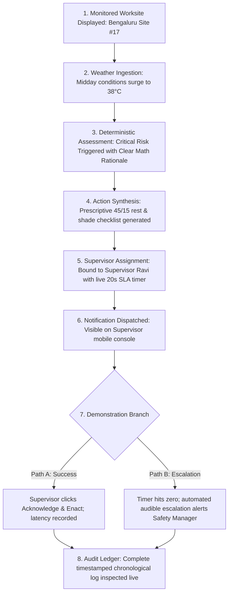

# Heat Action Response Engine (HARE) — Value Proposition Specification

## 1. Document Purpose

In industrial operations, software value is measured not by the complexity of its underlying algorithms, but by its capacity to solve high-friction operational challenges reliably. 

This document defines the value proposition of the **Heat Action Response Engine (HARE)** in a rigorous, evidence-aware, product-focused, and judge-ready manner. Specifically, it articulates:
1. What tangible operational value the platform creates.
2. Who receives that value within an enterprise organization.
3. The specific operational coordination breakdown it resolves.
4. How the platform transitions environmental telemetry into frontline execution.
5. Why this closed-loop execution model is superior to passive weather broadcasting.
6. How that value is concretely demonstrated within the Minimum Viable Product (MVP).
7. Why the platform justifies operational adoption by enterprise organizations.

The platform's value proposition directly addresses the foundational operational challenge defined in [`docs/01_PROBLEM_STATEMENT.md`](file:///d:/Amazon%202nd%20Hackathon%20Heat/docs/01_PROBLEM_STATEMENT.md):

> **Heat-risk information tells organizations when conditions may become dangerous; the harder operational problem is turning that signal into timely, site-specific, accountable, and traceable workplace action.**

---

## 2. One-Sentence Value Proposition

> **The Heat Action Response Engine helps organizations turn workplace heat-risk signals into site-specific preventive actions, assign those actions to responsible supervisors, track acknowledgment, escalate unresolved responses, and maintain a traceable operational record.**

---

## 3. Short Pitch Versions

### 3.1 The 10–15 Second Pitch
> **"We turn heat warnings into verified workplace action by connecting environmental risk detection to site-specific task plans, accountable supervisors, live acknowledgment tracking, automated escalation, and an immutable audit trail."**

### 3.2 The 20–30 Second Conversational Judge Pitch
> *"When extreme heat threatens outdoor worksites, current weather alerts only broadcast generic warnings—they don't tell supervisors what to do with their crews, nobody verifies if directives are seen, and unaddressed hazards fail to escalate.*
> 
> *The Heat Action Response Engine bridges this operational gap. We translate live heat forecasts into context-aware work-rest and hydration checklists, assign them directly to on-duty supervisors, enforce time-bounded acknowledgment, automatically escalate overdue actions to safety managers, and log every event in a permanent audit trail—keeping responsible humans firmly in control."*

---

## 4. Value Proposition Formula

The platform's core identity is structured through the classic product positioning formula:

```text
WHO:
Organizations operating distributed outdoor, industrial, or heat-exposed worksites

HAS WHAT PROBLEM:
Environmental heat conditions intensify dynamically, but generic weather alerts do not
automatically translate into coordinated, timely, or verified workplace mitigation actions.

BECAUSE OF WHAT OPERATIONAL GAP:
Environmental risk data remains structurally disconnected from task context, individual
supervisory ownership, acknowledgment verification, automated escalation fail-safes, and audit trails.

OUR PRODUCT:
The Heat Action Response Engine (HARE)

DOES WHAT:
Programmatically ingests weather data, computes deterministic risk, factors in site activity context,
synthesizes prescriptive action plans, binds directives to on-duty supervisors, enforces acknowledgment SLAs,
and escalates unresolved hazards.

CREATING WHAT VALUE:
A more coordinated, transparent, accountable, and traceable heat-risk operational response that protects
workforces, reduces supervisory friction, and provides management with verifiable compliance records.
```

---

## 5. Core Value Creation Dimensions

The platform creates enterprise value across six primary operational transitions:



### 5.1 From Awareness to Action
Standard weather services answer: *"What are the regional weather conditions?"* HARE answers the operational question: *"What concrete steps must this worksite take right now?"* Instead of leaving field teams to improvise, the engine translates environmental thresholds into standardized, prescriptive Standard Operating Procedures (SOPs).

### 5.2 From Generic Alerts to Contextual Actions
A blanket weather warning applies identically to an entire metropolitan area. HARE ingests site-specific operational context—distinguishing an indoor ventilated machine shop from an outdoor crew assembling structural steel in direct sunlight. By evaluating metabolic workload intensity and physical exposure, the platform delivers operationally proportional directives, preventing both alarm fatigue and dangerous under-protection.

### 5.3 From Information to Ownership
In standard safety communications, warnings broadcast over radios, group chats, or bulletin boards suffer from diffusion of responsibility. HARE binds every generated Action Plan to a specific on-duty Site Supervisor entity, establishing clear personal accountability for execution.

### 5.4 From Notification to Acknowledgment
Dispatching a notification provides zero proof that the recipient viewed, understood, or accepted the directive. HARE introduces a time-bounded acknowledgment loop, requiring supervisors to submit a positive confirmation (`ACKNOWLEDGE & ENACT`) within a defined response window.

### 5.5 From Unresolved Action to Escalation
When a frontline supervisor is occupied, distracted, or unresponsive during an acute heat event, traditional workflows stall. HARE's automated escalation engine detects SLA timeouts in real time and routes high-priority alerts to Safety Managers and Operations Leadership, ensuring critical hazards never go unnoticed.

### 5.6 From Fragmented Events to Auditability
In post-incident investigations or safety compliance reviews, organizations often discover fragmented, lost, or contradictory records. HARE creates a permanent, tamper-evident audit ledger capturing input weather values, risk scores, dispatched action plans, supervisory timestamps, and escalation traces.

---

## 6. Value Proposition by Target User

| User Role | Operational Problem Faced | Concrete Product Value Delivered |
| :--- | :--- | :--- |
| **Safety Manager** | Managing multiple dispersed worksites without real-time visibility into whether local supervisors enact safety rules. | Unified multi-site console displaying live risk tiers, active action plans, acknowledgment countdowns, and automated escalation alerts. |
| **Site Supervisor** | Receiving ambiguous weather alerts without clear instructions on what rest or hydration schedule to mandate for their crew. | Direct, prioritized, mobile-ready action checklists with single-touch acknowledgment, eliminating guesswork in the field. |
| **Organization Admin** | Managing worksite configurations, personnel directories, and safety escalation rules across fragmented systems. | Centralized facility onboarding, GPS coordinate validation, role-based access control, and intuitive personnel mapping. |
| **Frontline Worker** | Vulnerable to physical heat strain, exhaustion, and fatigue during high-exertion shifts in unshaded environments. | Indirect beneficiary of timely, verified protective interventions (mandatory shaded rest rotations, cool water replenishment). |
| **Operations Manager** | Balancing tight project delivery milestones with unpredictable heat disruptions and safety compliance risks. | Predictable operational adjustments, forward-looking forecast awareness, and proof of responsible safety governance. |

---

## 7. Safety Manager Value Proposition

```text
CONVENTIONAL WORKFLOW (BEFORE HARE):
Weather App Alert ──> Manual Interpretation ──> Ad-hoc Phone Calls / Group Chats
                 ──> No Delivery Verification ──> Unknown Field Implementation
                 ──> Fragmented Post-Shift Records
```

```text
HARE OPERATIONAL WORKFLOW:
Meteorological Ingestion ──> Deterministic Risk Engine ──> Contextual Action Synthesis
                        ──> Direct Supervisor Assignment ──> Live SLA Countdown Tracking
                        ──> Automated Manager Escalation (if SLA breached)
                        ──> Centralized Immutable Audit Ledger
```

### Quantifiable Operational Value:
* **Instant Multi-Site Situational Awareness:** Reduces the time required to assess organizational heat exposure across dozens of facilities from hours of phone calls to seconds on a dashboard.
* **Proactive Hazard Intervention:** Eliminates the risk of unnoticed frontline delays by automatically receiving escalations when supervisors fail to respond.
* **Audit-Ready Compliance Records:** Eliminates post-shift documentation guesswork by automatically archiving complete, timestamped event histories.

---

## 8. Site Supervisor Value Proposition

```text
CONVENTIONAL WORKFLOW (BEFORE HARE):
Receives generic SMS: "Heat Advisory Active" ──> Unclear operational meaning
                                            ──> Guesses work-rest schedule
                                            ──> Balances project deadlines without guidance
```

```text
HARE OPERATIONAL WORKFLOW:
Receives Urgent Mobile Card: "Site #17 — High Risk" ──> Clear Trigger Rationale
                                                   ──> Prioritized 3-Step Mitigation Checklist
                                                   ──> Single-Touch "Acknowledge & Enact"
                                                   ──> Logs quick execution confirmation note
```

### Quantifiable Operational Value:
* **Zero Cognitive Guesswork:** Transforms abstract meteorological parameters into direct, prioritized tasks (e.g., *"45 min work / 15 min shaded rest; verify water coolers"*).
* **Frictionless Interaction:** Enables single-touch acknowledgment and rapid status reporting designed specifically for rugged, outdoor mobile environments.
* **Operational Protection:** Provides supervisors with documented institutional backing for implementing necessary cooling breaks without fear of unauthorized production delays.

---

## 9. Organization-Level Value

At the enterprise level, the platform delivers strategic operational advantages:

* **Standardized Safety Protocol Enforcement:** Ensures that corporate Environmental Health and Safety (EHS) policies are applied consistently across all facilities, eliminating subjective regional variations.
* **Minimized Operational Disruption:** By replacing emergency work stoppages with planned, incremental work-rest rotations, organizations maintain steady productivity while mitigating thermal strain.
* **Complete Legal & Operational Traceability:** Protects the enterprise by maintaining structured records proving that hazardous conditions were monitored, directives were issued, and supervisory actions were tracked.
* **Enhanced Workforce Trust & Retention:** Demonstrates active, measurable institutional care for frontline laborer welfare, fostering higher workforce retention in physically demanding industries.

---

## 10. The "Alert vs. Action" Comparison

The table below contrasts the typical alert-centric model with HARE's closed-loop operational model:

| Operational Dimension | Typical Alert-Centric Workflow | Heat Action Response Engine (HARE) |
| :--- | :--- | :--- |
| **Primary Output** | Static text warning (*"High Heat Index"*) | Prescriptive Standard Operating Procedure (SOP) plan |
| **Contextual Awareness** | None; treats all recipients identically | Factors in workload category, shift timing, and shading |
| **Operational Assignment** | Broadcast to general groups; diffused ownership | Formally assigned to the specific on-duty supervisor |
| **Communication Flow** | One-way broadcast; fire-and-forget | Two-way closed-loop with positive acknowledgment |
| **Accountability Tracking** | Unverified; assumes message was read | Real-time SLA countdown timer enforcing response |
| **Failure Handling** | Silent failure; unread alerts disappear | Automated hierarchical escalation to Safety Managers |
| **Execution Logging** | None; no record of field implementation | Structured supervisor execution confirmation logs |
| **Auditability** | Fragmented chat histories and call logs | Permanent, tamper-evident chronological audit ledger |
| **Core Objective** | **Passive Hazard Awareness** | **Verified Workplace Operational Action** |

---

## 11. The Operational Transformation Gap

The central insight driving the platform's architecture is that industrial safety fails not at the detection layer, but at the operational execution layer:

```text
                       [ Meteorological Detection Layer ]
                         (Weather APIs, Forecasts, IMD)
                                       │
                                       ▼
             =====================================================
             [ THE UNADDRESSED OPERATIONAL TRANSFORMATION GAP ]
             * Which specific facility is at risk?
             * What tasks and workloads are exposed?
             * What concrete preventive controls must be enacted?
             * Who is the single accountable owner?
             * Did that person acknowledge the directive?
             * Who intervenes if the supervisor is occupied?
             =====================================================
                                       │
                                       ▼
                       [ Frontline Workplace Action ]
                   (Hydration, Shaded Rest Cycles, Safety)
```

HARE exists specifically to fill this operational gap with an automated, reliable software coordination bridge.

---

## 12. Core Product Value Loop



* **Environmental Signal:** Provides the continuous, objective hazard trigger.
* **Context:** Adapts the hazard to physical worksite realities and metabolic work rates.
* **Risk:** Applies explainable, deterministic mathematical rules without black-box drift.
* **Action:** Eliminates ambiguity by prescribing clear standard operating procedures.
* **Accountability:** Establishes an unambiguous chain of personal supervisory responsibility.
* **Response:** Verifies positive human engagement through time-bounded tracking.
* **Escalation:** Eliminates silent operational failures through automated management alerts.
* **Traceability:** Creates an immutable record supporting continuous organizational learning.

---

## 13. Why HARE Is More Than a Weather Dashboard

A commercial weather dashboard is designed to answer:

> *"What is the ambient temperature and forecast in this city today?"*

The Heat Action Response Engine is architected to answer:

> *"Given that the effective heat stress at Site #17 has reached High Risk for concrete workers, what specific work-rest schedule must be enacted, who is the supervisor responsible for enforcing it, have they acknowledged the directive, and what manager must be alerted if they fail to respond?"*

HARE is an **operational safety execution system**, not a meteorological visualization portal. Weather data serves purely as raw telemetry feeding the downstream operational workflow.

---

## 14. Why HARE Is More Than a Risk Calculator

A mathematical heat calculator (e.g., a static Heat Index or WBGT formula) produces an isolated numerical value:

$$\text{Calculated Heat Index} = 41.2^\circ\text{C} \quad \implies \quad \text{Category: Dangerous}$$

In an industrial workplace, this calculation immediately raises the operational question: **"So what?"**

A calculated number does not deploy shade canopies, distribute electrolyte fluids, rotate high-exertion crews, or alert executive leadership. HARE's value begins precisely where calculation ends: **transforming the calculated score into a verified, human-supervised workplace action**.

---

## 15. Human-in-the-Loop Value Creation

HARE is engineered around an augmented **human-in-the-loop** architecture that respects the boundaries of automated software:

```text
AUTOMATED SYSTEM LAYER
Continuously monitors telemetry, evaluates deterministic rules, synthesizes action plans,
tracks acknowledgment countdowns, and triggers escalations without fatigue.
                            │
                            ▼ (Coordinates & Informs)
HUMAN FRONTLINE SUPERVISOR
Observes real-world field dynamics, validates physical conditions, communicates with crews,
physically inspects water/shade supplies, and executes preventive controls.
                            │
                            ▼ (Reports & Confirms)
AUTOMATED AUDIT LAYER
Captures human confirmations, records timestamps, and maintains transparent accountability.
```

### Strategic Benefits of This Architecture:
* **Preserves Human Field Judgment:** Recognizes that on-site supervisors must accommodate dynamic local factors (e.g., sudden cloud cover, equipment breakdowns).
* **Prevents Algorithmic Overreach:** AI and software systems never act as autonomous safety arbiters or enforce facility shutdowns without human executive authorization.
* **Reduces Cognitive Burden:** Automates routine monitoring and task formulation, freeing supervisors to focus entirely on crew welfare and execution.

---

## 16. Artificial Intelligence Value Proposition

NVIDIA AI models are integrated strictly as **assistive communication multipliers**, never as safety decision authorities:

```text
+--------------------------------------------------------------------------------------------------+
|                                    NVIDIA AI VALUE CONTRIBUTION                                  |
+--------------------------------------------------------------------------------------------------+
|  1. RISK EXPLANATION                                                                             |
|     * Translates complex bio-meteorological values into plain-language situational briefs.        |
|  2. SUPERVISOR MESSAGE GENERATION                                                                |
|     * Synthesizes dense JSON action plans into concise, urgent, mobile-formatted dispatch texts.  |
|  3. MULTILINGUAL DIALECT TRANSLATION                                                             |
|     * Automatically renders English action checklists into regional languages (Hindi, Kannada).  |
|  4. SITUATIONAL SUMMARIZATION                                                                    |
|     * Drafts executive shift heat summaries for regional safety directors.                       |
|  5. GROUNDED IN-APP ASSISTANT                                                                    |
|     * Answers supervisor queries strictly grounded in active site telemetry and loaded SOPs.    |
+--------------------------------------------------------------------------------------------------+
|                                       INVIOLABLE SAFETY RULE:                                    |
|                       Deterministic Rules  >  AI Recommendations                                 |
|     AI assists human comprehension; deterministic mathematical rules govern all safety limits.    |
+--------------------------------------------------------------------------------------------------+
```

*(Detailed AI specifications and architectural guardrails are codified in `docs/43_AI_ASSISTANT.md`, `docs/44_NVIDIA_AI.md`, and `docs/46_AI_GUARDRAILS.md`.)*

---

## 17. Data and Technology in Service of Value

Technology choices in HARE exist purely to support the operational value proposition:

* **Open-Meteo REST API:** Eliminates capital expenditures and hardware delays by providing globally accessible, continuously updated weather data instantly based on GPS coordinates.
* **Deterministic Rules Engine:** Guarantees transparent, explainable, and 100% reproducible risk evaluations, ensuring full audit credibility.
* **Amazon Web Services (AWS):** Delivers scalable serverless compute (Lambda), robust API management (API Gateway), high-throughput audit persistence (DynamoDB), and instant notification dispatch (SNS).
* **React Web Console:** Delivers tailored, low-friction, role-specific user interfaces for both desktop Safety Managers and mobile Site Supervisors.
* **NVIDIA AI Microservices:** Delivers accelerated natural language synthesis and translation to bridge communication barriers across diverse workforces.

---

## 18. Observable Value in the Hackathon MVP

The value proposition is not a theoretical concept; it will be visibly validated live during the hackathon demonstration:



---

## 19. Observable Operational Metrics

To evaluate operational workflow performance without making speculative clinical claims, HARE tracks objective system-level metrics:

* **Mean Acknowledgment Latency:** Average duration between directive dispatch and supervisory acknowledgment.
* **SLA Compliance Rate:** Percentage of action directives acknowledged within the configured response window.
* **Escalation Frequency:** Count and percentage of directives that breach initial SLAs and require secondary management escalation.
* **Action Resolution Rate:** Percentage of dispatched action plans that progress through acknowledgment to verified field completion.
* **Active Facility Coverage:** Total number of enterprise worksites actively ingested, evaluated, and supervised.
* **Audit Trail Completeness:** Proportion of environmental risk cycles containing complete, unbroken chronological event chains.

*(Note: These are operational workflow metrics measuring organizational responsiveness; they do not represent clinical medical statistics.)*

---

## 20. Value Measurement Model

```text
INPUT STAGE:
Continuously updated meteorological and forecast telemetry ingested.
                   ↓
INTERPRETATION STAGE:
Deterministic evaluation of environmental heat stress and task workload tiers.
                   ↓
OPERATIONALIZATION STAGE:
Synthesis of discrete Standard Operating Procedure (SOP) action plans.
                   ↓
ACCOUNTABILITY STAGE:
Binding of action plan to a designated on-duty frontline supervisor.
                   ↓
RESPONSE STAGE:
Time-bounded supervisory acknowledgment tracked against active SLAs.
                   ↓
FOLLOW-UP STAGE:
Automated hierarchical escalation triggered upon unacknowledged timeout.
                   ↓
TRACEABILITY STAGE:
Immutable persistence of all states, payloads, and timestamps in the audit ledger.
```

> **Core Measurement Philosophy:** The platform measures **operational response quality and execution reliability**, not speculative physiological or clinical health outcomes.

---

## 21. Differentiation Through Operational Workflow Depth

HARE does not claim to have invented numerical weather forecasting, heat index equations, or mobile push notifications. Its market differentiation lies in the **depth, rigor, and closed-loop accountability of its operational response loop**:

```text
EXISTING INFORMATION SYSTEMS:
Signal ──> Basic Risk Calculation ──> Broadcast Alert
(Informational, passive, unassigned, unverified)

HARE OPERATIONAL EXECUTION SYSTEM:
Signal ──> Context ──> Risk ──> Action Plan ──> Assigned Supervisor
       ──> Time-Bounded Notification ──> Verified Acknowledgment ──> Automated Escalation
       ──> Execution Log ──> Immutable Audit Ledger
(Operational, active, assigned, verified, traceable)
```

The system elevates the **verified action**—not the passive alert—to the primary unit of value.

---

## 22. Value Proposition by Operational Outcome

| Target Organizational Outcome | Direct HARE System Mechanism |
| :--- | :--- |
| **Faster Hazard Awareness** | Centralized multi-site risk console with real-time API polling. |
| **Actionable Clarity** | Context-aware Standard Operating Procedure (SOP) mitigation checklists. |
| **Unambiguous Accountability** | Direct binding of action directives to designated on-duty supervisors. |
| **Response Visibility** | Real-time supervisory acknowledgment tracking against live countdown timers. |
| **Elimination of Ignored Hazards** | Automated hierarchical escalation to Safety Managers upon SLA timeout. |
| **Transparent Event Reconstruction** | Tamper-evident, chronological operational audit ledger. |
| **Enhanced Field Comprehension** | NVIDIA AI plain-language explanations and multilingual translation. |
| **Lower Coordination Friction** | Unified software platform replacing ad-hoc phone calls and fragmented chat apps. |

---

## 23. Value Proposition Hierarchy

To maintain strict product focus and prevent mission drift, value priorities are explicitly ranked:

1. **Primary Value (Core Mission):** Convert environmental heat-risk signals into verified, accountable, and timely workplace safety actions.
2. **Secondary Value (Operational Oversight):** Provide centralized multi-site visibility, SLA tracking, and automated escalation fail-safes for safety managers.
3. **Tertiary Value (Governance & Audit):** Maintain an immutable chronological record of all environmental inputs, directives, and supervisory responses.
4. **Supporting Value (Cognitive Assistance):** Leverage NVIDIA AI to explain complex metrics, draft concise briefings, and translate instructions across regional dialects.

*(Under this hierarchy, AI serves strictly as a supporting capability; HARE is an operational execution engine, not an AI chatbot.)*

---

## 24. What the Product Does NOT Promise

In accordance with [`docs/05_NON_GOALS.md`](file:///d:/Amazon%202nd%20Hackathon%20Heat/docs/05_NON_GOALS.md), the value proposition explicitly excludes unvalidated or medical claims:

* **No Promise of Absolute Safety:** The platform does not claim to prevent 100% of heat illnesses or eliminate all physical workplace hazards.
* **No Medical Diagnosis or Treatment:** Does not diagnose heatstroke, evaluate clinical symptoms, or replace medical personnel.
* **No Individual Clinical Predictions:** Does not calculate personal biometric risk percentages for named individuals.
* **No Legal or Regulatory Certification:** Does not issue statutory compliance certificates or replace licensed EHS auditors.
* **No Elimination of Human Responsibility:** Does not replace trained safety professionals or frontline human supervisors.

The platform promises **operational coordination and execution discipline**, not clinical medical protection.

---

## 25. What We Want the Judge to Remember

> **"Most people understand that extreme heat is dangerous. The harder problem for an industrial enterprise is operational: when a worksite becomes hazardous, what specific action must happen, who owns it, has anyone acknowledged it, and what happens if nobody responds?**
> 
> **The Heat Action Response Engine connects every link in that operational chain—turning passive weather warnings into verified, accountable workplace action."**

---

## 26. The 30-Second Spoken Pitch

> *"Extreme heat is disrupting industrial worksites worldwide, but today's weather alerts only tell companies that it is hot. They leave a dangerous operational gap: supervisors don't know what specific rest breaks to mandate, broadcast messages get ignored, and management has no record of who responded.*
> 
> *The Heat Action Response Engine solves this. Our platform ingests live weather forecasts, factors in site workload and shading, and automatically generates concrete work-rest-hydration action plans. We assign them directly to on-duty supervisors, enforce countdown acknowledgment SLAs, escalate unaddressed risks to safety managers, and log every event in an immutable audit ledger.*
> 
> *We take organizations from passive heat warnings to verified workplace action."*

---

## 27. Five Contextual One-Line Variants

1. **Canonical Product Tagline:**
   > *"From heat warning to verified workplace action."*
2. **Hackathon Pitch Variant:**
   > *"A software-first operational engine that turns meteorological heat forecasts into assigned, acknowledged, and escalated workplace safety actions."*
3. **Technical Architecture Variant:**
   > *"A cloud-native operational workflow platform combining deterministic heat risk modeling, contextual task mapping, and closed-loop supervisory SLA enforcement."*
4. **Safety-Manager-Focused Variant:**
   > *"Multi-site heat hazard visibility that ensures every safety directive has an assigned supervisor, a tracked response, and an audit-ready compliance record."*
5. **Frontline-Supervisor-Focused Variant:**
   > *"Clear, task-specific work-rest checklists delivered directly to your mobile screen with single-touch acknowledgment."*

---

## 28. The Value Proposition Canvas

```text
========================================================================================
CUSTOMER JOBS (What Users Are Trying to Accomplish):
• Monitor changing environmental heat hazards across operating worksites.
• Translate abstract weather data into concrete operational work-rest schedules.
• Assign clear supervisory responsibility for safety interventions.
• Verify that safety directives are seen and executed in the field.
• Intervene promptly when frontline supervisors fail to respond.
• Maintain a complete, defensible record of organizational safety responses.

CUSTOMER PAINS (Current Operational Friction):
• Regional weather alerts lack site-specific and workload context.
• Diffusion of responsibility in broadcast group chats and bulletin boards.
• Unclear acknowledgment—management assumes safety, but lacks confirmation.
• Critical warnings disappear without follow-up when supervisors are busy.
• Post-incident audits face fragmented, incomplete, or missing records.

CUSTOMER GAINS (Desired Operational Outcomes):
• Prescriptive, task-specific SOP checklists requiring zero guesswork.
• Instant visibility into multi-site risk and active supervisory status.
• Real-time assurance that directives are positively acknowledged.
• Automated escalation fail-safes preventing unaddressed hazards.
• Comprehensive, inspection-ready chronological audit ledgers.

PRODUCT PAIN RELIEVERS:
• Deterministic context engine adapting to task workload and physical shade.
• Single-touch mobile acknowledgment enforcing supervisory accountability.
• Automated SLA countdown timers triggering hierarchical manager escalation.
• Append-only operational audit ledger permanently logging all event states.

PRODUCT GAIN CREATORS:
• Unified operational console connecting detection directly to execution.
• NVIDIA AI assistive explanations and multilingual dialect translation.
• Objective workflow metrics measuring real organizational responsiveness.
========================================================================================
```

---

## 29. The Product Value Equation

The conceptual model of HARE's value creation can be summarized as:

```text
   [ Environmental Heat Signal ]
+  [ Workplace Context (Workload, Shift, Shading) ]
+  [ Deterministic Safety SOP Logic ]
+  [ Individual Supervisory Accountability ]
+  [ Time-Bounded Acknowledgment Tracking ]
+  [ Automated Hierarchical Escalation ]
+  [ Immutable Chronological Traceability ]
-----------------------------------------------------------------
=  VERIFIED, CLOSED-LOOP WORKPLACE HEAT-SAFETY OPERATIONS
```

*(Note: This represents a conceptual product execution model, not a mathematical biological formula.)*

---

## 30. Final Value Proposition Statement

> **The Heat Action Response Engine creates enterprise value by closing the operational gap between heat-risk detection and frontline workplace response. It connects environmental signals to worksite context, converts risk into preventive actions, assigns responsibility to supervisors, tracks acknowledgment, escalates unresolved actions, and preserves a traceable history—while keeping humans responsible for consequential safety decisions.**

---

* **Status:** Draft
* **Last Updated:** 2026-10-07
