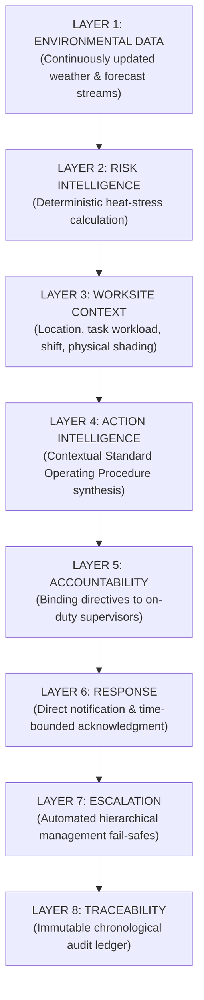

# Heat Action Response Engine (HARE) — Product Differentiation Specification

## 1. Purpose

Product differentiation in enterprise safety software is not established by claiming exclusive invention of fundamental technologies. The Heat Action Response Engine does **not** claim to have invented:
* Meteorological heat-risk detection or weather forecasting.
* Bio-meteorological heat index or wet-bulb globe temperature formulas.
* Established occupational health and safety work-rest guidelines.
* Push notifications, SMS gateways, or web dashboards.
* Artificial intelligence, large language models, or cognitive assistants.
* Physical environmental monitoring or sensor telemetry.

Instead, the platform's genuine differentiation lies in its **focused operational execution architecture**:

> **The Heat Action Response Engine focuses on the operational layer between identifying heat risk and verifying that an organization has responded.**

While existing systems are typically optimized either for broad weather broadcasting or static hazard calculation, HARE operationalizes the hazard signal into a closed-loop, accountable human workflow.

---

## 2. Core Differentiation Statement

> **Our differentiation is not simply detecting heat risk; it is connecting heat-risk detection to contextual workplace actions, accountable ownership, acknowledgment, escalation, and traceable response history.**

```text
CONVENTIONAL ALERT-CENTRIC MODEL:
[ Weather API / Forecast ] ──> [ Regional Warning ] ──> [ User Interprets Ad-Hoc ]
(Passive, uncontextualized, unassigned, unverified)

HEAT ACTION RESPONSE ENGINE MODEL:
[ Weather / Forecast ] ──> [ Worksite Context Engine ] ──> [ Deterministic Risk Engine ]
                      ──> [ Prescriptive Action Plan ] ──> [ Responsible Supervisor Assigned ]
                      ──> [ Notification Dispatched ]  ──> [ Time-Bounded Acknowledgment ]
                      ──> [ Automated Escalation ]     ──> [ Centralized Audit Ledger ]
(Active, contextualized, assigned, verified, traceable)
```

---

## 3. Differentiation Principles

The platform's competitive distinction is anchored in seven operational principles:

### 3.1 Action Over Alert
The platform never treats the alert as the final milestone. It does not stop at *"Heat risk detected."* It drives forward to: *"Here is the mandatory 45/15 work-rest and shaded hydration checklist, and Supervisor Ravi is responsible for enacting it right now."*

### 3.2 Context Over Generic Warning
Rather than broadcasting identical alerts across an entire geographical region, the engine factors in site-specific operational context:
* Physical worksite location and local exposure (direct sunlight vs. covered yard).
* Active shift timings and remaining duration.
* Task metabolic workload categories (Light, Moderate, Heavy, Very Heavy).
* Available infrastructure (on-site shade canopies, cooling stations, potable water access).

*(Note: The MVP models essential operational context; it does not claim to simulate every micro-physiological variable.)*

### 3.3 Ownership Over Broadcast
Broadcast communications (emails, group chats, bulletin boards) suffer from diffusion of responsibility. HARE binds every safety directive to a single on-duty supervisor entity, establishing an unambiguous, named owner accountable for field execution.

### 3.4 Acknowledgment Over Delivery
Sending a notification does not guarantee that the recipient saw, understood, or accepted it. HARE enforces a closed-loop acknowledgment state machine:

```text
[ ASSIGNED ] ──> [ NOTIFIED ] ──> [ ACKNOWLEDGED ] / [ UNACKNOWLEDGED ]
```

*(Acknowledgment confirms that the supervisor accepted operational responsibility; it does not replace physical field inspection.)*

### 3.5 Escalation Over Passive Waiting
When a frontline supervisor is occupied or fails to respond, traditional systems stall silently. HARE enforces configurable Service Level Agreement (SLA) countdown timers. If an acknowledgment window expires, the system automatically escalates the directive to the Safety Manager, converting passive waiting into active operational intervention.

### 3.6 Traceability Over Ephemeral Alerts
Group chat warnings and radio broadcasts vanish from operational memory. HARE writes every state transition—from initial weather trigger to supervisory acknowledgment and escalation—into an immutable, chronological audit ledger. This allows organizations to reconstruct the full sequence of events during post-shift reviews.

### 3.7 Human-in-the-Loop Over Autonomous Safety AI
HARE rejects the dangerous premise of allowing artificial intelligence models to act as autonomous safety arbiters:
* **Deterministic Rules (Source of Truth):** Transparent, mathematical equations govern all risk scores, thresholds, action selections, and escalation timers.
* **AI as Assistant (Cognitive Multiplier):** NVIDIA AI assists with plain-language explanations, supervisor alert formulation, and multilingual dialect translation.
* **Human Authority:** Frontline supervisors and safety managers maintain ultimate operational decision-making authority.

---

## 4. Product Differentiation Layers

The system's structural differentiation emerges from integrating eight operational layers around the environmental signal:



> **The Differentiation Insight:** While other software solutions often excel at Layer 1 or Layer 2, HARE's primary innovation is the seamless integration of **Layers 3 through 8**, establishing an accountable operational response loop.

---

## 5. Comparison With Common Solution Categories

The table below contrasts HARE with common technological categories in the industrial and weather markets:

| Solution Category | Typically Strong At | HARE Operational Focus |
| :--- | :--- | :--- |
| **Consumer Weather Apps** | High-fidelity weather visualization, radar maps, consumer alerts. | Ingests weather strictly as raw operational telemetry feeding workplace SOPs. |
| **Heat Warning Broadcasts** | Public hazard awareness over broad geographic regions. | Translates regional hazard signals into site-specific, assigned supervisory actions. |
| **Heat Risk Calculators** | Estimating mathematical heat index or WBGT values. | Operationalizes the calculation by assigning tasks, tracking SLAs, and escalating. |
| **Safety Guidance Apps** | Static libraries of occupational health guidelines and PDF manuals. | Dynamically synthesizes task-specific SOP checklists bound to active crews. |
| **Physical IoT Platforms** | Telemetry ingestion from hardware microcontrollers and sensors. | Software-first deployment; hardware-agnostic architecture deployable without wiring. |
| **Industrial Wearables** | Individual worker physiological strain and biometric tracking. | Focuses on supervisory workplace coordination without invasive worker surveillance. |
| **General BI Dashboards** | Aggregated data visualization and historical reporting. | Action-oriented execution engine driving live supervisory acknowledgment and escalation. |
| **Standalone AI Chatbots** | Conversational Q&A and text generation. | Constrains AI to assistive communication under strict deterministic safety rule primacy. |
| **Enterprise HRIS Systems** | Payroll, attendance, shift scheduling, and employee benefits. | Lightweight operational focus strictly on safety directive routing and compliance logging. |

*(Phrasing reflects typical focus areas; individual commercial implementations vary.)*

---

## 6. The Operational Response Gap

The fundamental gap addressed by HARE sits between hazard detection and organizational execution:

```text
               [ RISK DETECTION LAYER ]
           (Weather APIs, Heat Calculators)
                          │
                          ▼
        =====================================
        [ THE OPERATIONAL RESPONSE GAP ]
        * Who acts on the ground?
        * What specific actions must they take?
        * Has the directive been acknowledged?
        * What happens if they fail to respond?
        * What verifiable history remains?
        =====================================
                          │
                          ▼
               [ FRONTLINE EXECUTION ]
        (Hydration, Shaded Rest Rotations)
```

> **The project's differentiation is workflow depth rather than proprietary ownership of any single underlying algorithm.**

---

## 7. Conceptual Positioning Matrix

| Operational Capability | Passive Weather Alert | Standalone Risk Calculator | Monitoring Dashboard | Heat Action Response Engine |
| :--- | :---: | :---: | :---: | :---: |
| **Continuous Weather Ingestion** | **Yes** | Possible | Possible | **Yes** |
| **Deterministic Risk Scoring** | Possible | **Yes** | Possible | **Yes** |
| **Worksite & Workload Context** | Rare / Limited | Rare / Limited | Possible | **Yes (P0 Core)** |
| **Prescriptive Action Plan Synthesis**| Rare / Limited | Rare | Possible | **Yes (P0 Core)** |
| **Named Supervisory Assignment** | No | No | Rare | **Yes (P0 Core)** |
| **Two-Way Notification Dispatch** | One-Way Broadcast | Rare | Possible | **Yes (P0 Core)** |
| **Time-Bounded Acknowledgment SLA** | No | No | Rare | **Yes (P0 Core)** |
| **Automated Hierarchical Escalation**| No | No | Possible | **Yes (P0 Core)** |
| **Immutable Operational Audit Trail**| Rare | Rare | Possible | **Yes (P0 Core)** |
| **Assistive AI Communication Layer** | Rare | Rare | Possible | **Yes (P1 Assistive)** |
| **Hardware-Free Software Deployment**| **Yes** | **Yes** | **Yes** | **Yes (Software-First)** |
| **Augmented Human-in-the-Loop** | **Yes** | **Yes** | **Yes** | **Yes (Foundational)** |

*(This represents a conceptual positioning matrix, not an exhaustive market survey.)*

---

## 8. What We Are NOT Claiming

To preserve intellectual credibility and engineering integrity, the project explicitly rejects exaggerated or unsubstantiated claims:

* We do **not** claim to be the world's first heat-safety software application.
* We do **not** claim to have invented the Steadman Heat Index or wet-bulb formulas.
* We do **not** claim to be the only software platform utilizing automated escalation logic.
* We do **not** claim to replace professional EHS officers or human site supervisors.
* We do **not** claim that software alone can guarantee 100% prevention of heat-related illnesses.
* We do **not** claim that large language models should decide whether a worksite is safe.

> **Our claim is specific and disciplined: We take an identified heat-risk signal and execute a complete, accountable, and auditable operational response workflow around it.**

---

## 9. Why Workflow Differentiation Matters in Practice

In an active industrial environment, the presence or absence of an operational execution layer determines safety outcomes:

```text
WITHOUT THE HARE OPERATIONAL LAYER:
1. Ambient conditions pass danger threshold.
2. Broad advisory issued over radio/chat.
3. Supervisor is occupied and does not notice message.
4. Heavy physical labor continues in direct sunlight.
5. No timer exists, so no escalation occurs.
6. Hours elapse before intervention.
7. Post-shift investigation finds no record of who saw the alert.
```

```text
WITH THE HARE OPERATIONAL LAYER:
1. Ambient conditions pass danger threshold.
2. System evaluates workload (Heavy) and synthesizes Action Plan AP-1082.
3. Directive dispatched directly to Supervisor Ravi with 15-minute SLA.
4. If Ravi is occupied, timer breaches SLA at Minute 15.
5. Automated escalation immediately alerts the Regional Safety Manager.
6. Safety Manager contacts site dispatch to enforce shaded rest.
7. Complete chronological sequence permanently archived in audit ledger.
```

HARE significantly reduces coordination friction, eliminates silent operational delays, and establishes clear institutional accountability.

---

## 10. Differentiation Through Responsible AI Design

HARE establishes a differentiated paradigm for enterprise artificial intelligence in safety-critical domains:

```text
CONVENTIONAL PROBABILISTIC AI IN SAFETY (HIGH RISK):
[ Raw Telemetry ] ──> [ LLM Reasoning ] ──> [ Autonomous Safety Action ]
(Susceptible to hallucination, non-deterministic drift, and unverified authority)

HARE DETERMINISTIC PRIMACY ARCHITECTURE (RESPONSIBLE AI):
[ Telemetry ] ──> [ Deterministic Mathematical Rules ] ──> [ Verified Safety Directive ]
                                │
                                ▼ (Grounded Structured Payload)
                    [ NVIDIA AI Assist Layer ]
                    (Explanations, Messaging, Translation)
                                │
                                ▼
                    [ Human Supervisory Execution ]
```

By strictly restricting NVIDIA AI to **cognitive communication assistance** while anchoring safety decisions in deterministic rules, HARE provides an explainable, auditable, and regulatory-safe AI architecture.

---

## 11. Differentiation Through Hardware Independence

The MVP deliberately rejects hardware dependencies, providing significant deployment differentiation:

* **Zero Hardware Barrier:** Does not require sourcing, calibrating, installing, or wiring physical microcontrollers (ESP32, Arduino, DHT22) before an enterprise can protect workers.
* **Instant Global Deployment:** Any worksite on earth can be onboarded in five minutes using geographic coordinates alone.
* **Pluggable Architecture:** The downstream risk, context, action, and escalation engines are completely decoupled from data ingestion:

```text
[ External Weather API (Open-Meteo) ] ──┐
                                        ├──> [ Common Normalized Ingestion Interface ]
[ Future On-Site IoT Weather Stations ] ──┤                    │
                                        │                    ▼
[ Future Industrial Wearable Streams ]  ──┘      [ HARE Risk & Action Engine ]
```

This flexibility allows enterprises to deploy HARE immediately via software, and later integrate physical IoT sensors without altering their supervisory safety workflows.

---

## 12. Differentiation Through Complete Workflow Demonstration

Many hackathon prototypes present isolated features—an impressive machine learning model without an application, or a visual dashboard without backend accountability.

HARE differentiates itself by demonstrating a **complete, unbroken operational loop**:

$$\text{DETECT} \rightarrow \text{ASSESS} \rightarrow \text{CONTEXTUALIZE} \rightarrow \text{DECIDE} \rightarrow \text{ASSIGN} \rightarrow \text{NOTIFY} \rightarrow \text{ACKNOWLEDGE} \rightarrow \text{ESCALATE} \rightarrow \text{VERIFY} \rightarrow \text{AUDIT}$$

Demonstrating the complete lifecycle end-to-end provides judges with undeniable proof of technical maturity and real-world operational viability.

---

## 13. Reusable Architecture Pattern

The underlying architectural pattern established by HARE represents an extensible foundation for future operational safety applications:

```text
[ Environmental Signal Ingestion ]
                ↓
    [ Deterministic Risk Engine ]
                ↓
    [ Context & Activity Engine ]
                ↓
     [ Prescriptive Action Engine ]
                ↓
    [ Operational Assignment Layer ]
                ↓
    [ Notification & SLA Tracking ]
                ↓
    [ Hierarchical Escalation Engine ]
                ↓
    [ Immutable Audit History Ledger ]
```

While currently configured for workplace heat stress, this same pipeline could theoretically orchestrate responses to air pollution surges, high-wind crane risks, or industrial chemical alerts in future product phases.

---

## 14. Future Differentiation Roadmap

As the platform matures post-hackathon, its differentiation will expand into advanced operational domains:

* **Microclimate IoT Ingestion:** High-precision Wet Bulb Globe Temperature (WBGT) telemetry ingested directly from industrial on-site stations via AWS IoT Core.
* **Predictive Shift Re-Planning:** Analyzing 72-hour forecast curves to recommend proactive work rescheduling before heat waves peak.
* **Multi-Hazard Environmental Platform:** Generalizing the operational execution loop to manage air quality (AQI), high-wind crane hazards, and flash flooding.
* **Enterprise ERP Synchronization:** Bi-directional synchronization with SAP, Workday, and Procore for automated crew roster and cost impact modeling.

---

## 15. Competitive Positioning Language Guide

| Preferred Engineering Language | Language to Strictly Avoid |
| :--- | :--- |
| *"Our product operationalizes heat risk into workplace actions."* | *"We are the first platform to solve heat stress."* |
| *"The MVP demonstrates an accountable response loop."* | *"No competitor has this capability."* |
| *"We connect environmental data to assigned supervisors."* | *"Nobody else connects weather to notifications."* |
| *"We help organizations enforce time-bounded SLAs."* | *"Our platform guarantees 100% workplace safety."* |
| *"Deterministic rules govern safety; AI assists communication."* | *"Our AI replaces safety managers."* |

---

## 16. What We Want Hackathon Judges to Remember

> **"The innovation of the Heat Action Response Engine is not another weather alert. It is the operational response layer built around the alert.**
> 
> **When a worksite faces severe heat, our platform does not simply say 'it is hot.' It asks: What specific actions must be taken? Who owns the directive? Did they acknowledge it? Who steps in if they don't? And where is the permanent record?**
> 
> **We turn passive weather warnings into verified workplace action."**

---

## 17. The Feature Differentiation Test

Before any proposed feature is considered for development, it must pass the **Differentiation Test**:

```text
Does the proposed feature materially strengthen one of the core operational pillars?
[ ] CONTEXT: Does it make the risk more relevant to the specific worksite?
[ ] ACTION: Does it make the required preventive intervention clearer?
[ ] OWNERSHIP: Does it establish clearer personal supervisory responsibility?
[ ] ACKNOWLEDGMENT: Does it improve the fidelity or speed of receipt confirmation?
[ ] ESCALATION: Does it improve fail-safe intervention when directives stall?
[ ] TRACEABILITY: Does it enhance the permanent, auditable operational record?

If NO to all: The feature adds technical bloat without strengthening differentiation.
```

---

## 18. Final Differentiation Statement

> **The Heat Action Response Engine differentiates itself through an operational response loop: it connects heat-risk signals to worksite context, preventive actions, accountable ownership, acknowledgment, escalation, and traceable history.**
> 
> **Its value is not based on claiming exclusive ownership of weather data, heat-risk calculations, AI, or notifications; it comes from integrating these capabilities into one human-centered workplace safety workflow.**

---

* **Status:** Draft
* **Last Updated:** 2026-10-07
