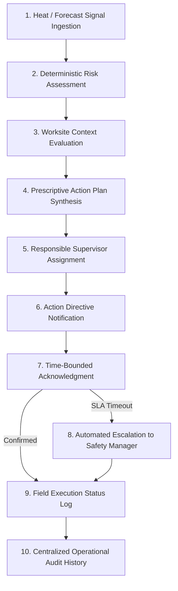
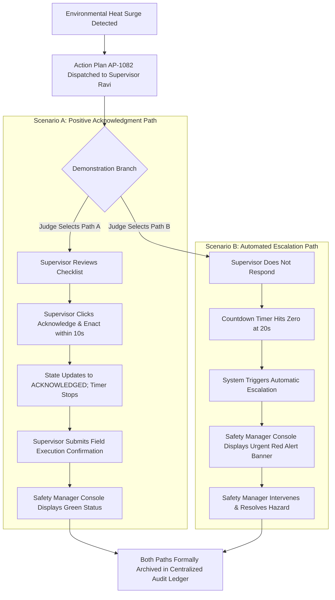

# Heat Action Response Engine (HARE) — MVP Success Criteria & Acceptance Specification

## 1. Document Purpose

This document defines how the engineering and product team will objectively determine whether the **Heat Action Response Engine Minimum Viable Product (MVP)** is successful.

Success in this project is not defined by:
* The raw quantity of AWS services deployed.
* The size or complexity of the underlying AI model.
* The number of incidental features or screens developed.
* Simply fetching weather data or calculating a mathematical heat index.
* A static visual user interface disconnected from backend workflows.

Instead, success is rigorously defined as:

```text
SUCCESS
   ≠  FEATURE QUANTITY

SUCCESS
   =  CORE 10-STAGE OPERATIONAL WORKFLOW OPERATES END-TO-END
   +  USERS INSTANTLY COMPREHEND REQUIRED ACTIONS
   +  SYSTEM RESPONDS DETERMINISTICALLY AND RELIABLY
   +  AI SAFETY AND REGULATORY BOUNDARIES ARE RESPECTED
   +  ENTERPRISE OPERATIONAL VALUE IS VISIBLY DEMONSTRATED LIVE
```

This specification establishes concrete, measurable criteria across functional, technical, safety, user experience, cloud architecture, and demonstration dimensions.

---

## 2. North Star Success Criterion

> **An identified workplace heat-risk event must move seamlessly through the complete operational execution loop from initial hazard detection to contextual action, responsible supervisor assignment, notification dispatch, time-bounded acknowledgment, automated escalation when unresolved, and immutable audit logging.**



This unbroken execution chain represents the single most important success benchmark across the entire project.

---

## 3. MVP Definition of Success

The hackathon MVP is considered successful if evaluators and judges can witness the complete operational loop live on screen without having to imagine missing components. The demonstration must visibly validate that:

1. A monitored worksite profile is actively configured with GPS coordinates and context.
2. Continuously updated meteorological data is ingested programmatically.
3. The deterministic risk engine evaluates incoming environmental metrics.
4. The system transparently explains the mathematical factors triggering the risk.
5. Worksite operational context (crew size, shift timing, workload tier) directly shapes the response.
6. A prescriptive Standard Operating Procedure (SOP) action checklist is synthesized.
7. The directive is explicitly bound to a named on-duty Site Supervisor.
8. A clear, actionable notification is delivered to the supervisor interface.
9. Positive supervisory acknowledgment is captured with high-precision latency logging.
10. An unacknowledged directive automatically triggers hierarchical escalation upon SLA timeout.
11. The Safety Manager console visually reflects the updated escalation status in real time.
12. The centralized audit ledger permanently archives every state transition and payload.

---

## 4. Critical Success Criteria (P0 / P1)

The table below catalogs the formal success criteria aligned with the priority definitions in [`docs/04_MVP_SCOPE.md`](file:///d:/Amazon%202nd%20Hackathon%20Heat/docs/04_MVP_SCOPE.md):

| Criterion ID | Formal Success Criterion | Priority | Verification Methodology |
| :--- | :--- | :---: | :--- |
| **SC-01** | Worksite profiles can be created, stored, and edited with GPS coordinates and supervisor. | **P0** | Functional CRUD & DB verification |
| **SC-02** | Weather and forecast data is successfully ingested via Open-Meteo REST API. | **P0** | Automated API integration test |
| **SC-03** | Heat risk is calculated using transparent, deterministic mathematical formulas. | **P0** | Unit test suite & math verification |
| **SC-04** | Explicit, human-readable trigger rationales are displayed alongside risk tiers. | **P0** | UI inspection & payload verification |
| **SC-05** | Worksite operational context (workload, shift, shade) dynamically modifies action plans. | **P0** | Multi-scenario context unit tests |
| **SC-06** | Prescriptive, task-based SOP action plans are synthesized automatically upon risk breach. | **P0** | Action engine functional tests |
| **SC-07** | Every generated action plan is bound to an active, accountable supervisor entity. | **P0** | State validation test |
| **SC-08** | Supervisor receives immediate, prominent notification on their interface. | **P0** | UI integration & dispatch verification |
| **SC-09** | Supervisor can submit positive acknowledgment with a single touch, recording latency. | **P0** | End-to-end user interaction test |
| **SC-10** | Unacknowledged directives automatically escalate to Safety Manager upon SLA expiration. | **P0** | Timer countdown & state machine test |
| **SC-11** | Safety Manager console displays real-time multi-site risk, SLAs, and escalation alerts. | **P0** | Frontend dashboard E2E test |
| **SC-12** | Immutable audit ledger permanently logs all events with ISO-8601 timestamps. | **P0** | Append-only database persistence test |
| **SC-13** | NVIDIA AI assists with explanations and translation without controlling safety rules. | **P1** | AI guardrail & integration evaluation |
| **SC-14** | Simulation mode reliably demonstrates accelerated risk surges and SLA timeouts. | **P1** | Live demo script dry-run |
| **SC-15** | System handles API timeouts and network failures safely without crashing. | **P1** | Chaos injection & error-handling test |

---

## 5. Functional Success by Capability

### 5.1 Worksite Management
* Successfully persists worksite name, GPS coordinates, assigned supervisor, active crew headcount, shift schedule, task workload category, and physical shade infrastructure.
* Prevents orphan worksites by requiring an assigned supervisory contact.

### 5.2 Weather Ingestion
* Programmatically retrieves 2m temperature, relative humidity, direct solar radiation, wind speed, and 24-hour forecast from Open-Meteo.
* Handles API throttling, rate limits, or network timeouts gracefully using fallback caches.
* Explicitly labels external data as **continuously updated weather data**, never claiming physical sensor equivalence.

### 5.3 Deterministic Heat Risk Engine
* Computes standard Heat Index values using documented mathematical polynomials.
* Produces 100% reproducible, deterministic risk tier classifications (`LOW`, `MODERATE`, `HIGH`, `CRITICAL`).
* Evaluates input parameters without random variation or ungrounded machine learning drift.

### 5.4 Worksite Context Engine
* Differentiates actions between contrasting facilities experiencing identical ambient weather (e.g., outdoor concrete tying vs. shaded equipment operation).
* Dynamically combines metabolic workload intensity with ambient heat index to determine effective site strain.

### 5.5 Action Plan Engine
* Maps evaluated risk tiers and workload categories into concrete Standard Operating Procedures.
* Generates structured action packages containing discrete checklist items (work-rest intervals, mandatory hydration, task rescheduling).

### 5.6 Notification Service
* Dispatches clear action directives containing risk summary, task checklist, and SLA deadline.
* Exposes notifications prominently on the supervisor console without requiring manual page reloads.

### 5.7 Acknowledgment Engine
* Captures positive supervisor confirmation (`ACKNOWLEDGE & ENACT`) with a single click.
* Records server-side timestamp and calculates elapsed acknowledgment latency.
* Updates action lifecycle state immediately from `DISPATCHED` to `ACKNOWLEDGED`.

### 5.8 Escalation Engine
* Enforces time-bounded SLA countdown timers linked to risk severity.
* Automatically transitions unacknowledged directives to `ESCALATED` upon timer expiration.
* Dispatches high-priority visual alerts to the Safety Manager console.
* **Separation of Operational vs. Demo Timeouts:**
  * *Demo Timeout:* Accelerated to 20–30 seconds for live judging validation.
  * *Operational Timeout:* Configurable in minutes for real-world deployment.

### 5.9 Audit Trail Ledger
* Appends immutable event records for all state transitions (`RISK_DETECTED`, `ACTION_GENERATED`, `DISPATCHED`, `ACKNOWLEDGED`, `ESCALATED`, `RESOLVED`).
* Stores complete JSON payloads and ISO-8601 UTC timestamps for post-shift compliance review.

---

## 6. User Experience Success Criteria

### 6.1 Safety Manager UX Success
* Can assess the heat risk status of all monitored facilities in under 3 seconds.
* Can inspect the exact mathematical trigger rationale for any facility with a single click.
* Instantly perceives unacknowledged directives through prominent visual badges.
* Receives high-priority visual and audible alerts within 1 second of an SLA escalation breach.
* Can export a clean, chronological audit history for any worksite or incident.

### 6.2 Site Supervisor UX Success
* Receives action directives on mobile or desktop without navigating complex menus.
* Understands required field tasks in under 15 seconds through concise, prioritized text.
* Submits positive acknowledgment with a single touch.
* Can input execution verification notes with minimal typing friction.

### 6.3 Organization Administrator UX Success
* Can onboard a new worksite, configure coordinates, and map supervisory personnel in under 5 minutes.
* Experiences zero ambiguity when assigning roles and escalation chains.

---

## 7. Workflow Success Verification

The end-to-end integration test must validate the following sequential lifecycle:

```text
E2E INTEGRATION TEST SCRIPT:
1. Initialize test worksite: "Bengaluru Logistics Terminal #17".
2. Ingest baseline weather: 28°C, 50% RH ──> Risk evaluates to LOW.
3. Inject elevated weather: 38°C, 65% RH ──> Risk evaluates to CRITICAL.
4. Verify Action Plan AP-1082 is synthesized with 45/15 rest & hydration checklist.
5. Verify directive is bound to Supervisor Ravi Kumar.
6. Verify notification appears on Supervisor console with active 20s SLA timer.
7. Verify positive acknowledgment updates state to ACKNOWLEDGED at Second 5.
8. Reset scenario; allow 20s timer to elapse without acknowledgment.
9. Verify state transitions to ESCALATED at Second 20.
10. Verify high-priority escalation alert appears on Safety Manager console.
11. Inspect Audit Ledger; verify unbroken chronological record of all events.
```

The test passes only if all 11 state transitions execute consistently and predictably.

---

## 8. Two Core Demonstration Scenarios

The MVP must support two distinct, repeatable demonstration paths during judging:



---

## 9. Technical Success Criteria

* **Reliability:** 100% uptime of the core demonstration flow during presentation; zero fatal crashes or unhandled exceptions.
* **Data Consistency:** Complete agreement between frontend UI state and backend database state across all polling cycles.
* **API Predictability:** Core RESTful endpoints (`/api/sites`, `/api/weather`, `/api/actions`, `/api/ack`, `/api/audit`) return valid JSON with strict schema validation.
* **Graceful Degradation:** If external weather APIs experience transient latency, the system utilizes cached forecasts or simulation fallbacks rather than halting execution.
* **AI Decoupling:** If the NVIDIA AI service experiences network latency or downtime, **the core deterministic safety workflow continues operating without interruption**.

---

## 10. Safety & Regulatory Success Criteria

* **Deterministic Primacy:** 100% of risk tiers, safety SOP selections, and SLA countdowns originate from deterministic mathematical logic, never from probabilistic language models.
* **Human Oversight Preserved:** The platform never executes autonomous physical shutdowns or issues binding employment disciplinary actions without human authorization.
* **Evidence-Aware Claims:** Platform documentation, UI labels, and presentation slides contain zero claims of "guaranteeing 100% safety" or "curing heat exhaustion."
* **No Medical Triage:** System outputs are strictly labeled as operational workplace administrative controls, avoiding medical diagnostic terminology.
* **Simulation Transparency:** Simulated weather inputs are prominently labeled with a visible `[SIMULATION MODE ACTIVE]` badge to prevent confusion with live feeds.

---

## 11. AI Success Criteria (NVIDIA AI)

Artificial intelligence success is judged by **assistance quality and guardrail compliance**, not generative novelty:

| AI Evaluation Dimension | Target Success Benchmark |
| :--- | :--- |
| **Grounding** | 100% of explanations and briefings cite only currently loaded telemetry and approved SOP guidelines; zero hallucinated facts. |
| **Correctness** | Explanations accurately reflect the underlying deterministic calculation without contradicting the risk tier. |
| **Safety Compliance** | Zero medical diagnoses, zero clinical treatment suggestions, and zero attempts to modify safety thresholds. |
| **Conciseness** | Generated supervisor dispatch messages are under 60 words, direct, and formatted for rapid mobile scanning. |
| **Translation Fidelity** | Regional language translations (Hindi, Kannada) preserve technical safety meaning (e.g., rest duration, hydration volumes). |
| **Failure Independence** | Disabling the AI endpoint leaves the core risk, action, assignment, acknowledgment, and escalation engine 100% functional. |

---

## 12. User Experience & Design Success Criteria

* **Cognitive Ergonomics:** High visual contrast, clean typography (Inter / Outfit), and dark/light mode balance ensuring readability in bright outdoor sunlight.
* **Zero Ambiguity:** Status indicators use universally recognized semantics (Green = Acknowledged/Normal, Amber = Caution/Pending, Red = Critical/Escalated) supported by text labels to assist color-blind users.
* **Rapid Response:** Site Supervisors can complete acknowledgment with a single tap on a target button occupying at least 48x48px on mobile viewports.
* **Explainability on Demand:** Clicking any risk badge reveals a popover displaying the exact mathematical input parameters and triggering rule.

---

## 13. System Performance Benchmarks

* **API Response Time:** Normal backend API transactions complete within acceptable interactive demo latencies (<500ms under standard loads).
* **Dashboard Initial Load:** Web management console renders complete multi-site state within 2.0 seconds.
* **State Update Latency:** Supervisory acknowledgment reflects on the Safety Manager dashboard within 1.0 second of submission.
* **Escalation Trigger Accuracy:** Escalation transitions occur within $\pm 1$ second of SLA timer expiration.

---

## 14. Data Quality & Auditability Success

* **Temporal Integrity:** 100% of database records contain valid, monotonically increasing ISO-8601 UTC timestamps.
* **Geospatial Precision:** Worksite records store latitude and longitude with at least 4 decimal places of precision.
* **Audit Trail Completeness:** The audit ledger successfully answers the eight canonical compliance questions for every event:
  $$\text{What happened?} \quad \text{When?} \quad \text{Where?} \quad \text{What action?} \quad \text{Who owned it?} \quad \text{Old state?} \quad \text{New state?} \quad \text{Escalated?}$$

---

## 15. Security & Governance Success

* **Role-Based Isolation:** Site Supervisors cannot access administrative configuration screens or view unassigned facilities.
* **Credential Hygiene:** Zero AWS secrets, API keys, or private tokens committed to repository source code; managed via environment variables or Secrets Manager.
* **Data Minimization:** No personal worker health records, biometric telemetry, or sensitive personal identification stored.

---

## 16. AWS Cloud Architecture Success

Cloud success is evaluated by architectural soundness and purpose-driven service selection:

```text
[ Amazon S3 / CloudFront ] ──> Responsive React Frontend Console
[ Amazon API Gateway ]     ──> Secure, Rate-Limited RESTful Endpoints
[ AWS Lambda ]             ──> Event-Driven Microservices (Ingestion, Rules, Actions)
[ Amazon DynamoDB ]        ──> High-Throughput Persistence (Sites, Actions, Audit Ledger)
[ Amazon SNS ]             ──> Real-Time Notification & Escalation Dispatch
```

Success means every deployed AWS service directly powers the operational safety loop, avoiding redundant cloud complexity.

---

## 17. Hackathon Judge Demonstration Checklist

The live demonstration is ready for evaluation when every item on this checklist is verified:

```text
[ ] Monitored worksite profile displays active location and workforce context.
[ ] Live weather ingestion demonstrates programmatic API connection.
[ ] Ingestion of elevated heat triggers deterministic Critical Risk tier.
[ ] System UI displays plain-language and mathematical trigger rationale.
[ ] Context engine proves that heavy physical labor requires enhanced rest cycles.
[ ] Prescriptive action plan AP-1082 is synthesized with concrete checklist items.
[ ] Directive is bound to designated supervisor entity.
[ ] Notification appears on supervisor console with active SLA countdown.
[ ] Path A demonstrates successful one-touch acknowledgment within SLA.
[ ] Path B demonstrates automated timeout escalation to Safety Manager.
[ ] Safety Manager console flashes high-priority escalation alert banner.
[ ] Permanent chronological audit ledger is displayed and verified live.
[ ] NVIDIA AI generates grounded risk explanation and supervisor message.
[ ] Core workflow continues operating smoothly if AI service is toggled off.
[ ] Platform is clearly proven to be software-first, requiring zero physical IoT sensors.
```

---

## 18. Evaluator Takeaways (What Judges Must Understand)

By the conclusion of the evaluation, judges must recognize:
1. **The Operational Gap:** That broadcasting weather warnings leaves a dangerous operational void between detection and execution.
2. **Product Distinction:** That HARE is an operational safety execution engine, not another weather app or risk calculator.
3. **Engineering Credibility:** That the core workflow operates reliably live on screen without fake prototypes or hand-waving.
4. **Cloud-Native Viability:** That the AWS serverless architecture is scalable, cost-effective, and enterprise-ready.
5. **Responsible AI Discipline:** That AI assists human communication while deterministic math protects safety limits.
6. **Deployability:** That the software-first architecture can be deployed to any worksite on earth in five minutes without waiting for hardware.

---

## 19. Success Metrics Dashboard

| Metric Identifier | Metric Name | Operational Definition | Target Demonstration Type |
| :--- | :--- | :--- | :--- |
| **M-01** | **Monitored Worksites** | Active facilities evaluated in demo. | 2–3 Configured Sites |
| **M-02** | **Risk Evaluation Cycles** | Total automated rule evaluations run. | Continuous / Periodic |
| **M-03** | **Action Plans Synthesized** | Discrete SOP packages generated. | Scenario-Driven |
| **M-04** | **Acknowledgment Latency** | Time from dispatch to supervisor ACK. | Demonstrated (<10s demo) |
| **M-05** | **Escalation Response Rate**| SLA timeouts triggering manager alerts. | 100% of unacknowledged runs |
| **M-06** | **Audit Trail Completeness** | Retention rate of required lifecycle events. | 100% Event Retention |
| **M-07** | **AI Grounding Fidelity** | Adherence to provided telemetry & SOPs. | 100% Grounded (No Hallucination) |
| **M-08** | **E2E Workflow Reliability** | Unbroken pass rate of 10-stage test runs. | 100% Pass Rate |

---

## 20. Formal MVP Acceptance Criteria

The MVP is formally accepted by project leadership only when all categories pass inspection:

```text
PRODUCT & SCOPE ACCEPTANCE:
[ ] Core operational gap is clearly articulated and demonstrated.
[ ] Strict scope control preserved; zero unapproved hardware or medical features.

RISK & SAFETY ACCEPTANCE:
[ ] Mathematical heat index calculation is deterministic, transparent, and tested.
[ ] Trigger reasons are explicitly displayed on all risk views.

WORKFLOW EXECUTION ACCEPTANCE:
[ ] Prescriptive action plans are generated, assigned, notified, acknowledged, and escalated.
[ ] Centralized chronological audit ledger records all lifecycle state transitions.

USER EXPERIENCE ACCEPTANCE:
[ ] Safety Manager, Site Supervisor, and Admin workflows function without dead ends.
[ ] Supervisor interface enables single-touch acknowledgment on mobile screens.

AI & CLOUD ACCEPTANCE:
[ ] NVIDIA AI operates strictly as an assistive communication layer.
[ ] AWS backend microservices persist data and route alerts reliably.
[ ] Simulation mode reliably executes both Path A and Path B on demand.
```

---

## 21. Failure Conditions (What Constitutes MVP Failure)

The project will be deemed **not yet successful** if any of the following failure conditions occur:
* The system cannot evaluate risk deterministically or produces contradictory risk tiers.
* Generated action plans cannot be assigned to a specific supervisor entity.
* Supervisory acknowledgment fails to record or does not update system state.
* An unacknowledged high-risk directive fails to trigger managerial escalation.
* The system fails to maintain an immutable audit trail of safety events.
* The core safety workflow halts because an external AI service is unavailable.
* An AI model modifies or overrides an established deterministic safety threshold.
* The system presents simulated weather data as real physical sensor measurements.
* The presentation makes unsubstantiated claims of clinical diagnosis or regulatory immunity.

---

## 22. Three Progressive Levels of Project Success

```text
LEVEL 1: MINIMUM TECHNICAL READINESS
Individual technical modules function in isolation (Weather API parses, DynamoDB stores records,
React UI renders, deterministic formulas calculate).

LEVEL 2: MVP FUNCTIONAL SUCCESS (Minimum Acceptable Product Target)
The modules connect into an unbroken operational pipeline:
Risk ──> Context ──> Action ──> Assignment ──> Notification ──> Acknowledgment ──> Escalation ──> Audit.

LEVEL 3: STRONG HACKATHON WINNING PRESENTATION (Target Quality Benchmark)
Flawless Level 2 execution PLUS polished visual ergonomics, grounded NVIDIA AI communication assistance,
defensible AWS cloud architecture, highly compelling problem framing, and rock-solid demo reproducibility.
```

---

## 23. MVP Success vs. Long-Term Impact

A strict distinction must be maintained between hackathon prototype validation and long-term societal impact:

```text
WHAT THE HACKATHON MVP PROVES:
"The software platform reliably detects elevated heat risk, synthesizes site-specific action plans,
assigns responsible supervisors, tracks acknowledgment, escalates failures, and logs a complete audit trail."

WHAT THE PROTOTYPE DOES NOT (AND CANNOT) CLAIM TO PROVE:
"This software has proven a 40% reduction in heatstroke hospitalizations across Indian construction sites."
```

Proving clinical health outcomes requires multi-year longitudinal studies, clinical trials, and epidemiological validation. The hackathon MVP proves **operational execution quality and workflow reliability**.

---

## 24. Future Success Criteria (Post-MVP Roadmap)

Future commercial iterations will evaluate advanced post-MVP criteria:
* Multi-year operational resilience benchmarking across enterprise client portfolios.
* Ingestion reliability across thousands of physical IoT microclimate weather stations via AWS IoT Core.
* Bi-directional ERP synchronization speed with SAP and Workday.
* Multi-hazard adaptation managing air quality (AQI) and extreme wind safety workflows.

---

## 25. Final Definition of Done

> **The Heat Action Response Engine MVP is considered formally complete when a configured industrial worksite can move through a complete, repeatable, and transparent heat-risk response workflow—from environmental signal and deterministic risk calculation through contextual action synthesis, accountable supervisory assignment, notification dispatch, time-bounded acknowledgment, automated escalation when unresolved, and immutable audit logging—while preserving human oversight and strictly adhering to medical, regulatory, data, and AI safety boundaries.**

---

## 26. Final Success Statement

> **Success is not having the most features or the most artificial intelligence. Success is proving one valuable operational workflow end-to-end: when workplace heat risk is identified, the right action reaches the right person, the system verifies whether they responded, unaddressed hazards automatically escalate, and the organization permanently preserves what happened.**

---

* **Status:** Draft
* **Last Updated:** 2026-10-07
