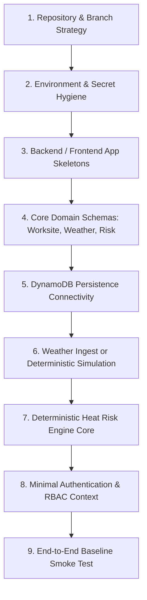

# 100 — Day 1 Execution Plan: Foundation & Minimal Vertical Slice

```text
Status: Documented
Scope: Hackathon Day 1 Engineering Sprint
Audience: Engineering Team, Technical Lead, DevOps
Last Updated: 2026-10-08
Sprint Theme: Technical Foundation over Visual Polish
```

---

## 1. Day 1 Objective & Core Philosophy

The primary objective of Day 1 is to establish the **minimum functioning vertical foundation** for the **Heat Action Response Engine**.

### Core Philosophy
> **Day 1 is NOT about visual polish or UI styling.**
> **Day 1 is about proving the end-to-end technical loop from raw data ingestion to deterministic safety classification.**

By the conclusion of Day 1, the repository must execute this minimal pipeline:

```text
REPOSITORY INITIALIZATION
       ↓
APPLICATION SKELETON (Backend + Frontend)
       ↓
DATABASE PERSISTENCE CONNECTIVITY (Amazon DynamoDB)
       ↓
AUTHENTICATION & ROLE SKELETON (Cognito / JWT / RBAC)
       ↓
WORKSITE DATA MODEL (Worksite & Facility Profile)
       ↓
WEATHER TELEMETRY (Open-Meteo Ingest or Synthetic Simulation)
       ↓
DETERMINISTIC HEAT RISK EVALUATION (Produces Authoritative Tier)
```

---

## 2. Day 1 Priority Stack

Engineering resources are allocated in strict hierarchical order:



1. **Repository Setup & Work Ownership:** Clean git branch conventions, code formatting, and strict secret protection.
2. **Environment & Local Tooling:** Node.js/TypeScript runtime, package dependencies, environment variable scaffolding.
3. **Skeleton Applications:** Bootstrapped Express/Fastify/Lambda backend service and React + TypeScript frontend shell.
4. **Core Domain Models:** TypeScript interface definitions for `Worksite`, `WeatherRecord`, `RiskAssessment`, `User`, and `Role`.
5. **Database Connectivity:** DynamoDB single-table schema initialized locally (DynamoDB Local) or on AWS dev account.
6. **Weather Telemetry Layer:** Integration with Open-Meteo API or pre-configured synthetic simulation mode.
7. **Deterministic Risk Engine:** Core mathematical logic computing Heat Index and emitting canonical risk levels.
8. **Authentication/RBAC Foundation:** JWT claims extraction distinguishing `ADMIN`, `SAFETY_MANAGER`, and `SUPERVISOR`.
9. **Minimal End-to-End Smoke Test:** Single script proving that simulated weather computes an authoritative risk score.

---

## 3. Measurable Day 1 Deliverables

The sprint concludes when these concrete deliverables are verified:

* [x] **Repository Ready:** Git repository configured with branch protections, `.gitignore`, and pre-commit secret scanning.
* [x] **Backend Health:** REST API running; `GET /api/v1/health` returns `HTTP 200 OK` with JSON timestamp.
* [x] **Frontend Shell:** React application boots without console errors; renders placeholder layout.
* [x] **Database Verification:** Write/read operation against DynamoDB succeeds for a sample entity.
* [x] **Worksite Entity:** At least one worksite record (`SITE-BLR-001`) can be created and queried.
* [x] **Weather Ingestion:** Ingests live Open-Meteo payload or loads deterministic synthetic simulation payload.
* [x] **Deterministic Risk Evaluation:** Engine evaluates temperature and humidity $\rightarrow$ returns structured `RiskAssessment`.
* [x] **Risk Result Metadata:** Evaluated risk includes `data_quality`, `rule_version`, and `risk_factors` array.
* [x] **Role Context:** Middleware extracts mock or Cognito JWT claims and identifies user role.
* [x] **Smoke Test Passed:** Automated script executes: Ingest $\rightarrow$ Risk Engine $\rightarrow$ Expected Risk Level.

---

## 4. Technical Work Breakdown

### 4.1 Repository & Branch Hygiene
* Initialize Git repository with main branch protection (`main` and `develop`).
* Enforce branch naming conventions: `feat/domain-model`, `feat/risk-engine`, `feat/weather-ingest`.
* Verify that `.gitignore` completely excludes:
  * `.env`, `.env.local`, `*.pem`, `*.key`, `node_modules/`, `dist/`, `.serverless/`.
* Confirm zero credentials or private tokens are committed (`docs/84_SECRETS.md`).

### 4.2 Backend Service Skeleton
* Initialize Node.js + TypeScript service targeting AWS Lambda / API Gateway.
* Setup HTTP routing and standardized JSON serialization.
* Implement structured logging outputting ISO 8601 UTC timestamps, `request_id`, and `correlation_id`.
* Implement standard error response envelope ([79_ERROR_CONTRACTS.md](file:///d:/Amazon%202nd%20Hackathon%20Heat/docs/79_ERROR_CONTRACTS.md)).

### 4.3 Frontend Application Skeleton
* Initialize React + Vite + TypeScript application.
* Setup standard application layout: Navigation Bar, Status Indicator, Main Content Area.
* Configure Axios / Fetch client with base URL pointing to local/dev backend API.
* Setup basic theme tokens (neutral dark/light palette, high contrast).

### 4.4 Domain Entity Definitions
Define core interfaces in shared types directory (`src/types/`):
* **`User` / `Role`:** `user_id`, `organization_id`, `role` (`ADMIN | SAFETY_MANAGER | SUPERVISOR`).
* **`Worksite`:** `worksite_id`, `name`, `latitude`, `longitude`, `facility_profile` (`OUTDOOR_DIRECT_SUN | INDOOR_UNCONDITIONED`).
* **`WeatherRecord`:** `dry_bulb_temperature`, `relative_humidity`, `heat_index`, `timestamp`, `source_type` (`OBSERVATION | FORECAST | SYNTHETIC_SIMULATION`).
* **`RiskAssessment`:** `risk_assessment_id`, `worksite_id`, `risk_level` (`LOW | MODERATE | HIGH | CRITICAL | UNKNOWN`), `rule_version`.

### 4.5 Weather Ingestion & Simulation Harness
* Implement Open-Meteo client fetching hourly temperature and relative humidity for target coordinates.
* Implement deterministic **Simulation Mode** ([38_SIMULATION_MODE.md](file:///d:/Amazon%202nd%20Hackathon%20Heat/docs/38_SIMULATION_MODE.md)):
  * Injects synthetic payload: Temp $36.5^\circ\text{C}$, RH $58\% \rightarrow$ Calculated Heat Index $39.4^\circ\text{C}$.
  * Explicitly flags payload with `source_type: "SYNTHETIC_SIMULATION"` and `is_simulation: true`.

### 4.6 Deterministic Risk Engine (Core Vertical Slice)
* Implement pure mathematical function evaluating temperature and humidity via Rothfusz regression equation.
* Implement baseline threshold evaluation logic:
  * Heat Index $< 32.0^\circ\text{C} \rightarrow$ `LOW`
  * Heat Index $32.0^\circ\text{C} - 37.9^\circ\text{C} \rightarrow$ `MODERATE`
  * Heat Index $38.0^\circ\text{C} - 43.9^\circ\text{C} \rightarrow$ `HIGH`
  * Heat Index $\ge 44.0^\circ\text{C} \rightarrow$ `CRITICAL`
  * Missing/Corrupted input $\rightarrow$ `UNKNOWN`
* Ensure engine is 100% deterministic (no async side-effects, no external network calls inside calculation loop).

---

## 5. Day 1 Acceptance Checklist

Before signing off on Day 1, the team must verify every checkpoint:

```text
================================================================================
DAY 1 EXIT GATE CHECKLIST
================================================================================
[ ] Application builds without TypeScript compiler errors (tsc passes cleanly)
[ ] Backend health endpoint GET /api/v1/health responds with HTTP 200 OK
[ ] Frontend boots on localhost / staging and renders header and worksite card
[ ] DynamoDB single-table created and read/write verified via AWS SDK
[ ] Synthetic worksite SITE-BLR-001 stored and queryable via API
[ ] Weather ingestion retrieves valid meteorological data or synthetic scenario
[ ] Risk engine evaluates synthetic heat spike and outputs HIGH RISK
[ ] Risk result records rule_version: "1.0.0" and data_quality: "VALID"
[ ] Missing temperature parameter returns risk_level: "UNKNOWN", never defaults to LOW
[ ] Zero secrets or API keys committed to Git repository
[ ] Smoke test script passes and logs execution trace to console
================================================================================
```

---

## 6. Day 1 Architectural Conclusion

Day 1 successfully de-risks the foundation. By prioritizing the **vertical slice of data ingestion, persistence, and deterministic risk evaluation** over cosmetic design, the team enters Day 2 with a functioning core capable of translating environmental hazard signals into operational workplace actions.
