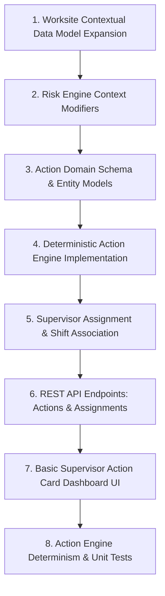
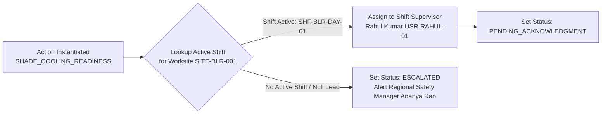

# 101 — Day 2 Execution Plan: Context, Action Engine & Supervisory Assignment

```text
Status: Documented
Scope: Hackathon Day 2 Engineering Sprint
Audience: Engineering Team, Domain Modelers, Frontend/Backend Leads
Last Updated: 2026-10-08
Sprint Theme: From Environmental Risk to Actionable Workplace Directives
```

---

## 1. Day 2 Objective & Operational Milestone

Day 2 bridges the gap between raw risk assessment and physical operational response. 

### Core Objective
> **Transform the assessed heat hazard into contextual, site-specific, and assigned preventative safety actions.**

By the conclusion of Day 2, the system must execute this operational flow:

```text
WEATHER INGESTION (Heat Index 39.4°C)
       ↓
DETERMINISTIC HEAT RISK ENGINE (Assesses HIGH RISK)
       ↓
WORKSITE CONTEXT INJECTION (Outdoor Direct Sun + Heavy Labor + No Permanent Shade)
       ↓
DETERMINISTIC ACTION ENGINE (Instantiates Specific Directives from Rule Catalog)
       ↓
SINGLE-SUPERVISOR ASSIGNMENT (Directly Routed to Rahul Kumar, On-Duty Lead)
       ↓
SUPERVISOR DASHBOARD CARD (Visible in Frontend Mobile & Desktop View)
```

---

## 2. Day 2 Priority Stack

Engineering resources are allocated in this sequential order:



1. **Worksite Context Expansion:** Enrich worksite profiles with workload, shade, cooling, and hydration infrastructure parameters.
2. **Contextual Risk Modifiers:** Update risk calculation rules to account for metabolic workload and radiant solar exposure.
3. **Action Domain Entity Schema:** Establish the canonical action model ([16_ACTION_MODEL.md](file:///d:/Amazon%202nd%20Hackathon%20Heat/docs/16_ACTION_MODEL.md), [74_ACTION_API.md](file:///d:/Amazon%202nd%20Hackathon%20Heat/docs/74_ACTION_API.md)).
4. **Deterministic Action Engine:** Implement rule-driven action generation mapping hazard levels and site contexts to concrete actions.
5. **Supervisor Ownership Assignment:** Bind generated action instances to active on-duty supervisors.
6. **API Contracts:** Implement `GET /api/v1/actions` and `GET /api/v1/worksites/{id}/actions`.
7. **Action Card UI:** Build the front-end action view displaying title, priority, owner, and response deadline.
8. **Automated Testing:** Unit test action generation determinism, site-specific variations, and invalid status transitions.

---

## 3. Worksite Contextual Data Integration

The Action Engine cannot generate generic advice; it requires rich worksite operational parameters:

### Contextual Data Fields Captured
* **Metabolic Workload Category:** `LIGHT` ($<200\text{ W}$), `MODERATE` ($200-350\text{ W}$), `HEAVY` ($>350\text{ W}$), or `UNKNOWN`.
* **Solar Exposure Profile:** `OUTDOOR_DIRECT_SUN`, `OUTDOOR_SHADED`, `INDOOR_UNCONDITIONED`, `INDOOR_AIR_CONDITIONED`.
* **Shade Infrastructure Status:** `AVAILABLE_PERMANENT`, `PORTABLE_CANOPY_ACTIVE`, `INADEQUATE_OR_NONE`.
* **Hydration Infrastructure Status:** `PLUMBED_STATION`, `DISPENSER_CHILLED`, `REMOTE_HAULED`, `DEFICIENT`.
* **Crew Exposure Duration:** Continuous hours exposed in active shift ($1-10\text{ hours}$).
* **Active Shift Assignment:** Shift ID (`SHF-BLR-DAY-01`) linking on-duty supervisor ID (`USR-RAHUL-01`).

---

## 4. Deterministic Action Engine Implementation

The Action Engine implements versioned declarative mappings ([41_ACTION_RULES.md](file:///d:/Amazon%202nd%20Hackathon%20Heat/docs/41_ACTION_RULES.md)):

```text
IF Risk Level IN ['HIGH', 'CRITICAL']
   AND Location == 'OUTDOOR_DIRECT_SUN'
   AND Shade Status == 'INADEQUATE_OR_NONE'
THEN
   Generate Action: SHADE_COOLING_READINESS (Priority: HIGH)
   Title: "Deploy Shaded Rest Area and Active Canopy"
   Deadline: Current Time + 15 Minutes (Live) / + 30 Seconds (Demo)
   Verification Required: TRUE
```

### Supported Action Types
The engine instantiates actions exclusively matching the canonical taxonomy:
1. **`HYDRATION_READINESS`:** Stage, inspect, and replenish chilled potable water and electrolyte packs.
2. **`SHADE_COOLING_READINESS`:** Erect portable shade canopies and set up misting fans within 50m of work zones.
3. **`SUPERVISOR_BRIEFING`:** Conduct mandatory toolbox safety talk covering heat distress symptoms.
4. **`WORK_REST_PLAN_REVIEW`:** Enforce structured rest pause rotations (e.g., 45 min work / 15 min rest).
5. **`TASK_RESCHEDULING_REVIEW`:** Reschedule non-critical heavy manual tasks to cooler morning hours.
6. **`WORKSITE_CHECK`:** Conduct physical walk-through to visually monitor worker thermal strain.
7. **`CREW_COMMUNICATION`:** Broadcast high-heat warnings across site radios and mobile channels.
8. **`RISK_REASSESSMENT`:** Take localized on-site temperature and humidity measurements.
9. **`SAFETY_MANAGER_REVIEW`:** Administrative escalation review for unmitigated extreme thermal events.

---

## 5. Explicit Supervisor Ownership Assignment

In life-safety operations, unowned alerts lead to fatal inaction. The Action Engine guarantees single-person accountability:



* **Validation Rule:** The assigned owner must hold the `SUPERVISOR` or `SAFETY_MANAGER` role.
* **Traceability:** Every action payload records:
  ```json
  "owner": {
    "user_id": "USR-RAHUL-01",
    "role": "SUPERVISOR",
    "name": "Rahul Kumar"
  }
  ```

---

## 6. Frontend Action Card Dashboard UI

Build the responsive Action Directive UI in the React client:
* **Visual Urgency:** High-contrast amber/red border indicating `HIGH` or `CRITICAL` priority.
* **Operational Directives Checklist:** Clear, bulleted action items for the field supervisor.
* **Owner Identification:** Prominently displays *"Assigned to: Rahul Kumar (Site Supervisor)"*.
* **Countdown Deadline:** Prominent visual timer displaying remaining seconds/minutes before automated escalation.
* **Action Status Badge:** Color-coded status badge (`PENDING_ACKNOWLEDGMENT`, `IN_PROGRESS`, `VERIFIED`).

---

## 7. Day 2 Acceptance Checklist

Verify all Day 2 criteria before committing sprint milestone:

```text
================================================================================
DAY 2 EXIT GATE CHECKLIST
================================================================================
[ ] Worksite context model captures workload, shade, cooling, and hydration
[ ] Risk engine incorporates metabolic workload and solar radiation modifiers
[ ] High-risk evaluation automatically triggers the Action Engine
[ ] Action Engine instantiates site-specific SHADE_COOLING_READINESS action
[ ] Generated action contains explicit owner (Rahul Kumar), priority, and deadline
[ ] Action records source rule ID (e.g., AR-SHADE-002) and rule version (1.0.0)
[ ] REST API endpoint GET /api/v1/actions returns active actions in standard JSON
[ ] Supervisor dashboard displays action card with readable directives and countdown
[ ] Unassigned worksite correctly sets action to ESCALATED with alert to Safety Mgr
[ ] Unit tests prove Action Engine determinism (100 runs yield identical action sets)
[ ] Invalid state transition (e.g. CREATED -> VERIFIED) returns HTTP 409 Conflict
================================================================================
```

---

## 8. Day 2 Architectural Conclusion

Day 2 successfully closes the gap between data and human responsibility. By equipping the system with **contextual intelligence, versioned deterministic action rules, and explicit supervisory ownership**, the platform is primed for Day 3: building the automated accountability and escalation engine.
