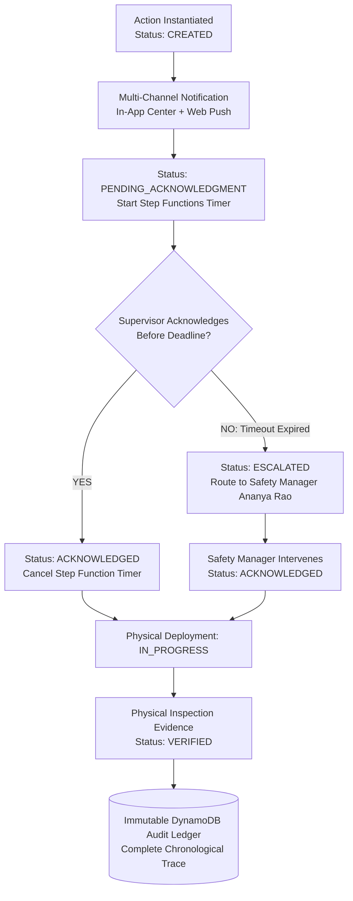

# 102 — Day 3 Execution Plan: Accountability, Escalation & Audit Trail

```text
Status: Documented
Scope: Hackathon Day 3 Engineering Sprint
Audience: Engineering Team, Backend Lead, Workflow Architects, QA
Last Updated: 2026-10-08
Sprint Theme: The Closed-Loop Accountability Engine
```

---

## 1. Day 3 Objective & Architectural Core

Day 3 builds the **core operational differentiator** of the Heat Action Response Engine: the closed-loop accountability engine.

### Core Objective
> **Build the complete feedback loop that turns an unacknowledged safety alert into an escalated, resolved, verified, and audited workplace intervention.**



---

## 2. Notification Dispatch Subsystem

Day 3 establishes multi-channel alert delivery, prioritizing the simplest, most resilient MVP channels:

### 2.1 MVP Channel Priority
1. **In-App Notification Center (Primary MVP Channel):** Real-time persistent notification banner and drawer inside the React client with audible tone.
2. **Web Push Notifications (PWA):** Browser push event waking up mobile devices without requiring background app installation.
3. **Simulated / Mock SMS Gateway (Development & Demo):** Emulated carrier delivery logging formatted payloads to console and mock delivery receipts.

### 2.2 Semantic Notification Boundaries
All notification code must strictly maintain these distinct state definitions:

```text
================================================================================
CRITICAL NOTIFICATION BOUNDARIES:
                  SENT ≠ DELIVERED ≠ READ ≠ ACKNOWLEDGED
================================================================================
```
* **`SENT`:** Outbound HTTP payload transmitted to carrier gateway.
* **`DELIVERED`:** Network acknowledgment received confirming device receipt.
* **`READ`:** User opened message or pushed notification banner into foreground.
* **`ACKNOWLEDGED`:** User authenticated and explicitly clicked the signed confirmation token.

---

## 3. Authenticated Supervisory Acknowledgment

The acknowledgment endpoint enforces single-click mobile confirmation under harsh field glare:

### 3.1 Endpoint Contract: `POST /api/v1/actions/{id}/acknowledge`
* **Authentication:** Requires valid Bearer JWT or cryptographically signed, single-use URL token (`tok_...`).
* **Validation:**
  * User must be the assigned `SUPERVISOR` or tenant `SAFETY_MANAGER`.
  * Action must currently be in `PENDING_ACKNOWLEDGMENT` or `ESCALATED` state.
* **Atomic State Mutation:**
  * Uses DynamoDB `TransactWriteItems`:
    1. Updates action status to `ACKNOWLEDGED`.
    2. Writes `ACTION_ACKNOWLEDGED` record to audit partition.
* **Orchestration Callback:** Dispatches a `CancelExecution` command to the running Step Functions timeout execution.

---

## 4. Automated Step Functions Escalation Engine

When on-site personnel fail to respond, the platform refuses to allow safety directives to languish:

```text
SUPERVISOR (Rahul Kumar)
          ↓  (Unacknowledged after 30s Demo / 15m Live)
AWS STEP FUNCTIONS TIMEOUT
          ↓
REGIONAL SAFETY MANAGER (Ananya Rao)
```

### 4.1 Escalation State Machine Mechanics
1. **Timer Initialization:** Upon action creation, EventBridge triggers a Step Functions execution configured with a `Wait` state matching `response_deadline`.
2. **Timeout Expiry:** If no cancellation signal is received before the wait state elapses, the state machine invokes the escalation Lambda.
3. **Status Mutation:** Action atomically transitions to `status: ESCALATED`.
4. **Alert Fan-Out:** An urgent priority alert is dispatched to regional safety managers with full attribution regarding the unresponsive supervisor.

### 4.2 Escalation Triggers
* **Primary Trigger:** `NO_ACKNOWLEDGMENT` (timeout expiry).
* **Secondary Trigger:** `ACTION_BLOCKED` (supervisor flags that equipment/water is unavailable).
* **Tertiary Trigger:** `UNASSIGNED_WORKSITE` (worksite shift has no registered lead).

---

## 5. Physical Verification & Non-Medical Boundary

Verification establishes that preventative engineering controls were physically staged on site:

### 5.1 Verification Protocol
* **Separation of Duties:** Only users holding `SAFETY_MANAGER` or `AUDITOR` permissions can call `POST /api/v1/actions/{id}/verify`. Supervisors are barred from self-verifying.
* **Required Metadata:** Verification requests must include:
  * `verification_method`: `PHYSICAL_INSPECTION`, `PHOTO_EVIDENCE`, `CHECKLIST_CONFIRMATION`.
  * `inspection_notes`: Specific confirmation of shade coverage and water volume.
* **Status Progression:** Action transitions from `VERIFICATION_PENDING` to `VERIFIED`.

### 5.2 Non-Medical Clinical Disclaimer
```text
================================================================================
SAFETY VERIFICATION BOUNDARY:
          VERIFIED ≠ MEDICALLY SAFE ≠ CLINICAL CLEARANCE
The status 'VERIFIED' confirms administrative and physical staging of 
preventative controls. It does NOT certify that individual workers are 
medically immune to heat illness or clinically cleared for labor.
================================================================================
```

---

## 6. Immutable Compliance Audit Ledger

Every consequential state transition committed on Day 3 is atomically recorded to the append-only DynamoDB audit partition ([85_AUDIT_LOGGING.md](file:///d:/Amazon%202nd%20Hackathon%20Heat/docs/85_AUDIT_LOGGING.md)):

```text
MINIMUM CONCISE AUDIT EVENT CHAIN:
1. RISK_ASSESSED          (Heat Index 39.4°C -> HIGH RISK)
2. ACTION_CREATED         (SHADE_COOLING_READINESS created)
3. NOTIFICATION_SENT      (Alert dispatched to Rahul Kumar)
4. ESCALATION_TRIGGERED   (Supervisory non-response timeout)
5. ESCALATION_RESOLVED    (Safety Manager Ananya Rao intervention)
6. ACTION_VERIFIED        (Physical canopy inspection confirmed)
```

* **Attributes Recorded:** `audit_event_id`, `correlation_id`, `request_id`, `timestamp`, `actor`, `event_type`, `resource_id`, `previous_state`, `new_state`.
* **Access Control:** Queryable only by `AUDITOR`, `SAFETY_MANAGER`, and `ADMIN`.

---

## 7. Day 3 Acceptance Checklist

Verify all Day 3 criteria before signing off on the sprint:

```text
================================================================================
DAY 3 EXIT GATE CHECKLIST
================================================================================
[ ] In-app notification center renders incoming directives with high-contrast alert
[ ] Action creation starts an AWS Step Functions timeout execution
[ ] Supervisor can acknowledge directive via single-click mobile API call
[ ] Replayed acknowledgment token is rejected with HTTP 409 Conflict
[ ] Simulated timeout expiry successfully fires Step Functions escalation Lambda
[ ] Action status transitions to ESCALATED and appears on Safety Manager console
[ ] Safety Manager can review, radio site, and submit escalation resolution
[ ] Action can transition to VERIFICATION_PENDING upon supervisor completion
[ ] Supervisor self-verification attempt is rejected with HTTP 403 Forbidden
[ ] Safety Manager submits physical verification; status updates to VERIFIED
[ ] DynamoDB audit partition contains all 6 chronological events linked by correlation_id
[ ] End-to-end integration test passes: Ingest -> Action -> Escalation -> Verify -> Audit
================================================================================
```

---

## 8. Day 3 Architectural Conclusion

Day 3 completes the core operational engine of the Heat Action Response Engine. With **automated timeout escalations, role-based verifications, and cryptographic audit logging**, the product is now operationally whole. Day 4 will focus on user experience, assistive AI integration, and live demo hardening.
