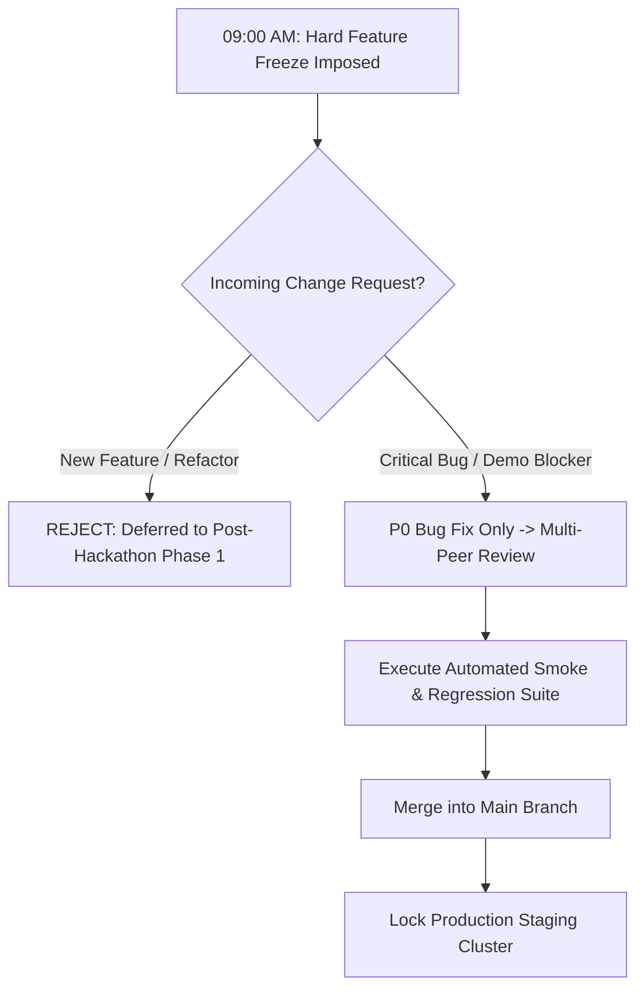

# 104 — Day 5 Execution Plan: Feature Freeze, Verification & Submission

```text
Status: Documented
Scope: Hackathon Day 5 Final Sprint
Audience: Complete Engineering Team, Project Lead, Presenters
Last Updated: 2026-10-08
Sprint Theme: Code Freeze, Evidence Verification & Submission
```

---

## 1. Day 5 Objective & Triage Philosophy

Day 5 is dedicated entirely to **freezing the codebase, executing full verification test suites, capturing immutable evidence, and completing submission deliverables**.

### Core Philosophy
> **Day 5 is NOT for building new features.**
> **Stability, correctness, and verifiable evidence take absolute priority over last-minute feature additions.**

```text
================================================================================
DAY 5 PRIORITY HIERARCHY:
STABILITY  >  CORRECTNESS  >  DEMO PROOF  >  EVIDENCE  >  SUBMISSION  >  POLISH
================================================================================
```

---

## 2. Hard Feature Freeze & Triage Protocol

At **09:00 AM on Day 5**, the repository enters a strict **Hard Feature Freeze**:



### Protocol Rules
1. **Zero New Scope:** Any pull request introducing unapproved schema modifications, additional API routes, or speculative features is immediately closed.
2. **P0 Bugs Only:** Only defects causing complete application crashes, broken authorization, or demo workflow failure are eligible for patching.
3. **Double Verification:** Any emergency patch requires verification by two engineers and a clean run of the automated regression suite before merge.

---

## 3. Comprehensive Verification Test Suite Execution

Execute the authoritative test specifications established in the documentation repository:

```text
================================================================================
COMPREHENSIVE TEST EXECUTION SEQUENCE
================================================================================
1. DETERMINISTIC RISK RULES:
   - Run: npm test -- tests/risk-engine/
   - Verify: 42 mathematical rules pass with 100% determinism (docs/91_RISK_ENGINE_TESTS.md).
   - Verify: Boundary conditions (T - ε, T, T + ε) pass without off-by-one errors.

2. DETERMINISTIC ACTION RULES:
   - Run: npm test -- tests/action-engine/
   - Verify: Contextual site mappings generate correct action types (docs/92_ACTION_ENGINE_TESTS.md).
   - Verify: Action deduplication suppresses redundant active directives.

3. API CONTRACT & SECURITY:
   - Run: npm test -- tests/api/
   - Verify: 20 contract tests pass (docs/93_API_TESTS.md).
   - Verify: Unauthorized/cross-tenant calls return HTTP 401/403.

4. AI SAFETY & GUARDRAILS:
   - Run: npm test -- tests/ai-eval/
   - Verify: Prompt injection and clinical medical advice requests trigger hard refusals.
   - Verify: Fallback mechanism operates when LLM mock times out (docs/94_AI_EVALUATION.md).

5. END-TO-END SYSTEM INTEGRATION:
   - Run: npm test -- tests/e2e/
   - Verify: Full 10-step lifecycle executes (docs/95_END_TO_END_TESTS.md).
   - Verify: All 6 audit events are written with matching correlation_id.
================================================================================
```

---

## 4. Final Demonstration Dry-Run & Staging Lock

Before recording media or opening the submission portal, the presentation team executes the complete live demonstration script ([96_DEMO_SCRIPT.md](file:///d:/Amazon%202nd%20Hackathon%20Heat/docs/96_DEMO_SCRIPT.md)):

```text
FULL DRY-RUN VERIFICATION (NORTH BENGALURU SCENARIO):
[ ] Step 01: Baseline dashboard displays healthy worksite
[ ] Step 02: Injected heat spike (39.4°C) triggers HIGH RISK badge
[ ] Step 03: Action ACT-001 (SHADE_COOLING) assigned to Rahul Kumar with 30s timer
[ ] Step 04: Supervisor non-response simulation elapses; Step Functions fires
[ ] Step 05: Action transitions to ESCALATED; appears on Ananya Rao's console
[ ] Step 06: Safety Manager resolves escalation with radio confirmation
[ ] Step 07: Physical inspection submitted; action status marks VERIFIED
[ ] Step 08: Audit ledger displays complete 6-event chronological trace
[ ] Step 09: AI assistant renders grounded briefing and hard clinical refusal
[ ] Step 10: One-click demo reset returns database cleanly to baseline
```

---

## 5. Submission Evidence Collection

Assemble and archive verified evidence in the project submission dossier:

1. **High-Resolution Screenshots:** Final UI captures named according to [108_SCREENSHOTS.md](file:///d:/Amazon%202nd%20Hackathon%20Heat/docs/108_SCREENSHOTS.md) (`01_dashboard.png` through `07_ai_assistance.png`).
2. **Demonstration Video:** 3-to-4 minute walkthrough MP4 recorded, synchronized, and transcoded according to [107_VIDEO_SCRIPT.md](file:///d:/Amazon%202nd%20Hackathon%20Heat/docs/107_VIDEO_SCRIPT.md).
3. **Architecture Diagrams:** High-res exports of AWS Serverless Mesh and State Machine flows.
4. **Git Commit Hash & Tag:** Clean release commit tagged `v1.0.0-mvp-submission` pushed to remote.
5. **Known Limitations Disclosure:** Explicit catalog of MVP boundaries ([99_JUDGE_QA.md](file:///d:/Amazon%202nd%20Hackathon%20Heat/docs/99_JUDGE_QA.md)).

---

## 6. Day 5 Acceptance Checklist

Review the final gate checklist prior to clicking "Submit":

```text
================================================================================
DAY 5 FINAL EXIT GATE CHECKLIST
================================================================================
[ ] Hard code freeze active; zero unapproved PRs merged
[ ] Full automated test suite passes (Unit, Domain, API, AI, and E2E)
[ ] Live demo dry-run succeeds on staging cluster within 4 minutes
[ ] Backup demonstration MP4 video verified and playable offline (Level 3)
[ ] All 7 core UI screenshots captured and verified against real application
[ ] Hackathon submission fields written according to docs/105_SUBMISSION.md
[ ] Pitch presentation deck polished and aligned with docs/106_PITCH.md
[ ] Video script matches recordings without misleading edits (docs/107_VIDEO_SCRIPT.md)
[ ] Git repository scanned for secrets; zero API keys or credentials exposed
[ ] Release checklist (docs/109_RELEASE_CHECKLIST.md) signed off by Tech Lead
[ ] Submission form submitted and confirmation receipt received
================================================================================
```

---

## 7. Day 5 Architectural Conclusion

Day 5 ensures that the Heat Action Response Engine is judged on its **verified technical merits, deterministic safety architecture, and operational integrity**. By enforcing an unbending code freeze and verifying every claim against automated test evidence, the team submits an engineering product that is rock-solid, fully defensible, and true to its mission: **from heat warning to verified workplace action.**
