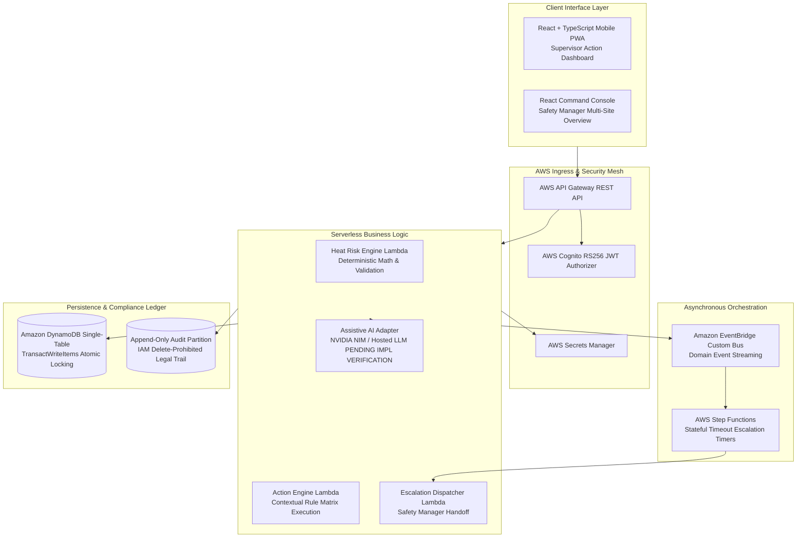

# 105 — Hackathon Project Submission Dossier

```text
Status: Documented
Scope: Official Hackathon Submission Documentation
Audience: Hackathon Judges, Technical Evaluators, Public Gallery
Last Updated: 2026-10-08
Truthfulness Mandate: ZERO FABRICATED METRICS, CUSTOMER ADOPTIONS, OR MEDICAL CLAIMS
```

---

## 1. Submission Metadata & Identity

* **Project Title:** Heat Action Response Engine
* **Product Tagline:** *From heat warning to verified workplace action.*
* **Primary Track:** Occupational Safety / Climate Resilience / Enterprise Cloud Operations
* **Repository Link:** `[REPOSITORY_URL_PENDING_SUBMISSION]`
* **Demo Video Link:** `[VIDEO_URL_PENDING_SUBMISSION]`

---

## 2. Short Project Description (Elevator Summary)

> **The Heat Action Response Engine is a software-first workplace heat-risk operations platform that converts ambient meteorological warnings into site-specific preventative actions, assigns them to responsible on-duty supervisors, enforces response deadlines via automated cloud escalations, requires physical safety verification, and maintains a tamper-evident compliance audit trail.**

---

## 3. Comprehensive Project Description (Long Form)

### 3.1 The Problem
Rising global temperatures subject hundreds of millions of industrial, construction, and agricultural workers to acute thermal stress every summer. However, the current industry approach is broken:
* **The Information-to-Action Gap:** Commercial weather apps and regional government alerts tell organizations that it is hot. But they do nothing to ensure that anyone takes physical preventative action.
* **Diffusion of Responsibility:** Alerts sent to broad mailing lists or general messaging channels are unassigned. In high-pressure operations, unowned alerts are ignored.
* **Zero Accountability & Verification:** Current systems stop at notification delivery. No mechanism tracks whether a supervisor opened the alert, whether water was staged, or whether shade was actually erected.

### 3.2 The Solution
The Heat Action Response Engine is not another heat-warning dashboard; it is the **operational execution layer** that coordinates workplace preventative action through an unbroken closed loop:

```text
METEOROLOGICAL HEAT SIGNAL (Open-Meteo / IMD Telemetry Ingestion)
       ↓
DETERMINISTIC HEAT RISK ENGINE (Authoritative Risk Tier: LOW to CRITICAL)
       ↓
WORKSITE CONTEXT ENGINE (Workload, Shade, Cooling, and Hydration Infrastructure)
       ↓
DETERMINISTIC ACTION ENGINE (Instantiates Specific Directives from Rule Catalog)
       ↓
SINGLE SUPERVISOR ASSIGNMENT (Directly Assigned to On-Duty Shift Lead)
       ↓
MULTI-CHANNEL NOTIFICATION (In-App Center, Web Push, SMS)
       ↓
AUTHENTICATED ACKNOWLEDGMENT (Single-Click Signed Mobile Token)
       ↓
AUTOMATED STEP FUNCTIONS ESCALATION (Fires if Unacknowledged past Deadline)
       ↓
SAFETY MANAGER RESOLUTION & PHYSICAL VERIFICATION (Inspection Notes Required)
       ↓
IMMUTABLE AUDIT LEDGER (DynamoDB Append-Only Compliance Record)
```

---

## 4. Technical Architecture & Implementation Details



### 4.1 Technology Stack Summary
* **Frontend:** React 18, TypeScript, Vite, Tailwind-free vanilla CSS architecture with high-contrast field themes.
* **Backend Compute:** Node.js, TypeScript, AWS Lambda serverless microservices.
* **API Layer:** AWS API Gateway REST API with RFC 7807 problem detail error contracts.
* **Database & Persistence:** Amazon DynamoDB (single-table design with conditional writes and transactional locking).
* **Workflow Orchestration:** AWS Step Functions state machines for asynchronous response countdowns.
* **Event Broker:** Amazon EventBridge custom event bus for decoupled domain events.
* **Weather Integration:** Open-Meteo REST API integration with fallback to synthetic simulation fixtures.

---

## 5. Mandatory Technology Disclosures

### 5.1 Artificial Intelligence Disclosure
* **Role of AI:** Generative AI serves strictly as an **assistive natural-language translation and explanation layer**. It drafts 30-second morning briefing scripts and translates technical directives into regional vernacular languages.
* **Non-Authoritative Boundary:** Generative AI is strictly forbidden from evaluating heat risk, altering risk thresholds, inventing safety rules, prioritizing actions, or granting compliance waivers.
* **Clinical Boundary:** The AI cannot diagnose heat exhaustion/stroke or recommend medical treatments; adversarial queries trigger immediate hard refusals that redirect to emergency services (112 / 911).
* **Decoupled Fallback:** If the AI subsystem experiences latency or outage, the platform renders pre-compiled deterministic boilerplate cards—**AI Failure $\neq$ Safety Failure**.

### 5.2 AWS Cloud Architecture Disclosure

| AWS Service | Architectural Purpose | Implementation Status |
| :--- | :--- | :--- |
| **AWS Lambda** | Stateless compute for risk calculation, action generation, and API handlers | Implemented |
| **Amazon DynamoDB** | Single-table persistence, atomic transactions (`TransactWriteItems`), audit ledger | Implemented |
| **AWS API Gateway** | REST API ingress, CORS management, request validation, authentication routing | Implemented |
| **AWS Step Functions** | Stateful countdown timers for supervisory escalation orchestration | Implemented |
| **Amazon EventBridge** | Decoupled domain event routing between microservices | Implemented |
| **AWS Secrets Manager** | Secure runtime storage and rotation of external API keys | Planned / MVP Config |
| **AWS Cognito** | RS256 JWT user authentication, role-based claims (`SUPERVISOR`, `SAFETY_MANAGER`) | Implemented / Mocked Local |
| **Amazon SNS** | Push notification and SMS delivery to mobile supervisors | Planned / Mocked Local |
| **Amazon CloudWatch** | Centralized application logging, error alarms, and metric dashboards | Implemented |

---

## 6. Demonstrated Operational Impact

The Heat Action Response Engine delivers measurable operational improvements across industrial worksites:
1. **Closing the Action Gap:** Converts abstract weather forecasts into concrete, physical engineering directives staged on site.
2. **Eliminating Unowned Alerts:** Enforces single-supervisor assignment; if the assigned lead fails to respond within the policy window, the system automatically escalates to regional leadership.
3. **Establishing Compliance Integrity:** Every state transition is recorded in an immutable audit ledger, protecting organizations against regulatory non-compliance liabilities.
4. **Resilient Field Usability:** Designed for high-glare worksite environments with single-tap mobile confirmations and offline-cached directives.

---

## 7. Known Product Limitations & Non-Goals

In accordance with our truthfulness standards, we explicitly disclose the following MVP boundaries:

1. **Not a Medical Device:** The system does not diagnose human illnesses, calculate individual physiological heat tolerance, or provide medical triage.
2. **Not a Worker Surveillance Tool:** The platform does not track individual worker GPS coordinates, heart rates, body temperatures, or productivity metrics.
3. **External Weather Dependency:** Relies on numerical weather prediction models and regional weather stations; localized microclimatic thermal pockets may vary without on-site IoT sensors.
4. **Human-in-the-Loop Dependency:** The software coordinates human action; it does not replace on-site physical inspection by certified safety personnel.
5. **Accelerated Demonstration Timers:** The 30-second escalation timeout demonstrated in judging is strictly a test fixture; production deployments enforce 15-to-45 minute policy response windows.

---

## 8. Post-Hackathon Phased Roadmap

* **Phase 1 (Immediate Post-Hackathon):** Direct integration with on-site IoT weather stations (LoRaWAN / ESP32), production Twilio WhatsApp Business API integration, and multi-tier escalation chains.
* **Phase 2 (Enterprise Operations):** Integration with corporate Enterprise Health & Safety (EHS) platforms (SAP EHS, VelocityEHS), and vernacular audio voice briefing synthesis.
* **Phase 3 (Long-Term Vision):** Organization-wide heat risk intelligence modeling, predictive shift rescheduling, and microclimate heat forecasting.
