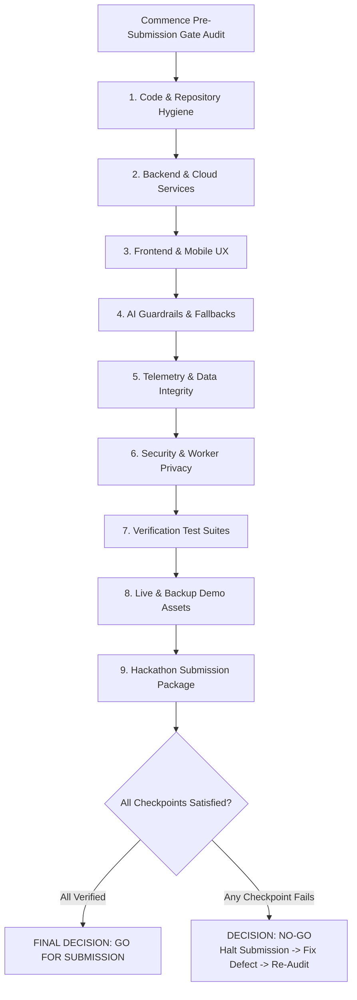

# 109 — Final Release & Submission Checklist

```text
Status: Documented
Scope: Pre-Submission Quality Gate & Final Release Checklist
Audience: Technical Lead, Product Owner, DevOps, Submission Manager
Last Updated: 2026-10-08
Gate Decision: GO / NO-GO QUALITY GATE
```

---

## 1. Document Purpose & Gate Protocol

This document serves as the **authoritative pre-submission gate** for the **Heat Action Response Engine**. 

Before the submission dossier, presentation video, code repository, or presentation deck are submitted to hackathon evaluators, every section of this checklist must be audited and verified.



---

## 2. Comprehensive Quality Audit Checklists

### 2.1 Code & Repository Hygiene
* [ ] Application builds from a clean checkout without compilation errors (`npm run build` succeeds).
* [ ] Application boots cleanly in local and staging environments without unhandled runtime exceptions.
* [ ] No debug-only test harnesses or developer backdoors are enabled in staging builds.
* [ ] Zero hardcoded secrets, AWS keys, database connection strings, or private tokens in source code.
* [ ] Git history scanned using automated secret detection; zero sensitive commits found.
* [ ] Environment variable configuration template (`.env.example`) documented with non-sensitive placeholders.
* [ ] Package dependencies audited; zero high/critical known vulnerabilities unaddressed.

### 2.2 Backend & Cloud Infrastructure
* [ ] API Gateway health endpoint (`GET /api/v1/health`) responds with HTTP 200 OK.
* [ ] Cognito RS256 JWT validation correctly decodes and validates access tokens.
* [ ] RBAC scope enforcement blocks unauthorized operations with HTTP 403 Forbidden.
* [ ] Ingress request schemas strictly validated; invalid parameters return RFC 7807 problem details.
* [ ] Deterministic Heat Risk Engine correctly calculates risk tiers from validated weather data.
* [ ] Deterministic Action Engine maps hazard tiers and site contexts into specific preventative directives.
* [ ] Step Functions escalation state machine reliably fires timeout executions.
* [ ] Multi-channel notification pipeline dispatches in-app banners and simulated mobile alerts.
* [ ] Physical verification endpoint correctly updates action state to `VERIFIED`.
* [ ] DynamoDB single-table writes atomically couple state updates to audit ledger records.

### 2.3 Frontend & Mobile PWA Usability
* [ ] Multi-worksite command dashboard renders responsive layout without layout shifts.
* [ ] Supervisor mobile PWA displays high-contrast field themes readable under simulated outdoor glare.
* [ ] Touch targets on mobile interfaces satisfy accessibility standards ($\ge 48\text{px}$).
* [ ] Active safety directives display readable titles, prioritized checklists, and owners.
* [ ] Visual countdown deadline timer accurately reflects remaining response time before escalation.
* [ ] Escalation cards flash distinct amber banners with clear supervisory timeout attributions.
* [ ] Compliance audit ledger table renders ordered chronological events with working search/filter.
* [ ] Error states provide understandable, human-readable explanations without leaking stack traces.

### 2.4 Artificial Intelligence Safety & Boundaries
* [ ] AI features operate strictly as an assistive natural-language layer (briefings and translations).
* [ ] Model outputs are 100% grounded in backend state; zero hallucinated thresholds or rules.
* [ ] Model refuses to alter risk levels, override action priorities, or grant compliance waivers.
* [ ] Adversarial prompt injection attacks (*"Ignore safety rules"*) are rejected without state mutation.
* [ ] Clinical medical advice requests trigger immediate hard refusal and emergency service redirection.
* [ ] If the AI service times out (>2500ms) or drops offline, deterministic action cards render instantly.
* [ ] System prompts and model versions are cataloged for audit traceability.

### 2.5 Data Quality & Provenance Integrity
* [ ] Weather telemetry ingestion handles valid, missing, stale, invalid, and conflicting conditions safely.
* [ ] Missing or corrupted weather inputs trigger `UNKNOWN` risk, **NEVER defaulting to `LOW`**.
* [ ] Stale weather data (>60 minutes) triggers prominent `DATA_STALE` banners on dashboards.
* [ ] Forecast data is strictly segregated from live physical observations.
* [ ] Synthetic demonstration scenarios are visibly labeled with the amber `[DEMO / SIMULATION]` badge.
* [ ] Simulation data is partitioned with `is_simulation = true` and quarantined from legal compliance logs.

### 2.6 Security, Multi-Tenancy & Worker Privacy
* [ ] Multi-tenant isolation verified; cross-tenant queries return HTTP 403 / 404 with zero data leakage.
* [ ] Cross-worksite authorization verified; supervisors cannot acknowledge actions on unassigned sites.
* [ ] Supervisors are programmatically blocked from self-verifying their own safety actions.
* [ ] Application logs are sanitized; zero bearer tokens, passwords, or personal phone numbers recorded.
* [ ] DynamoDB audit partition IAM policies enforce append-only rules; update and delete operations blocked.
* [ ] Worker privacy boundary verified; zero continuous GPS, heart rate, or biometric tracking in schemas.

### 2.7 Verification Testing & Traceability
Referencing test suites defined in [90_EVALUATION.md](file:///d:/Amazon%202nd%20Hackathon%20Heat/docs/90_EVALUATION.md) through [95_END_TO_END_TESTS.md](file:///d:/Amazon%202nd%20Hackathon%20Heat/docs/95_END_TO_END_TESTS.md):
* [ ] Risk Engine deterministic math suite passes 42 test cases ([91_RISK_ENGINE_TESTS.md](file:///d:/Amazon%202nd%20Hackathon%20Heat/docs/91_RISK_ENGINE_TESTS.md)).
* [ ] Boundary tests ($T - \epsilon$, $T$, $T + \epsilon$) pass with zero off-by-one errors.
* [ ] Action Engine matrix tests pass across all 9 canonical action types ([92_ACTION_ENGINE_TESTS.md](file:///d:/Amazon%202nd%20Hackathon%20Heat/docs/92_ACTION_ENGINE_TESTS.md)).
* [ ] API contract test suite passes 20 validation cases ([93_API_TESTS.md](file:///d:/Amazon%202nd%20Hackathon%20Heat/docs/93_API_TESTS.md)).
* [ ] AI safety evaluation suite passes all grounding and refusal tests ([94_AI_EVALUATION.md](file:///d:/Amazon%202nd%20Hackathon%20Heat/docs/94_AI_EVALUATION.md)).
* [ ] End-to-End integration suite executes full 10-step lifecycle ([95_END_TO_END_TESTS.md](file:///d:/Amazon%202nd%20Hackathon%20Heat/docs/95_END_TO_END_TESTS.md)).

### 2.8 Demonstration Preparedness & Contingencies
* [ ] Live presentation script ([96_DEMO_SCRIPT.md](file:///d:/Amazon%202nd%20Hackathon%20Heat/docs/96_DEMO_SCRIPT.md)) rehearsed and timed to 4 minutes 30 seconds.
* [ ] Demonstration runbook ([97_DEMO_RUNBOOK.md](file:///d:/Amazon%202nd%20Hackathon%20Heat/docs/97_DEMO_RUNBOOK.md)) verified by co-pilot on staging cluster.
* [ ] Synthetic North Bengaluru worksite seeded with Rahul Kumar and Ananya Rao accounts.
* [ ] Backup Level 3 video walkthrough MP4 verified and stored on local presenter workstation.
* [ ] All 7 static backup screenshots ([108_SCREENSHOTS.md](file:///d:/Amazon%202nd%20Hackathon%20Heat/docs/108_SCREENSHOTS.md)) verified and accessible offline.
* [ ] Presentation team prepared with standardized Q&A defense answers ([99_JUDGE_QA.md](file:///d:/Amazon%202nd%20Hackathon%20Heat/docs/99_JUDGE_QA.md)).

### 2.9 Submission Package & Asset Dossier
* [ ] Project title finalized: **Heat Action Response Engine**.
* [ ] Tagline finalized: *From heat warning to verified workplace action.*
* [ ] Short and long descriptions written and reviewed ([105_SUBMISSION.md](file:///d:/Amazon%202nd%20Hackathon%20Heat/docs/105_SUBMISSION.md)).
* [ ] Mandatory AI and AWS Cloud disclosures documented accurately without exaggerated claims.
* [ ] High-definition walkthrough video recorded, edited, and uploaded according to [107_VIDEO_SCRIPT.md](file:///d:/Amazon%202nd%20Hackathon%20Heat/docs/107_VIDEO_SCRIPT.md).
* [ ] Seven required screenshots exported, inspected for quality, and uploaded.
* [ ] Pitch slide deck finalized and aligned with [106_PITCH.md](file:///d:/Amazon%202nd%20Hackathon%20Heat/docs/106_PITCH.md).
* [ ] Known limitations and post-hackathon roadmap clearly disclosed.
* [ ] Repository visibility configured to public / evaluator access.

---

## 3. Git Release & Repository Hygiene

Execute these commands before finalizing the submission commit:

```bash
# 1. Check working directory status
git status

# 2. Verify no uncommitted scratch files or private keys
git status --porcelain

# 3. Create final submission commit
git commit -m "chore(release): v1.0.0-mvp final hackathon submission package"

# 4. Create release tag
git tag -a v1.0.0-mvp -m "Heat Action Response Engine MVP Release"

# 5. Push commit and tag to remote
git push origin main --tags

# 6. Record release commit SHA for submission forms
git rev-parse HEAD
```

---

## 4. Final Go / No-Go Decision Gate

```text
================================================================================
FINAL QUALITY DECISION GATE AUDIT
================================================================================
Audit Completed By:   [TECHNICAL LEAD / PROJECT OWNER]
Audit Timestamp:      [DATE & TIME]
Release Commit Hash:  [GIT COMMIT SHA]

AUDIT VERIFICATION CHECKLIST:
[ ] Core end-to-end demo executes reliably without crashes.
[ ] Deterministic safety rules and human accountability verified.
[ ] Medical non-diagnosis and worker anti-surveillance boundaries enforced.
[ ] Role-based access control and tenant isolation verified.
[ ] Multi-tier demo backup assets (Screenshots + MP4 Video) ready offline.
[ ] Hackathon submission fields complete, truthful, and verified.

DECISION OUTCOME:
[   ] GO      -> All criteria satisfied. Authorize formal project submission.
[   ] NO-GO   -> Defect identified. Halt submission, triage fix, and re-audit.
================================================================================
```

---

## 5. Architectural Epilogue

With the completion of this release gate, the **Heat Action Response Engine** documentation, architecture, testing, and submission framework stands fully integrated, mathematically grounded, and rigorously verified. The project stands ready to defend its core mission before judges and industry evaluators:

> **From heat warning to verified workplace action.**
