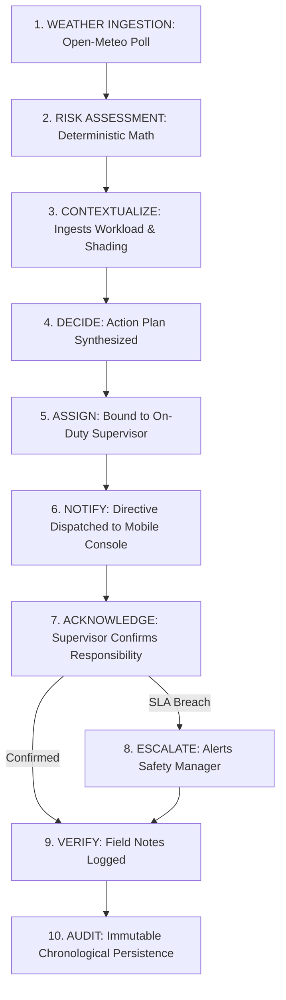

# 10. Requirements Specification

## 1. Purpose

This document defines the complete functional, non-functional, safety, and operational requirements for the **Heat Action Response Engine (HARE) Minimum Viable Product (MVP)**.

It translates the project charter, problem statement, solution design, and scope boundaries established in preceding documents into explicit, testable, and verifiable engineering specifications. These requirements establish the baseline contract for:
* **System & Cloud Architecture:** Defining boundaries for AWS services and backend data flows.
* **API & Interface Design:** Structuring data contracts between frontend clients and backend microservices.
* **Frontend Implementation:** Guiding role-specific interfaces for Safety Managers, Supervisors, and Administrators.
* **Verification & Testing:** Establishing explicit criteria for unit, integration, and end-to-end automated testing.
* **Hackathon Demonstration Readiness:** Ensuring every capability necessary for the judging demonstration operates reliably.

These requirements describe **WHAT** the system must do to execute its closed-loop operational workflow, avoiding premature implementation decisions that belong in subsequent technical architecture specifications.

---

## 2. Requirements Philosophy

The requirements are governed by ten foundational engineering principles:

1. **Action Over Alerts:** The system must drive beyond passive hazard detection toward prescriptive, task-based operational action plans.
2. **Human-in-the-Loop:** Automated systems advise, route, and escalate; responsible human supervisors and managers validate conditions and make operational decisions.
3. **Deterministic Safety Primacy:** All risk calculations, safety thresholds, standard operating procedures (SOPs), and escalation countdowns must originate from explainable, deterministic mathematical rules.
4. **Total Explainability:** Every calculated risk tier and generated action must expose an explicit, human-readable rationale detailing the triggering factors.
5. **Individual Accountability:** Every action directive must be bound to a single named, on-duty supervisor entity rather than broadcast anonymously.
6. **Immutable Traceability:** Every state transition, timestamp, payload, acknowledgment, and escalation must be permanently recorded in an append-only audit ledger.
7. **Strict Data Grounding:** All alerts, summaries, and notifications must be strictly anchored in verified meteorological telemetry, worksite parameters, and approved SOP guidelines.
8. **Least Necessary Complexity:** Implement only the technical capabilities required to prove the operational workflow; reject decorative or unverified features.
9. **Hardware Independence for MVP:** The MVP operational engine must function entirely on software-accessible weather APIs, eliminating physical IoT microcontrollers and hardware dependencies.
10. **Uncompromising Scope Boundaries:** Respect established non-goals; explicitly exclude clinical medical diagnosis, employee surveillance, and regulatory certification claims.

---

## 3. System Requirement Categories

Requirements are organized into ten distinct categories:

* **Functional Requirements (FR):** Core software behaviors, workflow stage transitions, and operational features.
* **Non-Functional Requirements (NFR):** System performance, reliability, scalability, maintainability, and usability attributes.
* **Safety Requirements (SR):** Guardrails ensuring deterministic authority, transparency, and elimination of medical claims.
* **AI Requirements (AIR):** Bounding generative AI strictly to assistive communication, explanation, and translation.
* **Data Requirements (DR):** Schema entities, relational integrity, and entity lifecycles.
* **Security Requirements (SECR):** Authentication, role-based access control, secret hygiene, and data protection.
* **Auditability Requirements (AR):** Historical event logging necessary to reconstruct operational sequences.
* **UX Requirements (UXR):** Cognitive ergonomics, visual hierarchy, and response simplicity for frontline roles.
* **Integration Requirements (IR):** Ingestion of external weather APIs and integration with cloud services.
* **Demonstration Requirements (DMR):** Simulation controls and scenario predictability for hackathon evaluation.

---

## 4. Requirement Priority Framework

Requirements are classified into three strict priority tiers aligned with [`docs/04_MVP_SCOPE.md`](file:///d:/Amazon%202nd%20Hackathon%20Heat/docs/04_MVP_SCOPE.md):

* **P0 (Mandatory for MVP):** Essential capabilities required to execute the complete end-to-end operational loop (`DETECT` $\rightarrow$ `ASSESS` $\rightarrow$ `CONTEXTUALIZE` $\rightarrow$ `DECIDE` $\rightarrow$ `ASSIGN` $\rightarrow$ `NOTIFY` $\rightarrow$ `ACKNOWLEDGE` $\rightarrow$ `ESCALATE` $\rightarrow$ `VERIFY` $\rightarrow$ `AUDIT`). A failure in any P0 requirement renders the MVP incomplete.
* **P1 (Important / Non-Blocking):** High-value enhancements (NVIDIA AI text generation, multilingual translation, simulation mode controls) that enhance presentation and usability but can degrade gracefully without halting core workflows.
* **P2 (Future / Post-Hackathon):** Capabilities explicitly deferred to subsequent commercial milestones (physical IoT weather stations, wearable biometrics, worker mobile apps, multi-hazard expansion).

---

## 5. Functional Requirements (FR)

The table below catalogs the functional requirements of the platform:

| Requirement ID | Requirement Description | Priority | Primary Actor | Acceptance Condition |
| :--- | :--- | :---: | :--- | :--- |
| **FR-01.1** | Create Worksite Profile | **P0** | Admin | System persists worksite name, GPS coordinates, assigned supervisor, crew size, shift hours, and workload tier. |
| **FR-01.2** | Edit Worksite Profile | **P0** | Admin | Authorized edits update worksite metadata with immediate effect on future evaluation cycles. |
| **FR-01.3** | Worksite Status Toggle | **P0** | Admin | Admin can activate or deactivate monitoring for any worksite; deactivated sites cease polling. |
| **FR-02.1** | User Authentication | **P0** | All Users | System identifies user and resolves assigned role (`ADMIN`, `SAFETY_MANAGER`, `SUPERVISOR`). |
| **FR-02.2** | Role-Based Access Control | **P0** | System | Enforces data and action access restrictions based on the user's active role. |
| **FR-02.3** | Supervisor Assignment | **P0** | Admin | Binds a supervisor entity to a specific worksite and active shift roster. |
| **FR-03.1** | Weather Data Ingestion | **P0** | System | Programmatically fetches 2m temperature, humidity, solar radiation, wind speed, and forecast via Open-Meteo REST API. |
| **FR-03.2** | Telemetry Association | **P0** | System | Links retrieved weather telemetry records to the corresponding worksite entity with UTC timestamps. |
| **FR-03.3** | Weather Freshness Tracking | **P0** | System | Records retrieval timestamp; detects and flags stale data exceeding configured polling intervals. |
| **FR-04.1** | Deterministic Risk Assessment | **P0** | System | Calculates heat stress index using mathematical formulas and outputs a discrete risk tier (`LOW`, `MODERATE`, `HIGH`, `CRITICAL`). |
| **FR-04.2** | Trigger Rationale Exposure | **P0** | System | Generates explicit mathematical trigger reasons alongside the calculated risk tier. |
| **FR-04.3** | Insufficient Data Handling | **P0** | System | If required weather variables are missing, flags status as `DATA_INSUFFICIENT`; never defaults to a "Safe" tier. |
| **FR-05.1** | Workload Context Integration | **P0** | System | Combines metabolic workload tier (*Light*, *Moderate*, *Heavy*, *Very Heavy*) with ambient risk to evaluate effective strain. |
| **FR-05.2** | Environmental Context Integration | **P0** | System | Modifies risk evaluation based on configured worksite infrastructure (direct sun vs. shaded canopy). |
| **FR-06.1** | Action Plan Synthesis | **P0** | System | Generates a structured Action Plan containing discrete SOP checklist items whenever risk thresholds are breached. |
| **FR-06.2** | Plan Contextual Binding | **P0** | System | Binds generated Action Plan to the target worksite, active crew headcount, and triggering risk event. |
| **FR-07.1** | Supervisory Ownership Binding | **P0** | System | Binds the synthesized Action Plan to the designated on-duty Site Supervisor entity as primary owner. |
| **FR-08.1** | Directive Notification Dispatch | **P0** | System | Delivers action directive containing risk tier, trigger rationale, and checklist to the supervisor interface. |
| **FR-08.2** | Delivery State Decoupling | **P0** | System | Marks directive as `DISPATCHED`; does not assume physical delivery proves human receipt. |
| **FR-09.1** | One-Touch Acknowledgment | **P0** | Supervisor | Enables supervisor to acknowledge directive with a single click, recording user ID and latency. |
| **FR-09.2** | Acknowledgment State Transition | **P0** | System | Transitions directive state from `DISPATCHED` to `ACKNOWLEDGED` immediately upon user confirmation. |
| **FR-10.1** | SLA Countdown Monitoring | **P0** | System | Initiates an active countdown timer upon directive dispatch linked to risk severity. |
| **FR-10.2** | Automated Timeout Escalation | **P0** | System | Automatically transitions unacknowledged directives to `ESCALATED` upon timer expiration. |
| **FR-10.3** | Escalation Alert Dispatch | **P0** | System | Delivers high-priority visual alert banner to Safety Manager console upon SLA timeout. |
| **FR-11.1** | Field Execution Status Logging | **P0** | Supervisor | Allows supervisor to submit field execution confirmation notes (e.g., *"Canopy deployed; crew on rest"*). |
| **FR-11.2** | Lifecycle Resolution | **P0** | Supervisor / Mgr | Transitions action state to `RESOLVED` once field verification notes are logged. |
| **FR-12.1** | Centralized Audit Persistence | **P0** | System | Writes an immutable event record to the append-only ledger for every lifecycle state transition. |
| **FR-12.2** | Audit Chronology Inspection | **P0** | Safety Mgr / Admin| Provides a chronological viewer displaying complete historical event chains with UTC timestamps. |
| **FR-13.1** | Safety Manager Multi-Site Console| **P0** | Safety Mgr | Displays real-time risk heatmaps, active action plans, pending SLAs, and escalations across all sites. |
| **FR-13.2** | Supervisor Action Console | **P0** | Supervisor | Displays assigned action directives, plain-language summaries, checklist, and one-touch ACK button. |
| **FR-13.3** | Administrator Management Console| **P0** | Admin | Provides interfaces to manage worksite geospatial coordinates, shift rosters, and personnel mappings. |
| **FR-14.1** | NVIDIA AI Risk Explanations | **P1** | System / AI | Generates plain-language non-technical summaries of mathematical risk triggers for supervisors. |
| **FR-14.2** | NVIDIA AI Message Formatting | **P1** | System / AI | Formats dense JSON action plans into concise, urgent, mobile-ready supervisory dispatch briefings. |
| **FR-14.3** | NVIDIA AI Dialect Translation | **P1** | System / AI | Translates English safety checklists into regional dialects (Hindi, Kannada) while preserving technical meaning. |
| **FR-15.1** | Simulation Scenario Injection | **P1** | Admin / Safety Mgr| Enables controlled injection of accelerated weather progressions to demonstrate risk surges on demand. |
| **FR-15.2** | Accelerated Demo SLA Timers | **P1** | System | Employs accelerated countdown timers (20–30s) in demo mode to validate automated escalation live. |

---

### Detailed Functional Specifications

### 5.1 Worksite Management
* Authorized Administrators must be able to define facility records containing: unique identifier (`worksite_id`), name, latitude, longitude, active shift hours (`shift_start`, `shift_end`), active crew headcount, primary assigned supervisor, task workload category (`Light`, `Moderate`, `Heavy`, `Very Heavy`), and physical environmental flags (`is_outdoor`, `shade_available`, `water_point_stocked`).
* Worksites must support active/inactive status toggles. Inactive facilities must not trigger automated weather polling or risk evaluations.

### 5.2 User and Role Management
* The platform must enforce role-based access across three distinct operational roles:
  * `ADMIN`: Full configuration authority over worksites, users, and system settings.
  * `SAFETY_MANAGER`: Read/write authority over multi-site risk, action plans, and escalations; read-only access to user directories.
  * `SUPERVISOR`: Read authority over assigned worksites and directives; write authority over acknowledgment and execution notes.
* The system must reject any attempt by a Site Supervisor to access global administrative configuration screens or acknowledge directives assigned to other supervisors.

### 5.3 Weather and Forecast Data
* Weather ingestion must query external REST endpoints (Open-Meteo) using worksite latitude and longitude coordinates.
* Retrieved data must include: ambient dry-bulb temperature (°C), relative humidity (%), direct solar radiation (W/m²), wind speed (km/h), and forward-looking 24-hour hourly forecast curves.
* The system must record the exact retrieval timestamp and data source provider.
* Open-Meteo data must be explicitly handled and displayed as **regional meteorological forecast data**, never represented as on-site physical sensor telemetry.

### 5.4 Deterministic Heat-Risk Assessment
* Heat risk must be computed through deterministic mathematical polynomials (Heat Index) combining dry-bulb temperature and relative humidity.
* The calculation must map into four standardized risk tiers: `LOW`, `MODERATE`, `HIGH`, `CRITICAL`.
* Every evaluation must generate an explicit, human-readable rationale (e.g., *"Calculated Heat Index 41.2°C exceeds High threshold (39.0°C) with elevated solar load"*).
* *(Note: Exact mathematical polynomials, coefficients, and numeric thresholds are authoritative in [`docs/20_HEAT_RISK_ENGINE.md`](file:///d:/Amazon%202nd%20Hackathon%20Heat/docs/20_HEAT_RISK_ENGINE.md). No arbitrary thresholds may be implemented outside that document.)*
* Under no circumstances may the system present a risk evaluation as a clinical medical diagnosis.

### 5.5 Worksite Context Engine
* The system must adjust effective risk severity based on configured operational parameters:
  * Heavy metabolic physical labor (>350W) must escalate protective actions by at least one operational tier compared to light sedentary labor under identical weather conditions.
  * Unshaded open-ground exposure must trigger mandatory temporary canopy deployment tasks in generated action plans.
* The context engine models operational workplace characteristics, not personal biometric or health profiles.

### 5.6 Action Plan Generation
* When environmental risk breaches baseline thresholds, the system must synthesize an Action Plan object containing: `action_id`, `worksite_id`, `risk_level`, `trigger_rationale`, `prescriptive_checklist`, `assigned_supervisor_id`, `sla_timeout_seconds`, and `status`.
* Action items must represent concrete administrative controls:
  * Mandatory work-rest cycle ratios (e.g., 45 minutes active work / 15 minutes shaded rest).
  * Mandatory fluid consumption intervals (e.g., 250ml cool water every 20 minutes).
  * Workload modification (e.g., pause unshaded crane assembly during peak afternoon heat).
  * Physical shade canopy deployment and water cooler verification.
* Action plans must be grounded in approved organizational safety SOPs; AI models are strictly prohibited from inventing unapproved safety protocols.

### 5.7 Assignment
* Generated Action Plans must be dynamically bound to the specific on-duty Site Supervisor assigned to the target worksite.
* If a worksite lacks an assigned supervisor, the directive must immediately route to the designated Regional Safety Manager with an `UNASSIGNED_ROSTER` warning flag.

### 5.8 Notification Dispatch
* The notification subsystem must dispatch action directives immediately upon synthesis.
* The notification payload must contain: worksite name, risk severity badge, concise trigger explanation, prioritized task checklist, and active SLA deadline.
* Directives must appear prominently on the supervisor console interface without requiring manual browser refreshes.

### 5.9 Acknowledgment Tracking
* The supervisor console must provide a prominent, single-touch `ACKNOWLEDGE & ENACT` button.
* When clicked, the system must capture: `acknowledged_at` (UTC timestamp), `acknowledged_by` (supervisor user ID), and calculate elapsed latency since dispatch.
* The directive lifecycle state must transition immediately from `DISPATCHED` to `ACKNOWLEDGED`.

### 5.10 Automated Escalation
* The system must execute background monitoring of all open directives against their configured SLA countdown timers.
* If a directive remains unacknowledged when the timer expires, the state machine must transition the directive to `ESCALATED`.
* An escalation event must immediately dispatch a high-priority visual alert to the Safety Manager console.
* **Separation of Operational vs. Demo Escalation Timing:**
  * In `DEMO_MODE`, escalation timers must be accelerated to 20–30 seconds for live judging.
  * In `LIVE_MODE`, escalation timers must be configurable in minutes according to organizational EHS policy.

### 5.11 Execution Verification
* Following acknowledgment, the supervisor interface must allow the supervisor to submit an execution confirmation note (e.g., *"Hydration coolers stocked; crew rotated into shade"*).
* Submitting execution confirmation must update the action status to `RESOLVED`, completing the operational loop.

### 5.12 Centralized Audit Ledger
* Every state transition must be written to an immutable, append-only ledger in persistent storage.
* Each audit entry must record: `event_id`, `timestamp`, `event_type`, `worksite_id`, `action_id`, `actor_id`, `previous_state`, `new_state`, and `payload_snapshot`.
* The audit trail must be queryable chronologically by authorized Safety Managers and Administrators.

### 5.13 Dashboards
* **Safety Manager Dashboard:** Must provide a real-time multi-site risk map, live action plan feed with SLA countdowns, prominent red escalation banner, and exportable audit log viewer.
* **Site Supervisor Dashboard:** Must provide an uncluttered, high-contrast mobile view displaying assigned directives, plain-language summaries, prioritized checklists, large ACK button, and execution note form.
* **Administrator Console:** Must provide facility registration forms, coordinate validation, user role tables, and escalation timeout settings.

---

## 6. User Workflow Requirements

The platform must enforce an unbroken sequential lifecycle across all ten stages:



* Each stage must be strictly dependent on the successful completion of the preceding stage.
* The system must prevent illegal state transitions (e.g., an unassigned action cannot be marked acknowledged; an escalated action cannot silently disappear).

---

## 7. Simulation and Demonstration Requirements (DMR)

* **DMR-01 (Dual Runtime Modes):** The system must support two mutually exclusive runtime modes: `LIVE_MODE` and `DEMO_MODE`.
* **DMR-02 (Simulation Banner):** When `DEMO_MODE` is active, a prominent visual indicator must be displayed across all screens to ensure transparent distinction from live weather feeds.
* **DMR-03 (Scripted Weather Surge):** Simulation mode must allow the user to inject a pre-scripted environmental profile (e.g., transition ambient temperature from 28°C to 38°C with 65% RH) to trigger high risk on demand.
* **DMR-04 (Dual Scenario Validation):** The simulation must reliably execute both **Path A (Positive Acknowledgment)** and **Path B (SLA Timeout Escalation)** repeatedly without system crashes.
* **DMR-05 (Deterministic Reset):** The simulation engine must provide a single-click reset function restoring worksites, actions, and audit logs to a clean initial state.

---

## 8. Artificial Intelligence Requirements (AIR - NVIDIA AI)

NVIDIA AI models must operate strictly as **assistive communication microservices**:

```text
+--------------------------------------------------------------------------------------------------+
|                                    NVIDIA AI PERMITTED CAPABILITIES                              |
+--------------------------------------------------------------------------------------------------+
|  AIR-01: Risk Explanation Generation (converts telemetry into plain-language briefs)             |
|  AIR-02: Supervisory Message Formatting (drafts concise, urgent mobile dispatch texts)          |
|  AIR-03: Multilingual Dialect Translation (renders English SOPs into Hindi/Kannada)             |
|  AIR-04: Shift Executive Summaries (synthesizes multi-site risk windows for Safety Managers)    |
|  AIR-05: Grounded Q&A Assistant (answers queries strictly grounded in loaded SOPs & telemetry)   |
+--------------------------------------------------------------------------------------------------+
|                                      STRICT AI PROHIBITIONS                                      |
+--------------------------------------------------------------------------------------------------+
|  AIR-06: AI must NEVER calculate, adjust, or override risk thresholds.                          |
|  AIR-07: AI must NEVER modify or suppress deterministic safety action plans.                     |
|  AIR-08: AI must NEVER diagnose heat illness or evaluate individual worker medical fitness.      |
|  AIR-09: AI must NEVER cancel or dismiss active escalations autonomously.                       |
|  AIR-10: AI must NEVER fabricate weather telemetry when external APIs are unavailable.          |
+--------------------------------------------------------------------------------------------------+
|                                      FAILURE INDEPENDENCE                                        |
+--------------------------------------------------------------------------------------------------+
|  AIR-11: Core safety rules, actions, SLAs, and escalations must function 100% without AI.       |
+--------------------------------------------------------------------------------------------------+
```

---

## 9. Data Entity & Relational Requirements (DR)

The platform data architecture must maintain strict relational integrity across the entire operational lifecycle:

```text
[ Worksite ] 1 ── * [ WeatherRecord ]
     │
     └── 1 ── * [ RiskEvent ]
                     │
                     └── 1 ── 1 [ ActionPlan ]
                                     │
                                     ├── 1 ── 1 [ SupervisorAssignment ]
                                     ├── 1 ── * [ NotificationDispatch ]
                                     ├── 1 ── 1 [ AcknowledgmentRecord ]
                                     ├── 1 ── ? [ EscalationEvent ]
                                     └── 1 ── * [ AuditLedgerEntry ]
```

* **DR-01 (Entity Traceability):** Every `ActionPlan` must maintain a foreign key reference to its parent `RiskEvent`, `Worksite`, and triggering `WeatherRecord`.
* **DR-02 (Actor Custody):** Every acknowledgment and escalation record must store the explicit user ID and role of the acting or alerted personnel.
* **DR-03 (Immutability):** Records written to the `AuditLedgerEntry` collection must be permanently append-only; update and delete operations must be forbidden at the database layer.

---

## 10. Data Quality Requirements (DQR)

* **DQR-01 (Input Validation):** Temperature values outside $[-20^\circ\text{C}, 60^\circ\text{C}]$ and relative humidity outside $[0\%, 100\%]$ must be rejected as invalid data.
* **DQR-02 (Fail-Safe on Missing Data):** If external weather streams fail or return malformed payloads, the engine must flag conditions as `DATA_UNAVAILABLE` and alert the Safety Manager. It must **never** silently assume conditions are "Safe."
* **DQR-03 (Stale Data Protection):** Weather readings older than 60 minutes must be flagged as `STALE_TELEMETRY` with a prominent warning indicator on the management console.
* **DQR-04 (Idempotency):** The action engine must prevent duplicate action plan generation for the same worksite within an active risk cycle.

---

## 11. Non-Functional Requirements (NFR)

* **NFR-01 (Reliability):** The platform must demonstrate 100% operational uptime during evaluation scenarios, with zero unhandled exceptions.
* **NFR-02 (Interactive Performance):** Backend REST APIs must respond within 500ms under standard demonstration loads; dashboard state updates must render within 1.0 second.
* **NFR-03 (Scalability):** The backend architecture must support multi-facility monitoring without requiring structural changes to the core evaluation pipeline.
* **NFR-04 (Maintainability):** Deterministic risk rules and SOP action mappings must be decoupled from UI rendering logic.
* **NFR-05 (Observability):** All backend microservices must emit structured JSON logs to Amazon CloudWatch capturing timestamps, request IDs, and error traces.
* **NFR-06 (Explainability):** Every calculated risk tier and generated action must expose plain-language mathematical rationales on the user interface.
* **NFR-07 (Accessibility):** Critical status indicators must combine color coding (Green, Amber, Red) with clear text labels and icons to support color-blind users.
* **NFR-08 (Mobile Responsiveness):** The Site Supervisor interface must be fully responsive, supporting touch targets of at least 48x48px on mobile viewports.

---

## 12. Safety Requirements (SR)

* **SR-01 (Deterministic Source of Truth):** Authoritative occupational safety guidance and deterministic mathematical equations are the sole arbiters of safety decisions.
* **SR-02 (Human Operational Authority):** System recommendations do not replace frontline human supervision. Human leaders retain full authority over physical site operations.
* **SR-03 (Explicit Medical Boundaries):** The system must not output clinical diagnoses, triage ratings, or individual medical fitness evaluations.
* **SR-04 (Transparent Limitations):** The system interface must explicitly communicate that weather API data represents regional numerical forecasts, not on-site microclimate sensor telemetry.

---

## 13. Security Requirements (SECR)

* **SECR-01 (Authentication):** All API endpoints (except public health checks) must enforce authentication using secure bearer tokens or AWS IAM authorization.
* **SECR-02 (Role-Based Authorization):** Every backend request must validate that the authenticated user possesses the required role permissions.
* **SECR-03 (Secret Hygiene):** API keys (Open-Meteo, NVIDIA, AWS credentials) must never be hard-coded in client bundles or committed to source code; they must be managed via environment variables or AWS Secrets Manager.
* **SECR-04 (Input Sanitization):** All user inputs (worksite names, notes) must be sanitized against SQL injection, NoSQL injection, and Cross-Site Scripting (XSS).

---

## 14. Privacy Requirements (PR)

* **PR-01 (Data Minimization):** The platform must store only the minimum personnel metadata required for operational routing (name, email/phone, role).
* **PR-02 (No Personal Biometrics):** The system must not store individual worker biometric data, medical histories, or heart-rate telemetry.
* **PR-03 (Prompt Privacy):** Sensitive corporate or personal information must never be included in prompts dispatched to external language model APIs.

---

## 15. Auditability Requirements (AR)

The centralized audit ledger must permanently preserve sufficient context to answer the eight canonical compliance questions for any event:

```text
1. WHAT happened?       ──> Event Type (e.g., SLA_BREACH_ESCALATED)
2. WHEN did it happen?  ──> ISO-8601 UTC Timestamp
3. WHERE did it happen? ──> Worksite ID & Name
4. WHAT action was set? ──> Action Plan ID & Checklist Payload
5. WHO owned it?        ──> Supervisor Entity ID & Name
6. WHAT was old state?  ──> Previous Lifecycle State (e.g., DISPATCHED)
7. WHAT is new state?   ──> New Lifecycle State (e.g., ESCALATED)
8. WAS it escalated?    ──> Escalation Recipient ID & Route
```

---

## 16. API & Integration Requirements (IR)

* **IR-01 (Weather API Client):** Robust HTTP client integration with Open-Meteo REST API supporting automatic retry with exponential backoff.
* **IR-02 (RESTful Backend API):** Clean JSON-over-HTTPS RESTful endpoints adhering to OpenAPI specifications for worksites, weather, actions, acknowledgments, and audit logs.
* **IR-03 (Notification Service):** Integration with Amazon SNS / SES or simulated mobile push banners for directive delivery.
* **IR-04 (NVIDIA AI Client):** Asynchronous integration with NVIDIA AI / Nemotron microservices with strict 3-second timeouts to prevent blocking core workflows.

*(Detailed endpoint schemas and payload structures are defined in `docs/70_API_CONTRACTS.md`.)*

---

## 17. AWS Cloud Infrastructure Requirements

The cloud deployment must leverage serverless and managed services proportional to MVP complexity:

```text
[ React Frontend Console ]  ──> Amazon S3 / Amazon CloudFront
[ API Management ]          ──> Amazon API Gateway
[ Compute & Rule Logic ]    ──> AWS Lambda (Python / Node.js)
[ Operational Persistence ] ──> Amazon DynamoDB (Single-digit ms latency)
[ Notification & Alerts ]   ──> Amazon SNS / SES
[ System Observability ]    ──> Amazon CloudWatch (Logs & Metrics)
[ Secret Management ]       ──> AWS Secrets Manager / Parameter Store
```

*(Complete infrastructure-as-code and architectural diagrams are codified in `docs/64_AWS_ARCHITECTURE.md`.)*

---

## 18. Error Handling & Resilience Requirements (EHR)

| Failure Mode | System Response & Fallback Behavior |
| :--- | :--- |
| **Open-Meteo API Timeout** | Log warning, use cached forecast telemetry if under 60m old; otherwise flag `DATA_STALE`. |
| **NVIDIA AI Service Down** | Log error, bypass AI text generation, display raw deterministic SOP checklist. Workflow continues 100%. |
| **Database Connection Failure** | Return HTTP 503, preserve in-memory state where feasible, emit critical CloudWatch alarm. |
| **Duplicate Acknowledgment** | Handle idempotently; return HTTP 200 with existing timestamp; do not overwrite initial latency. |
| **Invalid Worksite Coordinates** | Reject at validation layer with HTTP 400; prompt user to enter valid latitude/longitude. |

---

## 19. Requirements Traceability Matrix

The table below traces requirements across the broader project documentation suite:

| Requirement Domain | Primary Upstream Reference | Downstream Technical Specification |
| :--- | :--- | :--- |
| **Product Scope & North Star** | `docs/04_MVP_SCOPE.md` | `docs/00_PROJECT_CHARTER.md` |
| **User Personas & RBAC** | `docs/06_TARGET_USERS.md` | `docs/19_PERMISSION_MODEL.md` |
| **Success Criteria & Acceptance** | `docs/09_SUCCESS_CRITERIA.md` | `docs/90_EVALUATION.md` |
| **Deterministic Risk Engine** | `docs/02_SOLUTION.md` | `docs/20_HEAT_RISK_ENGINE.md` |
| **Context & Action Engine** | `docs/04_MVP_SCOPE.md` | `docs/40_ACTION_ENGINE.md` |
| **Assistive AI & Guardrails** | `docs/05_NON_GOALS.md` | `docs/44_NVIDIA_AI.md`, `docs/46_AI_GUARDRAILS.md` |
| **Frontend Dashboard UX** | `docs/06_TARGET_USERS.md` | `docs/50_FRONTEND_ARCHITECTURE.md`, `docs/51_SUPERVISOR_DASHBOARD.md` |
| **Backend & Cloud Architecture** | `docs/02_SOLUTION.md` | `docs/60_SYSTEM_ARCHITECTURE.md`, `docs/64_AWS_ARCHITECTURE.md` |
| **API Contracts & Data Schemas** | `docs/04_MVP_SCOPE.md` | `docs/70_API_CONTRACTS.md` |
| **Security & Secret Hygiene** | `docs/05_NON_GOALS.md` | `docs/80_SECURITY.md`, `docs/84_SECRETS.md` |

---

## 20. MVP Requirement Verification Checklist

```text
P0 — MANDATORY FOR MVP (Must Pass All):
[ ] FR-01: Worksite profile creation and coordinate configuration works reliably.
[ ] FR-02: Role-based access control enforces Admin, Safety Manager, and Supervisor boundaries.
[ ] FR-03: Real-time weather data is retrieved programmatically via Open-Meteo REST API.
[ ] FR-04: Deterministic heat risk engine computes Heat Index and outputs explicit trigger reasons.
[ ] FR-05: Worksite context (crew size, shift hours, workload category) modifies action plans.
[ ] FR-06: Prescriptive Action Plans are synthesized containing discrete SOP checklists.
[ ] FR-07: Action plans are dynamically bound to the designated on-duty Site Supervisor.
[ ] FR-08: Notification directives appear prominently on the supervisor console.
[ ] FR-09: One-touch acknowledgment updates state to ACKNOWLEDGED and captures latency.
[ ] FR-10: Unacknowledged directives automatically escalate to Safety Manager upon SLA timeout.
[ ] FR-11: Supervisor execution confirmation updates lifecycle status to RESOLVED.
[ ] FR-12: Append-only audit ledger permanently records all state transitions and payloads.
[ ] FR-13: Safety Manager console displays multi-site risk map, live SLAs, and escalation alerts.
[ ] NFR-01: Core demonstration workflow executes without unhandled errors or crashes.
[ ] SR-01: Zero medical diagnoses or unsupported safety claims present in system outputs.

P1 — DESIRABLE ENHANCEMENTS (Non-Blocking):
[ ] FR-14: NVIDIA AI generates grounded risk explanations and supervisor messages.
[ ] FR-14.3: Multilingual translation converts checklists into Hindi or Kannada.
[ ] FR-15: Simulation mode reliably executes Path A (ACK) and Path B (Escalation) on demand.
[ ] EHR-02: Core safety workflow continues operating smoothly if AI service is disabled.

P2 — FUTURE ROADMAP (Explicitly Excluded from MVP):
[ ] F-01: Physical on-site IoT weather station telemetry via AWS IoT Core / MQTT.
[ ] F-02: Industrial wearable biometric sensors monitoring physiological strain.
[ ] F-03: Dedicated individual worker mobile application.
[ ] F-04: Multi-hazard environmental expansion (air quality, wind, flood).
```

---

## 21. Requirement Change Control

To protect project momentum and prevent uncontrolled scope creep:

1. Any proposed modification or addition to these requirements must be formally evaluated against the **Six-Question Scope Filter** defined in [`docs/05_NON_GOALS.md`](file:///d:/Amazon%202nd%20Hackathon%20Heat/docs/05_NON_GOALS.md).
2. Proposed changes must be classified into P0, P1, or P2 priority.
3. Any alteration to P0 baseline requirements must be formally documented, justified, and approved in [`docs/110_DECISIONS.md`](file:///d:/Amazon%202nd%20Hackathon%20Heat/docs/110_DECISIONS.md) before engineering implementation commences.

---

## 22. Definition of Requirements Complete

This requirements document is formally considered complete because an independent software engineer or AI coding assistant can:
1. Clearly identify **WHAT** the system must do without ambiguous business gaps.
2. Understand the exact actors, permissions, and user journeys involved.
3. Verify which capabilities are mandatory (P0) versus optional (P1) or out-of-scope (P2).
4. Build automated test suites directly against the acceptance conditions in Section 5.
5. Respect the inviolable safety, privacy, and architectural guardrails governing the platform.

---

## 23. Final Requirement Principle

> **The MVP requirements exist to protect one complete operational loop: identify heat risk, understand it in worksite context, generate preventive action, assign responsibility, notify the responsible person, capture acknowledgment, escalate unresolved actions, and preserve a traceable record—while keeping consequential safety decisions deterministic, grounded, and human-supervised.**

---

**Status:** Draft  
**Last Updated:** 2026-10-07
