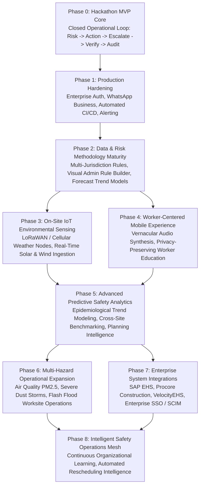

# 117 — Phased Post-Hackathon Product & Technology Roadmap

```text
Status: Documented
Scope: Strategic Post-Hackathon Engineering & Commercial Evolution
Audience: Product Leadership, System Architects, Investors, Enterprise Partners
Last Updated: 2026-10-08
Roadmap Governance: Phase 0 (MVP) -> Phase 1 (Hardening) -> Phases 2–8 (Enterprise Scale)
```

---

## 1. Roadmap Vision & Prioritization Philosophy

The **Heat Action Response Engine** transforms passive meteorological heat warnings into verified on-site workplace safety actions.

### Core Evolution Philosophy
> **We build from a rock-solid, verified core outward.**
> **We reject speculative feature sprawl. Every roadmap capability is prioritized strictly by: Safety Value + User Value + Engineering Feasibility.**
> **As the platform expands into physical IoT sensors, enterprise integrations, and multi-hazard resilience, deterministic safety authority and worker privacy boundaries remain inviolable.**



---

## 2. Phased Capability Roadmap

---

### Phase 0: Hackathon MVP Baseline (Current Scope)
* **Status:** `IMPLEMENTED / SUBMITTED BASELINE`
* **Core Capabilities:**
  * Software-first meteorological ingestion (Open-Meteo REST API) with deterministic Simulation Sandbox Mode.
  * 100% deterministic Heat Risk Engine evaluating Heat Index thresholds and worksite modifiers.
  * Deterministic Action Engine generating site-specific engineering directives (canopies, water staging, rest cycles).
  * Single-supervisor shift assignment with response countdown timers.
  * Multi-channel alerting (In-App Notification Center, Web Push, and simulated SMS).
  * AWS Step Functions automated timeout escalation (accelerated 30s demo timer / 15m live policy).
  * Regional Safety Manager escalation intervention and physical verification recording.
  * Append-only DynamoDB compliance audit ledger tracking all 6 chronological lifecycle events.
  * Assistive AI natural-language briefing generator with hard clinical medical refusal guardrails.

---

### Phase 1: Post-Hackathon Hardening & Pilot Readiness (Weeks 1–8)
* **Status:** `PLANNED IMMEDIATE PRIORITY`
* **Focus:** Transforming the hackathon MVP into an enterprise pilot-ready cloud platform.
* **Key Capabilities:**
  * **Enterprise Authentication & Provisioning:** Full AWS Cognito production federation with enterprise identity providers (Okta, Azure AD / Entra ID) via SAML 2.0 / OIDC.
  * **Production Telecommunications Gateway:** Direct integration with Twilio / AWS End User Messaging for production SMS and WhatsApp Business API template messaging.
  * **Observability & SRE Stack:** Distributed OpenTelemetry tracing across Lambdas, Datadog/CloudWatch ServiceLens dashboards, and PagerDuty on-call escalation alerts.
  * **Automated CI/CD Pipeline:** GitHub Actions multi-stage deployment pipelines (Dev, Staging, Prod) with automated secret scanning and contract test execution.
  * **Granular Tenant Administration:** Multi-site organizational management portal for creating, updating, and archiving worksite profiles and supervisor rosters.

---

### Phase 2: Data & Risk Methodology Maturity (Months 2–4)
* **Status:** `PLANNED`
* **Focus:** Deepening meteorological accuracy, jurisdictional compliance, and rule governance.
* **Key Capabilities:**
  * **Multi-Jurisdiction Risk Engine:** Dynamic switching between calculation engines (IMD Heat Action Plan, US OSHA Heat Index, ISO 7243 WBGT approximation, Australian BOM Excess Heat Factor) based on worksite geocoordinates.
  * **Visual Administrative Rule Builder:** Web-based policy configuration portal enabling corporate EHS directors to customize mandatory rest cycle thresholds and water quotas without code deployments.
  * **Predictive Shift Planning:** Forward-looking 24-hour forecast evaluation allowing project managers to reschedule high-metabolic concrete pours to cooler morning windows before work commences.
  * **Data Quality & Provenance Dashboard:** Real-time health monitoring of upstream meteorological feeds with automated variance detection.

---

### Phase 3: On-Site Physical IoT Environmental Sensing (Months 4–8)
* **Status:** `FUTURE SCOPE`
* **Focus:** Augmenting macro-weather models with physical worksite sensor nodes.
* **Key Capabilities:**
  * **Turnkey Weather Node Integration:** Certified integration with commercial industrial weather stations (Davis Instruments, LoRaWAN / Cellular gateways) measuring physical wet-bulb, dry-bulb, and solar radiation directly at the worksite perimeter.
  * **Secure Telemetry Ingestion Mesh:** AWS IoT Core integration enforcing X.509 device certificates, mutual TLS, and automated out-of-bounds sanity filtering.
  * **Sensor Calibration & Drift Tracking:** Automated detection of sensor degradation, dust accumulation on solar pyranometers, and radiative heating bias.
  * **Microclimate Heat Mapping:** Multi-sensor spatial heat mapping across vast construction sites (e.g., distinguishing unshaded roofing zones from covered fabrication shops).

---

### Phase 4: Worker-Centered Mobile Experience & Vernacular Audio (Months 6–10)
* **Status:** `FUTURE SCOPE`
* **Focus:** Extending safety communication directly to field crews while strictly maintaining anti-surveillance privacy boundaries.
* **Key Capabilities:**
  * **Vernacular Audio Voice Synthesis:** Text-to-speech audio broadcasting of morning safety briefings across local worksite PA systems and WhatsApp voice notes in regional languages (Hindi, Kannada, Telugu, Tamil, Bengali).
  * **Worker Digital Safety Boards:** Large-format field display terminal showing current worksite risk level, active rest cycle intervals, and water dispenser staging locations.
  * **Privacy-Preserving Hazard Reporting:** Anonymous mobile interface allowing workers to report empty water dispensers or torn shade canopies without fear of supervisory reprisal.
  * **Strict Anti-Surveillance Guarantee:** Zero individual biometric or continuous GPS tracking; privacy boundaries enforced by contract and architecture ([86_WORKER_DATA_PROTECTION.md](file:///d:/Amazon%202nd%20Hackathon%20Heat/docs/86_WORKER_DATA_PROTECTION.md)).

---

### Phase 5: Advanced Predictive Safety Analytics (Months 8–12)
* **Status:** `FUTURE SCOPE`
* **Focus:** Transforming compliance audit logs into enterprise-level risk intelligence.
* **Key Capabilities:**
  * **Cross-Site Safety Benchmarking:** Normalizing and comparing supervisory response times, escalation frequencies, and verification rates across multi-regional contractor portfolios.
  * **Epidemiological Risk Modeling:** Correlating localized thermal stress indexes with historical worksite safety incident rates to optimize company-wide rest pause policies.
  * **Regulatory Compliance Reporting:** One-click automated export of certified, tamper-evident PDF/CSV compliance dossiers for OSHA, NDMA, and labor ministry audits.
  * **Insurance Underwriting Integration:** Demonstrating verifiable preventative due diligence to negotiate reduced commercial workers' compensation insurance premiums.

---

### Phase 6: Multi-Hazard Operational Expansion (Year 2)
* **Status:** `FUTURE SCOPE`
* **Focus:** Expanding the closed operational loop beyond thermal heat stress to encompass co-occurring atmospheric hazards.
* **Key Capabilities:**
  * **Air Quality (AQI / PM2.5 / PM10) Action Engine:** Ingesting particulate pollution data and generating mandatory N95 respirator deployment or outdoor work curtailment directives during severe smog spikes.
  * **Severe Weather & Flash Flood Engine:** Automated high-wind crane curtailment and lightning standoff safety directives.
  * **Combined Hazard Indexing:** Evaluating the compounded cardiovascular strain of high heat combined with toxic air pollution in dense industrial metros.

---

### Phase 7: Enterprise System Integrations (Year 2)
* **Status:** `FUTURE SCOPE`
* **Focus:** Deep two-way synchronization with enterprise IT and construction management ecosystems.
* **Key Capabilities:**
  * **Construction Management Software Connectors:** Two-way synchronization with Procore, Autodesk Construction Cloud, and Trimble to automatically map project schedules and daily logs.
  * **Enterprise EHS Suite Connectors:** Bi-directional synchronization with SAP EHS, VelocityEHS, and Cority to eliminate duplicate incident entry.
  * **Workforce Management & Biometric Gate Ingress:** Integrating with site turnstiles to automatically extract active shift crew counts without tracking individual movements.

---

### Phase 8: Intelligent Safety Operations Mesh (Long-Term Vision)
* **Status:** `LONG-TERM RESEARCH & VISION`
* **Focus:** Closed-loop organizational learning and adaptive safety operations.
* **Key Capabilities:**
  * **Continuous Operational Learning:** Analyzing historical worksite escalation patterns to proactively recommend logistical staging optimizations (e.g., pre-ordering extra water tankers 48 hours before an anticipated heatwave).
  * **Adaptive Task Sequencing:** Algorithmic task scheduling recommendations that dynamically sequence high-metabolic trades to early mornings while scheduling indoor electrical trades during peak solar heat.
  * **Deterministic Primacy Preservation:** Even in the intelligent mesh vision, consequential life-safety directives remain governed by verified human-supervised deterministic safety thresholds.

---

## 3. Detailed Feature Prioritization Matrix

Every future roadmap initiative is evaluated against our standard prioritization rubric:
$$\text{Priority} = f(\text{Safety Value}, \text{User Value}, \text{Feasibility})$$

| Feature Initiative | Phase | Safety Value | User Value | Engineering Complexity | Data Dependency | Privacy Impact | Feasibility | Overall Priority |
| :--- | :---: | :---: | :---: | :---: | :---: | :---: | :---: | :---: |
| **Production Twilio / WhatsApp Messaging** | Phase 1 | `CRITICAL` | `HIGH` | `MEDIUM` | Low | None | `HIGH` | **P0 (Immediate)** |
| **Enterprise SSO & SAML Provisioning** | Phase 1 | `HIGH` | `HIGH` | `MEDIUM` | Low | None | `HIGH` | **P0 (Immediate)** |
| **Multi-Jurisdiction Rule Resolver** | Phase 2 | `CRITICAL` | `HIGH` | `MEDIUM` | Medium | None | `HIGH` | **P1 (Core)** |
| **Visual Administrative Rule Builder** | Phase 2 | `HIGH` | `HIGH` | `HIGH` | Low | None | `MEDIUM` | **P1 (Core)** |
| **Vernacular Voice Synthesis (Audio Notes)**| Phase 4 | `HIGH` | `CRITICAL` | `MEDIUM` | Medium | None | `HIGH` | **P1 (Core)** |
| **LoRaWAN On-Site Weather Station Mesh** | Phase 3 | `HIGH` | `MEDIUM` | `HIGH` | High (Hardware) | None | `MEDIUM` | **P2 (Hardware)** |
| **Regulatory One-Click Compliance Exports**| Phase 5 | `MEDIUM` | `HIGH` | `LOW` | Low | None | `HIGH` | **P2 (Commercial)**|
| **Anonymous Worker Hazard Reporting** | Phase 4 | `HIGH` | `HIGH` | `MEDIUM` | Low | High (Anonymous)| `HIGH` | **P2 (Culture)** |
| **Air Quality (AQI / PM2.5) Expansion** | Phase 6 | `HIGH` | `HIGH` | `MEDIUM` | Medium | None | `HIGH` | **P3 (Expansion)** |
| **Procore / SAP EHS Bi-Directional Sync** | Phase 7 | `MEDIUM` | `HIGH` | `HIGH` | High (External) | Low | `MEDIUM` | **P3 (Enterprise)**|
| **Adaptive Predictive Shift Rescheduling**| Phase 8 | `HIGH` | `HIGH` | `CRITICAL` | Very High | None | `LOW` | **P4 (Research)** |

---

## 4. Master Roadmap Summary Table

| Phase | Milestone Name | Timeline Target | Core Capability Focus | Primary Safety Value Delivered |
| :--- | :--- | :--- | :--- | :--- |
| **Phase 0** | **Hackathon MVP Baseline** | Current | Closed operational loop (Detect $\rightarrow$ Escalate $\rightarrow$ Audit) | Proves deterministic accountability loop |
| **Phase 1** | **Post-Hackathon Hardening** | Weeks 1–8 | WhatsApp Business API, Enterprise SSO, Observability | Enterprise pilot readiness & reliability |
| **Phase 2** | **Data & Methodology Maturity** | Months 2–4 | Multi-jurisdiction rules, Visual Rule Builder, Forecasting | Regulatory alignment across multi-nationals |
| **Phase 3** | **IoT Environmental Sensing** | Months 4–8 | LoRaWAN / Cellular microclimate on-site weather nodes | Physical microclimate accuracy |
| **Phase 4** | **Worker-Centered Experience** | Months 6–10 | Vernacular audio voice synthesis, anonymous reporting | Directly empowers field workforces |
| **Phase 5** | **Advanced Safety Analytics** | Months 8–12 | Cross-site benchmarking, insurance underwriting metrics | Proves enterprise ROI & preventative proof |
| **Phase 6** | **Multi-Hazard Expansion** | Year 2 | Ingestion of PM2.5 air pollution and severe storm events | Comprehensive climate workplace resilience |
| **Phase 7** | **Enterprise Integrations** | Year 2 | Bi-directional synchronization with SAP EHS & Procore | Embeds into existing corporate IT workflows |
| **Phase 8** | **Intelligent Safety Operations** | Long-Term | Closed-loop organizational learning & task sequencing | Predictive, adaptive workforce safety |

---

## 5. Summary Architectural Conclusion

The Phased Post-Hackathon Roadmap articulates an ambitious, disciplined, and technically credible path from a **hackathon vertical slice to an industry-defining enterprise climate safety platform**. By keeping human accountability at the center, preserving worker privacy, and anchoring every phase in deterministic safety logic, the Heat Action Response Engine is poised to revolutionize occupational safety in a rapidly warming world.

**From heat warning to verified workplace action.**
