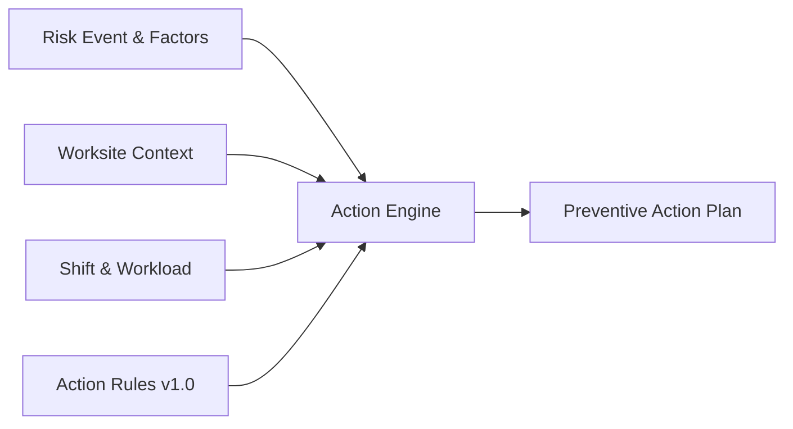
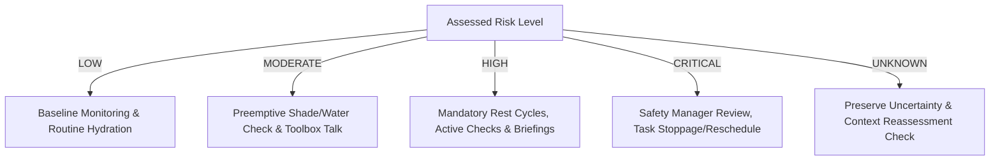
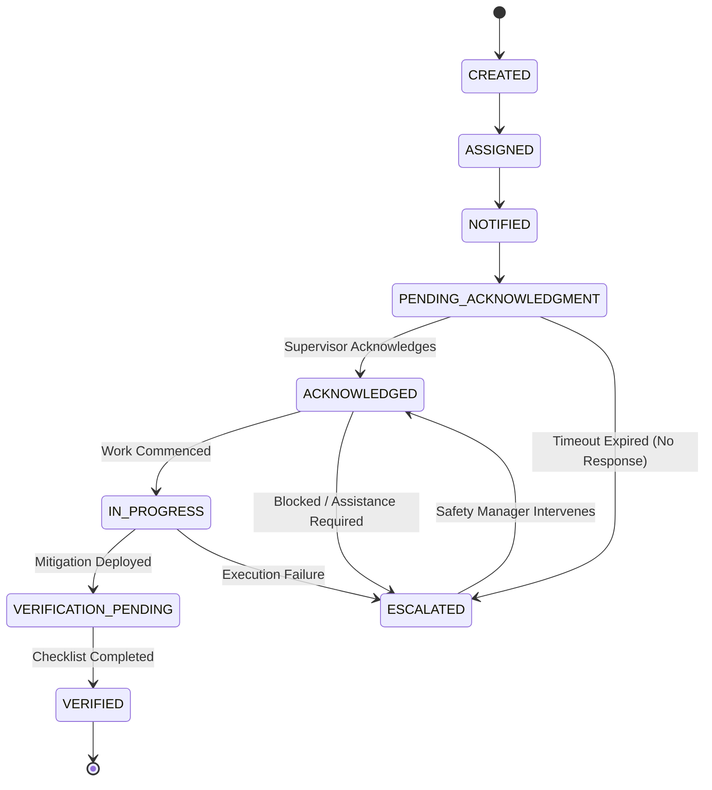

# 40 Action Engine Specification

## 1. Document Purpose

This document provides the authoritative technical and domain specification for the **Action Engine** within the **Heat Action Response Engine**.

Within the project architecture, there is a fundamental functional boundary between assessing environmental hazard and operationalizing preventive response:

```text
┌────────────────────────────────────────────────────────────────────────┐
│ RISK ENGINE                                                            │
│ Evaluates validated environmental data, physical workload, solar       │
│ exposure, and worker acclimatization to determine the ASSESSED         │
│ HEAT-RISK STATE (e.g., LOW, MODERATE, HIGH, CRITICAL, UNKNOWN).        │
└───────────────────────────────────┬────────────────────────────────────┘
                                    │ Assessed Risk Event
                                    ▼
┌────────────────────────────────────────────────────────────────────────┐
│ ACTION ENGINE                                                          │
│ Evaluates the assessed risk state alongside operational worksite       │
│ context and deterministic rules to determine WHAT PREVENTIVE           │
│ WORKPLACE RESPONSE must be created, prioritized, assigned, and audited.│
└────────────────────────────────────────────────────────────────────────┘
```

The Action Engine ensures that identifying a dangerous heat condition is never an end state. It transforms risk assessments into contextual, accountable, time-bounded, and traceable operational tasks assigned to responsible personnel.

---

## 2. Action Engine Definition

> **The Action Engine is the deterministic operational layer that converts an assessed workplace heat-risk condition and its relevant worksite context into one or more preventive actions with defined priority, ownership requirements, response expectations, and traceability.**

The Action Engine serves as the vital operational bridge between **knowing** and **doing**:
* **Knowing:** *"Heat Index is projected to reach 44°C at 13:00 during concrete pouring."*
* **Doing:** *"Action #ACT-1082: Site Supervisor Rahul Kumar must verify 20 liters of chilled electrolyte water, mandate a 15-minute shaded rest rotation for Crew B by 12:30, and acknowledge completion within 30 minutes."*

---

## 3. Authoritative Inputs

The Action Engine consumes a structured data contract comprising the assessed risk event, the physical worksite profile, active shift definitions, and versioned rules:



### Input Schema Attributes
1. **Risk Context (Required):**
   * `risk_event_id`: Unique identifier of the triggering evaluation.
   * `risk_level`: Assessed tier (`LOW`, `MODERATE`, `HIGH`, `CRITICAL`, `UNKNOWN`).
   * `risk_factors`: Array of dominant hazard drivers (e.g., `HIGH_AMBIENT_TEMPERATURE`, `HIGH_HUMIDITY`, `HEAVY_METABOLIC_RATE`).
   * `risk_explanation`: Structured deterministic justification string.
   * `risk_rule_version`: Version of the risk assessment ruleset utilized.
2. **Worksite Context (Required):**
   * `worksite_id`: Target operational facility or field boundary.
   * `worksite_type`: Industrial classification (`CONSTRUCTION`, `AGRICULTURE`, `WAREHOUSE`, `LOGISTICS`, etc.).
   * `outdoor_or_indoor`: Primary thermal exposure boundary.
   * `sun_exposure`: Direct radiant sunlight status (`FULL_SUN`, `PARTIAL_SHADE`, `INDOOR_CONTROLLED`).
   * `shade_availability`: Presence of rest shelters (`ADEQUATE`, `LIMITED`, `NONE`, `UNKNOWN`).
   * `hydration_availability`: Potable water staging status (`VERIFIED_ON_SITE`, `LIMITED`, `UNKNOWN`).
   * `cooling_availability`: Active cooling mechanisms (`MISTING`, `HVAC`, `FANS`, `NONE`).
3. **Shift & Operational Context (Required):**
   * `shift_id`: Active or upcoming operational work period.
   * `work_type`: Specific occupational activity (e.g., steel rebar tying, trenching).
   * `workload_category`: Metabolic rate classification (`LIGHT`, `MODERATE`, `HEAVY`, `VERY_HEAVY`).
   * `shift_timing`: Scheduled start, midpoint, and conclusion timestamps.
   * `acclimatization_context`: Crew acclimatization status (`ACCLIMATIZED`, `UNACCLIMATIZED`, `MIXED`, `UNKNOWN`).
   * `clothing_adjustment`: Personal protective equipment (PPE) thermal burden.
4. **Data Quality & Provenance (Required):**
   * `data_quality`: Health status of underlying telemetry (`VALID`, `STALE`, `MISSING`, `INVALID`, `UNKNOWN`, `CONFLICTING`).
   * `action_rule_version`: Active version identifier of the action ruleset.

### Data State Handling
* **Optional Inputs:** Auxiliary microclimate sensor offsets, detailed crew size headcount.
* **Unknown / Stale Inputs:** If shade, hydration, or workload context is marked `UNKNOWN` or `STALE`, the engine does **not** assume an optimistic condition. It applies conservative defaults and generates verification actions to inspect the unknown variables.

---

## 4. Action Engine Execution Pipeline

The Action Engine executes through a fourteen-stage deterministic pipeline:

```text
RISK EVENT RECEIVED (From Heat Risk Engine)
        │
        ▼
VALIDATE RISK EVENT (Verify Risk Event ID, Rule Version, Non-Empty Payload)
        │
        ▼
LOAD WORKSITE CONTEXT (Fetch Worksite Attributes & Facilities)
        │
        ▼
LOAD SHIFT CONTEXT (Fetch Workgroup Workload, Timing, & Crew Context)
        │
        ▼
LOAD APPLICABLE ACTION RULES (Filter Rules Matching Worksite Type & Risk Tier)
        │
        ▼
EVALUATE RULE CONDITIONS (Deterministic Boolean Condition Matching)
        │
        ▼
GENERATE CANDIDATE ACTIONS (Instantiate Action Templates)
        │
        ▼
RESOLVE CONFLICTS & DEDUPLICATE (Prune Redundant or Subsumed Actions)
        │
        ▼
APPLY PRIORITY SCALING (Compute Final Severity & Urgency Tiers)
        │
        ▼
DETERMINE REQUIRED OWNER ROLE (Target Supervisor vs. Safety Manager)
        │
        ▼
SET RESPONSE EXPECTATIONS (Calculate Acknowledgment & Verification Deadlines)
        │
        ▼
REQUIRE VERIFICATION PROTOCOL (Specify Checklist or Manual Confirmation)
        │
        ▼
CREATE IMMUTABLE ACTION RECORDS (Persist Entities in Operational Store)
        │
        ▼
HAND OFF TO NOTIFICATION WORKFLOW (Emit Events to Notification Engine)
```

---

## 5. Action Generation Principles

Every action synthesized by the engine adheres to core operational and safety principles:

1. **Preventive Before Reactive:** Actions must be scheduled and delivered *before* extreme thermal thresholds are breached, allowing staging of shade and hydration.
2. **Specific Before Generic:** Directives specify exact quantities, locations, and timeframes (e.g., *"Stage 25L water at East Rebar Zone"*) rather than vague platitudes (*"Stay cool"*).
3. **Contextual Before Broadcast:** Actions reflect the unique constraints of the worksite (e.g., indoor unventilated warehouse vs. outdoor highway paving).
4. **Actionable Before Informational:** Directives demand physical operational interventions, not passive observation.
5. **Accountable Before Anonymous:** Every action designates a single, explicit supervisory role responsible for execution.
6. **Explainable Before Opaque:** The underlying risk factors and rule citations triggering the action are transparently documented.
7. **Proportional to Assessed Risk:** Action intensity scales deterministically with assessed thermal hazard without causing operational paralysis.
8. **Traceable from Rule to Action:** Complete lineage connects the source rule, risk event, and resulting action ID.
9. **Human-Supervised:** Consequential decisions remain subject to on-site human verification.
10. **Safe Under Uncertainty:** Incomplete data triggers protective verification rather than assumption of safety.
11. **No Duplicate Spam:** Repeated weather refresh cycles must not flood supervisors with identical redundant tasks.
12. **No Contradictory Actions:** Conflicting operational commands are filtered prior to emission.
13. **No Unsupported Medical Directives:** Actions address workplace administrative and engineering controls; they do not prescribe medical treatments or individual health diagnoses.

---

## 6. Action Taxonomy (MVP Scope)

The MVP defines nine standard action categories:

| Action Type | Operational Purpose | Trigger Conditions | Typical Owner | Verification Required |
| :--- | :--- | :--- | :--- | :--- |
| **`HYDRATION_READINESS`** | Ensure physical availability, accessibility, and adequacy of chilled drinking water and electrolytes. | Risk $\ge$ MODERATE, or limited/unknown hydration context. | Site Supervisor | Yes (Checklist confirmation) |
| **`SHADE_COOLING_READINESS`** | Deploy, inspect, or unlock shaded rest shelters, canopy tents, misting fans, or air-conditioned rest rooms. | Risk $\ge$ MODERATE with outdoor exposure or limited shade. | Site Supervisor | Yes (Manual confirmation) |
| **`SUPERVISOR_BRIEFING`** | Conduct mandatory tailgate/toolbox talk on heat symptoms, buddy checks, and emergency escalation paths. | Risk $\ge$ HIGH, or shift commencement during elevated heat. | Site Supervisor | Yes (Crew acknowledgment) |
| **`WORK_REST_PLAN_REVIEW`** | Institute formal work-rest cycles (e.g., 45 min work / 15 min rest) adapted to heavy metabolic tasks. | Risk $\ge$ HIGH with Heavy/Very Heavy workload. | Site Supervisor | Yes (Schedule confirmation) |
| **`TASK_RESCHEDULING_REVIEW`** | Evaluate shifting strenuous outdoor manual tasks to cooler morning/evening hours or indoor areas. | Risk = CRITICAL, or persistent severe heat wave conditions. | Safety Manager / Supervisor | Yes (Operational log) |
| **`WORKSITE_CHECK`** | Perform physical inspection of work zones to verify compliance with hydration, shade, and PPE rules. | Risk $\ge$ HIGH during peak afternoon thermal window. | Site Supervisor | Yes (Inspection checklist) |
| **`CREW_COMMUNICATION`** | Broadcast direct advisory to field workgroup regarding thermal hazards and mandatory buddy system. | Risk $\ge$ MODERATE across distributed field crews. | Site Supervisor | No (Broadcast delivery) |
| **`RISK_REASSESSMENT`** | Re-evaluate local conditions due to data staleness, source conflict, or sudden microclimatic shifts. | Data Quality = `STALE`, `CONFLICTING`, or `UNKNOWN`. | Safety Manager / Supervisor | Yes (Assessment logged) |
| **`SAFETY_MANAGER_REVIEW`** | Executive safety oversight for unacknowledged critical hazards, site stop-work reviews, or repeated failures. | Risk = CRITICAL, or escalated supervisory inaction. | Safety Manager | Yes (Formal sign-off) |

---

## 7. Action Object Schema

Aligned with [16_ACTION_MODEL.md](file:///d:/Amazon%202nd%20Hackathon%20Heat/docs/16_ACTION_MODEL.md), the canonical `Action` entity encapsulates complete lifecycle state:

```json
{
  "action_id": "act_88f91a0c-4b21-4f11-9a12-abcdef123456",
  "organization_id": "org_infra_corp_01",
  "worksite_id": "WS-BLR-NORTH-04",
  "shift_id": "shf_20261007_day",
  "risk_event_id": "rsk_99c23b12-7e11-4a22-8b33-123456789abc",
  "action_type": "HYDRATION_READINESS",
  "title": "Stage Electrolyte Hydration Station at East Rebar Zone",
  "description": "Verify presence of minimum 25L chilled water and electrolyte packets. Confirm shade canopy is erected over hydration point before 11:30 AM.",
  "priority": "HIGH",
  "owner_id": "usr_sup_rahul_kumar",
  "owner_role": "SUPERVISOR",
  "status": "PENDING_ACKNOWLEDGMENT",
  "created_at": "2026-10-07T05:30:00Z",
  "assigned_at": "2026-10-07T05:30:01Z",
  "acknowledged_at": null,
  "started_at": null,
  "verified_at": null,
  "cancelled_at": null,
  "response_deadline": "2026-10-07T06:00:00Z",
  "escalation_status": "NONE",
  "source_rule_id": "AR-HYD-002",
  "rule_version": "1.0.0",
  "verification_required": true,
  "created_by": "SYSTEM_ACTION_ENGINE",
  "updated_at": "2026-10-07T05:30:01Z"
}
```

### Traceability Guarantee
The composite reference `source_rule_id` + `rule_version` + `risk_event_id` provides complete non-repudiation. Any auditor can inspect the exact environmental snapshot and deterministic logic that mandated the operational directive.

---

## 8. Action Content Contract

Every generated action must satisfy the structured content contract answering eight operational questions:

```text
┌────────────────────┬────────────────────────────────────────────────────────┐
│ CONTRACT ELEMENT   │ OPERATIONAL SPECIFICATION                              │
├────────────────────┼────────────────────────────────────────────────────────┤
│ WHAT               │ Specific physical preventive task to execute.          │
│ WHY                │ Explicit risk factor citation and rule justification.   │
│ WHERE              │ Targeted worksite, sector, or zone.                    │
│ WHEN               │ Execution time window and response deadline.           │
│ WHO                │ Assigned individual name and authoritative role.       │
│ PRIORITY           │ Urgency tier (LOW, MEDIUM, HIGH, CRITICAL).            │
│ EXPECTED RESPONSE  │ Explicit requirement (Acknowledge, Confirm, Verify).   │
│ STATUS             │ Current state within the operational lifecycle.        │
└────────────────────┴────────────────────────────────────────────────────────┘
```

### Illustrative Example
* **What:** Stage 25L potable chilled water and deploy 2 shade canopies in Sector 4.
* **Why:** Assessed Heat Risk is HIGH due to ambient temperature exceeding 37°C combined with heavy physical reinforcement work.
* **Where:** North Bengaluru Construction Site — Sector 4 Rebar Fabrication.
* **When:** Deploy before 11:30 IST; acknowledge within 30 minutes of issuance.
* **Who:** Rahul Kumar — Site Supervisor.
* **Priority:** HIGH.
* **Expected Response:** Acknowledge receipt via mobile interface; submit verification checklist upon staging.
* **Status:** `PENDING_ACKNOWLEDGMENT`.

---

## 9. Risk-to-Action Relationship

Action generation maps deterministically from assessed risk tiers while incorporating operational context:



* **LOW Risk:** Generates baseline readiness reminders if configured by organizational policy; no disruptive operational stops.
* **MODERATE Risk:** Generates proactive preparation actions (verifying hydration points, preparing shade awnings).
* **HIGH Risk:** Enforces mandatory work-rest schedule reviews, supervisor toolbox talks, and active hydration verification.
* **CRITICAL Risk:** Triggers high-urgency directives requiring Safety Manager intervention, consideration of task rescheduling, or halting high-metabolic outdoor tasks.
* **UNKNOWN Risk:** Generates mandatory operational verification actions to determine site conditions; never defaults to low risk.

---

## 10. Unknown and Data-Quality Handling

When incoming data is degraded, the Action Engine maintains absolute safety discipline:

```text
Environmental Data = STALE
        │
        ▼
Action Engine Evaluation:
  - Do NOT assume current conditions are safe.
  - Retain previously generated protective actions (do not auto-resolve).
  - Generate RISK_REASSESSMENT action assigned to Safety Manager.
  - Inject explicit warning into supervisor dashboard:
    "DATA STALE: Continue enforcing existing high-risk precautions."
```

If worksite attributes (e.g., shade availability) are `UNKNOWN`, the engine assumes `LIMITED` or `NONE` when evaluating risk-mitigation adequacy, triggering actions to inspect and supply shade.

---

## 11. Action Deduplication and Idempotency

External weather refreshes run every 15 to 60 minutes. Without strict deduplication, a persistent four-hour heat wave would generate dozens of redundant hydration directives.

### Deduplication Key
$$\text{DeduplicationKey} = \text{Hash}(\text{worksite\_id} + \text{shift\_id} + \text{action\_type} + \text{source\_rule\_id} + \text{date\_bucket})$$

### Idempotency Protocol
1. **Active Match:** If an identical action with status in `{PENDING_ACKNOWLEDGMENT, ACKNOWLEDGED, IN_PROGRESS}` is active, the engine skips creation and updates the `last_evaluated_at` timestamp.
2. **Severity Escalation:** If incoming risk escalates (e.g., MODERATE $\rightarrow$ HIGH), the existing action is dynamically escalated in priority or superseded by an urgent high-tier action.
3. **Completed Actions:** A completed action is not regenerated within the same operational time bucket unless risk parameters escalate significantly.

---

## 12. Action Prioritization

The Action Engine assigns one of four priority levels to every action:

* **`CRITICAL`:** Immediate threat to worker safety (e.g., extreme heat wave with heavy manual labor). Immediate notification; 15-minute response deadline; escalates directly to Safety Manager.
* **`HIGH`:** Significant thermal stress requiring structured administrative controls. Push notification; 30-minute response deadline; escalates if unacknowledged.
* **`MEDIUM`:** Moderate heat requiring preventive readiness. In-app notification; 60-minute response deadline.
* **`LOW`:** Informational advisories and standard baseline monitoring. Dashboard card; shift-window response.

---

## 13. Ownership and Assignment

The Action Engine strictly enforces role-based ownership aligned with [19_PERMISSION_MODEL.md](file:///d:/Amazon%202nd%20Hackathon%20Heat/docs/19_PERMISSION_MODEL.md):

* **`SUPERVISOR`:** Assigned tactical field directives (staging water, checking shade, conducting crew briefings, rotating shifts).
* **`SAFETY_MANAGER`:** Assigned organizational, review, and escalated directives (site-wide task rescheduling, reviewing unacknowledged critical hazards, overriding safety stops).

The engine assigns actions to the specific authenticated user holding the responsible role for the target worksite. If no supervisor is currently assigned to an active shift, the action automatically falls back to the worksite's primary Safety Manager with an `UNASSIGNED_SUPERVISOR` alert.

---

## 14. Verification Protocols

Actions can require formal operational verification before closure:

* **`SUPERVISOR_CONFIRMATION` (MVP Standard):** Supervisor clicks "Confirm Implemented" on mobile/web dashboard, attesting under their authenticated identity that the physical directive was completed.
* **`CHECKLIST_CONFIRMATION` (MVP Standard):** Supervisor completes a three-point digital checklist (e.g., [x] Water available, [x] Ice replenished, [x] Canopies erected).
* **`MANUAL_STATUS_UPDATE` (MVP Standard):** Authorized safety manager manually overrides or logs implementation status during site walk.
* **Future Extensions:** Geotagged photographic verification, IoT flow-meter signals on water dispensers, automated WBGT station acknowledgments.

---

## 15. Action Lifecycle State Machine

The Action Engine enforces the complete lifecycle state machine specified in [16_ACTION_MODEL.md](file:///d:/Amazon%202nd%20Hackathon%20Heat/docs/16_ACTION_MODEL.md):



---

## 16. Interaction with Notification Engine

The relationship between Action Engine and Notification Engine follows strict source-of-truth separation:

```text
┌─────────────────────────────────┐       Emits Event       ┌─────────────────────────────────┐
│ ACTION ENGINE                   ├────────────────────────►│ NOTIFICATION ENGINE             │
│ (Source of Truth for Actions)   │                         │ (Communication Mechanism)       │
└─────────────────────────────────┘                         └────────────────┬────────────────┘
                 ▲                                                           │ Dispatches SMS,
                 │ Updates State on Response                                 │ Push, In-App
                 └───────────────────────────────────────────────────────────▼
```

* An action record is created **first**; the notification is a side-effect communication.
* Notification delivery failure does not cancel or invalidate the underlying action.
* A notification being "sent" or "delivered" never equates to the action being "acknowledged".

---

## 17. Interaction with Escalation Engine

When an action stalls, the Action Engine interfaces directly with [17_ESCALATION_MODEL.md](file:///d:/Amazon%202nd%20Hackathon%20Heat/docs/17_ESCALATION_MODEL.md):

```text
Action Created: Response Deadline = 30 Minutes
                     │
                     ▼ [30 Minutes Elapsed without Acknowledgment]
Deadline Breach Triggered
                     │
                     ▼
Escalation Engine Engaged
  - Updates Action status to ESCALATED
  - Records Escalation Tier 1 in action audit trail
  - Dispatches high-priority notification to Safety Manager Ananya Rao
  - Displays persistent red escalation badge on central command console
```

The underlying action record remains the persistent anchor throughout the escalation chain.

---

## 18. Action Explainability

Every generated action must be fully explainable to auditors and field personnel via deterministic deduction:

$$\text{Assessed Risk Factor} + \text{Worksite Profile} + \text{Action Rule} \implies \text{Mandated Action}$$

* *Risk Factor:* Projected ambient temperature 38°C + Direct solar radiation.
* *Worksite Profile:* Open trench excavation + Heavy manual shovel work.
* *Action Rule AR-WR-004:* Mandates 30-min work / 30-min rest cycles for heavy tasks under High Risk.
* *Generated Action:* Enforce 30/30 work-rest cycle for Trench Crew 3.

---

## 19. AI Governance Boundary

Artificial Intelligence (Generative AI, Large Language Models) operates exclusively outside the safety-decision loop:

```text
DETERMINISTIC ACTION ENGINE (Authoritative Safety Decision)
  - Evaluates rules
  - Generates action type, priority, and deadline
  - Assigns owner role
                 │
                 ▼ Authoritative Action Object
AI ASSISTANT (Auxiliary Interface)
  - Translates description into regional languages (e.g., Kannada, Hindi)
  - Formats concise briefing card for field supervisor mobile display
  - Drafts plain-language summary for executive safety dashboard
```

### Prohibited AI Capabilities
AI models are mathematically non-deterministic and must **never**:
1. Alter assigned action priority or deadlines.
2. Suppress a mandatory action generated by rules.
3. Diagnose a worker’s physiological state.
4. Declare a worksite safe or dismiss a heat hazard.

---

## 20. Failure Handling and Resilience

If an unexpected software exception occurs during action synthesis:

* **Risk Event Preserved:** The originating risk event remains marked as unmitigated in the database.
* **Fallback Emergency Action:** If contextual rule evaluation fails, the engine falls back to a failsafe emergency template: *"SYSTEM ALERT: High Heat Detected. Supervisor must manually inspect site conditions."*
* **Observability Logging:** Stack traces, worksite context snapshots, and rule IDs are logged to operational telemetry.
* **Zero Silent Drops:** The system never drops a safety event silently.

---

## 21. Auditability and Lineage

Every mutation of an action record appends an immutable entry to the forensic audit log:

```json
{
  "audit_event_id": "aud_1082a93b",
  "action_id": "act_88f91a0c",
  "previous_status": "PENDING_ACKNOWLEDGMENT",
  "new_status": "ACKNOWLEDGED",
  "actor_id": "usr_sup_rahul_kumar",
  "actor_role": "SUPERVISOR",
  "timestamp_utc": "2026-10-07T05:42:15Z",
  "client_ip": "103.21.14.92",
  "user_agent": "FieldApp/Android-14",
  "verification_metadata": {
    "lat": 13.0827,
    "lon": 77.5877,
    "method": "SUPERVISOR_CONFIRMATION"
  }
}
```

---

## 22. Security and Permissions

Action creation, acknowledgment, verification, and overrides strictly adhere to [19_PERMISSION_MODEL.md](file:///d:/Amazon%202nd%20Hackathon%20Heat/docs/19_PERMISSION_MODEL.md):

* **Supervisors:** Authorized to view, acknowledge, update progress, and complete verifications for their explicitly assigned worksites.
* **Safety Managers:** Authorized to view site-wide actions, intervene in escalations, cancel redundant actions, and modify site operational configurations.
* **Workers:** Read-only access to relevant crew advisories.

---

## 23. Simulation Mode Parity

As specified in [38_SIMULATION_MODE.md](file:///d:/Amazon%202nd%20Hackathon%20Heat/docs/38_SIMULATION_MODE.md), Simulation Mode executes the **exact same Action Engine code path**:
* Synthetic risk events pass through identical validation and rule evaluation logic.
* Actions are instantiated with real schemas and assigned to demo personas (Rahul Kumar, Ananya Rao).
* Accelerated demo timers simulate the acknowledgment and escalation workflow.

---

## 24. MVP Scope vs. Future Roadmap

| Capability | MVP Baseline | Future Evolution |
| :--- | :--- | :--- |
| **Action Generation** | Deterministic rule matching | Predictive multi-shift optimization |
| **Context Adaptation** | Worksite type, workload, sun exposure | Microclimate sensor zones, dynamic RFID worker tracking |
| **Verification** | Digital checkmarks & supervisor mobile clicks | Geotagged camera verification, smart water-cooler telemetry |
| **Dispatch** | In-app mobile cards & SMS notifications | Digital signage boards, automated facility HVAC controls |
| **Language Support** | English + Assistive regional translation | Real-time automated voice briefings in field dialects |

---

## 25. Final Design Principle

> **The Action Engine exists to convert an identified heat-risk condition into a clear, proportionate, contextual, accountable, and traceable preventive response without allowing automation or AI to bypass authoritative safety rules or human oversight.**
