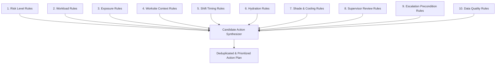

# 41 Action Rules Specification

## 1. Document Purpose

This document specifies the rule definition schema, evaluation taxonomy, execution ordering, and governance protocols for deterministic **Action Rules** within the **Heat Action Response Engine**.

Within the project architecture, there is a clear distinction between risk assessment rules and action generation rules:

```text
┌────────────────────────────────────────────────────────────────────────┐
│ RISK RULES (See 27_RISK_RULES.md)                                      │
│ Evaluate environmental parameters (temperature, humidity, solar        │
│ radiation), workload, and acclimatization to assess the HAZARD LEVEL.  │
└───────────────────────────────────┬────────────────────────────────────┘
                                    │ Assessed Risk State
                                    ▼
┌────────────────────────────────────────────────────────────────────────┐
│ ACTION RULES (This Document)                                           │
│ Evaluate the assessed hazard level alongside operational worksite      │
│ context to determine the MANDATORY PREVENTIVE OPERATIONAL RESPONSE.    │
└────────────────────────────────────────────────────────────────────────┘
```

Action rules determine *what must be done* operationally once a specific risk condition is established.

---

## 2. Action Rule Definition

An **Action Rule** is a deterministic, versioned, declarative policy mapping that binds an assessed heat-risk condition and its environmental/operational context to a concrete workplace mitigation:

```text
IF
    Risk Condition is satisfied (e.g., Risk Level = HIGH)
    AND Worksite Context matches (e.g., Outdoor = TRUE, Shade = LIMITED)
    AND Operational Shift matches (e.g., Workload = HEAVY)
THEN
    Generate a defined Preventive Action (e.g., SHADE_COOLING_READINESS)
WITH
    Defined Priority, Responsible Owner Role, Response Deadline, and Verification Protocol
```

Action rules are mathematically deterministic boolean expressions. They eliminate ambiguity, guesswork, and inconsistent supervisory responses across distributed industrial worksites.

---

## 3. Action Rule Schema

Action rules are represented in a structured, versioned schema:

```json
{
  "rule_id": "AR-HYD-002",
  "rule_name": "High Risk Outdoor Hydration Readiness Directive",
  "description": "Mandates physical staging of verified chilled potable water and electrolytes for outdoor crews during High Risk thermal windows.",
  "status": "ACTIVE",
  "version": "1.0.0",
  "priority": "HIGH",
  "conditions": {
    "risk_level_in": ["HIGH", "CRITICAL"],
    "worksite_environment": "OUTDOOR",
    "hydration_context_in": ["LIMITED", "UNKNOWN", "VERIFIED_ON_SITE"]
  },
  "action_output": {
    "action_type": "HYDRATION_READINESS",
    "title_template": "Stage Electrolyte Hydration Station for Shift {shift_id}",
    "description_template": "Verify minimum 25L chilled water and electrolyte supplies are stationed within 100 meters of work zone {zone_id}. Confirm before {start_time}.",
    "owner_role": "SUPERVISOR",
    "verification_required": true,
    "verification_method": "CHECKLIST_CONFIRMATION",
    "response_deadline_minutes": 30
  },
  "deduplication_key": "AR-HYD-002:{worksite_id}:{shift_id}",
  "source_reference": "OSHA-HEAT-NEP-2022 / NDMA-HAP-GUIDELINES",
  "effective_from": "2026-01-01T00:00:00Z",
  "effective_to": null,
  "created_at": "2026-01-01T00:00:00Z",
  "updated_at": "2026-01-01T00:00:00Z"
}
```

---

## 4. Rule Categories and Interactions

The action rulebase is organized into ten functional categories that interact during evaluation:



1. **Risk Level Rules:** Establish baseline supervisory vigilance and reporting cadence based on evaluated tier (`LOW`, `MODERATE`, `HIGH`, `CRITICAL`).
2. **Workload Rules:** Modulate work-rest cycle requirements based on metabolic demand (e.g., manual rebar vs. crane operation).
3. **Exposure Rules:** Account for radiant solar heat load, direct sunlight, and hot machine proximity.
4. **Worksite Context Rules:** Account for physical site topology (confined trench, high-rise slab, enclosed warehouse).
5. **Shift Timing Rules:** Adjust requirements for shift commencement, peak solar noon, and overnight recovery deficits.
6. **Hydration Rules:** Enforce staging volume, electrolyte availability, and proximity standards.
7. **Shade & Cooling Rules:** Mandate awning setup, misting tents, or indoor air-conditioned cooling room access.
8. **Supervisor Review Rules:** Require formal toolbox briefings, buddy checks, and physical site walks.
9. **Escalation Precondition Rules:** Set shorter acknowledgment deadlines for extreme scenarios.
10. **Data Quality Rules:** Mandate conservative verification when telemetry is stale, missing, or conflicting.

---

## 5. Deterministic Rule Evaluation Sequence

To guarantee absolute repeatability and eliminate race conditions, the Action Engine evaluates rules in a strict, unalterable 15-step sequence:

```text
 1. Validate incoming Risk Event structure and cryptographic integrity
 2. Verify underlying environmental data freshness and validity
 3. Extract evaluated Risk Level (LOW, MODERATE, HIGH, CRITICAL, UNKNOWN)
 4. Load Worksite Profile (Facility layout, shade structures, water access)
 5. Load Active Shift Context (Scheduled hours, tasks, metabolic workloads)
 6. Evaluate Data Quality Rules (If data is stale/missing, inject verification actions)
 7. Evaluate Core Risk-Level Rules (Generate baseline operational directives)
 8. Evaluate Workload & Metabolic Rules (Calculate required work-rest rotations)
 9. Evaluate Exposure & Environmental Rules (Trigger radiant shade/awning controls)
10. Compile Candidate Action Set (Aggregate all matching rule outputs)
11. Execute Conflict Resolution (Ensure no contradictory directives exist)
12. Execute Deduplication (Filter against active, in-progress action keys)
13. Assign Priority Tiers (Scale urgency: LOW, MEDIUM, HIGH, CRITICAL)
14. Bind Responsible Owner Roles (Assign to Site Supervisor or Safety Manager)
15. Persist Immutable Action Records and Emit Notification Events
```

> [!CRITICAL]
> **Evaluation Invariant:** This evaluation sequence is hard-coded and deterministic. Generative AI models are strictly prohibited from altering, re-ordering, or skipping any step.

---

## 6. Risk-Level to Action Mapping Matrix

The baseline mapping between assessed hazard levels and operational response patterns follows a structured continuum:

| Risk Level | Typical Operational Response Pattern | Primary Objectives | Typical Response Deadline |
| :--- | :--- | :--- | :--- |
| **`LOW`** | Standard operational readiness; routine water availability checks. | Baseline hydration maintenance; monitor forecast trends. | Standard shift window |
| **`MODERATE`** | Preemptive hydration staging; inspection of shade canopies; crew advisory. | Ensure mitigation assets are staged before conditions deteriorate. | 60 minutes |
| **`HIGH`** | Mandatory supervisor briefing; structured work-rest cycles; active site walk. | Enforce physical physiological rest; prevent cumulative heat strain. | 30 minutes |
| **`CRITICAL`** | Safety Manager direct review; evaluate halting heavy tasks; emergency standby. | Immediate life-safety intervention; prevent clinical heat emergencies. | 15 minutes |
| **`UNKNOWN`** | Retain protective posture; dispatch manual on-site environmental verification. | Resolve monitoring uncertainty; prevent false sense of safety. | 30 minutes |

*(Note: Threshold boundaries and specific work-rest durations are determined by organizational policy and documented domain references; they are not invented by system logic.)*

---

## 7. Contextual Rule Examples (Illustrative Patterns)

The following declarative patterns demonstrate how rules evaluate multi-dimensional conditions:

### Rule Pattern AR-001: Outdoor High-Risk Toolbox Briefing
```text
IF    risk_level IN ['HIGH', 'CRITICAL']
AND   worksite.outdoor_or_indoor == 'OUTDOOR'
AND   shift.status == 'ACTIVE'
THEN  GENERATE action_type = 'SUPERVISOR_BRIEFING'
      priority = 'HIGH'
      title = 'Conduct Mandatory Heat Hazard Toolbox Talk'
      owner_role = 'SUPERVISOR'
      response_deadline = 30 minutes
      verification = 'SUPERVISOR_CONFIRMATION'
```

### Rule Pattern AR-002: Limited Hydration Deficit Intervention
```text
IF    risk_level >= 'MODERATE'
AND   worksite.hydration_availability IN ['LIMITED', 'UNKNOWN']
THEN  GENERATE action_type = 'HYDRATION_READINESS'
      priority = 'HIGH'
      title = 'Replenish and Stage Emergency Hydration Supply'
      owner_role = 'SUPERVISOR'
      response_deadline = 30 minutes
      verification = 'CHECKLIST_CONFIRMATION'
```

### Rule Pattern AR-003: High Radiant Load Shade Deployment
```text
IF    risk_level >= 'HIGH'
AND   worksite.sun_exposure == 'FULL_SUN'
AND   worksite.shade_availability IN ['LIMITED', 'NONE']
THEN  GENERATE action_type = 'SHADE_COOLING_READINESS'
      priority = 'HIGH'
      title = 'Deploy Mobile Shaded Rest Shelters to Work Zone'
      owner_role = 'SUPERVISOR'
      response_deadline = 45 minutes
      verification = 'CHECKLIST_CONFIRMATION'
```

### Rule Pattern AR-004: Heavy Workload Work-Rest Adjustment
```text
IF    risk_level IN ['HIGH', 'CRITICAL']
AND   shift.workload_category IN ['HEAVY', 'VERY_HEAVY']
THEN  GENERATE action_type = 'WORK_REST_PLAN_REVIEW'
      priority = 'CRITICAL'
      title = 'Enforce Adjusted Work-Rest Rotation for Heavy Labor'
      owner_role = 'SUPERVISOR'
      response_deadline = 20 minutes
      verification = 'SUPERVISOR_CONFIRMATION'
```

> [!NOTE]
> The patterns above represent illustrative technical specifications for system design. Exact operational parameters must be validated by licensed industrial safety professionals prior to live deployment.

---

## 8. Conservative Rules for Unknown Context

When worksite or operational context is missing, action rules adhere to strict precautionary principles:

```text
UNKNOWN Hydration Availability   ≠   Hydration is adequate
UNKNOWN Shade Availability       ≠   Shade is adequate
UNKNOWN Workload Category        ≠   Workload is light
UNKNOWN Acclimatization State    ≠   Crew is acclimatized
```

### Fallback Directives
* If `hydration_availability` is `UNKNOWN`, the engine assumes `LIMITED` and generates an immediate verification directive.
* If `workload_category` is `UNKNOWN`, the engine defaults to the highest workload typical of that worksite classification.
* If `acclimatization_context` is `UNKNOWN`, the engine applies unacclimatized safety buffers.

---

## 9. Conflict Resolution Hierarchy

When simultaneous rules match a complex scenario, conflicts are resolved via an explicit, deterministic hierarchy:

```text
┌─────────────────────────────────────────────────────────────┐
│ 1. CRITICAL SAFETY DIRECTIVE (Stop-Work / Emergency Review) │
│    Always overrides lower-priority administrative tasks.     │
├─────────────────────────────────────────────────────────────┤
│ 2. SPECIFIC CONTEXTUAL RULE (Trench Heavy Workload)         │
│    Overrides generic worksite baseline rules.               │
├─────────────────────────────────────────────────────────────┤
│ 3. GENERIC RISK-LEVEL BASELINE RULE                         │
│    Applies only when no specific contextual rule matches.   │
└─────────────────────────────────────────────────────────────┘
```

The system never randomly selects between competing rules or attempts to average conflicting operational parameters.

---

## 10. Deduplication and Idempotency Architecture

To prevent alarm fatigue, action rules enforce deterministic deduplication:

$$\text{DeduplicationKey} = \text{RuleID} + \text{WorksiteID} + \text{ShiftID} + \text{OperationalDateBucket}$$

* If an action with the matching key already exists in an open state (`PENDING_ACKNOWLEDGMENT`, `ACKNOWLEDGED`, `IN_PROGRESS`), the incoming candidate action is suppressed.
* The suppression event is logged in observability metrics with the reason `DEDUPLICATED_AGAINST_ACTIVE_ACTION`.
* If the new rule evaluation demands an elevated priority tier (e.g., upgrading from `MEDIUM` to `HIGH`), the existing action is dynamically escalated.

---

## 11. Immutable Rule Versioning

Every rule modification increments a semantic version string (`MAJOR.MINOR.PATCH`):
* `MAJOR`: Structural change to schema, condition logic, or safety threshold philosophy.
* `MINOR`: Addition of new rule templates or worksite category bindings.
* `PATCH`: Clarification of textual descriptions or typo fixes.

### Audit Immutability
Every generated action stores `rule_id` and `rule_version`. Even if Rule `AR-HYD-002` is subsequently updated to v2.0.0, historical actions generated under v1.0.0 remain permanently linked to the exact logic that produced them. Historical decisions are never retroactively re-evaluated.

---

## 12. Grounded Domain Sources

Action rules are not fabricated arbitrarily; they derive directly from recognized occupational safety literature and national guidance frameworks:

* **OSHA Heat National Emphasis Program (NEP):** Guidance on hydration, rest breaks, shade, and acclimatization protocols.
* **National Disaster Management Authority (NDMA) India:** Guidelines for Preparation of Action Plan - Prevention and Management of Heat-Wave.
* **NIOSH Criteria for a Recommended Standard:** Occupational Exposure to Heat and Hot Environments.
* **ISO 7243:** Hot environments — Estimation of the heat stress on working man, based on the WBGT-index.

Refer to [29_DOMAIN_REFERENCES.md](file:///d:/Amazon%202nd%20Hackathon%20Heat/docs/29_DOMAIN_REFERENCES.md) for complete citations. Action rules do not claim regulatory legal certification; they operationalize documented best practices.

---

## 13. Absolute Safety Boundaries

Action rules operate under strict negative boundaries:

1. **No Medical Diagnosis:** Rules never diagnose heat stroke, heat exhaustion, or personal physiological strain.
2. **No Medical Treatment:** Rules prescribe administrative workplace mitigations (shade, water, rest); they do not prescribe medical interventions.
3. **No Worker Fitness Declarations:** Rules never declare an individual employee "cleared" or "fit" for extreme heat.
4. **No Autonomous Work Stoppage:** Rules can recommend Safety Manager review for task stoppage, but final shutdown authority remains human-supervised.
5. **No AI Suppression:** Generative AI is technically barred from suppressing, deleting, or altering an action rule output.

---

## 14. Comprehensive Rule Test Suite

Prior to production deployment, every rule must pass automated regression testing across eleven suites:

* **Suite 1 (Positive Verification):** Confirms rule fires when all conditions are met.
* **Suite 2 (Negative Verification):** Confirms rule does not fire when one condition fails.
* **Suite 3 (Boundary Verification):** Tests exact threshold cutoffs (e.g., temperature 34.9°C vs 35.0°C).
* **Suite 4 (Unknown Context):** Verifies conservative fallback behavior under null inputs.
* **Suite 5 (Stale Data):** Verifies injection of data quality review actions.
* **Suite 6 (Conflicting Sources):** Verifies precautionary escalation under source divergence.
* **Suite 7 (Deduplication):** Validates suppression of redundant actions over repeated evaluation cycles.
* **Suite 8 (Version Tracking):** Confirms correct version tagging across rule updates.
* **Suite 9 (Multi-Rule Concurrency):** Tests simultaneous firing of hydration, shade, and briefing rules.
* **Suite 10 (Recovery Resilience):** Validates rule engine recovery following database reconnects.
* **Suite 11 (Simulation Harness):** Verifies deterministic playback under synthetic demo fixtures.

---

## 15. Rule Observability and Telemetry

The rule execution engine emits structured telemetry for every evaluation run:

```json
{
  "rule_evaluation_event": {
    "evaluation_id": "eval_77a10b92",
    "timestamp_utc": "2026-10-07T05:30:00Z",
    "worksite_id": "WS-BLR-NORTH-04",
    "shift_id": "shf_20261007_day",
    "risk_level": "HIGH",
    "rules_evaluated_count": 14,
    "rules_matched_count": 3,
    "actions_generated_count": 2,
    "actions_deduplicated_count": 1,
    "matched_rules": [
      {"rule_id": "AR-HYD-002", "outcome": "ACTION_GENERATED"},
      {"rule_id": "AR-SHD-001", "outcome": "ACTION_GENERATED"},
      {"rule_id": "AR-BRF-001", "outcome": "DEDUPLICATED"}
    ]
  }
}
```

---

## 16. Rule Change Governance

Modifying production action rules requires strict change-management controls:

* **Authorization Role:** Only users holding the `SAFETY_MANAGER` or `SYSTEM_ADMIN` role may propose or activate rule modifications, as mandated by [19_PERMISSION_MODEL.md](file:///d:/Amazon%202nd%20Hackathon%20Heat/docs/19_PERMISSION_MODEL.md).
* **Dual Authorization:** Critical safety rule changes require dual-signoff (four-eyes principle) before publishing.
* **Audit Trail:** Every rule mutation logs the author ID, approval timestamp, git commit hash, and rationalization memorandum.
* **Zero Runtime Mutation:** Field supervisors and automated algorithms possess zero permission to edit rule logic.

---

## 17. Illustrative Baseline Rule Set

The MVP baseline implements a foundational set of six core rules:

* **`AR-001` (Outdoor High Risk $\rightarrow$ Supervisor Briefing):** Mandates crew toolbox talk and buddy-system assignment.
* **`AR-002` (High Risk + Limited Hydration $\rightarrow$ Hydration Readiness):** Directs emergency staging of drinking water.
* **`AR-003` (High Risk + Limited Shade $\rightarrow$ Shade & Cooling Readiness):** Mandates setup of temporary shade shelters.
* **`AR-004` (High Risk + Heavy Workload $\rightarrow$ Work-Rest Plan Review):** Requires instituting adjusted work-rest rotations.
* **`AR-005` (High Risk + Extreme Radiant Exposure $\rightarrow$ Worksite Check):** Directs active physical walk by supervisor.
* **`AR-006` (Unknown Telemetry $\rightarrow$ Risk Reassessment Check):** Flags sensor/data outage for manual supervisory inspection.

---

## 18. Rule Engine Boundary

```text
RISK RULES (Hazard Assessment)
         │
         ▼ Assessed Risk State
ACTION RULES (Operational Directives)
         │
         ▼ Preventive Action Plan
HUMAN SUPERVISION (Accountable Operational Execution)
```

---

## 19. Design Principle

> **Action rules determine the operational response to an assessed risk; they do not independently determine the underlying safety risk.**
