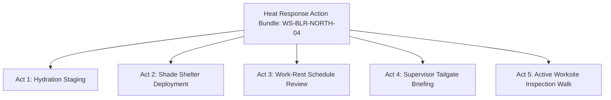

# 42 Site-Specific Actions Specification

## 1. Document Purpose

This document specifies the contextual adaptation layer that transforms generic preventive rules into **Site-Specific Actions** within the **Heat Action Response Engine**.

A primary failure mode of traditional weather alerts is that they broadcast broad, non-specific warnings (e.g., *"Extreme heat warning in district"*) without regard to the physical environment or operational reality of individual workplaces. The same macroscopic ambient temperature ($38^\circ\text{C}$) dictates vastly different operational responses depending on worksite characteristics:

```text
┌────────────────────────────────────────┬────────────────────────────────────────┐
│ HIGH-RISE REBAR FABRICATION            │ AIR-CONDITIONED LOGISTICS HUB          │
│ • Outdoor, 100% direct solar radiation │ • Indoor, thermally controlled         │
│ • Heavy metabolic labor (rebar tying)  │ • Moderate metabolic rate (forklifts)  │
│ • Zero natural shade on open slab      │ • Chilled potable water plumbed in     │
├────────────────────────────────────────┼────────────────────────────────────────┤
│ MANDATORY RESPONSE:                    │ MANDATORY RESPONSE:                    │
│ Erect temporary canopy awnings; stage  │ Verify HVAC airflow in loading bays;   │
│ ice-water coolers; enforce 30/30       │ monitor dock doors during trailer      │
│ work-rest cycles; buddy hydration.     │ unloading; standard water access.      │
└────────────────────────────────────────┴────────────────────────────────────────┘
```

The site-specific action layer bridges this gap, ensuring that every generated action is precisely calibrated to the target worksite's layout, infrastructure, and active shift profile.

---

## 2. Site-Specific Action Definition

> **A site-specific action is a preventive action whose content, priority, ownership, or verification requirements are adapted to the configured conditions and operational context of a particular worksite and shift.**

Site-specific adaptation operationalizes generic safety policies without transforming the platform into an intrusive personal medical monitor.

---

## 3. Generic Warnings vs. Site-Specific Actions

Traditional civic alerts leave workers and supervisors guessing. The Heat Action Response Engine delivers clear, contextual operational directives:

| Dimension | Generic Heat Warning | Site-Specific Action (This Platform) |
| :--- | :--- | :--- |
| **Directive** | "Take heat precautions; stay hydrated." | "North Bengaluru Construction Shift: Verify 25L chilled water at Sector 4 rebar shed; enforce 15-min rest rotation for Crew B." |
| **Accountability** | Broadcast to the general public; no owner. | Assigned specifically to Site Supervisor Rahul Kumar. |
| **Location** | Wide metropolitan area (50 km²). | Specific physical zone (Sector 4 Fabrication Pad). |
| **Response Window**| Indefinite and untracked. | 30-minute acknowledgment deadline with automated escalation. |
| **Verification** | None; compliance is unverified. | Formal digital checklist confirmation required for closure. |
| **Traceability** | None. | Immutable audit log linking risk event, rule, and supervisor sign-off. |

> [!NOTE]
> Site-specific adaptation provides **operational and environmental contextualization**. It does **not** provide personalized physiological diagnosis or medical advice.

---

## 4. Contextual Input Envelope

The site-specific action layer combines data from [14_WORKSITE_MODEL.md](file:///d:/Amazon%202nd%20Hackathon%20Heat/docs/14_WORKSITE_MODEL.md) and [15_WORKER_SHIFT_MODEL.md](file:///d:/Amazon%202nd%20Hackathon%20Heat/docs/15_WORKER_SHIFT_MODEL.md):

```text
                              CONTEXTUAL ENVELOPE
                                       │
     ┌─────────────────────────────────┼─────────────────────────────────┐
     ▼                                 ▼                                 ▼
WORKSITE ATTRIBUTES             SHIFT ATTRIBUTES                 INFRASTRUCTURE
• Worksite Classification       • Shift Schedule (Start/End)     • Hydration Points
• Outdoor vs. Enclosed Indoor   • Activity / Task Classification • Fixed Shade Structures
• Topography (Trench / High-Rise)• Workload Metabolic Rate       • Active Cooling (Misting/Fans)
• Microclimate Solar Exposure   • Acclimatization History        • PPE Thermal Burdens
```

---

## 5. Dimensions of Action Adaptation

Operational context modulates eight dimensions of the generated action:

1. **Action Type Selection:** An unventilated indoor warehouse triggers ventilation and fan checks; an open outdoor trench triggers shade canopy deployment.
2. **Action Wording & Instructions:** Generic templates are injected with specific zone names, equipment identifiers, and required water quantities.
3. **Priority Calibration:** An outdoor heavy-labor crew facing High Risk is assigned `CRITICAL` priority; an indoor crew in a partially shaded shed is assigned `HIGH`.
4. **Owner Assignment:** Directs tasks to the specific designated supervisor logged as managing that workgroup and shift.
5. **Verification Protocol:** Remote field crews require mobile checklist submissions; central facilities permit supervisory station updates.
6. **Response Deadlines:** Shorter deadlines (15 minutes) are enforced for high-exposure, unacclimatized crews.
7. **Timing Windows:** Actions specify execution deadlines relative to the local diurnal heat peak.
8. **Operational Scope:** Targets specific affected workgroups rather than disrupting unaffected site operations.

---

## 6. Industrial Worksite Adaptation Archetypes

Contextual rules adapt actions across diverse industrial sectors:

### 6.1 Construction (Building & Civil)
* *Characteristics:* Dynamic work zones, temporary electrical infrastructure, heavy manual rebar/formwork, direct radiant sun.
* *Adapted Actions:* Deploy mobile canopy tents to active pouring slabs; stage portable insulated water dispensers; conduct mandatory morning hydration toolbox briefings.

### 6.2 Road Work & Highway Paving
* *Characteristics:* Extreme radiant heat from hot-mix asphalt (130°C+), linear progression, zero stationary shade, traffic proximity.
* *Adapted Actions:* Stage vehicle-mounted cooling awnings; mandate frequent 20-minute rest rotations inside air-conditioned support cabs; rotate flaggers and paver operators.

### 6.3 Agriculture & Commercial Greenhouses
* *Characteristics:* High ambient humidity, direct sun, repetitive harvesting labor, distributed field acreage.
* *Adapted Actions:* Reschedule intensive manual harvesting to early morning hours (05:00–09:00); establish shaded field recovery stations with oral rehydration salts; implement buddy monitoring.

### 6.4 Warehousing & Logistics Hubs
* *Characteristics:* Enclosed metal roofing, high thermal mass, radiant heat accumulation inside shipping containers, forklift traffic.
* *Adapted Actions:* Activate high-volume industrial ceiling fans; inspect trailer unloading bay temperatures; enforce hydration breaks for container de-stuffing teams.

### 6.5 Heavy Manufacturing & Foundries
* *Characteristics:* Machine radiant heat (furnaces, casting lines), heavy protective leather/aluminized PPE, indoor high-heat zones.
* *Adapted Actions:* Enforce mandatory rotations into positive-pressure cooling booths; inspect personal vortex-tube cooling vests; provide electrolyte replenishment.

### 6.6 Outdoor Infrastructure Maintenance
* *Characteristics:* Powerline inspection, track maintenance, isolated mobile utility crews.
* *Adapted Actions:* Broadcast vehicle-level hydration readiness; require hourly supervisory radio check-ins; stage vehicle emergency cooling kits.

---

## 7. Site Constraint and Exception Handling

When a worksite cannot physically execute a standard mitigation action, the system handles the constraint transparently:

```text
Action Generated: Deploy Shade Canopy to Sector 4
                       │
                       ▼
Supervisor Flags Constraint: "NO_SHADE_CANOPIES_AVAILABLE_ON_SITE"
                       │
                       ▼
Constraint Resolution Engine:
  - Do NOT mark action as complete.
  - Action transitions to BLOCKED state.
  - Automatically triggers fallback directive:
    "Rotate crew to shaded ground cafeteria for required rest interval."
  - Escalates asset deficiency notification to Safety Manager.
```

The system prevents "paper compliance"—it is impossible for a supervisor to clear an action by falsely asserting non-existent site capabilities.

---

## 8. Action Specificity Hierarchy

The platform defines three levels of action maturity:

```text
┌────────────────────────────────────────────────────────────────────────┐
│ LEVEL 1: GENERIC WARNING                                               │
│ "High heat expected today. Please stay hydrated and rest as needed."   │
├────────────────────────────────────────────────────────────────────────┤
│ LEVEL 2: CONTEXTUAL DIRECTIVE                                          │
│ "Outdoor High Risk: Ensure shade canopies and water are staged."       │
├────────────────────────────────────────────────────────────────────────┤
│ LEVEL 3: OPERATIONAL ACTION (Target MVP Standard)                      │
│ "North Bengaluru Site, Sector 4 Rebar Pad: Supervisor Rahul Kumar must │
│ stage 25L chilled water and enforce 15-min rest cycles for Crew B by   │
│ 11:30 AM. Acknowledge within 30 min; submit verification checklist."   │
└────────────────────────────────────────────────────────────────────────┘
```

The MVP mandates **Level 3 Operational Actions** wherever worksite and shift metadata are populated.

---

## 9. End-to-End Contextual Transformation Example

```text
ASSESSED RISK:
  Risk Level   : HIGH (Heat Index: 43.5 °C)
  Trigger      : Ambient Temperature 37.5 °C + 56% Relative Humidity

GENERIC ACTION BASELINE:
  "Prepare for extreme heat conditions."

LOADED WORKSITE CONTEXT:
  Worksite ID  : WS-BLR-NORTH-04 (North Bengaluru Construction Site)
  Work Zone    : Sector 2 — Exposed Concrete Slab (Elevated Deck)
  Workload     : HEAVY (Manual Rebar Placement)
  Sun Exposure : FULL_SUN (Zero permanent structures)
  Shade Status : LIMITED (2 mobile awnings in site inventory)
  Hydration    : Central water cooler located 250m away at ground office
  Assigned Sup : Rahul Kumar (Authenticated Site Supervisor)

CONTEXTUAL ADAPTATION ENGINE OUTPUT:
  Action 1 (Hydration):
    "Stage mobile 20L water dispenser directly on Sector 2 slab.
     Do not permit workers to walk 250m to ground office in peak heat."
  Action 2 (Shade & Rest):
    "Erect 2 mobile awnings adjacent to rebar rack before 11:00 AM.
     Mandate 15-min rest rotation every 45 min of continuous labor."
  Action 3 (Briefing):
    "Conduct pre-pour tailgate talk on heat exhaustion signs. Assign buddy pairs."

OPERATIONAL BINDING:
  Owner        : Rahul Kumar (Site Supervisor)
  Priority     : HIGH
  Deadline     : 30 minutes from issuance (10:30 AM IST)
  Verification : Checklist submission (Water staged [x], Awning erected [x])
```

---

## 10. Multi-Action Coordination and Bundling

Severe heat events rarely require a single task; they require coordinated, multi-faceted interventions. The engine compiles these into a structured **Action Bundle**:



### Coordination Principles
* **Unified Presentation:** The supervisor receives a single, cohesive action card in the mobile interface containing the five coordinated tasks.
* **Independent Traceability:** In the database, each action retains its own distinct `action_id`, status, and verification trail.
* **Zero Contradiction:** The engine validates that no action conflicts with another (e.g., ordering continuous rebar pouring while ordering complete work stoppage).

---

## 11. Accountable Supervisory Ownership

Every site-specific action binds to an authenticated individual with operational authority:

* **Role Mapping:** Mapped via worksite shift rosters configured in the platform.
* **Supervisory Fallback:** If the primary supervisor is marked on leave or fails to acknowledge, the system engages the hierarchical chain:
  $$\text{Primary Supervisor (Rahul Kumar)} \xrightarrow{\text{Timeout}} \text{Backup Supervisor} \xrightarrow{\text{Timeout}} \text{Safety Manager (Ananya Rao)}$$
* **Non-Repudiation:** Actions cannot be assigned to generic aliases or unmonitored group distribution lists.

---

## 12. Site-Specific Verification Protocols

Verification methods are tailored to worksite infrastructure:

* **Hydration Staging:** Supervisor verifies volume via mobile checklist: `[x] Minimum 20L deployed`, `[x] Electrolytes present`, `[x] Temperature <15°C`.
* **Shade Deployment:** Supervisor confirms physical location: `[x] Canopy erected within 50m of work zone`.
* **Crew Briefing:** Supervisor submits headcount: `14 workers briefed on buddy system`.
* **Safety Manager Intervention:** High-tier review signed off via authenticated web console.

Future releases will incorporate optional geotagged photo capture and automated smart water-cooler telemetry.

---

## 13. Assistive AI Boundary in Site Adaptation

Generative AI assists with operational communication while strictly adhering to safety guardrails:

```text
DETERMINISTIC ACTION ENGINE (Authoritative Core)
  Calculates required action types, rest intervals, and hydration volumes.
                   │
                   ▼
ASSISTIVE AI LAYER (Language & Communication)
  • Adapts technical directives into clear vernacular (Kannada, Hindi, Tamil).
  • Formats actionable WhatsApp/SMS dispatch summaries for supervisors.
  • Drafts executive shift briefing summaries for central leadership.
```

### Prohibited AI Behaviors
* AI must **never** invent missing worksite features (e.g., hallucinating that a site has misting fans when the profile says `NONE`).
* AI must **never** reduce mandatory rest intervals based on speculative reasoning.
* If worksite context is missing, the AI output must explicitly state: *"Worksite shade status unknown; supervisor must verify on arrival."*

---

## 14. Worker Privacy and Ethical Safeguards

Site-specific actions govern **workplace environments and collective shift practices**. They strictly avoid intrusive worker monitoring:

* **No Personal Biometric Surveillance:** The platform does not track heart rates, internal core temperatures, or skin temperatures.
* **No Medical Record Storage:** Actions do not store personal medical diagnoses or health histories.
* **No Productivity Penalization:** Heat rest breaks mandated by the system are recorded as safety compliance events; they are explicitly protected from being weaponized as worker productivity deficits.
* **Focus on Administrative Controls:** The unit of mitigation is the **Worksite, Shift, and Workgroup**, governed by responsible supervisory leadership.

---

## 15. Degraded Context and Fallback Behaviors

When worksite profile attributes are missing or out of date:

| Missing Context Attribute | Conservative Engine Fallback | Generated Action |
| :--- | :--- | :--- |
| `shade_availability` = NULL | Assumes `NONE` | Mandates deploying temporary shade structures. |
| `hydration_availability` = NULL | Assumes `LIMITED` | Mandates physical hydration verification and staging. |
| `workload_category` = NULL | Defaults to `HEAVY` (for construction) | Imposes conservative work-rest intervals. |
| `supervisor_id` = NULL | Defaults to `SAFETY_MANAGER` | Escalates unassigned worksite alert to safety management. |

---

## 16. Forensic Audit Schema

Every site-specific action preserves a complete context snapshot in its audit record:

```json
{
  "action_context_snapshot": {
    "action_id": "act_88f91a0c",
    "worksite_id": "WS-BLR-NORTH-04",
    "worksite_name": "North Bengaluru Construction Site",
    "shift_id": "shf_20261007_day",
    "work_zone": "SECTOR_4_REBAR_PAD",
    "workload_at_generation": "HEAVY",
    "exposure_at_generation": "FULL_SUN",
    "shade_status_at_generation": "LIMITED",
    "assigned_supervisor_id": "usr_sup_rahul_kumar",
    "assigned_supervisor_name": "Rahul Kumar",
    "rule_version_evaluated": "1.0.0",
    "timestamp_utc": "2026-10-07T05:30:00Z"
  }
}
```

---

## 17. Simulation Mode Demonstration Walkthrough

In Simulation Mode (see [38_SIMULATION_MODE.md](file:///d:/Amazon%202nd%20Hackathon%20Heat/docs/38_SIMULATION_MODE.md)), site-specific action generation is demonstrated through a reproducible scenario:

1. **Worksite Selection:** Evaluator selects the fictional *"North Bengaluru Construction Site"*.
2. **Environmental Trigger:** Synthetic heat wave spike injects $38.5^\circ\text{C}$ temperature and 55% humidity.
3. **Context Binding:** Engine loads heavy rebar workload and unacclimatized crew attributes.
4. **Action Generation:** Engine generates the 5-point *"High-Heat Response Bundle"*.
5. **Supervisory Assignment:** Action assigned to Site Supervisor **Rahul Kumar**.
6. **Inaction & Escalation:** Presenter demonstrates expiration of the 30-second demo timer.
7. **Executive Intervention:** Hazard escalates to Safety Manager **Ananya Rao**, who views the site-specific context and logs executive sign-off.

---

## 18. MVP Scope vs. Future Roadmap

| Capability | MVP Baseline | Future Evolution |
| :--- | :--- | :--- |
| **Contextual Binding** | Static worksite facility attributes | Dynamic IoT microclimate sensors per zone |
| **Action Customization**| Templated site-specific text injection | Contextual spatial maps with GPS pins |
| **Verification Method** | Mobile checkmark & checklist forms | Geotagged site photos & sensor telemetry |
| **Shift Coordination** | Single supervisor per shift | Multi-supervisor distributed workgroup handoffs |

---

## 19. Architectural Flow and Responsibilities

The three-tier action architecture maintains clear conceptual boundaries:

```text
RISK ENGINE
    │
    ▼ "What is the assessed risk?"
Assessed Heat Risk Event (e.g., HIGH Risk, Heat Index 44°C)
    │
    ▼
ACTION ENGINE
    │
    ▼ "What preventive response should occur?"
Authoritative Action Rules & Templates (e.g., Hydration, Shade, Work-Rest)
    │
    ▼
SITE-SPECIFIC ACTION LAYER
    │
    ▼ "What should this particular worksite and shift do?"
Calibrated Operational Directives (Sector 4 Rebar Pad, 25L Water, 15-min Rest)
    │
    ▼
NOTIFICATION & ASSIGNMENT
    │
    ▼ "Who needs to act?"
Assigned Site Supervisor (Rahul Kumar)
    │
    ▼
ACKNOWLEDGMENT & VERIFICATION
    │
    ▼ "Did the responsible person respond and confirm?"
Supervisor Mobile Checkmark & Digital Checklist Submission
    │
    ▼
ESCALATION (If Unresolved)
    │
    ▼ "What happens if the response does not occur?"
Automated Handoff to Safety Manager (Ananya Rao)
```

---

## 20. Design Principle

> **Site-specific actions turn generic safety intentions into precise physical workplace mitigations, ensuring that every operational directive has an exact location, an assigned owner, and an auditable verification trail.**
