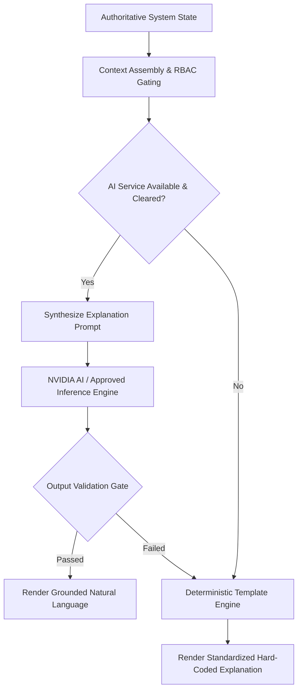

# 48 Explanation Engine Specification

**Document Status:** Draft  
**Last Updated:** 2026-10-07  

---

## 1. Document Purpose

This document specifies the technical and operational architecture for the **Explanation Engine** within the **Heat Action Response Engine**.

The primary purpose of the Explanation Engine is to translate structured, deterministic platform data into clear, understandable, role-appropriate, and actionable natural language for human decision-makers:

> **The Explanation Engine translates authoritative operational state into understandable human language; it explains what the system knows and why, without inventing facts or becoming the authority that decides safety.**

```text
┌────────────────────────────────────────────────────────────────────────┐
│ WHAT HAPPENED?     │ Authoritative state: Risk level transition to HIGH│
├────────────────────┼───────────────────────────────────────────────────┤
│ WHY DID IT HAPPEN? │ Evaluated rule: Heat Index 44.1°C + Heavy Workload│
├────────────────────┼───────────────────────────────────────────────────┤
│ WHAT DOES IT MEAN? │ Severe thermal strain threat for active crews     │
├────────────────────┼───────────────────────────────────────────────────┤
│ WHAT ACTION EXISTS?│ Mandated preventive task: ACT-1082 (Hydration)    │
├────────────────────┼───────────────────────────────────────────────────┤
│ WHO IS RESPONSIBLE?│ Accountable owner: Site Supervisor Rahul Kumar    │
├────────────────────┼───────────────────────────────────────────────────┤
│ WHAT HAPPENS NEXT? │ 30-minute acknowledgment window before escalation │
└────────────────────────────────────────────────────────────────────────┘
```

The Explanation Engine explains the decisions already computed by the deterministic engines; it is mathematically and technically barred from recalculating, modifying, or creating safety decisions.

---

## 2. Core Architecture and Fallback Pipeline

The Explanation Engine operates a dual-track architecture guaranteeing continuous availability:



### Key Architectural Safeguard
AI is utilized to improve **communicative clarity, accessibility, and natural phrasing**. It does not govern the underlying truth of the operational state. If AI services are offline, the system falls back seamlessly to hard-coded deterministic text templates.

---

## 3. Explanation Taxonomy (Nine Core Types)

The Explanation Engine supports nine distinct explanation archetypes:

### E01: Risk Explanation
* **Core Question:** *"Why is this worksite currently at this risk level?"*
* **Constituent Inputs:** Evaluated risk level, triggering environmental parameters ($T_a, RH$, Heat Index), metabolic workload, sun exposure, and rule citation (`RR-HIGH-002`).
* **Operational Contract:** Must state the exact tier immediately. Must never re-evaluate thresholds or suggest that the risk level is exaggerated.

### E02: Action Explanation
* **Core Question:** *"Why was this specific preventive action generated?"*
* **Constituent Inputs:** Action ID, title, action type, triggering risk event, physical worksite constraints, and rule citation (`AR-HYD-002`).
* **Operational Contract:** Explains the concrete physical hazard the action mitigates (e.g., preventing clinical dehydration during heavy manual labor).

### E03: Priority Explanation
* **Core Question:** *"Why is this action marked HIGH or CRITICAL priority?"*
* **Constituent Inputs:** Action priority enum, time remaining until afternoon heat peak, presence of unacclimatized workers, and severity of metabolic strain.
* **Operational Contract:** Directly cites the deterministic priority ruleset rather than generating subjective urgency.

### E04: Site-Specific Explanation
* **Core Question:** *"Why does this mitigation apply to this specific worksite and sector?"*
* **Constituent Inputs:** Worksite classification (`CONSTRUCTION`), physical zone (`Sector 4 Rebar Pad`), direct solar exposure, and lack of permanent shade structures.
* **Operational Contract:** Highlights physical site characteristics without disclosing sensitive commercial or private worker data.

### E05: Supervisor Operational Briefing
* **Core Question:** *"What does the supervisor need to know and execute right now?"*
* **Constituent Inputs:** Active shift schedule, pending action bundle, designated response deadlines, and verification checklist requirements.
* **Operational Contract:** Formats a concise, direct, 60-second verbal or textual script optimized for field mobile screens.

### E06: Safety Manager Enterprise Summary
* **Core Question:** *"What is the cross-site operational posture across all enterprise facilities?"*
* **Constituent Inputs:** Multi-site risk distribution, unacknowledged actions across all sites, active escalations, and regional meteorological alerts.
* **Operational Contract:** Synthesizes an executive analytical briefing highlighting operational bottlenecks and compliance exceptions.

### E07: Escalation Explanation
* **Core Question:** *"Why did this action trigger an escalation alert to safety management?"*
* **Constituent Inputs:** Escalation record, original owner ID, elapsed response time, expiration timestamp, and secondary assignee ID.
* **Operational Contract:** Transparently documents the timeline of unacknowledged inaction without subjective blame or speculation.

### E08: Temporal Change Explanation
* **Core Question:** *"What changed between the morning assessment and the afternoon assessment?"*
* **Constituent Inputs:** Consecutive risk events, delta in ambient temperature ($\Delta T$), delta in humidity ($\Delta RH$), and newly scheduled shift tasks.
* **Operational Contract:** Compares authoritative records chronologically. Never invents causal relationships when data shows only correlation. Uses phrasing such as *"The latest assessment reflects an updated forecast..."* rather than speculation.

### E09: Data Quality and Uncertainty Explanation
* **Core Question:** *"What is the integrity of the data driving this assessment?"*
* **Constituent Inputs:** Data quality enum (`VALID`, `AGING`, `STALE`, `MISSING`, `CONFLICTING`), minutes elapsed since refresh, and provider outage flags.
* **Operational Contract:** Prominently warns users of degraded data quality; explicitly reinforces that stale data must never be interpreted as safe conditions.

---

## 4. Standardized Explanation Content Structure

Every structured explanation generated by the engine adheres to a predictable 7-part content contract:

```text
┌─────────────────┬─────────────────────────────────────────────────────────┐
│ SECTION         │ CONTENT SPECIFICATION                                   │
├─────────────────┼─────────────────────────────────────────────────────────┤
│ 1. SUMMARY      │ One-sentence declaration of the active operational state│
│ 2. WHY          │ Primary environmental, physical, and rule drivers       │
│ 3. EVIDENCE     │ Validated numerical readings, timestamps, and rule IDs  │
│ 4. ACTION       │ Explicit physical mitigation required                   │
│ 5. OWNER        │ Accountable supervisor or manager assigned              │
│ 6. NEXT STEP    │ Concrete response deadline and verification method      │
│ 7. LIMITATIONS  │ Explicit disclosure of data staleness, forecast nature  │
└─────────────────┴─────────────────────────────────────────────────────────┘
```

---

## 5. Authoritative Evidence Hierarchy

The Explanation Engine resolves evidence according to a strict hierarchy:

```text
1. CURRENT LIVE APPLICATION STATE (Active Database Records)
                 │ Supersedes
                 ▼
2. DETERMINISTIC ENGINE OUTPUTS (Evaluated Rules, Factor Weights)
                 │ Supersedes
                 ▼
3. WORKSITE & SHIFT PROFILES (Configured Facilities & Rosters)
                 │ Supersedes
                 ▼
4. VALIDATED ENVIRONMENTAL TELEMETRY (Ingested Weather Records)
                 │ Supersedes
                 ▼
5. HISTORICAL AUDIT LOGS (Immutable Chronological Timeline)
                 │ Supersedes
                 ▼
6. APPROVED DOMAIN REFERENCES (OSHA NEP, NDMA, NIOSH Literature)
                 │ Supersedes
                 ▼
7. AI NATURAL-LANGUAGE SYNTHESIS (Presentation & Phrasing Layer Only)
```

The language model provides formatting, clarity, and phrasing; it is never treated as a source of evidence.

---

## 6. Groundedness and Non-Extrapolation Mandate

Every claim generated within an explanation must be traceable to an injected context key:

* **Internal Lineage:** The engine tags every sentence with its underlying database entity references (`event_id`, `rule_id`, `action_id`).
* **Non-Extrapolation Rule:** If the database does not contain a record of cooling fans on site, the explanation must state: *"On-site cooling fan availability is unrecorded."* It must never hallucinate equipment or infrastructure.

---

## 7. Explicit Uncertainty Handling

The Explanation Engine strictly forbids manufacturing certainty to reassure users:

```text
UNACCEPTABLE EXPLANATION (FALSE CERTAINTY):
"The weather is completely fine, workers are safe to continue heavy labor."

MANDATORY EXPLANATION (UNCERTAINTY-AWARE):
"The current assessment is MODERATE based on the 10:00 AM numerical forecast.
However, telemetry is currently AGING (48 minutes old). Supervisors must verify
on-site conditions and ensure continuous water access."
```

If data is `STALE` or `MISSING`, the explanation explicitly communicates the monitoring deficit.

---

## 8. Forecast vs. Physical Observation Disambiguation

The engine strictly distinguishes forward-looking model forecasts from verified physical reality:

| Data Type | Prohibited Phrasing | Mandatory Phrasing |
| :--- | :--- | :--- |
| **`FORECAST`** | "The site temperature is currently 39°C." | "The numerical forecast indicates conditions are expected to reach approximately 39°C at 14:00." |
| **`OBSERVATION`** | "Model simulations show high heat." | "On-site meteorological station confirms current ambient temperature of 38.2°C." |
| **`SIMULATED`** | "Real-world incident in progress." | "Demonstration mode: synthetic simulation scenario active." |

---

## 9. Role-Adapted Explanation Styling

The engine adapts vocabulary, syntax, and density based on the authenticated persona:

### Field Supervisor Profile (Rahul Kumar)
* **Objective:** Immediate operational clarity; minimum cognitive friction.
* **Style:** Imperative, direct, action-oriented. Highlights deadlines and assigned work zones.
* **Example:** *"Rahul: Sector 4 rebar work is HIGH risk due to 44°C Heat Index. Action ACT-1082 requires staging 25L chilled water within 18 minutes."*

### Safety Manager Profile (Ananya Rao)
* **Objective:** Comprehensive risk oversight and compliance visibility.
* **Style:** Analytical, structured, comparative. Highlights multi-site trends and escalations.
* **Example:** *"Ananya: North Bengaluru transitioned to HIGH risk at 11:00 AM under Rule RR-002. 1 action escalated due to supervisor acknowledgment timeout; 3 mitigations verified on schedule."*

### System Administrator Profile
* **Objective:** Technical pipeline integrity and infrastructure health.
* **Style:** Diagnostic, structured, error-code focused. Highlights API latencies and data quality states.

---

## 10. Vernacular Translation and Accessibility

The Explanation Engine supports localized regional languages (e.g., Kannada, Hindi, Tamil) for field briefings:

* **Semantic Invariance:** Translation must preserve exact risk levels (`HIGH`), action types (`HYDRATION_READINESS`), and time limits (`30 minutes`).
* **Zero Policy Drift:** Vernacular phrasing must not soften or dilute safety imperatives (e.g., translating *"mandatory rest"* into *"optional rest"* is strictly prohibited).
* **Bilingual Tagging:** Critical technical IDs (`ACT-1082`, `HIGH RISK`) are preserved in alphanumeric Latin script alongside translated text for cross-referencing.

---

## 11. Deterministic vs. AI-Assisted Layers

```text
┌───────────────────────────────────────┬───────────────────────────────────────┐
│ DETERMINISTIC EXPLANATION (BASELINE)  │ AI-ASSISTED EXPLANATION (ENHANCED)    │
├───────────────────────────────────────┼───────────────────────────────────────┤
│ • Hard-coded string templates.        │ • Dynamic natural-language synthesis. │
│ • 100% predictable; zero latency risk.│ • Fluid, conversational, role-adapted.│
│ • Always available during outages.    │ • Contextual Q&A and translation.     │
│ • Serves as the ultimate truth source.│ • Validated against deterministic base│
└───────────────────────────────────────┴───────────────────────────────────────┘
```

The AI-assisted explanation is a convenience layer that wraps the deterministic template.

---

## 12. Automated Output Validation and Gating

Before any explanation is rendered to a user, it passes through an automated validation gate:

```text
Candidate Explanation String
             │
             ▼
Automated Validation Scanner:
1. Does it match the authoritative risk level? (No HIGH/LOW mismatch)
2. Does it cite valid, existing Action IDs? (Regex match against DB)
3. Does it contain forbidden medical claims? (Keyword check: "diagnose", "treat")
4. Does it make unsupported regulatory guarantees? ("OSHA certified safe")
5. Does it contradict countdown timers or escalation assignments?
     ╱               ╲
 [CLEARED]        [VIOLATION]
     │                │
     ▼                ▼
Render to User   ABORT AI OUTPUT ──► Render Deterministic Fallback Template
```

---

## 13. Comprehensive Fictional Demonstration Example

### Scenario Setup
* **Worksite:** North Bengaluru Construction Site (`WS-BLR-NORTH-04`)
* **Supervisor:** Rahul Kumar (`usr_sup_rahul_kumar`)
* **Evaluated Risk:** `HIGH` (Heat Index: 44.1°C, Heavy Rebar Work, Full Sun)
* **Triggered Action:** `ACT-1082` (`SUPERVISOR_BRIEFING`, Priority: `HIGH`, Status: `PENDING_ACKNOWLEDGMENT`)
* **Deadline:** 30 minutes from issuance (18 minutes remaining)

### Generated Explanation (AI-Assisted Layer)
> **Why this is HIGH Risk:** The current assessment has been classified as **HIGH** by deterministic rule `RR-HIGH-002` using validated weather telemetry (Heat Index 44.1°C) combined with scheduled heavy manual rebar tying in full direct sunlight.
>
> **What needs to happen:** A high-priority preventive action (`ACT-1082`) has been assigned to Site Supervisor **Rahul Kumar** requiring a mandatory crew toolbox talk and staging of chilled hydration.
>
> **Next step:** Rahul must review and acknowledge this action within the next **18 minutes**. If acknowledgment is not logged, automated escalation will alert Safety Manager **Ananya Rao**.
>
> *(Data Quality: VALID via Open-Meteo | Evaluated at 10:30 AM IST)*

---

## 14. Forensic Audit Schema for Generated Explanations

Every explanation generated by the engine is committed to telemetry storage:

```json
{
  "explanation_audit_event": {
    "explanation_id": "exp_88a10b92-4f11-4a22-9b33-abcdef123456",
    "timestamp_utc": "2026-10-07T05:32:00Z",
    "explanation_type": "E01_RISK_EXPLANATION",
    "user_id": "usr_sup_rahul_kumar",
    "user_role": "SUPERVISOR",
    "worksite_id": "WS-BLR-NORTH-04",
    "source_risk_event_id": "rsk_99c23b12",
    "source_action_id": "ACT-1082",
    "engine_mode": "AI_ASSISTED_NVIDIA",
    "output_validation_result": "PASSED",
    "fallback_engaged": false,
    "execution_time_ms": 384
  }
}
```

---

## 15. Final Design Principle

> **The Explanation Engine translates authoritative operational state into understandable human language; it explains what the system knows and why, without inventing facts or becoming the authority that decides safety.**
