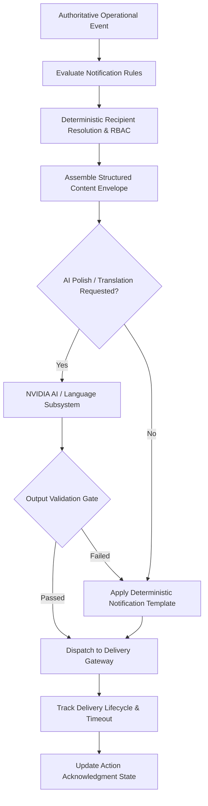
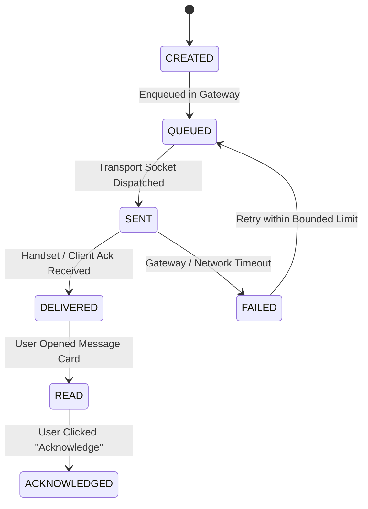

# 49 Notification Generation Specification

**Document Status:** Draft  
**Last Updated:** 2026-10-07  

---

## 1. Document Purpose

This document specifies the architecture, trigger conditions, content contracts, and delivery lifecycles for **Notification Generation** within the **Heat Action Response Engine**.

A primary operational failure in legacy weather alerting systems is conflating broadcasting a warning with ensuring workplace compliance. This platform enforces a fundamental operational distinction:

```text
┌────────────────────────────────────────────────────────────────────────┐
│ NOTIFICATION  ≠  ACKNOWLEDGMENT  ≠  VERIFICATION                      │
├────────────────────────────────────────────────────────────────────────┤
│ • NOTIFICATION : The platform communicated the operational directive.  │
│ • ACKNOWLEDGMENT: The responsible human responded and accepted custody.│
│ • VERIFICATION : The physical workplace mitigation was confirmed.     │
└────────────────────────────────────────────────────────────────────────┘
```

A notification is an informational and alerting mechanism. It is **not** evidence that a hazard has been mitigated. The underlying action record remains the authoritative source of truth.

---

## 2. Notification Pipeline Architecture

Notifications are generated through an event-driven, deterministic routing pipeline:



The notification engine does not independently evaluate environmental data or decide whether a worksite is dangerous. It responds strictly to authoritative events emitted by the Heat Risk Engine and Action Engine.

---

## 3. Authoritative Trigger Taxonomy

Notifications are triggered strictly by discrete system events, preventing notification storms:

| Trigger Code | Triggering Operational Event | Target Audience | Priority Tier |
| :--- | :--- | :--- | :--- |
| **`N01_RISK_ELEVATION`** | Worksite transitions to a higher risk tier (`MODERATE` $\rightarrow$ `HIGH`). | Site Supervisors & Safety Managers | `HIGH` |
| **`N02_ACTION_ASSIGNMENT`**| New mandatory preventive action instantiated and assigned. | Assigned Site Supervisor | `HIGH` / `CRITICAL` |
| **`N03_ACK_REMINDER`** | Action remains unacknowledged with 50% response window elapsed. | Assigned Site Supervisor | `HIGH` |
| **`N04_ESCALATION_ALERT`** | Action acknowledgment deadline expired without response. | Organizational Safety Manager | `CRITICAL` |
| **`N05_VERIFY_REMINDER`** | Action acknowledged but verification checklist pending at shift midpoint. | Assigned Site Supervisor | `NORMAL` |
| **`N06_DATA_FAILURE`** | Weather telemetry offline or stale exceeding grace window. | Site Supervisor & System Admin | `NORMAL` |

> [!NOTE]
> The platform does not generate a notification on every periodic weather refresh. Notifications are strictly event-driven, firing only on status transitions, new actions, or countdown milestones.

---

## 4. Canonical Notification Entity Schema

Notifications are tracked as first-class, auditable records:

```json
{
  "notification_id": "notif_99a10b2c-88f1-4a22-9b33-abcdef123456",
  "organization_id": "org_infra_corp_01",
  "worksite_id": "WS-BLR-NORTH-04",
  "action_id": "ACT-1082",
  "risk_event_id": "rsk_99c23b12",
  "recipient_id": "usr_sup_rahul_kumar",
  "recipient_role": "SUPERVISOR",
  "notification_type": "N02_ACTION_ASSIGNMENT",
  "priority": "HIGH",
  "title": "[HIGH PRIORITY] Action Assigned: Stage 25L Electrolyte Cooler",
  "summary": "Heat Index projected at 44.1°C during rebar work. Stage water in Sector 4 within 30 minutes.",
  "action_required": "Physical staging of hydration cooler and mobile checklist submission.",
  "response_deadline_utc": "2026-10-07T06:00:00Z",
  "channel": "IN_APP",
  "status": "SENT",
  "delivery_status": "DELIVERED",
  "created_at_utc": "2026-10-07T05:30:00Z",
  "sent_at_utc": "2026-10-07T05:30:01Z",
  "delivered_at_utc": "2026-10-07T05:30:03Z",
  "read_at_utc": null,
  "acknowledged_at_utc": null
}
```

---

## 5. Structured Content Model

Every notification generated by the platform satisfies the operational **6-Question Content Contract**:

```text
┌──────────────────────────────┬────────────────────────────────────────┐
│ QUESTION                     │ NOTIFICATION SPECIFICATION             │
├──────────────────────────────┼────────────────────────────────────────┤
│ 1. WHAT HAPPENED?            │ Sector 4 transitioned to HIGH risk.    │
│ 2. WHY DOES IT MATTER?       │ 44.1°C Heat Index with heavy labor.    │
│ 3. WHAT ACTION IS REQUIRED?  │ Stage 25L water and verify canopy.     │
│ 4. WHO OWNS IT?              │ Rahul Kumar (Site Supervisor).         │
│ 5. WHEN TO RESPOND?          │ Within 30 minutes (by 11:30 AM IST).   │
│ 6. WHAT IF NO RESPONSE?      │ Escalates directly to Safety Manager.  │
└──────────────────────────────┴────────────────────────────────────────┘
```

For constrained display channels (e.g., mobile push banners), the engine compiles a condensed 6-part micro-card:
$$\text{[TITLE]} \rightarrow \text{[CONTEXT]} \rightarrow \text{[ACTION]} \rightarrow \text{[OWNER]} \rightarrow \text{[RESPONSE]} \rightarrow \text{[STATUS]}$$

---

## 6. Deterministic Guardrails vs. AI Assistance Scope

The boundary between deterministic facts and AI phrasing is strictly enforced:

```text
┌───────────────────────────────────────┬───────────────────────────────────────┐
│ DETERMINISTIC SYSTEM FIELDS (LOCKED)  │ AI LANGUAGE ASSISTANCE SCOPE (PERMITTED)│
├───────────────────────────────────────┼───────────────────────────────────────┤
│ • Risk Level: HIGH                    │ • Polishing natural-language tone     │
│ • Action Type: HYDRATION_READINESS    │ • Generating vernacular translations  │
│ • Priority: HIGH                      │ • Synthesizing concise mobile cards   │
│ • Worksite ID: WS-BLR-NORTH-04        │ • Tailoring wording for supervisor vs │
│ • Assigned Owner: Rahul Kumar         │   executive audiences                 │
│ • Deadline: 2026-10-07T06:00:00Z      │ • Explaining why action was created   │
└───────────────────────────────────────┴───────────────────────────────────────┘
```

The AI model is technically barred from modifying any locked deterministic field. If the deterministic core assigns `HIGH` priority, the AI cannot alter it to `MEDIUM`.

---

## 7. Standardized Notification Templates

The platform maintains deterministic templates serving as reliable fallbacks:

### Template T-01: Action Assignment Directive
```text
[HIGH PRIORITY] Heat Action Assigned: {action_title}
Worksite: {worksite_name} | Zone: {zone_name}
Reason: Assessed {risk_level} risk (Heat Index {heat_index}°C)
Assigned Owner: {owner_name} ({owner_role})
Action Required: {action_description}
Response Window: Acknowledge within {response_minutes} minutes (Deadline: {deadline_local})
Status: PENDING_ACKNOWLEDGMENT
```

### Template T-02: Automated Escalation Notification
```text
[ESCALATION ALERT] Unacknowledged Action: {action_id}
Worksite: {worksite_name} | Zone: {zone_name}
Original Assignee: {owner_name} (No response logged within {response_minutes} minutes)
Current Status: ESCALATED TO SAFETY MANAGEMENT
Action Required: Safety Manager {manager_name} must review site status and intervene.
```

---

## 8. Deterministic Recipient Resolution and Routing

Recipients are resolved exclusively through application authorization structures:

```text
Operational Event Emitted
           │
           ▼
Resolve Assigned Supervisor from Shift Roster (15_WORKER_SHIFT_MODEL.md)
           │
      ┌────┴────┐
   [Found]   [Unassigned]
      │         │
      ▼         ▼
Route to    Fallback to Worksite Primary Safety Manager
Supervisor  (14_WORKSITE_MODEL.md) with Warning Flag
```

The AI model possesses zero authority to select, guess, or re-route notification recipients.

---

## 9. Role-Specific Delivery Profiles

Notifications are styled according to the operational responsibilities of the recipient:

* **Site Supervisor (Rahul Kumar):** Direct, imperative, tactical. Highlights the specific physical mitigation, zone location, and remaining minutes. Prominent "Acknowledge" button.
* **Safety Manager (Ananya Rao):** Analytical, aggregate, compliance-focused. Highlights unacknowledged delays, multi-site hazard distribution, and escalation histories.
* **System Administrator:** Diagnostic, technical. Highlights API ingestion failures, telemetry staleness, and gateway connectivity.

---

## 10. Communication Channels (MVP vs. Future)

* **MVP Baseline Channels:**
  * **`IN_APP`:** Real-time web and mobile operational notification center with audio cues for high-priority actions.
  * **`EMAIL`:** Asynchronous summaries and formal escalation notices.
* **Future Extension Channels:**
  * **`SMS / CELLULAR`:** Direct cellular SMS dispatch for remote field supervisors.
  * **`WHATSAPP / PUSH`:** Rich messaging cards with embedded response webhooks.
  * **`AUTOMATED VOICE`:** Automated telephone escalation for unacknowledged Critical hazards.

---

## 11. Rigorous Delivery Lifecycle State Machine

The platform explicitly separates delivery telemetry from human operational response:



### Operational Invariants
* `SENT ≠ DELIVERED`: A dispatched packet does not confirm arrival on a supervisor's handset.
* `DELIVERED ≠ READ`: Arrival does not mean the supervisor viewed the notification.
* `READ ≠ ACKNOWLEDGED`: Viewing does not mean the supervisor accepted operational responsibility.
* `ACKNOWLEDGED ≠ VERIFIED`: Acknowledging does not confirm the water was physically staged.

---

## 12. Automated Output Validation for AI-Assisted Messages

When generative AI assists with notification phrasing, the output is screened prior to dispatch:

```text
Generated Notification Text
             │
             ▼
Automated Validation Gate:
• Factual Accuracy: Do Action IDs, dates, and names match DB records exactly?
• Safety Check: Zero medical advice; zero "all clear / safe" declarations.
• Imperative Integrity: Does it clearly convey mandatory response requirements?
• Length Limits: Does it comply with channel limits (e.g., <160 chars for SMS)?
     ╱               ╲
 [CLEARED]        [FAILED]
     │                │
     ▼                ▼
Dispatch to User  ABORT AI TEXT ──► Dispatch Deterministic Template T-01
```

---

## 13. Semantic Preservation in Vernacular Translation

When notifications are translated into Indian languages (Kannada, Hindi, Tamil):
* **No Dilution of Urgency:** The words for `MANDATORY`, `HIGH RISK`, and `ESCALATED` must retain strict regulatory imperatives.
* **Preservation of Alphanumerics:** Dates, hours, numbers, and Action IDs (`ACT-1082`, `11:30 AM`) remain in standard numerals.
* **Dual Display:** Mobile notifications render translated text alongside a standardized English indicator card.

---

## 14. Deduplication and Anti-Flooding Controls

To prevent notification storms during volatile weather fluctuations:

$$\text{DeduplicationKey} = \text{Hash}(\text{worksite\_id} + \text{action\_id} + \text{notification\_type} + \text{recipient\_id})$$

* **Throttling Interval:** Identical reminders for the same action are throttled by a minimum configurable interval (e.g., 15 minutes).
* **State-Driven Triggering:** Notifications fire only when an action status *transitions* (e.g., `PENDING` $\rightarrow$ `ESCALATED`), not on periodic weather data polling.

---

## 15. Notification and Action Escalation Alignment

```text
Action ACT-1082 Created (Response Window = 30 Minutes)
                  │
                  ▼
[00 Min] Notification N02 Dispatched to Supervisor Rahul Kumar
                  │
                  ▼ [15 Min Elapsed - Still PENDING_ACKNOWLEDGMENT]
[15 Min] Notification N03 Reminder Dispatched to Supervisor
                  │
                  ▼ [30 Min Elapsed - No Response]
[30 Min] Escalation State Machine Activates
                  │
                  ▼
[30 Min] Notification N04 Escalation Alert Dispatched to Safety Manager Ananya Rao
```

> [!WARNING]
> **Simulation Timing Notice:**
> In hackathon demonstrations (see [38_SIMULATION_MODE.md](file:///d:/Amazon%202nd%20Hackathon%20Heat/docs/38_SIMULATION_MODE.md)), the escalation window may execute in 30 seconds for evaluation efficiency. This accelerated timing is strictly an evaluation harness and is **never** presented as an industrial safety standard.

---

## 16. Telemetry and Audit Logging Schema

Every notification event is committed to the immutable compliance log:

```json
{
  "notification_audit_event": {
    "notification_id": "notif_99a10b2c",
    "action_id": "ACT-1082",
    "recipient_id": "usr_sup_rahul_kumar",
    "recipient_role": "SUPERVISOR",
    "channel": "IN_APP",
    "priority": "HIGH",
    "generation_mode": "DETERMINISTIC_FALLBACK",
    "created_at_utc": "2026-10-07T05:30:00Z",
    "sent_at_utc": "2026-10-07T05:30:01Z",
    "delivered_at_utc": "2026-10-07T05:30:02Z",
    "read_at_utc": "2026-10-07T05:34:12Z",
    "delivery_latency_ms": 1120
  }
}
```

---

## 17. Operational Health Observability Metrics

The notification subsystem tracks operational health via standard metrics:

* **Dispatch Latency (ms):** Elapsed duration from event emission to gateway send.
* **Delivery Success Rate (%):** Percentage of messages successfully acknowledged by recipient handsets ($\ge 99.5\%$).
* **Acknowledgment Ratio (%):** Percentage of notifications resulting in authenticated supervisory acknowledgment before deadline.
* **Escalation Frequency (%):** Ratio of notifications triggering escalation due to unresponsiveness.
* **AI Fallback Rate (%):** Frequency of AI phrasing attempts falling back to deterministic templates.

---

## 18. Final Architecture Principle

> **AI should make the Heat Action Response Engine easier to understand and operate, while deterministic rules, validated data, authorization, human oversight, and traceable records remain the foundation of operational safety.**
