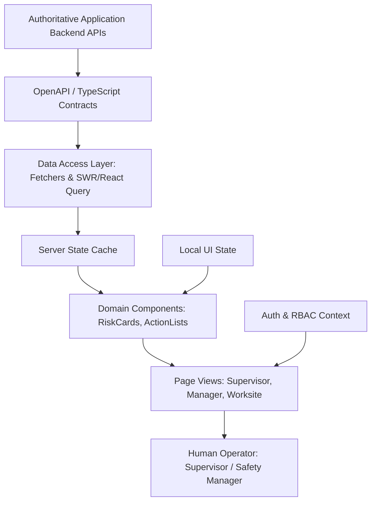

# 50 Frontend Architecture Specification

**Document Status:** Draft  
**Last Updated:** 2026-10-07  

---

## 1. Purpose and Visual Direction

This document defines the client-side software architecture, component hierarchy, state management, and design philosophy for the **Heat Action Response Engine** web application.

### Mandatory Visual Direction: Modern, Light SaaS Interface
The frontend must deliver a **bright, light, modern, clean, and professional SaaS interface**. It is engineered specifically for industrial operations and corporate safety managers who need rapid clarity under time pressure.

```text
┌────────────────────────────────────────────────────────────────────────┐
│ MANDATORY VISUAL PHILOSOPHY:                                           │
│ BRIGHT  +  CLEAN  +  CALM  +  PROFESSIONAL  +  ACTION-ORIENTED         │
├────────────────────────────────────────────────────────────────────────┤
│ • NOT dark by default, cyberpunk, or neon-heavy                       │
│ • NOT a chaotic weather consumer portal with distracting animations    │
│ • NOT an alarming hospital ICU monitor or emergency siren UI           │
│ • NOT a cluttered Wall Street financial trading terminal               │
│ • An authoritative, trustworthy enterprise operations console          │
└────────────────────────────────────────────────────────────────────────┘
```

The user experience creates **calm urgency and high accountability**. It enables field supervisors and safety executives to understand hazardous conditions instantly, see what needs to be done, acknowledge responsibilities, and verify physical workplace mitigations without cognitive friction.

---

## 2. Core UX Hierarchy

Every view in the platform answers seven operational questions in strict visual hierarchy:

```text
1. WHAT IS HAPPENING?        ──► Assessed Risk Level (LOW, MODERATE, HIGH, CRITICAL)
2. WHY DOES IT MATTER?       ──► Triggering Drivers (Heat Index 44°C, Direct Sun, Heavy Workload)
3. WHAT ACTION IS REQUIRED?  ──► Specific Operational Directive (Stage 25L Water Cooler)
4. WHO OWNS IT?              ──► Designated Responsible Role & Name (Supervisor Rahul Kumar)
5. HAS IT BEEN ACKNOWLEDGED? ──► Countdown Timer & Acknowledgment Status (Pending ACK)
6. IS IT VERIFIED?           ──► Field Mitigation Confirmation (Checklist Completed)
7. DOES IT NEED ESCALATION?  ──► Automated Elevation State (Escalated to Ananya Rao)
```

The most consequential information is positioned with the highest visual prominence. Secondary data is accessible through progressive disclosure.

---

## 3. Architecture Overview and Data Flow

The frontend is a decoupled Single Page Application (SPA) consuming strongly typed REST/JSON endpoints from the application backend:



### Strict Architectural Boundaries
* **The frontend does NOT determine safety:** It never calculates heat index thresholds, evaluates risk rules, triggers automated escalations, or mutates audit history.
* **The frontend is an operational presentation and interaction layer:** It renders backend state faithfully, captures human signatures/acknowledgments, and routes operations to authoritative endpoints.

---

## 4. Frontend Architectural Layers

The client application is organized into eleven decoupled architectural layers:

```text
 1. APP SHELL              : Global responsive layout, header, navigation, and user identity.
 2. ROUTING                : Role-aware client-side URL routing with route guards.
 3. AUTHENTICATION CONTEXT : User session token management, login state, and tenant binding.
 4. AUTHORIZATION CONTEXT   : RBAC evaluation matching roles (Supervisor vs. Safety Manager).
 5. DATA ACCESS LAYER      : Typed HTTP client handling headers, timeouts, and error parsing.
 6. SERVER STATE CACHE     : Query caching, optimistic updates, and background revalidation.
 7. DOMAIN STATE STORE     : Client-only operational state (active filters, drawer toggles).
 8. UI COMPONENT LIBRARY   : Generic primitive components (Buttons, Modals, Badges, Cards).
 9. DOMAIN COMPONENTS     : Business-specific widgets (RiskBadge, ActionCard, EscalationBanner).
10. PAGE VIEWS             : Composite routes (SupervisorDashboard, WorksiteDetail).
11. FEEDBACK & ERROR SYSTEM: Non-blocking toast notifications, error boundaries, and banners.
```

---

## 5. Technology Stack Direction

To align with modern web engineering standards, the target architecture specifies:

| Category | Recommended Technology Direction | Implementation Status |
| :--- | :--- | :--- |
| **Core Framework** | React 18+ (Functional Components & Hooks) | `APPROVED` |
| **Language** | TypeScript (Strict Mode Enabled) | `APPROVED` |
| **Build & Tooling** | Vite / Next.js (Fast HMR, ESM bundling) | `PENDING IMPLEMENTATION` |
| **Styling Architecture**| Vanilla CSS / Tailored CSS Modules / Utility Tokens | `PENDING IMPLEMENTATION` |
| **Data Fetching / Cache**| TanStack Query (React Query) or SWR | `PENDING IMPLEMENTATION` |
| **Client Routing** | React Router v6+ or Next.js App Router | `PENDING IMPLEMENTATION` |
| **Icons & Typography** | Modern SVG Icons (Lucide / Heroicons), Inter / Outfit font | `PENDING IMPLEMENTATION` |
| **Charts & Visualization**| Lightweight Canvas/SVG charts (Recharts / Chart.js) | `PENDING IMPLEMENTATION` |
| **Testing** | Vitest, React Testing Library, Playwright (E2E) | `PENDING IMPLEMENTATION` |

---

## 6. Lightweight App Shell Architecture

The App Shell establishes a distraction-free, light-neutral environment:

```text
┌────────────────────────────────────────────────────────────────────────┐
│ [Logo] Heat Action Response Engine   [Worksite Selector]  [Bell (3)] [User]│
├────────────────────────────────────────────────────────────────────────┤
│ [Dashboard]  [My Actions]  [Worksites]  [Escalations]  [Compliance]    │
├────────────────────────────────────────────────────────────────────────┤
│                                                                        │
│                      MAIN VIEW CONTENT CONTAINER                       │
│                                                                        │
└────────────────────────────────────────────────────────────────────────┘
```

### Key Shell Characteristics
* **Subtle Header:** Off-white background (`#FFFFFF`), subtle bottom border (`1px solid #E2E8F0`), zero heavy shadow.
* **Minimalist Brand Logo:** Clean typographic badge paired with a crisp status pulse.
* **Persistent Telemetry Pill:** Displays live connectivity and telemetry health (`VALID`, `STALE`, or `SIMULATION`).

---

## 7. Role-Aware Client Routing and Navigation

Navigation dynamically adapts to the authenticated persona’s permissions:

```text
┌───────────────────────────┬───────────────────────────┬───────────────────────────┐
│ FIELD SUPERVISOR          │ SAFETY MANAGER            │ SYSTEM ADMINISTRATOR      │
├───────────────────────────┼───────────────────────────┼───────────────────────────┤
│ • /dashboard (Operational)│ • /overview (Enterprise)  │ • /admin/system-health    │
│ • /my-actions (Assigned)  │ • /worksites (All Sites)  │ • /admin/integrations     │
│ • /worksite/:id (Details) │ • /escalations (Review)   │ • /admin/users-rbac       │
│ • /notifications          │ • /compliance-audit       │ • /admin/simulation       │
└───────────────────────────┴───────────────────────────┴───────────────────────────┘
```

Client-side route guards verify JWT claims before rendering protected routes. If a supervisor navigates to `/escalations`, the router redirects to an access-restricted boundary.

---

## 8. Foundational UX Design Principles

Five design principles govern all client-side implementations:

1. **Action-First Layout:** The user must immediately see *what requires physical intervention*. Metrics exist to support actions, not displace them.
2. **Progressive Disclosure:** Surface the risk level and critical action above the fold. Secondary factors (wind vectors, historical barometers) remain accessible via expandable panels.
3. **Calm Visual Discipline:** Eliminate flashing red screens or loud neon badges. High-risk states are displayed with authoritative, high-contrast clarity.
4. **Consistency Across Primitives:** Status badges, confirmation dialogues, and action cards use uniform geometry, typography, and spacing scales.
5. **Deterministic User Feedback:** Every user interaction (clicking "Acknowledge", submitting a checklist) provides immediate optimistic visual acknowledgment followed by background server confirmation.

---

## 9. Comprehensive State Handling: Loading, Error, and Empty

A professional enterprise application never leaves the user staring at a blank screen or a generic spinner:

### Loading State Matrix
* **Skeleton Loading:** Used for dashboard cards, rendering low-contrast gray placeholder pulses that maintain exact visual layout geometry during data retrieval.
* **Inline Button Spinners:** Used on "Acknowledge" and "Verify" buttons, preventing duplicate clicks while network calls complete.
* **Non-Blocking Background Refresh:** When weather refreshes in the background, a subtle, non-intrusive refresh dot indicates activity without dismounting UI components.

### Error State Protocol
Errors are specific, honest, and actionable:
```text
┌────────────────────────────────────────────────────────────────────────┐
│ ⚠️ TELEMETRY TEMPORARILY STALE                                          │
│ Weather telemetry for North Bengaluru has not updated in 75 minutes.   │
│ High-Risk safety precautions remain enforced. Inspect site manually.   │
│ [ Retry Connection ]                                                   │
└────────────────────────────────────────────────────────────────────────┘
```

### Meaningful Empty States
Empty states guide operational behavior:
* *No Pending Actions:* *"All morning heat actions verified. Monitoring afternoon forecast for Sector 4."*
* *No Escalations:* *"Zero active escalations across 12 worksites. All assigned supervisors have acknowledged on schedule."*

---

## 10. Accessibility Standards (WCAG 2.1 AA Compliance)

Worker safety requires accessible digital interfaces under harsh field conditions (glare, bright sunlight, dirty screens):

* **High-Contrast Text:** Text meets minimum 4.5:1 contrast ratios against card backgrounds.
* **Non-Color Safety Communication:** Every status color is accompanied by text and an icon:
  ```text
  [ ⚠️ HIGH RISK ]  (Red text + Warning Triangle Icon)
  ```
* **Full Keyboard Operability:** All modals, action lists, and drawer panels are fully navigable using `Tab`, `Enter`, `Space`, and `Escape`.
* **Touch-Friendly Hit Targets:** Mobile action buttons provide a minimum physical target size of $48 \times 48\text{ pixels}$.
* **Reduced Motion:** Respects `prefers-reduced-motion` operating system flags, disabling non-essential transitions.

---

## 11. Client-Side Performance Optimization

* **Zero Frame Drops:** Critical supervisory interfaces maintain 60 FPS scrolling and interaction speeds.
* **Aggressive Bundle Splitting:** Route-based lazy loading ensures the supervisor mobile client downloads $<150\text{ KB}$ of core JavaScript.
* **Stale-While-Revalidate (SWR):** Screens render instantly from client cache while validating freshness in the background.
* **Safety Freshness Invariant:** Client caching is bounded by strict TTLs; the application will never present cached weather data as fresh without a visible timestamp.

---

## 12. Real-Time Telemetry and Refresh States

The application top bar maintains an explicit environmental connectivity pill:

```text
┌─────────────┬─────────────────────────────────────────────────────────┐
│ STATE       │ VISUAL INDICATOR & OPERATIONAL MEANING                  │
├─────────────┼─────────────────────────────────────────────────────────┤
│ LIVE        │ Green dot: "Live Telemetry • Validated 2 mins ago"      │
│ REFRESHING  │ Subtle rotating icon: "Fetching latest forecast..."     │
│ AGING       │ Yellow dot: "Aging Telemetry • Refreshed 48 mins ago"   │
│ STALE       │ Orange dot: "Telemetry Stale • Fallback Active"         │
│ SIMULATION  │ High-contrast pill: "🔶 SIMULATION MODE ACTIVE"         │
└─────────────┴─────────────────────────────────────────────────────────┘
```

---

## 13. Final Design Principle

> **The frontend architecture delivers an authoritative, bright, and distraction-free operational cockpit; it structures complex environmental data into immediate human accountability without hiding behind visual clutter or unverified automation.**
