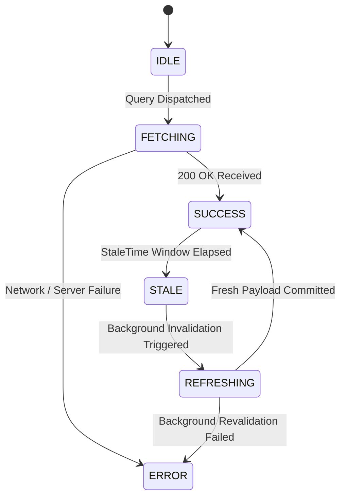
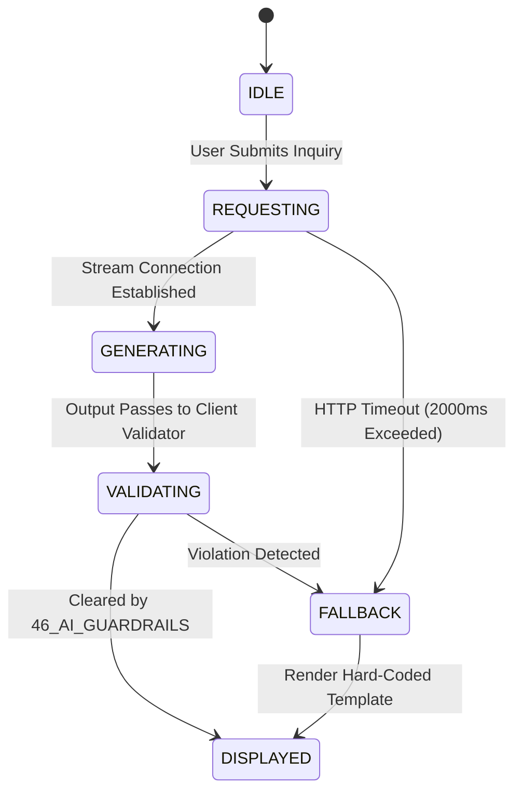

# 56 State Management Specification

**Document Status:** Draft  
**Last Updated:** 2026-10-07  

---

## 1. Document Purpose and Foundational Principle

This document specifies the client-side state architecture, caching policies, store boundaries, and error classification models for the **Heat Action Response Engine** frontend.

The state management architecture enforces one non-negotiable operational principle:

> **The frontend must never independently compute or duplicate safety business logic. All risk assessments, action rules, escalation timeouts, and authorization scopes are calculated by the authoritative backend and rendered faithfully by the frontend state stores.**

```text
┌────────────────────────────────────────────────────────────────────────┐
│ STATE FLOW DIRECTION:                                                  │
│ AUTHORITATIVE BACKEND DATABASE                                         │
│                │                                                       │
│                ▼ Strongly Typed REST API Payloads                      │
│ SERVER STATE CACHE (TanStack Query / SWR)                              │
│                │                                                       │
│                ▼ Derived Read-Only View Models                         │
│ DOMAIN PRESENTATION STORES                                             │
│                │                                                       │
│                ▼ Pure Props & Interactions                             │
│ UI COMPONENT LAYER (Cards, Modals, Forms)                              │
└────────────────────────────────────────────────────────────────────────┘
```

The frontend acts as an operational window into the backend's state of record. It never invents transitions or speculates on safety outcomes.

---

## 2. Seven Distinct State Categories

To prevent store bloat and race conditions, the client application categorizes state into seven decoupled domains:

```text
1. SERVER STATE        ──► Authoritative operational records from the backend database.
2. AUTHENTICATION      ──► JWT tokens, user identity, session expiration timers.
3. AUTHORIZATION (RBAC)──► User role, assigned worksite boundaries, permission claims.
4. LOCAL UI STATE      ──► Modals open/closed, active tab index, drawer toggles.
5. FORM STATE          ──► Transient input values, digital checklist checkboxes.
6. REAL-TIME / SYNC    ──► WebSocket connectivity, telemetry freshness indicators.
7. SIMULATION STATE    ──► Demo scenario parameters (strictly isolated from production).
```

---

## 3. Strict Non-Duplication of Business Logic

The frontend is explicitly prohibited from implementing client-side approximations of backend domain algorithms:

| Domain Calculation | Prohibited Client-Side Behavior | Mandatory Client-Side Implementation |
| :--- | :--- | :--- |
| **Heat Risk Scoring** | Computing heat index formulas or evaluating risk cutoffs in JavaScript. | Ingests `risk_level` enum directly from `/api/v1/worksite/:id/risk`. |
| **Action Generation** | Generating action cards based on local weather variables. | Consumes active actions directly from `/api/v1/worksite/:id/actions`. |
| **Escalation Cutoffs** | Client-side timer deciding when an action is officially escalated. | Reads `escalation_status` from backend; client displays countdown only. |
| **Role Clearance** | Client script deciding if user can override a safety stop. | Evaluates cryptographically verified claims delivered in user JWT. |

---

## 4. Server State Lifecycle Model

Server-derived records transition through an explicit lifecycle state machine:



### Critical Operational Distinctions
The state layer strictly differentiates three absence states:
* **`NO_DATA_AVAILABLE`:** Query succeeded, but zero actions or escalations are active.
* **`STALE_TELEMETRY`:** Records exist, but age exceeds freshness threshold.
* **`FETCH_FAILED`:** Network or server error prevented data retrieval.

---

## 5. Cautious Handling of Optimistic Updates

In standard consumer applications, optimistic updates provide perceived speed. In life-safety operations, **falsely implying that a safety action has succeeded before server confirmation is dangerous**:

```text
┌────────────────────────────────────────────────────────────────────────┐
│ OPTIMISTIC UPDATE POLICY MATRIX:                                       │
├────────────────────────────────────────────────────────────────────────┤
│ NON-CRITICAL UI STATE (PERMITTED):                                     │
│ • Expanding an action details drawer                                   │
│ • Toggling a dashboard filter chip                                     │
│ • Switching active UI tabs                                             │
├────────────────────────────────────────────────────────────────────────┤
│ SAFETY-CRITICAL OPERATIONAL ACTIONS (STRICTLY PROHIBITED):             │
│ • Marking an Action ACKNOWLEDGED before server commits to database     │
│ • Marking an Action VERIFIED before checklist is persisted             │
│ • Claiming an Escalation was resolved before backend approves          │
└────────────────────────────────────────────────────────────────────────┘
```

### Safety Action Flow
When a supervisor taps "Acknowledge":
1. Button enters an active pending state (`[ Acknowledging... ]`).
2. Mutation request dispatches to `/api/v1/actions/:id/acknowledge`.
3. UI updates to `ACKNOWLEDGED` **only after** HTTP 200 response with database commit confirmation is received.

---

## 6. Query Keys and Resource Identity Scoping

To prevent accidental cross-tenant or cross-worksite data contamination, all cache keys follow a strict hierarchical structure:

$$\text{QueryKey} = [\text{organization\_id}, \text{worksite\_id}, \text{entity\_type}, \text{scope\_parameters}]$$

```typescript
// Canonical Query Key Definitions
export const queryKeys = {
  currentRisk: (orgId: string, siteId: string) => 
    [orgId, siteId, 'risk', 'current'] as const,
    
  activeActions: (orgId: string, siteId: string, shiftId: string) => 
    [orgId, siteId, 'actions', 'active', shiftId] as const,
    
  escalations: (orgId: string, siteId?: string) => 
    [orgId, siteId ?? 'all', 'escalations'] as const,
    
  auditTrail: (orgId: string, actionId: string) => 
    [orgId, 'action', actionId, 'audit'] as const,
};
```

Switching worksites invalidates local queries, guaranteeing that Supervisor Rahul Kumar never sees residual data from an unrelated facility.

---

## 7. Granular Error Classification Store

The error store isolates failures into seven operational domains, ensuring users receive precise guidance rather than generic error messages:

```text
┌─────────────────────────┬─────────────────────────────────────────────┐
│ ERROR CLASSIFICATION    │ USER GUIDANCE & CLIENT BEHAVIOR             │
├─────────────────────────┼─────────────────────────────────────────────┤
│ AUTH_EXPIRED            │ Session token lapsed; trigger login modal.  │
│ PERMISSION_DENIED       │ User role restricted; display RBAC banner.  │
│ TELEMETRY_STALE         │ Weather API lag; display safe fallback.     │
│ NETWORK_OFFLINE         │ Mobile connection lost; display cache alert.│
│ VALIDATION_REJECTED     │ Form input failed schema checks.            │
│ SERVER_500_FAULT        │ Backend exception; log error, offer retry.  │
│ AI_ASSISTANT_UNAVAILABLE│ Inference endpoint offline; render fallback.│
└─────────────────────────┴─────────────────────────────────────────────┘
```

---

## 8. Authoritative State Machine Alignment

Frontend domain stores reflect the exact state transitions defined in [16_ACTION_MODEL.md](file:///d:/Amazon%202nd%20Hackathon%20Heat/docs/16_ACTION_MODEL.md):

$$\text{CREATED} \rightarrow \text{ASSIGNED} \rightarrow \text{NOTIFIED} \rightarrow \text{PENDING\_ACK} \rightarrow \text{ACKNOWLEDGED} \rightarrow \text{IN\_PROGRESS} \rightarrow \text{VERIFICATION\_PENDING} \rightarrow \text{VERIFIED}$$

The client-side store does not allow illegal state jumps. For example, an action cannot transition from `PENDING_ACK` directly to `VERIFIED` without passing through `ACKNOWLEDGED`.

---

## 9. Notification State vs. Action State Decoupling

A critical architectural distinction is enforced within client stores:

```text
NOTIFICATION STORE  ≠  ACTION STORE  ≠  ACKNOWLEDGMENT STATE
```

* Opening or dismissing an in-app notification **never** changes the status of the associated action.
* The notification store tracks `IS_READ`; the action store tracks `STATUS = PENDING_ACKNOWLEDGMENT`.
* Acknowledging an action in the Action Store triggers an event that clears the notification badge, not vice versa.

---

## 10. AI Assistant State Machine and Non-Blocking Isolation

The AI Assistant manages its own lifecycle in an isolated store, guaranteeing that inference latency never blocks the core dashboard:



If the AI inference service hangs or fails, the core Supervisor Dashboard continues to function with zero lag.

---

## 11. Client-Side Persistence and Cache Eviction Rules

* **Sensitive Data Ephemerality:** Worker rosters, personal supervisor phone numbers, and operational checklists are stored strictly in in-memory session caches; they are never written to `localStorage`.
* **Session Termination:** Logging out purges all in-memory React Query caches, resetting the application state completely.
* **Offline Drafts:** Checklists filled while offline are stored in encrypted browser IndexedDB storage and flushed immediately upon network re-establishment.

---

## 12. Complete State Management Matrix

| State Domain | Primary Store Mechanism | Persistence Scope | Invalidation Driver |
| :--- | :--- | :--- | :--- |
| **Current Risk** | TanStack Query Cache | In-Memory (TTL: 60s) | Ingestion Refresh / WebSocket Event |
| **Active Actions**| TanStack Query Cache | In-Memory (TTL: 30s) | Supervisor Mutation / Escalation Event |
| **Auth Session** | Secure Context + Token | Memory + SessionStorage | Expiration / Explicit Logout |
| **UI Toggles** | Zustand / React Context | Local UI State (Ephemera)| Component Unmount / Route Change |
| **Form Inputs** | React Hook Form | Local Component Memory | Form Submission / Reset |
| **Offline Queue** | Browser IndexedDB | Encrypted Local Disk | Successful Network Flush |

---

## 13. Final State Architecture Principle

> **Frontend state is an accurate, real-time mirror of authoritative backend reality; it manages user interaction smoothly without ever fabricating data, altering safety rules, or assuming that an unconfirmed action has succeeded.**
