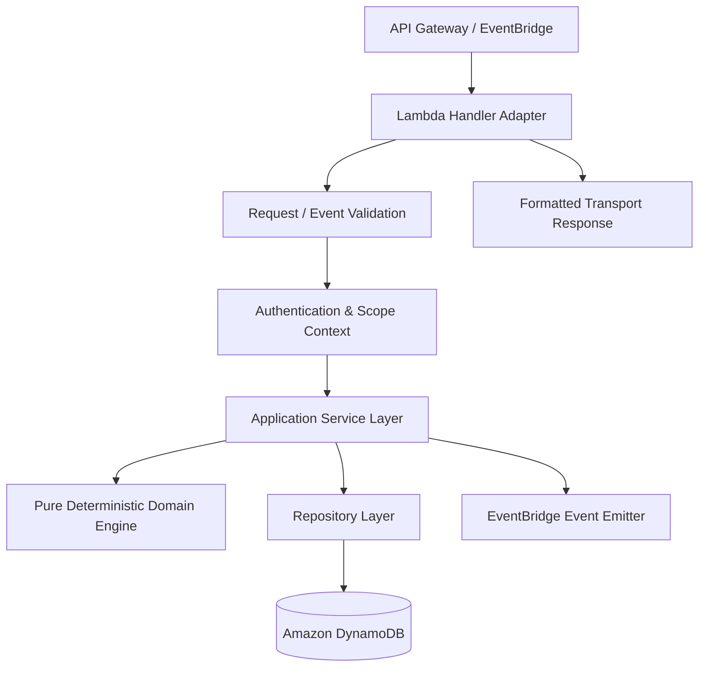
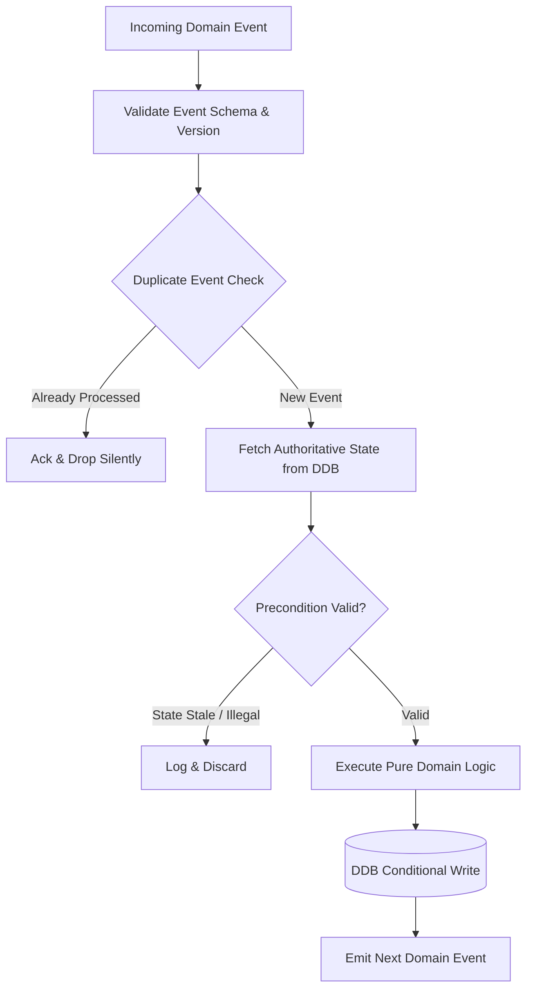

# AWS Lambda Compute Specification

**Document ID:** `66_LAMBDA`  
**Status:** Draft  
**Version:** 1.0.0  
**Last Updated:** 2026-10-07  
**Author:** Heat Action Response Engine Team  

---

## 1. Purpose

This document specifies the serverless compute architecture implemented via AWS Lambda for the Heat Action Response Engine. It defines how Lambda functions execute API operations, handle scheduled triggers, process asynchronous domain events, and orchestrate safety workflows without compromising domain authority or introducing unnecessary architectural fragmentation.

---

## 2. Scope

This specification governs:
* The execution boundaries and responsibilities of AWS Lambda across synchronous, scheduled, and event-driven domains.
* The clean architectural separation between Lambda handlers, application services, deterministic domain logic, and data repositories.
* Function packaging, modular domain organization, and cold-start optimization.
* Idempotency, retry mechanics, Dead-Letter Queue (DLQ) containment, and failure behavior.
* IAM execution roles, security boundaries, and observability standards.

*Out of Scope:* Concrete HTTP endpoint contracts (`70_API_CONTRACTS.md`), low-level DynamoDB schema definitions (`68_DYNAMODB.md`), and Step Functions state machine JSON definitions (`69_EVENTBRIDGE_STEP_FUNCTIONS.md`).

---

## 3. Architectural Role

> **"AWS Lambda is the serverless compute layer responsible for executing validated application and domain operations in response to API requests, scheduled triggers, and asynchronous domain events."**

Lambda functions act strictly as an **execution mechanism and transport boundary**. Lambda does not define safety policies, determine environmental risk thresholds, or replace the deterministic domain model. The domain model remains pure, testable TypeScript logic; Lambda provides the ephemeral compute environment that runs it.

---

## 4. Lambda Functional Responsibilities

Lambda executions fall into four distinct operational categories:

```text
┌────────────────────────────────────────────────────────────────────────┐
│                      LAMBDA EXECUTION CATEGORIES                       │
├─────────────────────┬──────────────────┬───────────────────────────────┤
│ CATEGORY            │ INVOCATION TYPE  │ PRIMARY WORKLOAD EXAMPLES     │
├─────────────────────┼──────────────────┼───────────────────────────────┤
│ 1. API Lambdas      │ Synchronous      │ Worksite CRUD, action query,  │
│                     │ (Request/Reply)  │ acknowledge action, verify,   │
│                     │                  │ escalation resolve, audit log │
├─────────────────────┼──────────────────┼───────────────────────────────┤
│ 2. Scheduled        │ Asynchronous     │ Hourly weather ingestion,     │
│    Lambdas          │ (EventBridge)    │ periodic data refresh, stale  │
│                     │                  │ telemetry scan, shift check   │
├─────────────────────┼──────────────────┼───────────────────────────────┤
│ 3. Event-Driven     │ Asynchronous     │ Risk reassessment trigger,    │
│    Lambdas          │ (Domain Events)  │ action generation, in-app     │
│                     │                  │ notification dispatch, DLQ    │
├─────────────────────┼──────────────────┼───────────────────────────────┤
│ 4. Workflow         │ Step Functions   │ SLA countdown checker, human  │
│    Task Lambdas     │ Task Token       │ escalation trigger, multi-tier│
│                     │                  │ notification cascade          │
└─────────────────────┴──────────────────┴───────────────────────────────┘
```

---

## 5. Layered Handler Architecture

Lambda handlers must remain **thin adapters**. Placing business rules, meteorological calculations, or direct database queries inside the Lambda handler function is strictly prohibited. Handlers translate transport inputs into typed commands, delegate to application services, and format transport responses.



### Handler Code Decoupling Model
1. **Lambda Handler (Transport Layer):** Extracts headers, claims, paths, and body. Maps event payload to internal Command/Query objects.
2. **Application Service (Use-Case Layer):** Coordinates transaction flow, validates business preconditions, queries repositories, and emits domain events.
3. **Domain Engine (Safety Core):** Pure TypeScript functions. Evaluates heat index formulas, threshold offsets, workload factors, and action rules (`20_HEAT_RISK_ENGINE.md`, `40_ACTION_ENGINE.md`).
4. **Repository Layer (Persistence):** Performs strongly consistent reads and transactional conditional writes against Amazon DynamoDB.

---

## 6. Lambda and Deterministic Safety

A foundational boundary of the platform is that compute infrastructure does not define safety:

```text
VALIDATED ENVIRONMENTAL DATA
             ↓
PURE DETERMINISTIC RISK ENGINE (TypeScript)
             ↓
AUTHORITATIVE RISK ASSESSMENT
             ↓
PURE DETERMINISTIC ACTION RULES (TypeScript)
             ↓
CONTEXTUAL ACTION DIRECTIVE
```

* **Zero Cloud Coupling:** The deterministic risk engine runs identically in a Lambda handler, a local Vitest unit test, or a mobile client preview.
* **AI Isolation:** When AI assistance is invoked via Lambda (`AIAssistantFunction`), it queries already-computed deterministic risk records from DynamoDB; the AI model **never** recalculates risk, overrides action priorities, or suppresses mandatory breaks.

---

## 7. Function Organization Strategy

To prevent the anti-pattern of maintaining dozens of micro-functions during a rapid hackathon deployment, the platform adopts a **Hybrid Domain Lambda Topology**:

```text
┌───────────────────────────────────┬───────────────────────────────────┐
│ REJECTED: MICRO-FUNCTION MONOLITH │ RECOMMENDED: HYBRID DOMAIN TOPOLOGY│
├───────────────────────────────────┼───────────────────────────────────┤
│ • 40+ separate Lambda functions   │ • 5-6 cohesive domain functions   │
│ • Severe cold-start distribution  │ • Shared in-memory domain core    │
│ • Massive CloudFormation template │ • Fast local testing and build    │
│ • Complex IAM role maintenance    │ • Clean boundary per lifecycle    │
└───────────────────────────────────┴───────────────────────────────────┘
```

### Functional Domain Allocation

```text
┌──────────────────────────┬──────────────────────┬──────────────────────────────┐
│ LAMBDA FUNCTION          │ TRIGGER SOURCE       │ DOMAIN RESPONSIBILITY        │
├──────────────────────────┼──────────────────────┼──────────────────────────────┤
│ `ApiHandlerFunction`     │ API Gateway Any Route│ Synchronous REST API routing,│
│                          │                      │ RBAC gating, Action commands │
├──────────────────────────┼──────────────────────┼──────────────────────────────┤
│ `WeatherIngestFunction`  │ EventBridge Schedule │ Polling Open-Meteo, unit     │
│                          │ (Cron: Hourly)       │ normalization, QA scoring    │
├──────────────────────────┼──────────────────────┼──────────────────────────────┤
│ `RiskEngineFunction`     │ EventBridge Bus      │ Ingests weather, runs math   │
│                          │ (`WEATHER_REFRESHED`)│ models, emits risk level     │
├──────────────────────────┼──────────────────────┼──────────────────────────────┤
│ `ActionEngineFunction`   │ EventBridge Bus      │ Matches risk to site profile,│
│                          │ (`RISK_ASSESSED`)    │ assigns supervisor, sets SLA │
├──────────────────────────┼──────────────────────┼──────────────────────────────┤
│ `EscalationFunction`     │ Step Functions / Bus │ Evaluates unacknowledged SLA,│
│                          │ (`SLA_BREACHED`)     │ alerts safety manager        │
├──────────────────────────┼──────────────────────┼──────────────────────────────┤
│ `AIAssistantFunction`    │ API Gateway Route    │ Builds grounded prompts,     │
│                          │ (`/assistant/chat`)  │ calls NVIDIA NIM with guards │
└──────────────────────────┴──────────────────────┴──────────────────────────────┘
```

---

## 8. Asynchronous Event Handling & At-Least-Once Delivery

Asynchronous event delivery via Amazon EventBridge or SQS provides **at-least-once delivery**. Handlers must be architected for duplicates, retries, and out-of-order execution.



### Safe Event Handling Guidelines:
1. **Event Schema Validation:** Validate that the incoming event matches recognized versions (`event_version: 1`).
2. **Authoritative Fetch:** Do not rely on event payload attributes as absolute truth; re-read the current entity state from DynamoDB using strongly consistent reads.
3. **Idempotency Guard:** Verify that the requested state transition has not already occurred.

---

## 9. Lambda Idempotency Mechanics

Critical operational actions (such as acknowledging an action or recording an escalation) must be strictly idempotent:

```typescript
// Conceptual Idempotent Conditional Acknowledgment Pattern
async function acknowledgeAction(actionId: string, supervisorId: string, idempotencyKey: string) {
  // 1. Check idempotency record in DynamoDB
  const existingRecord = await ddb.getIdempotency(idempotencyKey);
  if (existingRecord) {
    return existingRecord.cachedResponse;
  }

  // 2. Execute conditional update on Action Table
  try {
    const updatedAction = await ddb.update({
      TableName: "ActionsTable",
      Key: { action_id: actionId },
      UpdateExpression: "SET #st = :ack, acknowledged_by = :sup, acknowledged_at = :now",
      ConditionExpression: "attribute_exists(action_id) AND #st = :pending",
      ExpressionAttributeNames: { "#st": "status" },
      ExpressionAttributeValues: {
        ":ack": "ACKNOWLEDGED",
        ":pending": "PENDING_ACKNOWLEDGMENT",
        ":sup": supervisorId,
        ":now": new Date().toISOString()
      }
    });

    // 3. Save idempotency record and return
    await ddb.putIdempotency(idempotencyKey, updatedAction);
    return updatedAction;
  } catch (err) {
    if (err.name === "ConditionalCheckFailedException") {
      // Re-read current state to determine if already acknowledged
      const current = await ddb.get({ TableName: "ActionsTable", Key: { action_id: actionId } });
      if (current.Item.status === "ACKNOWLEDGED") {
        return current.Item; // Idempotent recovery
      }
      throw new ConflictError("Action state conflict: cannot acknowledge.");
    }
    throw err;
  }
}
```

---

## 10. Failure Handling & Resilience Matrix

```text
┌──────────────────────────┬──────────────────────────┬──────────────────────────┐
│ FAILURE MODE             │ RECOVERY MECHANISM       │ OPERATIONAL SAFETY IMPACT│
├──────────────────────────┼──────────────────────────┼──────────────────────────┤
│ Weather Ingest Timeout   │ Exponential backoff (3x);│ Mark telemetry as STALE; │
│ (Open-Meteo down)        │ fail gracefully.         │ preserve conservative    │
│                          │                          │ existing safeguards.     │
├──────────────────────────┼──────────────────────────┼──────────────────────────┤
│ DynamoDB Throttling      │ SDK automatic retry with │ Slight latency increase; │
│                          │ full jitter.             │ zero dropped writes.     │
├──────────────────────────┼──────────────────────────┼──────────────────────────┤
│ Action Engine Exception  │ Event moves to SQS DLQ   │ Operator alarmed via     │
│ (Malformed input)        │ after 3 failed attempts. │ CloudWatch; no bad state.│
├──────────────────────────┼──────────────────────────┼──────────────────────────┤
│ AI Assistant 500 Outage  │ Immediate fallback to    │ Briefing rendered via    │
│ (NVIDIA NIM unavailable) │ deterministic templates. │ static templates.        │
├──────────────────────────┼──────────────────────────┼──────────────────────────┤
│ Concurrency Conflict     │ Return HTTP 409 Conflict │ Client prompts user to   │
│ (Race condition)         │ with current state.      │ refresh dashboard.       │
└──────────────────────────┴──────────────────────────┴──────────────────────────┘
```

> **CRITICAL RULE: A Lambda execution failure must NEVER result in a silent downgrade to LOW risk.**

---

## 11. Security & IAM Execution Boundaries

Lambda execution roles enforce strict, fine-grained access policies conforming to the principle of least privilege:
* **No Blanket Policies:** `AdministratorAccess` and `AmazonDynamoDBFullAccess` are strictly barred.
* **Table-Level Scoping:** The `WeatherIngestFunction` execution role is granted write access exclusively to the `WeatherTable`; it has zero write permissions on `ActionsTable` or `UsersTable`.
* **Zero Secrets in Code:** Environment variables store only resource names (`TABLE_NAME`, `EVENT_BUS_NAME`). All credentials (API keys, JWT signing keys) are fetched dynamically from AWS Secrets Manager with in-memory caching.
* **Input Sanitization:** Every string and numeric input is sanitized and bounds-checked before being passed to SQL/NoSQL query layers or external HTTP calls.

---

## 12. Observability & Structured Logging

All Lambda functions output standardized JSON log events to Amazon CloudWatch using `AWS Lambda Powertools`:

```json
{
  "timestamp": "2026-10-07T14:20:00.123Z",
  "level": "INFO",
  "service": "action-engine",
  "function_name": "ActionEngineFunction",
  "request_id": "c6b4122d-67b1-4233-a3d8-91890e9e144a",
  "correlation_id": "corr_01HXYZ9910",
  "org_id": "org_infra_corp",
  "worksite_id": "site_blr_north_01",
  "action_id": "act_88219",
  "message": "Action successfully acknowledged by supervisor",
  "duration_ms": 42.5
}
```

### Metrics & Alarms Emitted:
* `ActionAcknowledgmentLatency`: Duration between action generation and supervisor acknowledgment.
* `UnacknowledgedEscalationCount`: Metric incremented whenever `EscalationFunction` fires.
* `TelemetryStalenessMinutes`: Duration since last successful weather observation ingest.

---

## 13. Performance & Cold-Start Optimization

1. **Architecture:** Deployed on AWS Graviton2 (`arm64`), delivering $\approx 20\%$ lower cost and improved execution efficiency compared to x86_64.
2. **Bundling:** Tree-shaken via esbuild/Vite to produce single-file bundles under $10\text{ MB}$.
3. **Execution Context Reuse:** Database clients (AWS SDK v3 `DynamoDBClient`) and HTTP connection pools are initialized outside the handler function in global scope.
4. **Memory Sizing:** Allocated 512 MB to 1024 MB; provides optimal CPU allocation to keep typical invocation durations under $50\text{ ms}$.

---

## 14. Non-Goals

Lambda explicitly does **not**:
* Serve as a permanent in-memory state cache (all state resides in DynamoDB).
* Act as an independent medical or occupational safety authority.
* Make autonomous threshold policy alterations based on AI output.
* Provide long-running background tasks exceeding 15 minutes.
* Handle direct client-side database connections.

---

## 15. Cross-Document References

* `60_SYSTEM_ARCHITECTURE.md`: High-level five-tier architecture.
* `61_TECH_STACK.md`: Runtime, language, and tool choices.
* `63_API_ARCHITECTURE.md`: API routing and error contracts.
* `67_API_GATEWAY.md`: Ingress routing and edge verification.
* `68_DYNAMODB.md`: Operational data persistence schemas.
* `69_EVENTBRIDGE_STEP_FUNCTIONS.md`: Asynchronous events and workflow state machines.
* `85_AUDIT_LOGGING.md`: Immutable compliance event formatting.
