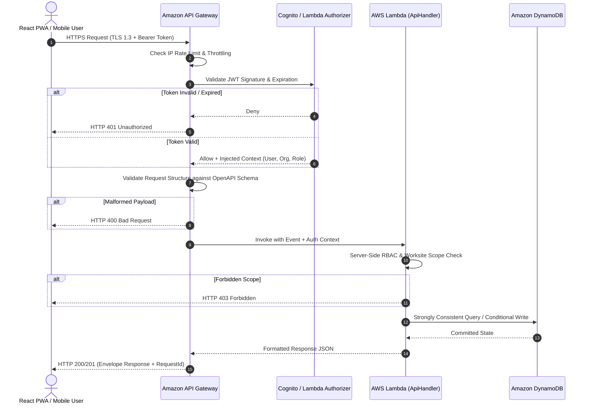
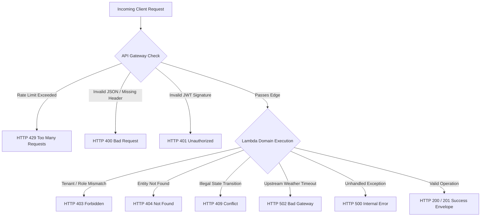

# Amazon API Gateway Specification

**Document ID:** `67_API_GATEWAY`  
**Status:** Draft  
**Version:** 1.0.0  
**Last Updated:** 2026-10-07  
**Author:** Heat Action Response Engine Team  

---

## 1. Purpose

This document specifies the architecture, routing rules, edge security controls, and operational boundaries of Amazon API Gateway within the Heat Action Response Engine. It governs how the React/PWA frontend, mobile supervisor views, and administrative clients interface with backend serverless compute.

---

## 2. Scope

This specification defines:
* API Gateway's role as the edge ingress controller and protocol termination boundary.
* The end-to-end HTTP request lifecycle, authentication gates, and token extraction mechanisms.
* Structural request validation, rate throttling, burst protection, and CORS policies.
* Error classification, timeout boundaries, and observability metrics.
* Integration with synchronous Lambda handlers and asynchronous domain boundaries.

*Out of Scope:* Detailed individual endpoint payload schemas (`70_API_CONTRACTS.md` through `79_ERROR_CONTRACTS.md`), internal Lambda function code (`66_LAMBDA.md`), and DynamoDB storage modeling (`68_DYNAMODB.md`).

---

## 3. Architectural Role

> **"Amazon API Gateway is the managed HTTP entry point that routes client requests to backend services, applies edge-level traffic and security controls, and provides a strict isolation boundary between public networks and internal application logic."**

### Critical Boundary Mandates:
* **API Gateway is NOT the business logic layer:** It does not calculate heat indices, evaluate action priority rules, enforce escalation timeouts, or generate compliance audit entries.
* **API Gateway is an edge enforcer:** It handles TLS termination, request rate limiting, payload size caps, CORS headers, and preliminary token validation before passing execution to AWS Lambda.

---

## 4. End-to-End Request Flow

Every client request follows an unambiguous, verifiable pipeline from edge ingress to backend response:



---

## 5. API Base Path & Versioning

All endpoints are organized under an explicit, major-versioned base path:

```text
/api/v1/
```

### Major Resource Collections
```text
/api/v1/organizations   # Multi-tenant organization configuration
/api/v1/users           # User identity, assigned roles, preferences
/api/v1/worksites       # Physical worksite profiles, locations, facilities
/api/v1/shifts          # Worksite shifts, active schedules, worker counts
/api/v1/weather         # Normalized weather observations and forecast runs
/api/v1/risks           # Authoritative heat-risk assessments and factor breakdowns
/api/v1/actions         # Workplace mitigation action directives and command routes
/api/v1/notifications   # In-app alerts, unread counts, delivery receipts
/api/v1/escalations     # Unacknowledged action breach tracking and interventions
/api/v1/audit           # Immutable compliance audit log inspection
/api/v1/assistant       # Grounded AI explanatory chat and worker briefings
```

---

## 6. HTTP & Edge Responsibilities

```text
┌───────────────────────────────────┬───────────────────────────────────┐
│ MANAGED BY API GATEWAY            │ MANAGED BY AWS LAMBDA / DOMAIN    │
├───────────────────────────────────┼───────────────────────────────────┤
│ • TLS 1.3 Termination & HSTS      │ • Role-Based Access Control (RBAC)│
│ • Client IP Rate Limiting         │ • Worksite tenancy scoping check  │
│ • Request Payload Size Caps (1MB) │ • Semantic domain rule evaluation │
│ • CORS Pre-flight (OPTIONS)       │ • Legal state-machine transitions │
│ • OpenAPI Structural Validation   │ • DynamoDB atomic mutations       │
│ • Edge HTTP Metric Aggregation    │ • Immutable compliance logging    │
└───────────────────────────────────┴───────────────────────────────────┘
```

---

## 7. Authentication Architecture

Authentication is enforced at the edge prior to Lambda execution.
* **Mechanism:** OpenID Connect (OIDC) / OAuth 2.0 Bearer tokens transmitted via the `Authorization: Bearer <JWT>` header.
* **Identity Provider Integration [PENDING VERIFICATION]:** Amazon Cognito User Pools or verified identity gateway.
* **Edge Validation:** API Gateway authorizer cryptographically validates the token's RS256 signature against the provider's JSON Web Key Set (JWKS), confirming token freshness (`exp`) and audience (`aud`).
* **Identity Injection:** Valid claims (`user_id`, `org_id`, `role`, `assigned_worksites`) are injected into the Lambda event context:
  `event.requestContext.authorizer.claims`

---

## 8. Authorization & Scoping Model

While API Gateway validates identity authenticity, **AWS Lambda enforces domain authorization**:

```text
AUTHENTICATED IDENTITY
          ↓
TENANT ORGANIZATION CHECK (Token org_id === Target Resource org_id)
          ↓
WORKSITE SCOPE CHECK (Token worksites.includes(worksite_id) OR role === 'SAFETY_MANAGER')
          ↓
ROLE CAPABILITY CHECK (e.g. SUPERVISOR can Acknowledge, but only SAFETY_MANAGER can Verify)
          ↓
STATE TRANSITION AUTHORIZATION (Is resource currently in legal state?)
```

> **Security Rule: Never trust client-provided claims or frontend UI visibility. All authorization decisions are strictly verified on the server.**

---

## 9. Structural Validation vs. Domain Validation

The architecture enforces a strict distinction between structural validation and domain validation:

```text
┌───────────────────────────────────┬───────────────────────────────────┐
│ STRUCTURAL VALIDATION             │ DOMAIN VALIDATION                 │
│ (Executed at API Gateway Edge)    │ (Executed in Backend Domain Core) │
├───────────────────────────────────┼───────────────────────────────────┤
│ • Is JSON syntactically valid?    │ • Does the worksite exist?        │
│ • Are required fields present?    │ • Is the user on duty for shift?  │
│ • Is temperature a valid float?   │ • Is action currently PENDING_ACK?│
│ • Is latitude between -90 and 90? │ • Has SLA timer already breached? │
│ • Is timestamp ISO 8601 UTC?      │ • Does supervisor have ownership? │
├───────────────────────────────────┼───────────────────────────────────┤
│ Result: 400 Bad Request           │ Result: 403 Forbidden / 409 Conf. │
└───────────────────────────────────┴───────────────────────────────────┘
```

---

## 10. CORS Policy (Cross-Origin Resource Sharing)

API Gateway implements strict CORS policies tailored to secure web applications:
* **Allowed Methods:** `GET`, `POST`, `PUT`, `DELETE`, `OPTIONS`.
* **Allowed Headers:** `Authorization`, `Content-Type`, `X-Request-Id`, `Idempotency-Key`, `If-Match`.
* **Allowed Origins:** Explicitly restricted to authorized domain origins:
  * Development: `http://localhost:5173`
  * Demonstration: `https://demo.heataction.example`
* **Wildcard Prohibition:** The wildcard `Access-Control-Allow-Origin: *` is **strictly prohibited** on authenticated production API endpoints.

---

## 11. Rate Limiting, Throttling & Abuse Protection

To safeguard backend infrastructure from mobile reconnection storms or denial-of-service attempts:
* **Default Stage Limits:**
  * Rate: 1,000 requests/second.
  * Burst: 2,000 requests.
* **Per-Client Throttling:** Usage plans restrict individual unauthenticated IP addresses to 50 requests/minute.
* **Response:** Exceeding limits triggers an immediate `429 Too Many Requests` response with a `Retry-After` header, dropping traffic before Lambda compute is invoked.

---

## 12. Idempotency & Retries on Safety Commands

Because mobile devices on job sites frequently experience transient network disconnects, clients may retry commands automatically:

```text
CLIENT SENDS COMMAND
(POST /api/v1/actions/{id}/acknowledge with Idempotency-Key: <UUID>)
                     │
                     ▼
API GATEWAY PASSES TO LAMBDA
                     │
                     ▼
CHECK IDEMPOTENCY RECORD IN DYNAMODB
                     │
      ┌──────────────┴──────────────┐
      ▼ (Key Exists in Cache)       ▼ (New Idempotency Key)
RETURN CACHED 200 RESPONSE    EXECUTE CONDITIONAL WRITE
(Zero duplicate processing)   STORE RESULT WITH 24-HR TTL
```

Commands protected by idempotency keys include:
* `POST /api/v1/actions/{id}/acknowledge`
* `POST /api/v1/actions/{id}/verify`
* `POST /api/v1/escalations/{id}/resolve`

---

## 13. Timeout Boundaries & Semantic Safety

* **API Gateway Timeout:** Fixed at $29\text{ seconds}$ (AWS managed limit).
* **Lambda REST Timeout:** Configured to $10\text{ seconds}$ (typical completion $<150\text{ ms}$).
* **Client Request Timeout:** Configured to $8\text{ seconds}$ in React PWA TanStack Query.

### Crucial Life-Safety Timeout Rule:
> **"A client or gateway timeout does NOT prove an operational action failed or succeeded."**

If an acknowledgment request times out at 8 seconds due to cellular jitter:
1. The client must **never** falsely mark the action as confirmed.
2. The client must **never** assume the action was dropped.
3. The client queries `GET /api/v1/actions/{id}` upon reconnection to reconcile authoritative state.

---

## 14. Real-Time UI & Invalidation Boundaries

The relationship between API Gateway and real-time state conforms to `57_REAL_TIME_UI.md`:
* **REST as Authority:** The REST API is the sole mechanism for retrieving full, validated application state on initial page load and user command submissions.
* **Lightweight Signals:** Asynchronous push mechanisms (SSE / WebSockets) deliver lightweight event invalidation flags (`RISK_UPDATED: site_blr_north_01`).
* **Authoritative Refetch:** The client receives the invalidation signal and executes a standard `GET /api/v1/worksites/{id}/dashboard` query via API Gateway to retrieve fresh authoritative state.

---

## 15. Standardized Error Handling Architecture

When requests fail, API Gateway and Lambda emit standardized JSON payloads conforming to `63_API_ARCHITECTURE.md`:



---

## 16. Observability & Edge Telemetry

API Gateway emits real-time telemetry directly into Amazon CloudWatch:
* **Access Logging:** Emits JSON log lines capturing `$context.requestId`, `$context.identity.sourceIp`, `$context.httpMethod`, `$context.status`, `$context.responseLatency`, and `$context.authorizer.claims.sub`.
* **Execution Metrics:** Monitored via CloudWatch dashboards:
  * `Count` (Total API volume)
  * `4XXError` (Client errors, malformed payloads, auth failures)
  * `5XXError` (Compute crashes, upstream timeouts)
  * `Latency` / `IntegrationLatency` (Edge overhead vs Lambda duration)

---

## 17. Environments & Stage Management

API Gateway is deployed across distinct stages managed via Infrastructure as Code:
* `local`: Mocked via local Express routing wrapper.
* `dev`: Continuous development stage on AWS.
* `demo`: Frozen, high-availability stage for hackathon evaluation and judge walkthroughs.
* `production`: Future enterprise deployment stage.

---

## 18. Non-Goals

Amazon API Gateway explicitly does **not**:
* Serve as a permanent caching database.
* Execute mathematical heat stress algorithms.
* Make escalation routing decisions.
* Provide arbitrary, unauthenticated public data access.

---

## 19. Cross-Document References

* `60_SYSTEM_ARCHITECTURE.md`: System topology and decoupling layers.
* `63_API_ARCHITECTURE.md`: REST API conventions, envelopes, and status codes.
* `66_LAMBDA.md`: Backend execution runtime.
* `68_DYNAMODB.md`: Authoritative data storage.
* `70_API_CONTRACTS.md`: Comprehensive endpoint schema definitions.
* `79_ERROR_CONTRACTS.md`: Standardized error JSON schemas.
