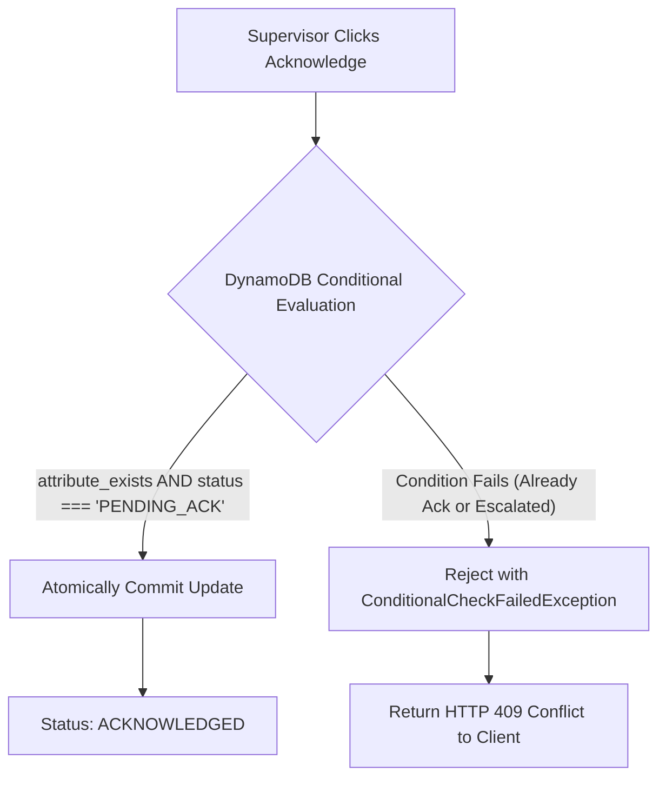

# Amazon DynamoDB Operational Storage Specification

**Document ID:** `68_DYNAMODB`  
**Status:** Draft  
**Version:** 1.0.0  
**Last Updated:** 2026-10-07  
**Author:** Heat Action Response Engine Team  

---

## 1. Purpose

This document specifies the Amazon DynamoDB database architecture for the Heat Action Response Engine. It defines the operational persistence layer that preserves authoritative application state, enforces atomic safety state transitions, prevents race conditions, and guarantees immutable compliance auditability.

---

## 2. Scope

This specification defines:
* The access-pattern-first data modeling methodology.
* Primary key (`PK`), sort key (`SK`), and Global Secondary Index (`GSI`) patterns.
* Strongly consistent read semantics versus eventual consistency tradeoffs.
* Conditional writes for safety-critical state-machine transitions.
* Atomic transactions (`TransactWriteItems`) for paired state and audit persistence.
* Data quality flag persistence, Time to Live (TTL) boundaries, and backup policies.

*Out of Scope:* Low-level AWS SDK configuration code (`66_LAMBDA.md`) and API payload schemas (`70_API_CONTRACTS.md`).

---

## 3. Architectural Role

> **"Amazon DynamoDB is the primary operational data store for all authoritative application state, including worksites, worker rosters, weather telemetry, risk evaluations, mitigation directives, acknowledgments, escalations, and compliance audit logs."**

```text
┌────────────────────────────────────────────────────────────────────────┐
│                      ARCHITECTURAL RESPONSIBILITIES                    │
├─────────────────────┬──────────────────────────────────────────────────┤
│ COMPONENT           │ EXACT OPERATIONAL ROLE                           │
├─────────────────────┼──────────────────────────────────────────────────┤
│ Amazon DynamoDB     │ Authoritative persistent operational state store │
├─────────────────────┼──────────────────────────────────────────────────┤
│ Risk Engine         │ Pure deterministic calculation and math rules    │
├─────────────────────┼──────────────────────────────────────────────────┤
│ Action Engine       │ Pure contextual action generation logic          │
├─────────────────────┼──────────────────────────────────────────────────┤
│ Amazon EventBridge  │ Asynchronous event routing and cron scheduling   │
├─────────────────────┼──────────────────────────────────────────────────┤
│ AWS Step Functions  │ Multi-step workflow and escalation orchestration │
└─────────────────────┴──────────────────────────────────────────────────┘
```

DynamoDB holds the ground truth. Client caches, event payloads, and intermediate Lambda memory are provisional; an operational action is only real when committed to DynamoDB.

---

## 4. Data Modeling Philosophy

DynamoDB is a distributed NoSQL key-value and document database. **Designing DynamoDB like a normalized relational database is an anti-pattern.** The data model is engineered strictly around access patterns:

```text
BUSINESS USE CASES & QUERIES
             ↓
REQUIRED ACCESS PATTERNS IDENTIFIED
             ↓
COMPOSITE KEYS & INDEXES DESIGNED
             ↓
DENORMALIZATION APPLIED WHERE OPERATIONAL
             ↓
TABLE TOPOLOGY CHOSEN
```

### Core Modeling Principles:
1. **Access-Pattern First:** Primary keys and indices are designed to satisfy exact application queries with zero full-table scans (`Query` over `Scan`).
2. **Denormalization for Speed:** Action records embed snapshot attributes of the target worksite (e.g., worksite name, assigned shade area) at generation time to eliminate multi-table lookups during emergency field responses.
3. **Partition Key Cardinality:** Partition keys combine tenant and entity identifiers (`ORG#<orgId>#SITE#<siteId>`) to prevent hot partitions under concurrent shift activity.
4. **Strong Consistency for Safety:** Reads and writes involving action acknowledgments, escalations, and verifications mandate strongly consistent operations.

---

## 5. Core Logical Entities

```text
┌──────────────────────────┬──────────────────────────────────────────────────┐
│ ENTITY DOMAIN            │ ATTRIBUTES & OPERATIONAL PURPOSE                 │
├──────────────────────────┼──────────────────────────────────────────────────┤
│ 1. Organization          │ Tenant profile, subscription tier, global contact│
│ 2. User                  │ User profile, contact, role (Admin, Mgr, Sup)    │
│ 3. Worksite              │ Geo coordinates, facilities, shade/water points  │
│ 4. Shift                 │ Active shift times, worker counts, task intensity│
│ 5. WeatherRecord         │ Ingested temperature, humidity, solar, QA flags  │
│ 6. RiskAssessment        │ Computed risk level, factor vectors, rule version│
│ 7. ActionRecord          │ Required safeguard, status, owner, SLA countdown │
│ 8. Notification          │ In-app dispatch record, read receipt, timestamp  │
│ 9. Escalation            │ SLA breach event, target manager, resolution log │
│ 10. AuditEvent           │ Immutable append-only operational compliance log │
└──────────────────────────┴──────────────────────────────────────────────────┘
```

---

## 6. Table Organization Strategy (Hybrid MVP Approach)

While pure single-table design is powerful, maintaining an ultra-dense single table during a rapid hackathon can introduce debugging friction and complex schema overloading.

The platform adopts a **Pragmatic Hybrid Table Strategy** for the MVP:

```text
┌──────────────────────────┬──────────────────────────────────────────────────┐
│ PHYSICAL TABLE           │ CONTAINED LOGICAL ENTITIES                       │
├──────────────────────────┼──────────────────────────────────────────────────┤
│ `OperationalTable`       │ Worksites, Shifts, Users, Active Actions,        │
│                          │ Risk Assessments, Active Escalations             │
├──────────────────────────┼──────────────────────────────────────────────────┤
│ `TelemetryTable`         │ Raw, Normalized & Historical Weather Ingestion   │
├──────────────────────────┼──────────────────────────────────────────────────┤
│ `AuditTable`             │ Immutable Compliance Audit Log (Append-Only)     │
└──────────────────────────┴──────────────────────────────────────────────────┘
```

### Why this hybrid strategy?
* **Isolates Telemetry Volume:** Ingesting hourly weather records across dozens of sites does not consume read/write capacity units allocated to high-priority supervisor action commands.
* **Preserves Audit Immutability:** Isolating `AuditTable` enables strict IAM policies granting `PutItem` without any `UpdateItem` or `DeleteItem` permissions, guaranteeing regulatory compliance.
* **Simplifies Query Patterns:** `OperationalTable` easily supports single-query dashboard fetches via composite partition keys.

---

## 7. Primary Access Patterns

The table architecture directly satisfies the thirteen mandatory operational queries:

```text
┌────┬────────────────────────────────────┬──────────────────┬───────────────┐
│ #  │ OPERATIONAL QUERY                  │ TARGET TABLE     │ METHOD        │
├────┼────────────────────────────────────┼──────────────────┼───────────────┤
│ Q1 │ Get worksite profile by ID         │ OperationalTable │ PK/SK GetItem │
│ Q2 │ List all worksites for organization│ OperationalTable │ GSI1 Query    │
│ Q3 │ Get current risk for worksite      │ OperationalTable │ PK/SK GetItem │
│ Q4 │ Get active actions for worksite    │ OperationalTable │ GSI2 Query    │
│ Q5 │ Get actions assigned to supervisor │ OperationalTable │ GSI3 Query    │
│ Q6 │ Get action by ID                   │ OperationalTable │ PK/SK GetItem │
│ Q7 │ Acknowledge action conditionally   │ OperationalTable │ UpdateItem    │
│ Q8 │ List active escalations for manager│ OperationalTable │ GSI2 Query    │
│ Q9 │ Get latest weather observation     │ TelemetryTable   │ PK/SK Query   │
│ Q10│ Get hourly weather forecast series │ TelemetryTable   │ PK Query      │
│ Q11│ Write compliance audit event       │ AuditTable       │ PutItem       │
│ Q12│ Get audit trail for specific action│ AuditTable       │ GSI1 Query    │
│ Q13│ Get audit trail for worksite/range │ AuditTable       │ PK Query      │
└────┴────────────────────────────────────┴──────────────────┴───────────────┘
```

---

## 8. Conceptual Key & Schema Design Patterns

*(All keys are conceptual patterns demonstrating access pattern satisfaction.)*

### 8.1 `OperationalTable` Schema
* **Primary Key:** `PK` (String), `SK` (String)

```text
┌───────────────────────┬──────────────────────────┬─────────────────────────────────────────┐
│ ENTITY TYPE           │ PARTITION KEY (PK)       │ SORT KEY (SK)                           │
├───────────────────────┼──────────────────────────┼─────────────────────────────────────────┤
│ Organization          │ `ORG#<orgId>`            │ `METADATA`                              │
│ User                  │ `ORG#<orgId>`            │ `USER#<userId>`                         │
│ Worksite              │ `ORG#<orgId>`            │ `SITE#<siteId>`                         │
│ Shift                 │ `SITE#<siteId>`          │ `SHIFT#<shiftId>`                       │
│ Current Risk          │ `SITE#<siteId>`          │ `RISK#CURRENT`                          │
│ Action Record         │ `SITE#<siteId>`          │ `ACTION#<actionId>`                     │
│ Escalation Record     │ `SITE#<siteId>`          │ `ESCALATION#<escId>`                    │
└───────────────────────┴──────────────────────────┴─────────────────────────────────────────┘
```

### Global Secondary Indexes (GSIs):
* **GSI1 (Organization Worksites):**
  * `GSI1PK = ORG#<orgId>`, `GSI1SK = SITE#<siteId>`
* **GSI2 (Active Worksite Actions by Status):**
  * `GSI2PK = SITE#<siteId>`, `GSI2SK = STATUS#<status>#PRIORITY#<priority>`
* **GSI3 (Supervisor Action Inbox):**
  * `GSI3PK = USER#<supervisorId>`, `GSI3SK = STATUS#<status>#DEADLINE#<timestamp>`

### 8.2 `TelemetryTable` Schema
* `PK = SITE#<siteId>`
* `SK = WEATHER#<timestamp>` (e.g., `WEATHER#2026-10-07T14:00:00Z`)
* Attributes: `dry_bulb_c`, `relative_humidity`, `solar_radiation`, `wind_speed`, `heat_index_c`, `quality_status`, `data_source`.

### 8.3 `AuditTable` Schema
* `PK = SITE#<siteId>`
* `SK = AUDIT#<timestamp>#<auditId>`
* `GSI1PK = RESOURCE#<actionId>`, `GSI1SK = <timestamp>`
* Attributes: `actor_id`, `actor_role`, `event_type`, `previous_state`, `new_state`, `rule_version`, `reason`.

---

## 9. Read Consistency Model

DynamoDB supports both eventually consistent and strongly consistent reads:

```text
┌───────────────────────────────────┬───────────────────────────────────┐
│ EVENTUALLY CONSISTENT READS       │ STRONGLY CONSISTENT READS         │
│ (Default, Half Cost)              │ (Mandatory for Safety State)      │
├───────────────────────────────────┼───────────────────────────────────┤
│ • Historical weather trends       │ • Active action list on mobile    │
│ • Long-term compliance analytics  │ • Current worksite heat risk badge│
│ • Non-urgent notification lists   │ • Acknowledgment pre-check        │
│ • Worksite facility descriptions  │ • Verification sign-off check     │
│ • User preference profiles        │ • Escalation SLA status           │
└───────────────────────────────────┴───────────────────────────────────┘
```

*Rule:* All queries driving active operational decisions in the field must specify `ConsistentRead: true`.

---

## 10. Conditional Writes: State Machine Protection

To eliminate race conditions and enforce legal state machine transitions, mutations employ DynamoDB **Conditional Expressions**:



### Concrete DynamoDB Conditional Update Expression
```json
{
  "TableName": "OperationalTable",
  "Key": {
    "PK": { "S": "SITE#site_blr_north_01" },
    "SK": { "S": "ACTION#act_88219" }
  },
  "UpdateExpression": "SET #st = :ack, acknowledged_by = :user, acknowledged_at = :now, resource_version = resource_version + :inc",
  "ConditionExpression": "attribute_exists(PK) AND #st = :pending AND assigned_to = :user",
  "ExpressionAttributeNames": {
    "#st": "status"
  },
  "ExpressionAttributeValues": {
    ":pending": { "S": "PENDING_ACKNOWLEDGMENT" },
    ":ack": { "S": "ACKNOWLEDGED" },
    ":user": { "S": "usr_sup_rahul" },
    ":now": { "S": "2026-10-07T14:20:00.123Z" },
    ":inc": { "N": "1" }
  }
}
```

---

## 11. Transactional Writes (`TransactWriteItems`)

Where state mutations require atomic all-or-nothing execution across entities, DynamoDB Transactions are utilized:

### Example: Acknowledging an Action and Creating an Audit Event
```text
TRANSACTION BEGIN
  1. Update OperationalTable:
     Action status -> ACKNOWLEDGED (Conditional on PENDING_ACK)
  2. PutItem to AuditTable:
     Write immutable audit entry for ACTION_ACKNOWLEDGED
TRANSACTION COMMIT
```
If the action status check fails, the audit record is **not written**, guaranteeing zero orphan or misleading audit entries.

---

## 12. Weather Data Storage & Separation of Realities

The database strictly isolates three distinct meteorological states:
1. **Physical Raw Feed:** Raw weather vendor payload.
2. **Normalized Observation:** Validated SI units with explicit station coordinates.
3. **Derived Risk Assessment:** Math outputs generated by the deterministic Risk Engine.

*Prohibition:* A predictive weather forecast run is **never** saved under the primary key of an actual physical observation. Forecast records are keyed with explicit target intervals:
`SK = FORECAST#RUN#2026-10-07T12:00Z#TARGET#2026-10-07T15:00Z`.

---

## 13. Data Quality State Persistence

Every weather record and risk assessment persists explicit data quality flags:
* `VALID`: Fresh telemetry within SLA ($<60\text{ min}$).
* `AGING`: Telemetry approaching expiration ($60\text{--}120\text{ min}$).
* `STALE`: Telemetry overdue ($>120\text{ min}$).
* `MISSING`: Upstream provider unreachable.
* `INVALID`: Telemetry failed numerical plausibility bounds.
* `CONFLICTING`: Multiple sensors disagree beyond variance tolerance.

> **SAFETY INVARIANT: Storing `MISSING` or `STALE` must NEVER automatically trigger a database write assigning a `LOW` risk rating.**

---

## 14. Time to Live (TTL) Governance

DynamoDB TTL automatically evicts expired records at zero write cost.

```text
┌──────────────────────────┬──────────┬────────────────────────────────────────┐
│ ENTITY TYPE              │ TTL USED?│ RETENTION RATIONALE                    │
├──────────────────────────┼──────────┼────────────────────────────────────────┤
│ Idempotency Cache Keys   │ YES      │ Evicted after 24 hours                 │
│ Temporary Notifications  │ YES      │ Evicted after 30 days                  │
│ Raw Telemetry Records    │ YES      │ Evicted after 90 days                  │
│ Active Worksites & Users │ NO       │ Permanent master data                  │
│ Action Records           │ NO       │ Permanent operational record           │
│ Compliance Audit Log     │ NO       │ NEVER expired (Regulatory compliance)  │
└──────────────────────────┴──────────┴────────────────────────────────────────┘
```

---

## 15. Security & Isolation Architecture

* **Zero Direct Client Access:** The React PWA never communicates directly with DynamoDB. All queries traverse API Gateway and Lambda.
* **IAM Least Privilege:** Dedicated execution roles govern each table (`WeatherIngestFunction` has zero access to `OperationalTable`).
* **Encryption at Rest:** Automatic AES-256 encryption using AWS-managed keys.
* **Encryption in Transit:** All traffic encrypted via TLS 1.3 across internal AWS service endpoints.

---

## 16. Cost & Performance Optimization

* **On-Demand Capacity Mode:** Eliminates manual capacity provisioning; costs pennies during hackathon evaluations while handling sudden traffic spikes effortlessly.
* **Query over Scan Rule:** Every operational API path executes `Query` operations on primary keys or GSIs. Table scans (`Scan`) are strictly barred from production request handlers.
* **Item Size Minimization:** Attributes use compact naming and lean payloads ($<5\text{ KB}$ per item), maximizing throughput and avoiding the $400\text{ KB}$ DynamoDB item limit.

---

## 17. Backup & Recovery

* **Point-in-Time Recovery (PITR):** Supported natively for continuous incremental backups in production environments.
* **Hackathon Safety:** On-demand table backups (`CreateBackup`) taken prior to live demonstration evaluation to ensure rapid recovery if demo data is accidentally mutated.

---

## 18. Cross-Document References

* `60_SYSTEM_ARCHITECTURE.md`: High-level data architecture.
* `63_API_ARCHITECTURE.md`: REST API integration contracts.
* `66_LAMBDA.md`: Serverless compute executing database queries.
* `69_EVENTBRIDGE_STEP_FUNCTIONS.md`: DynamoDB stream and workflow integration.
* `85_AUDIT_LOGGING.md`: Detailed audit record formatting.
