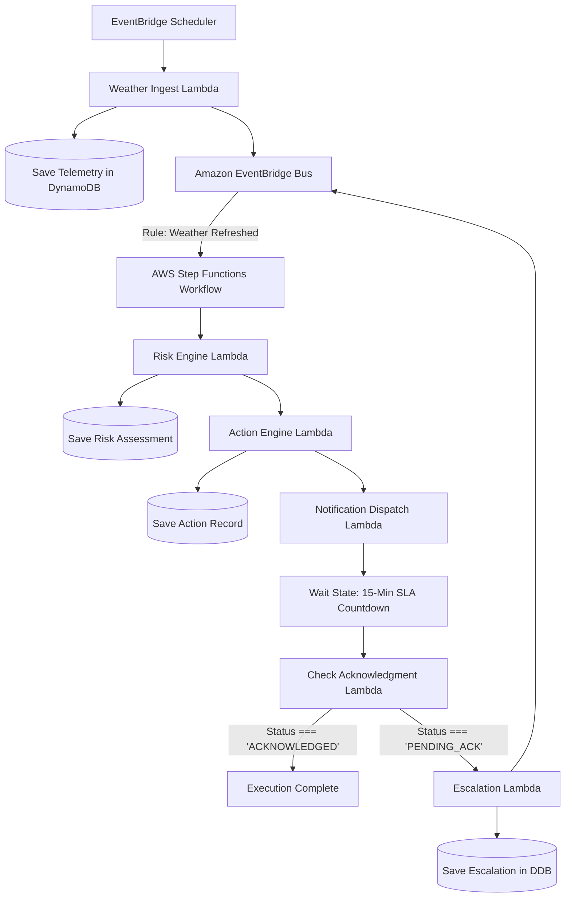
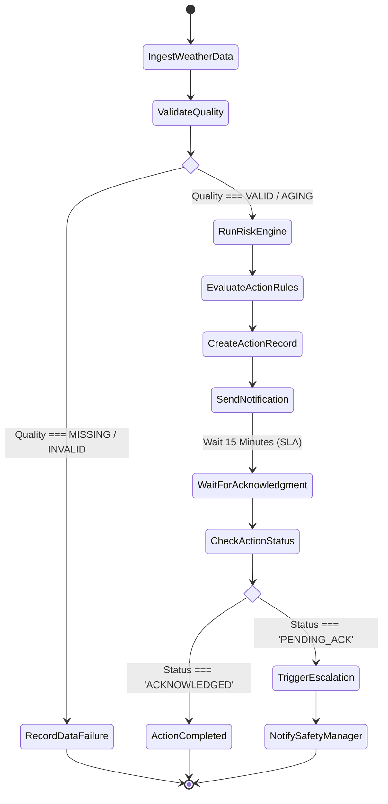
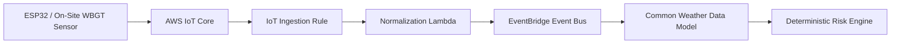

# Amazon EventBridge & AWS Step Functions Specification

**Document ID:** `69_EVENTBRIDGE_STEP_FUNCTIONS`  
**Status:** Draft  
**Version:** 1.0.0  
**Last Updated:** 2026-10-07  
**Author:** Heat Action Response Engine Team  

---

## 1. Purpose

This document specifies the asynchronous event routing, precision scheduling, and multi-step workflow orchestration architecture implemented via Amazon EventBridge and AWS Step Functions for the Heat Action Response Engine. It defines how background telemetry, risk recalculations, notification cascades, and escalation SLAs execute without compromising deterministic safety logic.

---

## 2. Scope

This specification defines:
* The core architectural distinction between EventBridge (routing/scheduling) and Step Functions (workflow orchestration).
* Domain event schemas, envelope metadata, versioning, and filtering rules.
* EventBridge Scheduler cron configurations and frequency limitations.
* Step Functions state-machine topology, wait states, and automated escalation timers.
* Dead-Letter Queues (DLQs), retry policies, idempotency, and out-of-order event handling.
* Simulation drill isolation and future IoT sensor ingestion compatibility.

*Out of Scope:* Low-level Lambda handler code (`66_LAMBDA.md`) and database schema design (`68_DYNAMODB.md`).

---

## 3. Mandatory Core Architectural Distinction

> **"Amazon EventBridge routes and schedules events. AWS Step Functions orchestrates multi-step stateful workflows. Neither service is the source of domain truth or the safety decision maker."**

```text
┌────────────────────────────────────────────────────────────────────────┐
│                        RESPONSIBILITY BOUNDARIES                       │
├─────────────────────┬──────────────────────────────────────────────────┤
│ AWS SERVICE         │ EXACT OPERATIONAL ROLE                           │
├─────────────────────┼──────────────────────────────────────────────────┤
│ Amazon EventBridge  │ WHEN and WHERE should an event or trigger go?    │
├─────────────────────┼──────────────────────────────────────────────────┤
│ AWS Step Functions  │ HOW should a sequential multi-step task execute? │
├─────────────────────┼──────────────────────────────────────────────────┤
│ Amazon DynamoDB     │ WHAT is the authoritative, persisted state?      │
├─────────────────────┼──────────────────────────────────────────────────┤
│ Risk Engine         │ WHAT is the deterministic mathematical risk?     │
├─────────────────────┼──────────────────────────────────────────────────┤
│ Action Engine       │ WHAT preventive action directive is required?    │
└─────────────────────┴──────────────────────────────────────────────────┘
```

Step Functions does not calculate heat stress or decide that a site is at `HIGH` risk. It invokes the deterministic Risk Engine Lambda, receives the mathematical evaluation, and routes execution accordingly.

---

## 4. End-to-End Orchestration Architecture



---

## 5. Amazon EventBridge: Scheduled Ingestion & Events

### 5.1 EventBridge Scheduler
The EventBridge Scheduler provides precision cron triggers for background operational cycles:
* **Hourly Telemetry Ingestion:** `cron(0 * * * ? *)` triggers `WeatherIngestFunction` at the top of every hour.
* **Acute Heatwave Surge Refresh:** `cron(*/30 11-16 * * ? *)` accelerates polling to 30-minute intervals during peak midday heat (11:00 AM to 4:00 PM local time).
* **Stale Telemetry Sweep:** `cron(15 * * * ? *)` checks for worksites where weather updates have lapsed beyond the 2-hour SLA.

> **CRITICAL RULE: Scheduling frequency is an application configuration, NOT an environmental safety guarantee.** The system does not imply continuous physical observation simply because a 30-minute cron is active.

### 5.2 Standard Domain Event Envelope
All application events emitted to the EventBridge custom bus (`heat-action-event-bus`) conform to a strict, structured envelope:

```json
{
  "event_id": "evt_01JXYZ8890ABCDEF",
  "event_type": "heat.action.risk_assessed",
  "event_version": "1.0",
  "timestamp": "2026-10-07T14:05:00.123Z",
  "source": "heataction.risk-engine",
  "organization_id": "org_infra_corp",
  "worksite_id": "site_blr_north_01",
  "resource_type": "RISK_ASSESSMENT",
  "resource_id": "risk_99412",
  "correlation_id": "corr_01HXYZ9910",
  "is_simulation": false,
  "payload": {
    "risk_level": "HIGH",
    "heat_index_c": 43.8,
    "data_quality": "VALID",
    "rule_version": "v1.2",
    "primary_factors": ["HIGH_SOLAR_EXPOSURE", "HEAVY_METABOLIC_WORKLOAD"]
  }
}
```

*Privacy Standard:* Event payloads carry operational references and entity identifiers; they **never** carry sensitive personal medical histories or raw worker identities.

---

## 6. EventBridge Rules & Routing Matrix

```text
┌──────────────────────────────┬────────────────────────┬──────────────────────────────┐
│ EVENT TRIGGER (`event_type`) │ MATCHING RULE PATTERN  │ TARGET CONSUMER              │
├──────────────────────────────┼────────────────────────┼──────────────────────────────┤
│ `heat.weather.refreshed`     │ `quality !== 'INVALID'`│ `RiskEngineFunction`         │
├──────────────────────────────┼────────────────────────┼──────────────────────────────┤
│ `heat.weather.data_failed`   │ `quality === 'MISSING'`│ `TelemetryAlertFunction`     │
├──────────────────────────────┼────────────────────────┼──────────────────────────────┤
│ `heat.action.risk_assessed`  │ `risk_level in [HIGH,  │ `ActionEngineFunction`       │
│                              │  CRITICAL]`            │                              │
├──────────────────────────────┼────────────────────────┼──────────────────────────────┤
│ `heat.action.created`        │ Status: `PENDING_ACK`  │ `NotificationDispatcher` &   │
│                              │                        │ `EscalationWorkflowStepFn`   │
├──────────────────────────────┼────────────────────────┼──────────────────────────────┤
│ `heat.action.acknowledged`   │ Status: `ACKNOWLEDGED` │ Cancel Step Function Timer & │
│                              │                        │ `AuditLoggingFunction`       │
├──────────────────────────────┼────────────────────────┼──────────────────────────────┤
│ `heat.action.escalated`      │ Severity: `CRITICAL`   │ Safety Manager Alert Lambda  │
└──────────────────────────────┴────────────────────────┴──────────────────────────────┘
```

---

## 7. Event Reliability, Retries & Dead-Letter Queues (DLQ)

Asynchronous event delivery guarantees **at-least-once delivery**, which means duplicate packets may arrive.
* **Dead-Letter Queue (DLQ):** Every EventBridge rule target is configured with an Amazon SQS DLQ (`arn:aws:sqs:...:event-bus-dlq`).
* **Retry Policy:** EventBridge retries failed invocations up to 3 times over a maximum age of 1 hour with exponential backoff.
* **DLQ Alarm:** A CloudWatch alarm monitors `ApproximateNumberOfMessagesVisible` on the DLQ; if $>0$, engineering receives an immediate operational alert.

---

## 8. AWS Step Functions: Workflow Orchestration [P1 / OPTIONAL]

AWS Step Functions orchestrates long-running, multi-step tasks that require explicit state tracking and wait countdowns.

### 8.1 Example Escalation State Machine (ASL Definition Flow)


### 8.2 Wait States & The Demo Timeout Distinction
Step Functions handles acknowledgment countdowns via native `Wait` states.

```text
┌───────────────────────────────────┬───────────────────────────────────┐
│ HACKATHON DEMO TIMEOUT            │ REAL PRODUCTION SAFETY WINDOW     │
├───────────────────────────────────┼───────────────────────────────────┤
│ • Configured for 30 to 60 seconds │ • Configured for 15 to 30 minutes │
│ • Designed for live judge review  │ • Derived from enterprise policy  │
│ • Accelerated countdown           │ • Mandated by safety standards    │
└───────────────────────────────────┴───────────────────────────────────┘
```

> **CRITICAL DISTINCTION: An accelerated demo timeout (e.g. 30 seconds) is an operational testing convenience; it is NEVER presented as a real occupational safety standard.**

---

## 9. Handling Out-of-Order Events & Idempotency

In distributed event systems, an `ACTION_ACKNOWLEDGED` event can theoretically arrive at a consumer before the initial `ACTION_CREATED` event due to network routing disparities.

### Out-of-Order Mitigation Protocol:
1. **Never rely on arrival sequence:** Consumers do not assume event chronological order.
2. **Re-Read Authoritative State:** Upon receiving an event, the Lambda consumer reads the target record from DynamoDB using strongly consistent reads.
3. **Monotonic Version Comparison:**
   ```typescript
   if (incomingEvent.resource_version <= currentDynamoRecord.version) {
     // Stale or duplicate packet; discard safely without reprocessing
     return;
   }
   ```
4. **Idempotent State Machines:** If an action in DynamoDB is already marked `ACKNOWLEDGED`, duplicate `ACTION_ACKNOWLEDGED` events complete successfully as no-ops.

---

## 10. Step Functions Failure Handling & Catch Blocks

Step Functions state machines implement robust error catching to prevent workflows from hanging indefinitely:
* **Retry Blocks:** Lambda invocations retry on `Lambda.ServiceException` and `Lambda.TooManyRequestsException` with exponential backoff (interval: 2s, multiplier: 2.0, maxAttempts: 3).
* **Catch Blocks:** Unhandled domain exceptions transition to a `LogFailureAndAlert` state.
* **Zero False Reassurance:** A workflow crash in Step Functions **never** records an action as completed. The action remains visible on supervisor dashboards with an operational warning banner.

---

## 11. Simulation Mode Orchestration

The event and workflow pipeline natively supports emergency response training drills (`38_SIMULATION_MODE.md`):
* **Simulation Event Tag:** Simulation triggers carry `is_simulation: true` and an explicit `scenario_id: "drill_extreme_heat_2026"`.
* **Execution Equality:** Synthetic weather runs through the **exact same** normalization, risk engine, and action engine code as production feeds.
* **Safety Isolation:**
  * External SMS and emergency voice calls are suppressed.
  * Audit logs and DynamoDB records persist with permanent `is_simulation = true` attributes.
  * Simulated alerts never alter production safety compliance scorecards.

---

## 12. Future IoT Physical Sensor Integration

The event architecture is designed to accommodate future physical on-site weather stations (`39_IOT_FUTURE_EXTENSION.md`):



*Architectural Preservation:* When physical sensors are deployed in future phases, the core Risk Engine, Action Engine, and Step Functions workflows require **zero modifications**. Telemetry simply enters via IoT Core rather than the Open-Meteo scheduled cron.

---

## 13. Observability & Workflow Monitoring

* **Step Functions Execution History:** Visual state transitions, execution inputs/outputs, and failure points are logged directly in the AWS Step Functions console.
* **EventBridge CloudWatch Metrics:**
  * `MatchedRules`: Volume of successfully matched events.
  * `TriggeredRules`: Execution invocations dispatched to targets.
  * `FailedInvocations`: Target delivery failures requiring DLQ triage.
* **End-to-End Tracing:** Event metadata propagates `correlation_id` across every hop from EventBridge through Step Functions to Lambda and DynamoDB.

---

## 14. Non-Goals

Amazon EventBridge and AWS Step Functions explicitly do **not**:
* Serve as persistent operational databases (authoritative state lives in DynamoDB).
* Independently calculate heat stress indices or assess physiological danger.
* Provide arbitrary, unconstrained client-side messaging channels.
* Override human supervisor acknowledgment with automatic closures.

---

## 15. Cross-Document References

* `60_SYSTEM_ARCHITECTURE.md`: High-level event-driven architecture.
* `62_TECH_STACK_FLOW.md`: Master end-to-end technology flow.
* `66_LAMBDA.md`: Serverless compute tasks invoked by events.
* `68_DYNAMODB.md`: Authoritative persistence backing workflow states.
* `85_AUDIT_LOGGING.md`: Compliance event trail standards.
