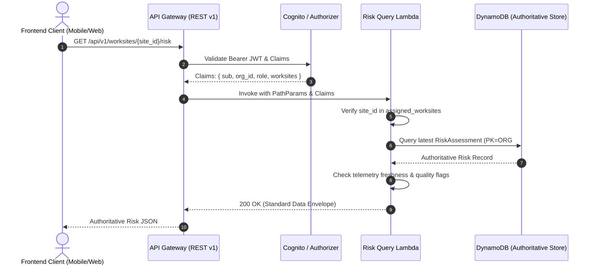

# Heat Risk Assessment API Specification

**Document ID:** `73_RISK_API`  
**Status:** MVP Design / Specification  
**Version:** 1.0.0  
**Last Updated:** 2026-10-08  
**Author:** Heat Action Response Engine Team  

---

## 1. Purpose & Scope

This specification defines the authoritative API contracts for retrieving and managing workplace heat-risk assessments within the **Heat Action Response Engine**.

The core mission of the platform is:
> **From heat warning to verified workplace action.**

The Risk API serves as the formal boundary between the pure, deterministic Heat Risk Engine and client-facing applications or downstream orchestration workflows. It exposes validated, traceable, and legally auditable heat-risk assessments computed from verified meteorological telemetry and worksite operational context (`20_HEAT_RISK_ENGINE.md`, `30_DATA_ARCHITECTURE.md`).

### Architectural Responsibility Definition

> **The Risk API exposes validated, traceable, deterministic heat-risk assessments for authorized users and downstream application workflows.**

The Risk API does **not** independently calculate safety thresholds or evaluate mathematical risk rules on the fly within the API gateway handler. It serves as an authoritative query and command gateway:

```text
┌────────────────────────────────────────────────────────┐
│               DETERMINISTIC RISK ENGINE                │
│       (Evaluates Weather + Worksite Context)          │
└──────────────────────────┬─────────────────────────────┘
                           │
                           ▼
┌────────────────────────────────────────────────────────┐
│                       RISK API                         │
│     (Authorization, Validation, Provenance, REST)      │
└──────────────┬──────────────────────────┬──────────────┘
               │                          │
               ▼                          ▼
┌──────────────────────────┐  ┌──────────────────────────┐
│   FRONTEND DASHBOARD     │  │      ACTION ENGINE       │
│  (Mobile PWA / Desktop)  │  │ (Instantiates Directives)│
└──────────────────────────┘  └──────────────────────────┘
```

---

## 2. Non-Negotiable API Invariants & Principles

Every implementation of this API must enforce these architectural principles:

```text
┌────────────────────────────────────────────────────────────────────────┐
│                     CORE RISK API INVARIANTS                           │
├────────────────────────────────────────────────────────────────────────┤
│ • API ≠ SAFETY ENGINE                                                  │
│ • FRONTEND ≠ SOURCE OF TRUTH                                           │
│ • AI ≠ SAFETY AUTHORITY                                                │
│ • RISK LEVEL MUST COME FROM DETERMINISTIC DOMAIN LOGIC                 │
│ • CLIENT MUST NOT SUPPLY AUTHORITATIVE RISK                            │
│ • CLIENT MUST NOT OVERRIDE RISK                                        │
│ • CLIENT MUST NOT SUPPRESS REQUIRED ACTIONS                            │
│ • FORECAST ≠ OBSERVATION                                               │
│ • UNKNOWN ≠ LOW RISK                                                   │
│ • STALE ≠ CURRENT                                                      │
│ • MISSING DATA ≠ SAFE CONDITION                                        │
│ • SIMULATION ≠ LIVE OPERATION                                          │
└────────────────────────────────────────────────────────────────────────┘
```

1. **No Client-Supplied Risk:** Clients can never submit, dictate, or override risk scores or severity tiers. Risk assessments are strictly derived by the backend deterministic engine.
2. **Deterministic Domain Authority:** Numerical thresholds and decision matrices originate exclusively in domain logic (`20_HEAT_RISK_ENGINE.md`, `26_RISK_LEVELS.md`, `27_RISK_RULES.md`). The API does not invent or negotiate safety thresholds.
3. **No False Safety on Data Failure:** If environmental data is stale, missing, corrupt, or conflicting, the system returns `UNKNOWN` or an explicit data quality warning. It **never** defaults to `LOW` risk.
4. **Explicit Lineage & Provenance:** Every response identifies whether inputs reflect live physical observations, forecasts, or simulated scenarios.
5. **Separation of Risk from Action:** The Risk API reports assessed environmental danger and contributing vectors; the instantiation and management of mitigation tasks belongs strictly to the Action API (`74_ACTION_API.md`).

---

## 3. Protocol, Authentication & Authorization Conventions

All Risk API endpoints comply with the master API standard (`70_API_CONTRACTS.md`):

* **Base Path:** `/api/v1`
* **Transport:** HTTPS over TLS 1.3 with mandatory JSON payloads (`application/json; charset=utf-8`).
* **Authentication:** Mandatory Bearer JWT on all endpoints (`Authorization: Bearer <token>`).
* **Identity Context:** Extracted claims must include `sub` (User ID), `org_id` (Tenant Organization), `role` (`ADMIN`, `SAFETY_MANAGER`, `SUPERVISOR`), and `assigned_worksites`.
* **RBAC & Scoping:**
  * `ADMIN`: Full tenant read/write and historical audit across all worksites.
  * `SAFETY_MANAGER`: Full multi-site oversight, assessment command triggers, and historical analysis.
  * `SUPERVISOR`: Read-only access scoped strictly to assigned worksites; authorized to trigger assessment refreshes for active shifts.
* **Headers:**
  * `Authorization: Bearer <token>` (Required)
  * `X-Request-Id: <uuid>` (Optional client tracing ID; echoed in response metadata)
  * `Content-Type: application/json` (Required on POST)

---

## 4. Endpoints Overview

```text
┌────────┬──────────────────────────────────────────────┬────────────────────────┐
│ METHOD │ ROUTE                                        │ ACCESS ROLE            │
├────────┼──────────────────────────────────────────────┼────────────────────────┤
│ GET    │ `/api/v1/worksites/{worksite_id}/risk`       │ All Roles (Scoped)     │
│ GET    │ `/api/v1/worksites/{worksite_id}/risk/history│ All Roles (Scoped)     │
│ GET    │ `/api/v1/risk-assessments/{risk_id}`         │ All Roles (Scoped)     │
│ POST   │ `/api/v1/worksites/{worksite_id}/risk/assess`│ Safety Manager / Sup   │
└────────┴──────────────────────────────────────────────┴────────────────────────┘
```

---

## 5. Data Model & Enumerations

### 5.1 Standardized Risk Levels
The Risk API exposes five canonical risk tiers (`26_RISK_LEVELS.md`). Specific mathematical boundaries are enforced by the engine:

```text
┌───────────┬────────────────────────────────────────────────────────────────────┐
│ TIER      │ OPERATIONAL DEFINITION                                             │
├───────────┼────────────────────────────────────────────────────────────────────┤
│ `LOW`     │ Baseline environmental conditions; minimal thermal strain.         │
│ `MODERATE`│ Elevated heat stress; hydration monitoring and vigilance required. │
│ `HIGH`    │ Hazardous heat conditions; mandatory work-rest cycles & shade.     │
│ `CRITICAL`│ Acute danger; immediate rescheduling, stand-down, or strict breaks │
│ `UNKNOWN` │ Telemetry missing, stale, invalid, or context unconfigured.       │
└───────────┴────────────────────────────────────────────────────────────────────┘
```

### 5.2 Environmental & Operational Data Quality
Quality indicators track data freshness and sensor integrity (`36_DATA_VALIDATION.md`):

* `VALID`: Real-time telemetry ingested within SLA window (<60 minutes old) passing sanity validation.
* `STALE`: Telemetry exceeds freshness SLA but remains usable under grace period with degradation flags.
* `MISSING`: Upstream telemetry feed unavailable; sensor unresponsive.
* `INVALID`: Telemetry values violate physical sanity checks (e.g., relative humidity > 100%, ambient temp > 65°C).
* `UNKNOWN`: Sensor or provider status unverified.
* `CONFLICTING`: Redundant sensor feeds or weather providers disagree beyond allowable variance thresholds.

### 5.3 Provenance Source Type
* `CURRENT_OBSERVATION`: Ground telemetry from AWS physical stations or real-time provider APIs.
* `FORECAST`: Predictive multi-hour synthetic forecast data.
* `DERIVED_METRIC`: Calculated index (e.g., Rothfusz Heat Index, estimated WBGT).
* `SIMULATED_INPUT`: Test scenario injected for training, drills, or hackathon demonstration.

---

## 6. Endpoint Specifications

### 6.1 Get Current Worksite Risk Assessment

Retrieves the latest authoritative risk evaluation for a specified worksite.

* **Route:** `GET /api/v1/worksites/{worksite_id}/risk`
* **Authorization:** `SUPERVISOR`, `SAFETY_MANAGER`, `ADMIN` (must have access to target worksite).
* **Path Parameters:**
  * `worksite_id` (String, required): Worksite identifier (e.g., `ws_blr_north_04`).

#### Success Response (`200 OK`):
```json
{
  "data": {
    "risk_id": "rsk_20261008_093000_ws_blr_04",
    "organization_id": "org_infra_corp_01",
    "worksite_id": "ws_blr_north_04",
    "shift_id": "shift_day_20261008",
    "risk_level": "HIGH",
    "assessment_time": "2026-10-08T09:30:00Z",
    "valid_until": "2026-10-08T10:30:00Z",
    "data_quality": "VALID",
    "is_simulation": false,
    "rule_version": "v1.4.0",
    "source_context": {
      "weather_source": "OPEN_METEO",
      "source_type": "CURRENT_OBSERVATION",
      "observation_timestamp": "2026-10-08T09:15:00Z",
      "observation_age_minutes": 15,
      "station_id": "STN_BLR_NORTH_AWS"
    },
    "risk_factors": [
      {
        "factor_name": "DRY_BULB_TEMPERATURE",
        "value": 38.6,
        "unit": "CELSIUS",
        "weight": "MAJOR",
        "contribution": "ELEVATED"
      },
      {
        "factor_name": "RELATIVE_HUMIDITY",
        "value": 58.0,
        "unit": "PERCENT",
        "weight": "MAJOR",
        "contribution": "ELEVATED"
      },
      {
        "factor_name": "HEAT_INDEX",
        "value": 45.2,
        "unit": "CELSIUS",
        "weight": "CRITICAL",
        "contribution": "HIGH_DANGER"
      },
      {
        "factor_name": "WORKLOAD_INTENSITY",
        "value": "HEAVY",
        "unit": "METABOLIC_RATE",
        "weight": "MAJOR",
        "contribution": "SIGNIFICANT_INTERNAL_HEAT"
      },
      {
        "factor_name": "DIRECT_SUN_EXPOSURE",
        "value": "UNSHADED_OUTDOOR",
        "unit": "EXPOSURE_CLASS",
        "weight": "MODERATE",
        "contribution": "SOLAR_RADIATION_ADDITION"
      },
      {
        "factor_name": "ACCLIMATIZATION_PROFILE",
        "value": "UNACCLIMATIZED_WORKERS_PRESENT",
        "unit": "ROSTER_STATUS",
        "weight": "MODERATE",
        "contribution": "HIGHER_SUSCEPTIBILITY"
      }
    ],
    "explanation": {
      "what": "Worksite is operating at HIGH heat risk.",
      "why": "Heat Index of 45.2°C combined with heavy physical labor (rebar tying) in unshaded areas exceeds sustained safe thermal limits.",
      "data": "Based on validated on-site telemetry from 09:15 UTC (15 minutes old).",
      "rule": "Evaluated against Corporate Rule Matrix v1.4.0 (ISO 7243 / IMD Guidance).",
      "limitations": "Direct wet-bulb globe temperature sensor unavailable; WBGT estimated from standard temperature and humidity models.",
      "next_steps": "Mandatory 45/15 work-rest schedule and shaded hydration staging required immediately."
    },
    "generated_action_ids": [
      "act_20261008_001",
      "act_20261008_002"
    ]
  },
  "meta": {
    "request_id": "req_01JXYZ998011",
    "timestamp": "2026-10-08T09:30:05.120Z",
    "resource_version": 1
  }
}
```

---

### 6.2 Get Historical Worksite Risk Assessments

Retrieves chronologically ordered past risk evaluations for analysis, compliance reporting, and audit reconstruction.

* **Route:** `GET /api/v1/worksites/{worksite_id}/risk/history`
* **Authorization:** `SUPERVISOR`, `SAFETY_MANAGER`, `ADMIN`.
* **Query Parameters:**
  * `limit` (Integer, optional, default `50`, max `200`): Page size.
  * `cursor` (String, optional): Base64 DynamoDB evaluation key for pagination.
  * `from` (ISO 8601 UTC String, optional): Start timestamp filter (`2026-10-08T00:00:00Z`).
  * `to` (ISO 8601 UTC String, optional): End timestamp filter (`2026-10-08T23:59:59Z`).
  * `risk_level` (Enum, optional): Filter by `LOW`, `MODERATE`, `HIGH`, `CRITICAL`, `UNKNOWN`.
  * `data_quality` (Enum, optional): Filter by `VALID`, `STALE`, `MISSING`, `INVALID`, `CONFLICTING`.
  * `include_simulation` (Boolean, optional, default `false`): Include simulation-generated assessments.

#### Success Response (`200 OK`):
```json
{
  "data": [
    {
      "risk_id": "rsk_20261008_093000_ws_blr_04",
      "worksite_id": "ws_blr_north_04",
      "shift_id": "shift_day_20261008",
      "risk_level": "HIGH",
      "assessment_time": "2026-10-08T09:30:00Z",
      "data_quality": "VALID",
      "rule_version": "v1.4.0",
      "is_simulation": false,
      "primary_driver": "HEAT_INDEX_EXCEEDED"
    },
    {
      "risk_id": "rsk_20261008_083000_ws_blr_04",
      "worksite_id": "ws_blr_north_04",
      "shift_id": "shift_day_20261008",
      "risk_level": "MODERATE",
      "assessment_time": "2026-10-08T08:30:00Z",
      "data_quality": "VALID",
      "rule_version": "v1.4.0",
      "is_simulation": false,
      "primary_driver": "TEMPERATURE_ELEVATED"
    }
  ],
  "meta": {
    "request_id": "req_01JXYZ998012",
    "timestamp": "2026-10-08T09:31:00.000Z",
    "count": 2,
    "next_cursor": "eyJzdGFydEtleSI6ICJyc2tfMjAyNjEwMDhfMDgzMCJ9"
  }
}
```

---

### 6.3 Get Risk Assessment by ID

Retrieves an immutable, individual assessment record by its unique identifier.

* **Route:** `GET /api/v1/risk-assessments/{risk_id}`
* **Authorization:** All authenticated roles scoped to the owning tenant organization and worksite.
* **Path Parameters:**
  * `risk_id` (String, required): Unique assessment identifier (e.g., `rsk_20261008_093000_ws_blr_04`).

#### Success Response (`200 OK`):
Returns the complete `data` object structure identical to `GET /worksites/{worksite_id}/risk`.

---

### 6.4 Trigger Worksite Risk Reassessment

Executes an authorized on-demand reassessment command (e.g., after an unexpected weather shift, cloudburst, or shift workload schedule change).

> [!IMPORTANT]
> The client initiates an **assessment command**. The client **never** supplies risk levels, numerical temperature values, or override thresholds in the payload. The backend retrieves authoritative telemetry and evaluates approved domain rules deterministically.

* **Route:** `POST /api/v1/worksites/{worksite_id}/risk/assess`
* **Authorization:** `SAFETY_MANAGER`, `ADMIN`, or authorized `SUPERVISOR`.
* **Headers:**
  * `Authorization: Bearer <token>`
  * `Content-Type: application/json`
  * `Idempotency-Key: <uuid>` (Mandatory to prevent duplicate concurrent evaluations)
* **Path Parameters:**
  * `worksite_id` (String, required): Target worksite identifier.

#### Request Body:
```json
{
  "shift_id": "shift_day_20261008",
  "reason": "SCHEDULED_MIDDAY_CHECK",
  "force_telemetry_refresh": true
}
```

#### Request Attributes:
* `shift_id` (String, optional): Active shift identifier. If omitted, backend resolves current active shift automatically.
* `reason` (Enum, required): Reason for on-demand trigger:
  * `SCHEDULED_MIDDAY_CHECK`
  * `WEATHER_SUDDEN_CHANGE`
  * `SHIFT_WORKLOAD_MODIFIED`
  * `SUPERVISOR_OBSERVATION`
  * `DRILL_SIMULATION`
* `force_telemetry_refresh` (Boolean, optional, default `false`): If `true`, instructs backend to pull fresh telemetry from weather providers before evaluation.

#### Success Response (`200 OK` or `201 Created`):
Returns the newly generated authoritative assessment record inside the standard `data` envelope.

---

## 7. Risk Explanation Contract & AI Guardrails

Every risk assessment contains a human-comprehensible structured explanation. The structure follows the **6-Part Safety Reasoning Architecture**:

```text
┌──────────────────────┬────────────────────────────────────────────────────────┐
│ COMPONENT            │ PURPOSE & CONTENT                                      │
├──────────────────────┼────────────────────────────────────────────────────────┤
│ 1. `what`            │ Current authoritative risk level category.             │
│ 2. `why`             │ Dominant physical & contextual drivers (temp, solar).  │
│ 3. `data`            │ Timestamp, telemetry age, and data quality status.     │
│ 4. `rule`            │ Approved rule matrix version and regulatory reference. │
│ 5. `limitations`     │ Missing parameters, sensor assumptions, or proxy data. │
│ 6. `next_steps`      │ Operational summary linking to actionable directives.  │
└──────────────────────┴────────────────────────────────────────────────────────┘
```

### Deterministic vs. AI Separation Guardrails
If AI language models (e.g., NVIDIA NIM / Claude / Gemini) are utilized to produce natural language translations, vernacular phrasing, or executive briefings (`43_AI_ASSISTANT.md`, `48_EXPLANATION_ENGINE.md`):

```text
┌───────────────────────────────────────┬───────────────────────────────────────┐
│ DETERMINISTIC DOMAIN (LOCKED)         │ AI LANGUAGE SCOPE (ASSISTIVE ONLY)    │
├───────────────────────────────────────┼───────────────────────────────────────┤
│ • `risk_level` (HIGH)                 │ • Language translation (Hindi, Tamil) │
│ • `risk_factors` (45.2°C, 58%)        │ • Vernacular supervisor summarization │
│ • `rule_version` (v1.4.0)             │ • Formatting bullet points for SMS    │
│ • `generated_action_ids`              │ • Audio narration script generation   │
└───────────────────────────────────────┴───────────────────────────────────────┘
```

**Strict Prohibition:** AI models are cryptographically and architecturally barred from altering, computing, or overriding the `risk_level`. If an AI service fails, times out, or hallucinates, the platform serves the deterministic fallback template with zero safety degradation.

---

## 8. Data Lineage & Provenance Metadata

To guarantee regulatory compliance and forensic auditability during workplace safety investigations, every risk assessment preserves immutable lineage:

| Field Name | Type | Description |
| :--- | :--- | :--- |
| `weather_source` | String | Source weather service (`OPEN_METEO`, `IMD`, `ON_SITE_IOT`). |
| `source_type` | Enum | `CURRENT_OBSERVATION`, `FORECAST`, `DERIVED_METRIC`, `SIMULATED_INPUT`. |
| `observation_timestamp` | ISO 8601 | Physical observation measurement time recorded at station. |
| `retrieved_at` | ISO 8601 | Exact backend ingestion time. |
| `observation_age_minutes`| Integer | Age of weather data at moment of risk evaluation. |
| `data_quality` | Enum | Freshness and sanity classification (`VALID`, `STALE`, etc.). |
| `rule_version` | String | Versioned domain matrix identifier used for calculation. |
| `is_simulation` | Boolean | Clear boolean flag indicating drill or simulated data. |

---

## 9. Failure Modes & Edge Case Semantics

The Risk API implements fail-safe semantics across all operational anomalies:

```text
┌───────────────────────────┬──────────────┬────────────────────────────────────┐
│ ANOMALOUS CONDITION       │ RETURN STATUS│ BEHAVIOR & RISK CLASSIFICATION     │
├───────────────────────────┼──────────────┼────────────────────────────────────┤
│ Weather Feed Unavailable  │ `200 OK`     │ `risk_level: UNKNOWN`,             │
│                           │              │ `data_quality: MISSING`.           │
│                           │              │ Prompts immediate manual review.   │
├───────────────────────────┼──────────────┼────────────────────────────────────┤
│ Weather Feed Stale        │ `200 OK`     │ `data_quality: STALE`.             │
│ (>60m, within grace)      │              │ Evaluates with explicit warning;   │
│                           │              │ Never silently presents as fresh.  │
├───────────────────────────┼──────────────┼────────────────────────────────────┤
│ Weather Feed Stale        │ `200 OK`     │ `risk_level: UNKNOWN`,             │
│ (>180m, grace expired)    │              │ `data_quality: STALE`. Suspends    │
│                           │              │ automated safety assumptions.      │
├───────────────────────────┼──────────────┼────────────────────────────────────┤
│ Sensor Values Corrupt     │ `200 OK`     │ `risk_level: UNKNOWN`,             │
│ (e.g. RH = 140%)          │              │ `data_quality: INVALID`.           │
│                           │              │ Flags sensor malfunction alert.    │
├───────────────────────────┼──────────────┼────────────────────────────────────┤
│ Dual Feeds Disagree       │ `200 OK`     │ `risk_level: UNKNOWN` or           │
│ (Temp delta > 8°C)        │              │ conservative tier with             │
│                           │              │ `data_quality: CONFLICTING`.       │
├───────────────────────────┼──────────────┼────────────────────────────────────┤
│ Risk Engine Lambda Fails  │ `500 / 503`  │ Standard error envelope.           │
│                           │              │ Never returns fabricated LOW risk. │
├───────────────────────────┼──────────────┼────────────────────────────────────┤
│ Worksite Not Found        │ `404`        │ Worksite does not exist in tenant. │
├───────────────────────────┼──────────────┼────────────────────────────────────┤
│ Unauthorized Worksite     │ `403`        │ Token lacks permissions for site.  │
└───────────────────────────┴──────────────┴────────────────────────────────────┘
```

---

## 10. Architectural Workflows & Diagrams

### 10.1 Authoritative Risk Retrieval Flow



### 10.2 On-Demand Assessment Lifecycle Flow

```mermaid
flowchart TD
    Req[Assessment Trigger Command<br>POST /worksites/{id}/risk/assess] --> Auth[Verify JWT & Role Permissions]
    Auth --> Lock[Acquire Idempotency Lease]
    Lock --> Fetch[Retrieve Environmental Telemetry]
    Fetch --> Validate{Validate Data Sanity & Freshness}
    
    Validate -- Valid / Grace --> Engine[Deterministic Risk Engine Evaluates Matrices]
    Validate -- Corrupt / Offline --> Unknown[Assign UNKNOWN Risk Level & Diagnostic Flag]
    
    Engine --> Persist[Atomic DynamoDB Commit<br>RiskAssessment + AuditEvent]
    Unknown --> Persist
    
    Persist --> ActionTrigger{Risk Elevated or Requires Actions?}
    ActionTrigger -- Yes --> Evt[Publish Domain Event<br>EventBridge: RISK_ASSESSMENT_COMPLETED]
    ActionTrigger -- No --> Ret[Return Authoritative Response]
    Evt --> Ret
```

---

## 11. Testing & Validation Matrix

Every implementation of the Risk API must pass the following integration test suite:

```text
┌──────────────────────┬──────────────────────────────┬──────────────────────────┐
│ TEST CASE IDENTIFIER │ SCENARIO DESCRIPTION         │ EXPECTED API BEHAVIOR    │
├──────────────────────┼──────────────────────────────┼──────────────────────────┤
│ `TEST_RISK_01`       │ Valid worksite risk request  │ 200 OK, complete factors,│
│                      │ with fresh telemetry         │ data_quality: VALID      │
├──────────────────────┼──────────────────────────────┼──────────────────────────┤
│ `TEST_RISK_02`       │ Unknown worksite ID          │ 404 NOT_FOUND error      │
├──────────────────────┼──────────────────────────────┼──────────────────────────┤
│ `TEST_RISK_03`       │ Tenant cross-access attempt  │ 403 FORBIDDEN error      │
├──────────────────────┼──────────────────────────────┼──────────────────────────┤
│ `TEST_RISK_04`       │ Telemetry older than 60m     │ 200 OK, data_quality:    │
│                      │                              │ STALE, warning present   │
├──────────────────────┼──────────────────────────────┼──────────────────────────┤
│ `TEST_RISK_05`       │ Telemetry missing upstream   │ 200 OK, risk: UNKNOWN,   │
│                      │                              │ data_quality: MISSING    │
├──────────────────────┼──────────────────────────────┼──────────────────────────┤
│ `TEST_RISK_06`       │ Conflicting dual telemetry   │ 200 OK, data_quality:    │
│                      │ feeds beyond variance delta  │ CONFLICTING              │
├──────────────────────┼──────────────────────────────┼──────────────────────────┤
│ `TEST_RISK_07`       │ Client attempts to POST      │ 422 UNPROCESSABLE ENTITY │
│                      │ arbitrary `risk_level: LOW`  │ or schema rejection      │
├──────────────────────┼──────────────────────────────┼──────────────────────────┤
│ `TEST_RISK_08`       │ Pagination cursor validation │ 200 OK, monotonic ordered│
│                      │ on `/risk/history`           │ history, valid cursor    │
├──────────────────────┼──────────────────────────────┼──────────────────────────┤
│ `TEST_RISK_09`       │ Simulation flag isolation    │ 200 OK, is_simulation:   │
│                      │                              │ true explicitly returned │
├──────────────────────┼──────────────────────────────┼──────────────────────────┤
│ `TEST_RISK_10`       │ Idempotency retry with same  │ 200 OK, returns cached   │
│                      │ Idempotency-Key on `/assess` │ result without re-eval   │
└──────────────────────┴──────────────────────────────┴──────────────────────────┘
```

---

## 12. Cross-Document Architecture Integration

* `20_HEAT_RISK_ENGINE.md`: Mathematical formulations and environmental weighting models.
* `26_RISK_LEVELS.md`: Core taxonomy and operational definitions for risk categories.
* `33_WEATHER_DATA_MODEL.md`: Ingested meteorological metrics and units of measurement.
* `68_DYNAMODB.md`: Single-table persistence design and index schema for risk records.
* `70_API_CONTRACTS.md`: Master protocol, envelope, header, and pagination standards.
* `74_ACTION_API.md`: Downstream preventive action directives triggered by assessed risk.
* `79_ERROR_CONTRACTS.md`: Error envelope structures and standardized error codes.
