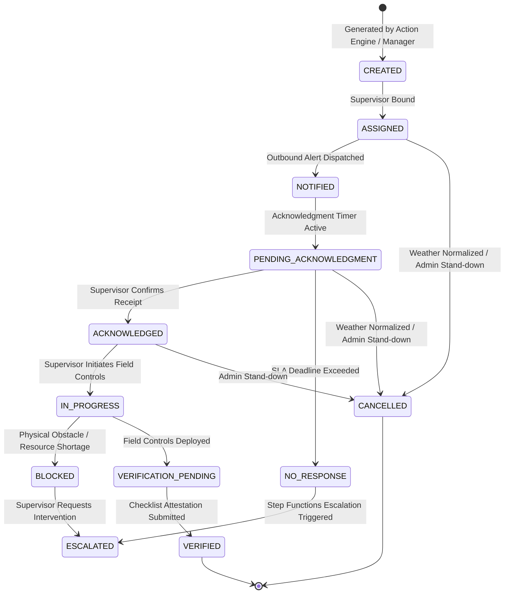
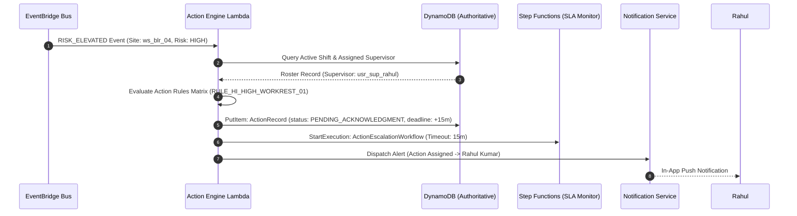

# Preventive Action API Specification

**Document ID:** `74_ACTION_API`  
**Status:** MVP Design / Specification  
**Version:** 1.0.0  
**Last Updated:** 2026-10-08  
**Author:** Heat Action Response Engine Team  

---

## 1. Purpose & Scope

This specification defines the authoritative API contracts for managing preventive workplace action directives within the **Heat Action Response Engine**.

The operational core of the platform is:
> **From heat warning to verified workplace action.**

In this platform, an action is the authoritative operational entity that translates abstract environmental heat signals and risk classifications into specific, accountable, and verifiable workplace interventions (`16_ACTION_MODEL.md`, `40_ACTION_ENGINE.md`).

### Architectural Responsibility Definition

> **The Action API exposes and controls accountable preventive actions generated from authorized deterministic risk workflows.**

The Action API bridges assessed risk, operational assignment, field execution, and verified compliance:

```text
┌──────────────────────────┐
│      RISK ASSESSMENT     │ (Authoritative Deterministic Engine)
└─────────────┬────────────┘
              │
              ▼
┌──────────────────────────┐
│    PREVENTIVE ACTION     │ (Action Rules & Worksite Context)
└─────────────┬────────────┘
              │
              ▼
┌──────────────────────────┐
│    ACCOUNTABLE OWNER     │ (Designated Field Supervisor)
└─────────────┬────────────┘
              │
              ▼
┌──────────────────────────┐
│      ACKNOWLEDGMENT      │ (Confirmed Receipt & Custody)
└─────────────┬────────────┘
              │
              ▼
┌──────────────────────────┐
│       VERIFICATION       │ (Field Execution Attestation)
└─────────────┬────────────┘
              │
              ▼
┌──────────────────────────┐
│  ESCALATION IF UNRESOLVED│ (SLA Breach Routing to Safety Manager)
└──────────────────────────┘
```

---

## 2. Non-Negotiable API Invariants & Principles

Every implementation of this API must enforce these architectural principles:

```text
┌────────────────────────────────────────────────────────────────────────┐
│                    CORE ACTION API INVARIANTS                          │
├────────────────────────────────────────────────────────────────────────┤
│ • API ≠ SAFETY ENGINE                                                  │
│ • FRONTEND ≠ SOURCE OF TRUTH                                           │
│ • AI ≠ SAFETY AUTHORITY                                                │
│ • NOTIFICATION ≠ ACKNOWLEDGMENT                                        │
│ • ACKNOWLEDGMENT ≠ VERIFICATION                                        │
│ • VERIFIED ≠ MEDICAL CERTIFICATION                                     │
│ • CLIENT MUST NOT OVERRIDE ACTION RULES                                │
│ • CLIENT MUST NOT SUPPRESS REQUIRED ACTIONS                            │
│ • CLIENT MUST NOT ARBITRARILY MODIFY PRIORITY                          │
│ • SIMULATION ≠ LIVE OPERATION                                          │
└────────────────────────────────────────────────────────────────────────┘
```

1. **State Machine Strictness:** Actions progress strictly through a deterministic finite state machine. Arbitrary status jumps (e.g., from `PENDING_ACKNOWLEDGMENT` directly to `VERIFIED`) are categorically rejected with `409 Conflict`.
2. **Explicit Command Endpoints:** High-consequence state mutations utilize dedicated command endpoints (`/assign`, `/start`, `/verify`, `/cancel`, `/block`) rather than generic `PATCH` requests to ensure strict validation, auditing, and idempotency.
3. **No Unilateral Priority Tampering:** Action priority is computed by deterministic backend rules (`41_ACTION_RULES.md`). Clients cannot downgrade safety priorities to bypass escalation SLAs.
4. **Mandatory Accountable Ownership:** Every operational action is bound to an authenticated human owner. Automated systems dispatch alerts, but humans remain accountable for field execution.
5. **Separation of Concerns:**
   * Notification dispatch is handled by `75_NOTIFICATION_API.md`.
   * Legal acknowledgment protocols belong to `76_ACKNOWLEDGMENT_API.md`.
   * SLA breach and escalation handling belong to `77_ESCALATION_API.md`.

---

## 3. Protocol, Authentication & Authorization Conventions

All Action API endpoints adhere to master conventions (`70_API_CONTRACTS.md`):

* **Base Path:** `/api/v1`
* **Transport:** HTTPS over TLS 1.3 with standard JSON bodies (`application/json; charset=utf-8`).
* **Authentication:** Mandatory Bearer JWT on all protected routes (`Authorization: Bearer <token>`).
* **RBAC & Scoping:**
  * `ADMIN`: Global organizational management, action creation, reassignment, and administrative cancellation.
  * `SAFETY_MANAGER`: Cross-site oversight, manual action generation, verification audit, escalation resolution.
  * `SUPERVISOR`: Viewing actions assigned to their worksites/shifts; acknowledging custody; marking in-progress; submitting verification checklists; reporting blockers.
* **Headers:**
  * `Authorization: Bearer <token>` (Required)
  * `Content-Type: application/json` (Required on POST)
  * `Idempotency-Key: <uuid>` (Mandatory on state mutations: `/actions`, `/assign`, `/start`, `/verify`, `/cancel`, `/block`)
  * `If-Match: "<resource_version>"` (Optional optimistic concurrency check)

---

## 4. Endpoints Overview

```text
┌────────┬──────────────────────────────────────────────┬────────────────────────┐
│ METHOD │ ROUTE                                        │ ACCESS ROLE            │
├────────┼──────────────────────────────────────────────┼────────────────────────┤
│ GET    │ `/api/v1/actions/{action_id}`                │ All Roles (Scoped)     │
│ GET    │ `/api/v1/worksites/{worksite_id}/actions`    │ All Roles (Scoped)     │
│ GET    │ `/api/v1/users/{user_id}/actions`            │ All Roles (Self/Scoped)│
│ POST   │ `/api/v1/actions`                            │ Safety Manager / Admin │
│ POST   │ `/api/v1/actions/{action_id}/assign`         │ Safety Manager / Admin │
│ POST   │ `/api/v1/actions/{action_id}/start`          │ Assigned Supervisor    │
│ POST   │ `/api/v1/actions/{action_id}/verify`         │ Assigned Supervisor    │
│ POST   │ `/api/v1/actions/{action_id}/cancel`         │ Safety Manager / Admin │
│ POST   │ `/api/v1/actions/{action_id}/block`          │ Assigned Supervisor    │
└────────┴──────────────────────────────────────────────┴────────────────────────┘
```

---

## 5. Canonical Action Entity Schema

The Action record represents the authoritative operational ground truth (`16_ACTION_MODEL.md`):

```json
{
  "action_id": "act_20261008_093000_1082",
  "organization_id": "org_infra_corp_01",
  "worksite_id": "ws_blr_north_04",
  "shift_id": "shift_day_20261008",
  "risk_id": "rsk_20261008_093000_ws_blr_04",
  "action_type": "WORK_REST_PLAN_REVIEW",
  "title": "Enforce 45/15 Work-Rest Rotation",
  "description": "Ambient heat index has reached 45.2°C. Mandate 15 minutes of shaded rest per hour for rebar crews. Dispense chilled electrolyte fluids at Water Station 2.",
  "priority": "HIGH",
  "owner_id": "usr_sup_rahul_kumar",
  "owner_role": "SUPERVISOR",
  "status": "PENDING_ACKNOWLEDGMENT",
  "verification_required": true,
  "verification_status": "PENDING",
  "verification_method": "CHECKLIST_CONFIRMATION",
  "response_deadline": "2026-10-08T09:45:00Z",
  "escalation_status": "NOT_ESCALATED",
  "source_rule_id": "RULE_HI_HIGH_WORKREST_01",
  "rule_version": "v1.4.0",
  "is_simulation": false,
  "created_at": "2026-10-08T09:30:00Z",
  "assigned_at": "2026-10-08T09:30:02Z",
  "notified_at": "2026-10-08T09:30:05Z",
  "acknowledged_at": null,
  "started_at": null,
  "verified_at": null,
  "cancelled_at": null,
  "created_by": "SYSTEM_ACTION_ENGINE",
  "updated_at": "2026-10-08T09:30:05Z",
  "resource_version": 2
}
```

---

## 6. Action Controlled Vocabularies & Priority

### 6.1 Action Types
The platform enforces a standardized taxonomy of workplace interventions (`16_ACTION_MODEL.md`, `42_SITE_SPECIFIC_ACTIONS.md`):

```text
┌────────────────────────────┬──────────────────────────────────────────────────┐
│ ACTION TYPE                │ OPERATIONAL SCOPE & PURPOSE                      │
├────────────────────────────┼──────────────────────────────────────────────────┤
│ `HYDRATION_READINESS`      │ Verify potable water volume, chilling, and salts.│
│ `SHADE_COOLING_READINESS`  │ Erect canopies, deploy misting fans, open shade. │
│ `SUPERVISOR_BRIEFING`      │ Conduct toolbox talk on heat strain symptoms.    │
│ `WORK_REST_PLAN_REVIEW`    │ Enforce mandatory scheduled rotations (e.g. 45/15)│
│ `TASK_RESCHEDULING_REVIEW` │ Reschedule heavy physical trades to cooler hours.│
│ `WORKSITE_CHECK`           │ Inspect water points, shade proximity, and crews.│
│ `CREW_COMMUNICATION`       │ Broadcast safety notices in local languages.     │
│ `RISK_REASSESSMENT`        │ Trigger on-demand environmental reassessment.    │
│ `SAFETY_MANAGER_REVIEW`    │ Multi-site escalation review and stand-down order│
└────────────────────────────┴──────────────────────────────────────────────────┘
```

### 6.2 Action Priority & SLA Deadlines
Priorities are assigned by backend deterministic rules based on risk severity and exposure:

```text
┌───────────┬──────────────────────────────┬────────────────────────────────────┐
│ PRIORITY  │ ACKNOWLEDGMENT SLA (LIVE)    │ ACKNOWLEDGMENT SLA (DEMO / DRILL)  │
├───────────┼──────────────────────────────┼────────────────────────────────────┤
│ `LOW`     │ 60 minutes                   │ 120 seconds                        │
│ `MEDIUM`  │ 30 minutes                   │ 60 seconds                         │
│ `HIGH`    │ 15 minutes                   │ 30 seconds                         │
│ `CRITICAL`│ 5 minutes                    │ 15 seconds                         │
└───────────┴──────────────────────────────┴────────────────────────────────────┘
```

---

## 7. Action Lifecycle & State Transition Enforcement

### 7.1 Authoritative Finite State Machine (FSM)



### 7.2 State Transition Validation Matrix
The backend validates all state mutations against this matrix. Illegal transitions yield `409 ACTION_STATE_CONFLICT`:

```text
┌───────────────────────┬────────────────────────────────────────────────────────┐
│ FROM STATUS           │ PERMITTED DESTINATION STATUSES                         │
├───────────────────────┼────────────────────────────────────────────────────────┤
│ `CREATED`             │ `ASSIGNED`, `CANCELLED`                                │
│ `ASSIGNED`            │ `NOTIFIED`, `CANCELLED`                                │
│ `NOTIFIED`            │ `PENDING_ACKNOWLEDGMENT`, `CANCELLED`                  │
│ `PENDING_ACKNOWLEDGMENT│ `ACKNOWLEDGED`, `NO_RESPONSE`, `CANCELLED`             │
│ `NO_RESPONSE`         │ `ESCALATED`, `ACKNOWLEDGED` (late ack with penalty)    │
│ `ACKNOWLEDGED`        │ `IN_PROGRESS`, `CANCELLED`                             │
│ `IN_PROGRESS`         │ `VERIFICATION_PENDING`, `BLOCKED`, `VERIFIED`          │
│ `BLOCKED`             │ `ESCALATED`, `IN_PROGRESS` (unblocked)                 │
│ `ESCALATED`           │ `ACKNOWLEDGED` (reassigned), `IN_PROGRESS`, `CANCELLED`│
│ `VERIFICATION_PENDING`│ `VERIFIED`, `IN_PROGRESS` (rejected by audit)          │
│ `VERIFIED`            │ None (Terminal state)                                  │
│ `CANCELLED`           │ None (Terminal state)                                  │
└───────────────────────┴────────────────────────────────────────────────────────┘
```

---

## 8. Endpoint Specifications

### 8.1 Get Action by ID

Retrieves an authoritative action record by its unique identifier.

* **Route:** `GET /api/v1/actions/{action_id}`
* **Authorization:** `SUPERVISOR`, `SAFETY_MANAGER`, `ADMIN`.
* **Path Parameters:**
  * `action_id` (String, required): Action identifier.

#### Success Response (`200 OK`):
```json
{
  "data": {
    "action_id": "act_20261008_093000_1082",
    "worksite_id": "ws_blr_north_04",
    "risk_id": "rsk_20261008_093000_ws_blr_04",
    "action_type": "WORK_REST_PLAN_REVIEW",
    "title": "Enforce 45/15 Work-Rest Rotation",
    "priority": "HIGH",
    "owner": {
      "user_id": "usr_sup_rahul_kumar",
      "name": "Rahul Kumar",
      "role": "SUPERVISOR"
    },
    "status": "PENDING_ACKNOWLEDGMENT",
    "response_deadline": "2026-10-08T09:45:00Z",
    "verification_required": true,
    "escalation_status": "NOT_ESCALATED"
  },
  "meta": {
    "request_id": "req_01JXYZ880011",
    "timestamp": "2026-10-08T09:31:00.000Z",
    "resource_version": 2
  }
}
```

---

### 8.2 List Worksite Actions

Retrieves actions scoped to a specific worksite, supporting operational dashboard feeds.

* **Route:** `GET /api/v1/worksites/{worksite_id}/actions`
* **Authorization:** Scoped to tenant and assigned worksite.
* **Query Parameters:**
  * `status` (Enum, optional): Filter by single status or comma-separated list (`PENDING_ACKNOWLEDGMENT,IN_PROGRESS`).
  * `priority` (Enum, optional): `LOW`, `MEDIUM`, `HIGH`, `CRITICAL`.
  * `shift_id` (String, optional): Filter by shift.
  * `limit` (Integer, optional, default `50`, max `200`): Page size.
  * `cursor` (String, optional): Base64 pagination token.

#### Success Response (`200 OK`):
```json
{
  "data": [
    {
      "action_id": "act_20261008_093000_1082",
      "action_type": "WORK_REST_PLAN_REVIEW",
      "title": "Enforce 45/15 Work-Rest Rotation",
      "priority": "HIGH",
      "status": "PENDING_ACKNOWLEDGMENT",
      "owner_id": "usr_sup_rahul_kumar",
      "response_deadline": "2026-10-08T09:45:00Z"
    }
  ],
  "meta": {
    "request_id": "req_01JXYZ880012",
    "timestamp": "2026-10-08T09:31:05.000Z",
    "count": 1,
    "next_cursor": null
  }
}
```

---

### 8.3 List User Actions

Retrieves the personal action queue for an authenticated supervisor or manager.

* **Route:** `GET /api/v1/users/{user_id}/actions`
* **Authorization:** Self (`user_id === token.sub`), `SAFETY_MANAGER`, or `ADMIN`.
* **Query Parameters:**
  * `status`: Filter by state (e.g. `PENDING_ACKNOWLEDGMENT`).
  * `active_only` (Boolean, default `true`): Excludes `VERIFIED` and `CANCELLED`.
  * `limit`, `cursor`.

---

### 8.4 Assign / Reassign Action Owner

Binds an accountable operational owner to an action directive.

* **Route:** `POST /api/v1/actions/{action_id}/assign`
* **Authorization:** `SAFETY_MANAGER`, `ADMIN`.
* **Headers:**
  * `Authorization: Bearer <token>`
  * `Content-Type: application/json`
  * `Idempotency-Key: <uuid>`

#### Request Body:
```json
{
  "owner_id": "usr_sup_anita_sharma",
  "reassignment_reason": "SHIFT_HANDOVER"
}
```

#### Backend Validation Rules:
1. Validates `owner_id` exists within the caller's `organization_id`.
2. Validates target user possesses an operational role (`SUPERVISOR` or `SAFETY_MANAGER`).
3. Validates target user is authorized for the action's `worksite_id`.
4. Updates `owner_id`, sets `assigned_at`, transitions state to `ASSIGNED`, resets escalation SLA timer.
5. Emits `ACTION_ASSIGNED` domain event to EventBridge.

---

### 8.5 Start Action Execution

Marks that the field supervisor has initiated physical deployment of safeguards.

* **Route:** `POST /api/v1/actions/{action_id}/start`
* **Authorization:** Assigned `owner_id` or `SAFETY_MANAGER`.
* **Headers:**
  * `Authorization: Bearer <token>`
  * `Idempotency-Key: <uuid>`

#### Request Body:
```json
{
  "notes": "Crew informed; mobile canopy shade being positioned in Sector 4."
}
```

#### Success Response (`200 OK`):
Transitions action state from `ACKNOWLEDGED` to `IN_PROGRESS` and logs `started_at`.

---

### 8.6 Verify Action Execution

Submits operational attestation that physical safeguards have been fully deployed on site.

> [!IMPORTANT]
> Software verification records formal workflow compliance attestation by the authenticated human supervisor. It does **not** represent automated clinical medical certification or statutory liability discharge.

* **Route:** `POST /api/v1/actions/{action_id}/verify`
* **Authorization:** Assigned `owner_id` or `SAFETY_MANAGER`.
* **Headers:**
  * `Authorization: Bearer <token>`
  * `Content-Type: application/json`
  * `Idempotency-Key: <uuid>`

#### Request Body:
```json
{
  "verification_method": "CHECKLIST_CONFIRMATION",
  "checklist_responses": [
    {
      "item_id": "CHK_CANOPY_ERECTED",
      "question": "Is shaded rest area erected within 50m of work zone?",
      "confirmed": true
    },
    {
      "item_id": "CHK_WATER_AVAILABLE",
      "question": "Is chilled drinking water stocked and accessible?",
      "confirmed": true
    },
    {
      "item_id": "CHK_CREW_ROTATION",
      "question": "Have crews been briefed on 45/15 rotation?",
      "confirmed": true
    }
  ],
  "notes": "All 18 workers rotated to canopy; electrolyte powder dispensed.",
  "evidence_references": [
    "s3://heataction-audit-evidence/ws_blr_04/20261008_canopy.jpg"
  ]
}
```

#### Verification Methods:
* `SUPERVISOR_CONFIRMATION` (MVP): Simple explicit attestation checkbox with timestamp.
* `CHECKLIST_CONFIRMATION` (MVP): Itemized safety checklist validation.
* `MANUAL_STATUS_UPDATE` (MVP): Safety manager override with recorded rationale.
* `PHOTO_EVIDENCE` (Future / Roadmap): S3-uploaded photo attachment.
* `SENSOR_SIGNAL` (Future / Roadmap): IoT smart water dispenser or shelter telemetry.

#### Success Response (`200 OK`):
Transitions status to `VERIFIED`, sets `verified_at`, writes an immutable `AuditEvent` to DynamoDB in an atomic transaction (`TransactWriteItems`), and terminates any active escalation workflows.

---

### 8.7 Report Action Blocker

Enables a field supervisor to report an operational impediment preventing safeguard execution.

* **Route:** `POST /api/v1/actions/{action_id}/block`
* **Authorization:** Assigned `owner_id`.
* **Headers:**
  * `Authorization: Bearer <token>`
  * `Idempotency-Key: <uuid>`

#### Request Body:
```json
{
  "blocker_code": "WATER_SUPPLY_EXHAUSTED",
  "description": "Potable water tanker delivery delayed; on-site supply depleted.",
  "requested_assistance": "Dispatch emergency water bowser or pause high-intensity rebar work."
}
```

#### Success Response (`200 OK`):
Transitions status to `BLOCKED`, sets `escalation_status: ESCALATED`, and immediately triggers Step Functions emergency notification routing to the Safety Manager.

---

### 8.8 Cancel Action

Administratively cancels an action rendered obsolete by sudden weather normalization or operational stand-down.

* **Route:** `POST /api/v1/actions/{action_id}/cancel`
* **Authorization:** `SAFETY_MANAGER`, `ADMIN`.
* **Headers:**
  * `Authorization: Bearer <token>`
  * `Idempotency-Key: <uuid>`

#### Request Body:
```json
{
  "cancellation_reason": "WEATHER_RAPID_NORMALIZATION",
  "rationale": "Sudden thunderstorm cooled ambient temperature to 28°C; risk downgraded to LOW."
}
```

#### Success Response (`200 OK`):
Transitions status to `CANCELLED`, cancels pending escalation timers, and records cancellation audit entry.

---

## 9. Action Creation: System-Generated vs. User-Created

```text
┌───────────────────────────┬─────────────────────────────┬─────────────────────┐
│ CHARACTERISTIC            │ SYSTEM-GENERATED ACTION     │ USER-CREATED ACTION │
├───────────────────────────┼─────────────────────────────┼─────────────────────┤
│ Triggering Source         │ Deterministic Risk Engine   │ Safety Manager via  │
│                           │ + Action Rules Engine       │ `POST /actions`     │
├───────────────────────────┼─────────────────────────────┼─────────────────────┤
│ `created_by` Field        │ `SYSTEM_ACTION_ENGINE`      │ User UUID (`usr_..`)│
├───────────────────────────┼─────────────────────────────┼─────────────────────┤
│ Priority Source           │ Rule Matrix (`v1.4.0`)      │ Manager-assigned    │
├───────────────────────────┼─────────────────────────────┼─────────────────────┤
│ Regulatory Authority      │ Enforced Safety Rules       │ Advisory / Discretion│
├───────────────────────────┼─────────────────────────────┼─────────────────────┤
│ Can Override System Rule? │ No                          │ No                  │
└───────────────────────────┴─────────────────────────────┴─────────────────────┘
```

User-created actions undergo identical tenant isolation, worksite authorization, and lifecycle validation. A Safety Manager cannot use manual creation to falsify or suppress mandatory system-generated safety directives.

---

## 10. AI Assistant Scope & Guardrails

Artificial Intelligence models (NVIDIA NIM / LLM) support human comprehension and workflow efficiency (`43_AI_ASSISTANT.md`, `46_AI_GUARDRAILS.md`):

```text
┌───────────────────────────────────────┬───────────────────────────────────────┐
│ DETERMINISTIC ACTION ENGINE (LOCKED)  │ AI ASSISTANCE SCOPE (PERMITTED)       │
├───────────────────────────────────────┼───────────────────────────────────────┤
│ • Action Generation Trigger           │ • Translating instructions to Kannada │
│ • Mandatory Priority Tier (HIGH)      │ • Formatting mobile checklist text    │
│ • SLA Response Deadlines              │ • Summarizing blockers for managers   │
│ • Verification State Transitions      │ • Drafting verbal toolbox briefing    │
│ • Escalation Routing & Triggers       │ • Suggesting logistical best practices│
└───────────────────────────────────────┴───────────────────────────────────────┘
```

### Absolute AI Prohibitions:
* AI cannot suppress a required system action.
* AI cannot downgrade an action priority.
* AI cannot declare an action verified.
* AI cannot bypass supervisor authorization.
* AI cannot invent or alter safety thresholds.

---

## 11. Idempotency & Concurrency Control

To guarantee reliable execution across unreliable mobile field connections:

1. **Mandatory Idempotency Keys:** Every state-mutating command requires an `Idempotency-Key` UUID. Repeated submissions with the same key return the original cached response with zero duplicate side effects.
2. **DynamoDB Conditional Writes:** State transitions use conditional expressions:
   ```text
   attribute_exists(PK) AND #status IN (:valid_from_states)
   ```
   If a race condition occurs (e.g. concurrent supervisor acknowledgment and Step Functions escalation), exactly one request succeeds; the other receives `409 Conflict`.
3. **Optimistic Locking:** Endpoints accept `If-Match: "<resource_version>"`. Mismatched versions return `412 Precondition Failed`.

---

## 12. Failure Modes & HTTP Status Codes

```text
┌──────┬────────────────────────┬────────────────────────────────────────┐
│ CODE │ STATUS NAME            │ SCENARIO & BEHAVIOR                    │
├──────┼────────────────────────┼────────────────────────────────────────┤
│ 200  │ OK                     │ Command succeeded; state updated.      │
├──────┼────────────────────────┼────────────────────────────────────────┤
│ 201  │ Created                │ Action successfully created.           │
├──────┼────────────────────────┼────────────────────────────────────────┤
│ 400  │ Bad Request            │ Malformed JSON, missing mandatory field│
├──────┼────────────────────────┼────────────────────────────────────────┤
│ 401  │ Unauthorized           │ Missing, invalid, or expired JWT.      │
├──────┼────────────────────────┼────────────────────────────────────────┤
│ 403  │ Forbidden              │ User not authorized for site or role.  │
├──────┼────────────────────────┼────────────────────────────────────────┤
│ 404  │ Not Found              │ Action ID does not exist in tenant.    │
├──────┼────────────────────────┼────────────────────────────────────────┤
│ 409  │ Conflict               │ State conflict (e.g., trying to verify │
│      │                        │ an unacknowledged or cancelled action).│
├──────┼────────────────────────┼────────────────────────────────────────┤
│ 422  │ Unprocessable Entity   │ Checklist validation failed.           │
├──────┼────────────────────────┼────────────────────────────────────────┤
│ 429  │ Too Many Requests      │ Rate limit exceeded.                   │
├──────┼────────────────────────┼────────────────────────────────────────┤
│ 500  │ Internal Server Error  │ DynamoDB transaction failure.          │
└──────┴────────────────────────┴────────────────────────────────────────┘
```

---

## 13. Architectural Workflows & Diagrams

### 13.1 Action Creation & Assignment Sequence



### 13.2 Field Execution, Verification & Escalation Paths

```mermaid
flowchart TD
    Pending[Action PENDING_ACKNOWLEDGMENT]
    
    Pending -->|Supervisor Confirms| Ack[POST /actions/{id}/acknowledge<br>Status: ACKNOWLEDGED]
    Pending -->|SLA Timeout Expired| Esc1[Step Functions Timeout<br>Status: NO_RESPONSE -> ESCALATED]
    
    Ack -->|Begin Deployment| Prog[POST /actions/{id}/start<br>Status: IN_PROGRESS]
    
    Prog -->|Site Impediment| Block[POST /actions/{id}/block<br>Status: BLOCKED -> ESCALATED]
    Prog -->|Controls Active| VPen[Status: VERIFICATION_PENDING]
    
    VPen -->|Submit Checklist| Ver[POST /actions/{id}/verify<br>Status: VERIFIED]
    
    Esc1 --> NotifyMgr[Escalation Alert to Safety Manager]
    Block --> NotifyMgr
    NotifyMgr --> Reassign[Manager Reassigns or Resolves]
```

---

## 14. Testing & Validation Matrix

```text
┌──────────────────────┬──────────────────────────────┬──────────────────────────┐
│ TEST CASE IDENTIFIER │ SCENARIO DESCRIPTION         │ EXPECTED API BEHAVIOR    │
├──────────────────────┼──────────────────────────────┼──────────────────────────┤
│ `TEST_ACT_01`        │ Get valid action by ID       │ 200 OK, full schema      │
├──────────────────────┼──────────────────────────────┼──────────────────────────┤
│ `TEST_ACT_02`        │ Action ID not found          │ 404 NOT_FOUND error      │
├──────────────────────┼──────────────────────────────┼──────────────────────────┤
│ `TEST_ACT_03`        │ Unauthorized worksite query  │ 403 FORBIDDEN error      │
├──────────────────────┼──────────────────────────────┼──────────────────────────┤
│ `TEST_ACT_04`        │ Assign owner with wrong role │ 422 UNPROCESSABLE ENTITY │
├──────────────────────┼──────────────────────────────┼──────────────────────────┤
│ `TEST_ACT_05`        │ Illegal transition: verify   │ 409 ACTION_STATE_CONFLICT│
│                      │ while PENDING_ACKNOWLEDGMENT │                          │
├──────────────────────┼──────────────────────────────┼──────────────────────────┤
│ `TEST_ACT_06`        │ Idempotent duplicate verify  │ 200 OK, cached response, │
│                      │ with same Idempotency-Key    │ zero duplicate audit logs│
├──────────────────────┼──────────────────────────────┼──────────────────────────┤
│ `TEST_ACT_07`        │ Complete checklist verify    │ 200 OK, status: VERIFIED,│
│                      │                              │ verified_at timestamp set│
├──────────────────────┼──────────────────────────────┼──────────────────────────┤
│ `TEST_ACT_08`        │ Report blocker triggers      │ 200 OK, status: BLOCKED, │
│                      │ escalation state             │ escalation: ESCALATED    │
├──────────────────────┼──────────────────────────────┼──────────────────────────┤
│ `TEST_ACT_09`        │ Administrative cancel action │ 200 OK, status: CANCELLED│
├──────────────────────┼──────────────────────────────┼──────────────────────────┤
│ `TEST_ACT_10`        │ Client attempts to downgrade │ 403 or 422 rejection;    │
│                      │ priority from CRITICAL to LOW│ priority immutable       │
└──────────────────────┴──────────────────────────────┴──────────────────────────┘
```

---

## 15. Cross-Document Architecture Integration

* `16_ACTION_MODEL.md`: Core domain entity definitions and operational boundaries.
* `40_ACTION_ENGINE.md`: Action generation rules engine and contextual weighting.
* `42_SITE_SPECIFIC_ACTIONS.md`: Concrete mitigation actions by trade and industry.
* `68_DYNAMODB.md`: Single-table partition layout and transactional write mechanics.
* `70_API_CONTRACTS.md`: Master protocol, envelope, header, and pagination standards.
* `73_RISK_API.md`: Upstream risk assessment triggers.
* `75_NOTIFICATION_API.md`: Outbound communication mechanisms.
* `76_ACKNOWLEDGMENT_API.md`: Detailed legal supervisor acknowledgment contracts.
* `77_ESCALATION_API.md`: SLA breach tracking and escalation management.
* `79_ERROR_CONTRACTS.md`: Standard error envelopes and machine-readable failure codes.
