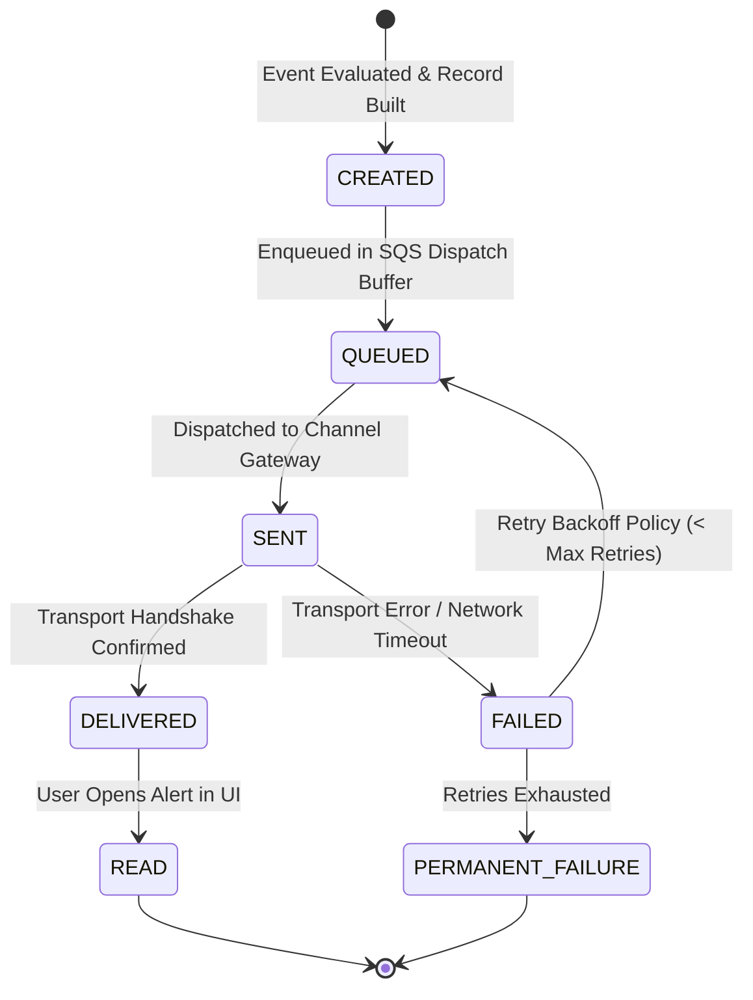
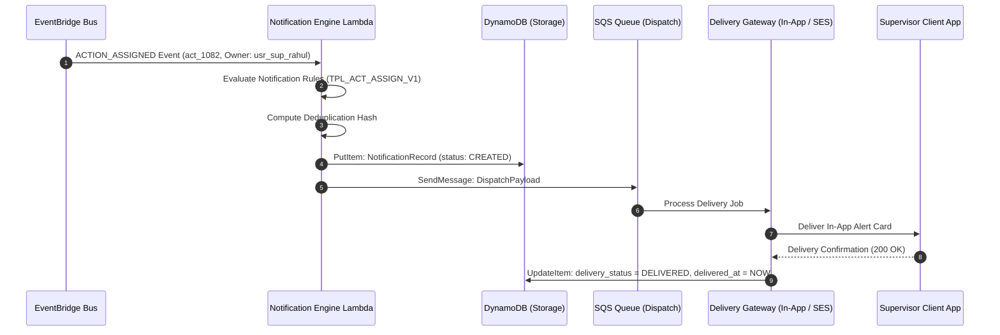

# Notification Delivery & Alerting API Specification

**Document ID:** `75_NOTIFICATION_API`  
**Status:** MVP Design / Specification  
**Version:** 1.0.0  
**Last Updated:** 2026-10-08  
**Author:** Heat Action Response Engine Team  

---

## 1. Purpose & Scope

This specification defines the authoritative API contracts for managing operational alerts, in-app notifications, recipient routing, and delivery tracking within the **Heat Action Response Engine**.

The core mission of the platform is:
> **From heat warning to verified workplace action.**

A catastrophic flaw in conventional weather alerting applications is equating the transmission of a message with real-world hazard mitigation. This platform enforces an unambiguous operational boundary:
> **A notification is a communication mechanism, not proof that a person has seen, acknowledged, or completed an action.**

### Architectural Responsibility Definition

> **The Notification API manages notification generation, recipient routing, content delivery, delivery tracking, and interaction state without treating message delivery as proof of human response or action completion.**

```text
┌────────────────────────────────────────────────────────┐
│                   AUTHORITATIVE EVENTS                 │
│      (Risk Elevation, Action Assignment, Escalation)   │
└──────────────────────────┬─────────────────────────────┘
                           │
                           ▼
┌────────────────────────────────────────────────────────┐
│                   NOTIFICATION API                     │
│    (Routing Rules, Template Assembly, Multi-Channel)   │
└──────────────┬──────────────────────────┬──────────────┘
               │                          │
               ▼                          ▼
┌──────────────────────────┐  ┌──────────────────────────┐
│      IN-APP FEED / UI    │  │    OUTBOUND GATEWAYS     │
│  (Mobile Badge & List)   │  │ (Email SES, Future SMS)  │
└──────────────────────────┘  └──────────────────────────┘
               │                          │
               └──────────────┬───────────┘
                              ▼
               ┌──────────────────────────┐
               │  DELIVERY RECEIPT RECORD │
               │ (SENT / DELIVERED / READ)│
               └──────────────────────────┘
```

The Notification API tracks the communication delivery lifecycle. Operational accountability, acknowledgment, and field verification remain strictly governed by the Action Record (`74_ACTION_API.md`, `76_ACKNOWLEDGMENT_API.md`).

---

## 2. Non-Negotiable API Invariants & Principles

Every implementation of this API must enforce these architectural principles:

```text
┌────────────────────────────────────────────────────────────────────────┐
│                  CORE NOTIFICATION API INVARIANTS                      │
├────────────────────────────────────────────────────────────────────────┤
│ • NOTIFICATION ≠ ACKNOWLEDGMENT                                        │
│ • ACKNOWLEDGMENT ≠ VERIFICATION                                        │
│ • SENT ≠ DELIVERED                                                     │
│ • DELIVERED ≠ READ                                                     │
│ • READ ≠ ACKNOWLEDGED                                                  │
│ • VERIFIED ≠ MEDICAL CERTIFICATION                                     │
│ • NOTIFICATION ENGINE ≠ SAFETY AUTHORITY                               │
│ • AI CANNOT ROUTE SAFETY-CRITICAL NOTIFICATIONS                        │
│ • NOTIFICATION FAILURE DOES NOT CANCEL REQUIRED ACTIONS                │
│ • SIMULATION ≠ LIVE OPERATION                                          │
└────────────────────────────────────────────────────────────────────────┘
```

1. **Strict State Separation:** Dispatching a notification (`SENT`), network confirmation (`DELIVERED`), and user interaction (`READ`) never modify the status of an underlying action. An action remains in `PENDING_ACKNOWLEDGMENT` until the supervisor explicitly invokes the acknowledgment command.
2. **Escalation Independent of Delivery:** If notification delivery fails (e.g. cellular network drop on site), the action escalation SLA timer in AWS Step Functions continues to run based on authoritative database timestamps. Technical communication failures trigger secondary escalation rather than assuming worker safety.
3. **Deterministic Recipient Routing:** Safety-critical recipients are determined solely by deterministic domain rules and worksite shift rosters. AI is barred from deciding who receives an emergency alert.
4. **Idempotent Dispatch:** Event retries from EventBridge or Lambda must never generate notification storms or duplicate alert cards.
5. **Clear Simulation Labeling:** All notifications generated during drills, simulations, or demonstrations must carry `is_simulation: true` and the visual prefix `[SIMULATION]`.

---

## 3. Protocol, Authentication & Authorization Conventions

All Notification API endpoints comply with the master API standard (`70_API_CONTRACTS.md`):

* **Base Path:** `/api/v1`
* **Transport:** HTTPS over TLS 1.3 with standard JSON payloads (`application/json; charset=utf-8`).
* **Authentication:** Mandatory Bearer JWT on all endpoints (`Authorization: Bearer <token>`).
* **RBAC & Scoping:**
  * `ADMIN`: Full tenant notification oversight and manual system broadcast dispatch.
  * `SAFETY_MANAGER`: Cross-site alert feed access, escalation alert oversight, and emergency broadcast dispatch.
  * `SUPERVISOR`: Personal alert feed access scoped to their assigned `user_id` and assigned worksites.
* **Headers:**
  * `Authorization: Bearer <token>` (Required)
  * `Content-Type: application/json` (Required on POST)
  * `Idempotency-Key: <uuid>` (Mandatory on POST commands)

---

## 4. Endpoints Overview

```text
┌────────┬──────────────────────────────────────────────┬────────────────────────┐
│ METHOD │ ROUTE                                        │ ACCESS ROLE            │
├────────┼──────────────────────────────────────────────┼────────────────────────┤
│ GET    │ `/api/v1/notifications`                      │ All Roles (Self/Scoped)│
│ GET    │ `/api/v1/notifications/unread-count`          │ All Roles (Self)       │
│ GET    │ `/api/v1/notifications/{notification_id}`    │ All Roles (Self/Scoped)│
│ POST   │ `/api/v1/notifications`                      │ Safety Manager / Admin │
│ POST   │ `/api/v1/notifications/{notification_id}/read│ Recipient (Self)       │
│ POST   │ `/api/v1/notifications/{notification_id}/retry│Safety Manager / Admin │
└────────┴──────────────────────────────────────────────┴────────────────────────┘
```

---

## 5. Notification Types & Priority Tiers

### 5.1 Authoritative Notification Types
Notifications are instantiated strictly in response to discrete system events (`49_NOTIFICATION_GENERATION.md`):

```text
┌────────────────────────────┬─────────────────────────────┬─────────────────────┐
│ TYPE CODE                  │ TRIGGERING DOMAIN EVENT     │ PRIMARY AUDIENCE    │
├────────────────────────────┼─────────────────────────────┼─────────────────────┤
│ `RISK_NOTIFICATION`        │ Worksite risk level elevated│ Field Supervisors & │
│ (`N01_RISK_ELEVATION`)     │ (e.g. MODERATE to HIGH)     │ Safety Managers     │
├────────────────────────────┼─────────────────────────────┼─────────────────────┤
│ `ACTION_ASSIGNMENT`        │ New preventive action       │ Assigned Site       │
│ (`N02_ACTION_ASSIGNMENT`)  │ created and owner bound     │ Supervisor          │
├────────────────────────────┼─────────────────────────────┼─────────────────────┤
│ `ACKNOWLEDGMENT_REMINDER`  │ 50% of acknowledgment SLA   │ Assigned Site       │
│ (`N03_ACK_REMINDER`)       │ window elapsed without resp │ Supervisor          │
├────────────────────────────┼─────────────────────────────┼─────────────────────┤
│ `ESCALATION_NOTIFICATION`  │ Acknowledgment deadline     │ Organizational      │
│ (`N04_ESCALATION_ALERT`)   │ expired; SLA breach         │ Safety Manager      │
├────────────────────────────┼─────────────────────────────┼─────────────────────┤
│ `VERIFICATION_REMINDER`    │ Action acknowledged,        │ Assigned Site       │
│ (`N05_VERIFY_REMINDER`)    │ verification pending at mid │ Supervisor          │
├────────────────────────────┼─────────────────────────────┼─────────────────────┤
│ `SYSTEM_DATA_FAILURE`      │ Environmental telemetry     │ Safety Manager &    │
│ (`N06_DATA_FAILURE`)       │ stale or offline > grace    │ System Admin        │
└────────────────────────────┴─────────────────────────────┴─────────────────────┘
```

### 5.2 Notification Priority vs. Risk Severity
Notification priority dictates delivery channel urgency and UI prominence. Notification priority is **not** identical to environmental risk severity:

```text
┌───────────┬──────────────────────────────┬────────────────────────────────────┐
│ PRIORITY  │ OPERATIONAL MEANING          │ UI & CHANNEL BEHAVIOR              │
├───────────┼──────────────────────────────┼────────────────────────────────────┤
│ `INFO`    │ Baseline advisory or status  │ Standard feed item; silent badge   │
├───────────┼──────────────────────────────┼────────────────────────────────────┤
│ `NORMAL`  │ Standard operational prompt  │ Feed badge; standard in-app card   │
├───────────┼──────────────────────────────┼────────────────────────────────────┤
│ `HIGH`    │ Elevated hazard; active SLA  │ High-contrast banner, audible tone,│
│           │ countdown running            │ primary mobile push dispatch       │
├───────────┼──────────────────────────────┼────────────────────────────────────┤
│ `CRITICAL`│ Acute hazard, blocker, or SLA│ Modal takeover, persistent alarm,  │
│           │ breach escalation            │ urgent multi-channel broadcast     │
└───────────┴──────────────────────────────┴────────────────────────────────────┘
```

---

## 6. Delivery Channels

The platform defines a multi-tier channel architecture across operational development phases:

```text
┌──────────────────────┬──────────────────────┬──────────────────────────────────┐
│ CHANNEL              │ IMPLEMENTATION PHASE │ DELIVERY & ACKNOWLEDGMENT LIMITS │
├──────────────────────┼──────────────────────┼──────────────────────────────────┤
│ `IN_APP`             │ MVP (Core)           │ Authoritative DynamoDB feed;     │
│                      │                      │ supports real-time READ receipts │
├──────────────────────┼──────────────────────┼──────────────────────────────────┤
│ `EMAIL`              │ P1 / Near-Term       │ Amazon SES delivery; open-rates  │
│                      │                      │ provide weak, non-authoritative  │
│                      │                      │ delivery receipts                │
├──────────────────────┼──────────────────────┼──────────────────────────────────┤
│ `SMS`                │ Future Roadmap       │ Amazon SNS / Twilio; carrier SMS │
│                      │                      │ delivery receipt; no read receipt│
├──────────────────────┼──────────────────────┼──────────────────────────────────┤
│ `PUSH`               │ Future Roadmap       │ Apple APNs / Firebase Cloud      │
│                      │                      │ Messaging; banner dismissal      │
├──────────────────────┼──────────────────────┼──────────────────────────────────┤
│ `WHATSAPP`           │ Future Roadmap       │ Meta Cloud API; rich action card │
├──────────────────────┼──────────────────────┼──────────────────────────────────┤
│ `VOICE / IVR`        │ Future Roadmap       │ Automated emergency audio calls  │
└──────────────────────┴──────────────────────┴──────────────────────────────────┘
```

> [!NOTE]
> In the MVP, the `IN_APP` channel is the authoritative channel. Outbound channels act as delivery signals; users must open the application interface to perform state-mutating actions.

---

## 7. Canonical Notification Entity Schema

The Notification object records full communication lifecycle and correlation attributes (`49_NOTIFICATION_GENERATION.md`, `68_DYNAMODB.md`):

```json
{
  "notification_id": "notif_20261008_093005_99a1",
  "organization_id": "org_infra_corp_01",
  "recipient_id": "usr_sup_rahul_kumar",
  "recipient_role": "SUPERVISOR",
  "worksite_id": "ws_blr_north_04",
  "action_id": "act_20261008_093000_1082",
  "risk_id": "rsk_20261008_093000_ws_blr_04",
  "notification_type": "ACTION_ASSIGNMENT",
  "priority": "HIGH",
  "title": "[HIGH PRIORITY] Action Assigned: Enforce 45/15 Work-Rest Rotation",
  "summary": "Heat Index projected at 45.2°C during rebar work. Enforce 15m shaded rest per hour and dispense chilled electrolytes in Sector 4.",
  "action_required": "Acknowledge directive and initiate 45/15 work-rest cycle.",
  "response_deadline": "2026-10-08T09:45:00Z",
  "channel": "IN_APP",
  "status": "SENT",
  "delivery_status": "DELIVERED",
  "failure_reason": null,
  "retry_count": 0,
  "is_simulation": false,
  "template_id": "TPL_ACT_ASSIGN_V1",
  "template_version": "v1.2.0",
  "language": "en-IN",
  "created_at": "2026-10-08T09:30:05Z",
  "queued_at": "2026-10-08T09:30:05Z",
  "sent_at": "2026-10-08T09:30:06Z",
  "delivered_at": "2026-10-08T09:30:07Z",
  "read_at": null,
  "related_event_id": "evt_eb_20261008_00192"
}
```

---

## 8. Notification Content & The 6-Question Operational Contract

Every operational alert generated by the engine satisfies the **6-Question Operational Content Contract** (`49_NOTIFICATION_GENERATION.md`):

```text
┌──────────────────────────────┬─────────────────────────────────────────────────┐
│ QUESTION                     │ NOTIFICATION CONTENT SPECIFICATION              │
├──────────────────────────────┼─────────────────────────────────────────────────┤
│ 1. WHAT HAPPENED?            │ Worksite WS-BLR-NORTH-04 elevated to HIGH risk. │
│ 2. WHY DOES IT MATTER?       │ 45.2°C Heat Index with heavy physical rebar work│
│ 3. WHAT ACTION IS REQUIRED?  │ Enforce 45/15 work-rest plan and stage canopy.  │
│ 4. WHO OWNS IT?              │ Rahul Kumar (Assigned Site Supervisor).         │
│ 5. WHEN TO RESPOND?          │ Within 15 minutes (by 09:45 UTC).               │
│ 6. WHAT IF NO RESPONSE?      │ Escalates immediately to Safety Manager.        │
└──────────────────────────────┴─────────────────────────────────────────────────┘
```

### Micro-Card Format for Mobile Banners
For constrained mobile push and SMS notifications, the engine formats a condensed 6-part micro-card:
$$\text{[PRIORITY]} \rightarrow \text{[WORKSITE]} \rightarrow \text{[DIRECTIVE]} \rightarrow \text{[OWNER]} \rightarrow \text{[DEADLINE]} \rightarrow \text{[CALL TO ACTION]}$$

**Example Micro-Card:**
> `[HIGH] North Bengaluru Site: Enforce 45/15 Work-Rest Cycle. Assigned to Rahul Kumar. Response required by 09:45 UTC. Tap to acknowledge.`

---

## 9. AI-Assisted Notification Generation & Safety Guardrails

The platform supports AI-assisted content translation, language localization, and readability enhancement (`43_AI_ASSISTANT.md`, `49_NOTIFICATION_GENERATION.md`):

```text
┌───────────────────────────────────────┬───────────────────────────────────────┐
│ DETERMINISTIC NOTIFICATION CORE (LOCK)│ AI ASSISTANCE SCOPE (PERMITTED)       │
├───────────────────────────────────────┼───────────────────────────────────────┤
│ • Recipient Identity (`usr_...`)      │ • Vernacular translation (Hindi,      │
│ • Notification Type (`ACTION_ASSIGN`) │   Kannada, Tamil, Telugu, Marathi)    │
│ • Priority Tier (`HIGH`)              │ • Tone tailoring (concise for mobile, │
│ • Response Deadline (`09:45:00Z`)     │   detailed for desktop portal)        │
│ • Action ID (`act_...`)               │ • Natural language summary of reason  │
│ • Worksite ID (`ws_...`)              │ • Audio narration script generation   │
└───────────────────────────────────────┴───────────────────────────────────────┘
```

### Absolute AI Prohibitions:
* AI cannot choose or substitute the notification recipient.
* AI cannot alter the assigned priority.
* AI cannot modify or remove the response deadline.
* AI cannot suppress an operational alert.
* AI cannot mark a notification delivered, read, or acknowledged.
* AI cannot invent or alter weather metrics.

---

## 10. Notification Lifecycle & Delivery States



### Detailed Lifecycle States:
* `CREATED`: Notification record assembled from template.
* `QUEUED`: Enqueued in FIFO dispatch queue (SQS).
* `SENT`: Dispatched to client WebSocket, push server, or email transport.
* `DELIVERED`: Delivery acknowledgment received from client or gateway.
* `READ`: User viewed notification card in active UI session.
* `FAILED`: Network or gateway transmission failed; eligible for retry.
* `PERMANENT_FAILURE`: Max retry limit reached; failure recorded in audit log.

---

## 11. Endpoint Specifications

### 11.1 List User Notifications

Retrieves the paginated notification feed for the authenticated user.

* **Route:** `GET /api/v1/notifications`
* **Authorization:** `SUPERVISOR`, `SAFETY_MANAGER`, `ADMIN`.
* **Query Parameters:**
  * `unread_only` (Boolean, optional, default `false`): Filter to unread alerts.
  * `priority` (Enum, optional): Filter by `INFO`, `NORMAL`, `HIGH`, `CRITICAL`.
  * `notification_type` (Enum, optional): Filter by type code.
  * `worksite_id` (String, optional): Filter by worksite.
  * `action_id` (String, optional): Filter by associated action.
  * `limit` (Integer, optional, default `50`, max `200`): Page size.
  * `cursor` (String, optional): Base64 pagination token.

#### Success Response (`200 OK`):
```json
{
  "data": [
    {
      "notification_id": "notif_20261008_093005_99a1",
      "notification_type": "ACTION_ASSIGNMENT",
      "priority": "HIGH",
      "title": "[HIGH PRIORITY] Action Assigned: Enforce 45/15 Work-Rest Rotation",
      "summary": "Heat Index projected at 45.2°C during rebar work.",
      "action_id": "act_20261008_093000_1082",
      "worksite_id": "ws_blr_north_04",
      "created_at": "2026-10-08T09:30:05Z",
      "read_at": null,
      "delivery_status": "DELIVERED"
    }
  ],
  "meta": {
    "request_id": "req_01JXYZ771101",
    "timestamp": "2026-10-08T09:32:00.000Z",
    "count": 1,
    "next_cursor": null
  }
}
```

---

### 11.2 Get Unread Notification Count

Lightweight endpoint for rendering unread notification badges in navigation headers.

* **Route:** `GET /api/v1/notifications/unread-count`
* **Authorization:** All authenticated users.

#### Success Response (`200 OK`):
```json
{
  "data": {
    "user_id": "usr_sup_rahul_kumar",
    "unread_count": 3,
    "has_critical": true,
    "highest_unacknowledged_priority": "CRITICAL"
  },
  "meta": {
    "request_id": "req_01JXYZ771102",
    "timestamp": "2026-10-08T09:32:01.000Z"
  }
}
```

---

### 11.3 Get Notification by ID

Retrieves an authoritative notification record by its unique identifier.

* **Route:** `GET /api/v1/notifications/{notification_id}`
* **Authorization:** Recipient (`token.sub === recipient_id`), `SAFETY_MANAGER`, or `ADMIN`.
* **Path Parameters:**
  * `notification_id` (String, required): Notification identifier.

#### Success Response (`200 OK`):
Returns the complete canonical notification entity inside the standard `data` envelope.

---

### 11.4 Mark Notification as Read

Records that the user viewed or opened the notification in an authenticated interface.

> [!CAUTION]
> Marking a notification as `READ` updates the UI read state only. It does **not** constitute legal acknowledgment of the action, does not cancel the escalation SLA timer, and does not record field verification.

* **Route:** `POST /api/v1/notifications/{notification_id}/read`
* **Authorization:** Target recipient only (`token.sub === recipient_id`).
* **Headers:**
  * `Authorization: Bearer <token>`
  * `Idempotency-Key: <uuid>`

#### Success Response (`200 OK`):
```json
{
  "data": {
    "notification_id": "notif_20261008_093005_99a1",
    "read_at": "2026-10-08T09:32:15Z",
    "status": "READ"
  },
  "meta": {
    "request_id": "req_01JXYZ771103",
    "timestamp": "2026-10-08T09:32:15.100Z"
  }
}
```

---

### 11.5 Trigger Notification Retry

Manually retries dispatch of a failed notification following technical delivery recovery.

* **Route:** `POST /api/v1/notifications/{notification_id}/retry`
* **Authorization:** `SAFETY_MANAGER`, `ADMIN`.
* **Headers:**
  * `Authorization: Bearer <token>`
  * `Idempotency-Key: <uuid>`

#### Success Response (`202 Accepted`):
Re-enqueues the notification for delivery, increments `retry_count`, and returns `status: QUEUED`.

---

## 12. Notification Idempotency & Delivery Resilience

To prevent notification storms caused by message retries:

1. **Deduplication Hashing:** The notification engine computes a deterministic deduplication key for every generated alert:
   $$\text{DeduplicationKey} = \text{SHA256}(\text{org\_id} + \text{event\_id} + \text{recipient\_id} + \text{notification\_type})$$
2. **DynamoDB Conditional Put:**
   ```text
   attribute_not_exists(PK)
   ```
   If EventBridge delivers duplicate events or a Lambda times out and retries, duplicate notification creation is rejected at the storage layer.
3. **Graceful Delivery Failure:** If in-app push or outbound email fails:
   * The notification record remains stored in DynamoDB under the recipient's partition.
   * When the supervisor opens the application, the unread feed query immediately retrieves the alert.
   * Step Functions SLA escalation operates independently based on database timestamps, ensuring worker safety is never compromised by dropped network packets.

---

## 13. Security Model & Multi-Tenant Isolation

* **Tenant Isolation:** Every notification query enforces partition scoping on `organization_id`. Cross-tenant alert leakage is prevented by DynamoDB composite keys (`ORG#<orgId>#USER#<userId>`).
* **Recipient Privacy:** Supervisors can only query notifications addressed to their personal `user_id`.
* **Protected Content:** Notifications contain operational workplace instructions and environmental context; they never transmit personally identifiable health data (PII) or confidential medical records.

---

## 14. Architectural Workflows & Diagrams

### 14.1 Notification Generation & Dispatch Sequence



### 14.2 Dual State Machine: Action Lifecycle vs. Notification Lifecycle

```mermaid
flowchart TD
    subgraph Action State Machine (Operational Truth)
        A_CREATED[CREATED] --> A_ASSIGNED[ASSIGNED]
        A_ASSIGNED --> A_PENDING[PENDING_ACKNOWLEDGMENT]
        A_PENDING -->|Supervisor Explicit Ack| A_ACK[ACKNOWLEDGED]
        A_ACK --> A_PROG[IN_PROGRESS]
        A_PROG --> A_VERIF[VERIFIED]
    end

    subgraph Notification State Machine (Communication Delivery)
        N_CREATED[CREATED] --> N_QUEUED[QUEUED]
        N_QUEUED --> N_SENT[SENT]
        N_SENT --> N_DELIV[DELIVERED]
        N_DELIV -->|User Taps Card| N_READ[READ]
    end

    A_ASSIGNED -.->|Triggers Event| N_CREATED
    N_READ -.->|Independent User Action Required| A_ACK
```

---

## 15. Testing & Validation Matrix

```text
┌──────────────────────┬──────────────────────────────┬──────────────────────────┐
│ TEST CASE IDENTIFIER │ SCENARIO DESCRIPTION         │ EXPECTED API BEHAVIOR    │
├──────────────────────┼──────────────────────────────┼──────────────────────────┤
│ `TEST_NOTIF_01`      │ List notifications for user  │ 200 OK, paginated array  │
│                      │ with unread filter           │ matching caller identity │
├──────────────────────┼──────────────────────────────┼──────────────────────────┤
│ `TEST_NOTIF_02`      │ Fetch unread count badge     │ 200 OK, accurate integer │
│                      │                              │ count and priority flag  │
├──────────────────────┼──────────────────────────────┼──────────────────────────┤
│ `TEST_NOTIF_03`      │ Cross-tenant notification    │ 403 FORBIDDEN or 404     │
│                      │ query attempt                │ NOT_FOUND error          │
├──────────────────────┼──────────────────────────────┼──────────────────────────┤
│ `TEST_NOTIF_04`      │ Mark notification as READ    │ 200 OK, read_at stamped, │
│                      │                              │ status: READ             │
├──────────────────────┼──────────────────────────────┼──────────────────────────┤
│ `TEST_NOTIF_05`      │ Duplicate event delivery     │ Deduplicated; exactly one│
│                      │ from EventBridge             │ notification created     │
├──────────────────────┼──────────────────────────────┼──────────────────────────┤
│ `TEST_NOTIF_06`      │ Verification that READ does  │ Action remains in        │
│                      │ NOT transition Action status │ PENDING_ACKNOWLEDGMENT   │
├──────────────────────┼──────────────────────────────┼──────────────────────────┤
│ `TEST_NOTIF_07`      │ Simulation notification has  │ 200 OK, is_simulation:   │
│                      │ explicit prefix & flag       │ true, title has [SIM]    │
├──────────────────────┼──────────────────────────────┼──────────────────────────┤
│ `TEST_NOTIF_08`      │ Non-recipient attempts to    │ 403 FORBIDDEN error      │
│                      │ mark notification as READ    │                          │
├──────────────────────┼──────────────────────────────┼──────────────────────────┤
│ `TEST_NOTIF_09`      │ Retry failed notification    │ 202 ACCEPTED, re-queued  │
│                      │ by Safety Manager            │                          │
├──────────────────────┼──────────────────────────────┼──────────────────────────┤
│ `TEST_NOTIF_10`      │ AI translation fallback upon │ Serves deterministic     │
│                      │ model timeout                │ English template cleanly │
└──────────────────────┴──────────────────────────────┴──────────────────────────┘
```

---

## 16. Cross-Document Architecture Integration

* `16_ACTION_MODEL.md`: Core operational action model and parent entity.
* `49_NOTIFICATION_GENERATION.md`: Full event taxonomy and 6-question content rules.
* `68_DYNAMODB.md`: Single-table partition design and GSI indexing for notifications.
* `70_API_CONTRACTS.md`: Master protocol, envelope, header, and pagination standards.
* `73_RISK_API.md`: Upstream risk elevation events.
* `74_ACTION_API.md`: Downstream preventive action directives.
* `76_ACKNOWLEDGMENT_API.md`: Distinct legal acknowledgment workflows.
* `77_ESCALATION_API.md`: Secondary escalation routing when acknowledgment times out.
* `79_ERROR_CONTRACTS.md`: Standard error envelopes and machine-readable failure codes.
