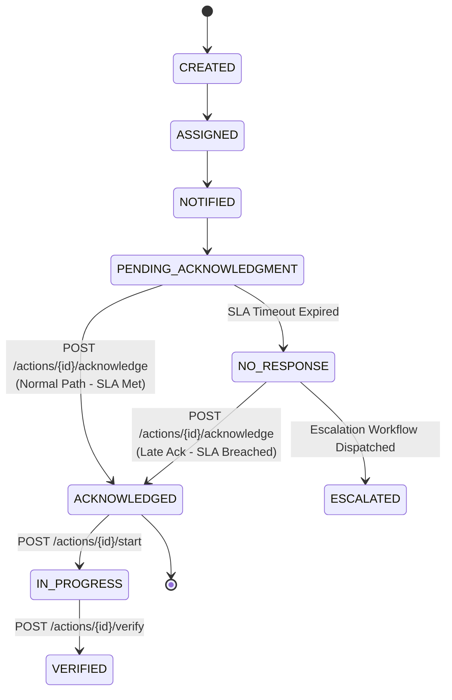
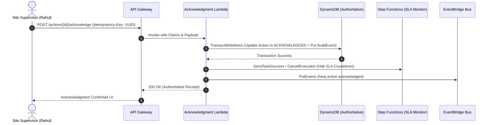

# Action Acknowledgment API Specification

**Document ID:** `76_ACKNOWLEDGMENT_API`  
**Status:** MVP Design / Specification  
**Version:** 1.0.0  
**Last Updated:** 2026-10-08  
**Author:** Heat Action Response Engine Team  

---

## 1. Purpose & Scope

This specification defines the authoritative API contract for explicit human acknowledgment of assigned operational preventive actions within the **Heat Action Response Engine**.

The operational core of the platform is:
> **From heat warning to verified workplace action.**

A primary vulnerability in workplace safety alerting is confusing message dispatch with human awareness. This platform establishes an unambiguous operational boundary:
> **A notification communicates an expected response; acknowledgment records an explicit, authenticated human response accepting operational custody of that assignment.**

### Architectural Responsibility Definition

> **The Acknowledgment API records explicit human receipt and operational custody of assigned preventive actions, terminates automated escalation SLA timers, and transitions the action into the active field execution pipeline.**

```text
┌────────────────────────────────────────────────────────┐
│                   ACTION ASSIGNED                      │
│            (Bound to Site Supervisor)                  │
└──────────────────────────┬─────────────────────────────┘
                           │
                           ▼
┌────────────────────────────────────────────────────────┐
│                   NOTIFICATION SENT                    │
│             (In-App Alert Dispatched)                  │
└──────────────────────────┬─────────────────────────────┘
                           │
                           ▼
┌────────────────────────────────────────────────────────┐
│             PENDING_ACKNOWLEDGMENT                     │
│      (Step Functions SLA Countdown Running)            │
└──────────────┬──────────────────────────┬──────────────┘
               │                          │
  (Supervisor Acknowledges)       (Timeout Expires)
               │                          │
               ▼                          ▼
┌──────────────────────────┐  ┌──────────────────────────┐
│      ACKNOWLEDGED        │  │       NO_RESPONSE        │
│ (Timer Cancelled; Audit) │  │   (Trigger Escalation)   │
└──────────────┬───────────┘  └──────────────────────────┘
               │
               ▼
┌──────────────────────────┐
│       IN_PROGRESS        │
│ (Field Controls Deployed)│
└──────────────────────────┘
```

The Acknowledgment API does **not** record that physical safeguards have been completed. Field completion is governed exclusively by verification (`74_ACTION_API.md`).

---

## 2. Non-Negotiable API Invariants & Principles

Every implementation of this API must enforce these architectural principles:

```text
┌────────────────────────────────────────────────────────────────────────┐
│                 CORE ACKNOWLEDGMENT API INVARIANTS                     │
├────────────────────────────────────────────────────────────────────────┤
│ • NOTIFICATION SENT ≠ ACKNOWLEDGED                                     │
│ • NOTIFICATION DELIVERED ≠ ACKNOWLEDGED                                │
│ • NOTIFICATION READ ≠ ACKNOWLEDGED                                     │
│ • ACKNOWLEDGED ≠ ACTION COMPLETED                                      │
│ • ACKNOWLEDGED ≠ VERIFIED                                              │
│ • ACKNOWLEDGED ≠ RISK RESOLVED                                         │
│ • ACKNOWLEDGED ≠ WORKER SAFE                                           │
│ • ACKNOWLEDGED ≠ MEDICAL CLEARANCE                                     │
│ • NO ACKNOWLEDGMENT ≠ PROOF THAT A WORKER IS PHYSICALLY HARMED         │
│ • FRONTEND ≠ SOURCE OF TRUTH FOR ACKNOWLEDGMENT STATE                  │
│ • CLIENT CANNOT SUPPLY AUTHORITATIVE TIMESTAMP OR ACTOR IDENTITY       │
└────────────────────────────────────────────────────────────────────────┘
```

1. **Explicit Human Interaction:** Acknowledgment requires an authenticated human user action via the application UI. System background jobs, cron triggers, push delivery confirmations, or AI agents can **never** trigger an acknowledgment on behalf of a human supervisor.
2. **Strict Identity Derivation:** The server derives `user_id`, `role`, `organization_id`, and `worksite_scope` strictly from the validated Bearer JWT. The client cannot spoof ownership or claim another user acknowledged the directive.
3. **Escalation Interruption:** A successful acknowledgment atomically halts the active AWS Step Functions SLA countdown timer, preventing unnecessary managerial escalations.
4. **Idempotent Execution:** Repeated acknowledgment attempts caused by mobile network retries must return the original authoritative receipt without corrupting the action state machine or spamming the audit ledger.
5. **No Medical Inference:** An acknowledgment attests to administrative custody; it does not constitute clinical evaluation, physiological fitness certification, or regulatory immunity.

---

## 3. Protocol, Authentication & Authorization Conventions

All Acknowledgment API endpoints adhere to the master API standard (`70_API_CONTRACTS.md`):

* **Base Path:** `/api/v1`
* **Transport:** HTTPS over TLS 1.3 with standard JSON payloads (`application/json; charset=utf-8`).
* **Authentication:** Mandatory Bearer JWT on all endpoints (`Authorization: Bearer <token>`).
* **RBAC & Scoping:**
  * `SUPERVISOR`: Primary role authorized to acknowledge actions assigned to their active shift and worksite.
  * `SAFETY_MANAGER`: Authorized to acknowledge or accept custody of actions across assigned sites (e.g. during supervisor incapacitation, shift handover, or post-escalation re-routing).
  * `ADMIN`: Administrative oversight; cannot bypass operational assignment rules without recorded justification.
* **Headers:**
  * `Authorization: Bearer <token>` (Required)
  * `Content-Type: application/json` (Required on POST)
  * `Idempotency-Key: <uuid>` (Mandatory on state mutation)
  * `If-Match: "<resource_version>"` (Optional optimistic concurrency check)

---

## 4. Endpoints Overview

```text
┌────────┬──────────────────────────────────────────────┬────────────────────────┐
│ METHOD │ ROUTE                                        │ ACCESS ROLE            │
├────────┼──────────────────────────────────────────────┼────────────────────────┤
│ POST   │ `/api/v1/actions/{action_id}/acknowledge`    │ Assigned Sup / Manager │
│ GET    │ `/api/v1/actions/{action_id}/acknowledgment` │ All Roles (Scoped)     │
└────────┴──────────────────────────────────────────────┴────────────────────────┘
```

> [!NOTE]
> Acknowledgment is fundamentally a command-driven state transition. The system does not expose generic CRUD endpoints (e.g. `PUT`, `DELETE`) for acknowledgments. Once committed, an acknowledgment is immutable and auditable.

---

## 5. Acknowledgment Preconditions & Finite State Machine

### 5.1 Precondition Validation Rules
Before executing the state transition, the application service verifies that all preconditions are satisfied:

```text
┌──────────────────────┬────────────────────────────────────────────────────────┐
│ PRECONDITION         │ VALIDATION RULE & FAILURE BEHAVIOR                     │
├──────────────────────┼────────────────────────────────────────────────────────┤
│ Action Existence     │ Action record exists in DynamoDB; returns 404 if not.  │
├──────────────────────┼────────────────────────────────────────────────────────┤
│ Tenant Boundary      │ `token.org_id === action.organization_id`; else 403.   │
├──────────────────────┼────────────────────────────────────────────────────────┤
│ Ownership Scope      │ Caller is the designated `owner_id` or authorized      │
│                      │ `SAFETY_MANAGER` for that worksite; else 403.          │
├──────────────────────┼────────────────────────────────────────────────────────┤
│ Valid State          │ Action must be in `PENDING_ACKNOWLEDGMENT` or          │
│                      │ `NO_RESPONSE` (Late Acknowledgment policy); else 409.  │
├──────────────────────┼────────────────────────────────────────────────────────┤
│ Non-Terminal State   │ Action has not been `VERIFIED` or `CANCELLED`; else 409│
└──────────────────────┴────────────────────────────────────────────────────────┘
```

### 5.2 State Machine Transition



### 5.3 Late Acknowledgment Policy
If an unacknowledged action enters `NO_RESPONSE` and triggers escalation before the supervisor responds, the supervisor may still acknowledge the action under the **Late Acknowledgment Policy**:
1. The status transitions to `ACKNOWLEDGED`.
2. The record logs `sla_breached: true` and the exact elapsed delay.
3. The open escalation event transitions to `ACKNOWLEDGED` with supervisor custody noted.
4. An audit entry records that the action was acknowledged after the policy deadline.

---

## 6. Endpoint Specifications

### 6.1 Submit Action Acknowledgment

Submits explicit human acknowledgment and acceptance of operational custody for an assigned action directive.

* **Route:** `POST /api/v1/actions/{action_id}/acknowledge`
* **Authorization:** Assigned `owner_id` (Supervisor) or `SAFETY_MANAGER`.
* **Headers:**
  * `Authorization: Bearer <token>`
  * `Content-Type: application/json`
  * `Idempotency-Key: <uuid>` (Mandatory)
* **Path Parameters:**
  * `action_id` (String, required): Target action identifier (e.g. `act_20261008_093000_1082`).

#### Request Body:
```json
{
  "note": "Received directive. Preparing shaded rest trailer and chilling electrolyte coolers for Sector 4 crew.",
  "estimated_start_minutes": 5
}
```

#### Request Attributes:
* `note` (String, optional, max 500 chars): Operational comment or context entered by the supervisor.
* `estimated_start_minutes` (Integer, optional, min 1, max 60): Supervisor's estimated time to physical deployment.

#### Success Response (`200 OK`):
```json
{
  "data": {
    "action_id": "act_20261008_093000_1082",
    "acknowledgment_id": "ack_20261008_093512_44a1",
    "organization_id": "org_infra_corp_01",
    "worksite_id": "ws_blr_north_04",
    "action_status": "ACKNOWLEDGED",
    "acknowledged_by": {
      "user_id": "usr_sup_rahul_kumar",
      "name": "Rahul Kumar",
      "role": "SUPERVISOR"
    },
    "acknowledged_at": "2026-10-08T09:35:12Z",
    "response_delay_seconds": 312,
    "sla_breached": false,
    "escalation_cancelled": true,
    "next_expected_step": "IN_PROGRESS"
  },
  "meta": {
    "request_id": "req_01JXYZ991101",
    "timestamp": "2026-10-08T09:35:12.450Z",
    "resource_version": 3
  }
}
```

---

### 6.2 Get Action Acknowledgment Details

Retrieves the immutable acknowledgment receipt sub-record for an action.

* **Route:** `GET /api/v1/actions/{action_id}/acknowledgment`
* **Authorization:** `SUPERVISOR`, `SAFETY_MANAGER`, `ADMIN` (scoped to organization and worksite).
* **Path Parameters:**
  * `action_id` (String, required): Action identifier.

#### Success Response (`200 OK`):
```json
{
  "data": {
    "acknowledgment_id": "ack_20261008_093512_44a1",
    "action_id": "act_20261008_093000_1082",
    "acknowledged_by": {
      "user_id": "usr_sup_rahul_kumar",
      "role": "SUPERVISOR"
    },
    "acknowledged_at": "2026-10-08T09:35:12Z",
    "note": "Received directive. Preparing shaded rest trailer.",
    "response_delay_seconds": 312,
    "sla_breached": false
  },
  "meta": {
    "request_id": "req_01JXYZ991102",
    "timestamp": "2026-10-08T09:36:00.000Z"
  }
}
```

#### If Unacknowledged (`404 Not Found` or `409 Conflict`):
If the action exists but has not been acknowledged, returns standard error envelope:
```json
{
  "error": {
    "code": "ACTION_NOT_ACKNOWLEDGED",
    "message": "Action act_20261008_093000_1082 is currently in PENDING_ACKNOWLEDGMENT state.",
    "request_id": "req_01JXYZ991103",
    "timestamp": "2026-10-08T09:36:01.000Z",
    "retryable": false
  }
}
```

---

## 7. Idempotency & Concurrency Mechanics

Field supervisors operating on construction and industrial sites frequently encounter spotty cellular coverage. The Acknowledgment API handles network instability through deterministic idempotency and database concurrency controls:

### 7.1 Idempotency Key Replay Semantics
Every acknowledgment submission requires an `Idempotency-Key` header:
1. When a request arrives, the backend checks for an existing record matching `hash(org_id, action_id, idempotency_key)`.
2. If an identical acknowledgment already completed within the past 24 hours, the backend returns the stored `200 OK` response with `meta.is_cached_replay: true`.
3. Zero secondary state transitions occur; zero duplicate audit records are emitted.

### 7.2 Atomic Conditional Update
DynamoDB executes the state transition using an atomic conditional write (`68_DYNAMODB.md`):

```text
ConditionExpression:
  attribute_exists(PK) AND
  attribute_exists(SK) AND
  #status IN (:pending_ack, :no_response) AND
  attribute_not_exists(acknowledged_at)
```

If two supervisors attempt simultaneous acknowledgment, or if a supervisor acknowledges at the exact millisecond the Step Functions escalation timer fires:
* Exactly one write succeeds atomically.
* The competing write fails with `ConditionalCheckFailedException` and maps to `409 ACTION_STATE_CONFLICT`.

---

## 8. Escalation & Workflow Integration

The Acknowledgment API interfaces directly with AWS Step Functions and EventBridge (`69_EVENTBRIDGE_STEP_FUNCTIONS.md`):



1. **Step Functions Signal:** Upon successful write, the Lambda signals the active Step Functions execution to cancel the countdown wait state.
2. **Domain Event Publication:** An event `heat.action.acknowledged` is published to EventBridge to clear unacknowledged warning banners across administrative dashboards.

---

## 9. Audit Event Generation

Every acknowledgment write generates an immutable `AuditEvent` inside the same atomic database transaction (`TransactWriteItems`) to guarantee zero orphan state transitions:

```json
{
  "audit_event_id": "aud_20261008_093512_98b2",
  "organization_id": "org_infra_corp_01",
  "worksite_id": "ws_blr_north_04",
  "timestamp": "2026-10-08T09:35:12Z",
  "event_type": "ACTION_ACKNOWLEDGED",
  "actor": {
    "user_id": "usr_sup_rahul_kumar",
    "role": "SUPERVISOR",
    "ip_address": "49.207.211.45"
  },
  "resource": {
    "type": "ACTION",
    "id": "act_20261008_093000_1082"
  },
  "previous_state": "PENDING_ACKNOWLEDGMENT",
  "new_state": "ACKNOWLEDGED",
  "reason": "Explicit supervisor UI confirmation",
  "source": "REST_API",
  "correlation_id": "req_01JXYZ991101"
}
```

---

## 10. Failure Scenarios & HTTP Status Codes

```text
┌──────┬────────────────────────┬────────────────────────────────────────┐
│ CODE │ STATUS NAME            │ CONTRACTUAL SCENARIO                   │
├──────┼────────────────────────┼────────────────────────────────────────┤
│ 200  │ OK                     │ Acknowledgment accepted and committed. │
├──────┼────────────────────────┼────────────────────────────────────────┤
│ 400  │ Bad Request            │ Malformed JSON, missing Idempotency-Key│
├──────┼────────────────────────┼────────────────────────────────────────┤
│ 401  │ Unauthorized           │ Missing, invalid, or expired JWT.      │
├──────┼────────────────────────┼────────────────────────────────────────┤
│ 403  │ Forbidden              │ User not authorized for site/action.   │
├──────┼────────────────────────┼────────────────────────────────────────┤
│ 404  │ Not Found              │ Action ID does not exist in tenant.    │
├──────┼────────────────────────┼────────────────────────────────────────┤
│ 409  │ Conflict               │ Action already verified, cancelled, or │
│      │                        │ acknowledged by another actor.         │
├──────┼────────────────────────┼────────────────────────────────────────┤
│ 422  │ Unprocessable Entity   │ Note exceeds 500 characters.           │
├──────┼────────────────────────┼────────────────────────────────────────┤
│ 429  │ Too Many Requests      │ Rate throttle exceeded.                │
├──────┼────────────────────────┼────────────────────────────────────────┤
│ 500  │ Internal Server Error  │ DynamoDB transaction failure.          │
└──────┴────────────────────────┴────────────────────────────────────────┘
```

---

## 11. Testing & Validation Matrix

```text
┌──────────────────────┬──────────────────────────────┬──────────────────────────┐
│ TEST CASE IDENTIFIER │ SCENARIO DESCRIPTION         │ EXPECTED API BEHAVIOR    │
├──────────────────────┼──────────────────────────────┼──────────────────────────┤
│ `TEST_ACK_01`        │ Valid acknowledgment by      │ 200 OK, status transitions│
│                      │ assigned supervisor          │ to ACKNOWLEDGED, audit set│
├──────────────────────┼──────────────────────────────┼──────────────────────────┤
│ `TEST_ACK_02`        │ Acknowledgment by supervisor │ 403 FORBIDDEN error      │
│                      │ assigned to different site   │                          │
├──────────────────────┼──────────────────────────────┼──────────────────────────┤
│ `TEST_ACK_03`        │ Action does not exist        │ 404 NOT_FOUND error      │
├──────────────────────┼──────────────────────────────┼──────────────────────────┤
│ `TEST_ACK_04`        │ Attempt to acknowledge an    │ 409 ACTION_STATE_CONFLICT│
│                      │ action in VERIFIED state     │                          │
├──────────────────────┼──────────────────────────────┼──────────────────────────┤
│ `TEST_ACK_05`        │ Attempt to acknowledge an    │ 409 ACTION_STATE_CONFLICT│
│                      │ action in CANCELLED state    │                          │
├──────────────────────┼──────────────────────────────┼──────────────────────────┤
│ `TEST_ACK_06`        │ Idempotent duplicate submit  │ 200 OK, cached replay    │
│                      │ with identical IdempotencyKey│ without duplicate audit  │
├──────────────────────┼──────────────────────────────┼──────────────────────────┤
│ `TEST_ACK_07`        │ Late acknowledgment when in  │ 200 OK, status: ACK,     │
│                      │ NO_RESPONSE state            │ sla_breached: true       │
├──────────────────────┼──────────────────────────────┼──────────────────────────┤
│ `TEST_ACK_08`        │ Concurrent acknowledgment    │ Exactly one 200 OK;      │
│                      │ by two actors simultaneously │ competing write gets 409 │
├──────────────────────┼──────────────────────────────┼──────────────────────────┤
│ `TEST_ACK_09`        │ Step Functions timer cancel  │ Verified task success    │
│                      │ invocation upon 200 OK       │ signal sent to workflow  │
├──────────────────────┼──────────────────────────────┼──────────────────────────┤
│ `TEST_ACK_10`        │ Atomic transaction fails     │ 500 INTERNAL_ERROR, no   │
│                      │ during audit write           │ partial state corruption │
└──────────────────────┴──────────────────────────────┴──────────────────────────┘
```

---

## 12. Cross-Document Architecture Integration

* `16_ACTION_MODEL.md`: Core action entity lifecycle and status transitions.
* `68_DYNAMODB.md`: Conditional updates and single-table partition key schema.
* `69_EVENTBRIDGE_STEP_FUNCTIONS.md`: Step Functions countdown timer and event bus topics.
* `70_API_CONTRACTS.md`: Master protocol, envelope, header, and pagination standards.
* `74_ACTION_API.md`: Parent action management and field verification endpoints.
* `75_NOTIFICATION_API.md`: Prior outbound alerting mechanism.
* `77_ESCALATION_API.md`: Escalation workflow triggered if acknowledgment fails.
* `78_AUDIT_API.md`: Immutable audit query endpoints.
* `79_ERROR_CONTRACTS.md`: Standard error envelopes and error codes.
