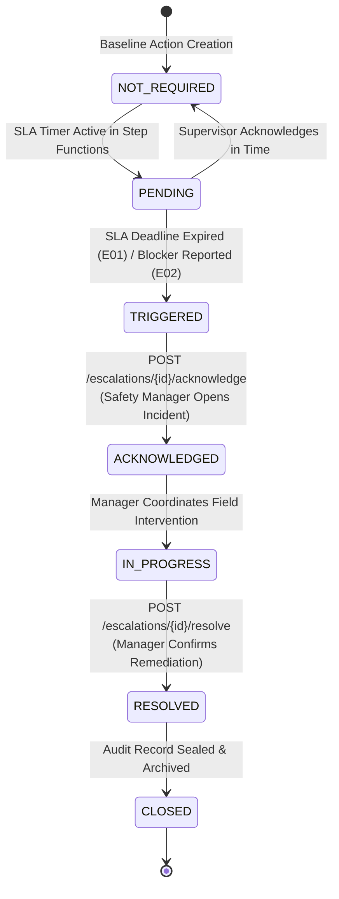
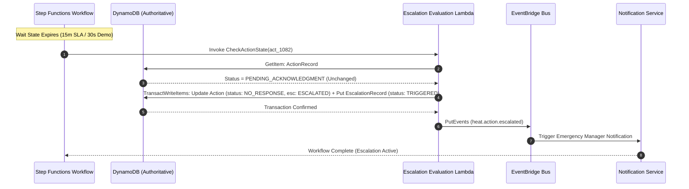

# Escalation Management API Specification

**Document ID:** `77_ESCALATION_API`  
**Status:** MVP Design / Specification  
**Version:** 1.0.0  
**Last Updated:** 2026-10-08  
**Author:** Heat Action Response Engine Team  

---

## 1. Purpose & Scope

This specification defines the authoritative API contracts for managing operational escalations within the **Heat Action Response Engine**.

The core mission of the platform is:
> **From heat warning to verified workplace action.**

In high-heat industrial and construction environments, an unacknowledged or blocked safety directive cannot be allowed to silently expire or remain unmonitored. This platform enforces a fundamental operational principle:
> **Escalation prevents unresolved safety-related operational work from becoming invisible.**

### Architectural Responsibility Definition

> **The Escalation API exposes and controls the systematic elevation of attention, custody, and managerial intervention when expected front-line responses do not occur or field obstacles prevent safeguard implementation.**

```text
┌────────────────────────────────────────────────────────┐
│               ACTIVE PREVENTIVE DIRECTIVE              │
│          (Assigned to Primary Site Supervisor)         │
└──────────────────────────┬─────────────────────────────┘
                           │
                           ▼
┌────────────────────────────────────────────────────────┐
│             STEP FUNCTIONS SLA COUNTDOWN               │
│        (Monitoring Response Policy Interval)           │
└──────────────┬──────────────────────────┬──────────────┘
               │                          │
  (Supervisor Responds in Time)    (Timeout / Blocker Reported)
               │                          │
               ▼                          ▼
┌──────────────────────────┐  ┌──────────────────────────┐
│   NORMAL FIELD PROGRESS  │  │   DETERMINISTIC TRIGGER  │
│  (Acknowledge & Verify)  │  │  (E01 Timeout / E02 Block)│
└──────────────────────────┘  └───────────┬──────────────┘
                                          │
                                          ▼
                              ┌──────────────────────────┐
                              │     ESCALATION RECORD    │
                              │ (Transfers Attention to  │
                              │  Safety Manager; Audited)│
                              └──────────────────────────┘
```

The Escalation API is an operational control mechanism. It does **not** replace emergency medical services or autonomous robotic shutdowns.

---

## 2. Non-Negotiable API Invariants & Principles

Every implementation of this API must enforce these architectural principles:

```text
┌────────────────────────────────────────────────────────────────────────┐
│                   CORE ESCALATION API INVARIANTS                       │
├────────────────────────────────────────────────────────────────────────┤
│ • ESCALATION ≠ EMERGENCY MEDICAL RESPONSE                              │
│ • ESCALATION ≠ PROOF OF PHYSICAL WORKER HARM                           │
│ • ESCALATION ≠ EMPLOYEE DISCIPLINARY / HR MONITORING                   │
│ • ESCALATION RESOLUTION ≠ ACTION VERIFICATION                          │
│ • ESCALATION ACKNOWLEDGMENT ≠ RISK RESOLVED                            │
│ • AI CANNOT TRIGGER, REROUTE, OR RESOLVE ESCALATIONS                   │
│ • CLIENT CANNOT ARBITRARILY CREATE ESCALATIONS VIA DIRECT REST POST    │
│ • FRONTEND CANNOT MUTATE ESCALATION STATE WITHOUT RECORDED CONTEXT     │
│ • DEMO TIMEOUT (30s) ≠ PRODUCTION OCCUPATIONAL SAFETY STANDARD         │
│ • SIMULATION ≠ LIVE OPERATION                                          │
└────────────────────────────────────────────────────────────────────────┘
```

1. **System & Event-Driven Instantiation:** Escalations are instantiated deterministically by AWS Step Functions SLA countdown monitors or explicit field blocker reports (`POST /actions/{id}/block`). Arbitrary client-side creation is prohibited.
2. **Dual-Custody Model:** An escalation transfers managerial attention to the Safety Manager without relieving the field supervisor of their underlying operational responsibility. Both identities remain recorded in the active incident entity.
3. **Escalation Resolution vs. Action Verification:** Closing an escalation event attests that managerial intervention occurred (e.g. water tanker dispatched, crew reassigned). It does **not** automatically mark the underlying action directive `VERIFIED` until field controls are confirmed.
4. **Deterministic Triggers Only:** Triggers (`E01` through `E05`) derive purely from mathematical clock comparisons and explicit field reports. AI language models have zero authority to create or suppress escalations.
5. **No Medical Implication:** Escalation indicates software response latency or logistical impediments; it does not constitute clinical triage or medical injury diagnosis.

---

## 3. Protocol, Authentication & Authorization Conventions

All Escalation API endpoints adhere to the master API standard (`70_API_CONTRACTS.md`):

* **Base Path:** `/api/v1`
* **Transport:** HTTPS over TLS 1.3 with standard JSON bodies (`application/json; charset=utf-8`).
* **Authentication:** Mandatory Bearer JWT on all endpoints (`Authorization: Bearer <token>`).
* **RBAC & Scoping:**
  * `SAFETY_MANAGER`: Primary actor authorized to view escalation feeds, acknowledge escalations, and submit managerial resolutions.
  * `ADMIN`: Organizational oversight, administrative audit, and fallback resolution.
  * `SUPERVISOR`: Read-only access scoped strictly to escalations arising from their assigned worksites/actions.
* **Headers:**
  * `Authorization: Bearer <token>` (Required)
  * `Content-Type: application/json` (Required on POST)
  * `Idempotency-Key: <uuid>` (Mandatory on state mutations: `/acknowledge`, `/resolve`)

---

## 4. Endpoints Overview

```text
┌────────┬──────────────────────────────────────────────┬────────────────────────┐
│ METHOD │ ROUTE                                        │ ACCESS ROLE            │
├────────┼──────────────────────────────────────────────┼────────────────────────┤
│ GET    │ `/api/v1/escalations/{escalation_id}`        │ All Roles (Scoped)     │
│ GET    │ `/api/v1/worksites/{worksite_id}/escalations`│ All Roles (Scoped)     │
│ GET    │ `/api/v1/escalations`                        │ Safety Manager / Admin │
│ POST   │ `/api/v1/escalations/{id}/acknowledge`       │ Safety Manager / Admin │
│ POST   │ `/api/v1/escalations/{id}/resolve`           │ Safety Manager / Admin │
└────────┴──────────────────────────────────────────────┴────────────────────────┘
```

---

## 5. Standardized Escalation Triggers & MVP Chain

### 5.1 Trigger Taxonomy
Escalations are triggered strictly in response to discrete deterministic conditions (`17_ESCALATION_MODEL.md`):

```text
┌──────────────┬──────────────────────────────┬──────────────────────────────────┐
│ TRIGGER CODE │ OPERATIONAL CONDITION        │ TRIGGER SOURCE                   │
├──────────────┼──────────────────────────────┼──────────────────────────────────┤
│ `E01`        │ No Acknowledgment (Timeout)  │ Step Functions SLA countdown     │
│              │ Acknowledgment deadline lapsed│ expires with status unchanged    │
├──────────────┼──────────────────────────────┼──────────────────────────────────┤
│ `E02`        │ Action Blocked (Impediment)  │ Field supervisor explicit command│
│              │ Water/shade/resource failure │ `POST /actions/{id}/block`       │
├──────────────┼──────────────────────────────┼──────────────────────────────────┤
│ `E03`        │ Verification Pending Timeout │ Step Functions midpoint check:   │
│              │ Action acked but unverified  │ controls unconfirmed at deadline │
├──────────────┼──────────────────────────────┼──────────────────────────────────┤
│ `E04`        │ Owner Unavailable / Invalid  │ Action Engine: shift roster lacks│
│              │ No supervisor assigned       │ an active supervisor account     │
├──────────────┼──────────────────────────────┼──────────────────────────────────┤
│ `E05`        │ Repeated Unresolved Action   │ Sustained HIGH/CRITICAL risk     │
│              │ Multiple cycles unresolved   │ across multiple polling cycles   │
└──────────────┴──────────────────────────────┴──────────────────────────────────┘
```

### 5.2 MVP Escalation Chain vs. Future Extension
The platform implements a focused, reliable two-tier escalation loop for the MVP:

```text
TIER 1 (Field Lead):        SITE SUPERVISOR
                                   │
                                   │ (Deterministic Escalation Trigger)
                                   ▼
TIER 2 (Operations Oversight): SAFETY MANAGER
```

*Future Architectural Extension (Roadmap):* Multi-tier routing (`SUPERVISOR` $\rightarrow$ `SAFETY_MANAGER` $\rightarrow$ `OPERATIONS_VP`) is preserved in schema design but not activated in MVP deployment.

---

## 6. Escalation Timing: Demo vs. Production Response Windows

> [!IMPORTANT]
> **A prominent operational distinction must be preserved between Hackathon Demo configurations and Production deployments:**
>
> * **Hackathon Demo / Drill Mode:** A compressed **30-second acknowledgment timeout** is utilized to enable interactive live demonstration of Step Functions escalation cascades without forcing judges to wait 15 minutes.
> * **Production Operational Mode:** Response windows are configured strictly according to organizational safety policy and applicable occupational health guidance (e.g. 15 minutes for `HIGH` risk, 5 minutes for `CRITICAL` risk).
>
> **The 30-second demo timeout is NOT an occupational health standard, statutory mandate, or universal safety threshold.**

---

## 7. Canonical Escalation Entity Schema

The Escalation record tracks incident management and dual custody (`17_ESCALATION_MODEL.md`, `68_DYNAMODB.md`):

```json
{
  "escalation_id": "esc_20261008_094500_77a1",
  "organization_id": "org_infra_corp_01",
  "worksite_id": "ws_blr_north_04",
  "action_id": "act_20261008_093000_1082",
  "risk_id": "rsk_20261008_093000_ws_blr_04",
  "trigger_type": "E01_NO_ACKNOWLEDGMENT",
  "reason": "Acknowledgment SLA deadline expired (15m elapsed without supervisor response).",
  "source_state": "NO_RESPONSE",
  "status": "TRIGGERED",
  "priority": "CRITICAL",
  "primary_supervisor": {
    "user_id": "usr_sup_rahul_kumar",
    "name": "Rahul Kumar",
    "role": "SUPERVISOR"
  },
  "escalated_to": {
    "user_id": "usr_mgr_priya_sharma",
    "name": "Priya Sharma",
    "role": "SAFETY_MANAGER"
  },
  "is_simulation": false,
  "triggered_at": "2026-10-08T09:45:00Z",
  "acknowledged_at": null,
  "resolved_at": null,
  "resolution": null,
  "created_at": "2026-10-08T09:45:00Z",
  "updated_at": "2026-10-08T09:45:00Z",
  "resource_version": 1
}
```

---

## 8. Escalation Lifecycle & Finite State Machine



### State Definitions:
1. `NOT_REQUIRED`: Normal operational flow; action is progressing within allowable SLAs.
2. `PENDING`: Step Functions countdown wait state is actively monitoring response time.
3. `TRIGGERED`: Deadline expired or blocker logged; urgent escalation alerts dispatched to Safety Manager.
4. `ACKNOWLEDGED`: Safety Manager has opened the alert and accepted incident management custody.
5. `IN_PROGRESS`: Safety Manager is actively remediating (phoning site, reallocating water, reassigning crews).
6. `RESOLVED`: Corrective managerial action executed and attested with structured notes.
7. `CLOSED`: Post-shift compliance review concluded; escalation archived in immutable audit ledger.

---

## 9. Endpoint Specifications

### 9.1 Get Escalation by ID

Retrieves an authoritative escalation record by its unique identifier.

* **Route:** `GET /api/v1/escalations/{escalation_id}`
* **Authorization:** `SUPERVISOR` (assigned worksite), `SAFETY_MANAGER`, `ADMIN`.
* **Path Parameters:**
  * `escalation_id` (String, required): Escalation identifier.

#### Success Response (`200 OK`):
Returns the complete canonical escalation entity inside the standard `data` envelope.

---

### 9.2 List Active Escalations

Retrieves active escalations across an organization or filtered by worksite for safety managers.

* **Route:** `GET /api/v1/escalations`
* **Authorization:** `SAFETY_MANAGER`, `ADMIN`.
* **Query Parameters:**
  * `status` (Enum, optional): Filter by `TRIGGERED`, `ACKNOWLEDGED`, `IN_PROGRESS`, `RESOLVED`, `CLOSED`.
  * `worksite_id` (String, optional): Filter by worksite.
  * `trigger_type` (Enum, optional): Filter by `E01`, `E02`, `E03`, `E04`, `E05`.
  * `limit` (Integer, default `50`, max `200`): Page size.
  * `cursor` (String, optional): Base64 pagination token.

#### Success Response (`200 OK`):
```json
{
  "data": [
    {
      "escalation_id": "esc_20261008_094500_77a1",
      "worksite_id": "ws_blr_north_04",
      "action_id": "act_20261008_093000_1082",
      "trigger_type": "E01_NO_ACKNOWLEDGMENT",
      "status": "TRIGGERED",
      "priority": "CRITICAL",
      "triggered_at": "2026-10-08T09:45:00Z",
      "primary_supervisor_name": "Rahul Kumar"
    }
  ],
  "meta": {
    "request_id": "req_01JXYZ661101",
    "timestamp": "2026-10-08T09:46:00.000Z",
    "count": 1,
    "next_cursor": null
  }
}
```

---

### 9.3 Acknowledge Escalation Incident

Safety Manager explicitly accepts incident management custody of the escalated event.

* **Route:** `POST /api/v1/escalations/{escalation_id}/acknowledge`
* **Authorization:** `SAFETY_MANAGER`, `ADMIN`.
* **Headers:**
  * `Authorization: Bearer <token>`
  * `Content-Type: application/json`
  * `Idempotency-Key: <uuid>`

#### Request Body:
```json
{
  "manager_note": "Alert received. Contacting site radio to verify supervisor status."
}
```

#### Success Response (`200 OK`):
Transitions escalation status from `TRIGGERED` to `ACKNOWLEDGED`, records `acknowledged_at`, and emits an `ESCALATION_ACKNOWLEDGED` audit event.

---

### 9.4 Resolve Escalation Incident

Formally records managerial resolution of the escalation anomaly.

> [!IMPORTANT]
> The client cannot simply send `{ "status": "RESOLVED" }`. Resolution requires a structured method code, detailed resolution notes, and authenticated identity verification.

* **Route:** `POST /api/v1/escalations/{escalation_id}/resolve`
* **Authorization:** `SAFETY_MANAGER`, `ADMIN`.
* **Headers:**
  * `Authorization: Bearer <token>`
  * `Content-Type: application/json`
  * `Idempotency-Key: <uuid>`

#### Request Body:
```json
{
  "resolution_method": "SUPERVISOR_CONTACTED_AND_CONFIRMED",
  "resolution_notes": "Supervisor phone connection was momentarily lost. Reached via site UHF radio; Rahul confirmed 45/15 canopy rest is now active.",
  "corrective_actions_taken": [
    "RADIO_BROADCAST_COMPLETED",
    "CONFIRMED_FIELD_CREW_RESTING"
  ],
  "reassign_action_to_self": false
}
```

#### Resolution Methods:
* `SUPERVISOR_CONTACTED_AND_CONFIRMED`: Manager verbally verified field implementation.
* `ACTION_REASSIGNED_TO_NEW_SUPERVISOR`: Alternate supervisor assigned to execute.
* `MANAGER_ASSUMED_FIELD_COMMAND`: Manager stepped in directly to deploy site controls.
* `SITE_WORK_PAUSED_BY_MANAGER`: Work halted due to severe unmitigated heat hazard.
* `ANOMALY_CLEARED_WEATHER_COOLED`: Weather normalized; directive cancelled.

#### Success Response (`200 OK`):
Transitions escalation status to `RESOLVED`, logs `resolved_at`, and atomically commits an `AuditEvent` to DynamoDB.

---

## 10. Step Functions & EventBridge Integration Mechanics

Escalations are driven by AWS Step Functions execution timers (`69_EVENTBRIDGE_STEP_FUNCTIONS.md`):



### Pre-Trigger Authoritative State Verification
Before creating an escalation, the Lambda handler queries DynamoDB with strong consistency (`ConsistentRead: true`). If the supervisor acknowledged the action 50 milliseconds prior to timer expiry, the check detects `status: ACKNOWLEDGED` and terminates gracefully with zero false escalations.

---

## 11. Idempotency & Deduplication

To prevent duplicate escalations from Step Functions retries or Lambda timeouts:
1. **Deterministic Primary Key:** Escalations are keyed as `PK: ORG#<orgId>#SITE#<siteId>`, `SK: ESC#<actionId>#<triggerType>`.
2. **Conditional Put:**
   ```text
   attribute_not_exists(PK) AND attribute_not_exists(SK)
   ```
   Repeated execution attempts detect the existing record, avoid creating duplicates, and return the authoritative active escalation.

---

## 12. Failure Modes & HTTP Status Codes

```text
┌──────┬────────────────────────┬────────────────────────────────────────┐
│ CODE │ STATUS NAME            │ CONTRACTUAL SCENARIO                   │
├──────┼────────────────────────┼────────────────────────────────────────┤
│ 200  │ OK                     │ Escalation acknowledged or resolved.   │
├──────┼────────────────────────┼────────────────────────────────────────┤
│ 400  │ Bad Request            │ Malformed request, missing method code.│
├──────┼────────────────────────┼────────────────────────────────────────┤
│ 401  │ Unauthorized           │ Missing, invalid, or expired JWT.      │
├──────┼────────────────────────┼────────────────────────────────────────┤
│ 403  │ Forbidden              │ Non-manager role attempting resolution.│
├──────┼────────────────────────┼────────────────────────────────────────┤
│ 404  │ Not Found              │ Escalation ID does not exist in tenant.│
├──────┼────────────────────────┼────────────────────────────────────────┤
│ 409  │ Conflict               │ Attempting to resolve an already       │
│      │                        │ RESOLVED or CLOSED escalation.         │
├──────┼────────────────────────┼────────────────────────────────────────┤
│ 422  │ Unprocessable Entity   │ Missing mandatory resolution notes.    │
├──────┼────────────────────────┼────────────────────────────────────────┤
│ 429  │ Too Many Requests      │ Rate throttle exceeded.                │
├──────┼────────────────────────┼────────────────────────────────────────┤
│ 500  │ Internal Server Error  │ Database transaction failure.          │
└──────┴────────────────────────┴────────────────────────────────────────┘
```

---

## 13. Testing & Validation Matrix

```text
┌──────────────────────┬──────────────────────────────┬──────────────────────────┐
│ TEST CASE IDENTIFIER │ SCENARIO DESCRIPTION         │ EXPECTED API BEHAVIOR    │
├──────────────────────┼──────────────────────────────┼──────────────────────────┤
│ `TEST_ESC_01`        │ Get valid escalation by ID   │ 200 OK, full schema      │
├──────────────────────┼──────────────────────────────┼──────────────────────────┤
│ `TEST_ESC_02`        │ List active escalations for  │ 200 OK, array of open    │
│                      │ Safety Manager               │ escalations scoped to org│
├──────────────────────┼──────────────────────────────┼──────────────────────────┤
│ `TEST_ESC_03`        │ Supervisor attempts to       │ 403 FORBIDDEN error      │
│                      │ resolve an escalation        │                          │
├──────────────────────┼──────────────────────────────┼──────────────────────────┤
│ `TEST_ESC_04`        │ Safety Manager acknowledges  │ 200 OK, status:          │
│                      │ active escalation            │ ACKNOWLEDGED             │
├──────────────────────┼──────────────────────────────┼──────────────────────────┤
│ `TEST_ESC_05`        │ Complete resolution with     │ 200 OK, status: RESOLVED,│
│                      │ valid method and notes       │ audit event committed    │
├──────────────────────┼──────────────────────────────┼──────────────────────────┤
│ `TEST_ESC_06`        │ Attempt to resolve already   │ 409 ESCALATION_STATE_    │
│                      │ resolved escalation          │ CONFLICT error           │
├──────────────────────┼──────────────────────────────┼──────────────────────────┤
│ `TEST_ESC_07`        │ Duplicate Step Functions     │ Deduplicated via key;    │
│                      │ timeout execution            │ zero duplicate records   │
├──────────────────────┼──────────────────────────────┼──────────────────────────┤
│ `TEST_ESC_08`        │ Pre-trigger check detects    │ No escalation created;   │
│                      │ late supervisor ack in DDB   │ Step Functions completes │
├──────────────────────┼──────────────────────────────┼──────────────────────────┤
│ `TEST_ESC_09`        │ Verification that resolving  │ Original action remains  │
│                      │ escalation does NOT auto-    │ in its active state;     │
│                      │ verify underlying action     │ no false verification    │
├──────────────────────┼──────────────────────────────┼──────────────────────────┤
│ `TEST_ESC_10`        │ Cross-tenant escalation query│ 403 FORBIDDEN or 404     │
│                      │ attempt                      │ NOT_FOUND error          │
└──────────────────────┴──────────────────────────────┴──────────────────────────┘
```

---

## 14. Cross-Document Architecture Integration

* `17_ESCALATION_MODEL.md`: Core domain entity model and trigger taxonomy.
* `68_DYNAMODB.md`: Single-table partition design and atomic transaction schemas.
* `69_EVENTBRIDGE_STEP_FUNCTIONS.md`: Step Functions state machine and countdown timers.
* `70_API_CONTRACTS.md`: Master protocol, envelope, header, and pagination standards.
* `74_ACTION_API.md`: Underlying preventive action directives.
* `75_NOTIFICATION_API.md`: Escalation alert dispatch mechanisms.
* `76_ACKNOWLEDGMENT_API.md`: Upstream supervisor acknowledgment interactions.
* `78_AUDIT_API.md`: Append-only compliance audit trail.
* `79_ERROR_CONTRACTS.md`: Standard error envelopes and error codes.
