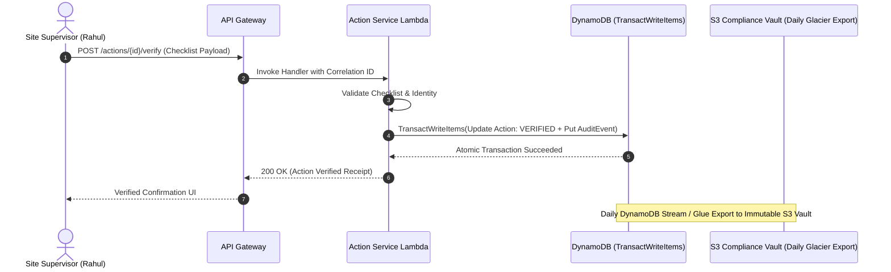
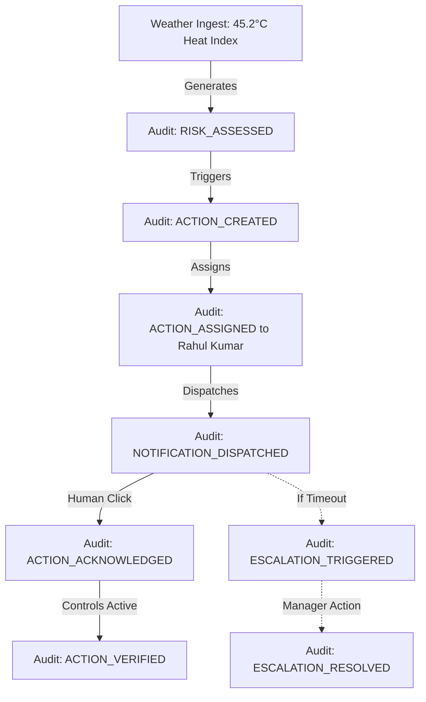

# Compliance & Operational Audit API Specification

**Document ID:** `78_AUDIT_API`  
**Status:** MVP Design / Specification  
**Version:** 1.0.0  
**Last Updated:** 2026-10-08  
**Author:** Heat Action Response Engine Team  

---

## 1. Purpose & Scope

This specification defines the authoritative API contracts for retrieving and inspecting the immutable compliance and operational audit trail within the **Heat Action Response Engine**.

The operational core of the platform is:
> **From heat warning to verified workplace action.**

In industrial safety management, proving that an operational directive was received, acknowledged, and addressed is a critical legal and regulatory imperative. This platform enforces a core architectural standard:
> **Audit history provides a trustworthy, tamper-resistant operational record of consequential state transitions.**

### Architectural Responsibility Definition

> **The Audit API exposes structured, append-only historical records detailing consequential actions, transitions, and user interactions to support regulatory compliance, safety incident forensic review, and organizational accountability.**

```text
┌────────────────────────────────────────────────────────┐
│             CONSEQUENTIAL OPERATIONAL EVENT            │
│       (Risk Assessed, Action Acknowledged, Verified)   │
└──────────────────────────┬─────────────────────────────┘
                           │
                           ▼
┌────────────────────────────────────────────────────────┐
│               ATOMIC TRANSACTION PERSISTENCE           │
│     (DynamoDB TransactWriteItems: State + Audit)       │
└──────────────────────────┬─────────────────────────────┘
                           │
                           ▼
┌────────────────────────────────────────────────────────┐
│                 IMMUTABLE AUDIT LEDGER                 │
│         (Append-Only, Chronologically Partitioned)     │
└──────────────────────────┬─────────────────────────────┘
                           │
                           ▼
┌────────────────────────────────────────────────────────┐
│                       AUDIT API                        │
│          (Role-Filtered, Scoped Retrieval Gateway)     │
└──────────────┬──────────────────────────┬──────────────┘
               │                          │
               ▼                          ▼
┌──────────────────────────┐  ┌──────────────────────────┐
│  INCIDENT FORENSIC REVIEW│  │   REGULATORY COMPLIANCE  │
│ (Safety Manager Portal)  │  │ (Enterprise Audit Export)│
└──────────────────────────┘  └──────────────────────────┘
```

The Audit API is an authorized **retrieval interface**. Consequential audit events are created exclusively by trusted backend application handlers during state transitions; arbitrary client-side audit creation is strictly prohibited.

---

## 2. Non-Negotiable API Invariants & Principles

Every implementation of this API must enforce these architectural principles:

```text
┌────────────────────────────────────────────────────────────────────────┐
│                     CORE AUDIT API INVARIANTS                          │
├────────────────────────────────────────────────────────────────────────┤
│ • AUDIT LOG ≠ GENERAL APPLICATION / DEBUG LOG                          │
│ • AUDIT HISTORY ≠ EDITABLE USER CONTENT                                │
│ • AUDIT TRAIL CANNOT BE EDITED, REWRITTEN, OR DELETED VIA API          │
│ • ADMINISTRATIVE PRIVILEGE DOES NOT CONFER PERMISSION TO MUTATE AUDIT   │
│ • AUDIT EVENT MUST PRESERVE IDENTITY, TIMESTAMP, PREVIOUS & NEW STATE  │
│ • NO SENSITIVE CREDENTIALS, SECRETS, OR UNPROTECTED HEALTH DATA IN AUDIT│
│ • AI CANNOT ALTER, GENERATE, OR RETROACTIVELY EDIT AUDIT ENTRIES       │
│ • PRIMARY STATE MUTATIONS MUST NOT SUCCEED IF AUDIT COMMIT FAILS       │
│ • SIMULATION ≠ LIVE OPERATION                                          │
└────────────────────────────────────────────────────────────────────────┘
```

1. **Audit Logs vs. Application Logs:** Technical debug traces, Lambda runtime metrics, and CloudWatch application errors are ephemeral system logs. An **Audit Event** is a first-class business entity capturing human and system operational accountability.
2. **Current State vs. Audit History:** The primary application tables answer *"What is the worksite state right now?"* The audit ledger answers *"How did the system get here, exactly who authorized each transition, and at what precise moment?"*
3. **Strict Immutability:** The API provides `GET` operations only. Endpoints for `PUT`, `POST`, `PATCH`, or `DELETE` on audit records do not exist.
4. **Zero Silent Traceability Loss:** State transitions and audit logging execute within atomic DynamoDB transactions (`TransactWriteItems`). A state transition can never commit if its audit entry fails.
5. **No Medical Inference:** Audit records document administrative and operational workflow events; they do not constitute clinical health records.

---

## 3. Protocol, Authentication & Authorization Conventions

All Audit API endpoints adhere to master conventions (`70_API_CONTRACTS.md`):

* **Base Path:** `/api/v1`
* **Transport:** HTTPS over TLS 1.3 with standard JSON payloads (`application/json; charset=utf-8`).
* **Authentication:** Mandatory Bearer JWT on all endpoints (`Authorization: Bearer <token>`).
* **RBAC & Scoping:**
  * `ADMIN`: Organization-wide compliance access; export capability for external auditors.
  * `SAFETY_MANAGER`: Cross-site operational audit history for all assigned facilities.
  * `SUPERVISOR`: Read-only access scoped strictly to audit events generated for their assigned worksites and actions.
* **Headers:**
  * `Authorization: Bearer <token>` (Required)
  * `X-Request-Id: <uuid>` (Optional client tracing ID; echoed in response metadata)

---

## 4. Endpoints Overview

```text
┌────────┬──────────────────────────────────────────────┬────────────────────────┐
│ METHOD │ ROUTE                                        │ ACCESS ROLE            │
├────────┼──────────────────────────────────────────────┼────────────────────────┤
│ GET    │ `/api/v1/audit`                              │ Safety Manager / Admin │
│ GET    │ `/api/v1/audit/{audit_event_id}`             │ All Roles (Scoped)     │
│ GET    │ `/api/v1/worksites/{worksite_id}/audit`      │ All Roles (Scoped)     │
│ GET    │ `/api/v1/actions/{action_id}/audit`          │ All Roles (Scoped)     │
│ GET    │ `/api/v1/escalations/{escalation_id}/audit`  │ Safety Manager / Admin │
└────────┴──────────────────────────────────────────────┴────────────────────────┘
```

---

## 5. Standardized Audit Event Taxonomy

Audit events are classified by operational domain (`16_ACTION_MODEL.md`, `17_ESCALATION_MODEL.md`):

```text
┌─────────────────────────────────┬──────────────────────────────────────────────┐
│ AUDIT EVENT TYPE                │ OPERATIONAL CONTEXT & SIGNIFICANCE           │
├─────────────────────────────────┼──────────────────────────────────────────────┤
│ `WORKSITE_CREATED`              │ Initial provisioning of worksite facility.   │
│ `WORKSITE_UPDATED`              │ Changes to cooling assets or roster context. │
├─────────────────────────────────┼──────────────────────────────────────────────┤
│ `RISK_ASSESSED`                 │ Authoritative heat risk evaluation computed. │
│ `RISK_DATA_QUALITY_CHANGED`     │ Telemetry flagged STALE, MISSING, or INVALID.│
├─────────────────────────────────┼──────────────────────────────────────────────┤
│ `ACTION_CREATED`                │ Directive instantiated by Action Engine.     │
│ `ACTION_ASSIGNED`               │ Accountable supervisor bound to action.      │
│ `ACTION_NOTIFIED`               │ Outbound alert dispatched to supervisor.     │
│ `ACTION_ACKNOWLEDGED`           │ Supervisor explicitly accepted custody.      │
│ `ACTION_STARTED`                │ Supervisor reported field deployment started.│
│ `ACTION_VERIFICATION_PENDING`   │ Controls deployed; awaiting checklist submit.│
│ `ACTION_VERIFIED`               │ Supervisor submitted verification checklist. │
│ `ACTION_CANCELLED`              │ Manager cancelled action due to weather/ops. │
├─────────────────────────────────┼──────────────────────────────────────────────┤
│ `ESCALATION_TRIGGERED`          │ SLA timeout (E01) or blocker (E02) fired.    │
│ `ESCALATION_ACKNOWLEDGED`       │ Safety Manager opened escalation incident.   │
│ `ESCALATION_RESOLVED`           │ Safety Manager recorded field resolution.    │
├─────────────────────────────────┼──────────────────────────────────────────────┤
│ `NOTIFICATION_DISPATCHED`       │ Communication gateway sent outbound payload. │
│ `NOTIFICATION_DELIVERY_FAILED`  │ Gateway reported transport or network error. │
├─────────────────────────────────┼──────────────────────────────────────────────┤
│ `SECURITY_AUTH_FAILED`          │ Unauthorized access attempt intercepted.     │
│ `SYSTEM_DATA_FAILURE`           │ Environmental ingestion offline > SLA window.│
└─────────────────────────────────┴──────────────────────────────────────────────┘
```

---

## 6. Canonical Audit Event Entity Schema

The Audit Event entity captures complete contextual provenance (`68_DYNAMODB.md`):

```json
{
  "audit_event_id": "aud_20261008_093512_98b2",
  "organization_id": "org_infra_corp_01",
  "worksite_id": "ws_blr_north_04",
  "timestamp": "2026-10-08T09:35:12Z",
  "event_type": "ACTION_ACKNOWLEDGED",
  "actor": {
    "user_id": "usr_sup_rahul_kumar",
    "name": "Rahul Kumar",
    "role": "SUPERVISOR",
    "ip_address": "49.207.211.45",
    "user_agent": "HeatActionPWA/1.4 (Android 14; Mobile)"
  },
  "resource": {
    "type": "ACTION",
    "id": "act_20261008_093000_1082"
  },
  "previous_state": "PENDING_ACKNOWLEDGMENT",
  "new_state": "ACKNOWLEDGED",
  "transition_reason": "Explicit supervisor UI confirmation",
  "operational_metadata": {
    "response_delay_seconds": 312,
    "sla_breached": false,
    "supervisor_note": "Received directive. Preparing shaded rest trailer."
  },
  "source": "REST_API",
  "correlation_id": "req_01JXYZ991101",
  "is_simulation": false
}
```

---

## 7. Endpoint Specifications

### 7.1 List Organizational Audit Events

Retrieves a chronologically ordered, filtered log of audit events for compliance analysis and regulatory audits.

* **Route:** `GET /api/v1/audit`
* **Authorization:** `SAFETY_MANAGER`, `ADMIN`.
* **Query Parameters:**
  * `from` (ISO 8601 UTC String, optional): Start timestamp (`2026-10-08T00:00:00Z`).
  * `to` (ISO 8601 UTC String, optional): End timestamp (`2026-10-08T23:59:59Z`).
  * `worksite_id` (String, optional): Filter by worksite.
  * `event_type` (Enum, optional): Filter by event type (`ACTION_ACKNOWLEDGED`).
  * `actor_id` (String, optional): Filter by specific user ID.
  * `resource_type` (Enum, optional): `ACTION`, `RISK`, `ESCALATION`, `WORKSITE`.
  * `limit` (Integer, default `50`, max `200`): Page size.
  * `cursor` (String, optional): Base64 pagination token.

#### Success Response (`200 OK`):
```json
{
  "data": [
    {
      "audit_event_id": "aud_20261008_093512_98b2",
      "timestamp": "2026-10-08T09:35:12Z",
      "event_type": "ACTION_ACKNOWLEDGED",
      "actor_name": "Rahul Kumar",
      "actor_role": "SUPERVISOR",
      "resource_type": "ACTION",
      "resource_id": "act_20261008_093000_1082",
      "previous_state": "PENDING_ACKNOWLEDGMENT",
      "new_state": "ACKNOWLEDGED"
    }
  ],
  "meta": {
    "request_id": "req_01JXYZ551101",
    "timestamp": "2026-10-08T09:47:00.000Z",
    "count": 1,
    "next_cursor": null
  }
}
```

---

### 7.2 Get Audit Event by ID

Retrieves an authoritative, individual audit record by its unique identifier.

* **Route:** `GET /api/v1/audit/{audit_event_id}`
* **Authorization:** All authenticated roles scoped to the owning organization and worksite.
* **Path Parameters:**
  * `audit_event_id` (String, required): Audit record identifier.

#### Success Response (`200 OK`):
Returns the complete canonical audit event entity inside the standard `data` envelope.

---

### 7.3 Get Action Audit Trail

Retrieves the complete, chronological lifecycle trace for an individual action directive from creation through verification or cancellation.

* **Route:** `GET /api/v1/actions/{action_id}/audit`
* **Authorization:** `SUPERVISOR`, `SAFETY_MANAGER`, `ADMIN` (scoped to action worksite).
* **Path Parameters:**
  * `action_id` (String, required): Action identifier.

#### Success Response (`200 OK`):
```json
{
  "data": [
    {
      "audit_event_id": "aud_01",
      "timestamp": "2026-10-08T09:30:00Z",
      "event_type": "ACTION_CREATED",
      "actor_role": "SYSTEM_ACTION_ENGINE",
      "new_state": "CREATED"
    },
    {
      "audit_event_id": "aud_02",
      "timestamp": "2026-10-08T09:30:02Z",
      "event_type": "ACTION_ASSIGNED",
      "actor_name": "System Roster Manager",
      "new_state": "ASSIGNED"
    },
    {
      "audit_event_id": "aud_03",
      "timestamp": "2026-10-08T09:35:12Z",
      "event_type": "ACTION_ACKNOWLEDGED",
      "actor_name": "Rahul Kumar",
      "new_state": "ACKNOWLEDGED"
    },
    {
      "audit_event_id": "aud_04",
      "timestamp": "2026-10-08T10:15:00Z",
      "event_type": "ACTION_VERIFIED",
      "actor_name": "Rahul Kumar",
      "new_state": "VERIFIED"
    }
  ],
  "meta": {
    "request_id": "req_01JXYZ551102",
    "timestamp": "2026-10-08T10:16:00.000Z",
    "count": 4
  }
}
```

---

## 8. Data Minimization & Privacy Protection

To comply with enterprise data protection standards and prevent credential leakage:
1. **Zero Credential Logging:** Audit events strictly strip Bearer tokens, API keys, passwords, session hashes, and internal KMS key identifiers.
2. **Minimal Identity References:** The actor block stores user identifiers, names, roles, and source IP addresses. Private personal contact information (personal phone numbers, residential addresses) is omitted.
3. **No Clinical Health Records:** The audit trail captures operational safety directives (e.g., *"Shade trailer opened"*); it never records personal worker health data or medical assessments.

---

## 9. Correlation & Distributed Traceability

To enable end-to-end operational forensics across serverless microservices:

```text
CLIENT REQUEST (X-Request-Id: req_01)
     │
     ▼
API GATEWAY (Passes request_id to context)
     │
     ▼
LAMBDA HANDLER (Generates correlation_id: corr_01)
     │
     ▼
DYNAMODB TRANSACTION (Writes Action + AuditEvent embedding corr_01)
     │
     ▼
EVENTBRIDGE EVENT (Carries correlation_id in event envelope)
     │
     ▼
NOTIFICATION DISPATCH (Embeds correlation_id in delivery receipt)
```

Investigators can query the audit trail by `correlation_id` to reconstruct the complete causal chain from environmental trigger through notification, acknowledgment, and field verification.

---

## 10. Audit Failure & Resilience Mechanics

A primary risk in distributed compliance systems is a "partial success" scenario where an action status updates, but the audit event fails to write due to network disruption.

### Dual-Write Prevention via DynamoDB Transactions
The engine eliminates partial success via DynamoDB `TransactWriteItems`:

```json
{
  "TransactItems": [
    {
      "Update": {
        "TableName": "HeatActionEngineTable",
        "Key": { "PK": "ORG#org_01#SITE#ws_01", "SK": "ACT#act_1082" },
        "UpdateExpression": "SET #status = :new_status, #ack_at = :now",
        "ConditionExpression": "#status = :pending_status"
      }
    },
    {
      "Put": {
        "TableName": "HeatActionEngineTable",
        "Item": {
          "PK": "ORG#org_01#AUDIT",
          "SK": "AUDIT#20261008T093512Z#aud_98b2",
          "event_type": "ACTION_ACKNOWLEDGED",
          "action_id": "act_1082",
          "actor_id": "usr_sup_rahul"
        }
      }
    }
  ]
}
```

If the audit write fails for any reason (e.g. provisioned throughput exceeded), the entire transaction aborts atomically. The action remains unacknowledged, and the caller receives `500 INTERNAL_ERROR`. **Traceability is never silently lost.**

---

## 11. Architectural Workflows & Diagrams

### 11.1 Consequential Operational Flow to Audit Ledger



### 11.2 End-to-End Operational Lifecycle Trace



---

## 12. Testing & Validation Matrix

```text
┌──────────────────────┬──────────────────────────────┬──────────────────────────┐
│ TEST CASE IDENTIFIER │ SCENARIO DESCRIPTION         │ EXPECTED API BEHAVIOR    │
├──────────────────────┼──────────────────────────────┼──────────────────────────┤
│ `TEST_AUDIT_01`      │ List audit events for site   │ 200 OK, chronologically  │
│                      │ with time-range filter       │ sorted array, cursor pagination│
├──────────────────────┼──────────────────────────────┼──────────────────────────┤
│ `TEST_AUDIT_02`      │ Fetch complete action audit  │ 200 OK, unbroken sequence│
│                      │ trail by action_id           │ from CREATED to VERIFIED │
├──────────────────────┼──────────────────────────────┼──────────────────────────┤
│ `TEST_AUDIT_03`      │ Cross-tenant audit query     │ 403 FORBIDDEN or 404     │
│                      │ attempt                      │ NOT_FOUND error          │
├──────────────────────┼──────────────────────────────┼──────────────────────────┤
│ `TEST_AUDIT_04`      │ Client attempts to POST or   │ 405 METHOD_NOT_ALLOWED or│
│                      │ PUT to `/audit`              │ API Gateway route reject │
├──────────────────────┼──────────────────────────────┼──────────────────────────┤
│ `TEST_AUDIT_05`      │ Traceability correlation     │ 200 OK, events share     │
│                      │ query matching correlation_id│ identical correlation_id │
├──────────────────────┼──────────────────────────────┼──────────────────────────┤
│ `TEST_AUDIT_06`      │ Verification that secrets/   │ Sensitive tokens absent  │
│                      │ passwords are not in payload │ from metadata blocks     │
├──────────────────────┼──────────────────────────────┼──────────────────────────┤
│ `TEST_AUDIT_07`      │ Simulation event inspection  │ 200 OK, is_simulation:   │
│                      │                              │ true explicitly logged   │
├──────────────────────┼──────────────────────────────┼──────────────────────────┤
│ `TEST_AUDIT_08`      │ Transaction rollback on audit│ 500 error, zero partial  │
│                      │ write failure                │ state mutation           │
└──────────────────────┴──────────────────────────────┴──────────────────────────┘
```

---

## 13. Cross-Document Architecture Integration

* `16_ACTION_MODEL.md`: Action lifecycle events and operational boundaries.
* `17_ESCALATION_MODEL.md`: Escalation event tracking.
* `68_DYNAMODB.md`: Single-table partition design and atomic transaction schemas.
* `70_API_CONTRACTS.md`: Master protocol, envelope, header, and pagination standards.
* `74_ACTION_API.md`: Upstream preventive action state mutations.
* `76_ACKNOWLEDGMENT_API.md`: Upstream supervisor acknowledgment events.
* `77_ESCALATION_API.md`: Upstream escalation management events.
* `79_ERROR_CONTRACTS.md`: Standard error envelopes and error codes.
