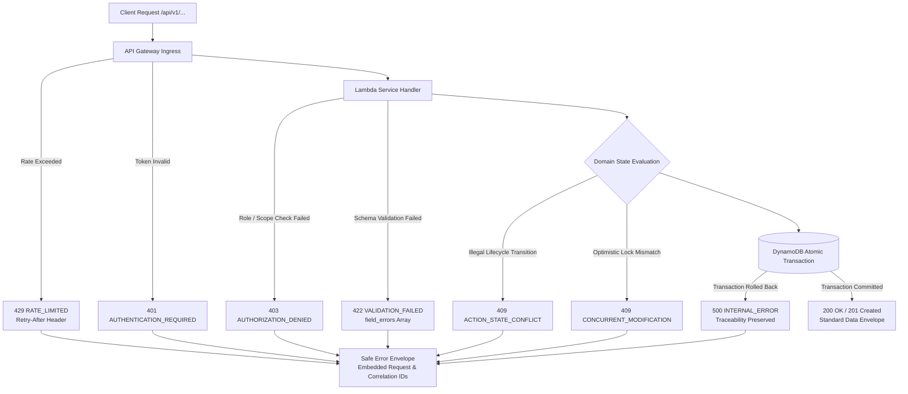

# Standardized Error Contracts Specification

**Document ID:** `79_ERROR_CONTRACTS`  
**Status:** MVP Design / Specification  
**Version:** 1.0.0  
**Last Updated:** 2026-10-08  
**Author:** Heat Action Response Engine Team  

---

## 1. Purpose & Master Design Principle

This specification establishes the **canonical shared error contracts** for all REST APIs (`70` through `78`) in the **Heat Action Response Engine**.

The core mission of the platform is:
> **From heat warning to verified workplace action.**

In a life-safety operational platform, ambiguous error messages, unhandled silent failures, or false-success indicators introduce unacceptable workplace risk. This specification enforces the master error design principle:

> **Errors must be predictable for clients, understandable for users, actionable for developers, safe against information leakage, and uncompromisingly explicit about whether an authoritative operation succeeded.**

```text
┌────────────────────────────────────────────────────────────────────────┐
│                   SAFETY-CRITICAL ERROR INVARIANT                      │
├────────────────────────────────────────────────────────────────────────┤
│ The API NEVER returns a 200 OK or successful-looking response when an   │
│ authoritative domain operation, safety transition, or database commit  │
│ has failed. Failure is always returned explicitly.                     │
└────────────────────────────────────────────────────────────────────────┘
```

---

## 2. Standard Error Envelope Schema

All `4xx` and `5xx` error responses adhere to a uniform, machine-readable JSON envelope:

```json
{
  "error": {
    "code": "ACTION_STATE_CONFLICT",
    "message": "The action cannot be acknowledged in its current state.",
    "request_id": "req_01JXYZ8890ABCDEF",
    "correlation_id": "corr_01JXYZ889012345",
    "timestamp": "2026-10-08T10:45:00.120Z",
    "retryable": false,
    "details": {
      "resource_id": "act_20261008_093000_1082",
      "current_state": "VERIFIED",
      "requested_transition": "ACKNOWLEDGED",
      "reason": "Action has already concluded field verification."
    }
  }
}
```

### Core Schema Field Definitions:
* `code` (String, required): Stable, screaming snake-case error code (see Section 3).
* `message` (String, required): Human-readable, client-safe description of the failure condition.
* `request_id` (String, required): Unique identifier for this HTTP interaction (echoed from `X-Request-Id` or generated by API Gateway).
* `correlation_id` (String, required): End-to-end tracing identifier spanning Lambda handlers, database operations, and asynchronous EventBridge events.
* `timestamp` (String, required): ISO 8601 UTC timestamp when the error was generated.
* `retryable` (Boolean, required): Explicit operational instruction indicating whether client retries are appropriate without altering the payload.
* `details` (Object, optional): Contextual metadata, field-level validation breakdowns, or state conflict descriptors.

---

## 3. Canonical Error Code Catalog

Error codes are strictly categorized and guaranteed stable once published:

```text
┌─────────────────────────────────┬──────┬──────────────────────────────────────┐
│ ERROR CODE                      │ HTTP │ OPERATIONAL MEANING                  │
├─────────────────────────────────┼──────┼──────────────────────────────────────┤
│ AUTHENTICATION_REQUIRED         │ 401  │ Missing, expired, or malformed JWT   │
│ AUTHENTICATION_INVALID          │ 401  │ Signature invalid or issuer unknown  │
│ AUTHORIZATION_DENIED            │ 403  │ Caller lacks role or tenant scope    │
│ RESOURCE_ACCESS_DENIED          │ 403  │ Caller not authorized for worksite   │
├─────────────────────────────────┼──────┼──────────────────────────────────────┤
│ RESOURCE_NOT_FOUND              │ 404  │ Target entity ID does not exist      │
│ INVALID_REQUEST                 │ 400  │ Malformed JSON, missing header       │
│ VALIDATION_FAILED               │ 422  │ Schema valid, domain rules violated  │
├─────────────────────────────────┼──────┼──────────────────────────────────────┤
│ INVALID_STATE_TRANSITION        │ 409  │ Requested transition not permitted   │
│ ACTION_STATE_CONFLICT           │ 409  │ Action in non-acknowledgeable state  │
│ ESCALATION_STATE_CONFLICT       │ 409  │ Escalation already resolved or closed│
│ IDEMPOTENCY_CONFLICT            │ 409  │ Same key used with different payload │
│ CONCURRENT_MODIFICATION         │ 409  │ Race condition; optimistic lock fail │
├─────────────────────────────────┼──────┼──────────────────────────────────────┤
│ DATA_UNAVAILABLE                │ 502  │ Upstream weather provider offline    │
│ DATA_STALE                      │ 200* │ Telemetry aged beyond SLA grace      │
│ DATA_INVALID                    │ 200* │ Environmental telemetry corrupt      │
│ DATA_CONFLICTING                │ 200* │ Dual telemetry providers disagree    │
├─────────────────────────────────┼──────┼──────────────────────────────────────┤
│ RISK_ASSESSMENT_FAILED          │ 500  │ Deterministic risk engine error      │
│ ACTION_GENERATION_FAILED        │ 500  │ Action rules evaluation failure      │
│ NOTIFICATION_DELIVERY_FAILED    │ 502  │ Communication gateway failure        │
│ WORKFLOW_FAILED                 │ 500  │ Step Functions orchestration error   │
├─────────────────────────────────┼──────┼──────────────────────────────────────┤
│ RATE_LIMITED                    │ 429  │ Request throttled by API Gateway     │
│ DEPENDENCY_UNAVAILABLE          │ 503  │ Downstream AWS/external service down │
│ INTERNAL_ERROR                  │ 500  │ Unhandled server exception           │
└─────────────────────────────────┴──────┴──────────────────────────────────────┘
```

*\*Note on Data Quality: As defined in Section 8, data quality anomalies on query endpoints return `200 OK` embedding an explicit `UNKNOWN` risk level and `data_quality` status rather than throwing HTTP failures, preventing frontend lockouts while maintaining complete safety clarity.*

---

## 4. HTTP Status Code Mapping Matrix

```text
┌──────┬────────────────────────┬────────────────────────────────────────┐
│ HTTP │ SEMANTIC DEFINITION    │ CONTRACTUAL USAGE & EXAMPLE            │
├──────┼────────────────────────┼────────────────────────────────────────┤
│ 400  │ Bad Request            │ Malformed JSON syntax, missing         │
│      │                        │ `Idempotency-Key` on command endpoints.│
├──────┼────────────────────────┼────────────────────────────────────────┤
│ 401  │ Unauthorized           │ Missing Bearer token, expired Cognito  │
│      │                        │ session. ("Who are you?")              │
├──────┼────────────────────────┼────────────────────────────────────────┤
│ 403  │ Forbidden              │ Supervisor attempting to access another│
│      │                        │ tenant's worksite. ("Permission Denied")│
├──────┼────────────────────────┼────────────────────────────────────────┤
│ 404  │ Not Found              │ Action or Worksite ID not in tenant.   │
├──────┼────────────────────────┼────────────────────────────────────────┤
│ 409  │ Conflict               │ State conflict (acknowledging an       │
│      │                        │ already verified action; lock race).   │
├──────┼────────────────────────┼────────────────────────────────────────┤
│ 422  │ Unprocessable Entity   │ Structurally valid JSON violating      │
│      │                        │ domain schema (e.g. invalid role).     │
├──────┼────────────────────────┼────────────────────────────────────────┤
│ 429  │ Too Many Requests      │ Burst rate limit exceeded at gateway.  │
├──────┼────────────────────────┼────────────────────────────────────────┤
│ 500  │ Internal Server Error  │ Database transaction rollback, runtime │
│      │                        │ unhandled exception in Lambda handler. │
├──────┼────────────────────────┼────────────────────────────────────────┤
│ 502  │ Bad Gateway            │ External weather API (Open-Meteo, IMD) │
│      │                        │ returned 5xx or unparseable response.  │
├──────┼────────────────────────┼────────────────────────────────────────┤
│ 503  │ Service Unavailable    │ AWS DynamoDB throttle, temporary       │
│      │                        │ maintenance mode, circuit breaker open.│
└──────┴────────────────────────┴────────────────────────────────────────┘
```

---

## 5. Structured Field-Level Validation Errors (`422`)

When a client payload fails domain-level validation, the `details` block includes an explicit `field_errors` array enabling frontends to render targeted field validation hints:

```json
{
  "error": {
    "code": "VALIDATION_FAILED",
    "message": "One or more submission fields failed validation.",
    "request_id": "req_01JXYZ8890ABCDEF",
    "correlation_id": "corr_01JXYZ889012345",
    "timestamp": "2026-10-08T10:45:00.120Z",
    "retryable": false,
    "details": {
      "field_errors": [
        {
          "field": "owner_id",
          "code": "INVALID_USER_ROLE",
          "message": "Assigned user usr_clk_09 does not hold an authorized SUPERVISOR role."
        },
        {
          "field": "response_deadline",
          "code": "DEADLINE_IN_PAST",
          "message": "Configured response deadline must be a future UTC timestamp."
        }
      ]
    }
  }
}
```

---

## 6. Authentication vs. Authorization Failure Contracts

To protect against security reconnaissance and unauthorized enumeration:

```text
┌───────────────────────────┬────────────────────────────────────────────────────┐
│ HTTP STATUS               │ CONTRACTUAL BOUNDARY & SECURITY SEMANTICS          │
├───────────────────────────┼────────────────────────────────────────────────────┤
│ `401 Unauthorized`        │ "Identity Unverified" — Missing or invalid token.  │
│                           │ Response contains NO internal permission metadata. │
├───────────────────────────┼────────────────────────────────────────────────────┤
│ `403 Forbidden`           │ "Access Denied" — Authenticated, but lacks role or │
│                           │ scope. Response does NOT reveal whether an entity  │
│                           │ exists in an unauthorized organization.            │
└───────────────────────────┴────────────────────────────────────────────────────┘
```

---

## 7. State Conflict & Concurrency Contracts (`409`)

State conflicts occur when a valid request conflicts with the authoritative current state stored in DynamoDB:

### 7.1 Action Lifecycle Conflict
```json
{
  "error": {
    "code": "ACTION_STATE_CONFLICT",
    "message": "Action cannot be acknowledged because it is currently VERIFIED.",
    "request_id": "req_01JXYZ8890ABCDEF",
    "correlation_id": "corr_01JXYZ889012345",
    "timestamp": "2026-10-08T10:45:00.120Z",
    "retryable": false,
    "details": {
      "resource_id": "act_1082",
      "current_state": "VERIFIED",
      "attempted_transition": "ACKNOWLEDGED",
      "valid_preceding_states": ["PENDING_ACKNOWLEDGMENT", "NO_RESPONSE"]
    }
  }
}
```

### 7.2 Idempotency Payload Conflict
If an `Idempotency-Key` is re-submitted with a mutated request payload:
```json
{
  "error": {
    "code": "IDEMPOTENCY_CONFLICT",
    "message": "Idempotency key was previously executed with a different request payload.",
    "request_id": "req_01JXYZ8890ABCDEF",
    "correlation_id": "corr_01JXYZ889012345",
    "timestamp": "2026-10-08T10:45:00.120Z",
    "retryable": false,
    "details": {
      "idempotency_key": "9b1deb4d-3b7d-4bad-9bdd-2b0d7b3dcb6d"
    }
  }
}
```

---

## 8. Data Quality Anomaly vs. HTTP Transport Error

A critical architectural failure in heat-health platforms is converting a weather API error into a "Low Risk" safe condition. The engine enforces an explicit operational distinction:

```text
┌───────────────────────────────────────────┬───────────────────────────────────┐
│ SCENARIO                                  │ CONTRACTUAL RETURN BEHAVIOR       │
├───────────────────────────────────────────┼───────────────────────────────────┤
│ Transport / Gateway Failure               │ HTTP 502 Bad Gateway              │
│ Weather API connection timed out or down  │ Standard Error Envelope           │
├───────────────────────────────────────────┼───────────────────────────────────┤
│ Telemetry Available but Stale / Missing   │ HTTP 200 OK                       │
│ Querying latest worksite risk assessment  │ Standard Data Envelope:           │
│                                           │ - `risk_level: UNKNOWN`           │
│                                           │ - `data_quality: STALE / MISSING` │
│                                           │ - Prompts diagnostic manual check │
└───────────────────────────────────────────┴───────────────────────────────────┘
```

> **RULE:** A data failure **never** silently defaults to `LOW` risk. If data is stale, corrupted, or absent, the platform surfaces `UNKNOWN` risk with an explicit diagnostic alert.

---

## 9. Retryability & Retry-After Policy

Errors explicitly declare client retry guidance via `retryable` and HTTP headers:

```text
┌──────────────┬───────────┬─────────────────────────────────────────────────────┐
│ STATUS CODE  │ RETRYABLE │ RETRY GUIDANCE & HEADERS                            │
├──────────────┼───────────┼─────────────────────────────────────────────────────┤
│ `400, 422`   │ `false`   │ Non-retryable without correcting request payload.   │
├──────────────┼───────────┼─────────────────────────────────────────────────────┤
│ `401, 403`   │ `false`   │ Non-retryable without re-authenticating or authz.   │
├──────────────┼───────────┼─────────────────────────────────────────────────────┤
│ `404, 409`   │ `false`   │ Non-retryable; client must refetch state.           │
├──────────────┼───────────┼─────────────────────────────────────────────────────┤
│ `429`        │ `true`    │ Retryable; client MUST obey `Retry-After: <seconds>`│
├──────────────┼───────────┼─────────────────────────────────────────────────────┤
│ `502, 503`   │ `true`    │ Retryable with exponential backoff and jitter.      │
├──────────────┼───────────┼─────────────────────────────────────────────────────┤
│ `500`        │ `false`   │ Non-retryable immediately; backend investigation req│
└──────────────┴───────────┴─────────────────────────────────────────────────────┘
```

---

## 10. Information Leakage Prevention & Security Masking

To eliminate vulnerability enumeration and comply with OWASP API Security standards:
1. **Zero Stack Trace Leakage:** Runtime exceptions, stack traces, and internal source file lines are intercepted by Lambda middleware and logged to CloudWatch; they are **never** returned in the API response.
2. **Zero Credential Exposure:** Database connection strings, AWS ARNs, private VPC IP addresses, and KMS key IDs are strictly stripped.
3. **Consistent Error Timing:** Cryptographic and authentication error handlers maintain constant-time execution paths to prevent side-channel timing analysis.

---

## 11. External Dependencies & AI Fallback Contracts

When external dependencies or AI models encounter operational failure:

```text
┌───────────────────────────┬───────────────────────────────────────────────────┐
│ DEPENDENCY OUTAGE         │ ENGINE BEHAVIOR & FALLBACK CONTRACT               │
├───────────────────────────┼───────────────────────────────────────────────────┤
│ Open-Meteo / IMD Offline  │ Switches to cached observation within grace SLA;  │
│                           │ if expired, returns `data_quality: MISSING`.      │
├───────────────────────────┼───────────────────────────────────────────────────┤
│ NVIDIA AI / LLM Failure   │ Graceful deterministic template fallback.         │
│ Model timeout or 5xx      │ Standard English text returned; zero disruption   │
│                           │ to underlying risk or action state machines.      │
├───────────────────────────┼───────────────────────────────────────────────────┤
│ Push / SMS Gateway Down   │ Notification stored in DynamoDB in-app feed;      │
│                           │ Step Functions SLA countdown runs independently.  │
└───────────────────────────┴───────────────────────────────────────────────────┘
```

---

## 12. Non-Negotiable Safety-Critical Error Rules

```text
┌────────────────────────────────────────────────────────────────────────┐
│               SAFETY-CRITICAL ERROR INTEGRITY RULES                    │
├────────────────────────────────────────────────────────────────────────┤
│ • ERROR ≠ SAFE CONDITION                                               │
│ • TIMEOUT ≠ ACTION COMPLETED                                           │
│ • NO ACKNOWLEDGMENT ≠ PROOF THAT WORKER IS MEDICALLY HARMED            │
│ • WEATHER FAILURE ≠ LOW RISK                                           │
│ • AI FAILURE ≠ SAFETY FAILURE                                          │
│ • NOTIFICATION DELIVERY FAILURE ≠ ACTION CANCELLED                     │
│ • PERSISTENCE FAILURE ≠ SUCCESSFUL STATE CHANGE                        │
└────────────────────────────────────────────────────────────────────────┘
```

---

## 13. Frontend Error Handling Prescriptions

Client applications (Mobile PWA, Desktop Safety Portal) must implement deterministic responses for each error category:

* **`401 Unauthorized`:** Clear cached session, redirect user to login interface, display session expiration banner.
* **`403 Forbidden`:** Render localized "Access Denied" view; do not redirect to login or leak tenant metadata.
* **`404 Not Found`:** Render entity not found notice; remove invalid record from local offline cache.
* **`409 Conflict`:** **Crucial Safety Action:** Force an immediate refetch of the authoritative entity via REST (`GET /actions/{id}`) to refresh user view with current database state.
* **`429 Too Many Requests`:** Pause automated polling; display retry countdown banner adhering to `Retry-After`.
* **`500 / 502 / 503`:** Display temporary system disruption modal; **never** assume an unconfirmed action succeeded.

---

## 14. Architectural Request & Error Flow Diagram



---

## 15. Testing & Validation Matrix

```text
┌──────────────────────┬──────────────────────────────┬──────────────────────────┐
│ TEST CASE IDENTIFIER │ SCENARIO DESCRIPTION         │ EXPECTED API BEHAVIOR    │
├──────────────────────┼──────────────────────────────┼──────────────────────────┤
│ `TEST_ERR_01`        │ Request with missing auth    │ 401 AUTHENTICATION_REQUIRED,│
│                      │ Bearer header                │ standard error envelope  │
├──────────────────────┼──────────────────────────────┼──────────────────────────┤
│ `TEST_ERR_02`        │ Supervisor accessing another │ 403 AUTHORIZATION_DENIED,│
│                      │ tenant worksite ID           │ zero entity existence leak│
├──────────────────────┼──────────────────────────────┼──────────────────────────┤
│ `TEST_ERR_03`        │ Malformed JSON body on POST  │ 400 INVALID_REQUEST      │
├──────────────────────┼──────────────────────────────┼──────────────────────────┤
│ `TEST_ERR_04`        │ Field validation failure     │ 422 VALIDATION_FAILED with│
│                      │ on multiple payload fields   │ complete field_errors    │
├──────────────────────┼──────────────────────────────┼──────────────────────────┤
│ `TEST_ERR_05`        │ Lifecycle state conflict on  │ 409 ACTION_STATE_CONFLICT│
│                      │ verified action acknowledge  │ with state descriptors   │
├──────────────────────┼──────────────────────────────┼──────────────────────────┤
│ `TEST_ERR_06`        │ Idempotency key payload      │ 409 IDEMPOTENCY_CONFLICT │
│                      │ mutation detection           │ error response           │
├──────────────────────┼──────────────────────────────┼──────────────────────────┤
│ `TEST_ERR_07`        │ Gateway throttling burst     │ 429 RATE_LIMITED with    │
│                      │                              │ Retry-After header       │
├──────────────────────┼──────────────────────────────┼──────────────────────────┤
│ `TEST_ERR_08`        │ Database transaction abort   │ 500 INTERNAL_ERROR;      │
│                      │ during atomic write          │ retryable: false         │
├──────────────────────┼──────────────────────────────┼──────────────────────────┤
│ `TEST_ERR_09`        │ Verification that stack trace│ Stack trace logged to    │
│                      │ is NEVER returned in response│ CloudWatch; stripped in UI│
├──────────────────────┼──────────────────────────────┼──────────────────────────┤
│ `TEST_ERR_10`        │ Upstream weather API 500     │ 502 DATA_UNAVAILABLE;    │
│                      │                              │ retryable: true          │
└──────────────────────┴──────────────────────────────┴──────────────────────────┘
```

---

## 16. Cross-Document Architecture Integration

* `70_API_CONTRACTS.md`: Master protocol, envelope, header, and pagination standards.
* `71_WEATHER_API.md`: Upstream telemetry ingestion errors.
* `72_WORKSITE_API.md`: Worksite and facility validation errors.
* `73_RISK_API.md`: Risk assessment and data quality anomaly contracts.
* `74_ACTION_API.md`: Action lifecycle and state conflict contracts.
* `75_NOTIFICATION_API.md`: Outbound delivery failure contracts.
* `76_ACKNOWLEDGMENT_API.md`: Acknowledgment state conflict and concurrency contracts.
* `77_ESCALATION_API.md`: Escalation state conflict and SLA failure contracts.
* `78_AUDIT_API.md`: Transaction rollback and audit failure contracts.
