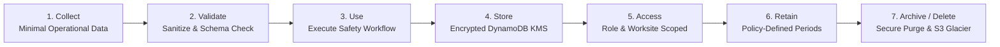

# Privacy by Design & Data Governance Specification

**Document ID:** `81_DATA_PRIVACY`  
**Status:** MVP Design / Specification (Pending Implementation Verification)  
**Version:** 1.0.0  
**Last Updated:** 2026-10-08  
**Author:** Heat Action Response Engine Team  

---

## 1. Purpose & Privacy Objective

This specification defines the privacy-by-design framework, data classification taxonomy, and governance policies for the **Heat Action Response Engine**.

The core mission of the platform is:
> **From heat warning to verified workplace action.**

Workplace safety technology often risks drifting into invasive worker surveillance under the guise of occupational health. The Heat Action Response Engine rejects this model, establishing a foundational privacy objective:

> **The system collects only the minimum operational data necessary to execute the workplace heat-risk response workflow, protects it appropriately, restricts access strictly based on responsibility, and deliberately avoids turning the platform into a worker-surveillance or medical-monitoring system.**

```text
┌────────────────────────────────────────────────────────────────────────┐
│                   CORE PRIVACY BOUNDARY RULE                           │
├────────────────────────────────────────────────────────────────────────┤
│ The platform evaluates WORKSITES, SHIFTS, and ENVIRONMENTAL HEAT.       │
│ It does NOT evaluate, track, score, or monitor INDIVIDUAL WORKERS.     │
└────────────────────────────────────────────────────────────────────────┘
```

---

## 2. Core Privacy Principles

1. **Privacy by Design:** Privacy controls and data minimization are integrated into the core schema architecture, not retrofitted as administrative policies.
2. **Strict Data Minimization:** The platform collects only attributes directly required for environmental risk evaluation, task assignment, legal acknowledgment, and compliance auditing.
3. **No Worker Surveillance:** Continuous personal location tracking, individual physiological telemetry, biometric scanning, and employee speed/productivity scoring are permanently prohibited.
4. **Purpose Limitation:** Operational worksite data is utilized strictly for heat-risk mitigation; it is never repurposed for HR performance management, salary deductions, or disciplinary tracking.
5. **Transparency & Explicit Governance:** Enterprise tenants and workers maintain clear visibility over what data is collected, where it is stored, who has access, and how long it is retained.

---

## 3. Data Classification Model

The platform organizes all application data into four discrete classification tiers:

```text
┌──────────────┬────────────────────────────────────┬────────────────────────────┐
│ TIER         │ DEFINITION                         │ EXAMPLES                   │
├──────────────┼────────────────────────────────────┼────────────────────────────┤
│ **PUBLIC**   │ Information freely accessible to   │ Public meteorological data,│
│              │ anyone without authorization       │ product documentation,     │
│              │                                    │ regional climate warnings. │
├──────────────┼────────────────────────────────────┼────────────────────────────┤
│ **INTERNAL** │ Non-sensitive system operational   │ Microservice telemetry,    │
│              │ configuration and software metrics │ Lambda execution metrics,  │
│              │                                    │ rule matrix versions.      │
├──────────────┼────────────────────────────────────┼────────────────────────────┤
│ **CONFIDENTIAL** Operational worksite details,     │ Physical facility context, │
│              │ preventive action records, and     │ active shifts, supervisor  │
│              │ organizational safety workflows    │ checklists, escalations.   │
├──────────────┼────────────────────────────────────┼────────────────────────────┤
│ **SENSITIVE**│ Personally identifiable identity   │ Authenticated user credentials,│
│              │ data, authorization credentials,   │ user phone numbers, email  │
│              │ and compliance audit trails        │ addresses, audit actor logs│
└──────────────┴────────────────────────────────────┴────────────────────────────┘
```

> **IMPORTANT DISTINCTION:** Ambient meteorological telemetry (temperature, relative humidity, solar radiation) is classified as `PUBLIC` or `INTERNAL`. It is **not** personal data. Only attributes linking physical operations to identifiable humans (supervisors, managers) carry privacy protections.

---

## 4. The Worker Privacy Boundary (Anti-Surveillance Guarantee)

A critical architectural differentiator of the Heat Action Response Engine is the strict separation between **environmental workplace controls** and **invasive personal monitoring**:

```text
┌───────────────────────────────────────┬───────────────────────────────────────┐
│ PERMITTED OPERATIONAL FOCUS (IN-SCOPE)│ PROHIBITED SURVEILLANCE (OUT-OF-SCOPE)│
├───────────────────────────────────────┼───────────────────────────────────────┤
│ • Worksite geographic coordinates     │ • Continuous individual worker GPS    │
│ • Aggregated shift worker headcount   │ • Personal wearable biometric sensors │
│ • General workload classification     │ • Core body temperature tracking      │
│ • Physical cooling asset counts       │ • Personal heart rate or sweat rate   │
│ • Scheduled work-rest cycle ratios    │ • Individual medical risk scores      │
│ • Supervisor toolbox talk records     │ • Worker productivity/speed tracking  │
│ • Water station accessibility checks  │ • Break duration monitoring for HR    │
└───────────────────────────────────────┴───────────────────────────────────────┘
```

The system models the **workplace environment**, not the **worker's physiology**. Interventions protect entire crews operating within a thermal zone rather than isolating individual workers based on biometric profiling.

---

## 5. Comprehensive Data Inventory & Governance

| Data Category | Representative Fields | Operational Purpose | Classification | Authorized Access | Retention Policy |
| :--- | :--- | :--- | :--- | :--- | :--- |
| **User Identity** | `user_id`, `name`, `email`, `role`, `phone_number` | Authenticate users & route urgent alerts | `SENSITIVE` | Self, Org Admin | Active employment + 90 days |
| **Worksite Profile** | `worksite_id`, `name`, `location`, `safeguards` | Target preventive actions to job site | `CONFIDENTIAL` | Admin, Safety Mgr, Scoped Sup | Contract duration + 3 years |
| **Shift Context** | `shift_id`, `worker_count`, `workload_intensity` | Contextualize metabolic heat generation | `CONFIDENTIAL` | Safety Mgr, Assigned Sup | 1 year operational archive |
| **Weather Telemetry** | `dry_bulb_temp_c`, `humidity`, `heat_index` | Calculate environmental heat risk | `INTERNAL` | All Roles | Aggregated permanently |
| **Risk Assessment** | `risk_id`, `risk_level`, `risk_factors` | Authoritative risk classification | `CONFIDENTIAL` | All Roles (Scoped) | 3 years compliance record |
| **Preventive Action**| `action_id`, `action_type`, `owner_id`, `status` | Direct workplace preventive actions | `CONFIDENTIAL` | Safety Mgr, Assigned Sup | 3 years compliance record |
| **Acknowledgment** | `acknowledgment_id`, `actor_id`, `timestamp` | Legal proof of human directive receipt | `CONFIDENTIAL` | Safety Mgr, Scoped Sup | 5 years legal archive |
| **Escalation** | `escalation_id`, `trigger_type`, `resolution` | Prevent unresolved safety directives | `CONFIDENTIAL` | Safety Mgr, Admin | 5 years legal archive |
| **Audit Ledger** | `audit_event_id`, `actor_ip`, `diff_state` | Forensic compliance audit trail | `SENSITIVE` | Safety Mgr, Admin | 7 years regulatory compliance |
| **AI Prompt Context**| Sanitized action title, risk tier | Assistive translation & summary | `CONFIDENTIAL` | Transient processing | Ephemeral (zero retention) |

---

## 6. Personally Identifiable Information (PII) Management

The platform minimizes PII collection strictly to administrative and supervisory personnel:
* **Workers:** Individual workers on site do not hold software accounts in the MVP; they are represented strictly as anonymous aggregate headcounts per shift (`worker_count: 45`).
* **Supervisors & Managers:** Accounts store only work-related contact information (business email, corporate mobile number, user role, worksite assignment).
* **Storage Protection:** PII fields stored in DynamoDB are encrypted at rest using AWS KMS. PII is never returned in public endpoints or unauthenticated error traces.

---

## 7. Regulatory & Legal Position (India DPDP Act 2023 Context)

The platform is designed with awareness of modern international data governance principles and the Indian **Digital Personal Data Protection Act, 2023 (DPDP Act 2023)**:

```text
┌────────────────────────────────────────────────────────────────────────┐
│                   COMPLIANCE & LEGAL NOTICE                            │
├────────────────────────────────────────────────────────────────────────┤
│ • This document outlines architectural privacy-by-design patterns.     │
│ • It does NOT constitute formal legal advice or certification.         │
│ • The system is NOT formally certified as "GDPR Compliant" or          │
│   "DPDP Certified" without organizational and legal deployment review. │
└────────────────────────────────────────────────────────────────────────┘
```

### 7.1 DPDP Act 2023 Architectural Considerations
1. **Data Fiduciary Role:** Enterprise employer tenants act as the Data Fiduciary; the Heat Action Response Engine software operates as the Data Processor.
2. **Lawful Processing Basis:** Processing of supervisor contact details is conducted on the basis of legitimate employment-related workplace safety mandates and compliance with occupational health obligations.
3. **Reasonable Security Safeguards:** The platform implements administrative, technical, and physical safeguards (TLS 1.3, KMS encryption, append-only audit ledgers) to prevent data breaches.
4. **Grievance Redressal:** Enterprise deployment plans must establish a designated contact point for employee data inquiries and correction requests.

---

## 8. Data Privacy Lifecycle



### Lifecycle Stage Principles:
1. **Collection:** Rejects unneeded fields at API Gateway validation gates.
2. **Validation:** Sanitizes and strips extraneous payload data.
3. **Usage:** Utilized strictly for heat-risk operations; zero third-party commercial monetization.
4. **Storage:** Partitioned by tenant organization ID with default encryption at rest.
5. **Access:** Governed by strict server-side RBAC and worksite scoping.
6. **Retention:** Transient communication queues purged rapidly; compliance records archived securely.
7. **Deletion / Purge:** Deprovisioned tenant data permanently removed following SLA retention expiration.

---

## 9. Data Retention Policy Matrix

Retention intervals are determined by operational necessity and compliance requirements rather than technical inertia:

```text
┌──────────────────────┬──────────────────────┬──────────────────────────────────┐
│ DATA ENTITY          │ RETENTION PERIOD     │ OPERATIONAL RATIONALE            │
├──────────────────────┼──────────────────────┼──────────────────────────────────┤
│ Notification Feed    │ 30 Days              │ Ephemeral communication; actions │
│                      │                      │ retain authoritative ground truth│
├──────────────────────┼──────────────────────┼──────────────────────────────────┤
│ Raw Hourly Weather   │ 90 Days              │ Telemetry aggregated into climate│
│                      │                      │ summaries; raw records purged    │
├──────────────────────┼──────────────────────┼──────────────────────────────────┤
│ Risk Assessments     │ 3 Years              │ Occupational safety historical   │
│                      │                      │ baseline and trend analysis      │
├──────────────────────┼──────────────────────┼──────────────────────────────────┤
│ Actions & Escalations│ 5 Years              │ Standard labor inspection and    │
│                      │                      │ liability defense window         │
├──────────────────────┼──────────────────────┼──────────────────────────────────┤
│ Immutable Audit Logs │ 7 Years              │ Statutory workplace safety and   │
│                      │                      │ compliance record retention      │
├──────────────────────┼──────────────────────┼──────────────────────────────────┤
│ AI Interaction Logs  │ 0 Days (Ephemeral)   │ Sanitized prompts processed in   │
│                      │                      │ memory; zero persistent logging  │
└──────────────────────┴──────────────────────┴──────────────────────────────────┘
```

---

## 10. Third-Party Data Processors & Boundary Controls

The platform restricts external data sharing strictly to essential service providers:

```text
┌──────────────────────┬──────────────────────┬──────────────────────────────────┐
│ THIRD-PARTY ENTITY   │ DATA TRANSMITTED     │ PRIVACY SAFEGUARD                │
├──────────────────────┼──────────────────────┼──────────────────────────────────┤
│ **Open-Meteo API**   │ Worksite Lat / Long  │ Public coordinates only; zero    │
│                      │ (Truncated to ~1km)  │ organization or user data sent   │
├──────────────────────┼──────────────────────┼──────────────────────────────────┤
│ **AWS Cloud (Host)** │ Encrypted database   │ Enterprise BAA / DPA; data stored│
│                      │ partitions and logs  │ strictly in specified AWS region │
├──────────────────────┼──────────────────────┼──────────────────────────────────┤
│ **NVIDIA AI / LLM**  │ Generic action title,│ Sanitized prompts; zero PII; no  │
│                      │ target language      │ model training on customer data  │
├──────────────────────┼──────────────────────┼──────────────────────────────────┤
│ **Amazon SES (Email)│ Supervisor work email│ TLS encrypted transmission; no   │
│                      │ and action title     │ confidential site notes in email │
└──────────────────────┴──────────────────────┴──────────────────────────────────┘
```

---

## 11. AI Privacy & Prompt Data Minimization

To eliminate data leakage through generative AI services:
1. **Zero Customer Data Training:** The platform contracts strictly with AI providers that guarantee zero retention and zero customer prompt usage for foundational model training.
2. **Context Minimization:** Only the specific action title and destination language are passed into prompt generation (e.g., *"Translate 'Enforce 45/15 Work-Rest Cycle' to Kannada"*).
3. **Zero Secret Injection:** Prompts never contain API keys, passwords, database primary keys, or employee personal identities.

---

## 12. Balancing Privacy with Compliance Auditability

A core architectural challenge is balancing **data minimization** with **traceable accountability**:

```text
┌───────────────────────────────────────┬───────────────────────────────────────┐
│ WHAT THE AUDIT LEDGER RECORDS         │ HOW PRIVACY IS PRESERVED              │
├───────────────────────────────────────┼───────────────────────────────────────┤
│ • Exact timestamp of acknowledgment   │ • Captures business user ID, not      │
│ • State transition (PENDING -> ACK)   │   personal residential contact info   │
│ • Operational note entered by actor   │ • Strips authorization tokens, session│
│ • IP address of confirming device     │   cookies, and passwords              │
│ • Associated Action ID and Site ID    │ • Excludes worker personal names      │
└───────────────────────────────────────┴───────────────────────────────────────┘
```

The audit trail proves that *a certified supervisor on site confirmed the shaded rest canopy was erected at 10:15 UTC*, without tracking which specific individual workers were resting under it.

---

## 13. Pre-Deployment Privacy Checklist

Before production release, verify that:
* [ ] No continuous GPS tracking or individual biometric monitoring features exist.
* [ ] Individual workers are modeled strictly as aggregate headcount numbers.
* [ ] External weather queries send truncated coordinates with zero tenant metadata.
* [ ] AI prompt assembly pipeline strips all credentials, tokens, and personal names.
* [ ] DynamoDB tables and S3 archives enforce default encryption at rest via AWS KMS.
* [ ] Audit log serializers actively strip passwords, bearer tokens, and session cookies.
* [ ] Data retention TTL flags are configured for ephemeral notification feeds.
* [ ] Formal legal review of enterprise data processing agreements is initiated.

---

## 14. Cross-Document Architecture Integration

* `19_PERMISSION_MODEL.md`: Master role-based access control and entitlement matrix.
* `68_DYNAMODB.md`: Single-table partition design, TTL expiration, and encryption.
* `78_AUDIT_API.md`: Append-only compliance audit trail specification.
* `79_ERROR_CONTRACTS.md`: Error masking and information leakage prevention.
* `80_SECURITY.md`: Global security architecture and threat mitigation.
* `82_AUTHENTICATION.md`: User identity establishment and credential lifecycle.
* `83_AUTHORIZATION.md`: Resource scoping and multi-tenant isolation.
