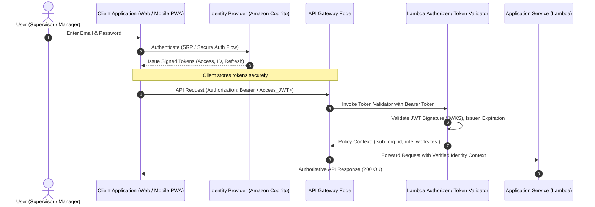
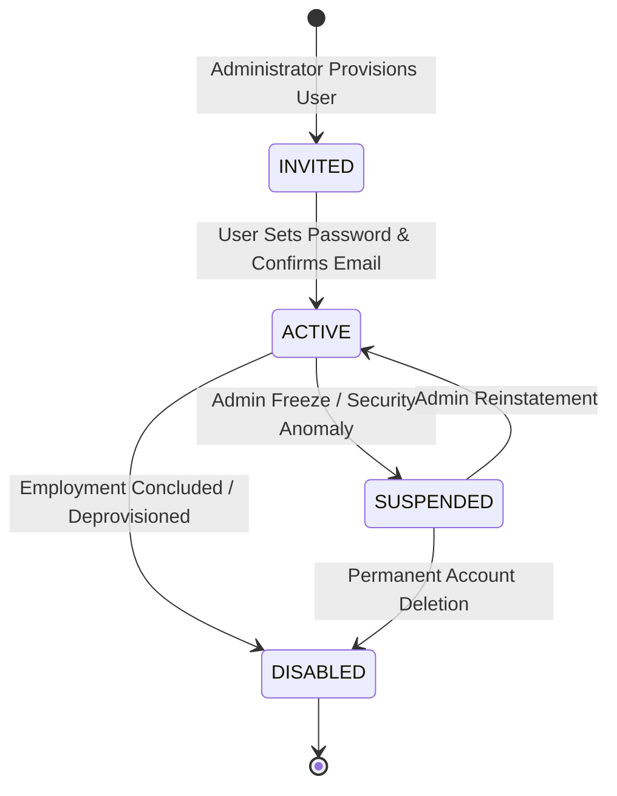

# Identity & Authentication Specification

**Document ID:** `82_AUTHENTICATION`  
**Status:** MVP Design / Specification (Pending Implementation Verification)  
**Version:** 1.0.0  
**Last Updated:** 2026-10-08  
**Author:** Heat Action Response Engine Team  

---

## 1. Purpose & Core Distinction

This specification defines the identity establishment, credential lifecycle, token validation, and session management architecture for the **Heat Action Response Engine**.

The core mission of the platform is:
> **From heat warning to verified workplace action.**

In an operational safety platform where acknowledgments and verifications carry legal accountability, the system must establish the authenticated identity of every human participant with cryptographic certainty.

### Foundational Distinction: Authentication vs. Authorization

```text
┌────────────────────────────────────────────────────────────────────────┐
│                   AUTHENTICATION ≠ AUTHORIZATION                       │
├────────────────────────────────────────────────────────────────────────┤
│ • AUTHENTICATION: "Who are you?"                                       │
│   Verifies the identity of the human actor via cryptographically       │
│   signed credentials and issues a verifiable security token.           │
│                                                                        │
│ • AUTHORIZATION: "What are you permitted to do?"                       │
│   Evaluates whether that verified identity holds the required role,    │
│   organizational scope, and worksite assignment to perform a command.  │
└────────────────────────────────────────────────────────────────────────┘
```

> **CRITICAL RULE:** Successful authentication **never** implies authorization. A valid token simply identifies the caller; server-side access controls must independently evaluate every operation against the user's explicit permissions (`83_AUTHORIZATION.md`).

---

## 2. Authentication Architecture

The platform enforces a modern token-based authentication flow centered on a managed Identity Provider:



---

## 3. Managed Identity Provider (Amazon Cognito)

### Architectural Selection & Implementation Status
* **Selected Candidate:** **Amazon Cognito User Pools** is the candidate identity service for the MVP architecture.
* **Implementation Status:** *Documented / Pending Implementation Verification*. The architecture defines integration patterns for Cognito User Pools; custom proprietary password databases are permanently prohibited.
* **Rationale for Managed IdP:**
  * Eliminates the risk of storing plaintext or custom-hashed passwords in application databases.
  * Provides built-in rate-limiting, credential brute-force protection, and account lockout policies.
  * Issues standard OIDC/OAuth 2.0 compliant JSON Web Tokens (JWT).

---

## 4. Authentication Methods & Credential Security

### 4.1 Primary Method: Email & Password (MVP)
* **Identifier:** Corporate business email address (unique across tenant).
* **Password Complexity Standards:**
  * Minimum 12 characters.
  * Mandatory inclusion of uppercase, lowercase, numbers, and symbols.
  * Verified against compromised credential blacklists via managed IdP checks.
* **Prohibition:** The application database (DynamoDB) **never** stores passwords, salt strings, or password hashes. All credential verification occurs inside the managed IdP boundary.

### 4.2 Brute-Force & Credential Stuffing Defenses
1. **Adaptive Throttling:** The IdP automatically triggers CAPTCHA or temporary IP blocks after 5 consecutive failed login attempts.
2. **Account Lockout:** An account enters a temporary 15-minute lock state after repeated authentication failures to prevent automated dictionary attacks.
3. **Constant-Time Verification:** Authentication endpoints return uniform failure timings to prevent side-channel username enumeration.

---

## 5. Token Architecture & Lifecycle

Upon successful authentication, the Identity Provider issues three standard tokens:

```text
┌──────────────┬──────────────┬──────────────────────────────────────────────────┐
│ TOKEN TYPE   │ LIFETIME     │ OPERATIONAL PURPOSE & CONTENTS                   │
├──────────────┼──────────────┼──────────────────────────────────────────────────┤
│ **ID Token** │ 60 Minutes   │ OpenID Connect token containing user profile     │
│              │              │ attributes (`name`, `email`) for UI rendering.   │
├──────────────┼──────────────┼──────────────────────────────────────────────────┤
│ **Access     │ 60 Minutes   │ OAuth 2.0 bearer token containing authorization  │
│ Token**      │              │ scopes, user UUID (`sub`), and tenant claims.    │
├──────────────┼──────────────┼──────────────────────────────────────────────────┤
│ **Refresh    │ 30 Days      │ Long-lived token used strictly to rotate expired │
│ Token**      │ (Rotated)    │ access tokens; stored securely with rotation.    │
└──────────────┴──────────────┴──────────────────────────────────────────────────┘
```

### 5.1 Token Expiration & Rotation Policy
* **Short-Lived Access Tokens:** Access tokens expire after **60 minutes**, limiting the blast radius of potential token interception on mobile devices.
* **Refresh Token Rotation:** Every refresh operation invalidates the previous refresh token and issues a new pair. If a revoked refresh token is re-submitted, the entire token family is immediately revoked (compromise detection).

---

## 6. Server-Side Token Validation Standards

The backend validates every incoming API request independently. The client **never** dictates security context:

```text
┌───────────────────────────┬────────────────────────────────────────────────────┐
│ VALIDATION CHECK          │ CONTRACTUAL REQUIREMENT                            │
├───────────────────────────┼────────────────────────────────────────────────────┤
│ 1. Cryptographic Signature│ Verified using IdP public JSON Web Key Set (JWKS). │
├───────────────────────────┼────────────────────────────────────────────────────┤
│ 2. Issuer (`iss`)         │ Must match trusted Cognito Pool URL exactly.       │
├───────────────────────────┼────────────────────────────────────────────────────┤
│ 3. Audience (`aud` / `cid`│ Must match registered API Client Application ID.   │
├───────────────────────────┼────────────────────────────────────────────────────┤
│ 4. Expiration (`exp`)     │ UTC timestamp must be in the future; zero leeway.  │
├───────────────────────────┼────────────────────────────────────────────────────┤
│ 5. Token Use (`token_use`)│ Must explicitly be `access` for operational APIs.  │
└───────────────────────────┴────────────────────────────────────────────────────┘
```

> **SECURITY INVARIANT:** The backend completely ignores client-supplied JSON headers such as `{"role": "ADMIN"}`. Role and organization claims are extracted strictly from the cryptographically verified JWT payload.

---

## 7. Authenticated User Context Model

Once validated, the Lambda Authorizer or middleware injects a verified, immutable `AuthContext` into the request pipeline:

```json
{
  "auth_context": {
    "user_id": "usr_sup_rahul_kumar",
    "organization_id": "org_infra_corp_01",
    "email": "rahul.kumar@infracorp.example",
    "role": "SUPERVISOR",
    "assigned_worksites": [
      "ws_blr_north_04",
      "ws_blr_east_02"
    ],
    "token_issued_at": "2026-10-08T09:00:00Z",
    "token_expires_at": "2026-10-08T10:00:00Z",
    "auth_provider": "COGNITO_USER_POOL"
  }
}
```

Application services use this verified context to enforce data filtering and worksite scoping without re-querying the identity provider.

---

## 8. Session Security & Storage on Client Devices

Field personnel use the application on mobile devices and field tablets. The client architecture minimizes token exposure:

1. **Storage Mechanics:**
   * In web browsers, tokens are held in application memory or secure encrypted session storage; long-term refresh tokens are stored in secure, `SameSite=Strict`, `HttpOnly` cookies where supported.
   * On mobile PWA environments, tokens reside within operating-system-sandboxed secure storage (KeyStore / Keychain).
2. **XSS & CSRF Defenses:**
   * All API mutations mandate `Content-Type: application/json` and custom headers (`Idempotency-Key`), preventing simple HTML form-based CSRF attacks.
   * Content Security Policy (CSP) headers block unauthorized external script injection.
3. **Explicit Logout:** Invoking `POST /auth/logout` revokes the active refresh token at the IdP and purges local client session caches.

---

## 9. Authentication Failure Contracts (`401` & `429`)

All authentication failures return standardized error envelopes conforming to `79_ERROR_CONTRACTS.md`:

```text
┌─────────────────────────┬──────┬───────────────────────────────────────────────┐
│ SCENARIO                │ HTTP │ ERROR CODE & CLIENT GUIDANCE                  │
├─────────────────────────┼──────┼───────────────────────────────────────────────┤
│ Missing Authorization   │ 401  │ `AUTHENTICATION_REQUIRED`: Bearer token absent│
├─────────────────────────┼──────┼───────────────────────────────────────────────┤
│ Expired Access Token    │ 401  │ `AUTHENTICATION_EXPIRED`: Trigger token refresh│
├─────────────────────────┼──────┼───────────────────────────────────────────────┤
│ Forged or Tampered JWT  │ 401  │ `AUTHENTICATION_INVALID`: Drop session        │
├─────────────────────────┼──────┼───────────────────────────────────────────────┤
│ Account Disabled/Locked │ 401  │ `ACCOUNT_LOCKED`: Display administrative notice│
├─────────────────────────┼──────┼───────────────────────────────────────────────┤
│ Brute-Force Rate Limit  │ 429  │ `RATE_LIMITED`: Obey `Retry-After: <seconds>` │
├─────────────────────────┼──────┼───────────────────────────────────────────────┤
│ IdP Service Unavailable │ 503  │ `DEPENDENCY_UNAVAILABLE`: Temporary retryable │
└─────────────────────────┴──────┴───────────────────────────────────────────────┘
```

---

## 10. Multi-Factor Authentication (MFA) Strategy

* **Privileged Account Requirement:** MFA (Time-based One-Time Password / TOTP via authenticator apps) is **mandatory** for accounts holding `ADMIN` or `SAFETY_MANAGER` roles.
* **Supervisor Field Accounts:** Supervisors operating in heavy PPE on active construction sites may utilize SMS OTP or trusted-device biometric bypass where organizational policy permits, balancing field usability with security.
* **Implementation Status:** *Planned for Production / Candidate for MVP Evaluation*.

---

## 11. User Account Lifecycle States

Every user account exists in exactly one authoritative lifecycle state within the identity store:



* **Immediate Revocation:** When an account transitions to `SUSPENDED` or `DISABLED`, the backend authorizer immediately drops all active sessions. A disabled user cannot execute API calls even if their 60-minute access token has not yet reached its expiration timestamp.

---

## 12. Authentication Security Events & Audit Integration

Critical authentication lifecycle events are emitted to CloudWatch and the immutable audit ledger (`78_AUDIT_API.md`):

```text
┌─────────────────────────────────┬──────────────────────────────────────────────┐
│ AUDIT EVENT TYPE                │ LOGGED CONTEXT (ZERO PASSWORDS STORED)       │
├─────────────────────────────────┼──────────────────────────────────────────────┤
│ `AUTH_LOGIN_SUCCESS`            │ User ID, role, IP address, device user-agent │
│ `AUTH_LOGIN_FAILURE`            │ Attempted email, failure reason, source IP   │
│ `AUTH_ACCOUNT_LOCKED`           │ User ID, lockout trigger, timestamp          │
│ `AUTH_PASSWORD_RESET_REQUESTED` │ User ID, delivery channel, timestamp         │
│ `AUTH_SESSION_REVOKED`          │ User ID, administrative reason, timestamp    │
│ `AUTH_ACCOUNT_DISABLED`         │ Target user ID, authorizing admin user ID    │
└─────────────────────────────────┴──────────────────────────────────────────────┘
```

---

## 13. Authentication Testing Matrix

```text
┌──────────────────────┬──────────────────────────────┬──────────────────────────┐
│ TEST CASE IDENTIFIER │ TEST SCENARIO                │ EXPECTED BEHAVIOR        │
├──────────────────────┼──────────────────────────────┼──────────────────────────┤
│ `TEST_AUTH_01`       │ Valid login credentials      │ 200 OK, valid JWTs issued│
├──────────────────────┼──────────────────────────────┼──────────────────────────┤
│ `TEST_AUTH_02`       │ Invalid password submission  │ 401 AUTHENTICATION_INVAL │
├──────────────────────┼──────────────────────────────┼──────────────────────────┤
│ `TEST_AUTH_03`       │ 5 failed logins sequentially │ 429 RATE_LIMITED / lock  │
├──────────────────────┼──────────────────────────────┼──────────────────────────┤
│ `TEST_AUTH_04`       │ Request with expired JWT     │ 401 AUTHENTICATION_EXP   │
├──────────────────────┼──────────────────────────────┼──────────────────────────┤
│ `TEST_AUTH_05`       │ Request with forged JWT sig  │ 401 AUTHENTICATION_INVAL │
├──────────────────────┼──────────────────────────────┼──────────────────────────┤
│ `TEST_AUTH_06`       │ Request with altered claims  │ Signature check fails 401│
├──────────────────────┼──────────────────────────────┼──────────────────────────┤
│ `TEST_AUTH_07`       │ Disabled user submits token  │ Authorizer blocks (401)  │
├──────────────────────┼──────────────────────────────┼──────────────────────────┤
│ `TEST_AUTH_08`       │ Refresh token rotation       │ Old refresh token revoked│
│                      │ replay attempt               │ and family invalidated   │
└──────────────────────┴──────────────────────────────┴──────────────────────────┘
```

---

## 14. Cross-Document Architecture Integration

* `19_PERMISSION_MODEL.md`: Master role-based access control and entitlement matrix.
* `70_API_CONTRACTS.md`: Master Bearer token request header conventions.
* `78_AUDIT_API.md`: Logging of authentication events and actor tracking.
* `79_ERROR_CONTRACTS.md`: Standard error envelopes for 401 and 429 responses.
* `80_SECURITY.md`: Overall security architecture and threat mitigation.
* `81_DATA_PRIVACY.md`: Protection of user contact information and PII.
* `83_AUTHORIZATION.md`: Downstream permission validation based on authenticated identity.
