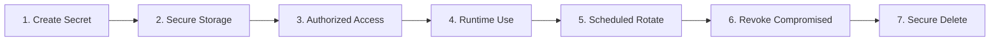
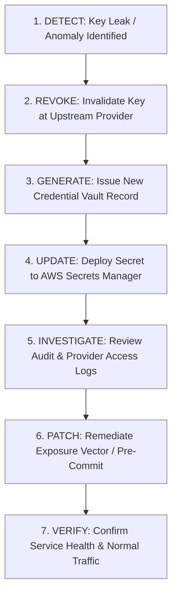

# Secrets & Sensitive Configuration Management Specification

**Document ID:** `84_SECRETS`  
**Status:** MVP Design / Specification (Pending Implementation Verification)  
**Version:** 1.0.0  
**Last Updated:** 2026-10-08  
**Author:** Heat Action Response Engine Team  

---

## 1. Purpose & Strategic Importance

This specification defines the authoritative architecture, lifecycle policies, and operational controls for managing secrets, cryptographic keys, and sensitive configuration data within the **Heat Action Response Engine**.

The core mission of the platform is:
> **From heat warning to verified workplace action.**

In an operational heat-safety platform, secret leakage threatens not only data confidentiality but the physical safety of workers. Compromised API credentials, database keys, or signing secrets can allow malicious actors to forge supervisor acknowledgments, suppress emergency escalations, or falsify environmental risk telemetry.

```text
┌────────────────────────────────────────────────────────────────────────┐
│                   SECRETS PROTECTION INVARIANT                         │
├────────────────────────────────────────────────────────────────────────┤
│ Secrets are NEVER committed to Git, NEVER embedded in client bundles, │
│ NEVER logged in application traces, and NEVER exposed via public APIs. │
│ Server-side secrets are resolved dynamically at runtime via secure     │
│ credential vaults under strict least-privilege IAM controls.           │
└────────────────────────────────────────────────────────────────────────┘
```

---

## 2. Secrets vs. Configuration Parameters

The platform maintains an explicit distinction between public configuration parameters and protected secrets:

```text
┌───────────────────────────────────────┬───────────────────────────────────────┐
│ NON-SENSITIVE CONFIGURATION           │ PROTECTED SECRETS (HIGH SENSITIVITY)  │
├───────────────────────────────────────┼───────────────────────────────────────┤
│ • Environment Name (`dev`, `prod`)    │ • Weather Provider API Keys           │
│ • Public API Gateway Base URLs        │ • NVIDIA AI / LLM API Tokens          │
│ • DynamoDB Table Names                │ • Amazon Cognito Client App Secrets   │
│ • Step Functions SLA Timeout Values   │ • Webhook HMAC Signature Secrets      │
│ • Deterministic Rule Version Strings  │ • Database Credentials (if applicable)│
│ • Feature Flags & UI Theme Settings   │ • Third-Party Notification Gateway Keys│
│ • CORS Allowed Origins Lists          │ • Deployment CI/CD IAM Access Tokens  │
└───────────────────────────────────────┴───────────────────────────────────────┘
```

> **CORE PRINCIPLE:** A public identifier, URL, or algorithm version is not a secret. Treating non-sensitive settings as secrets introduces operational friction, while treating secrets as general configuration risks catastrophic exposure.

---

## 3. Secret Inventory & Classification

The Heat Action Response Engine categorizes secrets across four operational dependency tiers:

```text
┌──────────────────────┬──────────────────────────────┬──────────────────────────┐
│ SECRET IDENTIFIER    │ PURPOSE & TARGET SERVICE     │ IMPLEMENTATION STATUS    │
├──────────────────────┼──────────────────────────────┼──────────────────────────┤
│ `WEATHER_API_KEY`    │ Commercial Open-Meteo or IMD │ Selected for MVP         │
│                      │ telemetry ingestion gateway  │ (Runtime Parameter)      │
├──────────────────────┼──────────────────────────────┼──────────────────────────┤
│ `AI_PROVIDER_KEY`    │ NVIDIA NIM / LLM API endpoint│ Selected for MVP         │
│                      │ authentication token         │ (Runtime Parameter)      │
├──────────────────────┼──────────────────────────────┼──────────────────────────┤
│ `COGNITO_APP_SECRET` │ OAuth 2.0 client secret for  │ Candidate for MVP        │
│                      │ backend token validation     │ (Evaluation)             │
├──────────────────────┼──────────────────────────────┼──────────────────────────┤
│ `WEBHOOK_SIGN_KEY`   │ HMAC-SHA256 signature key for│ Planned for Production   │
│                      │ outbound notification relays │                          │
├──────────────────────┼──────────────────────────────┼──────────────────────────┤
│ `SES_SMTP_SECRET`    │ Amazon SES credentials for   │ P1 / Near-Term Roadmap   │
│                      │ outbound email dispatch      │                          │
├──────────────────────┼──────────────────────────────┼──────────────────────────┤
│ `KMS_ENCRYPT_KEY`    │ Customer Managed Key ARN for │ Planned for Production   │
│                      │ DynamoDB / S3 encryption     │                          │
└──────────────────────┴──────────────────────────────┴──────────────────────────┘
```

---

## 4. Secret Storage Architecture

The platform integrates with AWS-native managed credential stores (`64_AWS_ARCHITECTURE.md`, `65_AWS_SERVICES.md`):

```mermaid
flowchart LR
    Deploy[CI/CD CloudFormation] -->|Provision Vault| SM[(AWS Secrets Manager / SSM Parameter Store)]
    SM -->|Encrypted via KMS| KMS[AWS KMS]
    Lambda[Lambda Execution Handler] -->|IAM Authenticated Request| SM
    Lambda -->|In-Memory Cache (Warm Run)| Runtime[Application Memory]
    Runtime -->|Call Third-Party API| Ext[External Provider: Weather / AI]
    
    Client[Web / Mobile Client] -. Forbidden Boundary .-> SM
```

### Architectural Enforcement Rules:
1. **Dynamic Runtime Resolution:** Lambda handlers retrieve secrets dynamically during cold-start initialization using AWS Secrets Manager or AWS Systems Manager Parameter Store.
2. **In-Memory Caching:** Resolved secrets are cached in process memory for the lifespan of the execution container to prevent per-invocation API throttling.
3. **Frontend Isolation:** Client browsers and mobile PWAs never receive server-side secrets. The frontend interacts strictly with API Gateway endpoints via user Bearer tokens; API Gateway and Lambda handle upstream provider credentials invisibly.

---

## 5. Secret Lifecycle Management

Every operational secret moves through an explicit, auditable seven-stage lifecycle:



1. **Creation:** Generated cryptographically with high entropy (e.g. 256-bit random keys).
2. **Storage:** Stored directly into encrypted vaults (AWS Secrets Manager) with KMS encryption.
3. **Access:** Governed by IAM resource policies granting read access strictly to specific Lambda execution roles.
4. **Usage:** Used only for target outbound HTTP requests; never echoed or propagated.
5. **Rotation:** Rotated systematically based on corporate policy or immediately upon suspect events.
6. **Revocation:** Inactive or superseded keys are revoked immediately at the upstream provider.
7. **Deletion:** Decommissioned secrets are scheduled for deletion with audit records preserved.

---

## 6. Environment Isolation Strategy

To prevent development activity from impacting production safety workflows:

```text
┌──────────────┬──────────────────────────────┬──────────────────────────────────┐
│ ENVIRONMENT  │ CREDENTIAL SCOPE             │ SAFETY & OPERATIONAL ISOLATION   │
├──────────────┼──────────────────────────────┼──────────────────────────────────┤
│ **LOCAL**    │ Mock environment variables;  │ Connects to local DynamoDB or    │
│              │ zero real production keys    │ test harness; no live provider   │
├──────────────┼──────────────────────────────┼──────────────────────────────────┤
│ **DEV**      │ Free-tier / sandboxed API    │ Test worksite context only;      │
│              │ credentials                  │ zero live dispatch notifications │
├──────────────┼──────────────────────────────┼──────────────────────────────────┤
│ **DEMO**     │ Dedicated hackathon drill    │ Isolated sandbox organization;   │
│              │ sandbox credentials          │ accelerated 30s escalation SLA   │
├──────────────┼──────────────────────────────┼──────────────────────────────────┤
│ **PROD**     │ High-availability commercial │ Live industrial worksites;       │
│              │ enterprise keys; KMS-managed │ strict production response SLAs  │
└──────────────┴──────────────────────────────┴──────────────────────────────────┘
```

> **MANDATORY POLICY:** Development or demonstration environments must **never** share credentials, API keys, or database tables with production environments.

---

## 7. Git & Source Code Repository Security

Accidental credential exposure in source code repositories is permanently prevented by strict technical controls:

```text
┌────────────────────────────────────────────────────────────────────────┐
│                   GIT REPOSITORY COMMIT PROHIBITION                    │
├────────────────────────────────────────────────────────────────────────┤
│ The following patterns are STRICTLY BANNED from Git repositories:      │
│ • API_KEY=... / SECRET_KEY=... / AWS_SECRET_ACCESS_KEY=...             │
│ • Password strings in hardcoded tests or mock data                     │
│ • Private certificates, .pem files, or RSA keypairs                   │
│ • Raw .env files containing live API credentials                       │
└────────────────────────────────────────────────────────────────────────┘
```

### Technical Enforcement Measures:
* **Comprehensive `.gitignore`:** Ignores all `.env`, `.env.*`, `*.pem`, `*.key`, and AWS credential files.
* **Pre-Commit Secret Scanning:** Pre-commit hooks (such as `gitleaks` or `git-secrets`) scan staged files for high-entropy strings and provider-specific key formats before commits are finalized.
* **Emergency Revocation Protocol:** If any secret is accidentally committed to a repository, it is treated as **compromised immediately**. Committing a subsequent deletion commit does not remediate the exposure; the credential must be revoked at the provider immediately.

---

## 8. Logging Redaction Standards

CloudWatch, Lambda stdout, and error log serializers enforce mandatory credential redaction:

```text
┌────────────────────────────────────────┬────────────────────────────────────────┐
│ SENSITIVE VALUE                        │ MANDATORY REDACTION OUTPUT             │
├────────────────────────────────────────┼────────────────────────────────────────┤
│ `Authorization: Bearer eyJhbGci...`    │ `Authorization: Bearer [REDACTED]`     │
│ `X-Api-Key: sk-live-99a10b...`         │ `X-Api-Key: [REDACTED_API_KEY]`        │
│ Upstream Provider Connection String    │ `Host: api.open-meteo.com [AUTH_MASKED]`│
│ Request Payload containing Password    │ `{"password": "[REDACTED]"}`           │
└────────────────────────────────────────┴────────────────────────────────────────┘
```

Application middleware intercepts all outbound and inbound HTTP logs, stripping sensitive tokens before CloudWatch ingestion (`80_SECURITY.md`).

---

## 9. Secret Rotation & Compromise Response Protocol

### 9.1 Secret Rotation Principles
* **Dual-Key Staging:** Rotation uses an overlap strategy where both old and new keys remain valid simultaneously for a 24-hour grace window, eliminating service interruption.
* **Rotation Triggers:**
  * Routine scheduled policy rotation.
  * Departure of technical team members with secret access.
  * Detection of abnormal upstream API usage spikes.
  * Accidental inclusion in source control or diagnostic output.

### 9.2 Compromise Incident Response Flow



---

## 10. Secrets Security Pre-Release Checklist

Before deploying any build to staging or production:
* [ ] Repository contains zero hardcoded API keys, passwords, or credentials.
* [ ] All `.env` and credential files are included in `.gitignore`.
* [ ] Lambda execution roles hold minimum-permission IAM access to Secrets Manager.
* [ ] CloudWatch logging serializers actively redact `Authorization` and API key headers.
* [ ] Third-party provider keys (Open-Meteo, NVIDIA) are provisioned via environment vaults.
* [ ] No server-side secrets are exposed to client JavaScript or mobile PWA bundles.
* [ ] Secret compromise revocation procedures are verified and documented.

---

## 11. Cross-Document Architecture Integration

* `64_AWS_ARCHITECTURE.md`: AWS Secrets Manager and IAM role deployment topology.
* `65_AWS_SERVICES.md`: AWS service selection and runtime credential bindings.
* `70_API_CONTRACTS.md`: Authorization Bearer token header handling standards.
* `78_AUDIT_API.md`: Logging of administrative security configuration events.
* `79_ERROR_CONTRACTS.md`: Stripping of internal credentials from error responses.
* `80_SECURITY.md`: Comprehensive security architecture and threat mitigations.
* `82_AUTHENTICATION.md`: User credential security and token signing keys.
* `89_THREAT_MODEL.md`: Threat vectors targeting secret compromise and mitigation.
