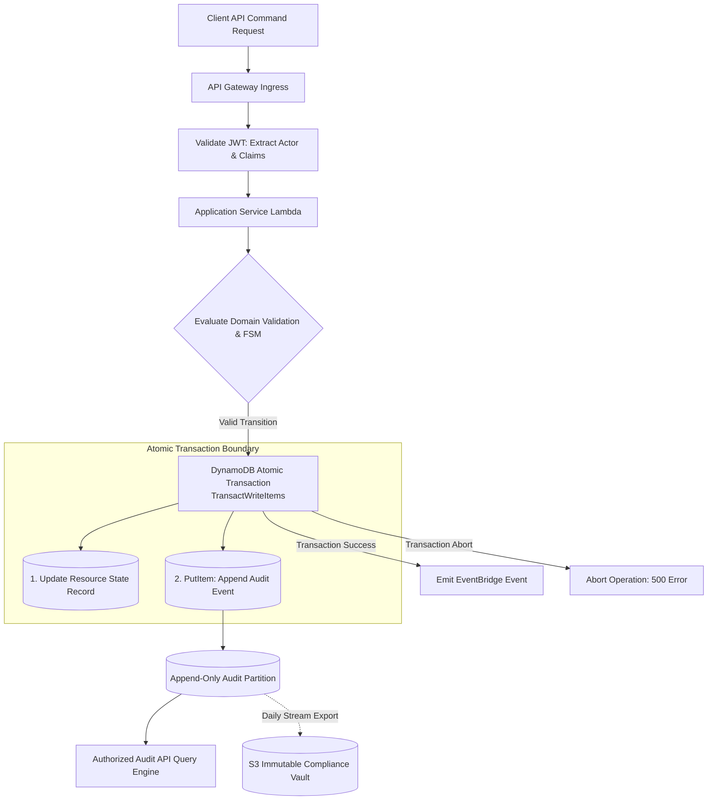
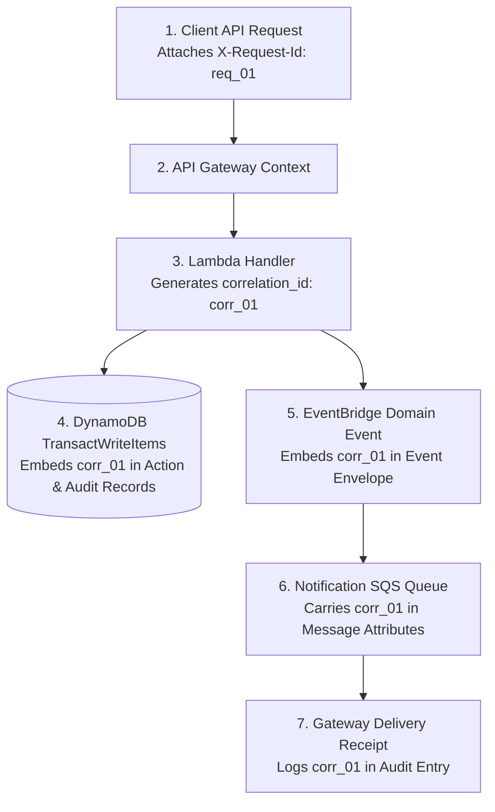

# Compliance Audit Logging & Traceability Specification

**Document ID:** `85_AUDIT_LOGGING`  
**Status:** MVP Design / Specification (Pending Implementation Verification)  
**Version:** 1.0.0  
**Last Updated:** 2026-10-08  
**Author:** Heat Action Response Engine Team  

---

## 1. Purpose & Architectural Role

This specification defines the backend implementation, data integrity safeguards, event correlation standards, and security controls for the audit logging subsystem of the **Heat Action Response Engine**.

The core mission of the platform is:
> **From heat warning to verified workplace action.**

In an occupational health and workplace safety operations platform, auditability is an absolute operational imperative. The audit subsystem answers the fundamental question of organizational accountability:
> **Who did what, to which resource, when, under what operational context, and what state changed?**

While `78_AUDIT_API.md` defines the client-facing REST retrieval contracts, this document establishes the **backend generation, immutability, transactional guarantees, and security architecture** of the audit ledger.

---

## 2. Core Operational Distinction: Audit Logs vs. Application Logs

A foundational architectural requirement is the strict operational segregation between diagnostic application logs and legally binding audit records:

```text
┌───────────────────────────────────────┬───────────────────────────────────────┐
│ APPLICATION / DIAGNOSTIC LOGS         │ COMPLIANCE AUDIT RECORDS              │
├───────────────────────────────────────┼───────────────────────────────────────┤
│ • Stored in Amazon CloudWatch Logs    │ • Stored in Authoritative DynamoDB    │
│ • Ephemeral retention (e.g. 14–30 days)│ • Long-term retention (e.g. 5–7 years)│
│ • Captures technical execution traces │ • Captures business state transitions │
│ • Contains debug metrics & latency    │ • Captures human actor accountability │
│ • May be discarded or rotated freely  │ • Strictly append-only & immutable    │
│ • Not suitable for legal compliance   │ • Designed for regulatory inspection  │
└───────────────────────────────────────┴───────────────────────────────────────┘
```

> **CRITICAL RULE:** A CloudWatch error log or Lambda debug statement is **not** an audit record. Treating technical execution logs as compliance records violates non-repudiation and regulatory traceability.

---

## 3. End-to-End Audit Architecture & Flow



---

## 4. Canonical Audit Event Entity Model

Every consequential state mutation constructs an authoritative `AuditEvent` record before committing:

```json
{
  "audit_event_id": "aud_20261008_093512_98b2",
  "organization_id": "org_infra_corp_01",
  "worksite_id": "ws_blr_north_04",
  "timestamp": "2026-10-08T09:35:12Z",
  "event_type": "ACTION_ACKNOWLEDGED",
  "actor": {
    "user_id": "usr_sup_rahul_kumar",
    "name": "Rahul Kumar",
    "role": "SUPERVISOR",
    "ip_address": "49.207.211.45",
    "user_agent": "HeatActionPWA/1.4 (Android 14; Mobile)"
  },
  "resource": {
    "type": "ACTION",
    "id": "act_20261008_093000_1082"
  },
  "previous_state": "PENDING_ACKNOWLEDGMENT",
  "new_state": "ACKNOWLEDGED",
  "transition_reason": "Explicit supervisor UI confirmation",
  "operational_metadata": {
    "response_delay_seconds": 312,
    "sla_breached": false,
    "supervisor_note": "Received directive. Preparing shaded rest trailer."
  },
  "source": "REST_API",
  "request_id": "req_01JXYZ991101",
  "correlation_id": "corr_01JXYZ991101_flow",
  "is_simulation": false
}
```

---

## 5. Comprehensive Taxonomy of Auditable Events

Audit logging is triggered strictly by discrete consequential operations:

```text
┌──────────────────────────────┬─────────────────────────────────────────────────┐
│ DOMAIN / CATEGORY            │ AUDIT EVENT TYPE & OPERATIONAL SIGNIFICANCE     │
├──────────────────────────────┼─────────────────────────────────────────────────┤
│ **1. Identity & Security**   │ `AUTH_LOGIN_SUCCESS` / `AUTH_LOGIN_FAILURE`     │
│                              │ `AUTH_ACCOUNT_LOCKED` / `AUTH_SESSION_REVOKED`  │
│                              │ `SECURITY_AUTHORIZATION_DENIED` (403 attempt)   │
├──────────────────────────────┼─────────────────────────────────────────────────┤
│ **2. Worksite Configuration**│ `WORKSITE_CREATED` / `WORKSITE_UPDATED`         │
│                              │ `WORKSITE_COOLING_ASSETS_MODIFIED`              │
├──────────────────────────────┼─────────────────────────────────────────────────┤
│ **3. Environmental & Risk**  │ `RISK_ASSESSED` (Calculated by Risk Engine)     │
│                              │ `RISK_DATA_QUALITY_CHANGED` (STALE / MISSING)   │
│                              │ `RISK_REASSESSMENT_COMMANDED` (On-demand trigger)│
├──────────────────────────────┼─────────────────────────────────────────────────┤
│ **4. Preventive Actions**    │ `ACTION_CREATED` / `ACTION_ASSIGNED`            │
│                              │ `ACTION_NOTIFIED` / `ACTION_ACKNOWLEDGED`       │
│                              │ `ACTION_STARTED` / `ACTION_BLOCKED`             │
│                              │ `ACTION_VERIFICATION_PENDING` / `ACTION_VERIFIED`│
│                              │ `ACTION_CANCELLED`                              │
├──────────────────────────────┼─────────────────────────────────────────────────┤
│ **5. Escalation Management** │ `ESCALATION_TRIGGERED` (Timeout E01 / Block E02)│
│                              │ `ESCALATION_ACKNOWLEDGED` (Manager accepted)    │
│                              │ `ESCALATION_RESOLVED` / `ESCALATION_CLOSED`     │
├──────────────────────────────┼─────────────────────────────────────────────────┤
│ **6. Outbound Notifications**│ `NOTIFICATION_DISPATCHED` / `DELIVERY_CONFIRMED`│
│                              │ `NOTIFICATION_DELIVERY_FAILED`                  │
├──────────────────────────────┼─────────────────────────────────────────────────┤
│ **7. System Failures**       │ `SYSTEM_DATA_FAILURE` (Weather feed outage > SLA)│
│                              │ `WORKFLOW_ORCHESTRATION_EXCEPTION`              │
└──────────────────────────────┴─────────────────────────────────────────────────┘
```

---

## 6. Audit Immutability & Anti-Tampering Safeguards

To maintain evidentiary and forensic integrity during regulatory investigations:

1. **Append-Only DynamoDB Pattern:** Audit records use composite partition keys:
   ```text
   PK: ORG#<organization_id>#AUDIT
   SK: AUDIT#<ISO_Timestamp>#<audit_event_id>
   ```
2. **Zero Modification APIs:** The application codebase and API Gateway contain zero routes, handlers, or database expressions for `UpdateItem` or `DeleteItem` on audit items.
3. **IAM Policy Restrictions:** The Lambda execution role possesses `dynamodb:PutItem` and `dynamodb:Query` entitlements only; `dynamodb:DeleteItem` and `dynamodb:UpdateItem` are explicitly denied by IAM boundary policies.
4. **Administrative Non-Repudiation:** System administrators (`ADMIN`) cannot edit historical records. Administrative adjustments require issuing a new corrective action with its own audit entry; historical events remain permanently unchanged.

---

## 7. Distributed Correlation & Tracing Architecture

To trace a consequential event across asynchronous AWS microservices:



By querying the audit log for a single `correlation_id`, investigators can reconstruct the complete end-to-end timeline from the initial weather ingestion through notification dispatch, supervisor acknowledgment, and field verification.

---

## 8. Privacy-Preserving Audit Serialization

To balance accountability with data protection standards (`81_DATA_PRIVACY.md`):

```text
┌────────────────────────────────────────┬────────────────────────────────────────┐
│ WHAT MUST BE INCLUDED                  │ WHAT MUST BE STRICTLY EXCLUDED         │
├────────────────────────────────────────┼────────────────────────────────────────┤
│ • Verified User ID & Operational Role  │ • Cleartext passwords or password hashes│
│ • Exact UTC Timestamp (ISO 8601)       │ • Bearer access tokens or refresh tokens│
│ • State Machine Transition Delta       │ • Third-party API keys or KMS secrets   │
│ • Operational notes entered by user    │ • Unfiltered raw HTTP request headers   │
│ • Anonymized source IP address         │ • Personal residential contact details │
│ • Specific Action ID and Worksite ID   │ • Individual worker medical data       │
└────────────────────────────────────────┴────────────────────────────────────────┘
```

---

## 9. Transactional Safety & Audit Failure Handling

A critical failure mode in distributed auditing is **silent traceability loss**, where an operational state update succeeds but the audit log write fails.

### Atomic Dual-Write via DynamoDB Transactions
The platform permanently eliminates partial state mutations by pairing state updates with audit writes inside a single `TransactWriteItems` call:

```json
{
  "TransactItems": [
    {
      "Update": {
        "TableName": "HeatActionEngineTable",
        "Key": { "PK": "ORG#org_01#SITE#ws_01", "SK": "ACT#act_1082" },
        "UpdateExpression": "SET #status = :new_status, #ack_at = :now",
        "ConditionExpression": "#status = :pending_status"
      }
    },
    {
      "Put": {
        "TableName": "HeatActionEngineTable",
        "Item": {
          "PK": "ORG#org_01#AUDIT",
          "SK": "AUDIT#20261008T093512Z#aud_98b2",
          "event_type": "ACTION_ACKNOWLEDGED",
          "action_id": "act_1082",
          "actor_id": "usr_sup_rahul"
        }
      }
    }
  ]
}
```

> **FAILURE POLICY:** If the audit write fails (e.g. provisioned throughput exceeded), the entire transaction aborts atomically. The action remains unacknowledged, and the caller receives an HTTP `500 INTERNAL_ERROR`. **The platform never allows an operational state transition to commit without its corresponding audit record.**

---

## 10. Audit Data Retention Strategy

Audit retention intervals are configured per enterprise policy and occupational health governance:
* **Active DynamoDB Partition:** Kept online for **90 days** to support real-time dashboard inspection and supervisor query feeds.
* **Cold Compliance Vault (S3 Glacier):** Exported daily via DynamoDB Streams / AWS Glue to an immutable S3 Glacier vault with Object Lock in Compliance Mode. Retained for **7 years** to satisfy statutory occupational safety inspection requirements.

---

## 11. Pre-Release Audit Logging Checklist

Before deploying changes to staging or production:
* [ ] Every state-mutating command endpoint emits a corresponding `AuditEvent`.
* [ ] All audit writes use atomic transactions (`TransactWriteItems`) paired with state updates.
* [ ] Database execution role lacks `DeleteItem` and `UpdateItem` permissions on audit partition.
* [ ] Audit serialization middleware strips Bearer tokens, secrets, and personal contact PII.
* [ ] End-to-end `correlation_id` propagation verified across Lambda and EventBridge events.
* [ ] Simulation events carry explicit `is_simulation: true` flags.
* [ ] Audit failure integration test confirms atomic rollback of operational state.

---

## 12. Cross-Document Architecture Integration

* `16_ACTION_MODEL.md`: Action lifecycle events and operational state transitions.
* `68_DYNAMODB.md`: Single-table partition layout, transactional writes, and GSI design.
* `69_EVENTBRIDGE_STEP_FUNCTIONS.md`: Asynchronous event envelope standards.
* `78_AUDIT_API.md`: Authorized client REST query specification.
* `79_ERROR_CONTRACTS.md`: Error handling when transactional audit writes abort.
* `80_SECURITY.md`: Global security architecture and threat mitigations.
* `81_DATA_PRIVACY.md`: Data classification and privacy-preserving serialization.
