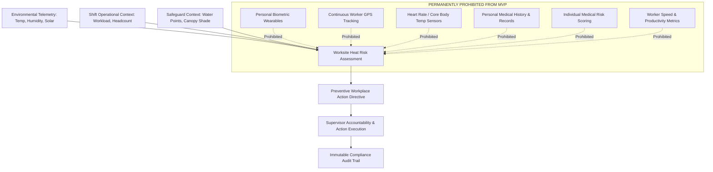

# Worker Data Protection & Anti-Surveillance Specification

**Document ID:** `86_WORKER_DATA_PROTECTION`  
**Status:** MVP Design / Specification (Pending Implementation Verification)  
**Version:** 1.0.0  
**Last Updated:** 2026-10-08  
**Author:** Heat Action Response Engine Team  

---

## 1. Purpose & Core Ethical Principle

This specification establishes the worker privacy safeguards, ethical boundaries, and anti-surveillance guarantees governing the **Heat Action Response Engine**.

The core mission of the platform is:
> **From heat warning to verified workplace action.**

In industrial labor management, technology introduced under the banner of "worker safety" frequently degenerates into invasive employee surveillance, algorithmic micromanagement, and disciplinary profiling. The Heat Action Response Engine permanently rejects this paradigm, establishing a core ethical principle:

> **The system optimizes workplace environmental safety and operational accountability without collecting, tracking, scoring, or exposing individualized worker physiological, biometric, or behavioral data.**

```text
┌────────────────────────────────────────────────────────────────────────┐
│                   ETHICAL BOUNDARY INVARIANT                           │
├────────────────────────────────────────────────────────────────────────┤
│ The platform protects workers by holding EMPLOYERS AND SUPERVISORS     │
│ ACCOUNTABLE for providing water, shade, and rest rotations.            │
│ It does NOT police, monitor, or profile the WORKERS themselves.        │
└────────────────────────────────────────────────────────────────────────┘
```

---

## 2. The Worker Data Privacy Boundary

The architectural boundary separating environmental heat-risk operations from prohibited worker surveillance is absolute:



---

## 3. Worker Data Categorization Model

The system organizes workplace operational data into three distinct tiers:

```text
┌───────────────────────────┬────────────────────────────────────────────────────┐
│ CATEGORY                  │ INCLUSION STATUS & SYSTEM SCOPE                    │
├───────────────────────────┼────────────────────────────────────────────────────┤
│ **1. Operational Data**   │ **PERMITTED (CORE MVP)**                           │
│                           │ Aggregate shift headcount (e.g. 45 workers on site),│
│                           │ workload classification (e.g. HEAVY rebar fixing), │
│                           │ assigned job trade, worksite location coordinates. │
├───────────────────────────┼────────────────────────────────────────────────────┤
│ **2. Supervisory Identity**│ **PERMITTED (MINIMAL)**                            │
│                           │ Authenticated account details for Site Supervisors │
│                           │ and Safety Managers responsible for site controls. │
├───────────────────────────┼────────────────────────────────────────────────────┤
│ **3. Individual Worker    │ **STRICTLY PROHIBITED (OUT OF SCOPE)**             │
│    Medical & Biometric**  │ Individual worker identities, health histories,    │
│                           │ body temperatures, biometric telemetry, or clinical│
│                           │ physiological measurements.                        │
└───────────────────────────┴────────────────────────────────────────────────────┘
```

---

## 4. Worksite Environmental Risk vs. Individual Medical Risk

A foundational concept of the Heat Action Response Engine is the strict distinction between **workplace ambient risk** and **individual clinical risk**:

```text
┌───────────────────────────────────────┬───────────────────────────────────────┐
│ WORKSITE ENVIRONMENTAL HEAT RISK      │ INDIVIDUAL MEDICAL / PHYSIOLOGICAL RISK│
├───────────────────────────────────────┼───────────────────────────────────────┤
│ • Evaluates ambient thermal stress    │ • Evaluates individual clinical state │
│ • Considers radiant heat, solar, wind │ • Considers internal core temperature │
│ • Considers physical work intensity   │ • Considers personal hydration deficit│
│ • Applies to the entire crew on site  │ • Applies to a single human patient   │
│ • Directs operational engineering     │ • Directs clinical medical triage     │
│   controls (shade, water, rotations)  │   or pharmaceutical treatment         │
│ • **CORE PLATFORM RESPONSIBILITY**    │ • **STRICTLY PROHIBITED OVERREACH**   │
└───────────────────────────────────────┴───────────────────────────────────────┘
```

> **SAFETY PRINCIPLE:** A `HIGH` worksite risk classification indicates that environmental and contextual conditions require mandatory group controls (such as 45/15 work-rest rotations). It **never** implies an algorithmic diagnosis that an individual worker is medically ill.

---

## 5. Absolute Prohibition on Individualized Worker Risk Scoring

The platform strictly bans the generation of individual worker risk scores:

```text
┌────────────────────────────────────────────────────────────────────────┐
│                     ALGORITHMIC PROHIBITION                            │
├────────────────────────────────────────────────────────────────────────┤
│ The platform NEVER calculates or outputs metrics such as:              │
│ • "Worker Ramesh: 82% Heat Stroke Risk"                                │
│ • "Worker Suresh: Low Acclimatization Vulnerability"                   │
│ • "Worker Anita: High Fatigue Liability Index"                         │
└────────────────────────────────────────────────────────────────────────┘
```

### Rationale:
1. **Medical Invalidity:** Non-invasive software algorithms cannot medically determine an individual's thermal strain without invasive physiological sensors and qualified clinical diagnostics.
2. **Discrimination & Retaliation Risk:** Individual risk scores are easily abused by unethical employers to terminate, reassign, dock wages, or penalize vulnerable workers.
3. **Collective Responsibility:** Occupational heat stress is an environmental hazard; mitigation must protect all workers equitably rather than shifting liability onto individual biology.

---

## 6. Anti-Surveillance Safeguards (Zero Continuous Tracking)

The platform enforces strict architectural safeguards against employee surveillance:

1. **No Continuous Location Tracking:** The application tracks the fixed physical coordinates of the **worksite facility** (e.g. `ws_blr_north_04`), not the real-time GPS coordinates of workers or supervisors.
2. **No Movement or Pacing Surveillance:** The system does not monitor step counts, worker velocity, or physical pauses.
3. **No Break Surveillance:** Acknowledged work-rest directives record that the *crew rotation was enacted*; the system does not time individual workers inside shade shelters to calculate productivity penalties.
4. **No Productivity Correlation:** Heat-risk evaluations are permanently isolated from commercial production KPIs, tonnage moved, or concrete poured.

---

## 7. Data Minimization & Group Abstractions

To protect front-line tradespeople from unnecessary data exposure:
* **Anonymous Shift Headcounts:** Shift rosters record worker presence as aggregate integer counts:
  ```json
  {
    "shift_id": "shift_day_20261008",
    "worksite_id": "ws_blr_north_04",
    "worker_count": 48,
    "workload_intensity": "HEAVY",
    "trade_categories": ["REBAR_BENDING", "FORMWORK"]
  }
  ```
* **No Worker Logins in MVP:** Field laborers do not create accounts, undergo facial recognition, or log in to software terminals. Supervisors receive instructions and coordinate field welfare directly.

---

## 8. Role-Based Access Scoping for Worker Welfare

Where crew operational information is processed, access follows strict least-privilege scoping (`83_AUTHORIZATION.md`):
* **Supervisor:** Views shift operational context strictly for their assigned worksite.
* **Safety Manager:** Views aggregate multi-site staffing and safeguard readiness.
* **Administrator:** Manages organizational shift templates and facility capacities.
* **Cross-Tenant Boundary:** Shift contexts are cryptographically and logically isolated by enterprise tenant ID (`organization_id`). Cross-tenant visibility is impossible.

---

## 9. Future IoT Sensors & Wearables Governance Boundary

While future phases of the platform may explore on-site microclimate telemetry (e.g. ESP32 physical weather stations measuring local radiant globe temperature), **personal wearables remain strictly out of MVP scope**:

```text
┌───────────────────────────────────────┬───────────────────────────────────────┐
│ FUTURE MICROCLIMATE SENSORS (ROADMAP) │ PERSONAL BIOMETRIC WEARABLES (BLOCKED)│
├───────────────────────────────────────┼───────────────────────────────────────┤
│ • On-site ESP32 / DHT22 stations      │ • Chest-strap heart rate monitors     │
│ • Wet Bulb Globe Temp (WBGT) masts    │ • In-ear core body temperature probes │
│ • Solar radiation pyranometers        │ • Personal physiological smartwatches │
│ • Water station flow meter sensors    │ • Individual sweat electrolyte patches│
└───────────────────────────────────────┴───────────────────────────────────────┘
```

### Preconditions for Any Future Biometric Wearable Integration:
If an enterprise client requests biometric integration in post-MVP phases, deployment is conditionally blocked pending:
1. Complete independent clinical validation and medical device regulatory clearance.
2. Formal opt-in worker consent mechanisms under applicable data protection laws.
3. Strict legal guarantees that biometric data cannot be used for HR evaluations or wage deductions.
4. Dedicated encrypted data enclaves completely segregated from operational worksite records.

---

## 10. Worker Data Protection Threat Matrix

| Threat Code | Threat Description | Attack Vector / Misuse Scenario | Architectural Mitigation |
| :--- | :--- | :--- | :--- |
| **WDP-01** | Surveillance Creep | Employer attempts to use app to track worker breaks for pay cuts | App tracks crew-level directive status only; zero individual timer logs |
| **WDP-02** | Biological Discrimination | Algorithmic scoring used to sideline older or vulnerable workers | Individual risk scoring permanently prohibited from software core |
| **WDP-03** | Unauthorized Identity Leak | Subcontractor worker names exposed via unsecured API endpoints | Worker entities modeled strictly as anonymous integer counts |
| **WDP-04** | Cross-Site Snooping | Competitor or unassigned supervisor inspects crew trade sizes | Worksite scoping blocks queries with HTTP 403 Forbidden |
| **WDP-05** | Biometric Exploitation | Third-party wearable plugin silently captures worker heart rates | Application API rejects personal biometric schemas at gateway |

---

## 11. Pre-Deployment Worker Protection Checklist

Before releasing any software version to production:
* [ ] Zero individual worker biometric, physiological, or medical fields exist in data schemas.
* [ ] Worker presence is represented strictly as aggregate headcounts per shift.
* [ ] No continuous individual GPS tracking mechanisms exist in client or mobile applications.
* [ ] System contains zero individual worker health-scoring algorithms.
* [ ] Shift operational records are isolated from commercial productivity and payroll systems.
* [ ] Supervisor dashboard displays group safety directives with zero worker surveillance metrics.
* [ ] Pre-deployment privacy audit confirms compliance with worker data minimization invariants.

---

## 12. Cross-Document Architecture Integration

* `15_WORKER_SHIFT_MODEL.md`: Shift context data modeling and aggregate headcount schemas.
* `16_ACTION_MODEL.md`: Focus on physical worksite controls rather than individual monitoring.
* `19_PERMISSION_MODEL.md`: RBAC boundaries protecting crew operational context.
* `80_SECURITY.md`: Overall security architecture and boundary enforcement.
* `81_DATA_PRIVACY.md`: Comprehensive privacy-by-design and data governance framework.
* `83_AUTHORIZATION.md`: Worksite scoping and multi-tenant partition isolation.
* `88_MEDICAL_DISCLAIMER.md`: Demarcation between operational safety and clinical diagnosis.
