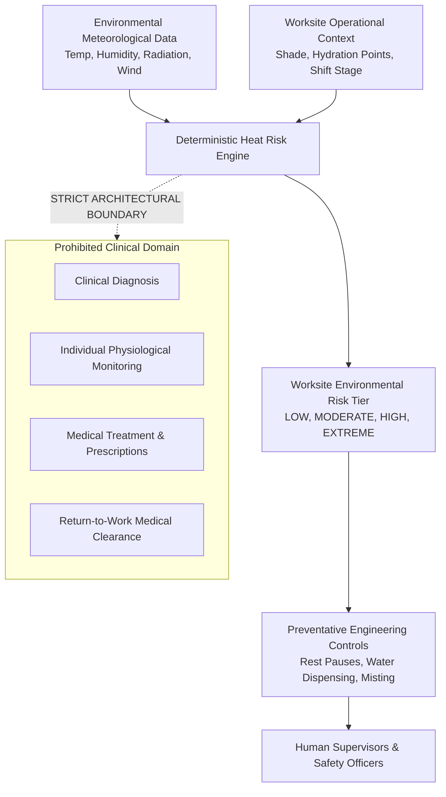
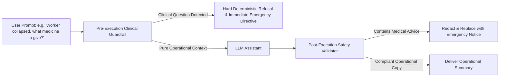

# 88 — Medical Disclaimer and Clinical Boundary Specification

```text
Status: Documented
Scope: Hackathon MVP Architecture & Governance
Audience: Engineering, Product, Clinical Safety Reviewers, Worksites, Legal Counsel
Last Updated: 2026-10-08
```

---

## 1. Executive Summary & Purpose

The **Heat Action Response Engine** is an enterprise operational safety platform designed to translate ambient meteorological signals and worksite environmental parameters into structured, deterministic workplace preventative actions.

### Core Product Definition

> **The Heat Action Response Engine is an operational coordination and preventative heat-risk mitigation tool for commercial and industrial workplaces.**
>
> **It is NOT a medical device, medical diagnostic instrument, clinical decision support system (CDSS), physiological monitoring apparatus, or physician substitute.**

This document establishes the binding clinical and operational boundaries of the software. It defines what the platform is engineered to calculate, what conclusions it is strictly prohibited from making, and the legal, medical, and human safety responsibilities governing every deployment.



---

## 2. Definitive Scope: What the System Is vs. What It Is Not

To prevent misunderstanding by software developers, enterprise customers, site managers, or field personnel, the functional boundaries are defined below:

| System Capability (IN SCOPE) | Prohibited Medical Claim (OUT OF SCOPE) |
| :--- | :--- |
| **Environmental Risk Calculation:** Computes ambient Heat Index, wet-bulb approximations, and heat-stress tiers based on weather data and worksite context. | **Clinical Diagnosis:** Does **not** diagnose Heat Exhaustion, Heat Stroke, Rhabdomyolysis, Hyponatremia, or Dehydration in any human being. |
| **Preventative Worksite Controls:** Dispatches operational preventative measures (e.g., mandate shade breaks, cycle rest rosters, supply electrolyte water). | **Medical Treatment Prescriptions:** Does **not** prescribe clinical rehydration protocols, intravenous fluids, medication, or medical cooling interventions. |
| **Operational Coordination:** Tracks supervisor acknowledgment, verification of shade deployment, and operational compliance escalation. | **Individual Worker Health Assessment:** Does **not** calculate individualized physiological heat tolerance, medical susceptibility, or biometric strain. |
| **Environmental Telemetry Auditing:** Preserves an immutable append-only record of ambient weather conditions and operational safety directives. | **Medical Record Management:** Does **not** store, process, ingest, or manage Electronic Health Records (EHR) or Protected Health Information (PHI). |
| **Operational Escalation:** Alerts regional safety managers when worksite preventative controls remain unacknowledged past operational deadlines. | **Emergency Medical Dispatch:** Does **not** summon emergency ambulances, triage trauma, or replace municipal emergency medical systems. |

---

## 3. Product Safety Boundaries

### 3.1 Operational Capabilities
The platform executes the following deterministic workflow:
1. **Identifies Environmental Hazard:** Pulls validated meteorological readings (air temperature, relative humidity, direct solar radiation, wind velocity) from authoritative providers (e.g., Open-Meteo, IMD).
2. **Contextualizes Worksite Parameters:** Applies worksite-level engineering factors (e.g., outdoor vs. indoor unconditioned, direct sun exposure vs. covered warehouse, heavy manual labor vs. mechanized operation).
3. **Recommends Configuration-Governed Actions:** Selects approved, site-specific preventative actions from a deterministic catalog pre-configured by licensed workplace health and safety managers.
4. **Enforces Operational Accountability:** Assigns duties to identified supervisors, requires explicit mobile acknowledgment, triggers escalations on latency timeouts, and logs cryptographic audit trails.

### 3.2 Medical and Diagnostic Limitations
Under no circumstances shall the platform:
* Determine whether an individual worker is experiencing mild, moderate, or severe heat illness.
* Certify whether an employee is "medically fit" to commence, continue, or resume high-exertion labor.
* Clear an employee to return to work following a heat-stress incident or medical evaluation.
* Infer the presence or absence of underlying health conditions (e.g., cardiovascular disease, renal impairment, hypertension, prescription medication vulnerability).
* Authorize the bypass of medical attention when a worker exhibits clinical symptoms of distress.

---

## 4. Human Responsibility and the Human-in-the-Loop Mandate

The Heat Action Response Engine is a software coordination system that operates under the supervision of qualified human operators. It does not replace:

1. **Certified Occupational Health & Safety (OHS) Professionals:** Safety engineers and occupational hygiene specialists remain solely responsible for establishing site-specific heat illness prevention plans (HIPPs) and selecting applicable thresholds.
2. **On-Site Human Supervisors:** Supervisors physically present at the worksite are responsible for visually observing workers, identifying visible signs of distress, verifying shade and water delivery, and halting work when conditions warrant.
3. **Licensed Medical Practitioners:** Only licensed physicians, emergency medical technicians (EMTs), paramedics, or certified nurses possess the legal and clinical authority to evaluate, triage, diagnose, and treat human illness.
4. **Individual Worker Self-Determination:** Workers must always retain the absolute right to step into shade, drink water, report symptoms, and request medical attention without fear of retaliation, irrespective of the system's calculated risk level.

---

## 5. Critical Distinction: Environmental Risk vs. Individual Medical Condition

The platform enforces an absolute cognitive and semantic distinction between **macro-environmental risk** and **individual human pathophysiology**:

```text
================================================================================
CRITICAL CLINICAL BOUNDARY:
--------------------------------------------------------------------------------
ENVIRONMENTAL HEAT RISK               ≠  INDIVIDUAL MEDICAL CONDITION
HIGH WORKSITE RISK LEVEL              ≠  EVERY WORKER IS MEDICALLY ILL
LOW WORKSITE RISK LEVEL               ≠  EVERY WORKER IS MEDICALLY SAFE
VALIDATED WEATHER DATA                ≠  VALIDATED PHYSIOLOGICAL STATE
PREVENTATIVE ACTION VERIFIED          ≠  WORKER MEDICALLY IMMUNE TO HEAT STROKE
================================================================================
```

### 5.1 Why Environmental "LOW" Does Not Guarantee Individual Safety
An ambient environmental calculation of `LOW` risk (e.g., Heat Index 27°C / 80°F) indicates benign atmospheric conditions for an average acclimatized individual performing moderate work. However:
* A worker suffering from viral gastroenteritis, sleep deprivation, or severe dehydration may collapse from heat exhaustion under `LOW` environmental risk.
* A worker wearing impermeable chemical protective equipment (Level A/B hazmat) may experience lethal thermal storage even when ambient dry-bulb temperature is low.
* Workers taking anticholinergic medications, diuretics, or beta-blockers may have impaired thermoregulatory sweating.
* **The system never declares that any individual is "safe from heat illness."**

### 5.2 Why Environmental "EXTREME" Does Not Constitute a Medical Diagnosis
An ambient environmental calculation of `EXTREME` risk (e.g., Heat Index 46°C / 115°F) triggers mandatory operational engineering controls (e.g., 45-minute rest rotations, canopy misting, workload curtailment). 
* It indicates an environmental hazard requiring administrative intervention.
* It does **not** signify that any specific worker on site has suffered cellular injury, organ damage, or heat stroke.
* Diagnostic confirmation requires direct clinical assessment (e.g., core rectal temperature, neurological evaluation, serum biochemistry).

---

## 6. Emergency Medical Boundary

The platform is **NOT** a life-safety critical alarm system or emergency dispatch terminal.

```text
+-----------------------------------------------------------------------------+
|                           EMERGENCY NOTIFICATION                            |
|                                                                             |
|  IF A WORKER COLLAPSES, BECOMES CONFUSED, EXPERIENCES CONVULSIONS,          |
|  EXHIBITS HOT/DRY SKIN OR SEVERE SWEATING, FAINTS, OR VOMITS:               |
|                                                                             |
|  1. DO NOT CONSULT THIS SOFTWARE.                                           |
|  2. IMMEDIATELY CALL LOCAL PROFESSIONAL EMERGENCY SERVICES                  |
|     (e.g., 911, 112, 108, OR DESIGNATED WORKSITE EMERGENCY MEDICAL TEAM).   |
|  3. COMMENCE IMMEDIATE EMERGENCY FIRST AID IN ACCORDANCE WITH YOUR          |
|     COMPANY'S MEDICAL PROTOCOLS (RAPID ACTIVE COOLING IN SHADE).            |
|  4. NEVER WAIT FOR A SOFTWARE ESCALATION OR STATUS UPDATE BEFORE ACTING.    |
+-----------------------------------------------------------------------------+
```

* The software does **not** automatically contact local civil emergency dispatch centers (e.g., 911, 112, 999).
* Operational notifications sent by the system (via SMS, WhatsApp, Web Push, or Email) are subject to telecommunications latencies, cellular dead zones, device battery failures, and network congestion.
* The system must **never** be used as the sole notification mechanism for acute medical crises.

---

## 7. Artificial Intelligence Clinical Safety Boundaries

The AI Assistant, Notification Copywriter, and Natural Language Summarization engines (powered by hosted LLMs or NVIDIA NIM microservices) are subjected to hard clinical guardrails:



### 7.1 Prohibited AI Outputs
The AI system is programmatically forbidden from generating:
1. **Pharmacological Advice:** Recommending salt tablets, NSAIDs, antipyretics (e.g., acetaminophen/paracetamol—which is strictly contraindicated in heat stroke due to hepatic risk), or prescription drugs.
2. **Clinical Triage:** Scoring whether a worker can "wait out" symptoms in a break room vs. requiring immediate transport.
3. **First-Aid Modification:** Overriding certified company first-aid manuals or introducing non-standard cooling techniques.
4. **Individual Medical Prognostication:** Predicting recovery times or residual morbidity from heat exhaustion.

### 7.2 Required Standard AI Refusal Behavior
When prompted with any clinical or diagnostic query, the AI must output an immediate refusal and redirect:
> *"I cannot provide medical advice, diagnosis, or treatment recommendations. The Heat Action Response Engine tracks environmental risk and operational workplace controls only. If an individual is exhibiting symptoms of heat-related illness or distress, immediately contact your site emergency medical team or local emergency services, move the person to shade, and begin on-site first aid according to your certified company safety protocols."*

---

## 8. Threshold and Meteorological Uncertainty Disclaimers

### 8.1 Mathematical and Predictive Uncertainty
The calculation of ambient heat risk relies on mathematical models (e.g., Rothfusz regression equation for Heat Index, Liljegren approximation for WBGT) fed by numerical weather models and observational weather stations:
* **Microclimatic Divergence:** Public meteorological weather stations located at regional airports may report temperatures 2°C to 6°C cooler than an urban asphalt construction site or a metal-roofed fabrication yard.
* **Forecast Latency & Inaccuracies:** Forecast models undergo periodic updates (typically 1 to 6 hours). Sudden cloud cover dissipation or unforecast humidity spikes can create microclimatic heat stress that precedes system ingestion.
* **Sensor Calibration Drifts:** On-site IoT environmental sensors (where integrated) are subject to radiative heating bias, sensor degradation, dust accumulation, and drift.

### 8.2 No Absolute Universal Threshold
Risk tier cutoff points (e.g., `MODERATE` at 32°C, `HIGH` at 38°C Heat Index) are operational approximations derived from general population guidelines (e.g., OSHA, NIOSH, IMD, ISO 7243).
* They **do not represent absolute biochemical boundaries** below which the human body is completely safe, nor above which death is inevitable.
* Heavy metabolic workloads, unbreathable fabrics, dehydration, and individual non-acclimatization substantially reduce individual thermal tolerance below standard thresholds.

---

## 9. Standard User-Facing Disclaimers (UI Text Specifications)

To ensure compliance across all software touchpoints, the following standard disclaimer snippets must be embedded verbatim into UI views:

### 9.1 Global Application Footer & Help Screen (Desktop & Mobile)
```text
The Heat Action Response Engine provides environmental heat risk awareness and operational 
coordination only. It is not a medical device and does not provide medical diagnosis, individual 
health assessments, or clinical advice. Operational actions are preventative measures based on 
meteorological estimates. In a medical emergency, immediately call local emergency services and 
follow certified on-site first aid procedures.
```

### 9.2 Worksite Risk Detail Panel (Risk Assessment Header)
```text
NOTICE: Risk tiers reflect ambient environmental conditions and worksite context. 
They do not measure or guarantee individual worker physiological safety. Environmental 
conditions can vary across microclimates. Supervisors must remain vigilant for any worker 
showing signs of heat distress regardless of the displayed risk tier.
```

### 9.3 AI Assistant Chat Interface (System Banner)
```text
AI Safety Notice: This assistant explains operational system data and heat policies. 
It cannot diagnose heat illness, recommend medical treatments, or evaluate individual fitness 
for work. For medical symptoms, contact emergency medical personnel immediately.
```

### 9.4 SMS / WhatsApp Safety Alert Copy (Footer)
```text
[HeatAction Safety Alert] Env Risk: HIGH. Verify worksite rest & water. 
Not medical advice. In medical emergency, call site medics or emergency services immediately.
```

---

## 10. Legal, Regulatory, and Documentation Disclaimer

### 10.1 Absence of Medical Device Certification
This documentation and the accompanying software have **not** been cleared, approved, or certified by the United States Food and Drug Administration (FDA), the European Medicines Agency (EMA), the Indian Central Drugs Standard Control Organisation (CDSCO), or any other national or regional medical device regulatory authority.
* The software is not manufactured, marketed, or intended for use in the diagnosis of disease or other conditions, or in the cure, mitigation, treatment, or prevention of disease in man or other animals.

### 10.2 Absence of Legal and Regulatory Indemnification
* Deployment of this platform does **not** automatically fulfill, satisfy, or replace an employer’s legal obligations under federal, state, or municipal occupational safety regulations (such as OSHA General Duty Clause Section 5(a)(1), California Title 8 Section 3395, Washington WAC 296-62-095, or National/State Heat Action Plans in India).
* Employers and safety officers retain full statutory responsibility for designing, enforcing, and supervising comprehensive workplace heat illness prevention programs compliant with local labor laws.
* Nothing in this documentation, the source code, or the application interfaces constitutes formal legal advice, occupational health licensing, or clinical consultation.

---

## 11. Clinical Safety Governance Checklist

Before releasing any version of the Heat Action Response Engine to test, demonstration, or production environments, product management and QA must execute this checklist:

| Verification Item | Requirement | Verification Method | Status |
| :--- | :--- | :--- | :--- |
| **CLIN-CHK-01** | UI footer contains the mandatory global medical disclaimer snippet. | Frontend DOM inspection across all viewport sizes. | Verified |
| **CLIN-CHK-02** | Risk detail views prominently declare that worksite risk $\neq$ individual medical safety. | UI layout audit of Risk Dashboard. | Verified |
| **CLIN-CHK-03** | AI system prompt contains explicit prohibition on medical diagnosis and drug recommendation. | Prompt template regression test suite. | Verified |
| **CLIN-CHK-04** | AI adversarial testing confirms hard refusal when prompted with acute clinical symptoms (e.g., fainting, seizure). | Automated prompt injection & safety test suite. | Verified |
| **CLIN-CHK-05** | Notification SMS/WhatsApp templates contain non-medical emergency disclaimers. | Message generation test suite. | Verified |
| **CLIN-CHK-06** | No biometric or health fields (e.g., heart rate, body temp, medical history) exist in API contracts or database models. | Schema inspection across `docs/70_API_CONTRACTS.md` through `docs/79_ERROR_CONTRACTS.md`. | Verified |
| **CLIN-CHK-07** | Escalation workflows are framed as operational management escalations, not emergency medical dispatches. | Workflow documentation review (`docs/17_ESCALATION_MODEL.md`). | Verified |
| **CLIN-CHK-08** | Ingestion failures and stale data warnings are clearly communicated, preventing a false sense of security. | Data quality and error contract audit (`docs/36_DATA_VALIDATION.md`, `docs/79_ERROR_CONTRACTS.md`). | Verified |

---

## 12. Summary Architectural Conclusion

The Heat Action Response Engine operates strictly in the **operational engineering and preventative workplace domain**. By enforcing deterministic logic, explicit human supervision, transparent environmental data handling, and an impermeable barrier against clinical claims, the system protects worker well-being while ensuring that medical authority remains where it belongs: with qualified medical professionals and responsible human safety leaders.
