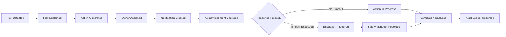
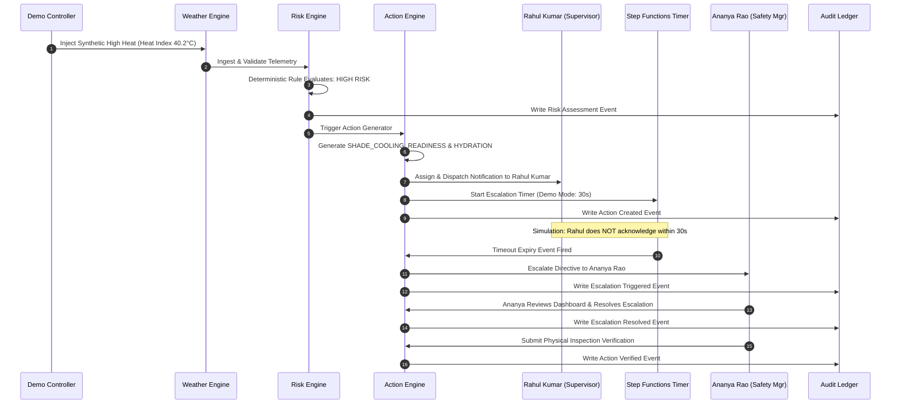

# 90 — System Evaluation & Verification Strategy

```text
Status: Documented
Scope: Hackathon MVP Architecture & Governance
Audience: System Architects, Quality Engineers, Safety Officers, Hackathon Evaluators
Last Updated: 2026-10-08
```

---

## 1. Evaluation Objective & Scope

The **Heat Action Response Engine** is an operational workplace safety platform designed to convert ambient meteorological risk indicators into deterministic, verifiable, and accountable preventative safety measures.

### Core Evaluation Objective

> **Evaluate whether the system reliably executes its core operational promise:**
> **Turn an identified workplace heat-risk condition into a contextual, accountable, and traceable preventative action.**

Evaluation cannot be reduced to a single algorithmic accuracy percentage or precision/recall metric. Because the platform coordinates real-world occupational safety interventions, evaluation spans eleven interdependent functional and safety dimensions:

```text
┌────────────────────────────────────────────────────────────────────────┐
│                      SYSTEM EVALUATION DIMENSIONS                      │
├────────────────────────────────────────────────────────────────────────┤
│ 1.  RISK CORRECTNESS      : Deterministic compliance with heat rules   │
│ 2.  ACTION CORRECTNESS    : Contextual, site-specific directives       │
│ 3.  DATA RELIABILITY      : Resilience to missing/stale/bad telemetry  │
│ 4.  SECURITY ENFORCEMENT  : RBAC, tenant isolation, and anti-tamper    │
│ 5.  WORKER PRIVACY        : Anti-surveillance & data minimization      │
│ 6.  AI SAFETY & BOUNDARIES: Zero override authority; strict refusal    │
│ 7.  WORKFLOW INTEGRITY    : Valid state machine & timeout escalation   │
│ 8.  AUDITABILITY          : Immutable, tamper-evident forensic trail   │
│ 9.  UX & OPERABILITY      : Front-line mobile usability under glare    │
│ 10. RELIABILITY & UPTIME  : Transparent degradation, no silent fails   │
│ 11. DEMO REPEATABILITY    : Verifiable simulation sandbox execution    │
└────────────────────────────────────────────────────────────────────────┘
```

---

## 2. North-Star Operational Evaluation Pipeline

The primary evaluation criterion for the platform is the successful execution of the closed-loop **Operational Safety Cycle**:



### North-Star Milestone Verification

To certify system readiness, an evaluation test must prove that every stage executes without dropped state, race conditions, or unrecorded transitions:

1. **RISK DETECTED:** Valid meteorological data ingested and processed into an authoritative risk tier (`LOW`, `MODERATE`, `HIGH`, `CRITICAL`).
2. **RISK EXPLAINED:** Transparent mathematical and contextual explanation compiled with exact rule-version attribution.
3. **ACTION GENERATED:** Deterministic action rules generate the required preventative measures (e.g., shade deployment, hydration breaks).
4. **OWNER ASSIGNED:** Actions are routed to the specific, authorized supervisor responsible for the designated worksite and shift cohort.
5. **NOTIFICATION CREATED:** Targeted alerts are dispatched across configured communication channels (Web Push, SMS, WhatsApp).
6. **ACKNOWLEDGMENT CAPTURED:** Supervisor records single-click confirmation via cryptographically signed tokens.
7. **ESCALATION TRIGGERED (IF UNANSWERED):** Unacknowledged directives trigger automated AWS Step Functions timeouts, alerting the regional safety manager.
8. **VERIFICATION CAPTURED:** Physical deployment is verified by authorized safety personnel before completion.
9. **AUDIT RECORDED:** Every discrete state mutation is committed transactionally to the append-only compliance ledger.

---

## 3. Evaluation Dimensions & Acceptance Criteria

| Dimension | Core Evaluation Question | Evaluated Metric | Acceptance Criteria |
| :--- | :--- | :--- | :--- |
| **Risk Engine** | Does the engine evaluate mathematical and contextual rules deterministically? | Rule test pass rate across all boundary conditions | 100% pass rate against documented rule fixtures; zero nondeterministic results |
| **Data Quality** | Are missing, stale, invalid, or conflicting weather feeds handled safely? | Unsafe fallback frequency (`FAIL-OPEN` occurrences) | **Zero.** The system must never convert bad/missing inputs into a `LOW` risk assumption |
| **Action Engine** | Are appropriate, site-specific preventative actions generated? | Action generation matrix match rate | 100% conformance to active action-rule catalog (`docs/41_ACTION_RULES.md`) |
| **Assignment** | Are actions routed strictly to authorized on-site personnel? | Accurate owner assignment rate | 100% valid assignment; zero unassigned or cross-tenant assignments |
| **Acknowledgment** | Does acknowledgment enforce valid, atomic state machine progression? | State transition validity rate | 100% atomic transitions; zero out-of-order transitions; zero replay successes |
| **Escalation** | Do unacknowledged directives reliably escalate upon timeout expiry? | Escalation trigger precision and timeliness | 100% timely escalation in automated timeout test suites |
| **Audit Logging** | Is every consequential operational state change immutably recorded? | Audit event coverage across mutating endpoints | 100% coverage; zero un-audited state mutations |
| **API Compliance** | Do REST endpoints conform strictly to versioned contracts and error models? | OpenAPI / JSON schema contract test pass rate | 100% schema conformance; RFC 7807 problem details on error |
| **Security & RBAC** | Are unauthorized operations, BOLA/IDOR, and privilege escalations blocked? | Unauthorized request rejection rate | 100% rejection (HTTP 401/403); zero cross-tenant data leaks |
| **AI Safety** | Does generative AI stay within assistive bounds and respect guardrails? | Unsafe output rate & prompt injection bypass rate | **Zero** accepted unsafe outputs; zero bypass of deterministic safety rules |
| **UX & Usability** | Can a supervisor acknowledge directives within 10 seconds under field glare? | Task completion time on mobile PWA client | Average acknowledgment time < 10 seconds; high-contrast legibility |
| **System Reliability** | Are operational failures, provider outages, and timeouts visible to users? | Silent failure count | **Zero silent failures.** Stale/degraded banners displayed immediately |
| **Demo Repeatability**| Can the hackathon demonstration scenario execute repeatedly on demand? | End-to-end simulation completion rate | 100% repeatable execution using synthetic demo fixtures |

---

## 4. Test Pyramid & Architectural Layers

The testing strategy follows a structured pyramid prioritizing deterministic domain rules:

```text
                           ┌─────────────────────────┐
                           │    E2E & DEMO SUITE     │
                           │  Complete Lifecycle Run │
                           └────────────┬────────────┘
                                        │
                         ┌──────────────┴──────────────┐
                         │      WORKFLOW & API TESTS   │
                         │ REST Contracts, Step Fn, GW │
                         └──────────────┬──────────────┘
                                        │
                       ┌────────────────┴────────────────┐
                       │    INTEGRATION & SECURITY TESTS │
                       │ DynamoDB, EventBridge, Auth/RBAC│
                       └────────────────┬────────────────┘
                                        │
                     ┌──────────────────┴──────────────────┐
                     │     UNIT & DETERMINISTIC RULE TESTS │
                     │  Math Rules, Boundary Tests, State │
                     └─────────────────────────────────────┘
```

### Layered Testing Strategy
1. **Unit & Rule Tests:** Highest volume. Exercises mathematical calculations (Heat Index, WBGT approximations), threshold boundaries, input validators, state machine transitions, and data normalization schemas in pure isolated compute.
2. **Domain Integration Tests:** Validates interactions between the Risk Engine, Action Engine, and single-table DynamoDB access patterns using local DynamoDB emulation.
3. **Workflow & Event Tests:** Verifies EventBridge rule routing, Step Functions timeout state machines, and notification webhook receivers.
4. **Security & API Contract Tests:** Executes automated penetration scripts targeting authorization bypasses, BOLA vulnerabilities, token tampering, and schema validation failures.
5. **AI Safety Evaluations:** Dedicated test harness evaluating prompt injection resistance, hallucination boundaries, and medical refusal guardrails.
6. **End-to-End & Simulation Tests:** Executes synthetic scenarios from weather ingest through mobile PWA acknowledgment and audit verification.

---

## 5. Safety-Critical Testing Principles

All test suites and validation harnesses must enforce the following non-negotiable safety axioms:

```text
================================================================================
NON-NEGOTIABLE SAFETY-CRITICAL TESTING PRINCIPLES
================================================================================
• UNKNOWN      ≠  LOW RISK          (Missing data must trigger UNKNOWN/ALERT)
• STALE        ≠  CURRENT           (Old weather data must show STALE warning)
• MISSING      ≠  SAFE              (Absence of telemetry is not absence of heat)
• INVALID      ≠  SAFE              (Corrupted payloads must be rejected/flagged)
• CONFLICTING  ≠  SAFE              (Divergent sources trigger safety stance)
• FORECAST     ≠  OBSERVATION       (Predictions must never masquerade as sensor data)
• SIMULATION   ≠  REAL EVENT        (Demo runs must be quarantined from legal records)
• AI OUTPUT    ≠  AUTHORITATIVE     (AI summaries cannot alter system state)
• ACKNOWLEDGED ≠  VERIFIED          (Supervisor click is not physical proof of shade)
• VERIFIED     ≠  MEDICALLY SAFE    (Physical controls do not guarantee individual health)
================================================================================
```

---

## 6. Negative Testing & Resiliency Scenarios

Negative testing is mandatory for system certification. The system must fail safely under adverse, corrupted, and hostile conditions:

```text
┌───────────────────────────────┬──────────────────────────────────────────────┐
│ FAILURE / ADVERSE CONDITION   │ MANDATORY SYSTEM BEHAVIOR                    │
├───────────────────────────────┼──────────────────────────────────────────────┤
│ External Weather API Offline  │ Retain last known risk; display STALE banner;│
│ (HTTP 500 / Timeout)          │ alert Safety Manager; do NOT reset to LOW.   │
├───────────────────────────────┼──────────────────────────────────────────────┤
│ Out-of-Bounds Sensor Reading  │ Reject reading as INVALID; do not compute;   │
│ (e.g., Temp = 95°C / RH = -5%)│ flag data quality error; log audit event.    │
├───────────────────────────────┼──────────────────────────────────────────────┤
│ Missing Worksite Context      │ Compute environmental baseline; generate     │
│ (Unconfigured Shade/Hydration)│ fallback general safety alert; flag context. │
├───────────────────────────────┼──────────────────────────────────────────────┤
│ Unauthorized State Transition │ Reject request with HTTP 403 Forbidden;      │
│ (Worker attempts /verify)     │ preserve existing action status; log audit.  │
├───────────────────────────────┼──────────────────────────────────────────────┤
│ Replayed Acknowledgment Token │ Reject with HTTP 409 Conflict;               │
│ (Token reused after click)    │ do not re-trigger lifecycle handlers.        │
├───────────────────────────────┼──────────────────────────────────────────────┤
│ Notification Dispatch Failure │ Record dispatch failure; trigger fallback    │
│ (Telecom gateway rejects SMS) │ channel (Push/WhatsApp); escalate if unread. │
├───────────────────────────────┼──────────────────────────────────────────────┤
│ AI Provider Outage            │ Suppress AI briefing; display standard       │
│ (Hosted LLM times out)        │ deterministic action card; workflow unharmed.│
├───────────────────────────────┼──────────────────────────────────────────────┤
│ DynamoDB Outage / Error       │ Return HTTP 500 RFC 7807 error; fail atomic  │
│ (Write failure during state)  │ transaction; do not return partial success.  │
└───────────────────────────────┴──────────────────────────────────────────────┘
```

---

## 7. Boundary Testing Specifications

Boundary testing validates behavior directly at mathematical threshold transitions:

```text
Threshold T (e.g., High Risk Trigger at Heat Index = 38.0°C)
  ├── Input = 37.9°C (T - ε)  --> Evaluates strictly to MODERATE RISK
  ├── Input = 38.0°C (T)      --> Evaluates strictly to HIGH RISK
  └── Input = 38.1°C (T + ε)  --> Evaluates strictly to HIGH RISK
```

* Tests must execute with double-precision floating-point tolerances ($\epsilon = 0.001$).
* Off-by-one errors (e.g., using `>` instead of `>=`) are classified as safety-critical bugs.
* All test thresholds must be read dynamically from active configuration files (`docs/27_RISK_RULES.md`) rather than hardcoded in test scripts.

---

## 8. Master Scenario Evaluation Library (S01 – S20)

The following controlled scenarios constitute the standard test library for continuous integration and release qualification:

| Scenario ID | Name & Description | Environmental & Operational Inputs | Expected System Behavior |
| :--- | :--- | :--- | :--- |
| **S01** | Normal Baseline Operations | Temp 24°C, RH 45%, Indoor light assembly | Risk: `LOW`. Standard baseline advisory; no urgent alarms. |
| **S02** | Elevated Moderate Heat | Temp 31°C, RH 55%, Outdoor moderate work | Risk: `MODERATE`. Hydration readiness directive dispatched. |
| **S03** | High Heat Threshold | Temp 36°C, RH 60%, Outdoor heavy construction | Risk: `HIGH`. Work-rest cycles (45/15) + shade canopy mandated. |
| **S04** | Critical Thermal Danger | Temp 42°C, RH 65%, Outdoor roofing | Risk: `CRITICAL`. Emergency curtailment / aggressive rest cycles. |
| **S05** | Missing Weather Telemetry | Weather provider returns HTTP 404 / empty | Risk: `UNKNOWN`. Amber warning banner; no assumption of safety. |
| **S06** | Stale Weather Ingestion | Last observation timestamp > 3 hours old | Risk: Preserved from prior cycle; `DATA_STALE` badge displayed. |
| **S07** | Physically Invalid Data | Temp 85°C, RH 110% | Input rejected; data quality error logged; risk flagged `UNKNOWN`. |
| **S08** | Conflicting Provider Data | Provider A: 28°C; Provider B: 41°C | Conflict detected; system takes higher-risk protective stance. |
| **S09** | High Heat + Heavy Workload | Heat Index 39°C + Heavy manual excavation | Combined risk elevated to `CRITICAL` due to metabolic load. |
| **S10** | High Heat + Shaded/Cooled | Heat Index 39°C + Indoor air-conditioned plant| Environmental hazard flagged; site controls mitigate to `MODERATE`. |
| **S11** | High Heat + Poor Shade | Heat Index 38°C + Open field, zero natural shade | Triggers high-priority `SHADE_COOLING_READINESS` action. |
| **S12** | High Heat + No Water Point | Heat Index 38°C + Remote worksite without water| Triggers critical `HYDRATION_READINESS` emergency staging action. |
| **S13** | Rapid Supervisor Acknowledgment | High-risk action assigned; supervisor clicks in 12s | Status updates to `ACKNOWLEDGED`; escalation timers aborted. |
| **S14** | Supervisor Non-Response | Action assigned; 15 min elapse with no response | Step Function triggers timeout; escalates to Safety Manager. |
| **S15** | Blocked Action Reporting | Supervisor marks `BLOCKED` (e.g., water truck late)| Action flagged `BLOCKED`; immediate alert to logistics & Safety Mgr. |
| **S16** | Formal Verification Success | Safety Manager inspects canopy; submits `/verify` | Status updates to `VERIFIED`; immutable audit record written. |
| **S17** | Unauthorized Verification | Supervisor attempts to call `/verify` on own action | Rejected HTTP 403; requires `SAFETY_MANAGER` or `AUDITOR` role. |
| **S18** | Weather Service Outage | Open-Meteo & IMD APIs fail simultaneously | Engine fails safely; retains last known state; logs alert. |
| **S19** | Hosted AI Endpoint Outage | NVIDIA NIM endpoint drops offline | Core deterministic action card displays; text summary omitted. |
| **S20** | Cross-Tenant Data Access | User from Tenant X queries Worksite from Tenant Y| Rejected HTTP 404/403; strict partition isolation enforced. |

---

## 9. Test Evidence Collection & Audit Artifacts

For a release qualification or hackathon evaluation run to be deemed valid, the testing harness must generate and archive the following immutable artifacts:

```text
/evaluation-run-artifacts/<run-id>/
├── 01_test_execution_manifest.json    # Commit SHA, timestamp, environment, runner ID
├── 02_rule_engine_test_report.xml     # Detailed JUnit/TAP results for math rules
├── 03_security_scan_results.json      # RBAC, BOLA, and dependency audit reports
├── 04_ai_guardrail_eval.json          # Prompt injection & medical refusal scores
├── 05_audit_trail_dump.json           # DynamoDB audit partition extract during run
├── 06_mobile_pwa_screenshots/        # Headless browser renders under simulated glare
└── 07_step_functions_execution.json  # Trace of escalation timer state transitions
```

---

## 10. Canonical Hackathon Demonstration Scenario

To prove end-to-end functionality during live evaluation, the system executes the standardized **North Bengaluru Construction Site Scenario**:



* **Worksite Context:** North Bengaluru Mixed Commercial Construction Site (outdoor, direct sun, heavy steel fixing).
* **Supervisory Personnel:** Rahul Kumar (Site Supervisor, mobile client), Ananya Rao (Regional Safety Manager, command dashboard).
* **Demo Safety Isolation:** Explicitly tagged with `X-Simulation-Mode: true` and rendered with a high-visibility amber demonstration banner.

---

## 11. Pre-Release System Evaluation Checklist

Before any build is promoted to user evaluation or demonstration, all items must be verified:

| Checkpoint | Requirement | Verification Method | Status |
| :--- | :--- | :--- | :--- |
| **EVAL-01** | All unit tests in Risk Engine pass with 100% determinism. | Automated CI test runner. | Planned |
| **EVAL-02** | Boundary tests verify threshold $\pm \epsilon$ transitions without off-by-one errors. | Automated boundary test suite. | Planned |
| **EVAL-03** | Stale and missing weather data triggers visible UI warnings and never defaults to `LOW`. | Fault injection test suite. | Planned |
| **EVAL-04** | All action rules in `docs/41_ACTION_RULES.md` map to valid actions. | Rule matrix regression tests. | Planned |
| **EVAL-05** | Escalation state machine triggers on timeout expiry and alerts Safety Manager. | Step Functions execution test. | Planned |
| **EVAL-06** | Every mutating action endpoint writes an atomic audit record in DynamoDB. | Audit table scan test. | Planned |
| **EVAL-07** | AI prompt injection attacks cannot alter risk tiers or mandatory actions. | Adversarial LLM test suite. | Planned |
| **EVAL-08** | Medical advice queries to AI assistant trigger hard refusal and emergency guidance. | Clinical boundary test suite. | Planned |
| **EVAL-09** | Cross-tenant API calls are rejected with HTTP 403 Forbidden. | Multi-tenant penetration test. | Planned |
| **EVAL-10** | Demo scenario S14 executes end-to-end within 90 seconds. | Live demonstration dry run. | Planned |

---

## 12. Summary Architectural Conclusion

The evaluation strategy for the Heat Action Response Engine ensures that the platform delivers on its life-safety operational mandate. By anchoring system certification in **deterministic mathematics, negative fault resiliency, strict RBAC isolation, and tamper-evident auditability**, the system guarantees that when extreme heat threatens industrial workforces, preventative action is executed with verifiable integrity.
