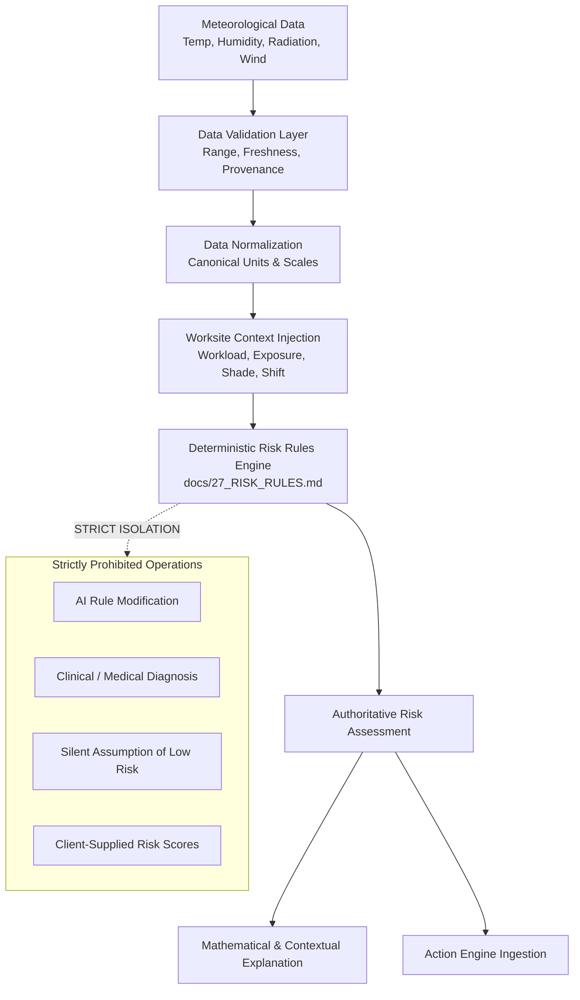

# 91 — Heat Risk Engine Test Specification

```text
Status: Documented
Scope: Hackathon MVP Architecture & Governance
Audience: Software Engineers, QA Engineers, Domain Modelers, Safety Officers
Last Updated: 2026-10-08
```

---

## 1. Document Purpose & Architectural Boundary

The **Heat Risk Engine** is the foundational safety-critical component of the **Heat Action Response Engine**. Its sole architectural mandate is:

> **Convert validated environmental parameters and worksite operational context into an authoritative, explainable, and deterministic heat-risk assessment using versioned domain rules.**



### Safety Boundary Invariants
The Heat Risk Engine is subject to strict negative boundaries:
1. **No Medical Diagnosis:** Does not diagnose heat exhaustion, stroke, dehydration, or medical fitness for duty.
2. **No Data Fabrication:** Does not synthesize or guess missing environmental parameters.
3. **No AI Modification:** AI models are strictly prohibited from calculating, altering, or overriding risk scores.
4. **No Forecast-as-Observation Conflation:** Weather predictions are strictly segregated from live observational sensors.
5. **No Silent Downgrade:** Degraded, stale, or missing data must never default to a `LOW` risk state.

---

## 2. Input Specifications

The test harness must validate engine behavior across three input categories:

### 2.1 Environmental Telemetry Inputs
* **Dry-Bulb Temperature ($T$):** Decimal degrees Celsius (°C). Valid domain: $-10.0^\circ\text{C}$ to $+65.0^\circ\text{C}$.
* **Relative Humidity ($RH$):** Percentage ($0\%$ to $100\%$).
* **Apparent Temperature / Heat Index ($HI$):** Derived or computed apparent temperature in °C.
* **Wind Velocity ($v$):** Meters per second ($\text{m/s}$). Valid domain: $0.0$ to $50.0\text{ m/s}$.
* **Direct Solar Radiation ($G$):** Watts per square meter ($\text{W/m}^2$). Valid domain: $0.0$ to $1400.0\text{ W/m}^2$.
* **Data Freshness / Timestamp:** ISO 8601 UTC timestamp. Must meet freshness thresholds ($\le 60\text{ minutes}$ for live operations).
* **Source & Provenance:** Source identifier (`OPEN_METEO`, `IMD`, `ON_SITE_IOT`, `SYNTHETIC_SIMULATION`).
* **Source Telemetry Type:** Explicit classification (`OBSERVATION` vs. `FORECAST`).

### 2.2 Worksite Contextual Inputs
* **Location Profile:** `OUTDOOR_DIRECT_SUN`, `OUTDOOR_SHADED`, `INDOOR_UNCONDITIONED`, `INDOOR_AIR_CONDITIONED`.
* **Metabolic Workload Category:** `LIGHT` ($<200\text{ W}$), `MODERATE` ($200-350\text{ W}$), `HEAVY` ($>350\text{ W}$), `VERY_HEAVY` ($>500\text{ W}$), or `UNKNOWN`.
* **Active Shade Infrastructure:** `ADEQUATE_PERMANENT`, `PORTABLE_CANOPY_ACTIVE`, `INADEQUATE_OR_NONE`.
* **Active Hydration Infrastructure:** `ON_SITE_CHILLED_WATER`, `ELECTROLYTE_STATION`, `LIMITED_OR_ABSENT`.
* **Clothing / PPE Barrier:** `STANDARD_COTTON_COVERALLS`, `VAPOR_BARRIER_HAZMAT`, `HEAVY_LEATHER_WELDING`, `NONE_SPECIFIED`.
* **Acclimatization Cohort Status:** `ACCLIMATIZED`, `UNACCLIMATIZED`, `MIXED_CREW`, `UNKNOWN`.

### 2.3 Rule Configuration Metadata
* **Rule Catalog Identifier:** e.g., `RULESET_INDIA_IMD_V1` or `RULESET_OSHA_NIOSH_V2`.
* **Semantic Rule Version:** e.g., `1.2.0`.

---

## 3. Output Schema & Invariants

All outputs generated by the risk engine must strictly conform to the contract defined in [73_RISK_API.md](file:///d:/Amazon%202nd%20Hackathon%20Heat/docs/73_RISK_API.md):

```json
{
  "risk_assessment_id": "RA-20261008-0914-BLR",
  "worksite_id": "SITE-BLR-001",
  "assessment_time": "2026-10-08T09:15:00Z",
  "risk_level": "HIGH",
  "data_quality": "VALID",
  "risk_factors": [
    {
      "factor_type": "ENVIRONMENTAL_HEAT_INDEX",
      "measured_value": 39.4,
      "unit": "CELSIUS",
      "threshold_breached": 38.0,
      "severity_contribution": "HIGH"
    },
    {
      "factor_type": "METABOLIC_WORKLOAD",
      "measured_value": "HEAVY",
      "threshold_breached": "MODERATE",
      "severity_contribution": "ELEVATED"
    }
  ],
  "explanation": "High thermal stress detected. Ambient Heat Index of 39.4°C combined with heavy manual labor exceeds continuous safe exposure limits.",
  "rule_version": "1.2.0",
  "source_context": {
    "primary_source": "IMD_STATION_43295",
    "source_type": "OBSERVATION",
    "observation_age_seconds": 720
  }
}
```

### Permitted Risk Level Enumeration
The engine must strictly emit one of the five canonical risk tiers (`docs/26_RISK_LEVELS.md`):
* **`LOW`**
* **`MODERATE`**
* **`HIGH`**
* **`CRITICAL`**
* **`UNKNOWN`**

---

## 4. Rule Determinism & Idempotency Testing

A core safety property of the engine is mathematical determinism:

$$\forall (E, C, R), \quad f(E, C, R) = f(E, C, R)$$

* Given identical Environmental inputs ($E$), Worksite Context ($C$), and Rule Version ($R$), the engine must emit the **identical risk level, risk factors, and reason codes**.
* The test harness executes $1,000$ iterations of identical input payloads across multiple execution threads to verify zero non-deterministic race conditions or floating-point divergences.

---

## 5. Threshold Boundary Testing ($\pm \epsilon$)

Boundary testing validates transitions at authoritative threshold cutoffs defined in `docs/27_RISK_RULES.md`.

```text
                     THRESHOLD BOUNDARY EVALUATION:
                  
     T - 0.01°C                    T                   T + 0.01°C
─────────●─────────────────────────●───────────────────────●─────────► Heat Index
     [Tier N]                  [Tier N+1]              [Tier N+1]
 (e.g. MODERATE)              (e.g. HIGH)             (e.g. HIGH)
```

### Boundary Test Suite Execution
1. **Infinitesimal Margin Testing:** Test inputs must include $T - \epsilon$, $T$, and $T + \epsilon$ where $\epsilon = 0.001$.
2. **No Operator Inversion:** Verify that inclusive operators (`>=`) vs. exclusive operators (`>`) match the exact specification in the rule definitions.
3. **No Hardcoded Constants:** Test scripts must load thresholds dynamically from the active rule configuration file to prevent specification drift.

---

## 6. Data Quality & Fault Resiliency Tests

The engine must handle corrupted, degraded, and missing telemetry without compromising worker safety:

```text
┌───────────────────────┬──────────────────────┬──────────────────────────────────────────┐
│ DATA QUALITY STATE    │ TELEMETRY CONDITION  │ EXPECTED RISK ENGINE BEHAVIOR            │
├───────────────────────┼──────────────────────┼──────────────────────────────────────────┤
│ VALID                 │ Fresh, in-bounds data│ Normal deterministic rule evaluation     │
├───────────────────────┼──────────────────────┼──────────────────────────────────────────┤
│ MISSING               │ Missing RH or Temp   │ Emit UNKNOWN; flag DATA_MISSING; alert   │
├───────────────────────┼──────────────────────┼──────────────────────────────────────────┤
│ STALE                 │ Age > 60 minutes     │ Retain prior risk; flag DATA_STALE; alert│
├───────────────────────┼──────────────────────┼──────────────────────────────────────────┤
│ INVALID / CORRUPT     │ Temp > 65°C / RH < 0%│ Reject payload; emit UNKNOWN; audit error│
├───────────────────────┼──────────────────────┼──────────────────────────────────────────┤
│ CONFLICTING           │ Provider A ≠ Prov B  │ Detect conflict; apply higher-risk stance│
└───────────────────────┴──────────────────────┴──────────────────────────────────────────┘
```

### Non-Negotiable Axiom:
> **`UNKNOWN` MUST NEVER SILENTLY BECOME `LOW`.**
> A communication blackout or dead sensor is an operational hazard requiring human review, not proof of safety.

---

## 7. Forecast vs. Observation Segregation Tests

The system must maintain strict provenance segregation between historical/current physical sensor observations and meteorological predictive models:

* **Observation Ingestion:** Input marked `source_type: "OBSERVATION"` produces an operational risk assessment authorizing immediate preventative actions.
* **Forecast Ingestion:** Input marked `source_type: "FORECAST"` produces a forward-looking risk projection labeled `source_type: "FORECAST"`.
* **Test Verification:** The test runner must verify that a forecast payload can **never** overwrite an active real-time observation record or clear a live on-site emergency directive.

---

## 8. Contextual Modifier Testing

The engine evaluates environmental heat in combination with operational worksite modifiers:

### 8.1 Metabolic Workload Modifiers
* **Test Case:** Ambient Heat Index is $31.0^\circ\text{C}$ (`MODERATE`).
  * With `workload: "LIGHT"` $\rightarrow$ Evaluates to `MODERATE`.
  * With `workload: "HEAVY"` $\rightarrow$ Triggers contextual escalation to `HIGH`.
  * With `workload: "UNKNOWN"` $\rightarrow$ Evaluates to `MODERATE` with contextual warning `WORKLOAD_UNCONFIRMED`.

### 8.2 Direct Sun & Shade Availability Modifiers
* **Test Case:** Ambient Heat Index is $37.5^\circ\text{C}$ (`MODERATE`).
  * With `location: "OUTDOOR_DIRECT_SUN"` and `shade: "NONE"` $\rightarrow$ Adds radiant solar offset ($+2.0^\circ\text{C}$ to $+3.5^\circ\text{C}$ effective index) $\rightarrow$ Escalates to `HIGH`.
  * With `location: "OUTDOOR_SHADED"` $\rightarrow$ Remains `MODERATE`.

### 8.3 PPE / Vapor Barrier Modifiers
* **Test Case:** Ambient Heat Index is $29.0^\circ\text{C}$ (`LOW`).
  * With `clothing_barrier: "VAPOR_BARRIER_HAZMAT"` $\rightarrow$ Thermal dissipation severely impeded $\rightarrow$ Triggers protective override to `HIGH`.

---

## 9. Acclimatization Testing

Where workforce acclimatization tracking is enabled:
* **Unacclimatized Cohort:** Workers on days 1–5 of high-heat exposure have reduced sweat response and narrower cardiovascular margins. The engine must evaluate rules flagged with `ACCLIMATIZATION_RESTRICTION`, triggering earlier work-rest cycles.
* **Missing Acclimatization Data:** Defaults to `UNCONFIRMED`, logging a recommendation for supervisory review without asserting medical fitness.

---

## 10. Explainability & Reason Code Verification

For every completed evaluation, the engine must supply human-readable and machine-parseable justification strings:
1. **Factor Breakdown:** Every breached threshold must be itemized in the `risk_factors` array.
2. **Plain-Language Summary:** A synthesized narrative must clearly explain *why* the risk was assessed at this tier without using medical diagnostic terminology.
3. **Auditability:** Output must link directly to the originating `rule_version`.

---

## 11. Security & Anti-Tamper Guardrail Tests

The test harness must verify that the Risk Engine cannot be manipulated by untrusted actors:
* **Attempted Client Risk Injection:** Sending `{ "risk_level": "LOW" }` in the request body to `/api/v1/risk/evaluate` is ignored or rejected; backend calculates risk purely from telemetry.
* **Attempted AI Override:** Injecting generative AI prompt text cannot modify the deterministic evaluation path.
* **Simulation Mode Isolation:** Scenarios executed with `is_simulation: true` are tagged explicitly and cannot overwrite real-world worksite risk assessments.

---

## 12. Safety-Critical Engine Invariants

Every build of the Heat Risk Engine must maintain these formal invariants:

```text
================================================================================
HEAT RISK ENGINE INVARIANTS
================================================================================
I-01: Invalid or physically impossible input CANNOT produce an authoritative VALID risk.
I-02: Generative AI output CANNOT alter the authoritative risk level.
I-03: Client-supplied risk claims are NEVER authoritative.
I-04: Historical risk assessments MUST retain rule-version attribution.
I-05: UNKNOWN data state CANNOT silently default to LOW risk.
I-06: FORECAST data CANNOT be represented as a live physical OBSERVATION.
I-07: SIMULATION data CANNOT pollute live compliance audit records.
I-08: The engine MUST produce identical output given identical input and rule version.
================================================================================
```

---

## 13. Master Risk Engine Test Matrix

| Test ID | Test Scenario | Input Vector | Expected Behavior | Safety Property |
| :--- | :--- | :--- | :--- | :--- |
| **RISK-001** | Valid Baseline Low Risk | Temp 22°C, RH 40%, Light work | Evaluates to `LOW`; baseline advisory | Determinism |
| **RISK-002** | Valid Moderate Risk Threshold | Heat Index 33.5°C, Moderate work | Evaluates to `MODERATE`; hydration factor | Accuracy |
| **RISK-003** | Valid High Risk Threshold | Heat Index 39.2°C, Heavy work | Evaluates to `HIGH`; rest-cycle factor | Worker Safety |
| **RISK-004** | Valid Critical Risk Threshold | Heat Index 44.8°C, Heavy work | Evaluates to `CRITICAL`; urgent alert | Worker Safety |
| **RISK-005** | Missing Temperature Parameter | RH 60%, Temp `null` | Emits `UNKNOWN`; logs `DATA_MISSING` | No Fabrication |
| **RISK-006** | Missing Humidity Parameter | Temp 38°C, RH `null` | Emits `UNKNOWN`; logs `DATA_MISSING` | No Fabrication |
| **RISK-007** | Stale Observation Ingestion | Age: 180 min, Temp 40°C | Retains risk; sets `data_quality: STALE` | Stale Visibility |
| **RISK-008** | Physically Impossible Temp High | Temp 85.0°C, RH 50% | Rejects input; emits `UNKNOWN` | Out-of-Bounds Check |
| **RISK-009** | Physically Impossible Temp Low | Temp -45.0°C in tropical site | Rejects input; emits `UNKNOWN` | Out-of-Bounds Check |
| **RISK-010** | Physically Impossible Humidity | Temp 30°C, RH 105% | Rejects input; emits `UNKNOWN` | Range Validation |
| **RISK-011** | Lower Boundary ($T - \epsilon$) | Threshold 38.0°C; Input 37.99°C | Evaluates to `MODERATE` | Precise Boundary |
| **RISK-012** | Exact Threshold ($T$) | Threshold 38.0°C; Input 38.00°C | Evaluates to `HIGH` | Exact Equality |
| **RISK-013** | Upper Boundary ($T + \epsilon$) | Threshold 38.0°C; Input 38.01°C | Evaluates to `HIGH` | Precise Boundary |
| **RISK-014** | Heavy Workload Escalation | Heat Index 31°C + Heavy Workload | Escalates from `MODERATE` to `HIGH` | Context Sensitivity |
| **RISK-015** | Solar Radiant Offset | Outdoor Direct Sun, zero shade | Adds radiant penalty; elevates tier | Context Sensitivity |
| **RISK-016** | Impermeable PPE Barrier | Low ambient heat + Hazmat gear | Escalates to `HIGH` due to vapor trap | PPE Awareness |
| **RISK-017** | Conflicting Data Providers | Provider A: 28°C; Provider B: 42°C | Flags conflict; takes higher-risk tier | Conservative Safety |
| **RISK-018** | Forecast Ingestion Segregation | Input `source_type: FORECAST` | Outputs forecast projection; no live override | Provenance Guard |
| **RISK-019** | Idempotency Verification | 1,000 iterations identical input | 1,000 identical results; zero variance | Strict Idempotency |
| **RISK-020** | Adversarial Client Injection | Client sends `{ risk_level: "LOW" }`| Ignored; server recomputes true tier | Anti-Tamper |

---

## 14. Test Execution Status & Verification

| Test Suite Category | Suite Identifier | Test Count | Current Status |
| :--- | :--- | :--- | :--- |
| Mathematical & Deterministic Rules | `TEST-SUITE-RISK-MATH` | 42 | Planned |
| Boundary & Epsilon Thresholds | `TEST-SUITE-RISK-BOUND` | 18 | Planned |
| Data Quality & Fault Injection | `TEST-SUITE-RISK-FAULT` | 24 | Planned |
| Worksite Context & Modifiers | `TEST-SUITE-RISK-CTX` | 30 | Planned |
| Provenance & Security Invariants | `TEST-SUITE-RISK-SEC` | 16 | Planned |

---

## 15. Summary Architectural Conclusion

The Heat Risk Engine is engineered to be **strictly deterministic, mathematically transparent, and resilient to degraded inputs**. By rejecting AI authority, enforcing strict boundary testing, and refusing to turn missing data into a false reassurance of safety, the engine provides an unshakeable foundation for all downstream worksite actions and legal compliance records.
