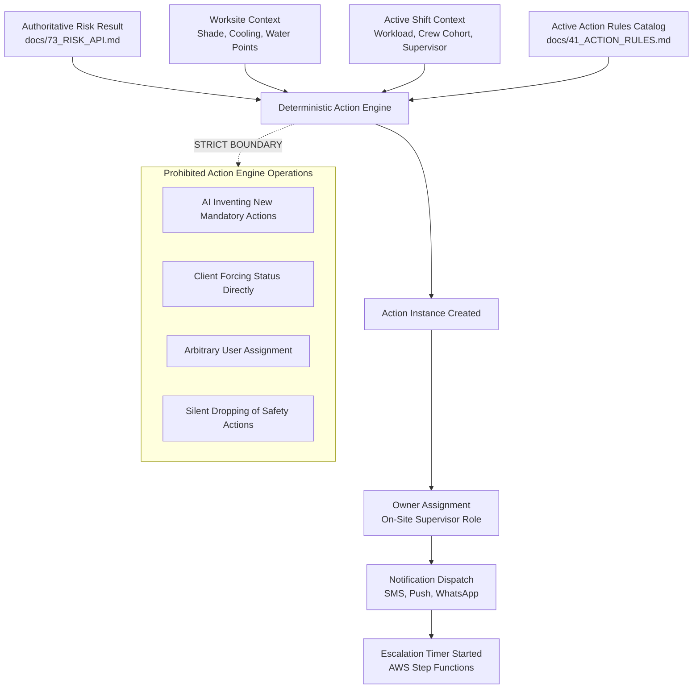
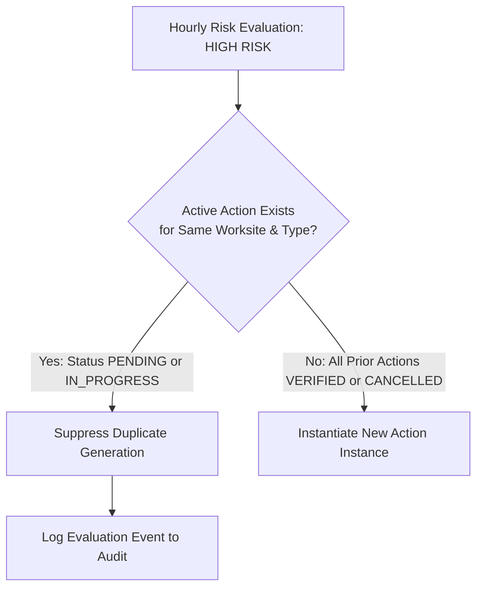
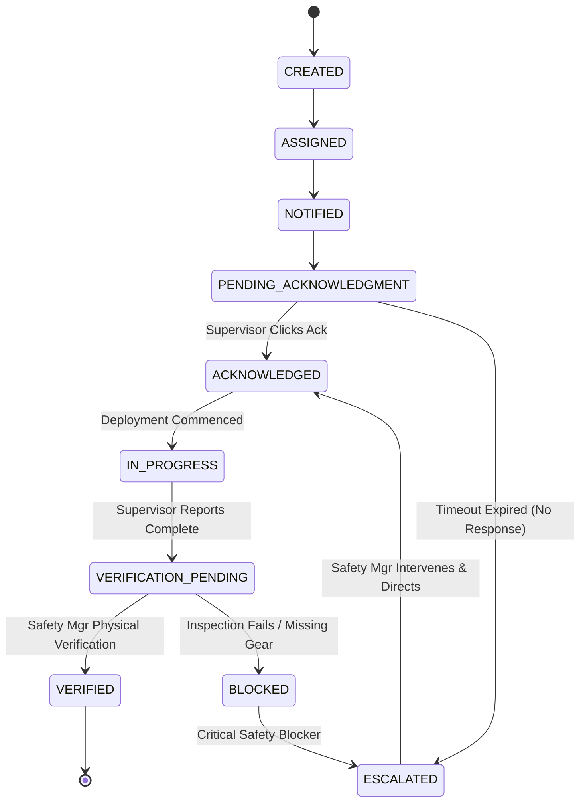

# 92 — Action Engine Test Specification

```text
Status: Documented
Scope: Hackathon MVP Architecture & Governance
Audience: Software Engineers, QA Engineers, Safety Directors, Workflow Designers
Last Updated: 2026-10-08
```

---

## 1. Document Purpose & Architectural Boundary

The **Action Engine** is the operational translation layer of the **Heat Action Response Engine**. Its core mission is:

> **Convert authoritative, deterministic heat-risk assessments and operational worksite context into discrete, site-specific, accountable preventative safety actions.**



### Critical Operational Boundary
The Action Engine operates deterministically:
1. **No Arbitrary Action Generation:** Actions are instantiated exclusively from pre-configured, versioned action rules (`docs/41_ACTION_RULES.md`).
2. **No AI Safety Supremacy:** Generative AI is prohibited from creating, removing, or re-prioritizing mandatory actions.
3. **No Unassigned Actions:** Every created action must have an identified, authorized supervisor owner or immediately trigger an `UNASSIGNED_ACTION_EXCEPTION` escalation.
4. **No Acknowledgment $\rightarrow$ Verification Conflation:** Supervisor acknowledgment of assignment is never treated as physical verification of safety controls.

---

## 2. Input Specifications

The test harness must validate action generation across the following structured inputs:

### 2.1 Risk Ingestion Payload
* `risk_assessment_id`: UUID / formatted string identifier.
* `risk_level`: Authoritative tier (`LOW`, `MODERATE`, `HIGH`, `CRITICAL`, `UNKNOWN`).
* `risk_factors`: Array of breached environmental and metabolic thresholds.
* `rule_version`: Semantic version of the originating risk rule.

### 2.2 Worksite Contextual Record
* `worksite_id`: Unique worksite identifier.
* `facility_type`: `OUTDOOR_CONSTRUCTION`, `AGRICULTURAL_FIELD`, `WAREHOUSE_LOGISTICS`, `MANUFACTURING_PLANT`.
* `shade_status`: `AVAILABLE_PERMANENT`, `PORTABLE_CANOPY_ACTIVE`, `INADEQUATE_OR_NONE`.
* `cooling_status`: `MISTING_ACTIVE`, `HVAC_AIR_CONDITIONED`, `NONE`.
* `hydration_status`: `PLUMBED_STATION`, `DISPENSER_CHILLED`, `REMOTE_HAULED`, `DEFICIENT`.

### 2.3 Operational Shift Record
* `shift_id`: Active shift identifier.
* `workload_intensity`: `LIGHT`, `MODERATE`, `HEAVY`, `VERY_HEAVY`.
* `assigned_supervisor_id`: User ID of on-duty supervisor (e.g., `USR-RAHUL-KUMAR`).
* `active_crew_count`: Integer count of workers exposed on site.
* `shift_start_time` / `shift_end_time`: ISO 8601 UTC timestamps.

### 2.4 Action Rule Configuration
* Active ruleset loaded from configuration store (`rule_catalog_version: "1.0.0"`).

---

## 3. Output Schema & Contract Alignment

Outputs instantiated by the Action Engine must strictly comply with the contracts defined in [74_ACTION_API.md](file:///d:/Amazon%202nd%20Hackathon%20Heat/docs/74_ACTION_API.md) and [16_ACTION_MODEL.md](file:///d:/Amazon%202nd%20Hackathon%20Heat/docs/16_ACTION_MODEL.md):

```json
{
  "action_id": "ACT-20261008-0915-BLR-01",
  "worksite_id": "SITE-BLR-001",
  "shift_id": "SHF-BLR-DAY-01",
  "risk_event_id": "RA-20261008-0914-BLR",
  "action_type": "SHADE_COOLING_READINESS",
  "title": "Deploy Shaded Rest Area and Active Canopy",
  "description": "High thermal stress window detected. Erect portable canopies with chilled water dispensing within 50 meters of outdoor work crews.",
  "priority": "HIGH",
  "owner": {
    "user_id": "USR-RAHUL-01",
    "role": "SUPERVISOR",
    "name": "Rahul Kumar"
  },
  "status": "PENDING_ACKNOWLEDGMENT",
  "response_deadline": "2026-10-08T09:30:00Z",
  "source_rule_id": "AR-SHADE-002",
  "rule_version": "1.0.0",
  "verification_required": true,
  "created_at": "2026-10-08T09:15:02Z"
}
```

### Canonical Action Types Taxonomy
The test suite validates actions matching the nine established system types:
1. **`HYDRATION_READINESS`:** Staging, verification, and replenishment of potable water and electrolytes.
2. **`SHADE_COOLING_READINESS`:** Deployment of shade structures, misting fans, or cooled shelters.
3. **`SUPERVISOR_BRIEFING`:** Conducting mandatory on-site toolbox talks on heat illness symptoms.
4. **`WORK_REST_PLAN_REVIEW`:** Enforcing structured work-rest cycles (e.g., 45 min work / 15 min rest).
5. **`TASK_RESCHEDULING_REVIEW`:** Shifting high-metabolic tasks to cooler morning/evening hours.
6. **`WORKSITE_CHECK`:** Conducting physical walk-throughs to observe worker heat strain.
7. **`CREW_COMMUNICATION`:** Broadcasting safety notices across radios or mobile channels.
8. **`RISK_REASSESSMENT`:** Triggering on-site microclimate measurements.
9. **`SAFETY_MANAGER_REVIEW`:** Administrative escalation review for unresolved extreme-heat events.

---

## 4. Action Rule Determinism & Idempotency Testing

The Action Engine must behave with 100% mathematical determinism:

$$\forall (R, W, S, \text{Catalog}), \quad \text{Actions}_{\text{generated}} = \text{Identical Action Set}$$

* **Idempotency Test:** Evaluating the same `risk_event_id` and worksite context multiple times must yield the identical set of action types, priorities, and deadlines.
* **No Spurious Variations:** Titles, rule linkages, and priority levels cannot fluctuate across evaluations.

---

## 5. Site-Specific Action Generation Testing

A core failure of primitive alerting systems is broadcasting identical generic warnings regardless of worksite conditions. The Action Engine test suite explicitly verifies site-specific variation:

```text
SCENARIO COMPARISON: IDENTICAL HIGH HEAT RISK (Heat Index 40.0°C)
─────────────────────────────────────────────────────────────────────────────
WORKSITE A: Outdoor Construction Site (Direct Sun, Heavy Work, No Shade)
  ├── Action 1: SHADE_COOLING_READINESS (Priority: HIGH) -> Deploy portable canopy
  ├── Action 2: HYDRATION_READINESS     (Priority: HIGH) -> Haul mobile chilled water
  └── Action 3: WORK_REST_PLAN_REVIEW   (Priority: HIGH) -> Mandate 45/15 rest cycle

WORKSITE B: Indoor Logistics Warehouse (Covered, Light Forklift, Shaded)
  ├── Action 1: HYDRATION_READINESS     (Priority: MEDIUM) -> Restock breakroom cooler
  └── Action 2: CREW_COMMUNICATION      (Priority: LOW)    -> Radio broadcast alert
─────────────────────────────────────────────────────────────────────────────
```

### Verification Criteria
The test harness validates that Worksite A receives aggressive physical engineering controls, while Worksite B receives administrative and communication controls tailored to its existing indoor infrastructure.

---

## 6. Supervisor Assignment & Ownership Tests

Every generated action must have a traceable, responsible human owner:
1. **Valid Assignment:** Actions generated for Worksite X during Shift Y must be assigned to the specific `SUPERVISOR` registered for that shift.
2. **Role Verification:** The assigned owner must hold the `SUPERVISOR` or `SAFETY_MANAGER` role; assignments to arbitrary roles (`WORKER`, `EXTERNAL_VIEWER`) are blocked.
3. **Missing Owner Exception:** If a worksite has no supervisor assigned to the active shift:
   * The Action Engine instantiates the action with `owner: null`.
   * Immediately sets `status: ESCALATED`.
   * Dispatches an urgent `UNASSIGNED_WORKSITE_ALERT` to the tenant Safety Manager.

---

## 7. Action Deduplication & Suppression Testing

To prevent supervisory alert fatigue, the Action Engine must prevent uncontrolled duplicate actions during repeated risk assessment cycles:



### Deduplication Test Cases
* **Test Case ACT-DEDUP-01:** High risk is assessed at 10:00 AM $\rightarrow$ Action `ACT-01` (`SHADE_COOLING_READINESS`) created in `PENDING_ACKNOWLEDGMENT`.
* **Test Case ACT-DEDUP-02:** High risk re-assessed at 10:15 AM $\rightarrow$ Action Engine detects active unacknowledged `ACT-01` of identical type $\rightarrow$ Suppresses duplicate; updates `last_evaluated_at` timestamp on `ACT-01`.
* **Test Case ACT-DEDUP-03:** Risk elevates from `HIGH` to `CRITICAL` at 10:30 AM $\rightarrow$ Action Engine instantiates new `CRITICAL` priority emergency curtailment action.

---

## 8. Action State Machine Lifecycle Testing

The lifecycle of an action must enforce strictly valid, unidirectional state machine transitions:



### Invalid Transition Rejections
The test suite must verify that illegal state jumps are rejected with HTTP 409 Conflict:
* `PENDING_ACKNOWLEDGMENT` $\rightarrow$ `VERIFIED` (Illegal: cannot skip acknowledgment and physical deployment).
* `CREATED` $\rightarrow$ `VERIFIED` (Illegal: cannot skip assignment and notification).
* `VERIFIED` $\rightarrow$ `PENDING_ACKNOWLEDGMENT` (Illegal: terminal states cannot be reopened).

---

## 9. Acknowledgment Testing

Supervisor acknowledgment establishes operational accountability:
* **Authorization Check:** Only the assigned supervisor or a tenant Safety Manager can submit `/acknowledge`.
* **Cryptographic Token Verification:** Webhook/mobile clicks must provide valid, single-use signed tokens (`docs/84_SECRETS.md`).
* **Timer Cancellation:** A successful acknowledgment atomically dispatches a `CancelTimer` command to the associated Step Function execution.
* **Audit Recording:** Emits an immutable `ACTION_ACKNOWLEDGED` audit record containing user ID, IP address, and timestamp.

---

## 10. Escalation Testing

When on-site personnel fail to respond, the escalation engine takes over:
* **Timeout Precision:** Escalation triggers when current time $\ge \text{response\_deadline}$.
* **Orchestration Execution:** AWS Step Functions fires the escalation Lambda, updating action status to `ESCALATED` and notifying regional leadership.
* **Live vs. Demo Timing:**
  * **Production Mode:** Timeout configured per company policy (e.g., $15\text{ minutes}$ for `HIGH`, $5\text{ minutes}$ for `CRITICAL`).
  * **Simulation Mode:** Timeout compressed to $30\text{ seconds}$ for live demonstration purposes.
* **Safety Principle:** Escalation remains persistently active until explicitly resolved by an authorized Safety Manager.

---

## 11. Verification Testing

Verification confirms that physical engineering controls are in place on site:
* **Role Enforcement:** Only users holding `SAFETY_MANAGER` or `AUDITOR` permissions can verify actions. Supervisors are barred from self-verifying.
* **Evidence Validation:** Requests to `/verify` must provide verification method (`PHYSICAL_INSPECTION`, `PHOTO_EVIDENCE`, `CHECKLIST_CONFIRMATION`) and operational notes.
* **Non-Medical Boundary:** The API and UI must clearly indicate that `VERIFIED` reflects administrative deployment, not an individual worker medical clearance.

---

## 12. Generative AI Safety Boundary Tests

The test suite ensures that AI services adhere to strict assistive roles:
* **No AI State Changes:** Sending an AI-generated payload to alter action status without going through authenticated REST endpoints is impossible.
* **No AI Priority Inflation/Deflation:** Prompts attempting to downgrade action priority from `CRITICAL` to `LOW` are blocked.
* **Assistive Enrichment Only:** AI is permitted only to generate briefing scripts, translate instructions into vernacular languages, or summarize active actions for morning standups (`docs/87_AI_SAFETY.md`).

---

## 13. Safety-Critical Action Invariants

All builds of the Action Engine must satisfy the following formal invariants:

```text
================================================================================
ACTION ENGINE INVARIANTS
================================================================================
A-01: No authoritative risk assessment -> No authoritative preventative actions.
A-02: Generative AI output CANNOT alter authoritative action state.
A-03: Clients CANNOT directly force action status without valid state progression.
A-04: Every action MUST have an authorized supervisor owner or enter ESCALATED state.
A-05: Acknowledgment DOES NOT equal physical verification.
A-06: Notification dispatch DOES NOT equal human acknowledgment.
A-07: Escalations MUST maintain cryptographic traceability to the parent action.
A-08: Repeated risk evaluations MUST NOT create uncontrolled duplicate actions.
A-09: Historical action records MUST retain immutable rule-version attribution.
================================================================================
```

---

## 14. Master Action Engine Test Matrix

| Test ID | Test Scenario | Input Vector | Expected Behavior | Safety Property |
| :--- | :--- | :--- | :--- | :--- |
| **ACT-001** | High Risk Outdoor Site | Risk `HIGH`, Outdoor Direct Sun, Heavy Work | Generates `SHADE_COOLING` and `HYDRATION` | Deterministic Safety |
| **ACT-002** | Low Risk Baseline Site | Risk `LOW`, Indoor Office, Light Work | Generates baseline hydration advisory only | Proportionate Response |
| **ACT-003** | Unknown Risk Ingestion | Risk `UNKNOWN` | Generates `RISK_REASSESSMENT` diagnostic action | Safe Fallback |
| **ACT-004** | Site-Specific Shade Context | Outdoor site with zero existing shade | Generates urgent portable canopy mandate | Site Specificity |
| **ACT-005** | Site-Specific Water Context | Remote worksite with hauled water point | Generates water staging verification directive | Site Specificity |
| **ACT-006** | Valid Supervisor Assignment | Worksite SITE-01, Shift SHF-DAY-01 | Action owner assigned to Rahul Kumar | Traceable Ownership |
| **ACT-007** | Missing Shift Supervisor | Worksite with unassigned shift roster | Emits `UNASSIGNED_ACTION`; escalates to Safety Mgr | Fail-Safe Routing |
| **ACT-008** | Unauthorized User Assignment | Request assigns action to `WORKER` role | Rejected HTTP 400 Bad Request | Role Enforcement |
| **ACT-009** | Duplicate Action Suppression | Re-evaluating identical HIGH risk in 10m | Reuses active action; suppresses duplicate | Fatigue Prevention |
| **ACT-010** | Risk Elevation Update | Risk increases from `HIGH` to `CRITICAL` | Generates new emergency curtailment action | Hazard Responsiveness |
| **ACT-011** | Valid Supervisor Acknowledgment| Assigned supervisor clicks signed token link | Status `ACKNOWLEDGED`; aborts Step Fn timer | Accountability |
| **ACT-012** | Unauthorized Acknowledgment | User from Tenant B calls `/acknowledge` | Rejected HTTP 403; preserves pending status | Multi-Tenant Scoping |
| **ACT-013** | Acknowledgment Token Replay | Replaying used acknowledgment token | Rejected HTTP 409 Conflict | Replay Defense |
| **ACT-014** | Escalation on Timeout Expiry | No response within response deadline (15m) | Status `ESCALATED`; alerts Safety Manager | Reliable Escalation |
| **ACT-015** | Demo Escalation Compression | Simulation mode active (`is_simulation: true`)| Step Function fires after 30 seconds | Demo Repeatability |
| **ACT-016** | Supervisor Self-Verification | Supervisor calls `/verify` on own action | Rejected HTTP 403 Forbidden | Separation of Duties |
| **ACT-017** | Valid Safety Manager Verify | Safety Manager submits inspection notes | Status `VERIFIED`; writes audit ledger | Physical Verification |
| **ACT-018** | Illegal State Jump | Calling `/verify` directly on `CREATED` action| Rejected HTTP 409 Conflict | State Integrity |
| **ACT-019** | AI Priority Override Attempt | Prompt attempts to downgrade CRITICAL priority | Ignored; priority governed by deterministic rule | AI Safety Boundary |
| **ACT-020** | Outage Notification Fallback | SMS dispatch fails (telecom gateway 500) | Triggers Push/WhatsApp; flags in UI | Multi-Channel Resiliency |

---

## 15. Cross-Document Testing Architecture

The relationship between the evaluation and testing specifications forms a cohesive verification continuum:

```text
┌────────────────────────────────────────────────────────────────────────┐
│ 90_EVALUATION.md                                                       │
│ Defines WHAT system success means across all 11 operational dimensions.│
└───────────────────────────────────┬────────────────────────────────────┘
                                    │
         ┌──────────────────────────┴──────────────────────────┐
         ▼                                                     ▼
┌───────────────────────────────────┐ ┌───────────────────────────────────┐
│ 91_RISK_ENGINE_TESTS.md           │ │ 92_ACTION_ENGINE_TESTS.md         │
│ Proves environmental inputs and   │ │ Proves authoritative risk is      │
│ worksite context produce true,    │ │ transformed into site-specific,   │
│ deterministic risk assessments.   │ │ accountable, verifiable actions.  │
└─────────────────┬─────────────────┘ └─────────────────┬─────────────────┘
                  │                                     │
                  └──────────────────┬──────────────────┘
                                     ▼
┌────────────────────────────────────────────────────────────────────────┐
│ DOWNSTREAM SYSTEM VALIDATION SPECIFICATIONS                            │
│ • docs/93_API_TESTS.md       : HTTP contracts, auth & error envelopes  │
│ • docs/94_AI_EVALUATION.md   : Prompt injection & medical refusals     │
│ • docs/95_END_TO_END_TESTS.md: Full simulation loop (Rahul -> Ananya)  │
└────────────────────────────────────────────────────────────────────────┘
```

---

## 16. Test Data Safety & Privacy Isolation

All test scripts, automation fixtures, and demonstration scenarios must adhere to strict data safety rules:
* **No Real Worker Telemetry:** Never use real names, phone numbers, or employee IDs in test fixtures. Use canonical personas (e.g., `Rahul Kumar`, `Ananya Rao`).
* **Synthetic Meteorological Fixtures:** Test data must originate from deterministic synthetic JSON fixtures, never unmonitored live feeds during automated CI runs.
* **No Real Credentials:** API keys, database connection strings, and webhook secrets in test files must use mock values (e.g., `mock-secret-token-xyz`).
* **Database Quarantine:** Automated test runs must execute against local DynamoDB Local emulators or dedicated ephemeral test tables tagged `Env: Test`, completely segregated from production partitions.

---

## 17. Test Execution Status Tracking

| Test Suite Category | Suite Identifier | Test Count | Current Status |
| :--- | :--- | :--- | :--- |
| Action Rule Matrix & Mapping | `TEST-SUITE-ACT-RULES` | 36 | Planned |
| Site Specificity & Context Modifiers | `TEST-SUITE-ACT-CTX` | 24 | Planned |
| Supervisor Assignment & RBAC | `TEST-SUITE-ACT-ASSIGN` | 18 | Planned |
| Deduplication & Anti-Fatigue | `TEST-SUITE-ACT-DEDUP` | 14 | Planned |
| State Machine & Lifecycle Transitions | `TEST-SUITE-ACT-STATE` | 28 | Planned |
| Step Functions Escalation Timeouts | `TEST-SUITE-ACT-ESCAL` | 16 | Planned |
| Safety Manager Verification | `TEST-SUITE-ACT-VERIFY` | 12 | Planned |
| AI Boundary Isolation | `TEST-SUITE-ACT-AI-SEC` | 15 | Planned |

---

## 18. Summary Architectural Conclusion

The Action Engine Test Specification guarantees that the system delivers on its core promise: **transforming ambient heat warnings into verified on-site workplace actions**. By enforcing mathematical determinism, preventing alert fatigue through deduplication, guaranteeing single-supervisor accountability, and enforcing strict separation between acknowledgment and physical verification, the platform ensures that preventative workplace interventions are executed with uncompromising operational integrity.
