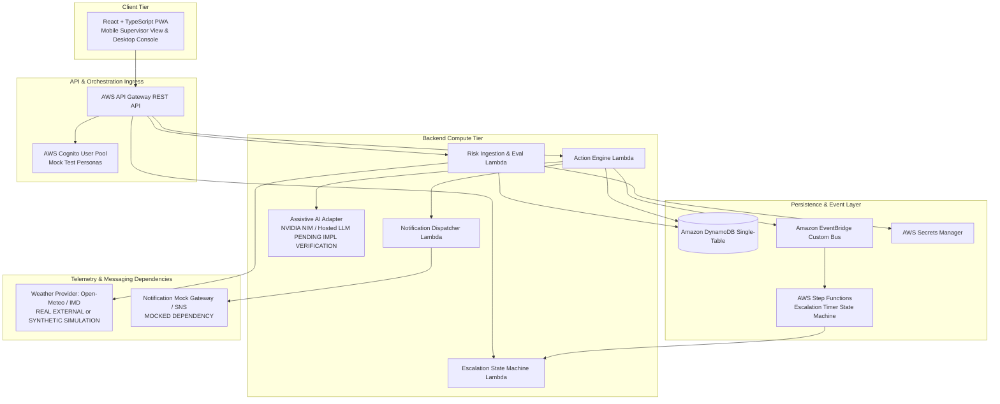

# 95 — End-to-End (E2E) System Test Specification

```text
Status: Documented
Scope: Hackathon MVP Architecture & Governance
Audience: System Architects, QA Engineers, DevOps Engineers, Hackathon Judges
Last Updated: 2026-10-08
```

---

## 1. Document Purpose & Operational Scope

This specification defines the complete system-level integration and operational testing framework for the **Heat Action Response Engine**. 

### Core Product Mandate
The mission of the platform is:
> **From heat warning to verified workplace action.**

While unit, domain, and API tests evaluate isolated microservices, the End-to-End (E2E) test suite validates that the entire system functions cohesively as an asynchronous, distributed, and human-supervised operational engine:

```text
WEATHER TELEMETRY (Live or Synthetic Ingest)
       ↓
INGRESS VALIDATION & NORMALIZATION
       ↓
DETERMINISTIC HEAT RISK ENGINE (Evaluates Threat Level)
       ↓
WORKSITE CONTEXT INJECTION (Shade, Cooling, Hydration, Shift)
       ↓
DETERMINISTIC ACTION ENGINE (Generates Specific Directives)
       ↓
SUPERVISOR ASSIGNMENT (Single Point of Accountability)
       ↓
MULTI-CHANNEL NOTIFICATION (SMS / Web Push / WhatsApp)
       ↓
SUPERVISOR ACKNOWLEDGMENT (Signed Token / Mobile Response)
       ↓
AUTOMATED ESCALATION (Step Functions Timeout if Unanswered)
       ↓
SAFETY MANAGER RESOLUTION & PHYSICAL VERIFICATION
       ↓
IMMUTABLE AUDIT RECORD (DynamoDB Compliance Ledger)
```

---

## 2. E2E Environment & Topology

The E2E test environment mirrors the production serverless cloud topology with explicit dependency labeling:



### Dependency Classification Rules
All E2E test scenarios must explicitly distinguish between data provenance classes:
1. **`REAL EXTERNAL DATA`:** Live HTTP telemetry ingested from real-world Open-Meteo or IMD endpoints for production verification.
2. **`SYNTHETIC SIMULATION DATA`:** Controlled, reproducible JSON scenarios injected via `docs/38_SIMULATION_MODE.md` for deterministic test assertions.
3. **`MOCKED DEPENDENCY`:** Telecommunications aggregators (SMS/WhatsApp) and external LLM endpoints replaced with deterministic mock stubs.

---

## 3. Core Happy Path E2E Lifecycle Walkthrough

The primary end-to-end test executes the full operational cycle from environmental trigger through physical verification and audit logging:

```text
================================================================================
E2E HAPPY PATH EXECUTION TRACE (SCENARIO E2E-001)
================================================================================
STEP 01: Pre-Condition Setup
         - Worksite "North Bengaluru Construction Site" active in database.
         - Supervisor "Rahul Kumar" assigned to active Day Shift.
         - Safety Manager "Ananya Rao" active in regional tenant scope.

STEP 02: Weather Signal Ingestion
         - Telemetry ingested: Temp 38.5°C, RH 60% (Heat Index 39.4°C).
         - Ingress schema validator confirms values are within physical bounds.

STEP 03: Deterministic Risk Assessment
         - Heat Risk Engine evaluates rule matrix -> Evaluates to HIGH RISK.
         - Assessment record RA-20261008-01 created and committed to DynamoDB.

STEP 04: Action Generation & Assignment
         - Action Engine combines HIGH risk + Outdoor Direct Sun + Heavy Labor.
         - Instantiates Action ACT-001 (SHADE_COOLING_READINESS).
         - Assigns Action ACT-001 strictly to Rahul Kumar (SUPERVISOR).
         - Sets response_deadline = Now + 15 min (Live) or Now + 30s (Demo).

STEP 05: Multi-Channel Notification
         - Notification event published to EventBridge.
         - Dispatcher formats high-priority SMS & Web Push containing signed HMAC token.

STEP 06: Simulated Non-Response & Timeout Expiry
         - Rahul Kumar does NOT click acknowledgment before deadline expires.
         - AWS Step Functions timer fires Execution Timeout event.

STEP 07: Automated Operational Escalation
         - Action status transitions atomically: PENDING_ACKNOWLEDGMENT -> ESCALATED.
         - High-priority escalation notification routed immediately to Ananya Rao.
         - Escalation record ESC-001 created and linked to parent Action ACT-001.

STEP 08: Safety Manager Resolution & Acknowledgment
         - Ananya Rao reviews central command dashboard, calls worksite supervisor.
         - Submits POST /api/v1/escalations/ESC-001/resolve with resolution rationale.
         - Action status transitions to ACKNOWLEDGED; active escalation resolved.

STEP 09: Physical Inspection & Verification
         - Canopies erected and misting station staged physically on site.
         - Ananya Rao calls POST /api/v1/actions/ACT-001/verify with inspection notes.
         - Action status transitions: VERIFICATION_PENDING -> VERIFIED.

STEP 10: Audit Trail Verification
         - E2E harness queries GET /api/v1/audit/events?correlation_id=corr_123.
         - Confirms 6 discrete, immutable audit events exist in exact chronological order:
           1. RISK_ASSESSED
           2. ACTION_CREATED
           3. NOTIFICATION_DISPATCHED
           4. ESCALATION_TRIGGERED
           5. ESCALATION_RESOLVED
           6. ACTION_VERIFIED
================================================================================
```

---

## 4. Failure & Resilience E2E Scenarios

The system's resilience under adverse conditions is validated through dedicated negative integration suites:

```text
┌─────────────────────────────────┬────────────────────────────────────────────┐
│ E2E FAILURE CONDITION           │ VALIDATED RECOVERY & SYSTEM BEHAVIOR       │
├─────────────────────────────────┼────────────────────────────────────────────┤
│ E2E-FAIL-01: Weather API Drop   │ Risk engine retains last known risk;       │
│ External weather returns 503.   │ displays prominent DATA_STALE alert;       │
│                                 │ NEVER defaults to LOW risk.                │
├─────────────────────────────────┼────────────────────────────────────────────┤
│ E2E-FAIL-02: Corrupted Ingress  │ Ingress validator catches reading; emits   │
│ Ingests 90°C ambient reading.   │ DATA_CORRUPT error; sets risk to UNKNOWN.  │
├─────────────────────────────────┼────────────────────────────────────────────┤
│ E2E-FAIL-03: Telecom Outage     │ Notification dispatcher detects carrier    │
│ Outbound SMS gateway fails.     │ error; retries; routes alert to in-app     │
│                                 │ dashboard panel and Web Push.              │
├─────────────────────────────────┼────────────────────────────────────────────┤
│ E2E-FAIL-04: AI Subsystem Crash │ LLM endpoint times out (>2500ms); system   │
│ NVIDIA NIM / Hosted LLM 500.    │ renders deterministic boilerplate card;   │
│                                 │ core safety workflow completely unaffected.│
├─────────────────────────────────┼────────────────────────────────────────────┤
│ E2E-FAIL-05: Unassigned Shift   │ Action Engine detects null supervisor;     │
│ Worksite has no on-duty lead.   │ creates action in ESCALATED state; alerts  │
│                                 │ Safety Manager immediately.                │
├─────────────────────────────────┼────────────────────────────────────────────┤
│ E2E-FAIL-06: Database Race      │ Two supervisors submit ack simultaneously; │
│ Concurrent clicks on action.    │ DynamoDB conditional write permits one;    │
│                                 │ second receives idempotent confirmation.   │
└─────────────────────────────────┴────────────────────────────────────────────┘
```

---

## 5. Role-Based E2E Persona Workflows

The test suite validates that different user roles operate within strictly segregated operational boundaries:

### 5.1 Persona: Site Supervisor (`SUPERVISOR` Role)
* **Authenticated Persona:** Rahul Kumar.
* **Permitted Capabilities:** Views assigned worksite only, views local active heat directives, acknowledges directives, reports blocked conditions.
* **Prohibited Capabilities:** Cannot view other worksites, cannot verify own actions, cannot alter risk thresholds, cannot access global compliance audit logs.

### 5.2 Persona: Regional Safety Manager (`SAFETY_MANAGER` Role)
* **Authenticated Persona:** Ananya Rao.
* **Permitted Capabilities:** Views all regional worksites, receives automated escalations, resolves unacknowledged actions, performs physical verifications, inspects compliance audit records.
* **Prohibited Capabilities:** Cannot bypass deterministic rules or delete historical audit entries.

### 5.3 Persona: System Administrator (`ADMIN` Role)
* **Authenticated Persona:** System Admin.
* **Permitted Capabilities:** Manages tenant accounts, configures worksite profiles, registers meteorological providers, updates versioned action rule catalogs.
* **Prohibited Capabilities:** Cannot edit or purge immutable audit log partitions.

---

## 6. Audit Trail End-to-End Traceability Verification

Every E2E test scenario concludes by asserting the integrity of the audit partition in DynamoDB:

```json
{
  "audit_event_id": "AUD-20261008-0931-01",
  "correlation_id": "corr_c39b8214-43f1-4876-88a2-192a83e60123",
  "request_id": "req_f81d4fae-7dec-11d0-a765-00a0c91e6bf6",
  "timestamp": "2026-10-08T09:30:15Z",
  "actor": {
    "user_id": "USR-ANANYA-01",
    "role": "SAFETY_MANAGER",
    "email": "ananya.rao@example.com"
  },
  "event_type": "ACTION_VERIFIED",
  "resource_type": "ACTION",
  "resource_id": "ACT-20261008-0915-BLR-01",
  "previous_state": "VERIFICATION_PENDING",
  "new_state": "VERIFIED",
  "worksite_id": "SITE-BLR-001",
  "organization_id": "ORG-CONSTRUCT-01",
  "metadata": {
    "verification_method": "PHYSICAL_INSPECTION",
    "inspection_notes": "Portable canopy erected with 4 misting fans and 200L potable water."
  }
}
```

* **Assertion 1:** Every mutating event preserves the originating `correlation_id`.
* **Assertion 2:** Timestamps are monotonically increasing.
* **Assertion 3:** State transitions record both `previous_state` and `new_state`.
* **Assertion 4:** Actor identity and role are unambiguously recorded.

---

## 7. AI End-to-End Boundary Verification

The E2E test harness explicitly tests the boundary between generative AI and authoritative state:

```text
================================================================================
AI E2E BOUNDARY TEST SCENARIO
================================================================================
1. Risk Engine computes: HIGH RISK.
2. Action Engine instantiates: SHADE_COOLING_READINESS.
3. Supervisor opens mobile client -> AI Briefing Service invoked.
4. AI Service renders: "Supervisors must establish canopy shade due to 39.4°C heat."
5. Test assertion:
   - Does AI output match authoritative action type? -> YES (Grounded)
   - Did AI modify the response deadline? -> NO (Unchanged)
   - Did AI alter the priority? -> NO (Remains HIGH)
   - Did AI alter the supervisor assignment? -> NO (Remains Rahul Kumar)
6. Conclusion: AI acts purely as a presentation-layer communication assistant.
================================================================================
```

---

## 8. Canonical Hackathon Demonstration Scenario (`DEMO-E2E-01`)

For hackathon judging and live product walkthroughs, the system runs the canonical **North Bengaluru Scenario**:

* **Worksite Profile:** North Bengaluru Commercial Hub (`SYNTHETIC DEMO DATA`).
* **Environmental Scenario:** Sudden mid-morning thermal spike (Heat Index 40.2°C).
* **Worksite Context:** Outdoor unshaded rebar installation, heavy metabolic labor.
* **Supervisor:** Rahul Kumar (Mobile PWA).
* **Safety Manager:** Ananya Rao (Command Desktop Dashboard).
* **Accelerated Escalation Timing:** $30\text{ seconds}$ escalation timeout to demonstrate Step Functions in live judging.
* **Demo Visual Isolation:** Distinct visual demonstration badge rendered across all screens.

---

## 9. Master End-to-End Test Matrix

| Test ID | Test Scenario | Preconditions | Executed Steps | Expected Authoritative Result | Failure / Fallback Behavior | Audit Evidence | Status |
| :--- | :--- | :--- | :--- | :--- | :--- | :--- | :--- |
| **E2E-001** | Full Happy Path with Escalation | Worksite & users configured | Ingest high heat $\rightarrow$ Non-response $\rightarrow$ Escalate $\rightarrow$ Verify | Action verified; escalation resolved | Step Function retries on timeout | 6 audit records | Planned |
| **E2E-002** | Rapid Supervisor Acknowledgment | Action in `PENDING_ACK` | Supervisor clicks within 15 seconds | Status updates to `ACKNOWLEDGED` | Step Function timer aborted | Ack event logged | Planned |
| **E2E-003** | Weather Provider Outage | API returns HTTP 503 | Weather refresh poller runs | Retains last risk; sets `DATA_STALE` | System alerts Safety Manager | Quality event logged | Planned |
| **E2E-004** | Out-of-Bounds Weather Reading | Ingest telemetry | Injects 85°C dry-bulb temp | Reading rejected; risk set `UNKNOWN` | Alert displayed on dashboard | Rejection event logged | Planned |
| **E2E-005** | Unassigned Worksite Shift | Worksite has no lead | Ingests high heat $\rightarrow$ Generates action | Action set `ESCALATED`; alerts Safety Mgr | Auto-routes to regional pool | Escalation logged | Planned |
| **E2E-006** | Blocked Action Reporting | Supervisor on site | Supervisor reports "No water truck" | Action marked `BLOCKED`; alerts logistics | Triggers emergency alert | Blocked event logged | Planned |
| **E2E-007** | Unauthorized Verification | Supervisor role | Supervisor calls `/verify` on own action | Rejected HTTP 403 Forbidden | Action state unchanged | Security alert logged | Planned |
| **E2E-008** | Multi-Tenant Data Isolation | User in Org Alpha | Queries worksites in Org Beta | Rejected HTTP 403 / 404 | Zero cross-tenant data leaked | Boundary event logged | Planned |
| **E2E-009** | AI Subsystem Crash | LLM drops offline | User opens action card during AI outage | Standard deterministic card rendered | AI error logged; workflow okay| Fallback event logged | Planned |
| **E2E-010** | Concurrent Acknowledgment Race | Action pending | Two supervisors click same action token | Exactly one succeeds; second receives 409 | DynamoDB lock prevents corruption| Single ack logged | Planned |

---

## 10. Summary Architectural Conclusion

The End-to-End System Test Specification confirms that the Heat Action Response Engine functions as a dependable, mission-critical operational system. By evaluating the **complete operational loop from meteorological alert to physical on-site verification**, the platform guarantees that hazardous workplace heat conditions are met with decisive, accountable, and legally auditable safety interventions.
