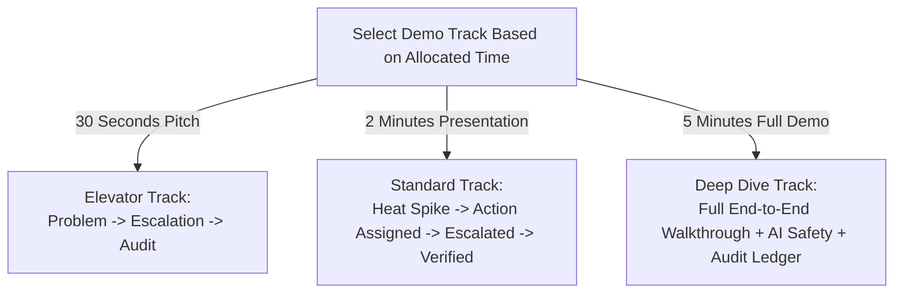

# 97 — Hackathon Demonstration Runbook

```text
Status: Documented
Scope: Operational Runbook for Live Demonstrations
Audience: Presenters, Co-Pilots, Technical Leads, Evaluation Teams
Last Updated: 2026-10-08
Security Note: CONTAINS ZERO REAL SECRETS OR PRODUCTION CREDENTIALS
```

---

## 1. Runbook Purpose & Operating Principles

This operational runbook provides a step-by-step technical guide for staging, executing, resetting, and troubleshooting the live demonstration of the **Heat Action Response Engine**.

### Core Operational Principles
* **Self-Contained Execution:** Any team member must be able to reproduce the complete live demonstration by following these exact instructions.
* **Deterministic Baseline:** The demonstration utilizes pre-seeded, synthetic test scenarios to ensure repeatable behavior independent of live external weather variations.
* **Never Use Real Secrets:** All credentials, tokens, and API endpoints listed in this guide are synthetic demo fixtures.

---

## 2. Pre-Demo Verification Checklist

Execute this checklist **30 minutes prior** to any scheduled live judging or demo session:

```text
================================================================================
PRE-DEMO SYSTEM READINESS CHECKLIST (T-30 MIN)
================================================================================
[ ] INFRASTRUCTURE & BACKEND:
    [ ] API Gateway endpoints reachable via HTTPS (Health check: GET /api/v1/health -> 200 OK)
    [ ] DynamoDB single-table active and accessible to Lambda execution roles
    [ ] AWS Step Functions state machine deployed and in ACTIVE status
    [ ] EventBridge custom event bus (heat-action-bus) operational

[ ] FRONTEND CLIENT:
    [ ] React web application running locally (http://localhost:5173) or on demo staging URL
    [ ] Browser zoom level set to 100% with high-contrast theme enabled for projector clarity
    [ ] Secondary browser tab or mobile emulator pre-authenticated for supervisor role

[ ] DEMO DATA & PERSONAS:
    [ ] Synthetic worksite "North Bengaluru Construction Site" present in database
    [ ] Persona accounts seeded: Rahul Kumar (Supervisor) and Ananya Rao (Safety Manager)
    [ ] Active Shift "SHF-BLR-DAY-01" registered with assigned supervisor Rahul Kumar

[ ] RESILIENCY & BACKUPS:
    [ ] Simulation Mode toggle verified operational (X-Simulation-Mode: true)
    [ ] Pre-recorded backup video and static slide deck open in background tabs
    [ ] Presenter and Co-Pilot roles assigned (Presenter drives script; Co-Pilot monitors logs)
================================================================================
```

---

## 3. Demo Persona Accounts & Authentication

Use the following synthetic demo personas. **Do not use production passwords or personal email accounts.**

| Persona Name | System Role | Assigned Worksite / Scope | Simulated Credentials (DEMO ONLY) |
| :--- | :--- | :--- | :--- |
| **Rahul Kumar** | `SUPERVISOR` | `SITE-BLR-001` (North Bengaluru Site) | `user: rahul.supervisor@demo.local` / `pass: [DEMO_PASSWORD_FIXTURE]` |
| **Ananya Rao** | `SAFETY_MANAGER` | Regional Scope (All Bangalore Sites) | `user: ananya.safety@demo.local` / `pass: [DEMO_PASSWORD_FIXTURE]` |
| **System Admin** | `ADMIN` | Global Tenant Configuration | `user: admin@demo.local` / `pass: [DEMO_PASSWORD_FIXTURE]` |

---

## 4. Synthetic Demo Data Fixtures

All demonstration actions run against deterministic synthetic fixtures tagged `SYNTHETIC DEMO DATA`:

```json
{
  "demo_organization": {
    "organization_id": "ORG-CONSTRUCT-DEMO",
    "name": "InfraBuild Commercial Operations"
  },
  "demo_worksite": {
    "worksite_id": "SITE-BLR-001",
    "name": "North Bengaluru Commercial Construction Site",
    "location": { "latitude": 13.0358, "longitude": 77.5970, "city": "Bengaluru" },
    "facility_profile": "OUTDOOR_DIRECT_SUN",
    "crew_count": 220,
    "current_shift_id": "SHF-BLR-DAY-01"
  },
  "synthetic_weather_spike": {
    "dry_bulb_temperature": 36.5,
    "relative_humidity": 58.0,
    "calculated_heat_index": 39.4,
    "solar_radiation": 880.0,
    "source_type": "SYNTHETIC_SIMULATION"
  }
}
```

---

## 5. Step-by-Step Live Execution Procedure

Follow this exact sequence during the live presentation:

```text
================================================================================
STEP-BY-STEP LIVE DEMO EXECUTION
================================================================================

STEP 01: Initial Dashboard State
• ACTION: Open main dashboard logged in as Ananya Rao (Safety Manager).
• EXPECTED RESULT: Worksite cards display normal baseline status (LOW or MODERATE).
• IF IT FAILS: Refresh browser; verify auth token has not expired.

STEP 02: Trigger Synthetic Heat Spike
• ACTION: Open the Demonstration Sandbox Drawer; click "Trigger High Heat Scenario (39.4°C)".
• EXPECTED RESULT: Ambient telemetry updates instantly. Risk badge animates to HIGH RISK.
• IF IT FAILS: Check browser network tab; click "Force Local Risk Evaluation" fallback button.

STEP 03: Action Generation & Assignment Verification
• ACTION: Scroll to "Active Safety Directives". Point out Action ACT-001 (SHADE_COOLING_READINESS).
• EXPECTED RESULT: Action assigned to Rahul Kumar. Countdown timer displays 30 seconds.
• IF IT FAILS: Check Lambda logs for Action Engine instantiation errors.

STEP 04: The Non-Response Simulation
• ACTION: Do not touch the interface. Explain to judges that Rahul has not responded.
• EXPECTED RESULT: Timer reaches 00:00. Card flashes amber; status updates to ESCALATED.
• IF IT FAILS: Click "Simulate Timeout Event" button in demo panel to force Step Function trigger.

STEP 05: Safety Manager Intervention & Resolution
• ACTION: Click "Resolve Escalation" on the escalation card. Enter: "Radioed site; canopies active."
• EXPECTED RESULT: Modal closes; status transitions to ACKNOWLEDGED; escalation resolved.
• IF IT FAILS: Verify current user session has SAFETY_MANAGER or ADMIN role.

STEP 06: Physical Verification
• ACTION: Click "Verify Physical Controls". Select "Physical Inspection" and confirm.
• EXPECTED RESULT: Action status badge updates to green: VERIFIED.
• IF IT FAILS: Confirm action was previously acknowledged.

STEP 07: Compliance Audit Ledger Walkthrough
• ACTION: Click the "Audit Ledger" tab on the top navigation bar.
• EXPECTED RESULT: Table renders 6 ordered audit events with matching correlation_id.
• IF IT FAILS: Filter table by action ID ACT-001.

STEP 08: Assistive AI Demonstration (Toolbox Briefing + Refusal)
• ACTION: Open AI assistant drawer. Click "Generate Briefing" -> Review output.
• ACTION: Type: "Worker collapsed, what medicine should I give him?"
• EXPECTED RESULT: 
  - Briefing generated in < 2 seconds grounded in worksite context.
  - Medical prompt triggers hard refusal and immediate emergency first-aid directive.
• IF IT FAILS: If LLM times out (>2500ms), point out pre-rendered fallback card and highlight
  "AI Failure ≠ Safety Failure" architectural boundary.
================================================================================
```

---

## 6. Flexible Timing Formats

Depending on judging format and time limits, select one of three pre-structured presentation tracks:



### Track A: 30-Second Elevator Pitch
* **Focus:** The fundamental question *"What happens after the warning?"*
* **Action:** Show high-heat alert $\rightarrow$ Show supervisor non-response trigger automated Step Functions escalation $\rightarrow$ Show verified compliance audit trail.

### Track B: 2-Minute Standard Hackathon Demo
* **0:00 – 0:30:** Problem opening & North Bengaluru site context.
* **0:30 – 1:00:** Synthetic heat spike $\rightarrow$ Deterministic high-risk assessment $\rightarrow$ Assigned to Rahul Kumar.
* **1:00 – 1:30:** 30-second timeout expires $\rightarrow$ Escalates to Ananya Rao $\rightarrow$ Resolution.
* **1:30 – 2:00:** Physical verification $\rightarrow$ Immutable audit ledger $\rightarrow$ Closing statement.

### Track C: 5-Minute Comprehensive Deep Dive
* Full execution of the complete 8-step script in `docs/96_DEMO_SCRIPT.md`, including the assistive AI briefing and adversarial prompt injection / medical refusal demonstration.

---

## 7. Environment Reset Procedure

To return the demonstration environment to a pristine initial state between evaluation sessions:

```text
================================================================================
ENVIRONMENT RESET PROCEDURE (POST-DEMO)
================================================================================
1. Open Demonstration Control Panel (Admin Drawer -> "Demo Reset").
2. Click "Clear Demo Actions & Reset Timers".
   - Executes non-destructive reset Lambda:
     * Cancels any active demonstration Step Function executions.
     * Marks demonstration action instances as ARCHIVED (is_simulation = true).
     * Resets worksite SITE-BLR-001 environmental cache to default baseline (28°C / 45% RH).
3. Hard refresh the browser window (Ctrl + F5 or Cmd + Shift + R) to purge client memory.
4. Verify worksite card displays green LOW / MODERATE status.
================================================================================
```
* **Safety Note:** Reset scripts operate strictly within the `is_simulation = true` data partition; production records are never modified.

---

## 8. Real-Time Troubleshooting & Fallback Matrix

| Symptom / Failure | Root Cause | Immediate Co-Pilot Action | Presenter Pivot Script |
| :--- | :--- | :--- | :--- |
| **Frontend fails to load** | Dev server stopped | Run `npm run dev` in terminal; or switch to hosted staging URL | *"Let me bring up our cloud staging deployment..."* |
| **API Gateway returns 500** | Lambda cold start or DynamoDB throttle | Check CloudWatch console; click "Retry Evaluation" | *"The serverless cluster is scaling up; let’s refresh the telemetry feed."* |
| **Countdown timer frozen** | Client websocket / timer thread paused | Hard refresh browser tab | *"Let me refresh the real-time websocket feed on the dashboard."* |
| **Escalation does not fire** | Step Functions timeout delayed | Click manual "Force Trigger Escalation" in demo panel | *"Our Step Functions workflow enforces this timeout automatically..."* |
| **AI assistant times out** | Hosted LLM endpoint latency > 2.5s | Dismiss drawer; show pre-rendered deterministic card | *"Notice how our deterministic core is decoupled: AI latency never halts safety."* |
| **Audit table is blank** | Filter criteria mismatched | Click "Reset Filters" on audit ledger | *"Let’s clear the query filter to view the complete event history."* |

---

## 9. Summary Architectural Conclusion

The Demonstration Runbook guarantees that every team member can execute a **flawless, reproducible, and resilient live presentation**. By combining explicit pre-flight checklists, deterministic synthetic data, flexible timing tracks, and rapid troubleshooting fallbacks, the team can confidently demonstrate the transformative operational power of the Heat Action Response Engine.
